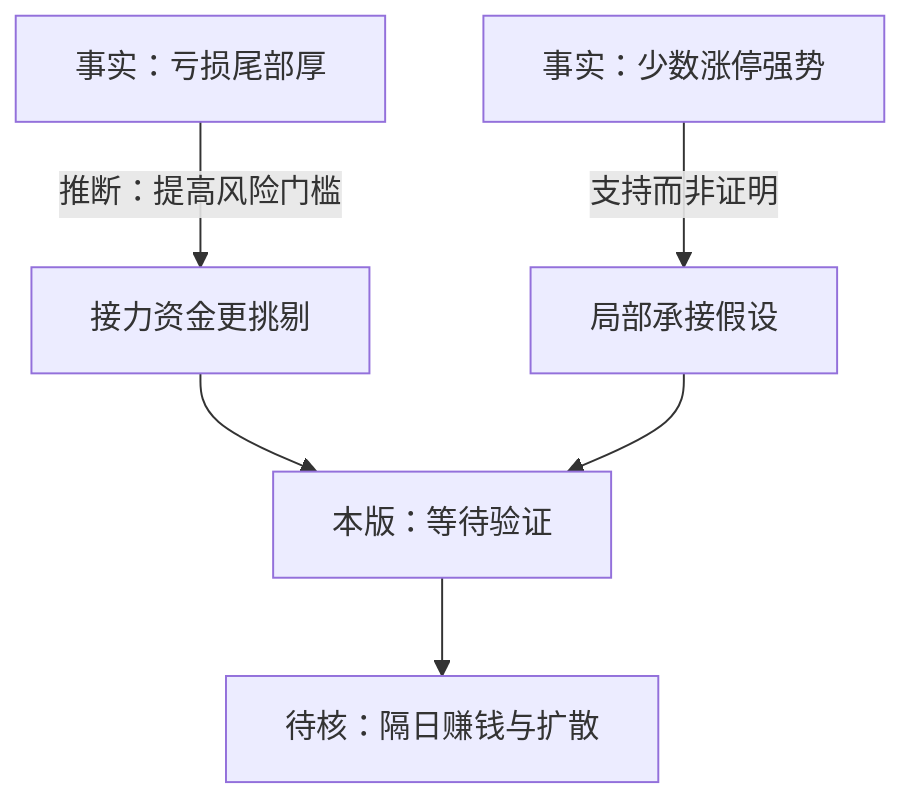
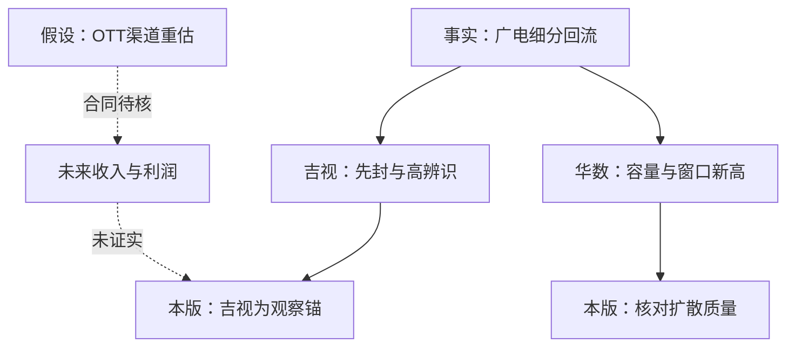
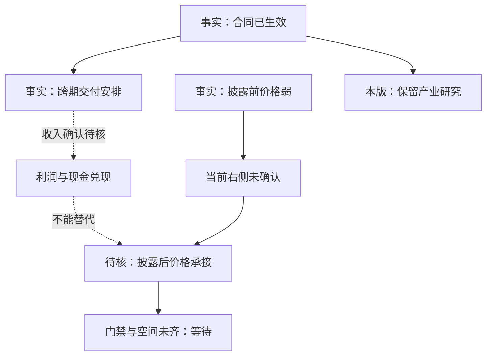

# 守正出奇｜退潮中认主角，不把避让认成新繁荣

> **核心主张：当前首先是风险偏好收缩，而不是消费或AI应用盈利周期已经反转；把吉视传媒作为广电局部承接的首要验证锚，把光启技术作为真实新增需求的产业对照，二者都先研究、等待，不提出当前新买。**

| 现在做什么 | 判断与动作 |
|---|---|
| 市场主张 | 延续11月13日的收缩判断；亏损尾部加厚，尚无足以持续进攻的新主航道 |
| 市场选择 | 吉视传媒进watch；华数传媒核容量扩散；长虹美菱核家电先锋，均非执行授权 |
| 真实需求 | 光启技术进watch核合同兑现；福龙马观察产品转订单，不用消息硬度钦定龙头 |
| 明确不做 | 不追高位老情绪核心，不把下降结构叫低吸，不因龙一有风险递补后排 |
| 硬拦截 | 文投控股、冰山冷热：接受本批R6 hard_reject，不以热度或强K线覆盖 |

目标业务日为2026年11月17日。本稿在当日开盘前形成；适用为盘前至竞价／开盘新增事实可用前的人读判断，午间不自动续期。不是实时买点，也不是订单。价格和主要资金事实为11月16日收盘，今日竞价、封单和承接均未取得。R4消息立场原窗口至09:25或新公告，R1/R2最迟11:30重评；新事实到来应更早重评，不能拿旧窗口支撑午后交易。

未读原版最终报告，不能声称两版事实窗口完全相同，也不把材料时间差说成思维优势。

研究覆盖仍为partial，流水线交付与材料齐备不等于研究全量。独立宏观包未核，催化剂日历不可用，必要监管／预警／审计原文分支和逐票RR未齐。这些缺口不另造“全市场停买”，但本稿也没有足够依据提出一笔满足原门禁的新买。**本版不进入执行，不读取账户，不分配账户仓位。**

展示说明：下列Mermaid图保留逻辑源码；受本次禁网络与缺离线引擎限制，尚未完成真实SVG渲染验收，正文表格和短文可独立阅读。已用本地浏览器在960／1280像素视口检查9张表、2个折叠区，无横向溢出或字面HTML标签；这不等于3张因果图已渲染通过。

## 先看一段行情：稀缺的是接力者，不是故事

11月16日，5572只样本中1136只上涨、4344只下跌，1021只跌幅至少5%；非ST口径涨停32、跌停60。前日涨停池36/37只可匹配，开盘平均溢价+2.36%，收盘反馈均值+0.99%，中位数却为-1.45%。少数赢家拉高均值，不代表接力买方普遍获利。对T+1交易，最值得问的是“明天谁来接今天的筹码”，不是“今天谁还亮着红灯”。〔R1 market_metrics〕

R7东财成交分类口径的市场主力净额，11月12日、13日、16日连续为负，最新一日约-643.79亿元，五日约-1396.97亿元。这是供应商对成交单的分类统计，不是全市场现金消失，也不能证明卖方身份；但与广度、跌停和中位数共同出现，足以反对把短暂修复线性外推为新主升。炸板率33.33%低于40%，不能虚写命中40%条款；60只跌停和厚尾风险同样不能被“炸板率没超线”抹掉。

阶段口径冲突不靠挑一个有利标签解决：绑定emotion_cycle的“主跌”用了缺数保守溢价-0.5%；该数不是实测。R1用实际开盘溢价重算为高位震荡，R4用广度和科技亏钱判断主跌。本版不凭标签指定战法，实际选择是等待，不接高位老核心；真实有效禁新仓、零预算和仓位上限仍优先。R1的25%只是研究建议，未取得其对应账户批准，不拿来当本版可用额度。

### 现实变化怎样进入市场定价

已绑定外盘指数显示美东11月16日标普约-1.92%、纳指-2.49%；R4带入科技与光通信下跌报道。公开转述称SemiAnalysis下修远期AI资本开支模型，这改变的是市场对未来回报和融资承受力的预期，不是已经核实全球AI订单塌陷，更不是国产供应商因此自动多拿订单。原始付费报告、最早发布时间与全模型未核，不能倒推它是11月16日A股下跌的唯一原因。

| 现实／信息变化 | 能走到的传导环节 | 不能跨越的一步 |
|---|---|---|
| 海外科技走弱、远期模型下修报道 | 可能抬高增长兑现要求、压低风险承受度 | 不等于国内每家公司订单被取消 |
| 内容向客厅大屏延伸的传播 | 渠道／牌照可能被重新定价 | 未核分成合同，不能直接写广电利润增长 |
| 家电多只封板及容量股上涨 | 证明资金当日愿意做消费切换 | 未核行业新增政策与需求拐点，不叫全面复苏 |
| 储能实施方案延续 | 装机、利用率与收益机制构成长期需求背景 | 2030目标不是当期预算，不让全部概念股共享订单 |
| 光启已生效销售合同 | 企业层面新增需求与交付安排可核 | 合同金额不是本季利润，也不是当前买入许可 |

储能材料已在11月13日公开，16日政府答记者问是延续，不伪装成今日首发。固态在材料中属于前沿储备，不能把储能、钠电、固态、材料扩产和零售标签强拼成一条纯粹产业链。黄金、铜、原油、汇率及宏观统计原表不齐，本版不下“降息／衰退／软着陆”的完整宏观结论。

**我的取舍是：市场当下愿意支付的是少数可见活口的接力价值；值得继续研究的产业机会，则必须让真实需求逐步落到交付、利润和现金。两者尚未合一，宁可保留这道裂缝，不用一段顺畅故事把它缝起来。**

## 市场选了谁：先分清地位，再分清能否买

### 广电：选吉视做辨识度锚，不把华数的财务相对优势当龙头任命书

11月16日电视广播细分净流入约6.79亿元、五日约9.87亿元，而全传媒当日约净流出25.32亿元。细分和大行业有包含及口径差别，不能相加。这支持“窄回流”，不支持“全传媒重估”。R2触板行业样本2封板、1炸板；不是全部成分中三分之二都涨停。

| 对象 | 为什么留它／不换它 | 反证与当前动作 |
|---|---|---|
| 吉视传媒 601929.SH | 10:12首封且无开板，热榜东财4／同花顺15；五日大单代理约+5.91亿元，有同向华数 | 亏损、存货／应收／债务风险；进watch，接受R6降级意见，不称盈利反转或全市场总龙 |
| 华数传媒 000156.SZ | 有线网络和数字内容有业务关系；11月16日收盘超过前20日高点，提供容量对照 | 封板较晚且3次开板，应收增长与收入下降并存；进watch，不因盈利相对好直接取代吉视 |
| 湖北广电 000665.SZ | 保留广电扩散质量对照 | 昨日未封板、龙虎榜净卖；降级观察，不为凑第三只递补 |
| 文投控股 600715.SH | 市场辨识度高，能研究其对情绪的影响 | AI漫剧收入占比仅2.57%，条件性*ST风险；硬拦截新增参与，不把它的风险自动转成广电订单 |

吉视的“奇”在于市场先选择了其流动性、辨识度与接力结构，而不是本批证据证明它最会从OTT赚利润。R2只在辨识、扩散观察和容量三项给出研究支持，不能把同日先后封板画成已经证明的因果带动。它11月16日收2.96元，尚未超过前20日高点3.03元；“回流核心”与“完整主升确认”仍是两个命题。

华数收8.54元、前20日高点8.26元，数值结构更靠右；但价格过旧高不等于今日能守住。其应收同比增长约17.45%，同期收入下降约1.94%，应收／累计收入约44.79%。吉视存货周转、应收与有息债务的问题更重。**本版接受二者R6 strong_suggest：研究保留，新增买入暂不提出。** 不靠财务相对好选“替补龙”，也不靠价格强把财务风险改成无关。

条件参与只能是：有权链拿到今日新事实后，吉视自身承接、华数等同方向助攻和隔日赚钱预期同时成立，再独立核价格空间与门禁。吉视若失去承接而华数孤立上涨，先收缩整条局部回流假设，不能自动宣布“换龙成功”。两者若保持地位、回踩不伤原结构与退出边界，不因为另一行业忽然更热就强制换票。今天没有取得这些新增事实，本稿不把“条件”写成“已发生”。

### 家电与零售：承认消费被选择，不把所有消费当成同一轮行情

| 比较问题 | 当前市场事实 | 本版取舍 |
|---|---|---|
| 谁在家电居前 | 长虹美菱09:47先封、0开板，后有厨电／小家电扩散；海信家电、美的亦涨 | 长虹美菱为家电首要观察锚，非因低价或名字；进watch等待 |
| 华帝为何不直接上位 | 首封紧随长虹、资金支持，日线已过前20日高点，但3次开板 | 保留容量／结构比较；接受财务strong_suggest，不因旧股息率追买 |
| 小熊／北鼎为何不是替补 | 小熊无开板但封板更晚；北鼎20cm却8次开板 | 前者核扩散，后者降级观察；财务看着少问题或涨得更多不自动取得龙头地位 |
| 广百是否比首板更值得追 | 三板、早封、后有天虹／鹏飞首板；零售行业五日却净流出约12.02亿元 | 保留零售地位观察，接受R6财务与拥挤strong_suggest，不提出三板追接 |
| 天虹能否代表储能 | 零售首板、当日大单改善，业务讨论偏零售数字化 | 只是零售联动，不借储能政策给它加一层合力 |

长虹美菱的真实家电业务让受益映射比纯名字联想扎实，但前三季利润接近零，收入下降、非经常部分与应收风险都在。11月16日4.31元仍低于MA60约4.4055元，前20日高点4.37元也未过。它是低位首板修复的研究对象，不是已证明主升后的低吸对象。**接受R6财务及结构两项strong_suggest，不覆盖。** 华帝已收复数值均线也不等于消费利润拐点成立；“市场领先”与“基本面更好”应各自证明。

广百的主角地位不因行业净流出就消失，但地位不能补偿任何价格。7.67元是11月16日收盘，缩量加速和“一字预测”意味着次日可成交性及先手兑现压力需核，不是隔夜排单依据。若广百强封而大东方、国芳等旧消费弱核仍跌停，说明强弱分离，不能把它写成整个商超线安全。广百若分歧失败，不抓天虹、鹏飞续讲同一故事。天虹的租赁等债务和一次性收益也须从经营复苏中剥离。

消费内部本版更愿意核对家电首板簇的扩散，而不是直接承担零售三板拥挤；这是当下机会层级比较，不是新增一套固定首板战法。家电行业五日资金本身仍略负，只有白色家电子行业较强，不能据四只首板就把它升为长期主线。全局仍偏收缩，首板也不是低风险凭证。

## 真需求与价格认可之间：光启不是因为“硬”就必须买

光启技术是本版首要产业事件对照，而非当前执行首选。理由比泛航空故事具体：R4原公告已核17.904亿元含税超材料航空结构产品合同，11月13日签署并生效，最晚2028年6月履行，占2025年主营收入87.52%；预计积极影响2027年及2028年上半年。最早已核公开报道为11月16日17:46，不能用此前收盘下跌判它“利好后市场不认可”。

| 对象 | 真实受益走到了哪一步 | 市场表达与为何这样取舍 |
|---|---|---|
| 光启技术 002625.SZ | 已生效销售合同，关联主营明确 | 披露前下行、五日大单约-1.74亿元；进watch，不左侧抄底，不因旧弱势否定新合同 |
| 福龙马 603686.SH | 新闻原文点名联合研发、清扫机器人预售 | 日线改善、五日约+2.72亿元，但当日净卖及上影；观察产品转订单，尚无行业核心地位 |
| 朗特智能 300916.SZ | 拟现金收购成都奥捷51%，不是完成交割 | 审批、关联交易及413.33%评估增值风险；观察，不把估值增值叫利润增长 |
| 海思科 002653.SZ | 产品入医保有明确事实，2027年1月1日实施 | 支付价格与净放量未知、旧价格下降；保留研究，不以较少数值红旗做左侧替补 |
| 顺钠股份 000533.SZ | 拟回购与变压器业务可核 | 用于持股激励非注销；冻结拍卖风险和下降修复结构仍在，降级观察 |

光启“需求最能核”胜过机器人预售与泛政策映射，但不胜过自身的现金兑现拷问：本批前三季收入下降约18.23%，存货同比增长约117.23%，应收／累计收入约203.13%。这不是预测合同不能履约，而是说明订单到可支配现金仍有很长的桥。其18.13元旧收盘低于MA20约20.567元和MA60约24.6223元，尚不具已核右侧主升结构。**接受R6财务与合同跨期两项strong_suggest；不覆盖，不算虚构RR。**

福龙马的预期差比旧“发布会定档”进一步：本批已从预告走到发布及预售报道。但还没走到销量、毛利、回款，12月上海发布会具体日期未取得。最早已核报道在11月16日15:46，不能说当天上涨已验证发布后合力。14.05元收盘超过前20日高点13.60元、盘中高14.50元与上影并存，保留价格约束。接受R6 F3/F9及消息时序strong_suggest：只是研究，不因关联华为便定为整个机器人主线核心。

若新行情中光启在合同公开后形成真实修复、同方向出现可核助攻，再比较它是否足以从产业对照升级为市场主角；单票跳空或一字不完成这个证明。福龙马若先形成真实订单和带动，也可以承认市场选择了它，不为证明自己偏好合同硬度而守死光启。但没有这些新增证据，今天不同时铺开航空、机器人、并购和医保四套交易。

## 对11月13日的判断负责，而不是对旧代码负责

本目录前份合法日报为11月13日午间稿，行情事实截至11月12日，当时以“风险收缩、核心化未成新主升”为主张，以寒武纪作产业锚、蓝色光标作竞争对照，水产看东方海洋与百洋。11月16日报告缺可核回执，**本次连续性只对照11月13日，不冒称逐日跟踪完整。**

| 原判断 | 本批新证据 | 今天的改变 |
|---|---|---|
| 全局仍收缩，局部核心不等于普遍赚钱 | 跌停60、跌幅至少5%的1021只；市场分类净额连续为负 | 主张延续且风险侧增强；不是新一轮全面进攻 |
| 国产算力值得核兑现 | 海外科技走弱、远期模型下修报道，国内科技链资金收缩 | 产业长期问题仍可研究，但当前进攻优先级削弱 |
| AI表达可从硬件转向应用 | 本批广电有资金／封板／人气，整体传媒和游戏资金仍负 | 将当下验证锚放到吉视／华数，不把两者叫蓝色光标的已证替代龙头 |
| 水产有窄情绪合力 | 本批未提供原两只同口径新画像、兑现与地位演变 | 个股延续未核，不说已证伪，也不沿用旧买点或旧市值 |

这不是认定寒武纪、蓝色光标、东方海洋或百洋11月16日已经失去全部价值。本批对它们没有足够同票更新，不能从不在R5里推导它们失败。本次缩小“今天愿意承担交易风险”的主张，是全局风险和新研究覆盖共同约束，不是用新名单证明旧主张错误。旧产业假设保留研究资格；旧价位、旧仓位建议与旧买点不自动有效。

## 怎样改判：证伪、兑现、未认可与波动不能混用

| 实际出现什么 | 对判断的含义 | 本版动作／原纪律 |
|---|---|---|
| 原件否定商业权益、合同取消，或真实核心地位实质迁移 | 事实或载体证伪 | 撤回相应主张；已有仓位由有权链按原规则处理，不用长叙事止痛 |
| 消息兑现、价格已吃完可核空间，强势却不再有合理回报 | 预期兑现／价格问题 | 不新增；不必等公司变坏才承认交易不划算 |
| 订单或政策真实，但披露后仍无承接、无助攻 | 市场暂未认可 | 继续研究，不抢跑埋伏；光启不因“迟早认识价值”获得扛单权 |
| 核心地位、业务证据、承接及原退出边界均未破坏 | 正常波动才可能成立 | 可维护原判断，不因别票更快强制换；不豁免止损 |
| 广电／家电不只核心强，隔日利润、容量扩散和市场尾部同步改善 | 局部修复升级的必要新证据 | 增强假设，交有权链重评；不是本稿提前发出买权 |
| 活口孤立、后排亏钱，高位老核心继续放量兑现 | 局部合力削弱或失效 | 等待／收缩判断，不靠下一只后排补齐故事 |

### 新买、已有仓位、研究方向，各自回答自己的问题

本版没有执行票、数值触发买点、止盈目标或仓位建议。原因是目前只形成研究优先级，未形成可核目标空间与完整逐票开仓资格；不是让空格成为隐性授权。旧收盘、旧高与均线只解释11月16日位置，**不能把“过3.03元”或“回到20.567元”直接当11月17日委托价。**

以后若有权链提出真实新买，须明确打板／半路／低吸类型、触发价、结构止损、可核止盈目标与失败标准，止损距保留-5%至-10%硬区间，RR低于1拒绝；缺目标不造目标，缺RR不写通过。主跌转修复只保留真正新题材首／二板研究，不把广百、北纬、凯撒等老情绪核心改名新低位。日线未确认上升结构的票不称主升低吸。

| 11月16日流通市值参考（亿元） | 仍然适用的限制 |
|---|---|
| 吉视103.30；华数145.17；广百53.76；光启390.62；福龙马58.37 | 过20亿元只是必要条件，不证明合格或值得买 |
| 长虹美菱37.72；华帝36.60；北鼎27.43；朗特32.43 | 20—50亿元谨慎区，不以弹性抵消流动性；长虹另有41.149亿元异源口径未核一致 |
| 瀛通通讯19.31；欧亚集团17.84 | 低于20亿元硬线，拦截新增参与，不作冷门替补 |

已有仓位仅给条件维护原则，未核真实持仓、成本、T计划与可卖量，不发出减仓／换仓订单。调整前应由有权链先查已有T计划，避免重复动作；不一次性清掉多只股票。短线不达预期隔日退出、炸板破均线、日线破20日均线等既有规则照旧，不因研究尺度较长豁免。A股T+1不变，当日新买不能靠当日卖出止损化解风险，跌停／跳空亦可能令实际损失超过计划止损。

**今天最有价值的决断，是承认暂时没有“产业事实、市场主角、当前价格、必要资格”四者同时成立的对象。研究继续，交易等待。**

展开：其余真实对象的取舍与反证

| 对象 | 本批研究事实与本版取舍 |
|---|---|
| 北纬科技 002148.SZ | 四板高度真实，多主题、7次开板及高换手；两季现金流与正利润背离。接受财务／筹码strong_suggest，仅作情绪温度计，不追老高标 |
| 凯撒文化 002425.SZ | 实际连续二板，五天四板不是新低位；商誉／权益约51.87%、亏损与当日净卖。接受财务／筹码strong_suggest，降级观察 |
| 金逸影视 002905.SZ | 同版板型二连板、一字反包；R5一句话“首板”不采纳。接受财务strong_suggest及文字纠偏，院线不自动享有短剧收益 |
| 鹏飞绿能 002356.SZ | 零售扩散候补、低于MA60、五日个股资金缺口；旧名不认证当前主业。接受财务／结构strong_suggest，不自动递补 |
| 紫竹高科 002058.SZ | 固态分支先锋可研究；商业权益未齐、债务及应收风险，前20日高点未过。接受财务strong_suggest；撤销风险警示按新事实，不无限延续旧预警 |
| 领湃科技 300530.SZ | 储能／钠电20cm首板不等同固态；连年亏损、高债务与应收风险。接受财务strong_suggest，降级观察 |
| 世龙实业 002748.SZ | 化工二板、氯化亚砜供需与产品价格待核，不是纯固态总龙；保留应收soft_suggest，观察，不用三日榜单净买冒充单日 |
| 龙江交通 601188.SH | 股价趋势强、当日资金支持；季节客流至收费利润未核，离中期均线较远。接受微观结构strong_suggest，观察，不因冰山被拒递补 |
| 金新农 002548.SZ | 二板早封真实，但生猪行业仅单股效应，猪价／成本未核且杠杆高。接受财务strong_suggest，观察，不拼成整个大消费合力 |
| 小熊电器 002959.SZ | 本批数值财务未检出红旗不等于必要审核齐；较晚封板、旧高未越，只核家电扩散，不因前排有风险晋级 |
| 北鼎股份 300824.SZ | 财务soft_suggest与8次开板strong_suggest都保留；20cm不是选股优先权，降级观察 |
| 天虹股份 002419.SZ | 应收、一次性利润和含租赁债务风险；接受财务strong_suggest，只核零售联动，不借储能标签补强 |
| 朗特智能 300916.SZ | 接受财务及交易条件strong_suggest；12%协议转让不是已在二级市场卖出，股东所得不是上市公司所得 |
| 海思科 002653.SZ | 数值项少红旗不是无风险；接受医保时序strong_suggest，不把2027支付安排写成当季收入 |
| 顺钠股份 000533.SZ | 接受消息strong_suggest及F9提示；控股股东股份刑事冻结不等于上市公司已经立案，亦不把回购当股价下限 |

文投控股hard_reject来自S3条件性*ST预警，不是声称已经被*ST；冰山冷热hard_reject来自当期F3/F4/F6/F9四项，F7为FY2025关联交易另列，不拿旧年度凑四项。二者硬否决均不因研究窗口午间到期自动解除，须正式实质纠错或解除证据。金辰股份已有原公告否定海外报道的实质业务关联，不沿用太空光伏故事；九阳触板未封，国统有高度却缺精确催化／扩散，均不凭榜单名次成为主角。

展开：来源、事实窗口与展示验收限制

本稿使用启动器核过的精确版本：run_id为20261117T061042-28389-8648，summary摘要见frontmatter。先完整载入research_summary，再逐个完整载入R1—R7及绑定attention、emotion_cycle，按业务对象、结论与嵌入证据核对；重复原始表格不称为新的独立源核验。未沿证据中的raw路径、公告链接或未知宏观路径扩大读取，未补抓行情／网络／账户，未读取原D1最终名单或报告。

关键出处：R1 market_metrics、market_assessment、external_markets；R2 main_lines／secondary_lines、excluded_comparisons；R3 market_reward及resonance_top_themes；R4 E20261117_002／003／004／009／013及相应原文、first_known_at；R5逐票dimensions、metrics、fundamental_checks及局部图像结构化记录；R6 counter_arguments、candidate_reviews、source_timing_audit；R7 market_capital、sector_flows、dimension_freshness。attention信号日11月16日，持久榜统计不当今日持续性证明。

R4 knowledge_cutoff为11月17日06:34:03，表示本批消息核验范围，不保证所有公开消息已覆盖；CLS补充末条为05:47。R5生成时刻、研究文件mtime与R6生成时刻不是行情事实截止。财务多为2026Q3，审计和部分关联交易是FY2025，不伪称11月17日实时财务。ETF、两融为11月13日；R7海外核心股也仅到13日，不能拿其滞后个股序列代替R1的16日指数快照。跷跷板没有确认配对，不能声称已证科技资金整体搬入消费。

R5覆盖24只R2对象，R6也实质检查24只，但必要审核完成数为0；这不是24只全部硬否决，也不是全部通过。F12结构化年度审计标准记录不替代当前原文分支，S2/S3缺口不当阴性。上游R4消息字段中的“当时R7 unavailable”是阶段内交叉时点，不覆盖本包最终R7确已存在的事实。summary的orchestrator_status仍为partial，不被交付成功抬为complete。

方法仅取彭道富20261112心得及本目录README，旧“嵌入原D1栏目”提案已撤回，不实施。历史只用绑定11月13日报告，11月16日连续性缺口保留；没有把方法书中历史案例当今日股票事实。

展示限制：正文因果关系配有Mermaid源码及等价短文／表格，实线的推断也以边标签明确，虚线保留待验证环节。本次禁止网络，现有验证器依赖固定CDN，已查本机相关依赖未发现可离线调用的Mermaid包或mmdc；因此没有发起CDN请求，Mermaid尚未完成真实SVG渲染验收，不能称全部图已渲染通过。核心判断、限制和动作不依赖图是否显示；不把未渲染源码伪装成已验收图。Markdown表格与正文另行使用本地渲染检查，结果不认证投资判断。

本任务唯一业务写入为本日期Markdown；不生成或修改watchlist_plan、amendment、原盘前报告、研究产物、runtime、日志、usage与回执，不改变原流水线终态。保存不自动形成执行授权。

