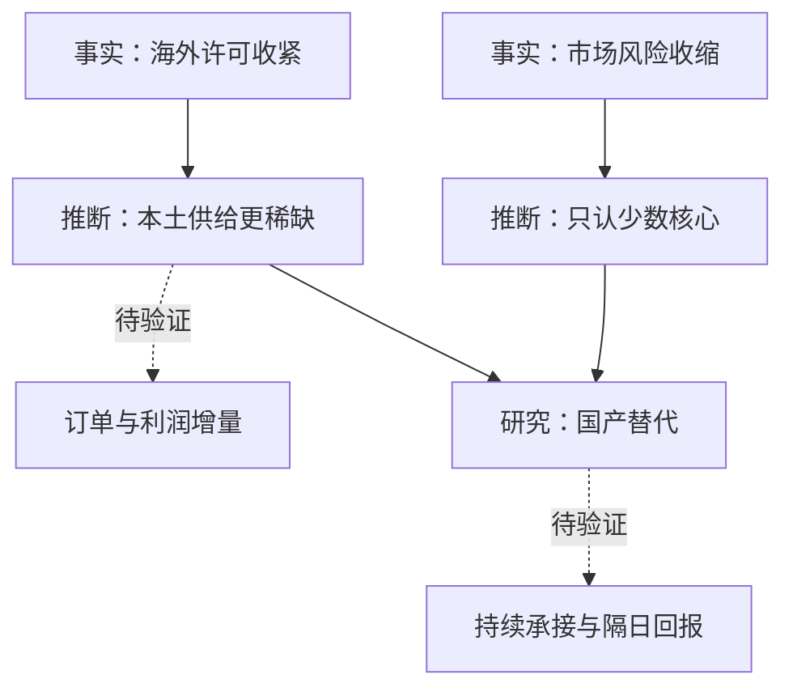
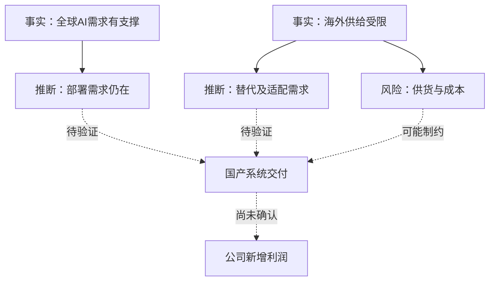
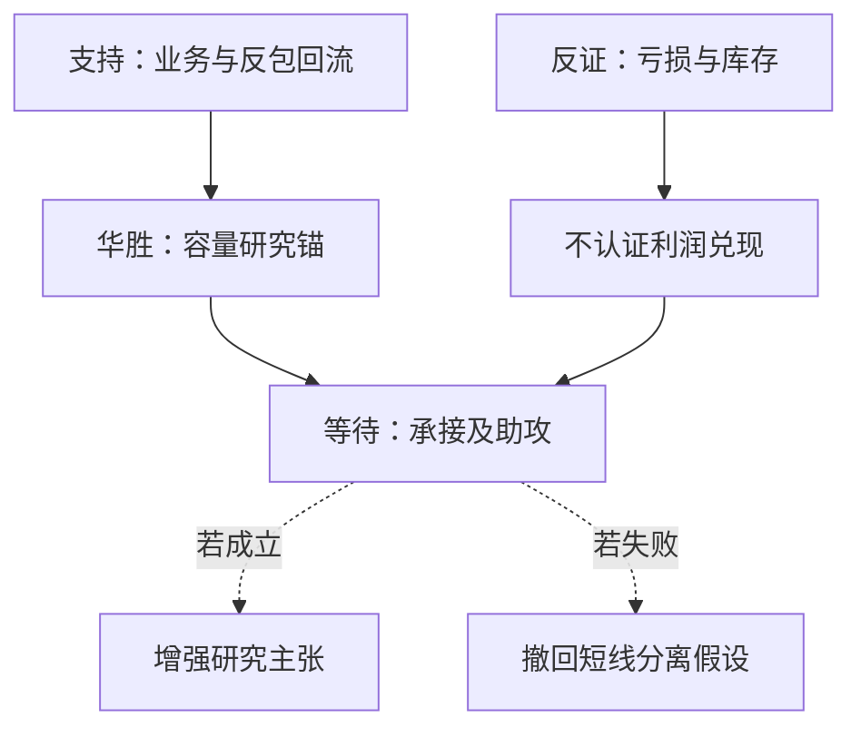

# 守正出奇｜替代的方向值得守，接力的资格仍要等

> **核心主张：风险收缩中，市场在提高本土半导体供给的定价权重，但还没有证明一轮可广泛参与的主升；首要研究华胜天成的容量承接，光刻保留方向、不强行选出可买龙头。当前动作是等待，不提出新增买入。**

| 先看什么 | 本版取舍 |
|---|---|
| 最值得投入心力的机会 | 国产替代能否从事件稀缺性，走向核心持续承接与真实交付 |
| 主要市场表达 | 华胜天成为容量研究锚；有研新材为材料端竞争观察；华东重机只作高度温度计 |
| 明确不做什么 | 西陇科学硬拦截；不让盛剑自动递补；不以英伟达财报利好直接抄底CPO |
| 今天是不是空仓日 | 对新增风险，本版按空仓等待处理；不等于账户清仓指令，也不另发全市场硬禁买 |
| 当前缺口 | 今日承接、逐票RR与完整必要合规未核；宏观覆盖不完整，研究汇总仍为partial |

目标业务日为2026年11月18日。本稿在开盘前实际生成，适用于形成后至今日09:30的盘前研究判断；竞价及开盘新事实出现须重评，不将本文自动延长为全天买卖指令。价格和主要资金是11月17日事实，新闻含18日凌晨增量，两者不是同一截面。本版未读取原D1最终名单、报告或交易JSON，未核其事实窗口，不宣称比原版更早、更全或更优。

排版限制：本次无网络授权，本地未找到Mermaid渲染依赖，下面的Mermaid图未完成实际SVG渲染验收；各图的核心判断亦完整写在相邻短文和表格中，不依赖图形才能读懂。不能把源码检查说成已渲染。

## 不是“芯片都该涨”，而是供给安全与风险承受力在拉扯

主要矛盾有两层：现实里，海外先进算力的可获取性与许可成本受到新约束；市场里，承受隔夜风险的资金却仍在收缩。前者提高本土供给的研究价值，后者要求我们区分“值得理解的赛道”和“今天值得买的股票”。

| 11月17日已发生的事实 | 对当前判断的约束 |
|---|---|
| 1326只上涨、4119只下跌，67只跌停 | 指数跌幅不大不代表普遍可接力 |
| 37只收盘涨停、20只收盘炸板，炸板率35.09% | 存在局部赚钱效应，但远非全面恢复；不是炸板率已超过40% |
| 首板风格+1.0148%；二板以上风格-3.898% | 低位新表达相对占优，不能据此直接把所有首板称为低位或可买 |
| 前日涨停池昨日开盘均值-0.3045%，收盘中位数-0.4498% | T+1接力收益仍脆弱；收盘均值微正不代表多数人赚钱 |
| R7东财口径近五日主力净额-1835.72亿元，四日连续净卖 | 局部回流不能直接升级成增量牛市 |

这里的“主跌”是风险温度，不是自动生成打法的遥控器。绑定情绪文件的-0.5%溢价是缺数占位，本稿采用R1同池重算的开盘值；开盘负均值与收盘微正均值导致阶段敏感性不同，保留冲突。R1的20%只是市场研究仓位建议，不是已批准账户预算，更不是必须花掉的额度。本文等待的理由是证据与交易条件尚未闭合，不是把旧零预算无限继承。

宏观认识也不越界：R1内嵌的亚洲指数与国内金、铜、原油连续合约动量偏弱，只能支持风险偏好谨慎；连续合约含换月影响，不能由价格直接断言衰退或降息周期。美股指数只到11月16日，不能冒充17日隔夜收盘。美元指数与完整汇率坐标不足，独立宏观包未核。

## 根逻辑可守，但不能跳过中间那座桥

BIS限制是本批取得原文支持的事实；“国内公司立即得到替代订单”不是。许可制不是全面封禁，商业推荐系统存在豁免，具体算力门槛及关联机房条件须逐案核；联邦公报实际生效时间仍未核。它可能同时造成国内替代需求增加、海外GPU供给受限和交付成本上升，同一家公司未必只受益。

与此同时，R4内嵌的英伟达官方财报与量产交付信息，支持全球AI需求仍有韧性；但Q4毛利率指引71%—72%低于Q3非GAAP的74.9%，且不假设中国数据中心计算收入。需求增长与中国可获取性下降可以并存，不能用一个“大AI利好”抹平。

我愿意持续研究的是“谁能把供给安全要求变成可交付的产品与系统，并且被市场持续选择”，不是所有带芯片标签的低价票。R2光刻胶/光刻机分别上涨2.83%/2.78%，光刻胶7封3炸、封板率70%，确有相对强势；但两概念重叠，资金不能相加，且真实启动轮次未核。11月4日已有芯片扩散高潮记录，不能把17日的首板潮无条件定义为全新周期。

R7设备行业五日净额约+39.53亿元，与电子化学品行业五日约-7.45亿元并存；上位行业统计不是精确光刻概念的完整资金证明。由此我承认光刻是当前表达之一，却不把研究排序最高自动翻译成最值得买。

## 先比较载体，再决定把心力放在哪里

### 华胜天成优先研究，不是因为它“最正宗”

相较只有高度的华东重机、存在硬风险的西陇和低换手反弹的盛剑，华胜天成同时有实际系统业务、容量交易与反包结构，因此更适合检验本轮替代能否被市场持续定价。选它是选择验证对象，不是宣布认证龙头或宣布其未来涨幅最大。

| 对象与身份 | 选它研究的理由 | 最主要的反证／当前动作 |
|---|---|---|
| 华胜天成 600410.SH：首要容量锚 | 3天2板反包；系统业务；五日DC净额+12.70亿元 | 不是五日连续净入；亏损与存货压力。进watch，等待承接 |
| 有研新材 600206.SH：材料竞争观察 | 首板及双平台人气；昨日DC净额+14.89亿元 | 五日仅1日净入、8次开板；缺本轮完整R5/R6画像。研究观察 |
| 华东重机 002685.SZ：高度温度计 | 唯一非ST三板，日线一字 | 芯片收入占比小、业绩承诺落空；资金符号冲突。降级观察，不追高度 |
| 盛剑科技 603324.SH：光刻联动对照 | 同批早封，绿色厂务与电子化学品业务真实 | 低换手、应收压力、趋势修复；不能因西陇被否自动升龙一。降级观察 |
| 西陇科学 002584.SZ：被拦截的前排 | 首板前排、电子化学品业务及正资金属实 | R6已核S2历史造假实锤。拦截新增参与，不设买入情景 |

华胜天成11月17日收15.29元，首封后有一次开板，最终反包封住；不是两连板。DC五日净额+12.6997亿元，16日却净流出6.1392亿元，17日回流7.1420亿元。R5大单加超大单五日约+12.3198亿元是另一公式，不相加、不平均；XTick与DC同向只支持方向线索，分类金额不是机构真实账户身份。THS另一个12—17日窗口也不能与11—17日五交易日窗口伪装成同窗冲突。

真正的经营支持是前三季收入同比+20.83%，公司三季报内嵌原文将经营现金改善归因于算力项目回款，而非只有概念标签。反面是归母仍亏损约2.59亿元，毛利率约11.09%，存货同比约+102.23%，九个月周转从约3.314降至2.520。第一大股东约79.97%持股质押亦应披露，但公司无控股股东，不能偷换为控股股东F11硬拒。

**预期差在这里：** 市场可能先交易国产适配与交付能力，利润暂未全面兑现；如果后续回款、周转与毛利证明改善，根逻辑才变硬。反之，若只是以库存堆积换收入，或海外器件限制压住交付，替代叙事也可能压低而非抬高利润。本轮没有新增订单原件，不把期待写成收入。

### 方向最热，不等于其中必有一只必须买

西陇的前排地位不应被抹去，正因为市场确实选择过它，S2硬拦截才是实质取舍。公司法披逐字引述广东监管局2023年处罚决定，涉及2020—2022H1财务虚假记载，2025年报仍披露相关赔偿。不是2026年新立案，不宣称现在ST或必然退市；整改和标准年审也不自动解除既有S2规则。R6硬否决不能覆盖，不因09:30研究窗口结束而自动失效。

盛剑并不能填补这个空位。11月17日收20.82元、换手1.65%，低于光刻胶成分中位3.8084%；全天非一字。H1电子化学品收入约2508万元且分部毛利为负，主业务绿色厂务不能改写成先进光刻胶新增量产订单。前三季应收约为累计收入108.07%，归母亏损；日线仅勉强收复MA30、仍低于MA50。这是“同方向有辨识度的反弹”，不是已经证明的主升核心低吸对象。我接受R6的strong_suggest，不覆盖、不自动递补。

江化微的配套材料映射、海立的容量与五日正资金，可以继续比较；联合化学的20cm首板也不因前缀被排除。但本轮没有证明它们已取代前排并通过必要画像，不能靠“更正宗”或“买得到”直接接位。国林科技虽是20cm早封扩散对象，已核流通市值约19.66亿元，低于20亿元硬线，不拿弹性豁免。

### 有研与华东：一个检验筹码回流，一个检验接力风险

有研新材17日收39.33元。五日DC净额约+9.87亿元，却是前四日均负、最后一日大幅回流；同日XTick约+24.08亿元与DC同向但金额差异大，不能合并成更大的“真实吸筹”。8次开板意味着买方经历大量筹码交换，不直接等于出货，也不等于洗盘结束。R3热榜理由里的靶材客户、扩产与财务数字属平台AI归因摘要，本稿不将其升级为本轮独立核过的公司原件。因此它是材料端竞争观察，不以大额净入越过缺失的完整画像。

华东重机17日日线OHLC均为6.70元，三板与多头数值结构是真的；“下一日还能以合适价格成交”不是。H1芯片领域收入占产品合计仅约1.28%，主体仍是集装箱装卸设备；锐信图芯2025年未完成业绩承诺，已计商誉减值。2.92亿元定增用于智能制造基地、尚待注册，不能称GPU订单。17日THS净额-1.2106亿元与DC+0.5133亿元方向相反，R5分档为+0.5196亿元，不以二比一投票消除冲突。对它的研究重点是分歧释放后是否仍能组织助攻，而非按纯GPU利润估值或追逐一字稀缺性；本版不提出高位新买。

## 怎样等待，以及什么变化才足以改变判断

这不是已经设计好的买点表。今日竞价、开盘承接与真实收益空间尚未取得；没有可诚实签出的触发价、目标价、止损价和RR，故不提出任何新增买入，也不编一个目标反算合格盈亏比。

| 对象 | 可增强研究判断的条件 | 应削弱／撤回的条件 |
|---|---|---|
| 华胜天成 | 有效新行情中，换手后保持相对强势；同方向有真实助攻与隔日回报 | 板块修复而自身失去反包承接；或订单、回款假设被新原件否定 |
| 有研新材 | 大幅回流后仍有持续承接，材料扩散与业务原件相互支持 | 只剩昨日资金榜，次日筹码释放而无跟随回报；不以更低价补逻辑 |
| 盛剑科技 | 由充分换手证明地位，而非低成交封单；真实业务进展支持 | 主线回流却掉队，或回款／业务受益被反证；不自动补西陇空缺 |
| 华东重机 | 仅观察高度换手和助攻关系是否成立 | 一致转分歧失去承接或只剩独板；不把三板当新题材低位首板 |
| 西陇科学 | 只保留市场组织关系的研究价值 | 现有S2硬拦截持续有效；强势、回封和窗口到期均不解除 |

若未来有权执行链提出真正新买，仍须独立通过核心判定、RR、完整纪律与战术门禁，写清买点类型、真实触发、失败标准与退出；止损距离保留买入价下方5%—10%的硬区间，RR<1拒绝。图上“看起来向上”或本版选作研究锚，都不是门禁已通过。跳空和跌停可能使实际损失超过计划止损，T+1也不允许当日新买靠当日卖出消除隔夜风险。

| 变化类型 | 该改什么，而不是泛泛说“逻辑还在” |
|---|---|
| 事实证伪 | 官方否定业务受益、交付链受阻或核心地位实质迁移：撤回对应主张，不等更便宜 |
| 预期兑现 | 新闻已交易、价格挤掉剩余空间：可以不新买，不必等公司变差才承认交易结束 |
| 暂未认可 | 根逻辑仍可能成立，但无承接与合力：留研究、不左侧埋伏；不把等待解释成必涨 |
| 正常波动 | 原因、核心关系与原退出边界均未受损：不因别票先涨而强制换股；既有止损仍有效 |

已有仓位维护与新买分开：本稿没有账户、成本、可卖数量及T计划输入，不给具体清仓或换仓指令。若持有的是同一已验证核心且仅正常波动，不因日报出现新名字就切换；若短线情景失败，则按原退出规则处理，不能亏损后改称长期国产替代。原有炸板破均线、日线破20日均线等退出纪律保留；真实调整应由有权链先核既有T计划和原风险约束，不能借本文一次性剧烈调仓。

流通市值20亿元硬线、20—50亿元警示区不变。17日参考值：西陇约38.06亿元、盛剑约30.37亿元，均处警示区；华东约67.51亿元、华胜约167.65亿元。市值合格只解决必要条件，不能消除上述反证；西陇即使合格也仍被S2拦截。国林低于20亿元明确不作为可参与递补。本文不改任何有效停买、零预算、仓位硬限或下单授权。

## 对11月13日那份判断负责，而不是另起一个漂亮故事

本目录前份可核日报是11月13日午间稿，其市场事实主要截至11月12日；11月16、17日缺合法日报回执，不假装连续逐日跟踪。前稿把寒武纪作为产业研究锚，蓝色光标作竞争对照，水产只认窄情绪合力，且均未提出当日下午新买。

| 原主张 | 本批新事实与本版处理 |
|---|---|
| 市场风险收缩、不能把局部避让当全面繁荣 | 延续。17日广度、跌停与五日资金继续反对广泛接力，但不按旧温度禁止研究 |
| 国产算力值得持续核兑现 | 方向延续、短线载体认识更新。BIS原文与本土设备材料回流增强供给安全议题，不等于盈利已落地 |
| 寒武纪是首要产业锚 | 短线强度判断削弱，不宣判产业失败。R7显示16日-8.2656%、17日仅+0.7606%，17日收904.80元；DC五日仍+21.97亿元，并非无人承接 |
| 蓝色光标与水产是竞争表达 | 连续性未核。本轮未取得同等完整经营、价格与承接更新，不沿用13日买点或排名，也不因未入本批画像认定失败 |

把华胜放在首要容量研究位置，不是把寒武纪换仓出去。寒武纪的旧经营增长与旧现金质量反证保留其原事实日；本批缺同等深度新画像，不能称已完成最新经营复核。市场可能同时保留芯片产业锚与系统交付交易核心；只有真实地位迁移与新证据才能支持改变交易，不靠今天谁封得更早。

对于其他方向，我不因不在科技就排除。家电有二板、有真实情绪选择，但九阳已官方否认传闻中的华为战略合作，不能用错误映射撑估值；长虹美菱仍有需求、成本和利润风险。回收政策是真实根基，新增补贴与单企收入未核，中再资环等尚未形成相应接力。CPO昨日本就承压，今晨英伟达财报是后到信息，不能倒填成昨日价格已兑现的原因；只有后续真实资金与右侧承接才能改变等待判断。均不因一个更响的消息夺走当前研究中心。

**最后的取舍：守住国产替代这个值得研究的问题，不守死任何代码；尊重华胜的市场表达，却不把反包、热榜和净流入连成一张买入许可证。今天不买，是等待证据闭合，不是等待市场证明自己聪明。**

展开：证据定位、版本与研究覆盖限制

### 本稿消费范围

本轮生产run为`20261118T061043-76966-21082`，使用用户给定精确版本的summary及R1—R7，另读取已绑定attention、emotion_cycle、两份方法材料和11月13日本版日报。各JSON完整载入并逐对象核对判断及证据字段；重复原始表格不是额外独立数据源，也不冒称本稿重查了监管网站、公告PDF或图像。未沿证据中的路径补读raw、未知宏观包或其他未授权材料，未取行情、账户或网络。

研究汇总明确`orchestrator_status=partial`、`contract_checks_passed=false`。R5覆盖本轮4只画像，但契约因候选不足5只且缺规定降级标记而failed；这是覆盖/结构问题，不是四票事实全部无效，也不说明四票安全。R6逐票模式1/2完成，模式6板块alert与模式7当前合规窗口仍未完成；不能将没有另一条hard_reject当成排雷通过。即使外部程序完成交付，研究仍为partial。本版不伪造第五只画像补合同。

### 关键事实在主研究内的位置

| 本文问题 | 精确研究对象／字段 |
|---|---|
| 风险温度与隔日反馈 | R1 `evidence` E1—E6、`emotion_cycle_evaluation`、`market_assessment` |
| 国产替代与BIS边界 | R4 `top_events` E004/E005，同根事件的正负分面不重复计催化；E001/E002/E003为英伟达同根财报及交付材料 |
| 光刻广度与候选比较 | R2 `main_lines[0]`、`coverage.exact_member_panels`、`coverage.comparison_objects` |
| 四票业务、价格、财务 | R5 `profiles[0..3].dimensions`，顺序为西陇、盛剑、华东、华胜 |
| 硬拦截及反证 | R6 `counter_arguments`、`candidate_review_summaries`；S2事实ID `XILONG_S2_2023_16`，重复展示不算两条独立硬拒 |
| 容量与跨日变化 | R7 `main_force.market_aggregates`、`stock_flows` 中600410.SH、600206.SH、688256.SH及各`series_5d` |

R6各strong_suggest均保留并接受：盛剑的核心与先进胶订单说法降级；华东的资金一致、纯GPU估值与高度必然可达说法降级；华胜的持续五日吸筹和替代订单自动兑现说法降级。不新增固定扣仓乘数，不把软反证变成R6未作出的硬否决。

热榜事实截至11月17日22:30附近；attention虽然文件放在18日，`signal_trade_date=20261117`、`declared_lag_days=1`，不是今日实时榜。persistent历史统计也不是当前连续核心证明。R7 ETF份额与两融主要只到16日，不作17日完整增量。跷跷板在已检190组中没有满足阈值的配对，不等于不存在市场轮动。

R4证据窗口截至18日06:33:30；R5于07:19:48成稿，内嵌公司法披节选按各自公告日期、财务期间和实际捕获记录使用，不用成稿时间冒充监管全覆盖。价格与均线截至17日，R5仅绑定图像分析记录、未独立看PNG，本稿也未看图，不宣称视觉确认突破。未来触发条件必须重新取得有效行情；本稿不提供可直接委托的旧均线价。

辅助催化剂日历不可用；独立宏观包未核、未获旁路读取。方法为彭道富20261112心得与本目录README，只提供问题顺序，旧栏目接线提案不采用，不作当前行情证据。历史只用本包绑定的20261113日报，16、17日连续性缺口明确保留。

本稿只写本目录日期Markdown，不生成或修订交易JSON，不进入执行，不更改原版预案、研究产物、流水线状态、usage或回执。来源与展示校验不是收益认证。

