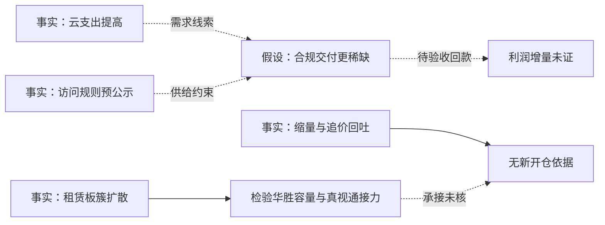

# 守正出奇｜从光刻的供给故事，转向算力的交付检验

> **延续华胜天成作为首要容量观察锚，新增真视通作为接力对照；不提新增买入。** 11月18日，算力租赁从零星强势走到同群扩散，比光刻更能解释资金的实际选择；但市场仍在奖励前一天拿到先手的人，并未持续奖励当天追价的人。值得守的是本土算力能否兑现交付，不是昨天的涨停溢价。

**窗口：** 2026年11月19日盘前形成。本文基于11月18日A股收盘；热榜约至18日22:30，19日无竞价或盘中事实。盘前判断遇首批有效竞价或重大新反证即重评，最迟19日09:30失效；不是全天指令。研判缺口：算力轮次未核、必要个股审查未完、触发价与RR未核；独立宏观包未核、绑定催化剂日历不可用。

## 先手回报改善，不代表追价回报改善

| 18日事实 | 对19日判断的约束 |
|---|---|
| 科创50 +2.20%；全A仅1,318涨、4,133跌，中位数-1.20%；沪深成交约1.37万亿元，较前日缩约6% | 钱在集中选标的，不是普遍扩张；不能用指数强替代横截面强 |
| Tushare涨停37→41、跌停67→39、炸板20→24；24/(41+24)=36.92%。梯队为1只四板、7只二板、33只首板，无三板 | 尾部损失收敛，接力仍断层；一只四板不能代表普遍晋级。xTick原生炸板率分母未核，不混算 |
| 17日37只涨停配对：18日开盘平均+3.19%，收盘对昨收平均+1.57%、中位+0.73%；开盘到收盘平均-1.46%。前日连板子组收盘中位-1.01% | 隔夜持有与开盘追入是两笔不同的交易；确认修复要看溢价能否留住，而非只看高开 |
| R7东财分档全市场单日约-85.04亿元、近五日-2,119.23亿元，五天均负 | 个股与板块回流可以发生，但不足以证明新一轮普涨或机构持续配置 |

绑定情绪文件判“主跌”时，用的是缺数占位的-0.5%开盘溢价；采用R1同池实算，开盘与收盘口径的敏感性对照均更支持**偏弱震荡下的局部修复**。广度和炸板警报保留，不采用上游固定阶段动作。R1的25%只是盘前市场研究意见，不是额度，也不影响本版等待判断。

## 为什么是交付和租赁，而不是泛科技

**需求不是订单，订单也不是利润。** 腾讯三季度资本开支由527.84亿元升至814.33亿元、云服务收入同比增35%，但非IFRS经营利润同比约降6%。英伟达数据中心收入和Rubin出货支持全球部署需求；毛利指引从74.9%降至71%—72%，且不计中国数据中心计算收入。BIS先进芯片及服务器远程访问规则已预公示，正式刊发与具体适用未核；它既可能提高本土适配和交付价值，也可能抬高依赖进口设备者的成本。美联储10月纪要是19日03:00公开的旧会议记录，提及AI债务、租赁与循环融资风险，不是新利率决定。合起来支持的是**部署需求未消失、可交付供给更值得核验、融资和利用率不可忽略**，不是所有租赁商的盈利同时上修。

把预期差落到两份公告上：**协创数据（300857）**18日午间可知旧协议设备采购与排产已有进展；合同上限374.90亿元不等于新签金额，未部署验收不计费、整改不达标可解约。股价+18.02%但R2五日约净流出9.60亿元、当日日榜净卖约2.67亿元，留作产业验证，不当接力核心。**行云科技（300209）**首期含税2亿元的词元订单是盘后新增事实；20亿元是意向上限，按确认订单与实际调用结算，不能倒过来解释当日+17.32%。两者比“贴有算力标签”更能检验交付，但均不能把订单借给华胜或真视通。

**市场确实在往交付侧集中，但只证实了一天。** R2固定成员对照中，东数西算由6只涨停增至19只、19封2炸、成分中位+0.52%；租赁由2只增至17只。R3晚榜租赁、东数西算、昇腾前三是同一语义簇，不是三条独立主线；概念资金转正也只有一天，近五日仍负。R5/R6没有确认目标日交易条件，R2的轮次标识仍空。若次日只剩少数封单而租赁成分与中位回落，解释应退回“一次集中回补”。

| 竞争方向 | 为什么不替代主观察 |
|---|---|
| **PCB/互连** | 属同一算力需求链的容量验证。行业单日分档约+45.17亿元，五日-146.90亿元，概念仅2封4炸；少数大票回补不等于行业反转。CPO也不另算一条确认主线 |
| **光刻** | 核心供给议题未消失，市场表达转弱：胶7板→2板、中位-1.31%，机5板→0板。盛剑一字二板但亏损，全筑媒体标签不能替代成分核验且质押高；不以少数封单证明扩散或接棒 |
| **6G、湾区、家电** | 武汉凡谷、中贝是通信分支的两只首板，2封3炸，中贝与算力重叠；试点不是订单。湾区只有窄个股反馈，没有精确板块宽度。九阳双人气榜首仍跌停，公司披露深思考持股7.92%不并表且未盈利，热度更像筹码压力而非接棒证据 |

## 同一逻辑，为什么先看华胜而不追最早或最高

| 对象（18日收盘） | 市场角色与相对取舍 | 最重要的反证与动作 |
|---|---|---|
| **华胜天成 600410，16.82元** | **进观察，首要容量锚。** 连续二板、四天三板，09:55首封未开；成交约48.15亿元、换手19.03%。东财同窗五日+15.45亿元，三日异动榜约净买2.98亿元。系统集成与项目回款使其比纯题材参照更适合检验交付，但不是两份新增订单的合同方 | 单日东财+2.10亿元，低于前日+7.14亿元；前三季亏2.59亿元、异动公告称基本面未重大变化。价格高于前20日高点的数值结构不等于19日承接；五日涨34.56%，若只剩溢价兑现且同群无跟随，不提高参与级别 |
| **真视通 002771，13.07元** | **进观察，接力对照。** 09:30先封、二板未开，租赁同群扩散，与华胜相比更早表达市场选择；可用来检验换手后是否仍有带动，不把早封写成独立订单 | 流通23.60亿元在警示区；东财5日+0.56亿元、18日却约-0.10亿元，三日榜净卖约153万元。前三季亏约3,609万元，应收/营收130.23%。若孤强或两只核心同步失承接，不认卡位；现无新增直接硬催化可托底 |
| **深南电路 002916，201.19元** | **进观察，配套的持续性对照。** 午后较沪电先封且未开板；东财五日+1.66亿元，强于沪电，前三季利润与收入增长提供经营基底 | 量比0.92，20日约-34.17%，仍低于20日线229.40；存货增106.89%、周转下降。不把首次回补当趋势低吸，等PCB有更多成分跟随，而非单票再封 |
| **沪电股份 002463，80.19元** | **进观察，配套的资金弹性对照。** 成交约81.86亿元、单日东财+13.19亿元，比深南更能检验大成交回补能否续航 | 三次开板，五日东财-2.82亿元，20日约-30.25%，仍低于20日线87.55。若回流停在单日且深南溢价回吐，仍是修复，不是切换标的 |

华东重机升为市场唯一四板，但18日OHLC同价、换手2.20%，且非本轮所用的东数西算或租赁成分。估值异动公告与既往低芯片业务占比是反证，仍只作**高度温度计**。卡莱特同为二板但首封更晚，常山北明是有辨识度的首板扩散，不凭名次替代双锚。天娱数科五日资金和量价皆弱，中京电子单日回升但五日仍净负、20日约-28%，均降级、不补位。通信若要独立，先看武汉凡谷以外是否新增有效板簇、与算力脱钩后还能保持收益；中贝的量比4.05不是双主线证明，五项红旗继续待适用性复核，不写成已生效硬拒。

**南威软件（603636）拦截，不递补。** 两条独立法定事实：2025年审计为带强调事项段的无保留意见，部分算力设备尚未到货安装（F12/S3同一事实）；公司披露因涉嫌信息披露违法违规被证监会立案（证监立案字0262026006号）。未见终局原件，不写成已经处罚、造假或ST。前述硬否决由R6作出，不随09:30观察窗口结束而解除，也不外推全市场。R6审了九只，模式1/2覆盖九只、必要的6/7并未全覆盖；没有硬否决不等于排雷通过。

## 什么时候才改变判断

| 新事实 | 判断与动作 |
|---|---|
| **真实扩散**：昨板反馈中位为正且不快速回吐，涨跌广度改善；华胜换手有承接，真视通不只剩孤板，租赁助攻从封单变成可持续赚钱反馈 | 提高「局部交付逻辑持续定价」的可信度。只在有权链取得新行情、落实个股审查和四闸门之后，才可重新比较华胜右侧机会与真视通接力；不能照昨收下单 |
| **暂未认可**：局部强但大部分样本仍跌，真视通先封却无助攻，或华胜容量承接不足 | 保留研究，不左侧埋伏、不追孤强；不拿PCB或6G的独板填空 |
| **预期兑现**：双核心高开随后回吐、同群封板缩减，或有承接但新价已挤掉可证空间 | 撤回短线接力假设，不新增。不必等订单取消才承认隔日交易不成立 |
| **事实证伪**：新增原件否定采购、验收或回款，或持续资金和板块关系证实核心地位迁移 | 撤回被证伪的产业传导或个股地位；新载体重新举证，不按日报名次换股 |
| **正常波动**：原受益链、核心带动和事先退出边界均未受损 | 可维持原研究与合规持有理由，不因其他票先涨就切换；已经触发原退出条件的仓位不适用 |

**新增交易与已有持仓分开。** R5未核可执行结构、真实触发价、目标、失败价与RR。本版不填伪精确点位。若有权方之后复评，仍须过核心、RR、纪律、战术四闸，止损距买价下方5%—10%，RR<1拒绝，不能以昨日均线反算合格目标。流通市值低于20亿元不参与，20—50亿元为警示区（真视通23.60亿元，华胜184.43亿元）；市值合格不是豁免。T+1下当天新买不能靠当日退出，跳空也可能越过止损。没有持仓、成本、可卖数量与既有T计划，不给清仓、减仓数量或换仓指令；若原短线情景失败或触发既有炸板破均线、日线破20日线等退出边界，按原纪律与授权处理，不能事后改成长期持有。本版不改变任何停买、有效零预算、硬仓位或授权。

## 与11月18日相比：根逻辑不换，表达重心有变化

- **延续并细化：** 前份以11月17日事实立论，认为供给安全值得守且华胜是容量锚。18日华胜从反包走到连续二板，且有租赁同群扩散，市场证据增强；公告与亏损反证没有解除。继续研究同一票，不是继续按旧价或旧窗口交易。
- **明确削弱：** 昨日光刻广度强而核心资格不足；本轮光刻宽度、资金与算力租赁相对强度改变，更值得把注意力给交付。不将板块重心变化等同政策反转，也不认证同一启动轮次或19日主升。
- **更新比较关系，不假装完成逐票复核：** 真视通补足了昨日缺少的早封/换手对照；华东从唯一三板到唯一四板仍不升格。前份材料端观察有研新材及西陇的历史判断不拿旧价格重做；本轮未获同等级交易复核，不判有研失败，也不解除先前风险事项或强行递补。历史使用已绑定的本目录11月18日版本，不推定缺口日期连续跟踪。

展开：事实时点、来源与覆盖限制

| 可定位的依据 | 本文使用与限制 |
|---|---|
| Summary及R1–R7，run `20261119T061006-97374-14802` | `contract_checks_passed=true` 是契约结构；`orchestrator_status=partial`、全局采集severity=2才是覆盖状态，不能因交付完成而改为全量。R1 E1–E5和R2/R3的相同面板不重复计为独立证据 |
| R2 `main_lines[0].metrics`、`secondary_lines`、`candidate_comparisons`；R3 `resonance_top_themes` | A股价量截至11/18 15:00；概念是固定当前成分回看对照而非历史成员回测，资金不把语义重叠的概念、行业和个股相加；绑定attention是11/18榜、声明滞后1日。群聊和OCR只作注意力线索，不认证订单或买方身份 |
| R4 `top_events` E001–007、E010–013、E034、E045、E047、E049、E052 | R4核验窗口至19日06:23:30；发布时间、获知时间与盘面分离；同一公告正负分面不重复计事件。新闻/OCR/旧业绩覆盖不齐，独立宏观包未核且未获旁路读取 |
| R5 `profiles`、R6 `counter_arguments`/`coverage`/`hard_rejects` | 逐票旧收盘和均线仅为带日参考。R5证据核验截至19日07:00:09.349883、R6沿用截至07:00:26.510184的证据窗口，不是全市场监管覆盖。华胜有绑定图像分析记录，本稿未独立看原图；真视通、深南、沪电同版图证据缺，数字结构不冒充视觉确认 |
| R7 `main_force`、`hot_money`、`overseas_core_stocks`、`etf_futures` | 东财分档不是实际账户净买，与Tushare大单分档不合并；龙虎榜按日/三日及上榜理由分别理解。ETF份额代理仅到11/17；不推导北向实时净额。美股11/18当地盘：标普-0.23%、纳指+0.42%、道指-1.11%，并非外盘共振；SOX、DXY缺，离岸人民币只有11/17未核时点，不外推汇率，商品连续价格也不单独支持宏观周期判断 |

方法材料按绑定版本使用，只定问题顺序；旧栏目接线提案不采用。未查看原D1最终名单、报告或交易JSON，不比较两版截止先后。未补数据、网络、账户或读取证据内外链；本文仅为独立人读研究。若阅读端不渲染Mermaid，相邻正文与情景表完整保留图中判断；本次未验收Mermaid实际图形效果。

