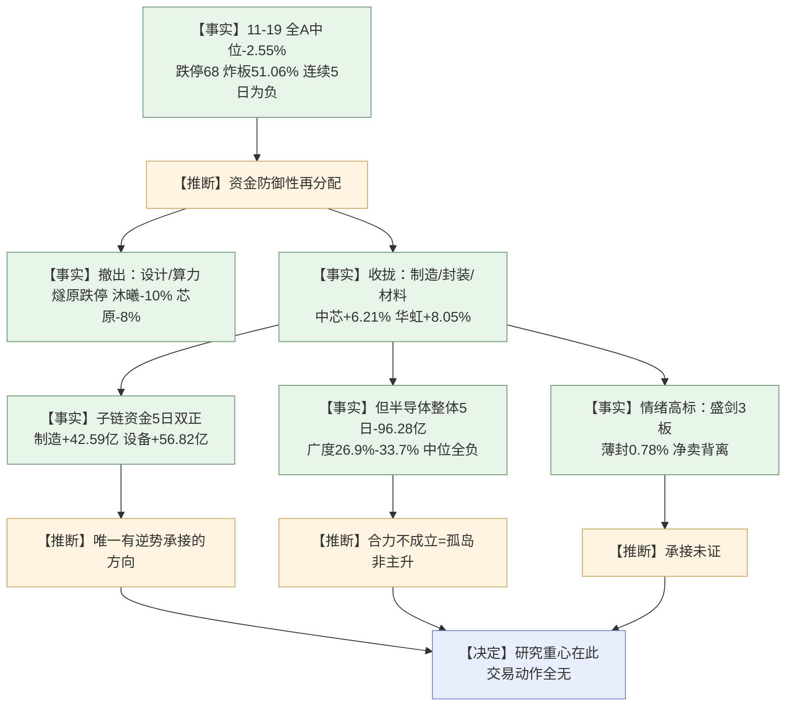
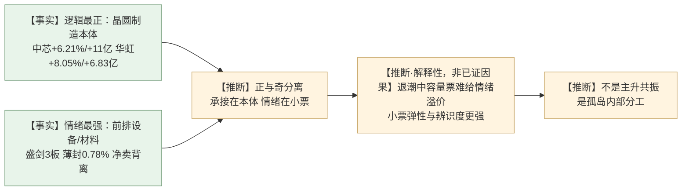
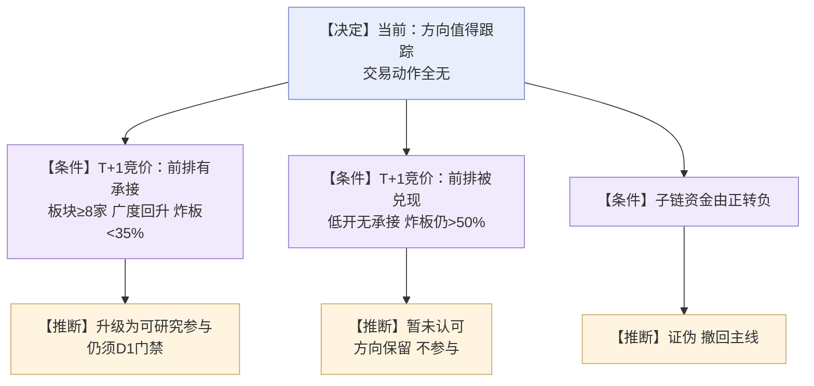

# 守正出奇 · 20261120 独立研究（非发布）

```yaml
type: shouzheng_chuqi_plan
trade_date: '20261120'
generated_at: 2026-11-20T13:29:21+08:00
source_summary_sha256: 未提供（一次性隔离回放，无签名摘要件；不以占位值冒充）
data_asof: A股事实=2026-11-19T15:00:00+08:00收盘；美股=2026-11-19收盘；feed最晚=2026-11-20T05:45；冻结输入留存上界=2026-11-20T07:08:52.397410+08:00
status: 非发布 · 盘中补制（真实生成13:29，不倒填盘前）
```

> **这份东西不是发布稿，也不是交易授权。**它是一次受限的盘前资料事后回放，只经 stdout 交回，未写生产、未执行、未读盘中与午盘、未调用任何工具或数据源。所有事实来自字段投影，不宣称读全原始语料。

---

## 一、先给判断与动作

**一句话主张：11-19 这段行情的实质不是“半导体主升”，而是退潮中的一次防守性结构切换——资金从设计/算力撤向制造/封装/材料子链，真实承接落在晶圆制造本体（中芯、华虹），情绪高标落在前排设备/材料小票（盛剑）。这条线是当前唯一有逆势承接的方向，值得作为研究重心持续跟踪；但广度、消息面、承接三面都没达到可交易标准。所以今天是研究日，不是参与日。**

**当前动作：**

- 全部对象 = **观察 / 降级 / 拦截**，无一进入“目前适合买入”；
- **执行池为空**（与 R2 同结论，本版独立得出，非照抄）；
- 市场层面的仓位/预算建议一律不采纳为额度：R1 给的 0.1 自称“市场研究建议、非预算”，本版同样不转成仓位或买权；
- **T+1 生效**，11-19 已板票一律不追；观察对象最早只能 11/23 重评，且须 D1 独立门禁与 R6 反证；
- **9 条已核硬否决原样保留**，本版不重新推导、不降级、不豁免。

**事实窗口与关键缺口（逐来源分列）：**

| 来源 | 事实观测时点 | 生成/获知时点 | 状态 |
|---|---|---|---|
| R1 风格 | 11-19 15:00 A股收盘；隔夜美股11-19收盘 | valid_from 06:17:13，外盘获知06:03 | degraded，conf 0.392 |
| R3 情绪 | L1 热榜为 11-19 晚榜；检查窗口 11-17 15:00–11-19 22:30 | observed_at 06:28:42 | 字段投影 |
| R2 主线 | 11-19 15:00 收盘（E1–E5 全为20261119） | 补做 13:05:20 | partial，conf 0.58 |
| R4 消息 | feed 11-19 18:04–11-20 05:45；美股11-19收盘；公告PDF抓取时分未知 | 补做 12:57:02 | partial，conf 0.62 |
| R5 / R7 | — | — | **未交付**（NaN 序列化失败） |
| R6 反证 | 同上窗口 | 补做 13:11:29 | partial；四项必要审核完成 0 票 |

- 冻结输入最晚留存 **07:08:52** 只是文件留存上界，**不是行情截至时刻**；各源覆盖窗口不同，已逐行标注。
- 本版**没有 11/20 竞价、开盘、盘中任何数据**；11-20 实际强弱在盘前判断时完全未知，本版不填补。
- R5、R7 缺席 → 财务红旗、第三方资金口径均无法形成，凡涉及一律标未知，**缺证不记为安全**。

---

## 二、这一段行情在交易什么

11-19 是一个“指数不跌、个股大跌”的缩量退潮：全 A 中位 **-2.5514%**，649 涨 / 4876 跌，跌停 **68** 家、涨停 **23** 家、炸板率 **51.06%**、封板率 48.9%，最高板仅 **3 板**，成交缩到 **1.31 万亿**；连续 5 个交易日全 A 中位为负。但指数被权重和科创护住（上证50 +0.32%、科创综指 -0.33%），**广度并没有修复**。

在这种环境里，市场的动作可以拆成两条互斥的资金流：

- **撤出**：设计/算力端被系统性卖出——燧原 20CM 跌停、沐曦 -10%、芯原 -8.09%、利扬 -10.95%、寒武纪 -1.58%；
- **收拢**：制造/封装/材料端逆势承接——中芯 +6.21%（主力 +11.00 亿）、华虹 +8.05%（+6.83 亿）、中微 +5.05%、长电 +4.74%，前排有格林达、江化微、大港、蓝箭、盛剑封板。

**主要矛盾不是“半导体景气回升”，而是“半导体内部资金从设计/算力向制造/封装/材料再分配”，且这种分配发生在全市场杀跌的背景里，属于防守性收缩，不是普涨进攻。** 这一点决定了它的级别：**逆势孤岛，不是产业主升**。



---

## 三、最硬的逻辑是什么，它硬在哪里、哪里不硬

**最硬的可核事实，是资金分层，不是板块普涨。** 集成电路制造 1日 +24.23 / 5日 +42.59 / 20日 +56.48 亿；半导体设备 +18.55 / +56.82 / +144.54 亿；封测 +14.94 / +4.85 / -12.68 亿；而半导体整体 5日 **-96.28 亿**。同一板块整体流出、子链双正——这是“资金在板块内部换位置”，不是“板块被整体买入”。这条分层事实是本轮逻辑的根。

**传导路径**：BIS 11-16 起 14nm 及以上代工需审批，收紧先进 foundry / OSAT 客户审查 → 国产 12 英寸 FAB 认证与产能利用率叙事；伯恩斯坦上调 2027 全球 WFE 至 2170 亿美元（+39%）→ 设备/材料资本开支预期；阿里称模型将依赖国产芯片 → 国产制造受益。三条都指向“制造/设备/材料”，方向与子链资金的正向一致。

**但消息面并不支持价格面。** 本次 R4 对同一批板块的判断是：**先进封装/光刻胶 = 负面（medium）**，并自述“11/19 该分支逆势上涨，消息面与价格面背离”；**晶圆代工 = 负面（low）**，注明“中芯 +6.21%/华虹 +6%以上，价格面与消息面相反”；**海外算力链/CPO = 负面（high）**。同时隔夜外盘是明确逆风：纳指 -2.25%、AMD -7.7%（做空报告）、英伟达 -3.3% 六连跌。

**所以这条线是“价格 + 子链资金 + 情绪驱动的逆势承接”，不是“消息驱动的产业主升”。** 这决定了它对隔夜外盘更敏感，也决定了它的持续性要打折：3 天、V 型（11-17 11家 → 11-18 3家 → 11-19 11家）、高度仅 3 板、广度 26.9%–33.7%、中位全负。

**最强反证有三条，都必须摆在台面：**

1. **广度证伪**：先进封装 215 只 32.1% 上涨 / 中位 -1.10%；光刻胶 83 只 33.7% / -0.89%；光刻机 52 只 26.9% / -1.74%；存储 208 只 30.8% / -1.29%。前排封得住、后排杀跌，“合力来自全市场”不成立。
2. **承接未证**：龙一盛剑 3 板，但封单/流通仅 **0.78%**、换手 20.00%、命中龙虎榜上涨净卖背离，公司已澄清光刻胶收入占比 4.41%；龙二中京只是首板，而全市场 1→2 晋级率 **5.71%**、首板次日收盘中位 **-0.84%**、开→收中位 **-2.81%**——首板本身就是当日被罚通道。
3. **环境逆风**：炸板 51.06%、跌停 68 家、连续 5 日负中位、成交缩量；隔夜 AMD/NVDA 领跌 AI 硬件。开盘有外部反证。

**结论：方向值得跟踪，逻辑尚未成立为可交易主线。硬的是资金分层的事实，不硬的是广度、消息、承接。**

---

## 四、谁在承载它：正与奇的分工，不是谁对谁错

这里必须诚实面对一个错位：**逻辑最正的地方与情绪最强的地方，不是同一批股票。**

- **逻辑最正、承接最真**：晶圆制造本体——中芯（+6.21%，主力 +11.00 亿，流通 2446 亿）、华虹（+8.05%，+6.83 亿）。它们是制造端直接受益者，且当天有真实大单容量承接。但它们是容量票、不在 leaders 名单、无逐票门禁，**本版只能作为“承接事实”记录，不构成交易候选**。
- **情绪最强、承接最弱**：盛剑科技（3 板）——高度全市场最高之一，但薄封 0.78%、换手 20.00%、净卖背离。**高度是真的，承接是弱的。**



这个分工本身就是结论：**主升的特征是本体与情绪核心同向共振、广度扩散；现在只有本体承接 + 前排封板 + 后排杀跌，所以它是结构性孤岛，不是主升。** 这不意味着市场选错了载体，而意味着这一段行情的“奇”（情绪表达）跑在了“正”（产业承接）前面——**出奇的机会要等承接验证，不是现在追高度。**

---

## 五、候选横向比较：为什么没有一只同时过关

按“承接质量优先于高度”的独立排序（这是我的取舍，与“谁板高谁核心”的直觉相反，理由是退潮环境里承接比高度稀缺）：

| 对象 | 逻辑/受益真伪 | 市场表达（承接质量） | 主要反证 | 当前动作 |
|---|---|---|---|---|
| 盛剑科技 603324 | 半导体工艺设备/废气处理；光刻胶占比 4.41%（公司澄清），概念部分借势 | 3板高度龙一，09:37 首封 0 开板 | **薄封 0.78% + 换手 20% + 龙虎榜净卖背离** → 高度成立、承接未证 | **降级**（高度标杆，非承接核心） |
| 中京电子 002579 | PCB/封装基板；先进封装/存储/PCB/CPO 五概念交集，归因不唯一 | 首板但 **0 开板 + 封单 14.23% + 主力5日+2.70亿/超大单+2.90亿**，封板质量第一档 | 首板受罚通道（1→2 仅 5.71%）；五概念并列=共识证据不足 | **观察·优先级高于盛剑**（结构好、通道差） |
| 格林达 603931 | 显影液/光刻胶配套（非本体）；PE 47.49 | **09:31 早封 + 换手 8.16% + 封单 14.50%（本线最高封单比）** | 5日主力仅 +0.98 亿，资金体量不足以单独领涨；早封低换手可能是锁仓也可能是无人接力 | **观察**（结构最好、资金最小） |
| 江化微 603078 | 湿电子化学品/光刻胶配套；PE 110.48 | 5日主力 +3.56 亿（本线最大、4/5 正），封单 8.14% | **13:06 尾盘才首封**，日内时点最弱，属追价末端 | **观察**（资金强、时点弱） |
| 海立股份 600619 | 主业家电零部件，**光刻机为概念交叉**，受益真伪偏弱 | 光刻机 52 只唯一涨停 + 热榜 +59 位 + 超大单5日+5.50亿 | 开板 2 次、换手 21.43%；题材交叉承担主线 β 依据不足 | **观察**（情绪样本，非逻辑载体） |
| 中芯国际 688981 / 华虹 688347 | **制造端本体，逻辑最正** | +6.21%/+11亿、+8.05%/+6.83亿，真实容量承接 | 容量票、非情绪核心、**不在 leaders、无逐票门禁** | 仅记录承接事实，**非候选** |

**读法**：真正同时满足“逻辑正 + 承接真 + 身位够 + 不在受罚通道”的票，本轮是 **0 只**。逻辑最正的（中芯/华虹）不是情绪核心；情绪最强（盛剑）承接最弱；承接质量最好的（中京/格林达）只是首板或资金太小。这就是“执行池为空”的真实原因，不是凑不出，是**没有一个对象站得住四关**。

**逐票的预期差与退出边界（缺价不编）：**

- **盛剑**：预期差在“3→4 板是否由板块继续给 ≥8 家涨停支撑”，单靠薄封易一日游；介入前提是竞价不被先手兑现 → 现为降级。
- **中京**：预期差在“首板能否晋级二板”，厚封 0 开板是真实承接，但通道是当日被罚的首板；须 T+1 竞价有承接量才谈晋级。
- **格林达**：预期差在“早封低换手是锁仓还是无人接力”，次日不高开即证伪锁仓。
- **江化微**：预期差在“尾盘板须竞价强开才成立”。
- **海立**：预期差在“热榜 +59 是试仓还是共识”，无早盘封单则易回。

价格约束：材料只给 11-19 收盘价（盛剑 25.19、中京 12.17、格林达 29.15、江化微 26.86、海立 15.07），**这是带日期的参考，不是今日价，也不据此给止损位**；R2/R6 均明确不出买卖点，本版同守此线，止损与买点交 D1 用真实竞价重定价。

---

## 六、什么会改变这个判断

今天是“资金先行、消息未确认、承接未验”。要把“暂未认可”和“逻辑证伪”分开，不能用一个动作处理三种情况：

| 情景 | 触发证据（T+1 / 11-23 起） | 判断变化 |
|---|---|---|
| **预期兑现 / 升级** | 竞价显示前排真实承接（盛剑不被兑现、中京/格林达有承接量），板块当日再给 ≥8 家涨停，广度回升、炸板率回落 <35% | 方向从“孤岛”升级为“可研究参与”，**仍须 D1 独立门禁，不是本版授权** |
| **暂未认可** | 竞价低开闷杀、前排炸板、广度仍 26%–33%、炸板仍 >50% | 判定“外盘压制下的暂未认可”，**方向保留研究，不参与** |
| **证伪 / 撤回** | 制造/设备 5 日资金由正转负；前排全线炸板或大幅低开无承接；板块涨停从 11 家塌到 ≤3 家且广度继续恶化 | **撤回主线主张**，不硬扛 |
| **正常波动** | 单票回踩但子链资金与本体承接未变 | 不改变方向研究资格；**风险退出一笔 ≠ 删除方向研究** |



---

## 七、今天与此前相比

**首次建立。** 本目录此前无已独立验收的版本，本版不借原 D1 名单、不伪造连续跟踪；后续报告才读本目录前一份真实日报来维护逻辑。因此“延续/增强/削弱”暂无对照，写**未核**；本版只对被要求保留的既有事实（硬否决、T+1）负责。

---

## 八、边界、硬否决与买权

- **本版非发布**：一次性受限盘前事后回放，stdout 交付，未写生产、未落 JSON、未进执行链；不生成/修订 `watchlist_plan`，不改原版任何对象。
- **市场建议不授买权**：R1 的 0.1 是市场研究建议；本版所有评分、覆盖标记、完成标记只说明研究质量，**不授予或剥夺交易资格**。R6 四项必要审核完成 0 票、R2 执行池为空，均不构成买入许可。
- **T+1 生效**：11-19 涨停 23 只与连板梯队一律不追；观察对象最早 11/23 重评，且须 D1 独立门禁；停牌对象复牌后另行核价。

**已核硬否决（R4 公告 PDF 原件，本版原样保留、不重新推导、不豁免）：**

| 代码 | 名称 | 否决理由 |
|---|---|---|
| 605255.SH | 天普股份 | 2026/1 证监会立案；11/19 复牌；前三季营收 2.115亿(-8.17%)、归母 -1593.33万、PB12.44 |
| 300147.SZ | *ST香雪 | 11/19 广州中院裁定受理重整；11/20 叠加退市风险警示 |
| 600703.SH | 三安光电 | 累计冻结 13.12 亿股占总股本 26.30%，轮候冻结合计 166.81% |
| 002229.SZ | 鸿博股份 | 子公司被诉货款 2.7739 亿 + 资金占用损失 2754.31万，未开庭 |
| 688801.SH | 燧原科技 | 3 日跌幅偏离≥30%；无限售流通仅 1790.03万股占 4.1595% |
| 600567.SH | 山鹰国际 | 11/19 停牌筹划重大事项 |
| 000635.SZ | 英力特 | 11/20 继续停牌 |
| 600185.SH | 珠免集团 | 继续停牌 |
| 002122.SZ | ST汇洲 | 11/20 停牌一天 |

---

## 九、折叠：完整论证与出处审计（供复核，不必通读）

<details>
<summary>逐票出处与反证映射（R2/R3/R4/R6 字段投影）</summary>

- 盛剑 603324：Tushare limit_list_d 20261119、limit_step、ths_member 886009.TI、moneyflow 20261023-20261119；封板字段 fd_ratio_of_float=0.0078、turnover 20.0044；净卖背离源为同 run R7.log，非签名件。R6_M2_02 判 strong_suggest。
- 中京 002579：theme_anchors 先进封装 anchors[0]；limit_list 首封 102721、0 开板；封单字段 1.01亿 vs 14.23% **不自洽**，本版以占比为准，绝对额待核（R2 已标系统性单位问题）。R6_M2_01、R6_M7_01（跨版 F9/F10/F3，第三手证据）。
- 格林达 603931：首封 093117、开板 1 次、换手 8.1568%、封单 14.50%；mf5 +0.98 亿。
- 江化微 603078：首封 130646（尾盘）、0 开板、封单 8.14%、PE 110.48；mf5 +3.56 亿。R6_M2_06、R6_M3_01。
- 海立 600619：ths_member 886054.TI 光刻机唯一涨停、热榜 +59；开板 2 次、换手 21.4262%；主业家电零部件。R6_M2_09。
- 中芯/华虹：R2 leader_structure，非 leaders 成员，本版不计入候选审核，仅作承接事实。
- 板块广度/资金：R2 metrics line_breadth、sector_flows_yi（Tushare moneyflow_ind_dc 20261023-20261119 逐日重算，原 run 字段投影）。
- 消息面：R4 sectors_catalyzed 先进封装/光刻胶=负面(medium)、晶圆代工=负面(low)、CPO=负面(high)、存储=交织、设备=交织；E002 阿里 capex 可能下调、E003 美股 AI 硬件下跌、E004 BIS 11-16 新规。

</details>

<details>
<summary>为什么“执行池为空”不是偷懒</summary>

按纪律，炸板率 ≥35% 时候选须砍半；本轮炸板 51.06%，可交易候选砍半为 0。叠加：①龙一命中龙虎榜净卖背离 + 薄封 0.78%；②龙二只是首板（1→2 仅 5.71%）；③广度 26.9%–33.7%、中位全负；④消息面 R4 判负面、与外盘同向偏空。四条同时成立时，任何一只进执行池都是拿个股 α 承担全部回撤，且没有板块 β 缓冲。空池是对这四个事实的诚实反应，不是对全市场的否定——研究观察对象全部保留。

</details>

<details>
<summary>本版与 R6 的差异（不照抄，也不硬反）</summary>

- 中京：R6 给“降级”（首板授龙二与当日赚钱效应相反）。本版给“观察·优先级高于盛剑”，理由是封板质量（0 开板+14.23%）与资金连续性（5日+2.70亿/超大单+2.90亿）确实优于盛剑（0.78%/+0.56亿）。**但两者都不在可买入，差异只在研究排序，不构成执行分歧。**
- 盛剑：R6 判 strong_suggest（高度≠承接），本版同意，并进一步把它降为“高度标杆”而非“承接核心”。
- 硬否决：完全沿用 R6 保留的 9 条，未新增、未豁免。

</details>

<details>
<summary>适用限制与未执行事项</summary>

- 仅适用于 20261120 盘前判断窗口；不适用盘中、午盘或后续交易日；不构成任何交易指令。
- 冻结留存 07:08:52 不是行情截止；11/20 竞价与开盘强弱在盘前判断时未知，本版不补。
- R5、R7 未交付：财务红旗、第三方资金口径缺失，**缺证不记为安全**；中京/真视通的跨版红旗仅作旁证。
- 东财业绩预告为 2026Q3 旧样本，业绩交叉维度失效，不能宣称“今日无业绩催化”。
- BIS 11-16 新规原文未见（媒体转述）；FT 台积电/三星停供仅群聊转述、feed 未证；PCB 短缺为单一底稿。
- 本版未调用任何工具/MCP/记忆/网页/文件读取；所有原日志与 skill 的旧取数写盘指令在本任务均未执行；未读 D1 名单，`in_today_plan` 一律 null。
- 角色规范中的示例证券/价格未被当作本日数据；本版所有代码、价格均出自本批已核材料或字段投影。

</details>

---

**一句话收尾：11-19 值得守的“正”，是资金在退潮中向制造/封装子链收拢这条可核的分层事实；需要出的“奇”，不是今天去追一个 3 板薄封的龙头，而是承认“承接在本体、情绪在小票”的分工、等 T+1 的真实承接验证。方向留在研究里，买点留给市场验证之后。**