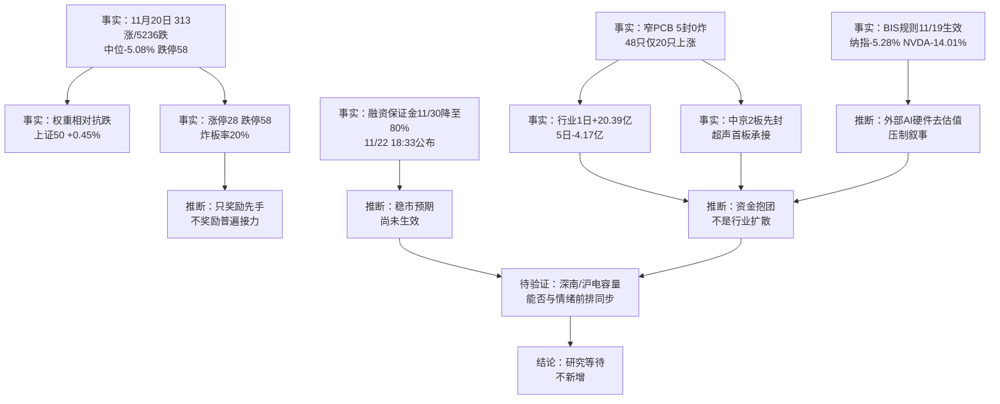
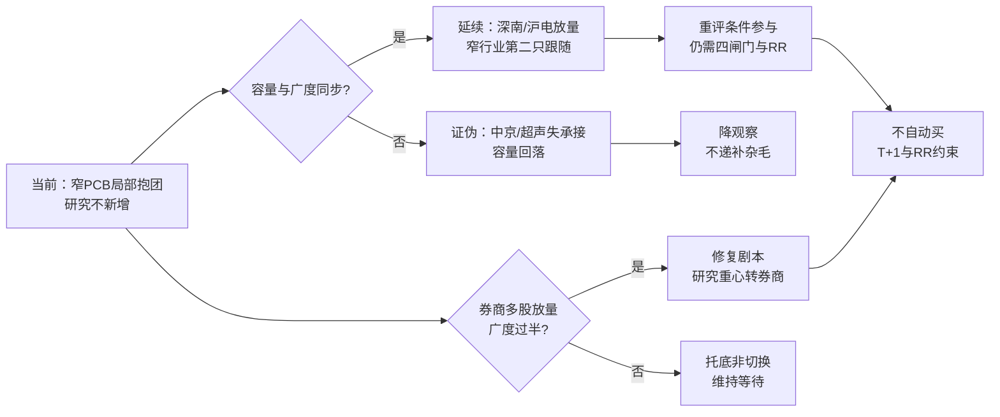

# 守正出奇｜普跌里的窄PCB：资金抱团，不是产业主升

> **手动盘中补制。** 本稿基于11月23日早盘原批留存的11月20日收盘事实，形成开始记录为10:48:16；不含11月23日竞价、开盘或盘中行情，不是早间自动交付，不进入执行。文中“今天”均指11月23日；凡未标明新时点的价格与资金，都是11月20日收盘事实，不是11月23日实时信号。

**适用窗口：** 本稿形成晚于开盘，只用于复核11月20日事实与11月23日首个承接窗口，不把任何买点称为盘前有效；盘中或次日使用必须重新核价、核承接、过四闸门。11月20日事实不会自动延长为11月23日盘中结论。

## 首屏：先给判断与动作

**一句话主张：** 11月20日普跌之后，市场只在窄PCB这一小块地方给出了资金奖励；这是主跌中的资金抱团，不是产业主升。值得守的是“高端PCB产能与盈利”这条根，不是“AI PCB”这个标签；当前动作是研究、等待、不新增。

**当前动作：** 研究 / 等待 / 不新增。本版无新买、无减仓、无换仓指令；不改变任何停买、有效预算、仓位上限、T+1、人工确认或执行授权。研究就绪不等于可交易，方向看好也不等于现在买入。

**改变信号：**

- **增强：** 窄行业至少出现第二只有效跟随，深南电路与沪电股份放量同向，全市场广度过半或个股涨跌幅中位数转正。
- **证伪：** 中京电子、超声电子失去承接，深南、沪电容量回落，窄行业上涨家数明显少于20/48。
- **替换剧本：** 券商多股同步放量且广度改善，才讨论“稳市修复”成为主线；只有权重托指数不算。
- **外部压制：** 纳指、费半再急跌，或BIS规则适用范围扩大，风险偏好继续收缩，维持等待。

**关键缺口（可见，不藏）：** summary为partial；R1/R2/R3为degraded，R4/R5/R6/R7为partial；R2对窄PCB的交叉验证只有R7资金一项同向，R3未共振、R4无同向正催化；R7主力双口径分歧、DataPro 4013、SOX缺失；催化剂日历不可用；独立宏观包未核；11月23日竞价与盘中未核。

## 这段行情在交易什么

先看事实，再看推断。11月20日是A股标准收盘日，也是11月23日之前最后一个完整截面：

| 11月20日事实（收盘） | 数值 | 对11月23日的含义 |
|---|---|---|
| 全市场广度 | 313涨、5236跌、23平；中位-5.08%；跌超5%的2863只 | 普跌，不是普通震荡；个股中位数与昨涨停池中位同为-5.08% |
| 涨停/跌停/炸板 | 涨停28、跌停58、炸板7；炸板率20%；梯队1板25、2板1、4板2、无3板 | 接力断层；只有少数高度，没有中间梯队 |
| 昨涨停池反馈 | 23只收盘中位-5.08%；首板18只仅1只晋级 | 先手也普遍亏，日内追价更差 |
| 指数 | 上证-1.23%、深成-3.09%、创业板-3.54%、沪深300-0.76%、中证1000-4.89%、上证50+0.45% | 权重相对抗跌，不等于全市场企稳 |
| 外盘（11月20日当地盘） | 标普-3.70%、纳指-5.28%、道指-1.93%、恒指-1.89%、韩综-5.21%、日经-5.06%；纳指5日-10.02%、30日-17.35% | 外部AI硬件在去估值，不是普通回调 |
| 政策（11月22日18:33可见） | 融资保证金下限100%降至80%，11月30日施行 | 修复预期有了真实文件，但尚未生效；4000亿元是理论沟通口径，不是已流入 |

这段行情的主要矛盾，不是“有没有主线”，而是**外部AI硬件去估值**与**内部稳市预期**的夹缝里，资金还愿不愿意为一个小板块持续付钱。11月20日给出的答案是：只愿意为窄PCB的少数先手付钱，而且只付了一天——行业单日+20.39亿元，5日仍-4.17亿元；48只成分仅20只上涨，中位-1.02%；5家封板、0家触板失败。

**级别与持续性。** R2的stage_name字段把窄PCB定为“局部轮动早期（非市场主升）”，其lifecycle子模块另写“主升早期”；两处标签不一致，本稿取更保守的stage，不拿lifecycle当交易许可。生命周期记录为运行3天、资金连续3天、炸板率0；这只能说明它刚形成，不足以说明它能扩散。它有三条腿没有站起来：广度只有20/48；5日资金仍为负；R3没有把它放进L1+L2共振，R4对PCB只有BIS和英伟达事件的负面外溢，没有同向正催化。更关键的是，窄行业与广义PCB不是同一命题：东财广义PCB概念单日-6.35亿、5日-82.20亿，同花顺概念-4.85%、仅26/243上涨；窄行业的5封0炸不能外推成行业反转。三条腿里只有资金一条是正的，所以它是**抱团**，不是**主线**。

**外部约束不能偷换为PCB利好。** BIS远程访问最终用途规则于11月19日美东生效，R4把PCB列在负面外溢；加州对英伟达的传票、NVDA单日-14.01%、纳指-5.28%，是估值和风险敞口冲击。R4另外保留了“远程算力新增许可边界带来国产替代观察”的正向条件分支，但那是同一事实的条件分支，不是第二件事；不能把负面外溢改写成“国产PCB订单增加”。本稿未核到可用的国内CPI、PMI、信贷数据，宏观判断只能以市场风险偏好为主，不能声称已完整覆盖经济周期。

## 最硬的逻辑与市场实际选择

最硬的逻辑不是“AI PCB”四个字，而是**高端PCB的产能与盈利稀缺性**。可核的事实是：深南电路PCB收入占55.91%、毛利率36.85%、利润占比66.44%；沪电股份窄行业5日资金第一、+13.83亿元；窄行业5封0炸。它们说明高端产能有真实盈利基础，但不说明11月23日还有增量订单；R2自己写得很清楚：“涨价传导仅为解释，未证订单”。

市场实际选择的是**情绪前排**：中京电子2板、9:36:24首封、4家窄行业同伴随后封；超声电子首板、10:00:45首封、零开板、单日+8.11亿元、龙虎榜净买+4.41亿元。市场买的是“低位+速度+承接”，不是“收入占比+毛利率”。

于是出现分工：**情绪核心**中京、超声承载传播，**容量核心**深南、沪电承载逻辑。奇正尚未合一。对交易而言，最忌讳的是用情绪核心的2板去证明产业逻辑，或用容量核心的抗跌去替代情绪承接。

**横向排序（R2研究分，不是买入排序）：**

| 顺位 | 方向 | R2分 | 已核事实 | 本版结论 |
|---|---|---|---|---|
| 1 | 窄PCB | 74 | 5封0炸；20/48上涨；1日+20.39亿、5日-4.17亿 | 研究首选，不交易 |
| 2 | 先进封装 | 63 | 盛剑4板四开、封单0.43亿、3日龙虎榜净卖 | 高位分歧，不参与 |
| 3 | 算力租赁 | 56 | 真视通4板零开，租赁仅它一封 | 孤板温度计 |
| 4 | 人形机器人 | 55 | 11月22日16:40赛事传播，概念-5.44%、热榜11月22日降至11 | 注意力观察 |
| 5 | 猪肉及农业 | 54 | 东方海洋水产首板、金新农猪肉封板、万向德农种植封板 | 多支链，防御观察 |
| 6 | 证券 | 52 | 政策强，11月20日无板，中信5日-4.72亿 | 修复剧本 |
| 7 | AI应用 | 52 | 龙版传媒首板，广义AI应用弱 | 观察 |

### 情绪前排：市场选中的“奇”

| 对象（11月20日收盘） | 市场为什么选它 | 逻辑真伪与主要反证 | 当前动作/等待条件 |
|---|---|---|---|
| 中京电子 002579，13.39元，流通78.12亿 | 窄行业唯一2板，9:36先封，4家同业随后封；2板零开，封单2.04亿；东财1日+2.37亿、5日+5.35亿 | 100%PCB但毛利率仅11.87%；R6模式7四项红旗：应收+22.1%对营收+1.8%、存货+37.3%、应收/营收44.7%、有息负债/净资产101.0%；D1如拟纳入执行按原规则剔除；异动公告称基本面未重大变化 | 只作高度温度计；不列执行对象；若孤板或高开回吐，降观察 |
| 超声电子 000823，18.51元，流通110.12亿 | 首板首个窄行业助攻，10:00:45首封零开；单日+8.11亿、龙虎榜净买+4.41亿；窄行业5日第3 | 首板隔日历史仅1/18晋级；19.95%换手；F4存货+34.6%对营收+15.2%、周转3.39对上年3.66下降；不是2板高度 | 研究；只有弱转强且出现第二只跟随才谈接力；不盲追 |
| 真视通 002771，15.82元，流通28.57亿 | 算力租赁4板零开，封单1.59亿；xTick单日+3.90亿 | 租赁实测仅它一封，无同群；28.57亿在20—50亿警示区；F3；孤板不等于主线 | 高度温度计；不接力；同群仍无第二只则降观察 |
| 盛剑科技 603324，27.71元，流通40.42亿 | 先进封装4板，9:25:01首封 | 4次开板、封单仅0.43亿、3日龙虎榜净卖0.42亿；公告否认光刻胶，相关收入仅4.41%；4日+46.38%风险提示；40.42亿警示区 | 拦截/不参与；只作高位分歧样本 |
| 东方海洋 002086，3.75元，流通59.29亿 | 农业篮子最早封，9:42:06首封零开；单日+5.63亿、龙虎榜净买+3.14亿 | 实际水产，非猪肉也非种植；23.83%换手；30日内15次上榜；农业未形成同支链 | 防御轮动观察；不因“农业”标签追价 |
| 长华集团 605018，10.26元，流通48.23亿 | 人形机器人首板，10:14:31首封零开；11月22日16:40群聊传播南京赛事 | 概念近端-5.44%、热榜排名11月22日降至11；单板、换手仅2.47%、封单0.35亿；赛事传播不是订单 | 注意力观察；不参与 |

### 容量与竞争剧本：逻辑的“正”

| 对象 | 硬逻辑/事实 | 反证/约束 | 当前动作 |
|---|---|---|---|
| 深南电路 002916，210.00元，流通1396.16亿 | PCB收入55.91%、毛利率36.85%、利润占比66.44%；11月20日-0.59%相对抗跌；5日窄行业资金第2、+9.05亿；R2定为容量核心 | 1日Tushare+3.38亿对xTick-1.55亿，口径分歧；F4存货+106.9%对营收+53.8%、周转2.34对上年2.98下降；1396亿弹性有限；未封板 | 容量验证锚；放量同向且窄行业跟随才谈右侧；不低吸 |
| 沪电股份 002463，收盘价本批未核，流通1552.26亿 | 5日窄行业资金第1、+13.83亿；11月20日-0.96%、1日+3.27亿；11月18日有板 | 未封板；业务数据本批未核；F9应收/营收41.55%；前序资金不等于主动承接；收盘价未核不编 | 容量资金锚；与深南同向确认才提升方向；不单独追 |
| 中信证券 600030，流通3091.63亿 | 证券成分，11月20日+0.79%相对抗跌；融资保证金下调11月30日生效 | 无板；东财1日-0.41亿、5日-4.72亿；证券5日榜第47；政策未生效，4000亿非流入 | 修复剧本容量锚；券商多股放量且广度过半才升级；否则托底 |
| 国泰海通 601211 | 11月20日+0.61%，与中信对照 | 资金迁移未证；无板 | 同剧本对照；不单独行动 |
| 金新农 002548、万向德农 600371 | 猪肉唯一封板、种植唯一封板；农业内部多支链 | 东方海洋是水产；三支不同链，不能合并为“农业主线”；无连续合力 | 防御观察；不合成主线 |
| 拓荆科技 688072、华天科技 002185 | 拓荆收购获注册，11月20日批文、11月21日披露；华天配套融资报告11月21日 | 11月20日拓荆-3.56%、设备组仅2/25涨；华天-6.31%；公告不等于订单或产能；融资有稀释 | 事件观察；不进PCB或封装核心 |

**受益证据分层。** 中京有100%PCB收入与11.87%毛利率；深南有55.91%PCB收入与36.85%毛利率；超声、沪电在本批R2没有嵌入同等主营证据，标签不等于受益证明；真视通、盛剑、长华的事件与主营关联也未逐项核。这一层不补齐，就不能把“板数”或“资金排名”当成产业逻辑。

**预期差放在一句话里：** 中京的预期差是“2板能否带出第二只”，不是“PCB收入占比”；超声的预期差是“首板能否变成容量”，不是“首板涨幅”；深南的预期差是“容量能否与情绪同步”；沪电的预期差是“5日资金第一能否转成价格”。四者都没有被11月23日的竞价或盘中证实。

**T+1博弈。** 中京的2板是卡位，超声的首板是助攻和弹性；真视通的4板是高度，但没有同群助攻；盛剑的四板四开是分歧；深南、沪电是容量联动。次日要看的不是谁开得高，而是：中京能否在分歧中弱转强并带出第二只，超声能否从首板分离成容量，深南、沪电能否联动，盛剑能否止跌。缺一项，接力就不成立；不能用“高开”替代“承接”。

**为什么不是别的方向：**

- **真视通/算力租赁：** 4板最高，但租赁同群只有它一封；R2把算力租赁列为弱支线（56分），真视通是“算力孤板高度对照”。没有群，就没有主线，不能因为板数最高就自动升级。
- **盛剑/先进封装：** 4板但四次开板、封单0.43亿、龙虎榜净卖，公司还否认光刻胶；是高位情绪锚，不是产业核心。
- **券商：** 政策事实强，但11月20日无板、5日资金负；它是“修复剧本”，不是“当前主线”。只有券商多股同步放量且广度改善，才值得把研究重心移过去。
- **机器人/农业：** 一个是注意力事件，一个是防御假设；都缺少价格与资金同向。单板不能证明扩散，标签不能替代合力；农业也不要求与科技机械跷跷板。
- **半导体设备/封测：** 拓荆注册、华天融资是真实公告，但11月20日价格分别-3.56%、-6.31%，设备组仅2/25涨；事件不等于订单，公告不等于板块进攻。

## 什么条件下改判

| 情景 | 触发事实 | 判断 | 动作 |
|---|---|---|---|
| 延续/增强 | 窄行业至少2只跟随；深南、沪电放量同向；广度过半或中位转正 | 从“抱团”升级为“局部主线” | 研究升级；仍需四闸门与RR；不因升级自动买 |
| 暂未认可 | 只有中京、超声强，容量平，第二只不出现 | 抱团未扩散 | 保持研究/等待；不追孤强 |
| 预期兑现 | 容量确认但高开挤掉空间，RR<1 | 逻辑对，交易不对 | 不追；等回踩或放弃 |
| 事实证伪 | 中京、超声失承接，容量回落，窄行业上涨明显少于20/48；或BIS、外盘再恶化 | 抱团结束或外部压制 | 降观察；不递补杂毛；不抄底 |
| 修复剧本 | 券商多股同步放量，广度过半，昨日强票改善 | 政策修复扩散 | 研究重心转券商；仍走四闸门；不假设已成交 |
| 正常波动 | 单日回踩但容量与广度未破 | 原判断未受损 | 维持研究与既有纪律；不为日报新意换票 |

**证伪、预期兑现、暂未认可、正常波动要分开。** 中京或超声一天不涨，不自动证明“PCB结束”；容量与广度同时失守，才是否定“局部主线”。反过来，容量确认但价格已高到RR<1，也不能因为“逻辑对”就追。研究正确不保证交易正确，这是本版与旧稿都要守的边界。

## 交易边界与已有仓位

- **流通市值硬线：** 低于20亿元不参与；20—50亿元为警示区。本批中真视通28.57亿元、盛剑40.42亿元、长华48.23亿元在警示区，市值合格不是豁免。主跌底色下，新仓只有0或极小试仓两档；本版取0新增。
- **T+1：** 11月23日新买不能靠当日退出；跳空可能越过止损，不能用“逻辑更硬”取消。
- **R6：** hard_rejects为空，但formal_review_completed=false、review_passed=false，18只已审、必要审核未全。中京模式7为strong_suggest，四项红旗真实命中；文件明确“D1如拟纳入执行，按原模式7四红旗规则剔除”，并“不可用分歧买点、榜单阴性或辅助缺失抵消”。本版不覆盖这一条件规则。
- **RR与止损：** RR<1拒绝；止损距买价下方5%—10%为硬区间。本版不填伪精确触发价；11月20日收盘价只作带日期参考，不是11月23日买点。
- **账户与预算：** 本批未核真实账户额度或停买；未知不拨正、不补0，不改有效零预算、仓位上限、人工确认和既有执行保护。
- **已有仓位：** 本版没有持仓、成本、可卖数量和T计划，不能判断存量；若已有仓位，按原退出纪律（炸板破均线、日线破20日线等）处理，不能用本稿的长逻辑取消。本版不给清仓、减仓数量或换仓指令。

## 与11月19日相比：根逻辑未换，载体判断要改

本目录上一份有来源凭证的独立稿是11月19日；11月20日没有独立回执，不能拿非发布版冒充连续历史。因此连续性只对11月19日负责。

- **延续：** AI算力与硬件供给的根逻辑仍在。11月19日以“算力交付”为主张；今天仍在这条链条上研究，只是把“租赁运营”换成“PCB硬件承载”来检验。
- **削弱：** 11月19日设想的“租赁同群扩散”没有兑现。本轮算力租赁只有真视通一只封板，4板孤高；华胜天成未进入本批18只研究对象，不能据旧稿断言其强弱，也不能续用旧结论。旧稿的“双锚”只剩一个孤板，不足以维持原主线判断。
- **增强：** 窄PCB 5封0炸，深南、沪电容量相对抗跌，市场把表达从“租赁运营”移向“硬件承载”；但只有资金一条腿，R3、R4没有确认，增强是相对的，不是绝对的。
- **改判：** 若容量与广度不确认，连“硬件承载”也只是抱团；退回等待，不为了维持旧叙事而硬扛。
- **历史边界：** 11月20日非发布版不作为有凭证历史；11月19日之前的观点也不因本稿自动延长有效期。旧收盘价和均线只作带日期参考。

## 折叠：来源、时点、覆盖限制与审计

展开：本稿实际使用的输入、时点与限制

| 输入 | 本稿用途 | 时点与限制 |
|---|---|---|
| `data/research/20261123/research_summary.json`，sha256 `c6f3e859e71aa3540f6e6d5bad021794eafd919a68605527ec3443a0c14374d1` | 确认run、状态、R1—R7路径 | `orchestrator_status=partial`；`contract_checks_passed=true`只说明结构契约，不等于研究全量；R1/R2/R3为degraded，R4/R5/R6/R7为partial；`hard_rejects=[]` |
| R1 `R1_style.json` | 广度、指数、涨停梯队、昨强反馈、风格与情绪、外盘 | 事实日11月20日收盘；美股11月20日当地盘；confidence 0.504；风格“震荡分化型”，情绪“主跌”；sentiment 45不用于仓位 |
| R2 `R2_main_sectors.json` | 窄PCB研究主线、次级支线、候选、资金、广度、交叉验证 | 事实日11月20日收盘；主线1条、次级6条；窄PCB 74分；`confirmed_tradable_main_lines=[]`、`execution_pool=[]`；交叉验证仅R7资金同向；stage与lifecycle标签不一致，本稿取保守stage |
| R3 `R3_sentiment.json` | 注意力与共振、公众号观点、热榜 | 当日四榜未返回；图片OCR 17条超时；PCB仅L1、不在L1+L2；机器人/国产算力/PCB材料是文本关注，不是资金确认 |
| R4 `R4_news.json` | BIS、英伟达传票、融资保证金、回购/注册/融资事件 | 26个可核事实/披露；要闻正文全空、渠道缺口；catalyst_calendar不可用；公告时点与盘面分离 |
| R5 `R5_stock_profiles.json` | 14只逐票画像、基本面红旗、容量/情绪分工 | 18只候选中建14只；图、监管必要来源及若干辅助项按票缺口；`market_context`为局部轮动早期、非主升 |
| R6 `R6_devil_advocate.json` | 反证、四象限、逐票红旗、D1交接条件 | 18只已审；`hard_rejects=[]`；formal_review_completed=false；中京模式7为strong_suggest，文件写明D1如拟纳入执行按原规则剔除；超声/深南F4、沪电F9为soft_suggest |
| R7 `R7_capital_flow_20261123.json` | 主力资金、行业/个股资金、外盘对照 | 主维度最新T-1；DataPro 4013；主力双口径分歧；11月20日两融未齐；SOX缺失；ETF仅代理；confidence 0.2625 |
| `attention_signals.json` | 注意力交叉 | 信号日11月20日，声明滞后3日；不是11月23日实时人气 |
| `emotion_cycle.json` | 情绪温度背景 | 上游phase=high_chop、metrics_date=11月20日；R1重算为main_down；两者差异保留，状态机标签只作诊断，不当作交易指令 |
| 方法 `彭道富/20261112.md`、本目录`README.md` | 问题顺序与写作边界 | 方法不是当前行情证据；不把书中历史案例当作今日事实 |
| 历史 `20261119.md` | 唯一有凭证的上一份独立稿 | 只用于说明延续/削弱/改判；11月20日无回执，不冒充连续历史 |

**宏观覆盖说明：** 本稿的宏观部分只来自本批真实带入的材料：美股与港股、韩日指数，BIS规则，融资保证金通知，汇率与境内商品代理。11月20日汇率中间价6.6748、DXY缺失；黄金代理-4.45%、铜-2.45%、原油+0.87%，均为境内连续映射，不等海外期货，不单独构成周期结论。本稿未核到可用的国内CPI、PMI、信贷数据；独立宏观包未核，不能声称已完整覆盖政策、经济与时局。

**数据口径分歧：** 东财行业资金与问财窄行业同向，但Tushare同花顺广义PCB与问财分桶相反；深南1日Tushare+3.38亿对xTick-1.55亿；中京1日Tushare+2.37亿对xTick+3.87亿；真视通1日Tushare+0.32亿对xTick+3.90亿。本稿分别标注，不把不同口径相加，不用单一口径证明“资金全面回流”。

**未读取与未改变：** 本稿未读取原盘前预案、`watchlist_plan`最终名单、账户、raw、execution、其他报告或外部实时数据；未写原计划JSON、runtime或订单；未改变任何原对象状态。两版对照由用户完成。

**图表验收限制：** 本次会话没有终端执行工具，未运行`scripts/verify_mermaid.py`；两张图使用保守语法，正文保留了等价的判断与情景表。若阅读端不渲染Mermaid，结论不依赖图形。图表中的“事实/推断/待验证”标签是身份说明，不是概率或评分。

**交付边界：** 本稿只写本路径这一份人读Markdown；不进入执行，不形成交易授权，不改变原版、研究、账户或任何订单。
