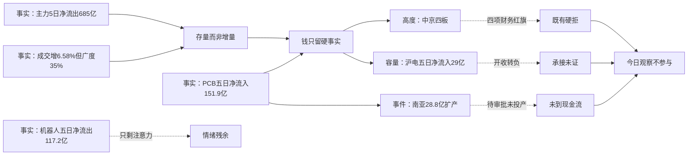
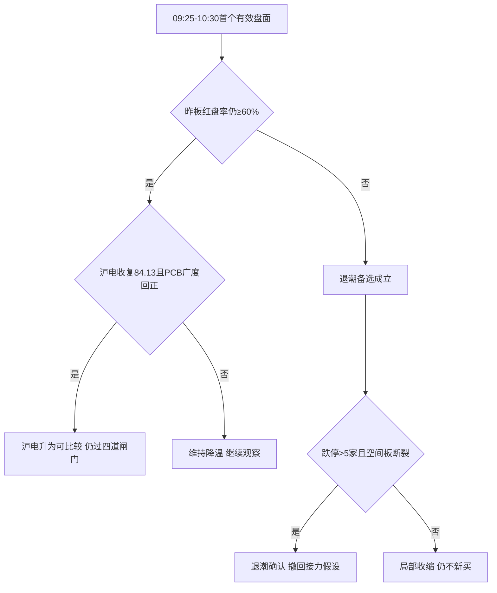

# 守正出奇｜钱只进"板级"，不进"注意力"

> **主张：全市场主力资金 5/10/20 日连续净流出（-685.3 / -2,521.0 / -3,477.8 亿元），却仍持续买入 AI 硬件的板级供给——印制电路板 5 日 +151.9 亿、元件 +152.7 亿、通信网络设备 +101.8 亿；而人气第一的机器人 5 日 -117.2 亿、液冷 -97.3 亿。11/24 恰好暴露这条逻辑的弱点：高度在中京电子、容量在沪电股份、事件在南亚新材，三者脱节。所以今天值得守的是"板级供给"这条根，值得做的动作是**观察与等承接**，不是买入。**

**本版动作（人读研究，不进入执行、不写 plan JSON、不改任何授权）**

| 对象 | 11/24 收盘事实 | 本版身份 | 今日动作 |
|---|---|---|---|
| 沪电股份 002463 | 84.13 元，+1.73%，开 90.66 收 84.13（开收 -7.20%），贴日低 83.80 | 板级供给的**容量锚** | **进 watch**，等有效承接 |
| 中京电子 002579 | 16.20 元，唯一 4 板一字，成交 8.33 亿（前 5 日均量 0.79 倍） | 市场选择的**高度锚**，同时命中 4 项财务红旗 | **进 watch**，标注既有硬拒条件，不参与 |
| 信科移动 688387 | 9.45 元，+3.62%，未封板 | 6G 试点 + 真金增持的**出奇观察** | **进 watch**，等市场表达 |
| 长华集团 605018 | 12.42 元，3 板一字，成交 0.618 亿、换手 1.06% | 注意力核心，产业证据为负 | **降级观察**，不接力 |
| 中际旭创 300308 | 417.00 元，-0.05%，开 463.20 收 417.00（开收 -9.97%） | CPO 容量反证 | **不进** |

**窗口与缺口：** 本文于 2026-11-25 07:19 盘前形成，早于 09:25 竞价，**不是盘中补制**。适用窗口为 11/25 09:25–10:30；出现首个有效可比盘面或重大新反证即重评，到点自然失效。缺口：11/25 竞价与盘中未核；独立宏观包未核（只用本批研究真实带入的政策、经济、跨资产材料，不宣称宏观已完整覆盖）；绑定催化剂日历本交易日不可用；R5 逐票合规原文覆盖按对象留缺；图片 OCR 本批 67 张全部失败，群内图片主题未核。

## 一、这一段在交易什么：存量在收缩，钱在往有硬事实的地方挤

先摆事实，再讲判断。

| 11/24 事实（Tushare 口径，收盘） | 数值 | 对今天判断的约束 |
|---|---|---|
| 涨/跌/平 | 1,952 / 3,498 / 126（n=5,576） | 广度 35.01%，前一日为 83.63%；中位 -0.67% |
| 沪深成交额 | 16,548.62 亿元，环比 +6.58% | 放量没有换来扩散，是"换手"不是"增量" |
| 涨停 / 跌停 / 未回封 | 55 / 2 / 68；炸板率 68/123 = 55.28% | 追价者当日被套，已触及既有缩减纪律 |
| 梯队 | 4 板 1、3 板 4、2 板 25（连板 30），首板 25 | **连板 16→30、首板 130→25**：存量挤向前排 |
| 昨涨停池 146 只 | 开盘中位 +3.72%、收盘中位 +3.26%、109 只红、30 只续板、开收中位 0%、8 只跌超 9% | 溢价在开盘前形成，盘中无增量；但红盘率 74.66% 不等于亏钱效应扩散 |
| 指数分化 | 上证 +0.27%（3,548.37）、科创50 +1.81%、创业板开 +3.88% 收 -0.05%、中证500 -0.27% | 单看指数翻红会漏掉中位 -0.67% |
| 全市场主力 | 11/24 -37.89 亿（超大单 +91.31 亿被大单 -129.20 亿抵消）；5 日 -685.31、10 日 -2,521.02、20 日 -3,477.79 亿 | 11/23 单日 +269.63 亿是修复日的孤立回补，不是趋势转向 |

这条时间线的形状很清楚：11/18（中位 -1.20%）→ 11/19（-2.55%）→ 11/20（-5.08%，2,856 只跌超 5%、303 只跌超 9%）是主跌；11/23 一根强修复（中位 +2.41%、146 涨停、高度 5）；11/24 放量分化，把修复日的战果削掉一半。

**主要矛盾不是"科技还行不行"，而是"总量资金在持续离场时，还愿意为哪种东西留下"。** 全市场主力 5/10/20 日全负、11/24 又是净流出，但局部板块可以 5 日净流入百亿量级——这说明钱没有消失，只是拒绝摊开。**这一段交易的是"存量对稀缺硬事实的集中"，不是"新一轮主线的扩散"**；11/24 连板层增厚而首板层塌缩（早盘 09:35 前只有 5 只首板），正是这种集中最直观的形态。

**情绪阶段（原生六态，只定温度，不授买权）：降温，事实日 20261124**，来源 lianban:qingxu（as_of 2026-11-25T06:06:17+08:00，sha256 209eb916…3ba4），公开正文**未明示收盘或盘中估算**（edition 未知），**目标日盘中估计缺失**。已绑定 display_prior 从"降温"出发：修复 11% / 升温 16% / 高潮 17% / 降温 17% / 退潮 31% / 冰点 7%，六项合计 99%，**页面取整频率，不归一、不补余量，分母未核**。同景样本条件为"上证收盘低于 250 日线 + 降温第 1 天"，n=82，基础首位退潮 34% / 高潮 17%，**精确逐格计数与其余去向未核**；exact_transition_matrix 本批未提供。

**我对目标日 20261125 的选择：首选"降温"，备选"退潮"——与页面基础首位（退潮 31%）不同，理由与反证见第六节。**

## 二、根在板级供给，不在注意力

先看 11/24 的钱到底进了哪、出了哪（东财订单口径，亿元）：

| 方向 | 当日 | 5 日 | 当日板块涨跌 | 读法 |
|---|---|---|---|---|
| 印制电路板（行业） | +33.92 | **+151.87**（5 次正） | -0.42% | 钱在进、价没跟：最典型的"未被价格兑现的集中" |
| 元件（行业） | +30.47 | **+152.72** | -0.23% | 同上，与 PCB 同源，不重复当两条独立证据 |
| 电子（行业） | +64.73 | +120.93 | +0.87% | 大类层面确认，成分重叠不加总 |
| 通信网络设备及器件 | +17.15 | **+101.82** | +0.76% | 6G 试点当日，钱先进、表达未出 |
| 消费电子零部件及组装 | +25.62 | +22.87 | +1.96% | 折叠屏新品对应，但订单未证 |
| 半导体 | +10.74 | **-24.36** | +1.08% | 单日回补、5 日仍负：隔夜费半 -7.9% 前的仓位不是"持续买" |
| 机器人概念 | +20.80 | **-117.18**（5 日仅 2 天正） | +0.78% | 人气第一、资金持续走 |
| 液冷服务器 | +10.14 | **-97.27** | +0.88% | 次线分支，同样是单日回补 |
| 人形机器人 | +8.90 | -38.18 | +1.58% | 概念热度与资金方向相反 |
| 机器人执行器 | -1.49 | — | +2.19% | 涨幅最好、资金净流出：纯情绪定价 |

这张表推翻了一个看起来顺手的结论："人气第一 = 主线"。**人形机器人概念连续同榜第一（R3 标注为拥挤警报，不构成派发结论也不加正分），但 5 日资金净流出 117.2 亿、涨停从 67 家收缩到 19 家；11/24 当天四份公司公告全是产业否证——长华执行器相关收入约 8.8 万元、行星滚柱丝杠在研无定点无营收；克来机电明确不涉人形机器人产品；柯力传感机器人力学传感器收入占比不足 1%；亿嘉和援引前三季亏损 2.17 亿元。**这是注意力定价，不是产业承接。**它不假，但它属于另一套证据体系（辨识度、合力、接力），不能用"机器人是未来"替它兜底，也不能用它的连板去证明板级供给。**

反过来，板级这一侧的硬事实是本批新增、可核、且落在现金流与产能上的：南亚新材董事会通过 28.8 亿元高端覆铜板建设（尚需立项/环评/施工许可，未投产）；胜宏科技拟 10 派 10、约 9.83 亿元，占前三季归母 29.04%；工业富联拟前三季派现 132.85 亿元，占前三季归母 32.90%；沪电股份前三季收入 232.25 亿、归母 56.22 亿、PE 24.19；行云科技签 2.9856 亿元五年算力服务合同（服务器已验收，首付款与履约保证金 2,488 万元到账未知）。**这五条里，四条是产能、分红、利润，一条是订单；没有一条是"题材标签"。**

宏观这一侧，本批能带进来的只有这些，我不做超额解读：美国贴现率会议纪要显示 10 月 FOMC 前八家地区联储董事会曾建议上调至 4.25%，理事会维持 4%（历史偏紧偏好，不是新加息）；同期纽约金 -2.23%、银 -5.12%、沪金夜盘 -2.59%、沪银 -6.77%，21 个观测区间金 -9.6%、铜 -14.7%、油 -22.2%；央行预告 11/25 开展 5,000 亿元 7 天逆回购与 8,000 亿元 1 年期 MLF（**两条公告合并只说明同日操作窗口，未核净投放，不是股市增量**）；商务部把 2024 年第 46 号公告第二款自 11/28 起暂缓至 2027/1/27（不是全部撤销）；欧盟对进口混动汽车保障措施初裁拟 12/1 起临时措施；霍尔木兹条件趋紧、WTI/Brent 1 月合约 +2.35%/+2.27%。合起来支持的是"风险偏好受压、高久期估值更敏感、结构性而非普涨"，**不支持"宏观转暖"**。独立宏观包未核，这一段只到这里。

## 三、载体：先承认市场选了什么，再分辨谁能承载

市场 11/24 的选择很清楚：唯一 4 板给了中京电子，注意力给了机器人（长华 3 板一字、福莱 2 板回封）。这不是误判，它是真实表达。**"守正"守的是板级供给这条根；"出奇"是承认表达未必等于可承载——但不能反过来用"财务纯度"钦定另一个龙头。**

| 主线内对象 | 11/24 事实 | 为什么可能是核心 | 最重要的反证 | 动作 |
|---|---|---|---|---|
| **沪电股份 002463** | 84.13 元 +1.73%；成交 89.12 亿；5 日东财 +29.02 亿（可见成分第一）；相对 MA20 +0.93%（由收盘与相对值反算约 83.35） | 主营 PCB 直接映射；PE 24.19、前三季归母 56.22 亿；位置低、资金累计最厚；研报 45 行、调研 99 行 | 开 90.66 收 84.13，开收 -7.20% 且贴日低 83.80；东财 +6.09 亿与 xTick -0.52 亿口径冲突；成交不等于承接 | **进 watch**，等收复 84.13 且同伴回正 |
| **中京电子 002579** | 16.20 元 4 板一字，0 开板，成交 8.33 亿，换手 8.81%，流通 94.52 亿；5 日东财 +9.90 亿 | 市场唯一高度；PCB 是资金 5 日唯一持续净流入方向 | 应收 +22.08% 对营收 +1.83%（F3）、存货 +37.31% 且周转 3.15→2.79（F4）、应收/收入 44.69%（F9）、有息借款/归母权益下界 101.02%（F10）；前三季归母 -1.17 亿、PE 失效；一字锁价成交仅前 5 日 0.79 倍 | **进 watch**，标注：若纳入即触发原有 ≥4 红旗规则，不得覆盖、不得用低位票填空 |
| **南亚新材 688519** | 144.95 元 -1.80%；开 159.00 高 162.00 低 144.58；成交 22.56 亿；流通 341.04 亿 | 28.8 亿扩产是该板块 5 日资金流最强处的产业确认；公告 11/24 23:53 首次可知，**11/25 才是首反应日** | 同行资本开支不是订单，更不是利润；尚需审批、投产远；11/24 回吐发生在消息前，隔夜费半 -7.9% 可压过单票利好 | **观察**，不作首推 |
| **胜宏科技 300476** | 122.32 元 +6.27%；开 130.00 高 134.80 低 121.00；成交 84.17 亿 | 10 派 10 显示盈利；问财 5 日样本前列 | 从 130 回落到 122.32，分红不是订单，行业负面不被个股股息抵消 | **观察** |
| **工业富联 601138** | 40.96 元 +6.97%，未回封（Z）；成交 117.08 亿；5 日东财 +33.12 亿；人气双榜第 3 | 132.85 亿派现是现金流事实 | 分红是股东回报信号，不是新增服务器订单；+6.97% 是公告前参照，不能倒因 | **观察** |
| **信科移动 688387** | 9.45 元 +3.62%，未封；成交 4.59 亿；流通 323.07 亿 | 6G 部省协同试点八省市（板块级事件）+ 控股股东 11/24 实买 200 万股/1,899.07 万元、计划合计不超 2 亿；通信网络设备 5 日 +101.82 亿 | 试点不是商用、订单或中标；无第二只、无涨停梯队、热榜未覆盖；收 +3.62% 无法辨识买盘与因果 | **进 watch**（出奇二档），等市场表达 |

对照与不进（同一行讲清"为什么不选它"，不靠名次替代）：

| 对象 | 11/24 事实 | 不选它的理由 | 动作 |
|---|---|---|---|
| 长华集团 605018 | 12.42 元 3 板一字，成交 0.618 亿、换手 1.06%、相对 MA20 +19.07%；PE 161.43 | 一字锁价不是可交易流动性；8.8 万元收入 + 丝杠无定点，PE 161 无兑现支撑；R6 两条 strong_suggest（开板换手未验、估值临界） | 降级观察 |
| 福莱新材 605488 | 51.45 元 2 板回封，开板 1 次，成交 10.08 亿、换手 6.62%；5 日东财 +3.85 亿；PE 224.44 | 换手桥接优于长华，但涂布主业≠触觉手套规模入账；R6 判"回封后同伴转弱或放量回吐即降级" | 降级观察 |
| 同星科技 301252 | 42.48 元 20cm 2 板，2 次开板，封单 0.179 亿，成交 3.89 亿；相对 MA20 +24.21% | 20cm 弹性真实，但两次开板 + 弱封单；制冷设备是间接证据，行云合同不映射同星订单 | 观察，不升级 |
| 寒武纪 688256 | 970.00 元 +6.03%，成交 143.22 亿；PE 146.31、PB 40.33、PS 53.43 | F4 存货 +212.81%（周转 0.74→0.50）、F8 两单季 CFO 为负而利润为正；隔夜费半 -7.9% 直接冲击高久期估值 | 不进 |
| 中际旭创 300308 | 417.00 元 -0.05%，开收 -9.97%，贴日低 415.21；成交 285.83 亿；5 日东财 +50.61 亿但 10/20 日仍负 | 东财 +11.77 亿与 xTick -20.84 亿口径冲突；回购是报告书程序不是执行；CPO 板块消息净 -0.99 | 不进 |
| 克来机电 603960 | 16.91 元 3 板一字，成交 0.261 亿、换手 0.59%；流通 44.34 亿（20–50 警示区） | 公告明确不涉人形，光模块利润来源未核，前三季归母 -544.91 万；一字 0.26 亿是锁价不是买方承接 | 不进 |
| 九阳股份 002242 | 35.05 元 +10.01%，人气双榜第 1；流通 267 亿 | "羊年字辈"是名称联想，公司已披露深思考持股 7.92% 不并表且未盈利；R2 判其反 6 天 4 板不能与连续板并排数 | 不进（纯情绪辨识） |
| 华东重机 002685 | 8.95 元 +9.95%，开板 7 次、换手 49.15%、东财 -3.71 亿 | 8 天 6 板与连续板不可等同；高换手 + 净卖出，不是可承接结构 | 不进 |
| 金新农 / 东方海洋 | 均为 3 板；东方海洋开板 10 次、换手 35.23%、双主业亏损；猪肉 5 日 -8.59 亿 | 农业两个高标各自未扩散，反向切换假设不成立；不因科技弱就自动切农业 | 不进 |

**对沪电再补一句为什么是它、而不是"更强的"那只：** 中京是市场选出的高度，沪电是我认为最可能承载这条根的对象，两者并不矛盾——一个回答"市场此刻把钱押在哪"，一个回答"这条逻辑如果延续，谁有容量和利润接得住"。沪电的问题是**它 11/24 没接住**（开 90.66、收 84.13、贴日低），所以我给它的身份是"进 watch 的容量锚"，不是"可参与的核心"。承认这一点，比给它编一个买点更重要。

## 四、什么条件才改判：先看承接，再谈升级

| 新事实（11/25 09:25–10:30） | 判断 | 动作 |
|---|---|---|
| **真实扩散**：上涨家数超下跌、中位转正；昨板开收收益改善；沪电收复 84.13 且 PCB 广度回正；中京开板后回封并带动容量 | 板级集中从"资金进价没跟"转为"资金与价格同向"，逻辑增强 | 可把沪电升为"可比较对象"，但仍须过原有四道闸门与 R6；不因本版升级而免除 RR、止损距 -5~-10%、T+1 |
| **暂未认可**：局部翻红但广度仍 35% 附近；沪电在 84.13 下方；只有单只强、同伴不跟 | 逻辑未被否定，只是市场还没给价格 | 保留研究，不加仓、不左侧埋伏、不拿南亚或信科填空 |
| **预期兑现**：昨板红盘率跌破 60%、炸板率继续 >50%、高位票高开回吐 | 隔日溢价已被抽干，接力不成立 | 撤回短线接力假设；不等订单取消才承认 |
| **事实证伪**：南亚项目被否/延期、沪电收入与收款明显不匹配、行云首付款确认未到账、机器人出现真实订单级披露 | 该条传导被推翻，或反向证明注意力侧开始兑现 | 撤回被证伪的那一条；新载体重新举证，不按名次换股 |
| **正常波动**：接力结构弱化但板级产业事实（分红、利润、capex）未变 | 根逻辑未损，只是交易窗口不利 | 研究继续，不新增；已有持仓按既有退出边界处理，不因"我看得更长"取消 |

## 五、与 11 月 19 日相比：根逻辑迁移了，不是换了新故事

上一份（本目录 20261119）守的是"算力交付/租赁"，首要容量锚是华胜天成，接力对照是真视通，并同时跟踪深南电路、沪电股份。此后 11/20 全市场中位 -5.08%、2,856 只跌超 5%，把租赁链打散；11/23 修复；11/24 出现三个可核的变化：

- **真视通（原接力对照）失效**：11/24 -0.40%，龙虎榜净卖 1.42 亿，东财人气从第 6 掉到第 26（同花顺热股仍第 9）。断板 + 净卖 + 人气下滑，原"早封换手"假设不再成立。
- **华胜天成（原容量锚）降级**：11/24 +3.12%、收 17.17 元，东财与同花顺人气双榜第 2（11/19 时为第 9），但龙虎榜净卖 3.87 亿、苏南帮席位净卖 4.39 亿。**人气新高而资金净卖，是"霸榜出货"形态的必要条件（不是确认）；在不核逐笔实益人的前提下，我只能把它从"容量锚"降为"注意力与资金背离的观察对象"。**
- **沪电股份从"资金弹性对照"升为"容量首选观察"**：不是因为它更强（11/24 高开全吐），而是因为它成了 5 日资金唯一持续为正的方向里，位置最低（相对 MA20 +0.93%）、估值最实（PE 24.19）、利润最大（归母 56.22 亿）的那一个。

所以本份的迁移是：**根从"算力能不能交付"移到"AI 硬件板级供给的产能、利润与资本开支"**。推动迁移的是三类新事实（南亚 28.8 亿扩产、胜宏与富联的分红、沪电的利润与 5 日资金累计），不是"昨天谁涨得多"。**这不是为日报新意换方向；上一份的核心载体确实出现了资金与注意力的背离，属于应当改判的情形。**

**连续性说明：** 本目录可核的前份为 20261119；11/20、11/23 无本栏日报（交接回执缺失），因此 11/20–11/24 的连续性只按本批真实事实重建，不伪造"昨日观点"，也不宣称逐日跟踪。

## 六、情绪阶段与目标日：我偏离页面首位，选"降温"

阶段只定温度，不授买权，不定仓。已核对的原生事实：**phase_schema=lianban_six_v1、phase=phase_name="降温"、fact_date=20261124**，last_observed_state 为"降温 / 第 1 个交易日 / close_verified=true"，来源 lianban:qingxu，as_of 2026-11-25T06:06:17+08:00，edition=unknown，intraday_phase=null（盘中估计缺失）；**目标日 20261125 盘中未观测**。指标（涨停 55、跌停 2、炸板率 55.28%、高度 4）均为 11/24 的 metrics_date，不用指标日或生成日冒充阶段事实日。

| 已绑定材料 | 内容 | 限制 |
|---|---|---|
| display_prior（从降温出发） | 修复 11%、升温 16%、高潮 17%、降温 17%、退潮 31%、冰点 7% | 页面取整频率，合计 99%，不归一、不补余量；分母未核 |
| same_scene | 条件：上证收盘低于 250 日线 + 降温第 1 天；n=82；基础首位退潮 34% / 高潮 17% | 精确逐格计数、其余去向、精确转移行均未核 |
| exact_transition_matrix | 本批未提供 | 不计算未校准后验 |

**我的判断：首选"降温"，备选"退潮"；与页面首位（退潮 31%）和同景首位（退潮 34%）不同。**

- **偏离的理由（事实层）：** 退潮的定义特征是亏钱效应扩散、连板断层。11/24 恰恰相反——跌停仅 2 家；昨涨停池 109/146 收红（74.66%）；连板家数从 16 增到 30，二板从 13 增到 25，首板→二板晋级率 25/130 = 19.23%；旧连板 5/16 = 31.25% 存活。这是"高度断裂、低位增厚"的降温形态，不是"接力全面失败"的退潮形态。
- **偏离的代价与反证（同样要摆清）：** 炸板率 55.28% 意味着当日追价者大面积被套；创业板开 +3.88%、盘中最高 +4.22%、收 -0.05%、开收 -3.79%，是典型的高开出货日内形态；旧双 5 板全部断板且收绿；隔夜费半初报 -7.9%、英伟达 -5.94%、纳指 -1.48%（道指 +0.85%、标普等权 +2.59%，说明是 AI 硬件局部杀估值而非全面 risk-off）。**这四条都指向"降温可能很快滑向退潮"，所以备选不是摆设。**
- **改判窗口与条件：** 09:25–10:30 联看四件——上涨/下跌家数、个股中位、昨板开收收益、主线容量与高度能否同向。若广度与奖励同向改善→维持降温（若持续齐扩则重评修复）；若昨板红盘率跌破 60%、跌停 >5 家、中京断板且三板全灭→退潮成立；若跌停显著扩张且涨停 <20→再评估冰点。**任何一个箭头都不单独定论，竞价单点也不定论。**
- **身份声明：** 这是我的研究判断，**不是阶段概率、不是胜率、不是仓位依据**；页面频率与同景样本只作背景，我没有把它们归一成后验，也没有据此计算任何额度。

展开：事实时点、来源与覆盖限制（含数字口径）

| 可定位依据 | 本文用法与限制 |
|---|---|
| research_summary.json（sha256 e98b9e81…98e62，run 20261125T061054-28855-30004） | orchestrator_status=partial、fetch_global_severity=2、contract_checks_passed=false。这是**覆盖状态**，不是"全量已核"；R4 契约 44 项缺 stop_loss（研究字段缺失，不等于交易价位已核） |
| R1_style.json | 风格=震荡分化型（风格非情绪阶段）；事实日 11/24 收盘；情绪分 65 为既有四项公式的定性研究值，不作仓位权重；R1 建议 35% 是**盘前研究意见**，本版不采用为额度 |
| R2_main_sectors.json | 两条研究主线（机器人 77 分、PCB 74 分）+ 六条次线；main_template=分歧接力（单一模板）；execution_pool 为空、confirmed_tradable=false；leaders_degraded=true，目标日承接未核 |
| R3_sentiment.json | 双源（KOL 文本 + 热榜）L1+L2 四主题：人形机器人、PCB/海外算力硬件、半导体设备/国产算力、AI应用；weflow 已退役，图片 OCR 67 张全失败（0 可用文本），群内图片主题未核；热榜信号日 11/24 |
| R4_news.json | 57 事件、55 硬事件；公告原件经巨潮 PDF 前若干页核对；**稀疏事件日**（event_density 0.0073）；R4 明确"市场意见与消息叉乘不授交易权"，confirmed_execution_candidates 为空 |
| R5_stock_profiles.json | 8 份画像（R2 17 只压至 8，其余 9 只 not_selected 不等于否决）；六维分数多为 null，不外推为评分；composite/alpha/risk 档位仅描述，不参与准入 |
| R6_devil_advocate.json | 17 只全审；formal_review_completed=false（必要合规覆盖按票留缺）；4 条硬拒为大烨智能 300670（11/25 停牌、11/26 ST 复牌）、神雾节能 000820（同上）、瑞茂通 600180、美丽生态 000010——**唯一硬否决权，本版不得覆盖、不递补** |
| R7_capital_flow_20261125.json | 资金/龙虎榜/游资/IF 为 11/24 已核；ETF 份额代理仅 11/23；两融最新 11/23；DataPro 返回 4013（订阅/坐席不可用，未使用其数据）；北向未请求、仅复盘参考；confidence 0.35 为证据等级，非概率 |
| 绑定辅助输入 | attention_signals 为 11/24 信号、声明滞后 1 日（文件内 signal_sha256 指向 11/24 原件）；emotion_cycle 见第六节；催化剂日历本交易日**不可用**（文件不存在），未补读 |
| 数字口径 | 沪深成交 16,548.62 亿（R1）与全市场含北 16,678.00 亿（R7/xtick）为不同口径，不混列；涨停/炸板用 Tushare 分母（55/68/123），xTick 的 64/73/4 为另一套定义，不拼分母；东财与 xTick 资金方向可交叉、数值不拼接；MA20 为按"11/24 收盘 + 相对 MA20 百分比"反算的参考值（沪电≈83.35、中京≈12.35、中际≈477.50、寒武纪≈895.33），仅作位置描述，不作趋势门禁 |
| 外盘与商品 | 美股为 11/24 美东收盘；SOX 有 -7.9%（初报）与 -8.27%（05:00 前后快照）两个并列口径，不取平均、不混算；韩股 +6.32% 的交易日历未核（unverified）；商品为境内连续期货代理，不是境外结算价，不足以确认衰退或降息 |

**方法材料**（`游资风格/彭道富/20261112.md`、本目录 README）按绑定版本使用，只定问题顺序与证据分量：先理解主要矛盾与级别，再比较赛道根与市场主角，先选值得投入心力的机会，再谈局部技术；允许情绪定价但不伪装成业绩兑现；不为日报新意换票，也不为维持一致性硬扛。**未采用方法稿中已撤回的"旧栏目接线"提案。**本版未读取原盘前预案、watchlist_plan 或任何执行/账户文件，未补数据、未联网、未下单。

## 边界

本版是人读研究，**不进入执行、不生成或覆盖任何交易 JSON、不写 runtime 或日志、不改原盘前预案**。流通市值硬线（<20 亿不参与、20–50 亿为警示区，克来 44.34 亿、浙文 46.65 亿在警示区）、T+1、既有退出纪律（炸板破均线、日线破 20 日线）与全部真实停买/零预算/仓位上限/人工确认原样生效。**本版不给触发价、不给止损价、不给仓位比例**——R5 未核可执行结构、目标价与 RR，编一个精确点位只是伪精确；若有权方后续复评，仍须过核心、盈亏比、纪律、战术四道闸门，止损距买价下方 5%–10%，RR<1 拒绝。今天可以做的动作只有一个：**观察，等 09:25–10:30 的承接把判断从"逻辑成立"推进到"交易成立"，或者不推进。**
