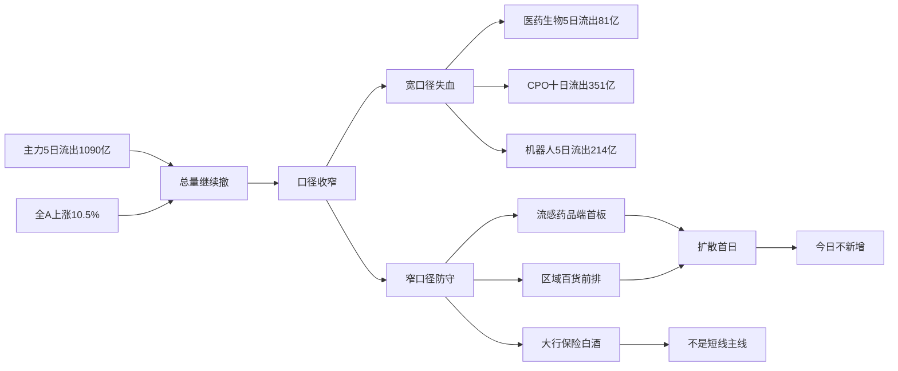
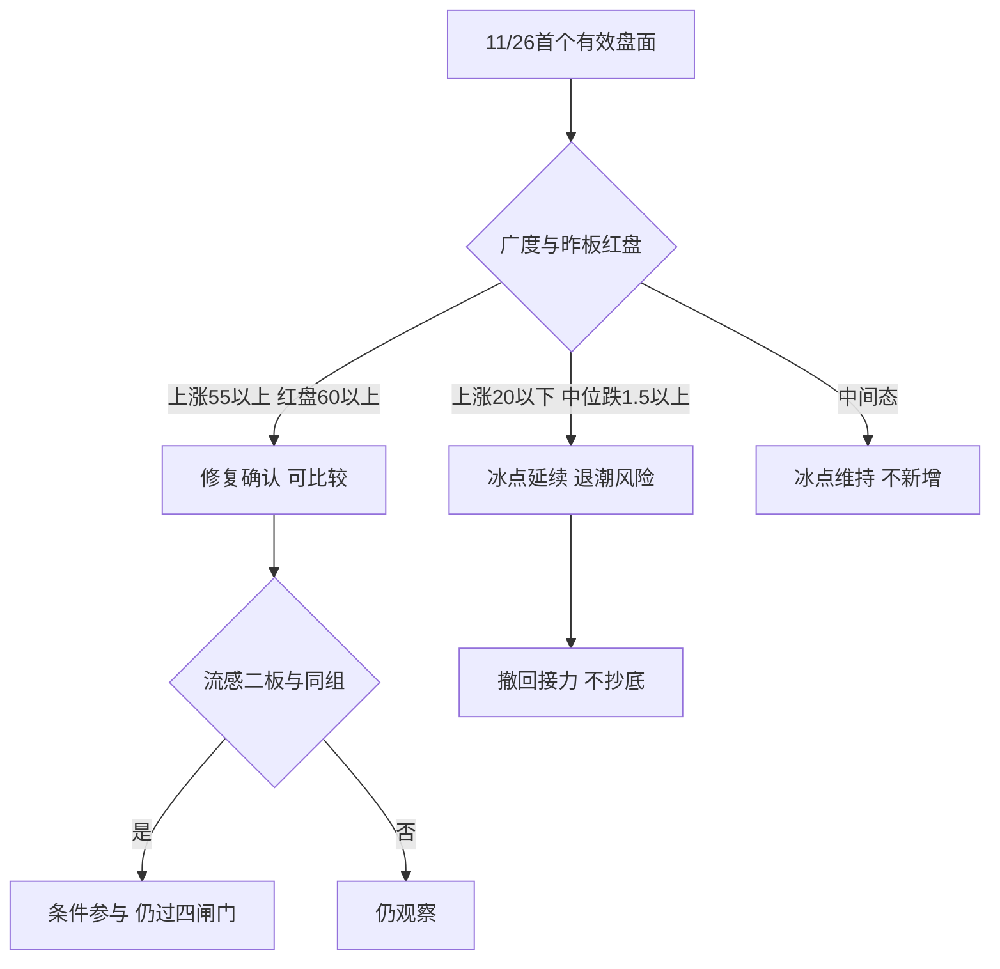

# 守正出奇｜冰点第六天：钱只买窄口径，不买大故事

> 一句话：11/25 的主要矛盾不是“科技对防守”，而是总量五日出流 1,090 亿下的口径收窄——宽口径（医药生物 5 日 -81 亿、CPO 10 日 -351 亿、机器人 5 日 -214 亿）全部失血，只有最窄的当期事件（流感药品端首板、区域百货）还在成交；流感是首日，零售是杭州 3 板高度上的首日扩散。**今天默认不新增；把“流感/百货能否出二板”作为唯一观察，等市场用二板选出载体，而不是我先钦定龙头。**

**本版动作（人读研究，不进入执行、不写 plan JSON、不改任何授权）**

| 对象 | 11/25 收盘事实 | 本版身份 | 今日动作 |
|---|---|---|---|
| 亨迪药业 301211 | 11.11 元 +19.98%，09:33:24 首封零开板，龙虎榜净买 0.445 亿，五日大单第 8/185 | 流感弹性第一顺位 | **观察**；二板确认才谈条件参与 |
| 特一药业 002728 | 8.35 元 +10.01%，09:31:33 首封零开板，五日大单仅第 15/185，问财当日净卖 | 时序锚，但两项杂毛判据 | **观察，不追** |
| 杭州解百 600814 | 8.35 元 +10.01%，3 板，09:30:03 零开板，五日大单第 2/185；同日披露交易风险 | 零售高度 | **观察，不追 4 板** |
| 天孚通信 300394 | 130.87 元 +7.65%，成交 117.16 亿，五日 +29.25 亿；但 CPO 仅 10/100 上涨 | 旧根的独强反证 | **观察，不升级** |
| 中京电子 002579 | 17.82 元，5 板，14:54:48 尾封，换手 42.49%，榜净卖 | 高位压力测试 | **不参与** |
| 南亚新材 688519 | 137.19 元 -5.35%，收在日低；28.8 亿扩产公告后首个交易日 | 产业事实、价格腿破 | **观察，不抄底** |

**窗口与缺口：** 本文于 2026-11-26 07:18 盘前形成，早于 09:15 竞价，**不是盘中补制**。适用窗口为 11/26 09:25–10:30；出现首个有效可比盘面或重大新反证即重评，到点自然失效。缺口：11/26 竞价与盘中未核；独立宏观包未核，只用本批研究真实内嵌的政策、经济与跨资产证据；催化剂日历本交易日不可用（文件不存在）；R4 契约有 49 项缺 stop_loss 研究字段（不等于执行价位已核）；R5 逐票合规、图像与缠论按对象留缺；R6 13/13 必要审核未完成、formal_review_completed=false，但 0 条 hard_reject；图片 OCR 本批超时、群文本分页未核、东财人气榜 11/25 为空。

## 一、这一段在交易什么：不是“高低切换”，是总量撤离下的口径收窄

先摆 11/25 的事实，全部为 Tushare 收盘口径。

| 11/25 事实 | 数值 | 对今天判断的约束 |
|---|---|---|
| 涨/跌/平 | 586 / 4,926 / 61（n=5,573） | 上涨占比 10.51%，中位 -3.77%，1,860 只跌超 5%，284 只跌超 9% |
| 沪深成交额 | 13,829.27 亿元，环比 -16.43% | 缩量下跌，买盘缺席而不是恐慌换手 |
| 涨停/跌停/未回封 | 51 / 43 / 30；炸板率 30/81 = 37.04%；曾开板回封 23 | 跌停从 2 家扩到 43 家；炸板率虽回落，亏钱效应已扩散 |
| 梯队 | 5 板 1、4 板 2、3 板 6、2 板 5；首板 37（35 家 11:30 前首封） | 1 进 2 为 5/25 = 20%，2 进 3 为 6/25 = 24%；低位晋级仍窄 |
| 昨涨停池 55 只 | 开盘均 +2.05%/中位 +0.03%；收盘均 -1.37%/中位 -4.47%；开收到收中位 -4.67%；19 红/35 绿；14 续板；7 只收在跌停 | **开盘参与昨板的中位结果是 -4.67%**；追开盘先输一手 |
| 昨炸板池 68 只 | 收盘中位 -6.13%；44 只跌超 5% | 反包/低吸炸板股是更差的交易 |
| 指数 | 上证 3,476.47 -2.03%（250 日均线 3,954.60，仍在下方）；创业板 -4.19%；科创50 -5.12%；中证2000 -4.26% | 不是单指数问题，是小盘与高久期一起杀 |
| 全市场主力 | 单日 -489.68 亿；5 日 -1,089.95 亿；10 日 -3,209.18 亿；20 日 -4,197.77 亿 | 上份（11/24 事实）的 5 日流出约 -685 亿，一天后扩大到 -1,090 亿 |
| 尾段 30 分钟 | 上证 -0.43% | 收盘前没有护盘式回收 |

这张表最容易被读错的地方，是把 11/25 当成“科技跌、消费涨”的普通高低切换。不是。**全市场主力 5/10/20 日全部为负，且 5 日流出在一天内从约 -685 亿扩到 -1,090 亿；缩量 16.43% 说明没有增量承接。**钱不是从科技搬到消费，而是从“宽口径”退到“窄口径”和防守资产。

宽口径全面失血：医药生物 5 日 -81.24 亿、10 日 -193.29 亿；新零售 5 日 -11.77 亿、10 日 -53.90 亿；CPO 10 日 -351.37 亿、20 日 -517.46 亿；机器人概念 5 日 -214.04 亿、10 日 -824.75 亿；电子 5 日 -188.28 亿、10 日 -643.11 亿；半导体 5 日 -196.11 亿、10 日 -299.37 亿；液冷服务器 5 日 -169.42 亿。**这些不是“回调”，是持续净流出。**

窄口径仍有成交，但都很小：医药商业今日 +2.55 亿/+0.74%、5 日仅 -1.10 亿；百货今日 +4.35 亿/+1.84%、5 日 +6.61 亿；一般零售今日 +4.93 亿/+0.35%、5 日 +3.96 亿、10 日仍 -12.81 亿。防守配置也在吸钱：白酒 5 日 +7.20 亿、10 日 +15.66 亿；保险 5 日 +4.83 亿、10 日 +8.28 亿、20 日 +17.30 亿；国有大型银行 5 日 +2.66 亿、10 日 +6.16 亿、20 日 +6.17 亿；造纸 5 日 +6.10 亿。**但这些防守资产没有涨停群，构不成短线主线；短线的窄口径只有流感与区域百货。**

宏观这一侧，本批能带进来的只有这些，不做超额解读：美国 10 月核心 PCE 同比在快讯里有 2.3% 与 3.3% 两个冲突口径，官源未核，不采定值；同一工具的 12 月加息隐含读数从 99.8% 到 97.8%，仍高，是媒体读数、不是官方概率；公布后标普 -0.25%、纳指 -0.62%、道指 +0.33%，只有道指转涨；恒指 -1.14%、日经 -2.78%、韩综 -6.16%（韩国日历未核）。商品按 10/26–11/25 的境内连续期货结算看：金 -10.84%、铜 -17.03%、油 -21.87%；离岸人民币 +0.14%，美债 10 年 4.91%（-9bp，序列只到 11/24）。**合起来支持的是“风险偏好收缩、高久期估值更敏感、结构而非普涨”，不支持“宏观转暖”。**独立宏观包未核，这一段只到这里。

**情绪阶段（原生六态，只定温度，不授买权）：冰点，事实日 20261125，连续第 6 个交易日。**来源 lianban:qingxu，as_of 2026-11-26T06:06:10+08:00，edition=unknown，intraday_phase=null（盘中估计缺失），close_verified=true。指标（涨停 51、跌停 43、炸板率 37.04%、高度 5）的 metrics_date 也是 20261125，但阶段事实日只取 20261125，不用指标日或生成日替代。

| 已绑定材料 | 内容 | 限制 |
|---|---|---|
| display_prior（从冰点出发） | 修复 53%、升温 2%、高潮 12%、降温 缺失、退潮 4%、冰点 26% | 页面取整频率，六项合计 97%，不归一、不补余量；分母未核 |
| same_scene（冰点连续 ≥4 天） | n=5；去向 冰点 60% / 高潮 20%；次日指数均值 +0.1%、上涨占比 40% | 样本仅 5；去向合计 80%，其余 20% 未列、未核；不是联合概率或个股胜率 |
| exact_transition_matrix | 本批未提供 | 不计算未校准后验 |

**我的目标日 20261126 选择：首选 冰点（延续），备选 修复。** 这与页面宽样本基础首位（修复 53%）不同，与同景去向首位（冰点 60%）同向。

- **偏离基础排序的理由：** 11/23 的修复只活了一天，11/24 中位 -0.67%、11/25 中位 -3.77%，修复尝试被连续卖回；宽样本的 53% 没有条件化“修复已经失败一次”。隔夜也没有风险资产普涨；11/25 缩量 16.43%、尾段 -0.43%，说明没有恐慌承接；跌停 43 家、1,860 只跌超 5%，广度是这一段序列最差。
- **同景的用法：** 冰点连续 ≥4 天的去向首位是冰点 60%，方向与我的判断一致；但 n=5、20% 去向未列，我不把 60% 当概率，只当方向证据。
- **最强反证（必须摆清）：** 宽样本 修复 53% 排首；同景次日指数均值 +0.1%、上涨占比 40%，并非继续崩；炸板率从 55.28% 回落到 37.04%，23 只曾开板回封，51 家涨停、37 家首板、2–5 板梯队完整、14 只昨板续板——内部并非没有赚钱效应；美股跌幅收窄、道指转涨；隔夜三家大行披露回购增持贷款合同/承诺（建行超千亿、工行近 1,800 亿、中行超 1,800 亿，统计口径不同，不是当晚新增投放）；央行 11/25 开展 8,000 亿 MLF 与 5,000 亿 7 天逆回购（对冲到期，未核净投放）。**所以修复不是弱备选；若开盘广度与昨板红盘率同步改善，它先成立。**
- **改判条件：** 上涨占比 ≥55%、昨板红盘率 ≥60%、开盘溢价兑现、高位有低位助攻 → 修复成立；上涨占比 <20%、中位跌 1.5% 以上、跌停继续扩张、高位断板 → 冰点延续、退潮风险上升；20%–55% 之间、只有单票封板、昨板继续回吐 → 冰点维持；指数独自翻红不算证伪。
- **声明：** 阶段与预测不授买权、不定仓；以上频率不是概率，也没有被归一成后验。

## 二、根：板级供给的价格腿被打断，低位扩散只有一天

上份（本目录 20261125）守的是“板级供给”：PCB 5 日 +151.87 亿、元件 +152.72 亿、通信网络设备 +101.82 亿，钱在进、价没跟；容量锚沪电、高度锚中京、事件锚南亚、出奇锚信科，动作是观察等承接。

11/25 把“资金进、价没跟”改写成“资金撤、价跟跌”：

| 方向 | 11/25 当日 | 5 日 | 10 日 | 读法 |
|---|---|---|---|---|
| 印制电路板 | -36.55 亿 / -5.35% | +70.15 亿 | -76.74 亿 | 5 日正流入一天腰斩，10 日仍负：积累失败 |
| 元件 | -40.30 亿 / -5.57% | +66.04 亿 | -112.06 亿 | 与 PCB 同源，不重复当两条独立证据 |
| 通信 | -28.81 亿 / -4.36% | +10.04 亿 | -226.62 亿 | 5 日几乎归零 |
| CPO | -61.58 亿 / -5.10% | +32.49 亿 | -351.37 亿 | 5 日只是反弹残值，10 日巨额流出 |
| 机器人概念 | -124.08 亿 / -4.95% | -214.04 亿 | -824.75 亿 | 涨停 67→19→3，注意力退潮 |
| 医药生物 | +4.24 亿 / -1.17% | -81.24 亿 | -193.29 亿 | 今日小回补，5/10 日仍大幅流出 |
| 新零售 | +11.22 亿 / -0.59% | -11.77 亿 | -53.90 亿 | 宽口径消费没有持续买盘 |

**这张表推翻的是“5 日资金正 = 持续买”这个顺手结论。**PCB 的 5 日正流入从 +151.87 亿降到 +70.15 亿、元件从 +152.72 亿降到 +66.04 亿、通信网络设备从 +101.82 亿降到 +76.44 亿——一天之内 5 日正流入腰斩，10 日仍负，说明前面几天的“进”是反弹买、被 11/25 卖穿，不是蓄势。更极端的对照是半导体设备：5/10/20 日 +2.80/+58.40/+174.25 亿，是科技里唯一还有 20 日资金厚度的分支，11/25 也被砸 -15.89 亿/-9.14%。**这不是“科技内部高低切换”，是科技整体降估值。**

产业事实没有消失：南亚新材 28.8 亿高端覆铜板扩产（尚需立项、环评、施工许可，未投产）；戴尔 AI 服务器积压订单 1,323 亿美元、全年 AI 服务器指引从 740 亿上调到 780 亿美元（但戴尔盘前一度跌 7.2%，是媒体报道、非直连；A 股算力涨停家数 7→4）。**研究正确不等于交易正确**——这正是“特效药”教训：证明一条逻辑没被推翻，不等于价格还在为它付钱。板级供给的根，从“未被价格兑现”变成“积累失败”；我把它降为**研究保留**，不再作为今天的交易根。沪电、信科移动 11/25 的逐票收盘本批未核到，不补数。

反过来，11/25 真正被买的是最窄的当期事件：

- **流感/药品端**：12 家医药主题终封多集中 09:31–10:36；特一 09:31:33 首封零开板、亨迪 09:33:24 首封零开板；医药主题 185 只成分里 81 只上涨、14 只终封、3 只未回封，封板率 82.35%。但东财流感 +0.43%/+8.75 亿、5 日 -18.12 亿，问财同源大单净卖约 2.42 亿；医药生物 5 日 -81.24 亿。**板块层面只有一天，资金层面仍在失血。**
- **区域百货**：一般零售 +0.35%/+4.93 亿、5 日 +3.96 亿；百货 +1.84%/+4.35 亿、5 日 +6.61 亿；4 封 3 未回封，29/58 上涨；杭州解百 3 板零开板、五日大单第 2，国芳 1 板 10:06 零开板、五日第 3。**这是窄口径防守，不是大消费普涨；新零售宽口径仍 -0.59%。**

所以今天的根不是“板级供给”，也不是“消费复苏”，而是：**冰点里，钱只买“窄口径 + 当期事件 + 低位”的期权；它给期权定价，不给趋势定价。** 这个根作为扩散目前只有一天；杭州的 3 板是它的前史，不是扩散的第一天。必须用 11/26 的二板或 4 板来证。

## 三、载体：市场选了谁，为什么不是别人

### 流感：亨迪是弹性第一顺位，但我不预封龙头

| 对象 | 11/25 事实 | 为什么是它 | 主要反证 | 动作 |
|---|---|---|---|---|
| 亨迪药业 301211 | 11.11 元 +19.98%，09:33:24 零开板；龙虎榜净买 0.445 亿；五日大单第 8/185、+0.626 亿；流通 46.39 亿 | 20cm 弹性 + 零开板 + 榜净买 + 五日资金第 8；同组里封板稳定性最好 | 只有一日板；20cm 波动更大；问财当日净卖 0.181 亿；F3 应收、F6 扣非/归母差 63.7%；46.39 亿在 20–50 亿警示区；R6 明确“不替代 10cm 核心” | **观察**；二板+同组承接才谈条件参与 |
| 特一药业 002728 | 8.35 元 +10.01%，09:31:33 零开板；五日大单仅第 15/185、+0.229 亿；问财净卖；流通 41.86 亿 | 10cm 最早的时序锚，收盘在日高；若二板先封，它才是市场选择的 10cm 核心 | 五日资金第 15、问财净卖、R2 同时命中两项杂毛判据；F3 应收 +43.77% 对营收 -9.87%、F4 存货周转 321→271 天；PE 65.04/PB 2.38 偏贵；41.86 亿警示区 | **观察，不追**；二板先封才改判为时序核心 |
| 人民同泰 600829 | 首板，开板 4 次；医药流通 | 医药商业 +0.74%/+2.55 亿、5 日仅 -1.10 亿，流通端的资金持续性反而好于药品端 | 4 次开板：封板结构差，只能当扩散验证 | **只作扩散对照，不参与** |
| 康芝/石药/拓新 | 康芝 20cm 两开、资金第 2 但稳定性差；石药首封更晚、五日第 96/185；拓新流通 19.1 亿 | 康芝是弹性反证；石药是时序反证；拓新是硬线反证 | 拓新 <20 亿硬线，直接剔除；康芝两开不如亨迪零开；石药资金太靠后 | **均不参与** |

**为什么研究排序亨迪第一、交易排序却是等待：** 亨迪的“零开板 + 榜净买 + 五日第 8”是当前证据里最干净的弹性组合；但它只有一天，20cm 的次日波动也最大，问财与龙虎榜还有口径分歧。特一则有“最早封板”的时序优势，却是 R2 明确的两项杂毛（五日第 15、问财净卖）。**这两个人谁当核心，不该由我在盘前用研究纯度决定；11/26 谁先封二板、谁带动同组，谁才是市场选择的载体。**若特一先封并带动亨迪，我修正为“特一时序核心”，不因先前排序硬扛；若亨迪先封、特一跟随，则亨迪是弹性核心，但仍不替代 10cm 的宽度意义。

### 百货：杭州是市场高度，但不是可追的 4 板

| 对象 | 11/25 事实 | 为什么是它 | 主要反证 | 动作 |
|---|---|---|---|---|
| 杭州解百 600814 | 8.35 元 +10.01%，3 板，09:30:03 零开板；五日大单第 2/185、+1.680 亿；流通 61.38 亿 | 零售唯一 3 板、零开板、五日资金第 2；市场已经把高度给它 | 3 板后同日披露交易风险；问财当日净卖；量化基金两席 11/23–24 有上榜；4 板在冰点里是高位加高位 | **观察，不追 4 板**；只有开板回封+国芳晋级才重评 |
| 国芳集团 601086 | 10.75 元 +10.03%，1 板 10:06 零开板；五日第 3、+1.096 亿；问财 +0.46 亿；流通 71.60 亿 | 非杭州前排、零开板、五日第 3、问财为正；比家家悦的持续度好 | 收盘仍低于 MA20 约 10.55%；20 日 -18.25%；PE 71.28/PB 4.44；F3 应收 +227%、F6；补涨需要杭州反馈 | **观察**；杭州不反馈则不称补涨 |
| 家家悦 603708 | 9.68 元 +10.00%，1 板 10:04:50 零开板；五日第 13、+0.147 亿；流通 59.93 亿 | 封板略早于国芳，是宽度同伴 | 五日资金太薄；有息负债/归母权益 128.73%；R2 杂毛 | **降级观察，不参与** |
| 珠免集团 600185 | 11/25 停牌；11/26 复牌，拟收购免税子公司剩余 49% | 直接公司事件，免税/零售方向，复牌首日有事件关注 | 收购定价、发行与审批未核；首日板型未知；不能拿杭州高度替珠免定价；R4 同时列了定价不确定性 | **观察，不参与首日** |

### 旧根与高位：天孚是独强，中京是压力测试

| 对象 | 11/25 事实 | 为什么是它 | 主要反证 | 动作 |
|---|---|---|---|---|
| 天孚通信 300394 | 130.87 元 +7.65%，成交 117.16 亿；五日分档 +29.56 亿/东财 +29.25 亿；MA20 126.30，收盘 +3.62% | 旧根里唯一逆势强、两口径资金同为正、成交容量最大 | CPO 仅 10/100 上涨、中际 -1.92%；20 日 -35.03%、20 日高 201.9；F3 应收 +77.31%；R6 两条 strong_suggest 判“观察、不升级” | **观察，不升级**；容量同伴不转强就仍是独强 |
| 中京电子 002579 | 17.82 元，5 板，14:54:48 尾封，换手 42.49%，成交 41.87 亿；流通 103.97 亿 | 市场唯一高度，PCB 的板位标尺 | 尾封 + 42.49% 换手 + 榜净卖 0.55–0.73 亿（多条原因不相加）+ 东财 -2.12 亿、xTick +0.38 亿；PCB 仅 9/215 红盘；F3/F4/F9/F10；五板后异常波动公告 | **不参与** |
| 金新农 002548 | 5.01 元，4 板，换手 22.57%，开板 2 次；五日 +2.732 亿；流通 40.30 亿 | 四板高度、五日资金为正 | 公告提示猪价下跌致养殖大幅亏损、股价严重偏离基本面；猪肉仅 2 封、8/39 上涨、5 日 -4.88 亿；40.30 亿警示区 | **不参与** |
| 南亚新材 688519 | 137.19 元 -5.35%，开 140.02/高 149.48/低=收 137.19；28.8 亿扩产 | 板级供给最具体的产业事实 | 公告后首个交易日收在日低；审批、环评、开工与投资执行未核；不是订单，更不是利润 | **观察，不抄底** |
| 九阳/宁波东力 | 九阳 38.56 元 3 板、开板 7 次、PE 445.45、前三季归母 -41.75%、两次风险提示；宁波 21.7 元 3 板、开板 2 次、五日 +1.14 亿、龙虎榜 -0.249 亿对东财 +0.639 亿/ xTick +5.618 亿 | 注意力与高位压力的反证 | 家电 -1.71%/-2.48 亿、机器人 -6.02%/-78.82 亿；九阳不是红利（息率 0.389%）；宁波只是存量高标 | **均不参与** |

**一句话区别：** 亨迪/特一是“低位事件能不能出二板”，杭州/国芳是“区域百货能不能扩散”，天孚是“旧根还有没有独强”，中京/金新农/九阳/宁波是“高位还能不能接”。**前两类可以研究条件参与，后两类今天只做压力测试，不做接力。**

## 四、与上份相比：根逻辑削弱，不是换了一个新故事

上份的判断是“钱只进板级、不进注意力”，载体是沪电（容量）、中京（高度）、南亚（事件）、信科（出奇），动作是观察等承接。11/25 的结果分三块：

1. **价格腿断了。** PCB/元件/通信的 5 日正流入一天腰斩，10 日仍负；南亚 137.19 收在日低；中京虽 5 板，但 14:54 尾封、42.49% 换手、榜净卖；天孚 +7.65% 是唯一逆势强，但 CPO 10/100、20 日 -35%。沪电、信科 11/25 的逐票收盘本批未核，不补。
2. **产业事实还在。** 南亚 28.8 亿扩产、戴尔 1,323 亿美元积压订单、AI 服务器指引上调，都未被推翻；但“事实在”不等于“价格此刻为它付钱”。所以是**根逻辑削弱（价格腿失效）、不是根逻辑失效（产业事实仍在）**。
3. **上份的“等承接”没有等到。** 这个动作保护了资金，但也说明交易腿从未成立；我不把“没买”说成“看对”，只把它记为一次有效的等待。

新事实是：上份的主比较里没有流感/百货，11/25 的市场表达恰恰在这两个低位方向。**这是上份的覆盖缺口，本轮补上，但不宣称预判正确。**本目录 11/20、11/23 虽有文件，本轮没有绑定回执，未读、不作连续依据；可核前份只有 20261125。

## 五、条件、退出与改判：今天默认不新增

**为什么默认不新增：** 冰点第六天、43 家跌停、1,860 只跌超 5%、全市场 5 日 -1,090 亿；昨板开盘到收盘中位 -4.67%、昨炸板池中位 -6.13%——在“开盘接力中位为负”的市场里，新增的期望不对称。R2 的 execution_pool 为空、confirmed_tradable_main_lines=0、trade_authorization=none；R6 13/13 必要审核未完成；R1 的 0% 是研究意见、不是账户命令，但和我的判断同向。**这不是用阶段标签代替判断，而是价格与资金的事实让我选择等待。**

**唯一条件参与：亨迪（是条件，不是买入建议）。**

- **确认条件：** 11/26 09:30–10:00，流感组至少两只二板，或特一/人民同泰至少一只明确跟随；亨迪封住二板 13.33 且封单/换手匹配；全A 上涨占比不再低于 20%。三者缺一，不参与。
- **入场：** 只在封板确认，或回踩 11.11 不破后重新走强时考虑；不在竞价抢、不在 11.11–13.33 之间凭想象半路。
- **止损与失败：** 实际入场价下方 -5%~-7%；结构上跌破 11.11 且 30 分钟不收回即失败；同组特一跌破 8.35 也判扩散失败。T+1，不达预期隔日走。
- **退出：** 炸板破均线、日线破 MA20（10.40）按既有纪律；不用“流感季很长”取消短线边界。
- **盈亏比：** R5 未核可执行 RR；价格算术只能作参考——13.33 打板、12.40 止损（-7%），到下一个 20cm 涨停 16.00 约 2.9，但 20cm 三连板罕见；若只看 +10% 到 14.66，约 1.4，只够试仓、不够正常仓。**所以它是试仓级，不是主仓级；本版不给仓位比例。**
- **市值硬线：** 46.39 亿在 20–50 亿警示区，不因板型豁免；拓新 19.1 亿、天圣 15.26 亿在 20 亿以下，直接不参与。

**杭州/国芳的条件：** 杭州只有“开板回封 + 国芳或家家悦晋级”才重评；3 板后的风险公告与量化席位，使它不适合追 4 板。国芳只有在杭州保持反馈、自己二板时才叫补涨；它仍低于 MA20 约 10.55%、20 日 -18.25%，不能因为“低位”就自动买。**天孚**只有中际/新易盛同向、CPO 上涨家数明显扩大时才从“独强”升为“容量修复”；否则不升级。**中京/金新农/九阳/宁波/珠免首日/南亚抄底**均不参与。

**改判情景（分清证伪、兑现、暂未认可、正常波动；阈值沿用本轮研究的参考，不是新增门槛）：**

| 11/26 首个有效盘面 | 判断 | 动作 |
|---|---|---|
| 上涨占比 ≥55%、昨板红盘率 ≥60%、溢价兑现、高位有低位助攻 | **修复确认**；我的“冰点首选”被推翻 | 亨迪/杭州从观察升为可比较；仍过核心、盈亏比、纪律、战术四道闸门 |
| 上涨占比 <20%、中位跌 1.5% 以上、跌停继续扩张、高位断板 | **冰点延续、退潮风险上升** | 撤回接力假设，不抄底；不因“跌多了”买 |
| 20%–55% 之间、只有单票封板、昨板继续回吐 | **暂未认可**：冰点维持 | 不新增；指数独自翻红不算证伪 |
| 流感二板成立、但全A 广度不改善 | **局部脉冲**，不是主线 | 最多按既有试仓额度、四闸门全过才考虑；不把局部当趋势 |
| 亨迪回吐破 11.11、特一破 8.35、人民同泰/石药不跟 | **事实证伪**：流感扩散失败 | 撤回流感假设；不换一只票硬讲 |
| 杭州开板不回封、国芳不晋级 | **预期兑现**：零售高度结束 | 撤回零售；不接 4 板 |
| 单日回踩但南亚项目、戴尔订单、流感季事实未变 | **正常波动** | 研究继续；不因回踩改根，也不因“逻辑还在”取消短线边界 |

**等待的代价也要说清：** 如果 11/26 直接修复，亨迪/特一的二板可能就是冰点后第一轮新周期的起点，等待会错过第一天的位置。这是真实的代价，不是免费的谨慎。我的取舍是：**在开盘接力中位 -4.67% 的市场里，用“二板确认”换取更低的错误率；宁可错过第一天的半路，也不在竞价里接错。** 如果市场证明我错，我按修复情景改判，不为了维持“冰点”的一致性硬扛。

## 六、折叠：来源、口径与缺口

展开：来源绑定、逐票状态、数字口径与限制

来源与时点。 本版只消费本轮已核精确版本：research_summary.json（sha256 a9f60da1…2fff9，run 20261126T061055-62560-3434，orchestrator_status=partial，fetch_global_severity=2）；R1/R2/R3/R4/R5/R6/R7 逐个读取并核 hash；emotion_cycle、attention_signals 为绑定辅助输入；催化剂日历不可用。R1 置信度 0.7、R2 0.62、R3 0.364、R7 0.42，R4/R5/R6 为 null；这些是研究质量值，不是概率或仓位依据。

覆盖缺口。 R4 契约 49 项缺 stop_loss 研究字段（研究字段缺失，不等于执行价位已核）；R6 13/13 必要审核未完成、formal_review_completed=false、review_passed=false，但 hard_rejects=0、counter_arguments=52（24 条 strong_suggest、28 条 soft_suggest）。R6 的 strong_suggest 不是硬否决，但按既有纪律需要显式覆盖并写理由；本版不覆盖任何一条，受影响对象一律降级/观察、不做新增。R2 execution_pool 为空、confirmed_tradable_main_lines=0、trade_authorization=none、execution_eligible=false；R5 trade_permission=research_only，13 份画像全部 partial，RR、target_intraday、sise/chanlun 逐票留缺；R7 的 ETF 份额代理仅到 11/24、两融仅到 11/24、北向未使用、ETF 净流为 null、IF 基差 -74.24 不作方向；R3 东财人气榜 11/25 为空、热榜为 11/25 切片、OCR 全超时、群文本分页未核；emotion_cycle 的 edition=unknown、intraday missing、exact_transition_matrix=null；独立宏观包未核。

逐票审核状态（R5 13 份画像）。 特一、亨迪、九安、海南海药、百花医药、杭州解百、国芳、家家悦、天孚、金新农、中京、宁波东力、九阳；R5 全部 research_only、execution_eligible=false；本版只把亨迪、特一、杭州、国芳、天孚放进可观察比较，其余只作反证或对照。九安、海南海药、百花医药、家家悦本批均为降级/杂毛或持续流出，不作为今日候选；特一/亨迪/金新农在 20–50 亿警示区；拓新 19.1 亿、天圣 15.26 亿在 20 亿以下硬线。

数字口径。 沪深成交 13,829.27 亿（R1）与全市场含北 13,926.60 亿（R7/xTick）为不同口径，不混列；涨停/炸板用 Tushare 分母 51/30/81，xTick 的 57/44/37 为另一套定义，不拼分母；东财与 xTick 资金方向可交叉、数值不拼接；行业/概念成分重叠，不跨板块求和；5 日/10 日/20 日为 R7 的滚动窗口，窗口起点 10/29、终点 11/25；MA5/MA10/MA20/MA50 为 R5 日线自算，仅作位置参考，不作买入信号；11/26 涨停参考价是按 11/25 收盘与现行涨跌幅限制算的算术值，不是触发价、不是目标价。

价格参考（只作事实坐标，不作买卖指令）。

| 对象 | 11/25 收盘 | MA5 | MA20 | 20 日高/低 | 11/26 涨停参考 |
|---|---|---|---|---|---|
| 亨迪药业 | 11.11 | 9.71 | 10.40 | 11.28 / 8.80 | 13.33（20cm） |
| 特一药业 | 8.35 | 7.81 | 8.65 | 9.42 / 7.16 | 9.19（10cm） |
| 杭州解百 | 8.35 | 7.11 | 7.11 | 7.79 / 6.11 | 9.19（10cm） |
| 国芳集团 | 10.75 | 9.78 | 12.02 | 14.57 / 8.84 | 11.83（10cm） |
| 天孚通信 | 130.87 | 116.12 | 126.30 | 201.90 / 99.90 | 157.04（20cm） |
| 中京电子 | 17.82 | 14.86 | 12.60 | 16.20 / 10.61 | 19.60（10cm） |
| 金新农 | 5.01 | 4.18 | 3.74 | 4.55 / 3.23 | 5.51（10cm） |

方法与历史。 方法稿为 `游资风格/彭道富/20261112.md` 与本目录 README，只定问题顺序与证据分量：先理解主要矛盾与级别，再比较赛道根与市场主角，先选值得投入心力的机会，再谈局部技术；允许情绪定价但不伪装成业绩兑现；不为日报新意换票，也不为维持一致性硬扛。未采用方法稿中已撤回的“旧栏目接线”提案。历史只读 20261125 已绑定回执；11/20、11/23 文件虽存在，本轮无绑定回执，未读、不伪造连续。本版未读原 D1 报告、watchlist_plan 或任何执行/账户文件，未补抓数据、未联网、未下单。

边界提醒。 本文是人读研究，不是执行授权；不写 runtime、不写日志、不写 plan JSON、不改原盘前预案。流通市值硬线（<20 亿不参与、20–50 亿警示）、T+1、既有退出纪律（炸板破均线、日线破 20 日线）与全部真实停买/零预算/仓位上限/人工确认原样生效。本版不给仓位比例；任何后续参与仍须过核心、盈亏比、纪律、战术四道闸门，止损距买价下方 5%–10%，RR<1 拒绝。

## 边界

今天可以做的动作只有一个：**观察，等 11/26 09:25–10:30 的盘面把“一日脉冲”证成“二板扩散”，或者不证成。** 如果证成，也只在前述条件与四道闸门全部满足时谈试仓；如果不证成，研究继续，交易不做。**逻辑成立不等于价格合适；研究正确不等于交易正确；等待不是免费的，但在冰点里，接错的代价更高。**
