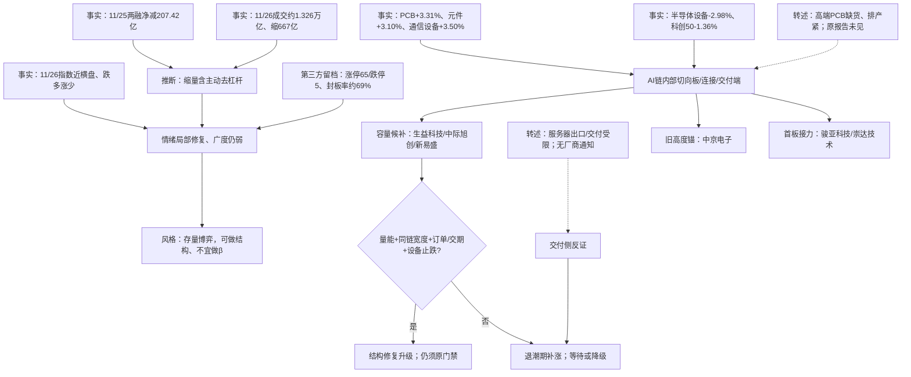

# 2026-11-27 · 守正出奇 · 盘后回放

> 实际生成：2026-11-27T15:43:38+08:00｜仅供研究，不构成有效竞价/午盘修订，不进入交易系统。

# 2026-11-27｜SZ 守正出奇（独立人读隔离回放）

**目标业务日：** 2026-11-27。  
**事实窗口：** 最新交易事实为 **2026-11-26 收盘**；盘前材料截止 **2026-11-27 08:30**（主体材料在 06:10 前，07:42 日历的证据截止为 07:30）。本文虽在盘后整理，但不使用 11-27 竞价、盘中或收盘结果，也不把整理时点当作行情窗口。生成时刻由外层附；本文不写虚构时刻。  
**身份与边界：** 本栏独立于 D1 最终选择，不读、不模仿其名单；只做研究与人读对照。未联机取数、未生成交易 JSON、不进入执行链，不提供仓位、买卖价、盈亏比或交易授权。  
**历史连续性：** 随包未见本目录上一交易日合法日报，**历史连续性未核**；本栏按现有材料首次建立，不声称“延续/增强/削弱”前日判断。

## 一、结论与动作

**一句话：11-26 是“去杠杆中的缩量情绪修复”，不是 AI 全链反转。最值得持续研究的是 AI 链内部从设备/材料向“当期可交付的 PCB、元件、光模块”切换，但截至 08:30 只有单日价格响应与二手产业转述，未形成可交易主线。**

- **主要矛盾：** 杠杆在撤、成交在退，而情绪指标局部修复；市场只能做结构轮动，尚不能做全面风险偏好回升。
- **市场实际选择：** 11-26 强的是 PCB、元件、通信网络设备，弱的是半导体设备；资金表达更像“从扩产预期切向交付/缺货环节”，而不是“AI 硬件全面上涨”。
- **核心主张状态：** 研究方向成立度中等，交易确认度不足。**当前动作：研究、等待、不新增。** 若后续量能、宽度、旧核心承接和公司级订单/交期证据同时改善，候选只进入原执行门禁复核，不代表本栏授权买入。
- **已有仓位：** 按原系统既定的止损、炸板/破均线、T+1 与退出纪律维护；本栏不以“长期 AI 逻辑”延长或改写退出边界。
- **新买：** 当前无。首板、旧高度、事件二元项均不直接构成新买理由；不用低位后排递补核心。
- **事件项：** 11-27 联合光电上会、南特科技解禁、ST 停复牌、纳指类 ETF 停牌等均不改变本栏核心判断；不预测上会结果，不把“通过”写成“注册/交割”。

## 二、主要矛盾与传导

当前不是“AI 有没有长期逻辑”的问题，而是：**在分母收缩、成交缩量的环境里，哪一段 AI 硬件能先把叙事兑现成当期交付、价格承接和可核订单。**  
11-26 的价格结构给出一个有限答案：PCB/元件/通信设备强，半导体设备继续弱；但这一答案只有一天，且缺原始产业文件与逐票订单，不能升级为“新主升”。

**级别判断：** 现有证据只支持“日级/局部轮动修复”，不支持“周级别主升”。关键不是 11-26 涨了哪些票，而是 11-27 以后能否出现**放量、宽度扩大、旧核心不失承接**三者共振。单日容量股上涨、单只首板或高标晋级，均不足以单独改判。

## 三、证据分层

| 类型 | 可见证据 | 来源时点/样本段 | 本栏判读 |
|---|---|---|---|
| 可见事实·接口片段 | 截至 11-25，两市融资余额 21,142.86 亿，单日净减 207.42 亿；融资买入端小于偿还端 | 07:42 日历引用，trade_date=20251125；本栏未重跑接口 | 指向主动降杠杆，不宜直接写成“集中强平”；但方向仍是收缩 |
| 可见事实·公开收评/留档 | 11-26 上证约 +0.01%、深成指约 −0.02%、创业板约 +0.29%；科创50 −1.36%；下跌家数逾 3,600；成交约 1.32/1.33 万亿，较前日缩约 667 亿 | R1、R2、R7 引同一类公开页；口径略有差异 | 指数尾盘回稳未扭转弱广度；支持“缩量修复”，不支持反转 |
| 第三方留档·未重算 | 11-26 涨停约 65、跌停 5、炸板 29、封板率约 69.15%、炸板率约 30.85%；连板高度 5；前日涨停池开盘溢价为空 | 06:05 情绪页、06:00 连板页；R1/R2/情绪文件同源成分较高 | 只能作局部情绪修复背景；炸板率分母与回封口径未核，不能据此确认或排除 35% 阈值 |
| 可见事实·行业价格 | PCB +3.31%、元件 +3.10%、通信网络设备及器件 +3.50%；半导体设备 −2.98%；11-25 半导体设备曾 −8.63% | 11-26 申万细分，经日历与 R2/R7 转列 | 支持“AI 链内部换仓至板/连接/交付端”，非“AI 全链反转” |
| 转述·产业叙事 | 高端 PCB 缺货、部分高端产能排产偏紧；AI 服务器/交换机需求带动高层板、高速材料 | 11-26 07:26 等媒体转述；协会原报告未见 | 可作为根逻辑线索；不能直接推出全行业涨价或点名公司订单 |
| 转述·交付反证 | 有报道称服务器厂商被要求暂停向部分东南亚地区运送相关服务器；未见厂商通知或监管细则 | 11-26 16:31 后报道；R4 列为交付风险 | 对光模块/CPO、PCB、服务器链是交付侧反证；不能直接写成“订单取消” |
| 可见事实·宏观 | 韩国央行 11-26 加息 25bp 至 3.25%，并上调 2026/2027 GDP 与 CPI 预测，理由涉及 AI 半导体繁荣 | 07:42 日历；媒体/官方摘要层 | “分子改善、分母收紧”并存；AI 硬件基本面与折现率不能只取一边 |
| 转述·政策日程 | 11-30 融资保证金比例 100%→80% 生效；存量合约可重算 | 07:42 日历排期 | 提高名义额度不等于提高借款意愿；真正的验证是融资买入额占成交比重 |
| 热度·单日 | 11-26 约 22:30 热榜：CPO 概念居前、PCB 居前；九阳双榜第一；群聊文字与 OCR 可读展示 0 行 | R3；持续榜明细未展示 | 只有单日注意力，不能判群聊共振、连续霸榜或资金合力；同日双榜第一不等于出货 |
| 资金·缺失 | 无逐票主力净额、龙虎榜席位、ETF 份额、两融逐票明细；11-27 无增量 | R7；北向不覆盖 | 不能推断大资金意图；未知不能填零，也不能当阴性 |
| 推断 | 市场当前更愿为“能交付的 PCB/连接/光模块”付费，而不是为“要投钱的设备/材料扩产”付费 | 由行业涨幅、旧高标断板与设备弱势共同推出 | 只是研究主张，未经订单、交期、多日量能验证，不能称已确认主线 |

**数据留档的可见性不等于逐条独立核实。** R1–R7 是已完成的盘后隔离回放稿，均声明证据以 08:30 前为界；本栏使用其汇总，但同源底稿被多份报告引用时，不重复计为独立验证。07:42 日历仅用于排期、前日背景和消息回溯；06:42 扩池正文未提供，仅通过下游引用看到对象与流通盘边界，不继承旧评级或资金结论。

## 四、逐票横向比较

### 1. AI 链：先比较“容量验证”与“旧高度温度计”

| 对象 | 截至 11-26 可见事实 | 研究定位与选择理由 | 最强反证与当前动作 |
|---|---|---|---|
| **生益科技 600183.SH** | R2/R5 载 11-26 约 **+5.85%**，非涨停；同链材料/PCB 上涨；缺同窗成交占比与订单 | **材料端容量候补。** 若高端覆铜板/高速材料缺货为真，它比纯设备更靠近“当期交付”；相对旧高度票位置较低，具备容量观察价值 | 反证：只有单日价格；缺高速材料收入占比、价格传导、订单与毛利证据；若缺货叙事不能落到公司产品结构，受益是假的。**动作：研究观察，不新买；等待同链宽度+放量+公司/行业原件。** |
| **中际旭创 300308.SZ** | R2/R5 载 11-26 约 **+5.18%** 非涨停；日历回顾另写 **+7%**，两者冲突未核；外盘 11-25 NVDA −3.91%、MU −4.53%；服务器交付限制报道构成反证 | **光模块容量对照。** 辨识度高、同链价格响应强；若 AI 网络侧需求真实，它是容量载体之一 | 反证：涨幅口径冲突；外盘芯片弱；服务器出口/交付限制未被厂商文件证实也未被否认；单日上涨不能证明订单增量。**动作：观察，不钦定中军；不新买。** |
| **中京电子 002579.SZ** | 日历回顾：25 日 5 板，26 日未封、收 **+7.91%**，成交约 43.44 亿；R2/R5 视作 PCB/CPO 旧高度锚 | **情绪温度计，而非新买候选。** 它的价值是检验“旧核心断板后是否失承接”，不是用累计板数替代续板 | 反证：断板已是事实；高位大成交既可能是换手，也可能是派发前兆；无新增订单证据。**动作：只观察次日承接；已有仓位按原纪律，不补不摊；若放量下跌，板块降级。** |
| **骏亚科技 603386.SH** | 11-26 09:31 首封首板；无直接新增订单证据 | **首板接力观察。** 首封早于崇达，能作短线资金表达的温度计 | 反证：首板早晚不构成龙头地位；缺开回封、换手、次日承接。**动作：观察，不因首板直接新买；只有同链扩容且次日承接通过原门禁再评估。** |
| **崇达技术 002815.SZ** | 11-26 10:11 首封首板；热榜转述 11-25 互动易称已有主流服务器厂商 PCB 配套合作 | **业务映射较具体的接力对照。** 比纯概念标签更接近 PCB 交付端 | 反证：晚于骏亚首封；互动易是历史转述，不是本轮新增订单；批量合作不等于收入确认。**动作：观察；需正式订单/量产/客户证据，不替代核心。** |
| **新易盛 300502.SZ** | 11-26 约 +4.26%（日历约 +4%）；无独立新增事件 | **同链价格对照。** 用于判断光模块链是否整体延续 | 反证：单日跟涨不证趋势；缺独立催化。**动作：只作对照，不列核心候补。** |

**为什么研究排序偏“生益科技/中际旭创”而非“中京电子”？**  
中京电子是旧高度锚，26 日已经断板，信息价值在检验情绪容错；它是“温度计”，不是低位新核心。生益科技/中际旭创代表市场实际选择的容量端，但仍只能称“候补”，因为量能、订单、交期与涨幅口径都未确认。**为什么骏亚/崇达不能直接上位？** 首板早晚、历史互动易和业务映射都不等于本轮订单或板块地位；按方法，不用首封顺序自动改写核心。

### 2. 其他方向：有高度不等于有主线

| 方向/对象 | 可见证据 | 裁决与动作 |
|---|---|---|
| **商业航天·利君股份 002651.SZ／顺灏股份 002565.SZ** | 09:25 分别录 3 板/首板；同花顺商业航天概念约 −0.08%；可见 FCC 附条件许可报道锚点 09:30，晚于早封；许可上限不是实际部署或 A 股订单 | **只观察前排高度，不并入核心。** 早封不能倒推为 09:30 报道触发；无直接合同证据。**不新买；只有概念宽度转正且公司级业务证据出现再重评。** |
| **化工·金牛化工 600722.SH／赤天化 600227.SH** | 矩阵由前一日 2 家增至 8 家；金牛 3 板、赤天化 2 板；甲醇、尿素、染料并不共享同一利润驱动；煤焦期价不能替代甲醇价差 | **轮动竞争，不是产业反转。** 有梯队但缺容量核心、品种价差和连续资金。**不新买；研究甲醇/尿素各自价差与承接。** |
| **机器人·克来机电 603960.SH／宏达高科 002144.SZ** | 克来 09:31 录 5 板；宏达 09:30 录 2 板；机器人/人形机器人概念均偏弱；媒体转述公司风险提示称工业机器人销售占比极小、且不涉及人形机器人产品；监管工作函与公司公告原件未核 | **高度标尺，不是板块主升。** 明确拦截“人形机器人直接受益”叙事；五连板不能替代宽度。**不参与该叙事；只有独立订单与板块扩散同时出现才重评。** |
| **零售/纯情绪·杭州解百 600814.SH／中央商场 600280.SH／九阳股份 002242.SZ／东方海洋 002086.SZ／冰山冷热 000530.SZ** | 杭州解百 4 板、中央商场 2 板，但零售涨停由 4 家降至 3 家；九阳 +8.66% 未封且有风险提示；东方海洋为水产反包；冰山冷热为 5 天 3 板反包且热门概念收入有限 | **纯情绪分化对照，不拼成一条主线。** 名字梗、反包和高位人气都不能替代梯队与收入兑现。**不新买；只保留情绪温度观察。** |
| **直接事件·精测电子／协创数据／瑜欣电子 301107.SZ／凌云光** | 精测电子有“近 2 亿元前道量检测订单”标题，协创数据有“光模块验证并交付”标题；均缺合同、客户、批量与验收。精测、协创、凌云光代码未在可用摘录展示；瑜欣电子为拟并购事件，不是交割 | **直接事件只作研究线索，不授龙头身位。** 代码未绑定者不纳入可交易候选；标题不能替代公告原件。**全部不新买。** |
| **事件与供给·联合光电 300691.SZ／南特科技 920124／ST 复牌等** | 11-27 联合光电并购重组委上会；南特科技解禁 42.98%；*ST 春天、*ST 沐邦停牌，11-30 复牌状态不同；山鹰、珠免已复牌一字，属已交易事件 | **二元事件，不改变 AI 链主判断。** 通过≠注册≠交割；要约/注资预案不等于全量保底；解禁纸面比例不等于当日可卖量。**不预测、不交易。** |

## 五、最强反证与改判条件

**最强反证：PCB/光通信的强势可能只是“退潮期补涨”，不是 AI 链内部换仓升级。**  
理由有四：一是 11-26 成交再缩约 667 亿，价格强而量能退；二是半导体设备仍 −2.98%、科创50 −1.36%，AI 链“分母端”未止跌；三是中京电子 5 板后断板，旧核心没有给出无缝续强；四是高端 PCB 缺货只有媒体/转述，原报告、订单、交期和客户结构未核。若 11-27—12-01 出现“PCB 冲高回落 + 设备继续新低 + 成交跌破 1.2 万亿”，本栏应把该方向降级为退潮期补涨，而不是继续讲“AI 修复”。

| 情景 | 触发条件 | 对主张与动作 |
|---|---|---|
| **结构修复升级** | 11-27 起数个交易日：PCB/元件/CPO 放量续强；同链容量与首板同步；成交回至约 1.45 万亿附近；半导体设备止跌；出现公司/协会级订单或交期原件 | 从“研究等待”升级为“有条件研究参与”；候选仍须独立通过原门禁、T+1 与退出纪律。优先容量验证，不追已高位一致性 |
| **维持观察** | 指数横盘、局部情绪活跃，但成交仍低于 1.35 万亿、板块宽度不扩、旧核心承接一般 | 研究观察，不新增；已有仓位按原纪律维护；不用低位后排递补 |
| **证伪/降级** | 中京电子失承接并放量下跌；PCB/元件冲高回落；半导体设备创新低；成交低于 1.2 万亿；服务器交付限制或订单取消得到正式文件证实 | 撤回“内部换仓”主逻辑，转回退潮防守；不因长期 AI 叙事扛单，不把研究正确当交易正确 |
| **预期兑现** | 缺货/订单/涨价正式公开，相关票高开或快速涨停 | 研究上确认逻辑，交易上不追已经兑现的利好；等回踩与新的独立门禁，不用“利好已知”替代风险收益 |
| **正常波动** | 单日开板、尾盘炸板、容量股一日回踩，但同链宽度、核心承接与成交未同时恶化 | 不机械升级为“主线结束”；也不因一日回踩删除研究方向。区分过程波动与逻辑失败 |

**事件层改判：** 联合光电上会结果、ST 复牌、南特解禁、ETF 停牌等，只影响各自事件定价；不改变 PCB/光通信核心主张。事件通过与否均不构成 AI 链订单证据，也不应反向解释 11-26 的板块价格。

## 六、交易情景与边界

- **研究方向：** PCB/高速材料/光模块的“当期交付端”最值得继续跟踪；商业航天、化工、机器人、零售均暂居次位。研究优先级不等于买入优先级。
- **已有仓位维护：** 按原系统的止损、炸板/破均线、T+1、时间退出规则执行；本栏不改变也不延长。若原持仓属于高位旧核心，断板后不因本栏“产业逻辑”而补仓。
- **新买：** 当前无。任何候选只有在“同链放量+宽度扩大+旧核心承接不坏+公司/行业证据”同时出现，并独立通过原四闸门后，才可进入原系统评估。本栏不提供价格、仓位、盈亏比或下单指令。
- **等待与退出：** 若结构未确认，等待是完整判断；若证伪条件出现，退出按原纪律执行，不用长期叙事止痛。研究方向可以继续保留，交易权限不能自动同步。

## 七、缺口与未核实项

1. **11-27 当日数据全缺。** 08:46 的 11-26 两融数据在盘前截止之外；09:30 工业利润未见官方原件；11-27 竞价、盘中、收盘、联合光电审核结果均未纳入。
2. **市场收盘明细未逐项重算。** 涨停/跌停/炸板/封板率/连板梯队来自第三方留档和媒体转述，炸板率分母、回封处理、样本版本未核；前日涨停池开盘溢价为空，收盘反馈亦缺，不能把局部样本当全市场赚钱效应。
3. **产业链原件缺。** 高端 PCB 缺货的协会原报告、逐企排产、交期、订单、客户结构、涨价与毛利传导均未见；服务器出口/交付限制无厂商通知或监管细则。
4. **逐票研究缺口。** 候选普遍缺同窗成交占比、真实换手、开回封、近 5 日资金、龙虎榜、两融、流通市值、收入敞口、毛利贡献和估值输入；R5 标注本轮对象均为部分画像，且无可采图像。无价格表不替代因果判断。  
5. **数据冲突未消。** 中际旭创 11-26 涨幅有 **+7%** 与 **+5.18%** 两个口径；新易盛约 **+4%** 与 **+4.26%** 也有差异。本栏不取单一数值作为交易依据，须回原始收盘再核。
6. **扩池与历史缺。** 06:42 扩池正文未提供，只按下游引用看到对象和流通盘边界，不继承旧评级；本目录前一交易日日报未提供，连续性未核。
7. **R6 未完成不等于无风险。** 随包未见可证实硬否决，但模式 6/7 多项“未完成”，不能把未完成当阴性，也不能把未见否决当放行。原生产 schema、执行门禁、权限校验均未在本回放中运行，不声称原生产契约通过。
8. **交易参数缺失。** 本文不提供具体触发价、止损距离、止盈、盈亏比、仓位或最终名单；这些必须由原执行体系按 11-27 实际数据另行计算。
