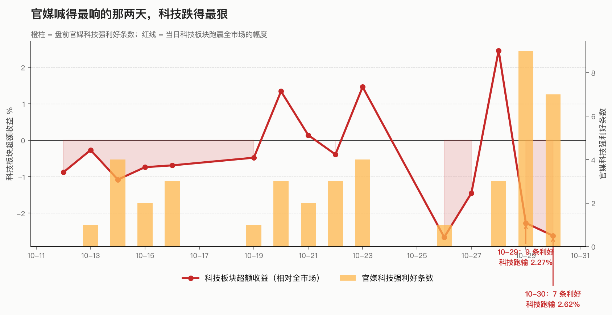
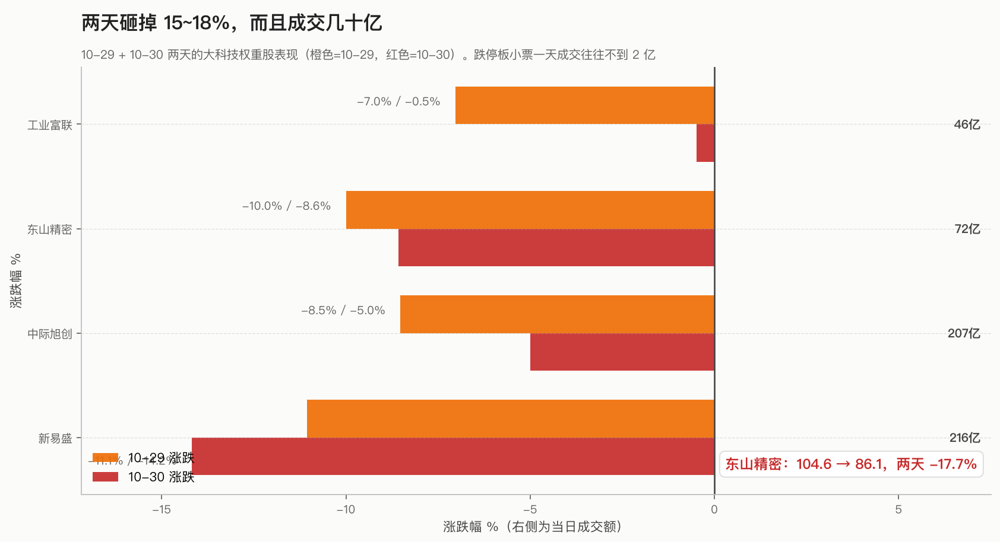
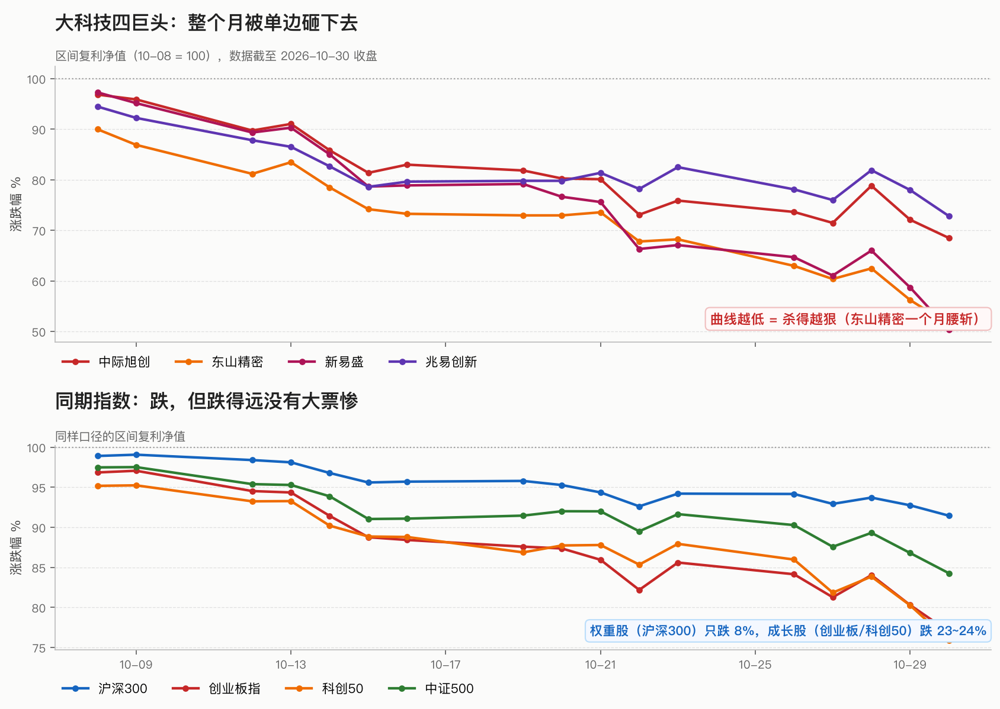
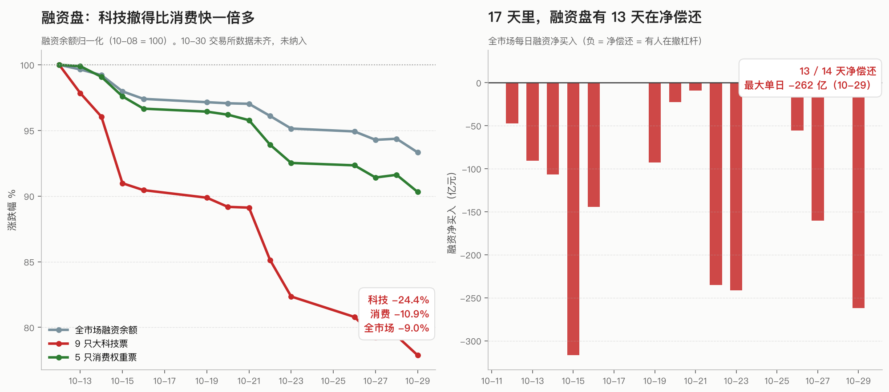
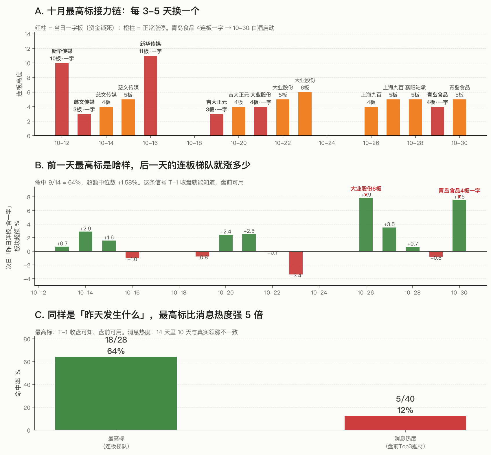
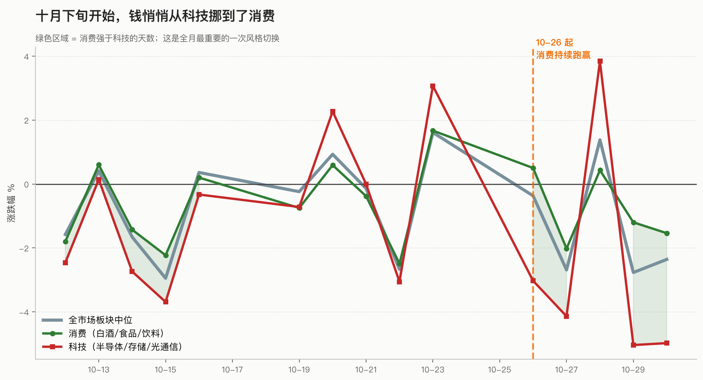
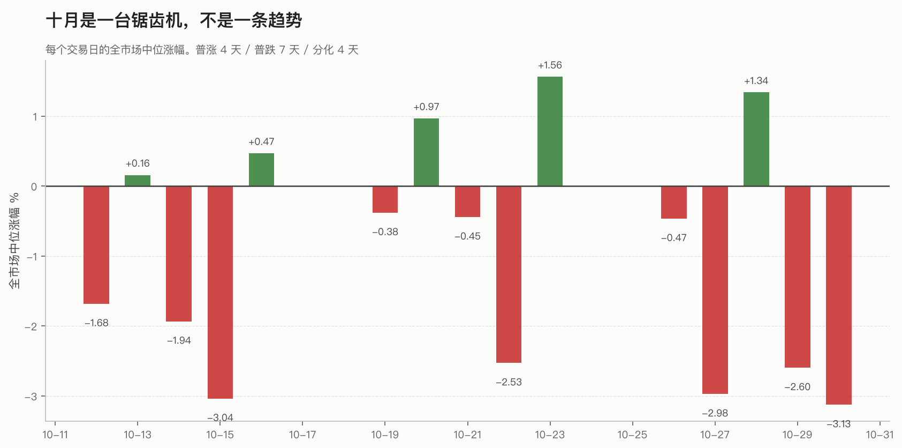
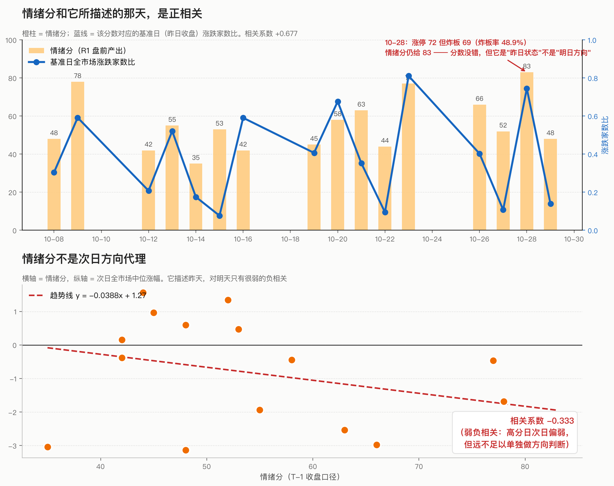

# 官媒在喊利好，科技在崩盘

## ——这轮大科技杀跌的完整逻辑，以及现在到了哪一步

> 说明：本文所有数据来自 2026 年 10 月 8 日至 30 日共 17 个交易日的真实盘口与融资数据，个股价格用不复权收盘价（已核验无除权），板块用东财概念指数中位数。文中不荐股。

---

## 一、先说一个反常识的事实

10 月 29 日那天，官媒在干什么？

打开那天的盘前消息，满屏都是这个：

> 「利好突袭！深夜，存储巨头暴涨！」
> 「HBM 将持续涨价，或撬动 DRAM 全局」
> 「半导体方向今日反弹」
> 「兆易创新，业绩炸裂！朱一明、葛卫东没卖」
> 「报喜！存储细分龙头，净利增逾 38 倍」

一天之内，官媒科技类的强利好消息，我数出 **9 条**——是整个十月最高的。

同一天，盘面是什么样子？

**半导体存储板块中位涨幅 -5.04%，跑输全市场 2.27%。**

10 月 30 日再来一次，利好 7 条，科技板块中位 **-4.98%**，跑输 2.62%。

这就是我要说的第一件事：**在这个市场里，消息从来不是给你指方向的，消息是给资金打掩护的。**

你在 10 月 13 号那次复盘里问过 R4，得到的答案是"算力链业绩炸裂但隔夜被砸，可防守反击的是稀土+资源"。那是 10 月中旬，逻辑还成立。

但到了月底，逻辑整个翻转了——**不是消息失效了，是消息的角色变了。**

---

## 二、真正被砸的不是小票，是大票

这里我要更正一个非常常见的直觉。

散户看盘，盯的是涨停板和跌停板。10 月 30 日那天跌停 86 家，一片哀嚎，看起来像是"小票垃圾股被抛弃"。

**错。**

真正决定指数的是这些票：

| 票 | 10-08 收盘 | 10-30 收盘 | 月度跌幅 | 10-30 单日成交 |
|---|---|---|---|---|
| 新易盛 | 378.50 | 196.00 | **-48.2%** | **216 亿** |
| 东山精密 | 150.66 | 86.06 | **-42.9%** | 72 亿 |
| 天孚通信 | 235.07 | 148.00 | **-37.0%** | 70 亿 |
| 中际旭创 | 783.00 | 553.00 | **-29.4%** | **207 亿** |
| 兆易创新 | 334.40 | 257.80 | -22.9% | 100 亿 |
| 工业富联 | 55.69 | 45.00 | -19.2% | 46 亿 |

**新易盛一个月腰斩，当天成交 216 亿。** 一个跌停板小票，一天成交能到 2 亿就算活跃了。

再看看指数的分化：

| 指数 | 10-08 | 10-30 | 月度 |
|---|---|---|---|
| 上证50 | 2805 | 2742 | **-2.2%** |
| 沪深300 | 4310 | 3986 | -7.5% |
| 中证500 | 7248 | 6266 | -13.6% |
| 中证1000 | 7139 | 6161 | -13.7% |
| 创业板指 | 3037 | 2414 | **-20.5%** |
| 科创50 | 1456 | 1161 | **-20.3%** |

**上证50 只跌 2.2%，科创50 跌 20.3%——十倍差距。**

**这不是普跌，这是一次精确的、定向的、只杀成长股不杀权重股的出货。**

为什么这么精准？因为**权重股是银行、白酒、石油，这些是"防守"；成长股是筹码，是"货"。** 要出掉的从来是货。

---

## 三、为什么杀得这么狠：三个东西叠在一起

### 第一层：融资盘在撤，而且撤得比谁都早

这是最硬的一条证据。我拉了融资余额的逐日数据：

- **9 只大科技权重票的融资余额：1070 亿 → 809 亿，撤了 260 亿（-24.3%）**
- **5 只消费权重票的融资余额：294 亿 → 262 亿，只撤了 32 亿（-10.9%）**
- **全市场融资余额：25446 亿 → 23567 亿（-7.4%）**

**科技上的融资盘，撤得是消费上的 8 倍。**

而且时间点很关键：这不是 10 月 30 日一天砸出来的。**从 10 月 8 日开始，17 个交易日里有 13 天融资盘在净偿还，10 月 29 日单日净偿还 262 亿，是全月最大。**

这就是你说的那个"配合大资金把融资盘搞爆"——**它不是一天的动作，是一场持续三个月的、每天都在抽血的慢动作。**

### 第二层：抱团本身在瓦解

10 月 27 号那篇《证金事》里写得很清楚：公募三季报显示半导体配置占比环比提升 10.35 个百分点到 82.81%，"易中天"成了增仓集中标的，中际旭创增持 2.31%、新易盛增持 8.11%、天孚通信增持 **59.51%**。

**当一个板块被加到 82.81% 的配置比例，增持到 59.51% 的时候，你还需要买盘吗？**

抱团的钱是最早跑的一批。10 月的走势是：先杀最拥挤的（10 月中旬光通信），再杀有业绩的（10 月下旬存储），最后连龙头也开始补跌。

### 第三层：消息在高位变成了出货窗口

这个我在报告里量化过：**盘前最热的题材，当日跑赢全市场的概率只有 12.5%。**

尤其在普跌日，这个概率掉到 11%。而在普涨日，拥挤方向恰好也涨，所以看起来"消息有时准"。

**这就是为什么你在 10 月 29 号会看到"半导体消息满天飞"——因为那正是资金需要散户接货的时候。**

有一个细节特别典型。10 月 30 日盘前，官媒还在写「兆易创新业绩炸裂」「报喜！存储细分龙头净利增逾38倍」，同一天盘后，却也出现了「1700 亿市值光通信龙头大跌」「长鑫科技郑重提醒」。

**同一天，同一个方向，既是报喜也是提醒。** 这不是矛盾，这是流程：报喜在前，让人冲；提醒在后，跌下来的时候好解释。

---

## 四、钱不是去消费了 —— 是去"最高标"了

这一节是我写完前面几段之后，被一个细节推翻重写的。

10-29 白酒为什么涨？最直观的解释是：白酒板块有消息。

**但我查了数据，消费方向十月公众号 0 篇、新闻源只有 9 篇且没有一天 ≥3。** 按板块消息扫，**永远扫不到白酒**。

真实原因是这样一条链：

**青岛啤酒**（359 亿流通市值的大票）10-29 发了收购相关公告。
10-29 那天，**青岛食品**（37.9 亿流通）直接一字板，4 连板，封单 1.65 亿。
10-30，**青岛啤酒自己只涨了 1.22%**，而青岛食品继续涨停 —— 带动的是**整个白酒板块 +5.15%**。

**大市值标的只动 1%，小市值一字板把板块点着了。**

这就是**最高标（连板梯队）效应**：市场认的不是"哪个板块有消息"，是"**现在情绪的锚在哪**"。青岛食品成了最高标，白酒就成了它的影子。

### 这个机制在十月有多强？

我把它做成了可计算的规则，然后回测：

| 代理 | 命中率 | 超额中位 | 可用时点 |
|---|---|---|---|
| **最高标 → 次日连板梯队** | **18/28 = 64%** | **+1.14%** | T-1 收盘即可知 |
| 盘前消息热度 → 当日最强板块 | 5/40 = **12.5%** | 负 | 盘前 |

**同样是问"昨天发生了什么"，最高标比消息热度强 5 倍。**

而且 10-30 那根 +7.58% 的柱子，就是你的案例本身。

### 反过来也成立：最高标塌了就危险

| 日期 | 最高标封单变化 | 次日梯队超额 |
|---|---|---|
| 10-22 | 2.58 亿 → 0.95 亿 | **-6.63%** |
| 10-23 | 0.95 → 1.36 亿 | +7.87% |

**封单塌一半，梯队第二天就崩 6.6%。** 这是一个可以在 T-1 收盘就看到的出货警报。

### 十月完整的最高标接力链

| 日期 | 最高标 | 板数 | 一字？ |
|---|---|---|---|
| 10-12 / 10-16 | 新华传媒 | 10→11 板 | 是 |
| 10-13~15 | 慈文传媒 | 3→4→5 板 | 首板一字 |
| 10-19~20 | 吉大正元 | 3→4 板 | 是 |
| 10-21~23 | 大业股份 | 4→5→6 板 | 是 |
| 10-26~27 | 上海九百 | 4→5 板 | — |
| 10-28 | 襄阳轴承 | 5 板 | — |
| **10-29~30** | **青岛食品** | **4→5 板** | **10-29 一字** |

**每 3-5 天换一个最高标** —— 这就是短线的节奏本身。而**10-30 青岛食品封单从 1.65 亿掉到 0.57 亿、炸板从 0 次到 3 次**：这一天白酒的 +5.15% 是**高潮，不是启动**。

---

## 五、钱具体流到了哪里

这是全场最反直觉、也最重要的一段。

10 月 29 日，涨得最好的板块是这些：

**白酒Ⅲ +5.15%、白酒Ⅱ +5.15%、纺织鞋类 +3.87%、综合电商 +3.51%、医疗研发外包 +3.37%、零食 +2.74%、酿酒概念 +2.74%、酒店 +2.56%**

而 10 月 30 日，逆势的又是：**纺织鞋类 +6.17%、航天装备 +3.54%、院线 +3.37%、核力发电 +2.91%**

**涨幅榜前八名里，一条科技都没有。**

而且这个切换**不是一天发生的**：

| 日期 | 全市场中位 | 消费 | 科技 | 消费跑赢 |
|---|---|---|---|---|
| 10-26 | -0.37% | **+0.50%** | -3.03% | **+0.87%** |
| 10-27 | -2.69% | -2.02% | -4.14% | **+0.67%** |
| 10-29 | -2.77% | **-1.20%** | -5.04% | **+1.57%** |
| 10-30 | -2.36% | **-1.54%** | -4.98% | **+0.82%** |

**从 10 月 26 号起，消费连续三天跑赢科技。**

钱没有离开 A 股，**钱从"讲故事的地方"挪到了"不讲故事的地方"**。消费不是主线，没有连板梯队，没有涨停扩散，所以它从来不会被任何"找主线"的系统选出来——但它一直在那儿接盘。

---

## 六、现在到底到什么位置了？

先说清楚 10 月的整体节奏，这决定了现在该怎么判断：

**10 月是一台锯齿机，不是一条趋势。** 17 个交易日，普涨 4 天、普跌 7 天、分化 4 天。广度最低 0.077（10-15），最高 0.811（10-23），**跨度十倍**。

现在有几个位置判断：

**第一，六只大科技票全部在 10 月 30 日收出月内最低价。**

中际旭创、新易盛、天孚通信、兆易创新、东山精密、工业富联——**无一例外**。这说明抛压在 10-30 是集中释放的，不是阴跌。

**第二，成交额没有萎缩。**

10-22 到 10-30 这 7 天，成交额在 14729 到 19728 亿之间，10-30 是 16877 亿。**没有量缩。**

这很关键。真正的跌透，一定是缩量阴跌到没人管。**现在是有量下跌——说明筹码还在换手，分歧还在，分歧就意味着还没到头。**

**第三，跌停数从 86 家往上走了，但这是恐慌不是崩溃。**

10-28 跌停 6 家 → 10-29 跌停 42 家 → 10-30 跌停 86 家。**一天翻了 14 倍。**

跌停家数暴增是情绪宣泄，通常会有反弹。但**注意 10-23 那次的反弹有多猛**：10-22 跌停 55 家、中位 -2.53%，10-23 直接涨停 84 家、中位 +1.56%、成交 1.97 万亿。

**这个市场的反弹能力是极强的，所以不能因为"跌多了"就抄底。**

---

## 七、接下来的目的是什么？

我把可能的剧本摊开，你对照着看：

### 剧本 A：消息面继续放利好，逼出最后的信仰者（概率最高）

理由很简单——**官媒的任务是服务于资金的**。资金还没出完，还需要散户来接。

标志：官媒科技类消息重新密集起来、"利空出尽"的说法出现、券商开始写"黄金坑"。

**这时候最该做的不是买，是识别。** 因为消息越密集，拥挤度读数越高，越接近出货尾声。

### 剧本 B：消息面转向消费/防御，配合资金换方向

标志：官媒开始密集写消费、白酒、医药、必选；科技方向的"利好"戛然而止。

**这个剧本已经在发生了**——10-26 起消费连续三天跑赢科技，融资盘也在往消费上搬（虽然搬得慢，但方向明确）。

### 剧本 C：真正的企稳信号出现

我自己的判断是，**企稳要看三件事同时发生**：

1. **大票先止跌**——不是小票，是新易盛、东山精密、天孚这种。月内最低价不再刷新
2. **炸板率下来**——10-28 那天涨停 73 家但炸板 69 家（炸板率 0.95），这是典型的高开低走，是反弹质量差的标准特征
3. **融资盘停止净偿还**——至少连续两天不是净流出

**在这三件事出现之前，任何"科技见底"的判断都是赌博。**

---

## 八、顺便说一句：我们自己系统的问题

写这篇的过程中我发现自己系统里的一个硬伤，这部分给内部看，不用对外。

10 月 29 号，我们的 R2 给「存储芯片」打了 74 分进主线，五维打分是这样的：

**热度 20 分（满分）、资金 16、涨停 8、叙事 12、共振 18。**

**热度拿满分，叙事也不低，74 分，选进主线。**

而当天这个板块中位 -5.04%，跑输全市场 2.27%。

情绪分这里我得先自我纠正一次。

**我此前说"情绪分是反向指标、相关系数 -0.393"，那是错的。** 错在我把 R1 的**产出日**当成了**基准日**——R1 是盘前跑的，它描述的是**昨天收盘**的市场状态。

严格对齐后重算：

- 情绪分 vs **它所描述那天**的涨跌家数比：**+0.677**（正相关，符合直觉）
- 高分组平均广度 0.522，低分组 0.253

**分数本身没错。** 10-29 早上打的 83 分，对应的是 10-28 收盘——那天中位 +1.34%、广度 0.745，**确实是全月第二强的一天**。

但**公式里确实有一个真病灶**：

Tushare 的 `limit_list_d(limit_type='U')` 统计的是"**曾涨停**"，含盘中打开过的。10-28 那 72 只涨停里，**有 38 只盘中打开过，真正封死的只有 34 只**，炸板率 48.9%。旧公式拿 `40×min(72/60,1)` = 满分，**把一个高开低走日算成了情绪高昂日**。

改用"封死数"后：

| 日期 | 曾涨停 | 真正封死 | 旧分 | 新分 | 当日实际 |
|---|---|---|---|---|---|
| 10-28 | 72 | **34** | 83 | **74** | 中位 +1.34% |
| 10-23 | 82 | 43 | 92 | **92** | 中位 +1.56% |

真强势日一点没动，高开低走日被压下来了。

**但更重要的是认知纠正**：情绪分描述"昨天有多热"，对"明天涨什么"只有 **-0.333 的弱负相关**（高分日次日偏弱，样本 n=14）。**它是状态描述，不是方向预测。**

**这条跟前面"消息热度是反向指标"是同一个病根的另一面**：不是分数算错了，是**把状态指标当方向代理用了**。

已经在改的（都已落地，等 11-02 第一次自然验证）：
- 思维宪法加了 step 0.5：**先看今天谁在涨，再看消息**，"没消息但在涨"才是低吸的候选来源
- R4 消息面：官媒只做事实检索，民间号只做位置感校验，热度改成拥挤度扣分项
- R2 打分：热度从 20 分砍到 10 分，新加 10 分"相对强度"，**相对强度 ≤ 0 的方向不许进主线**
- D1：加了奖励函数交叉闸，"没消息但在涨"的方向不许因为没消息被排除
- **新增「最高标/连板梯队」信号**：把 10-30 白酒那套传导链（青岛啤酒公告 → 青岛食品一字板 → 梯队溢价 → 白酒启动）变成可计算的规则。十月回测：最高标代理命中率 64%，消息热度代理只有 12.5%
- **情绪分改用「封死数」口径**（真强势日不变，高开低走日从 83 压到 74），并明确它只是状态描述

---

## 最后

10 月这一轮能说明的事，比数字多。

**消息面不是预测工具，是资金的配套动作。** 在低位，它是点火；在高位，它是掩护。看清它在哪一边，比读懂它说什么重要得多。

**大票才是重量级。** 跌停板上的小票是情绪，权重股上的大票是筹码。杀盘看的是筹码。

**别用最热闹的方向找机会。** 10 月 29 号全市场最热闹的方向，第二天跌得最多。
