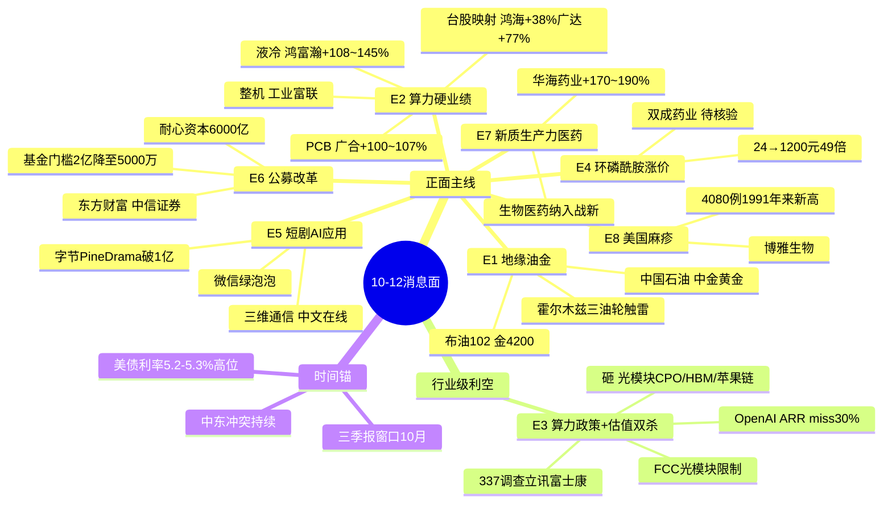

# 2026-10-12（周一）· **消息面事件驱动**

> **数据源新鲜度**: partial · **降级状态**: true（公众号源关闭 / iwencai 缺 key / R7 未出）· **置信度**: 0.66
> **覆盖窗口**: 2026-10-09 → 10-12 07:30（72h）· **主源**: 财联社+新浪快讯(2327) / 重大要闻(800) / 东财三季报预告(166) / 5焦点群(86)
> **情绪周期锚**: 主升（conf 0.62，涨停69 / 炸板率16.9% / 连板天梯9）→ 猛干龙头、主升分歧做补涨，但**算力内部高低切**。

## 一句话结论

**三季报硬业绩（液冷/PCB/医药）+ 短剧AI应用 + 油金地缘**三条线打进攻，**FCC光模块+OpenAI ARR miss 是唯一行业级利空**，算力内部从高位光模块向业绩硬的液冷/PCB切换。

---

## 🗺️ 消息面全景图

## 📊 板块极性叉乘矩阵（核心交付）

| 板块 | 事件锚 | 极性 | 强度 | 首推龙头 | 独立源 | 三季报预告 | 综合 |
|------|--------|:--:|:--:|--------|:--:|--|:--:|
| 液冷 | E2 | 🟢正面 | high | 鸿富瀚 301086 | 4 | +108~145% | 🟢🟢🟢 |
| 算力PCB | E2 | 🟢正面 | high | 广合科技 001389 | 4 | +100~107% | 🟢🟢🟢 |
| AI服务器整机 | E2/E3 | 🟡分歧 | high | 工业富联 601138 | 4 | — | 🟢🟢 |
| 短剧/AI应用 | E5 | 🟢正面 | high | 三维通信 002115 | 4 | — | 🟢🟢🟢 |
| 券商 | E6 | 🟢正面 | high | 东方财富 300059 | 4 | — | 🟢🟢🟢 |
| 油气开采 | E1 | 🟢正面 | high | 中国石油 601857 | 4 | — | 🟢🟢 |
| 黄金 | E1 | 🟢正面 | high | 中金黄金 600489 | 3 | — | 🟢🟡（已抢跑）|
| 创新药 | E7 | 🟢正面 | medium | 华海药业 600521 | 3 | +170~190% | 🟢🟢🟢 |
| 化学制药 | E4 | 🟢正面 | medium | 双成药业 002693 | 2 | — | 🟡（单源待核）|
| 血制品 | E8 | 🟢正面 | medium | 博雅生物 300294 | 2 | — | 🟡（映射间接）|
| 军工 | E1 | 🟢正面 | medium | （南海实弹，观察）| 2 | — | 🟢🟡 |
| 内需消费 | E7 | 🟢正面 | medium | （顺周期扩散）| 2 | — | 🟢🟡 |
| **光模块/CPO** | E3 | 🔴负面 | high | 规避 中际旭创/新易盛 | 4 | — | 🔴🔴 |
| HBM/存储 | E3/E2 | 🔴分歧 | medium | 成本预期下调 | 2 | — | 🔴 |
| 苹果链/连接器 | E3 | 🔴负面 | medium | 规避 立讯精密 | 3 | — | 🔴 |
| 航空/下游用油 | E1 | 🔴负面 | medium | 成本上升 | 2 | — | 🔴 |

> 叉乘读法：**E2（业绩正）× E3（政策负）同落在算力主线**——这不是矛盾，是主线内部的资金高低切。业绩硬的液冷/PCB/整机抗跌甚至吸金，纯估值的高位光模块/CPO 被砸。D1 应在算力内做结构、而非整体加减仓。

---

## 🎯 顶级事件详解（三问 + 首推票思维链）

### E20261012_001 · 霍尔木兹三油轮触雷 + 沙特机场连环遇袭 · high · 正面（weighted 0.73）

**事件摘要**：10-12 凌晨霍尔木兹海峡第三艘油轮（载75万桶原油）触雷起火，阿曼海域一油轮遭无人机袭击；沙特利雅得机场遇袭已致12死309伤。布伦特暗盘破102美元（+1%），金价破4200美元/盎司。南海12-20日同步实弹军演。

**推理深度三问**：
- **大资金意图**：美伊"战时状态"下伊朗军方明确"商船未经协调不得通过霍尔木兹"，供给中断溢价重定价。资金在科技股高位震荡时，借地缘切向**油金避险+军工**做高低切防御，属主升期中的轮动而非撤退。
- **为什么走强**：油价是真实供给收缩（触雷/禁航），金价是实际利率+避险双驱动；暗盘已先动，A股周一有补涨映射，但黄金股10-09已提前大涨（中金黄金+6.84%）。
- **逻辑够不够硬**：油偏**硬**（物理供给中断+多官方源），金偏**半硬**（已抢跑一笔）。缺陷是美伊谈判窗口随时可能重开，地缘溢价回撤快，只能做事件驱动短打。

**首推票思维链**：
- 中国石油 601857（首推，参考11.60）
  - **买入理由**：上游油价弹性最直接的权重标的，10-09逆势抗跌+0.09%，位置低未抢跑；油破102有补涨。
  - **风险点**：大盘股权性钝、弹性小于小票；美伊临时缓和则溢价当日回吐。
  - **止损条件**：11.00（参考价-5.2%，跌破5日线）。
  - **可验证假设**：周一开盘原油链若30分钟内不跟涨布油、或油气板块净流出，则映射失效，放弃。
- 中金黄金 600489（弹性首推，参考22.95）
  - **买入理由**：金价4200直接放量，中金集团平台；山东专题会议推动矿产金扩能。
  - **风险点**：10-09已+6.84%提前抢跑，高开兑现风险大。
  - **止损条件**：21.70（-5.4%）；高开>+4%不追，只做回踩5日线低吸。
  - **可验证假设**：沪金/伦敦金若亚盘回落跌破4180，则抢跑资金兑现，回避。

### E20261012_002 · 台股算力9月营收超预期 + 三季报液冷/PCB硬业绩 · high · 正面（weighted 0.69）

**事件摘要**：台股9月营收鸿海+38.4%、广达+76.7%（Vera Rubin 26Q4小批量、订单能见度到2028）、纬创+87%；A股鸿富瀚中报预增108-145%（液冷板整柜模组）、广合科技预增100-107%（算力PCB/AI服务器）、博迁新材证伪高容MLCC景气；招商策略列算力芯片/存储/PCB/液冷为利率转跌后第一受益方向。

**推理深度三问**：
- **大资金意图**：在 E3 的 FCC/OpenAI 利空把光模块砸出坑后，机构需要一条"利空砸不动、业绩能兑现"的算力分支抱团，**液冷/PCB 正是被三季报验证的高确定性环节**，资金从光模块向配套环节搬家。
- **为什么走强**：不是讲预期，是**当期盈利兑现**——鸿富瀚、广合都是100%+的真实中报，且台股产业链给出到2028年的能见度，产业趋势与业绩共振。
- **逻辑够不够硬**：**最硬**。公告业绩+台股硬数据+券商策略三方独立共振。缺陷是10-09板块整体随光模块回调（鸿富瀚-7.16%、广合-7.49%），但这恰是主升分歧的低吸窗口。

**首推票思维链**：
- 鸿富瀚 301086（首推，参考140.20）
  - **买入理由**：液冷板整柜模组放量，中报净利+108~145%硬兑现；林童"液冷业绩释放最明显"；回调-7.16%给买点，RR>2。
  - **风险点**：高价股波动剧烈；若大盘二次探底，高β杀跌。
  - **止损条件**：131.50（-6.2%，跌破前低/10日线）。
  - **可验证假设**：周一液冷板块若不能随台股映射高开企稳、或开盘30分钟净流出，则分歧转退潮，降watch。
- 工业富联 601138（总龙，参考56.07）
  - **买入理由**：AI服务器整机龙头，台链映射核心，10-09逆势+0.68%、43亿成交抗跌，主升趋势完好。
  - **风险点**：市值大弹性弱于小票；受E3北美链情绪牵连。
  - **止损条件**：53.20（-5.1%，破20日线）。
  - **可验证假设**：算力整机若资金回流则龙头先行；若旭创/新易盛继续杀跌拖累板块，则买点后置。
- 广合科技 001389（中军，参考154.50）：业绩+100~107%但高价+单日-7.49%，仅6%小仓试，止损143.50（-7.1%）。

### E20261012_003 · 【行业级利空】FCC光模块限制 + OpenAI ARR miss + 337调查 · high · 负面（weighted -0.52，已衰减）

**事件摘要（正反两面强制拆分）**：FCC光模块限制持续发酵；OpenAI 9月ARR仅500亿美元，低于北美共识700亿约30%，2万亿IPO估值承压；USITC 10-9 对垂直电力传输系统启动337调查，立讯精密、富士康(工业富联母公司)、台达、广达均被列；伯恩斯坦把Rubin NVL72机柜成本预期下调17%（HBM/NAND价格调整）。中信建投定调"科技调整重心，防御优先"。

**推理深度三问**：
- **大资金意图**：高位算力（尤其光模块）是节前最拥挤交易，FCC+ARR miss给了获利盘兑现的借口，资金**不是离开AI，而是在AI内部从高估值切向高景气（见E2）**。
- **为什么杀跌**：光模块/CPO前期按北美CSP无限CapEx定价，ARR miss+FCC直接动摇"需求无限+出口无碍"两个假设；337调查点名立讯/富士康压制连接器/电力传输。
- **逻辑够不够硬**：**利空为硬**（官方调查+财报数据），但已过3日衰减至64%以下（decayed=true），属"背景压力"而非新增恐慌，周一更可能是结构分化而非板块再崩。

**杀伤面（bearish）**：光模块、CPO、HBM/存储（成本下调）、苹果链/连接器、垂直电力传输。**规避**中际旭创(300308 775元高位)、新易盛(300502)、立讯精密(002475，337+苹果双压)。**不接飞刀，买点后置到三季报验证+FCC落地。**

### E20261012_005 · 字节PineDrama破1亿 + 微信「绿泡泡」 · high · 正面（weighted 0.65）

**事件摘要**：Sensor Tower 数据字节短剧应用 PineDrama 上线约9个月下载破1亿、DAU约700万，Q2下载激增460%；微信上线官方短剧小程序「绿泡泡」AI内容成主力；华福AI互联网连发红果AI短剧追踪及专家电话会。10-09中文在线、上海电影等短剧股已20cm/涨停。

**推理深度三问**：
- **大资金意图**：高利率+算力硬件受E3压制时，市场找**增量故事**，AI应用（短剧）是少数能讲用户/时长真实爆发的方向，资金从硬件切向应用做风格再平衡。
- **为什么走强**：有硬数据（1亿下载/Q2+460%）+ 渠道（微信亲自下场）+ 赚钱效应（10-09涨停潮）三共振，题材处在主升早段。
- **逻辑够不够硬**：偏**题材硬**（产业数据真，但A股映射股的业绩弹性多为间接投流/版权），龙头已20cm，性价比在低位补涨而非追龙头。

**首推票思维链**：
- 三维通信 002115（首推/补涨，参考9.55）
  - **买入理由**：子公司巨网科技为字节 TikTok for Business 全球授权代理、独家运营海外流量，PineDrama出海投流直接受益；10-09仅+4.49%位置低，有补涨空间。
  - **风险点**：投流业务与PineDrama实际订单绑定度未公告量化，题材属性强。
  - **止损条件**：9.02（-5.5%，破5日线）。
  - **可验证假设**：周一短剧板块若继续放量、中文在线不大幅低开，则补涨成立；若龙头炸板退潮则一并回避。
- 中文在线 300364（总龙，参考24.47）：AI短剧IP龙头、10-09 20cm、18.5亿成交，仅6%情绪仓，高开>5%不追，止损22.90。

### E20261012_006 · 证监会12年首修公募运作办法 + 耐心资本 · high · 正面（weighted 0.52）

**事件摘要**：证监会发布修订《公开募集证券投资基金运作管理办法（征求意见稿）》，股票/混合/FOF成立门槛由2亿降至5000万，被动指数基金举牌/短线/减持限制适度豁免，非FOF投基金上限10%→30%；吴清10-10座谈会强调壮大耐心资本，今年社保/年金/保险中长期资金净买入A股超6000亿；10月沪市回购已超170亿。

**推理深度三问**：
- **大资金意图**：这是**指数级政策底**信号，降门槛+豁免举牌直接利好增量入市与机构定价权，资金受益最直接的是券商（成交+两融+财富管理）与宽基/红利。
- **为什么走强**：10-09午后宽基ETF脉冲式净买入、指数V型反转已是稳市资金明牌，券商（东财+3.88%）提前反应。
- **逻辑够不够硬**：制度性利好**中期硬、短期需量能确认**，券商是旗手但必须成交量配合，否则只是脉冲。

**首推票思维链**：
- 东方财富 300059（首推，参考17.95）
  - **买入理由**：互联网券商龙头，市场放量/情绪修复弹性最高，10-09 V型反转领涨+3.88%。
  - **风险点**：β属性强，若大盘缩量回调首当其冲。
  - **止损条件**：17.05（-5.0%，破10日线16.9附近）。
  - **可验证假设**：周一两市成交额若不能放大、券商不续强，则政策利好多头兑现，降仓。
- 中信证券 600030（中军，参考25.91）：低PB并购重组旗舰，+2.01%稳健，8%仓，止损24.60。

### E20261012_004 · 环磷酰胺涨价49倍 · medium · 正面（weighted 0.56）⚠️单源

**事件摘要**：第一财经报道化疗基石药环磷酰胺原研"安道生"因百特委托产线2026年初故障断供，价格从24元→680→1200元（49倍），新建产线需约5年，短期缺口难补。5群中3群口播国产替代（双成药业、誉衡药业）。

- **大资金意图**：短缺涨价+国产替代经典题材，资金做低位医药小票弹性。
- **为什么走强**：涨价倍数夸张（49倍）有传播力，低价股（双成9.8元/誉衡3.69元）易被点火，10-09双成已+7.69%。
- **逻辑够不够硬**：**偏软**——仅群聊+单一媒体，**无上市公司公告证实双成/誉衡实际持有环磷酰胺批文与产能**。按红线1，单源非官方事件强度顶格medium。
- **首推**：双成药业 002693 仅5%题材仓，止损9.10（-7.1%，炸板即走）；誉衡药业 002437 为 proxy 跟风**仅watch不进execution**。**R5必须核验批文，未核实前禁止重仓。**

### E20261012_007 · 新质生产力意见纳入生物医药 + 财政扩内需 · medium · 正面（weighted 0.52）

**事件摘要**：中共中央国务院《关于发展新质生产力的意见》（10-10头版）将生物医药与新一代信息技术、机器人并列为战略性新兴产业；财政部表态实施更积极财政、全方位扩内需。兴证医药/银河证券解读为创新药制度性利好。

- **大资金意图**：顶层文件定调十五五产业主线，引导耐心资本向创新资产集中，属慢变量制度利好。
- **为什么走强**：短线弹性弱于题材，但叠加三季报，**有业绩的医药股能走出政策+景气双击**。
- **逻辑够不够硬**：方向硬、节奏慢；优先选业绩兑现标的而非纯政策概念。
- **首推**：华海药业 600521（参考17.45）——特色原料药+制剂出口，中报净利+170~190%硬兑现，10-09+4.8%放量，8%仓，止损16.55（-5.2%），目标19.5-21.5。

### E20261012_008 · 美国麻疹创1991年来新高 · medium · 正面（weighted 0.41）

**事件摘要**：美国CDC数据截至10-8今年麻疹确诊4080例，超2025全年（2289例），为1991年来年度最高。群聊口播被动免疫（人免疫球蛋白，接触后7日内预防）受益：博雅生物（互动易实锤）、卫光生物。

- **大资金意图**：海外疫情映射的潜伏型小题材，资金博血制品板块情绪。
- **逻辑够不够硬**：**间接**——美国麻疹与国内血制品需求之间传导链弱，且有疫苗（麻腮风）这一更直接预防手段，免疫球蛋白仅用于暴露后。
- **首推**：博雅生物 300294（参考14.88）位置低仅+1.5%未发酵，5%小仓潜伏，止损14.10（-5.2%），目标16.5-18；不追，与E4/E7医药共振才加分。

---

## 🔥 三季报业绩预告命中（硬 alpha 交叉验证）

从 166 条当日业绩预告提取高增速并与本卷事件板块叉乘：

| 代码 | 名称 | 预告类型 | 同比区间 | 事件命中 | 逻辑强度 |
|------|------|---------|---------|---------|:--:|
| 301086 | 鸿富瀚 | 预增(净利) | +108%~145% | E2 液冷板整柜 | 🟢🟢🟢 |
| 001389 | 广合科技 | 预增(净利) | +100%~107% | E2 算力PCB | 🟢🟢🟢 |
| 600521 | 华海药业 | 预增(净利) | +170%~190% | E7 创新药 | 🟢🟢🟢 |
| 688801 | 燧原科技 | 预增(营收) | +326%~455% | E2 国产算力芯片 | 🟢🟢（未列首推 高价450元）|
| 688469 | 芯联集成 | 预增(净利) | +247% | E2 半导体制造 | 🟢🟢 |
| 600256 | 广汇能源 | 预增(扣非) | +192%~203% | E1 油气/能源 | 🟢🟢（油+业绩 可作E1补充）|
| 300821 | 东岳硅材 | 预增(净利) | +19048%~19748% | 有机硅（无事件锚）| ⚪基数效应 不追 |
| 300497 | 富祥股份 | 预增(净利) | +658%~785% | 化工（顺周期E7弱关联）| 🟡 |
| 600176 | 中国巨石 | 预增(净利) | +100%~110% | 玻纤（无直接事件锚）| 🟡 |

> 注：E1 中国石油/中金黄金、E5 三维通信/中文在线、E6 券商**当日不在166条预告内**，属事件/政策驱动而非业绩驱动，资金验证字段 r7_status=stale（盘前R7未出），需开盘后资金确认。

## 关键证据

- 霍尔木兹第三艘油轮触雷（载油75万桶）· 财联社/伊朗革命卫队 · 2026-10-12
- 布伦特暗盘破102美元、金价破4200美元/盎司 · 财联社 · 2026-10-12
- 鸿富瀚前三季度净利+108.19%~144.93%（液冷板整柜模组）· 公司公告 · 2026-10-09
- 广合科技前三季度净利+100.33%~107.23%（算力PCB）· 东财业绩预告 · 2026-10-10
- 台股9月营收 鸿海+38.42%/广达+76.69%/纬创+87.19% · 群-林童 · 2026-10-11
- OpenAI 9月ARR 500亿（共识700亿，-30%）· 财联社 · 2026-10-09
- USITC 对垂直电力传输系统337调查（立讯/富士康/台达/广达）· USITC公告 · 2026-10-09
- PineDrama 9个月下载破1亿、Q2+460% · Sensor Tower/华福证券 · 2026-10-11
- 证监会《公募基金运作办法》征求意见（门槛2亿→5000万）· 证券时报 · 2026-10-10
- 美国麻疹4080例创1991年来新高 · 新华社/CDC · 2026-10-10

## 数据源审计

| 源 | 日期 | 状态 | 备注 |
|---|---|:--:|---|
| tushare/news_cls（财联社+新浪） | 10-09~10-12 | 🟢 | 2327条·72h回看 |
| tushare/news_major | 10-12 | 🟢 | 800条长篇要闻 |
| eastmoney/earnings_predict | 2026-09-30报告期 | 🟢 | 166条三季报预告 |
| wechat_cli_5groups | 10-11 | 🟢 | 86条·5焦点群（匿名）|
| wechat_official（三刀/mptext） | 10-12 | 🔴 | 用户08-20取消公号源·0字节 |
| vibe_trading/iwencai | 10-12 | 🔴 | key未配置·受益股池降级多源交叉 |
| hithink_business_query | — | 🟡 | 未调·以公告/业绩预告/主营描述替代 |
| R7 资金流 | 10-12 | 🟡 | 盘前未出·r7_status=stale |

## 不确定性 / 反证

1. **E2 与 E3 同在算力，方向相反**：若周一光模块继续崩且拖累整个AI板块情绪，液冷/PCB 的"业绩免疫"可能失效（β拖累），需盘中确认资金是否真的做内部高低切。
2. **E4 环磷酰胺股性未证实**：双成/誉衡是否持环磷酰胺批文无公告，纯群聊口播，存在点火后证伪跳水风险——已限medium+5%仓+R5核验闸门。
3. **地缘溢价回撤快**：美伊谈判窗口曾重开，油金只能事件短打，黄金股已抢跑一笔，追高易被套。
4. **R7 资金流缺失**：全部个股 capital_flow_verification 为 stale，首推票缺主力资金独立确认，止损用10-09真实收盘价，开盘须以竞价/资金流二次验证。
5. **短剧A股映射间接**：除三维通信有字节代理关系外，多数为版权/情绪映射，龙头已20cm，补涨股持续性依赖板块情绪。
6. **公众号源缺席**：21号"盘前纪要"结构化涨停归因缺失，题材→个股映射少一层官方交叉。

## 与其他 R/D/E 的关系

- 依赖：data/raw/20261012 三硬源 + 5群；emotion_cycle（主升0.62）
- 被消费：R2 主线（液冷/PCB/短剧/券商/油金）/ R5 个股画像（重点核 E4 批文、E5 代理订单）/ R6 反证（E3 行业级利空需复核 hard_reject 光模块）/ D1 预案（top_pick_logic + stop_loss 直接可用）
- 对 D1 建议：execution 优先 E2 鸿富瀚/工业富联、E5 三维通信、E6 东方财富；proxy 誉衡/慈文仅 watch；E3 点名光模块/立讯进禁止清单。

## Sub-Agent 元数据

- skill: analyze_news_impact_v1@1.4（含v1.4正反拆分 + v1.2 top_pick_logic）
- artifact: data/research/20261012/R4_news.json
- method: llm_v1（三硬源+5群·时间衰减λ=0.15·8硬事件·板块极性叉乘）
- 生成时刻: 2026-10-12T07:44:00+08:00
