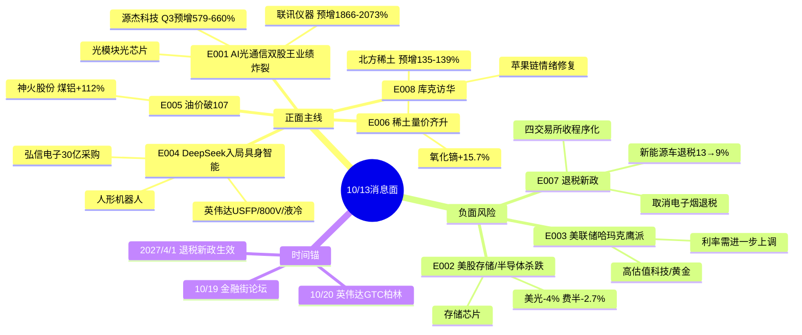

# 2026年10月13日(周二) · **消息面事件驱动**

> **数据源新鲜度**: partial · **降级状态**: false(三硬源齐) · **置信度**: 0.66
> **覆盖窗口**: 前72h · **主源**: 财联社快讯(2309) + 证券时报/上证报公众号 + 5焦点群(437) + 东财Q3业绩预告(224)
> **市场段位**: 高位震荡(emotion_cycle=high_chop,0.75) · 科创已破年线 · 10/12两市4300只下跌 成交1.54万亿缩量3627亿

## 一句话结论

算力链"业绩炸裂 vs 海外杀跌+美联储鹰派"剧烈对冲,**硬业绩兑现日只低吸不追高**;资金真正可防守反击的是**稀土+资源涨价**(北方稀土/神火),存储链开盘规避。

## 🗺️ 消息面全景图

## 🎯 顶级事件详解(每事件三问 + 首推票思维链)

### E20261013_001 · AI光通信双股王三季报炸裂 · strength=high · polarity=正面 · weighted=0.90

**事件摘要**: 联讯仪器(688808)前三季净利19-21亿,同比 **+1866%~2073%**;源杰科技(688498)Q3净利4.03-4.53亿,同比 **+579%~660%**。两家原A股"股王"业绩均点名数据中心/高速光通信/CW光芯片需求。证券时报+上证报+东财预告三源确认。

**推理深度三问**:
- **大资金意图**: 这是算力链**最硬的业绩证真**——在科创破年线、险资被疑"追涨杀跌"砍科技的当口,机构需要一个"业绩能接住估值"的锚。但10/12两股已分别大跌8.13%/6.96%,说明资金在**利好兑现先跑**,意图是借业绩做高低切换而非无脑接力。
- **为什么走强**: 光模块/光芯片厂扩产→上游测试设备(联讯)和CW光芯片(源杰)量价齐升,是产业β传导到财报的真金白银;但二级已提前吃满全年涨幅,业绩是"兑现"不是"新增量"。
- **逻辑够不够硬**: 业绩本身**极硬**(20倍级增速+官方公告),但**短期交易逻辑偏弱**——高位+破年线情绪+隔夜费半跌2.7%。硬逻辑不等于今天能买,买点必须后置到分歧。

**首推票思维链**:

#### 联讯仪器 688808 · role=首推 · 通信测试设备
- **买入理由**: Q3预告+1866~2073%(东财硬预告),卖铲人逻辑,光模块/光芯片扩产直接受益;通信测试仪器国产替代
- **风险点**: 收盘1277元高位,10/12已跌8.13%,隔夜费半-2.7%;高股价流动性差,利好兑现可能续杀
- **止损条件**: 1187元(收盘×0.929,跌破5日线确认),仓位上限8%
- **可验证假设**: 开盘30min若光模块板块net主力净流出或低开>3%不收回 → 兑现盘主导,当日不接

#### 源杰科技 688498 · role=龙二 · CW光芯片
- **买入理由**: Q3收入+265~293%、净利+579~660%,CW产品出货旺盛毛利高位;数通光芯片国产核心
- **风险点**: 1122元高位+10/12跌6.96%;美股存储/光器件Ciena-10%、Lumentum-9.8%、Coherent-7.9%隔夜重挫,直接压制情绪
- **止损条件**: 1043元(收盘×0.93),仓位8%
- **可验证假设**: 若中际旭创/新易盛开盘不能企稳(群聊已问"700能企稳吗")→ 板块共振向下,放弃低吸

### E20261013_002 · 海外存储/半导体杀跌 · strength=high · polarity=负面 · weighted=-0.70

**事件摘要**: 周一美股存储盘初普跌,美光-4%、闪迪-6%、SK海力士-3.25%;费城半导体收跌2.7%创三周新低;微软宣布数吉瓦自研Maia 300 AI芯片(明年部署)。

**推理深度三问**:
- **大资金意图**: 存储现货涨价叙事在二级市场提前兑现后,海外资金借"微软自研芯片减少外采+财报季获利了结"砸存储,是高位科技板块的**全球性减仓动作**。
- **为什么走强(空)**: 微软自研Maia长期削弱第三方GPU/存储外采预期,叠加费半破位,趋势资金止损。
- **逻辑够不够硬**: **情绪传导硬,基本面未必转空**——A股存储有自身涨价逻辑,但开盘1-2日情绪面必受拖累,不与之对抗。

**影响**: bearish_scope=板块级 → 存储/HBM、半导体设备、A股算力硬件高位票开盘规避;微软供应链(液冷/电源/机柜)反而是结构性利好,与E004的800V/液冷呼应。

### E20261013_003 · 美联储哈玛克鹰派 · strength=high · polarity=负面 · weighted=-0.65

**事件摘要**: 克利夫兰联储主席哈玛克接受《巴伦周刊》专访称"利率需要进一步上调""倾向更小幅度更高频次""当前限制性仍不足""通胀压力正从AI领域扩散"。美债收益率处24年高位。

- **大资金意图**: 鹰派+高美债收益率是全球高估值科技的**估值天花板**,叠加A股科创破年线,成长股风险偏好被压。
- **为什么砸盘**: 贴现率上行→远期现金流折现贬值,AI算力/创新药/黄金首当其冲。
- **逻辑够不够硬**: 单一地方联储主席(非FOMC票委共识),但方向信号明确,**情绪冲击>实质**,利好银行/高股息防御切换(10/12银行已逆势走强)。
- **bearish_scope=行业级**: AI算力全链/创新药/黄金;黄金另有哈萨克斯坦央行减持-3pct利空共振。

### E20261013_004 · DeepSeek入局具身智能 + 英伟达新供应链标准 · strength=high · polarity=正面 · weighted=0.70

**事件摘要**: 多信源称梁文锋密集接触机器人创业者,DeepSeek考虑进入具身智能(或亲自组队);英伟达OCP峰会开放Vera Rubin设计,推进盲插液冷、800V直流,与思科推USFP可插拔光模块(单通道400Gb/s、12.8Tb/s);纳微半导体合作800V转12V电源(盘后+7%)。

- **大资金意图**: DeepSeek下场给国产人形机器人**顶级流量背书**,机构在算力高位震荡期需要新的低位主题承接资金;英伟达USFP/800V/液冷是下一轮AI基建增量。
- **为什么走强**: 具身智能是2026少数尚未充分炒作的AI分支,DeepSeek入局=国产大模型+机器人结合的想象空间打开。
- **逻辑够不够硬**: 主题**中等偏软**(DeepSeek尚在"考虑"阶段,无产品/订单),受益股分散;800V/液冷有英伟达产业标准背书相对硬。**主题日,仓位严控**。

#### 弘信电子 300657 · role=首推(主题,llm_pure置信顶格0.5)
- **买入理由**: 子公司安联通(英伟达ELITE伙伴)签29.83亿算力芯片采购合同,FPC+算力服务器双主业,累计算力订单97亿;叠加"Token工厂"+具身端侧AI
- **风险点**: 纯主题催化无Q3预告验证,llm_pick_method=llm_pure_no_verification,置信0.5;仅入观察需D1/R5复验
- **止损条件**: 待R5给参考价,原则跌破10日线或-8%硬止损
- **可验证假设**: 开盘若机器人/Token工厂板块封板率低、弘信不能高开站稳 → 主题不接力,放弃

### E20261013_005 · 国际油价大涨 布油破107 · strength=medium · polarity=正面 · weighted=0.55

**事件摘要**: WTI收93.74(+2.06%)、布油106.65(+1.84%);特朗普称"与伊朗战争很快结束后油价将跌"。真正硬alpha在顺周期资源股业绩。

- **大资金意图**: 地缘溢价推油价,但特朗普言论提示反复;资金借能源价格高位向**有业绩的煤铝/资源**切换。
- **为什么走强**: 神火Q3净利74亿(+112%,电解铝+煤价涨、氧化铝成本降),粤桂股份矿石硫酸+154~169%,是价格上行的财报兑现。
- **逻辑够不够硬**: 油本身地缘扰动偏软,**资源股业绩硬**;属高位震荡期低相关防御反击方向。

#### 神火股份 000933 · role=首推(煤铝资源)
- **买入理由**: Q3净利74亿同比+112%(东财硬预告),电解铝+煤炭双弹性,氧化铝降价扩利
- **风险点**: 属顺周期非油直接标的,油价若因特朗普言论回落会带情绪;大盘缩量
- **止损条件**: 待R5;跌破10日线或-7%,铝/煤价回落即证伪
- **可验证假设**: 开盘有色/煤炭板块资金净流入且铝价稳 → 成立

### E20261013_006 · 北方稀土Q3预增+稀土量价齐升 · strength=high · polarity=正面 · weighted=0.75

**事件摘要**: 北方稀土前三季净利36.2-36.8亿 **+135%~139%**(扣非+167~171%);Q4精矿长协价38769元/吨同比+约48%;氧化镨钕74.05万/吨,氧化镝较6月初+15.73%。AI伺服电机+新能源车磁材+工业自动化需求共振。

- **大资金意图**: 资源安全+涨价+硬业绩三重叙事,是科技杀跌日资金**高低切换的首选承接池**之一。
- **为什么走强**: 供给约束(产业链安全管控)+下游多点需求,长协价七连涨后高位企稳,龙头业绩兑现。
- **逻辑够不够硬**: **硬**(业绩+价格+政策三锚,证券时报/上证报双源+东财预告),且与外盘科技低相关,防御中带进攻。

#### 北方稀土 600111 · role=首推 · 轻稀土龙头
- **买入理由**: 全球轻稀土龙头,Q3+135~139%硬预告,氧化镝重稀土强势,AI伺服/新能源车磁材需求
- **风险点**: 稀土价格若高位回落;大盘缩量拖累;短期已有涨幅防分歧
- **止损条件**: 待R5参考价;跌破10日线或-7%,稀土现货价回落即逻辑证伪
- **可验证假设**: 开盘稀土永磁板块资金净流入、氧化镨钕报价稳 → 加仓信号;冲高回落放量则只观察

### E20261013_007 · 新能源车出口退税下调 + 程序化交易收紧 · strength=medium · polarity=负面 · weighted=-0.50

**事件摘要**: 财政部/税务总局:2027/4/1起新能源车增值税出口退税13%→9%,取消电子烟设备退税;四大期货交易所同日就程序化交易违规处理办法征求意见(10/19截止),新增六类高频违规情形、最高停开仓12个月+50万罚款。

- **大资金意图**: 清理低效退税+倒逼产能出海,短期留6个月窗口或引发"抢出口",长期压制出口型整车/电池利润率。
- **为什么走弱**: 电子烟直接取消(打击最直接),新能源车边际利润预期下修;程序化新规压制量化高频题材情绪。
- **逻辑够不够硬**: 政策**硬但远期**,缓冲期长,实际冲击2027年才体现,今日以情绪利空对待。
- **bearish_scope=板块级**: 整车出口、锂电出口、电子烟(思摩尔链)、量化高频概念。

### E20261013_008 · 何立峰会见苹果库克 · strength=medium · polarity=正面 · weighted=0.45

**事件摘要**: 国务院副总理何立峰10/12在人民大会堂会见苹果执行董事长库克,欢迎科技企业深化对华合作;库克称在华长期发展有信心。苹果智能家居发布前获目标价上调。

- **大资金意图**: 副总理级会见释放中美经贸**缓和信号**,对冲E003鹰派对风险偏好的部分压制。
- **为什么走强**: 果链/消费电子情绪修复,中美关系边际转暖。
- **逻辑够不够硬**: **偏软**——仅官方通稿,无硬订单/采购催化,只列情绪观察,不进首推。

## 📊 板块 × 事件极性叉乘矩阵

| 板块 | 事件锚 | 净极性 | 首推龙头 | 独立源数 | Q3预告 | 综合置信 |
|------|--------|:--:|----------|:--:|--------|:--:|
| 稀土永磁 | E006 | 🟢正面 | 北方稀土 | 3 | +135~139% | 🟢🟢🟢 |
| 煤铝/资源 | E005 | 🟢正面 | 神火股份 | 3 | +112% | 🟢🟢🟢 |
| 光模块/光芯片 | E001 | 🟢正面(兑现) | 联讯仪器/源杰 | 4 | +1866%/+660% | 🟢🟢(只低吸) |
| 人形机器人/具身 | E004 | 🟢正面(主题) | 弘信电子(观察) | 3 | 无 | 🟡🟡 |
| 800V/液冷/电源 | E004/E002 | 🟢正面 | 纳微链(美股映射) | 2 | n/a | 🟡🟡 |
| AI算力硬件(综合) | E001/E002/E003 | ⚠️**分歧** | — | 多 | 多空对冲 | 🟡 |
| 银行/高股息 | E003(避险) | 🟢正面 | — | 2 | n/a | 🟢🟢 |
| 苹果链/消费电子 | E008 | 🟢正面(情绪) | 无硬票 | 1 | n/a | 🟡 |
| 存储/HBM | E002 | 🔴负面 | — | 3 | — | 🔴 |
| 半导体设备 | E002/E003 | 🔴负面 | — | 2 | — | 🔴 |
| 黄金/贵金属 | E003 | 🔴负面 | — | 2 | — | 🔴 |
| 新能源车出口/电子烟 | E007 | 🔴负面(远期) | — | 2 | — | 🔴(缓冲) |

## 🔥 三季度业绩预告命中(硬 alpha 交叉验证 · eastmoney_earnings_predict)

| 代码 | 名称 | 预告类型 | 增速区间 | 事件命中 | 逻辑强度 |
|------|------|----------|----------|----------|:--:|
| 688808.SH | 联讯仪器 | 预增 | +1866%~2073% | E001 光通信测试 | 🟢🟢🟢 |
| 688498.SH | 源杰科技 | Q3预增 | +579%~660% | E001 CW光芯片 | 🟢🟢🟢 |
| 688378.SH | 奥来德 | 预增 | +442%~538% | OLED设备(独立) | 🟢🟢 |
| 000833.SZ | 粤桂股份 | 预增 | +154%~169% | E005 矿石硫酸 | 🟢🟢🟢 |
| 600111.SH | 北方稀土 | 预增 | +135%~139% | E006 稀土 | 🟢🟢🟢 |
| 000933.SZ | 神火股份 | 预增 | +112% | E005 煤铝 | 🟢🟢🟢 |
| 300285等 | 坤彩科技 | 预增 | +178%~227% | 钛白粉(独立) | 🟢🟢 |

注:翰宇药业+502~531%(原料药)亦在14家预增名单,与今日主线弱相关未单列。

## 关键证据

- 证据1: 联讯仪器前三季净利19-21亿 同比+1866%~2073% · 证券时报/东财预告 · 2026-10-12
- 证据2: 美光-4%/闪迪-6%/费半-2.7% 微软自研Maia数吉瓦 · 财联社 · 2026-10-12
- 证据3: 哈玛克"利率需进一步上调" 倾向小幅高频 · 财联社/巴伦周刊 · 2026-10-13
- 证据4: DeepSeek梁文锋考虑入局具身智能 · 财联社独家+群聊 · 2026-10-12
- 证据5: 北方稀土Q3+135~139% 氧化镝较6月初+15.73% · 上证报 · 2026-10-12
- 证据6: 新能源车出口退税13%→9% 2027/4生效 · 财政部公告/上证报 · 2026-10-12

## 数据源审计

| 源 | 日期 | 状态 | 备注 |
|---|---|:--:|---|
| news_cls(财联社+新浪) | 2026-10-13 | 🟢 | 2309条·72h回看 |
| news_major | 2026-10-13 | 🟢 | 800条长篇要闻 |
| eastmoney_earnings_predict | 2026-10-13 | 🟢 | 224条·Q3预告 |
| wechat_official_rss | 2026-10-13 | 🟡 | 32篇;财联社早知道/盘前纪要feed 0条 |
| wechat_cli_5groups | 2026-10-13 | 🟢 | 437条·5焦点群(匿名) |
| hithink-market/business-query | 2026-10-13 | 🔴 | 未实时直调,受益股池以公告原文+东财预告替代 |
| xtick/hot_news | 2026-10-13 | ⚪ | 未直采(走本地落盘+财联社) |
| weflow | 2026-10-13 | 🔴 | MCP DOWN(ngrok离线) |

## 不确定性 / 反证

1. **算力链多空剧烈对冲**: E001硬业绩 vs E002海外杀跌 vs E003鹰派,方向取决于开盘资金选择;在科创破年线+高位震荡段位,**默认利好兑现先杀,不追高**,若开盘光模块放量企稳才可低吸龙头。
2. **首推票多缺R5参考价**: 联讯/源杰止损价以收盘价×0.93估算,北方稀土/神火/弘信止损待R5补价,R7资金面未出(r7_status=stale),资金验证不足。
3. **具身智能(E004)偏主题**: DeepSeek仅"考虑"阶段,弘信电子为llm_pure_no_verification(置信0.5),只进观察池,需D1/R5复验不直接进execution。
4. **苹果链(E008)单源官方通稿**,无硬催化,仅情绪对冲。
5. **油价(E005)地缘反复风险**,特朗普"战争结束油价跌"言论可能逆转,资源股真正支撑是自身业绩而非油价。
6. 盘前纪要/财联社早知道RSS为空,缺最结构化的盘前涨停归因,主线细节可能漏检。

## 与其他 R/D/E 的关系

- 依赖: data/raw/20261013(五源) + emotion_cycle/mainline_lifecycle
- 被消费: R2主线 / R5个股画像(补参考价+止损) / R6反证(hard_reject) / R7资金面交叉 / D1预案
- 特别提示D1: 高位震荡段位,execution优先级 稀土/资源(硬业绩低相关) > 光通信龙头(仅分歧低吸) > 具身主题(观察);存储/黄金/电子烟开盘规避

## Sub-Agent 元数据

- skill: analyze_news_impact_v1@1.4
- artifact: data/research/20261013/R4_news.json
- method: llm_v1(五源·时间衰减λ=0.15·正反两面·板块极性叉乘)
- 生成时刻: 2026-10-13T07:48+08:00
