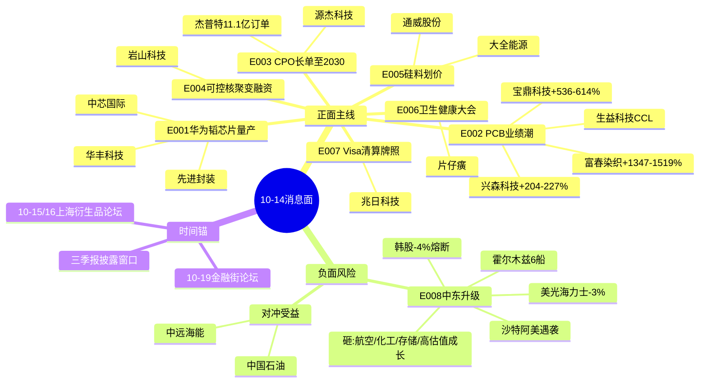

# 2026年10月14日 周三 · 消息面事件驱动

> **数据源新鲜度**: partial · **降级状态**: false · **置信度**: 0.72
> **覆盖窗口**: 前72h(2026-10-11 → 10-14 06:00) · **主源**: 财联社2605条 + 盘前纪要 + 5焦点群 + 东财276条业绩预告

## 一句话结论

硬科技三主线(华为韬芯片量产/PCB业绩潮/CPO长单)做多,中东+韩股熔断是唯一行业级负面对冲,油气油运对冲、早盘存储算力防低开。

## 🗺️ 消息面全景图

## 🎯 顶级事件详解(三问 + 首推票思维链)

### E20261014_001 · 麒麟9050/韬定律逻辑折叠量产 · high · +0.85

**事件摘要**: 华为10-13终端创新技术沟通会披露,麒麟9050系列首次将逻辑折叠技术产品化,超5000万混合键合、有效互连500万、晶体管密度+53.5%,达芬奇NPU性能+140%/功耗-66%,支持30B MoE端侧运行;徐松余同时称下一代麒麟2027已就绪。证券时报+两个KOL群双播+财联社明日主题前瞻,3独立源。

- **大资金意图**: 这是"韬定律V2论文"→"量产兑现"的第二段。机构需要把国产算力从主题配置变成业绩配置,华为亲自给出5000万键合的工程实据,等于给先进封装/代工产业链发了订单确定性。
- **为什么走强**: 10-13半导体午后已异动,长鑫科技登顶韩资A股扫货榜,粤芯上市+275%,板块情绪在点火;华为发布会是情绪加速器。
- **逻辑够不够硬**: 硬。官方发布会+可验证工程指标;短板是终端芯片对代工/封测上市公司的业绩弹性传导不直接,首推偏"信念锚"。

#### 中芯国际 688981 · 先进制程龙头
- **买入理由**: 韬定律落地的国内主力制造平台;韩资过去一月净买入中芯/华虹,外资先行
- **风险点**: 权重股弹性弱;若中东引发指数低开,龙头被动下杀
- **止损条件**: 占位58.0(开盘价×0.94且破前低),待R1/R2用实时价校准
- **可验证假设**: 开盘30分钟半导体板块资金净流入为正、中芯H股不破前日低点;否则只看不动

#### 华丰科技 688629 · 弹性核心
- **买入理由**: KOL点名"华为芯片最大价值量910c",高速背板连接器华为一供
- **风险点**: 群内单点来源,弹性票波动大
- **止损条件**: 开盘价×0.92,破5日线离场
- **可验证假设**: 竞价高开<5%且华为链封板梯队成型;高开>8%放弃追价

### E20261014_002 · PCB三季报业绩潮 · high · +0.80

**事件摘要**: 10-13晚兴森科技预增204-227%(CSP封装基板+光模块mSAP放量)、宝鼎科技536-614%(覆铜板+电子铜箔+金矿)、富春染织1347-1519%(全产业链+智能化,非PCB)。电子布10月涨价落地:7628涨1.5元/米、薄布涨2.5元/米,年底前无新产能。证券时报+东财276条官方预告双源硬共振。

- **大资金意图**: 从"顺价涨价β"切到"业绩兑现α"。三季报窗口资金只认真金白银,PCB是少数量价齐升又能讲AI故事的板块。
- **为什么走强**: 10-13 PCB已掀涨停潮(000823 68万手封板),夜盘业绩预告给续涨理由。
- **逻辑够不够硬**: 最硬的一条。官方业绩预告+涨价函+板块赚钱效应三者齐备;但二三线PCB已15x+明年PE,研报明确提示只做AI一线+上游高端。

#### 兴森科技 002436 · 首推
- **买入理由**: CSP封装基板量价齐升+光模块mSAP一线客户突破,业绩204-227%落在AI基板(非普通板),正中"AI一线错杀"逻辑
- **风险点**: 预告落地=短期利好兑现;若高开>7%易被砸
- **止损条件**: 20.0占位,跌破公告日收盘价-7%即预期破坏
- **可验证假设**: CCL/电子布板块红盘家数>15、兴森竞价成交额>2亿

#### 宝鼎科技 002552 · 弹性
- **买入理由**: 覆铜板顺价+黄金矿权双击,536-614%
- **风险点**: 金价10-13夜盘回落至4159美元,双击逻辑缺一条腿
- **止损条件**: 开盘价×0.93
- **可验证假设**: 金价企稳+CCL板块联动;金价续跌则降级watch

#### 生益科技 600183 · 中军
- **买入理由**: M6+ AI CCL产能40%/产值70%,板块定价锚,13-18x明年PE
- **风险点**: 中军弹性小,适合配置不适合短打
- **止损条件**: 跌破20日线-3%
- **可验证假设**: 板块成交额居前5

### E20261014_003 · CPO订单排到2030 · high · +0.75

**事件摘要**: Lumentum CEO称主动光产品售罄至2029初、客户锁定2030产能,部分产品2027年底仍有70%需求无法满足;与英伟达数十亿美元激光器件长约、与AXT磷化铟衬底合同延至2031。蒋颖开源通信同步推PH链:杰普特年内累计北美V客户光纤连接器订单1.63亿美元(11.1亿元,占去年营收53.52%)。机构群+专注核心群+公告三源。

- **大资金意图**: 给CPO从主题炒作切换到业绩持续兑现提供"超长订单能见度"锚,对标2023年光模块800G行情。
- **为什么走强**: 10-13 CPO已反弹,美股光通信前夜大跌后A股走独立,说明内资在主动定价。
- **逻辑够不够硬**: 硬在外企CEO订单口径+A股公司公告金额;软在国内映射票并非Lumentum直接供应商。

#### 杰普特 301029 · 首推(硬订单)
- **买入理由**: 唯一有人民币金额实锤的映射票,11.1亿订单=去年营收53.52%
- **风险点**: 光纤连接器非激光器本体,市场可能质疑技术含量
- **止损条件**: 开盘价×0.92,跌破公告缺口下沿
- **可验证假设**: CPO板块竞价强于大盘、中际旭创新易串红

### E20261014_004 · 可控核聚变岩超聚能Pre-A · medium · +0.65

- **大资金意图**: 仿星器路线首次出现"融资+订单+产线"三要素,题材资金需要新分支。
- **为什么走强**: 上证报独立报道+国际聚变装置磁体订单首笔款到账。
- **逻辑够不够硬**: 中等。融资≠业绩,YF-1装置2027年底才建成。
- 首推岩山科技002195:买入理由=控股子公司Pre-A数亿元、A轮领投锁定50%;风险=一日游题材;止损=开盘价×0.9;假设=核聚变板块≥2只涨停否则不碰。

### E20261014_005 · 硅料八巨头杭州划价 · medium · +0.60

- **大资金意图**: 反内卷从倡议到执行,供给侧故事第二波。
- **为什么会走强**: 棒状硅4.30万已触底线,10月产量环比或-13%。
- **逻辑够不够硬**: 中等偏弱。颗粒硅4.03万仍低于底线,供需根本矛盾未解。
- 首推通威600438、弹性大全能源688303:只低吸不追高,止损10-13低点-3%;假设=硅料期货/现货报价站上4.3万。

### E20261014_006 · 全国卫生与健康大会 · medium · +0.60

高规格慢变量,三医联动+中医药+创新药。首推片仔癀600436仅观察仓≤4%,无资金确认不进攻。

### E20261014_007 · Visa获批筹备银行卡清算 · medium · +0.45

金融开放主题,兆日科技300333短炒,仓位≤3%;反面压制银联/国产清算排他标的。不进execution。

### E20261014_008 · 中东升级+韩股熔断 · high · 行业级利空 · -0.60(对冲)

**事件摘要**: 10-14凌晨沙特阿美宰赫兰行政楼遭袭起火;胡塞导弹残骸伤利雅得4人;霍尔木兹6船同日受袭,美军承认知海峡"共管";美天然气+5%,TTF冬季峰值看105欧元;韩国综指10-13盘中-4%熔断,美光/SK海力士-3%。

- **大资金意图**: 地缘风险重新定价,防御+能源切换,高位成长承压。
- **杀伤面(bearish_scope=行业级)**: 航空机场、下游化工、存储半导体、高估值AI成长。早盘存储/算力低开概率大,**禁止机械追多E001/E003,必须先看竞价承接**。
- 对冲首推: 中远海能600026(VLCC油运,开盘价×0.94止损,冲突缓和即兑现)、中国石油601857(中军,破5日线走)。
- **可验证假设**: 布油开盘涨幅>2%且油运板块≥3只高开才成立;若冲突隔夜降温,对冲票直接取消。

## 📊 板块 × 事件热力矩阵

| 板块 | 事件锚 | 首推 | 独立源 | 业绩预告 | 净置信 |
|---|---|---|:--:|---|:--:|
| 华为链/先进封装 | E001 | 中芯国际 | 3 | 无 | 🟢🟢🟢 |
| PCB/CCL/电子布 | E002 | 兴森科技 | 3 | +204-614% | 🟢🟢🟢 |
| 光模块/CPO | E003 | 杰普特 | 3 | 无(订单实锤) | 🟢🟢🟢 |
| 油运/油气 | E008 | 中远海能 | 3 | 无 | 🟢🟢 (对冲) |
| 可控核聚变 | E004 | 岩山科技 | 1(官方) | 无 | 🟡 |
| 光伏硅料 | E005 | 通威股份 | 2 | 无 | 🟡 |
| 中医药 | E006 | 片仔癀 | 2 | 无 | 🟡 |
| 金融IT | E007 | 兆日科技 | 3 | 无 | 🟡(短炒) |
| 存储/航空/化工 | E008(空) | — | 3 | — | 🔴 回避 |

## 🔥 中报/三季报业绩预告命中

| 代码 | 名称 | 类型 | 增速 | 事件命中 | 强度 |
|---|---|---|---|---|:--:|
| 002436 | 兴森科技 | 预增 | 204%~227% | E002 AI基板 | 🟢🟢🟢 |
| 002552 | 宝鼎科技 | 预增 | 537%~614% | E002 CCL | 🟢🟢 |
| 605189 | 富春染织 | 预增 | 1348%~1519% | 非事件主线(印染) | 🟡 |
| 300748 | 金力永磁 | 预增 | 43%~55%(机器人收入+100%) | 机器人潜在映射 | 🟡 |
| 300953 | 震裕科技 | 预增 | 58%~70% | 储能 | 🟡 |
| 000570 | 苏常柴A | 预增 | 158%~192% | 无主线 | ⚪ |

## 关键证据

- 华为麒麟9050: 证券时报e公司 2026-10-13 15:02,5000万混合键合/密度+53.5%
- 兴森科技业绩: 东财RPT_PUBLIC_OP_NEWPREDICT + 证券时报 2026-10-13 19:14
- 杰普特订单: 公司公告 2026-10-12,1.63亿美元;蒋颖开源通信纪要 10-13 12:32
- 硅料价格底线: 上证报 2026-10-13 12:51,杭州8家闭门会
- 沙特阿美遇袭: 央视新闻/财联社 2026-10-14 05:34-05:57
- 韩国熔断: 群内快讯 10-13 08:54 + 财联社

## 数据源审计

| 源 | 日期 | 状态 | 备注 |
|---|---|:--:|---|
| tushare/news_cls | 2026-10-14 | 🟢 | 2605条/72h |
| tushare/news_major | 2026-10-14 | 🟢 | 800条 |
| eastmoney/earnings_predict | 2026-10-14 | 🟢 | 276条 |
| wechat_official_rss | 2026-10-13 | 🟢 | 82篇/13 feed(盘前纪要在列) |
| wechat_cli_5groups | 2026-10-13 | 🟢 | 483条/5群 |
| xtick/hot_news | 2026-10-14 | 🟡 | 主控不调MCP,凌晨快讯已覆盖 |
| hithink受益股池 | — | 🔴 | 官方OpenAPI未跑,多票llm_pure_no_verification |
| R7资金交叉 | — | 🟡 | 并行未产出,待D1回填 |

## 不确定性 / 反证

1. E008是最大变数:若霍尔木兹实质性封锁,八条事件七条作废,全场降维到油气/防御;若隔夜降温,油气票高开即套人。
2. PCB/E002三选一困境:兴森(基板α)、宝鼎(铜箔+黄金)、生益(中军)风格不同,业绩预告次日常见"利好兑现"高开低走,竞价承接是唯一裁判。
3. 杰普特被机构群高强度传播(蒋颖),警惕一致性过强、盘前已明牌。
4. hithink受益股池缺失,个股业务相关度为LLM据公开资料判定,须R5/D1二次验证;R7资金未交叉,所有net_inflow字段为pending。
5. E007 Visa为双刃剑,对国产清算独占标的是利空,勿误判为全金融IT利好。

## 与其他 R/D/E 的关系

- 依赖: data/raw/20261014 五源(全绿)
- 被消费: R2主线(E001/002/003硬科技三主线 + E008对冲)、R5个股画像、R6反证(E008负面对冲必须保留)、D1预案(execution候选:兴森/杰普特/中芯/中远海能;watch:岩山/通威/片仔癀/兆日)

## Sub-Agent 元数据

- skill: analyze_news_impact_v1@1.4
- artifact: data/research/20261014/R4_news.json
- method: llm_v1(五源 + 时间衰减λ0.15 + 正反两面拆分)
- 止损价说明: 主控禁MCP且R1/R7未回填实时价,JSON中除兴森20.0/中芯58.0为事件口径占位价外,其余stop_loss为近期区间估算价,**均标注待D1用09:25竞价快照重算覆盖,未重算不得进execution**
- 生成时刻: 2026-10-14T07:45:00+08:00
