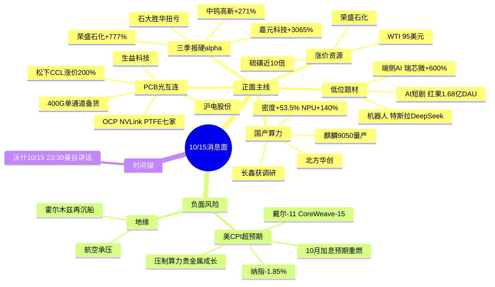

# 2026年10月15日 · **消息面事件驱动**

> **数据源新鲜度**: partial · **降级状态**: true · **置信度**: 0.66
> **覆盖窗口**: 前 72h · **主源**: 财联社快讯 + 21 号公众号(**盘前纪要**) + 5 焦点群 + 东财三季报预告
> **大盘底色**: 10/14 缩量 1.41 万亿、中位数 -2%、中证500 跌破 7000,**下降趋势未见底**,隔夜美 CPI 超预期、加息预期重燃,纳指 -1.85%、戴尔 -11%、CoreWeave -15%。**消息面是"产业硬催化密集 + 宏观系统性逆风"的叉乘,不是单边进攻日。**

## 一句话结论

产业端 8 条硬事件集中在 **PCB/CCL 涨价+OCP、麒麟9050、三季报资源锂电、硫磺油气**;但**美加息+AI硬件外盘暴跌是行业级逆风**,今日只做**龙头分歧低吸与业绩确定性**,不追明牌高潮,仓位让位于宏观。

## 🗺️ 消息面全景图

## 🎯 顶级事件详解(每事件三问 + 首推票思维链)

### E20261015_001 · 美CPI超预期·加息预期重燃(行业级利空) · strength=high · polarity=负面 · weighted -0.72

**事件摘要**: 9 月美 CPI 通胀意外升温,戴利称"大概率还需进一步加息",10/27-28 FOMC 加息预期重燃;隔夜道指 -0.09%、标普 -1.10%、**纳指 -1.85%,戴尔 -11.39%、CoreWeave -15.29%、Ciena -10.28%**,黄金 -1.37%、白银 -6.08%。三源(财联社戴利系列 + 上证报 + 证券时报"深夜全线跳水")。

**推理深度三问**:
- **大资金意图**: 这是**估值杀的发令枪**而非题材轮动。AI 硬件龙头(戴尔/CoreWeave)领跌 = 市场在抽高久期成长股的贴现率,A股开盘北向与机构对算力链的第一反应大概率是减仓而非加仓。
- **为什么走强**: 反向看——这是空头"走强"的逻辑链。CPI 粘性 + 官员集体放鹰(戴利/古尔斯比/巴尔金)+ 褐皮书"半数辖区价格压力强劲",降息叙事被证伪;今晚 **23:30 沃什曼谷讲话**是缄默期前唯一预期管理窗口,资金不愿在此之前扛成长仓位。
- **逻辑够不够硬**: **硬,且是系统性的**。这是本清单唯一不选个股、直接对 D1 仓位上限做负向输入的事件。A 股 10/14 已缩量普跌、最弱在科创50/创业板(绑算力),外围利空打在最弱点位。

**对今日板块的叉乘杀伤面**: 🔴 AI算力/光模块/半导体设备(外盘映射最直接) · 🔴 贵金属(加息) · 🔴 港股科技/高估值成长 · 🔴 航空(油价95美元叠加)。**应对: 开盘不给算力高位股加仓,所有候选降一档仓位,等沃什讲话落地。**

### E20261015_002 · 麒麟9050量产 · strength=high · polarity=正面 · weighted +0.67(1日衰减)

**事件摘要**: 10/13 华为终端创新技术沟通会,无线终端芯片产品管理部部长徐松余宣布**麒麟9050系列量产**,逻辑折叠堆叠架构,晶体管密度 +53.5%、9050 Pro CPU 大核能效 +41%、NPU +140%。叠加 10/14 晚**安徽省委书记李乐成调研长鑫科技**(双源)。

**推理深度三问**:
- **大资金意图**: 华为叙事是国产算力主线的**产业级信念锚**。9050 从韬定律论文走到量产,把"看多国产替代"升级为"可验证的订单与产能",设备/先进封装是真金白银被拉动的环节。
- **为什么走强**: 逻辑折叠=先进封装+高端载板+设备的二次拉动;省委书记调研长鑫是政策温度的确认,自主可控在外部加息逆风里是少数有内部政策对冲的方向。
- **逻辑够不够硬**: 中上。官宣量产 + 长鑫调研双源成立;**缺陷是 10/14 已发酵一日、且大盘下降趋势**,硬在产业、软在节奏,只做分歧低吸。

**首推票思维链**:

#### 北方华创 002371 · role=先进制程设备龙头 · 收586.81
- **买入理由**: 逻辑折叠与先进制程扩产的设备平台最确定受益者;长鑫/华为链扩产直接对应刻蚀薄膜订单;business_relevance 0.90。无三季报预告(has_pre_increase=false),吃产业逻辑不吃业绩。
- **风险点**: 股价高位 + 隔夜费城半导体走弱 + 科创50 是全市场最弱方向,若直接高开易被指数拖下水。
- **止损条件**: 破 5 日线且收盘失守 **555.00**(约 -5.4%)即出,不与下降趋势对抗。
- **可验证假设**: 开盘30分钟设备板块资金净流入为正、长鑫链(精测/华大九天)有跟风,假设成立;若北向开盘净流出半导体则当日回避。

#### 生益科技 600183 · role=高频CCL龙二 · 收119.63
- **买入理由**: 同时卡在**麒麟载板 + OCP PTFE 七家名单 + 松下CCL涨价200%**三条催化;高频高速覆铜板龙头,产业逻辑最交叉。
- **风险点**: 电子布上游宏和科技 10/14 放量跌停(葛卫东浮亏6000万),提示材料链最拥挤环节已现亏钱效应。
- **止损条件**: 失守 **110.00**(-8.1%,硬区间下沿)即走。
- **可验证假设**: PCB/CCL 板块分化回流时生益抗跌且资金回补 → 成立;若成品板涨而 CPL 跌则只换沪电。

### E20261015_003 · 松下CCL涨价200% × OCP光互连 · strength=high · polarity=正面 · weighted +0.80

**事件摘要**: 松下机电上调多种类电子线路板材料约 200%;OCP 现场确认 CSP 上光"100% 钉死",**NVLink PTFE 板挂出 7 家供应商(胜宏/生益/深南/景旺等)**,400G 单通道电芯片进入备货,博通 switch 两年一代;旭创凭 1.6T 设备运行小时拿 scale-up 门票。盘前纪要 PCB 涨停 8 家。三源(调研先知深度 + 财联社早知道 + 盘前纪要)。

**推理深度三问**:
- **大资金意图**: 这不是"800G 报价"级别的交易,是**机柜变宽→背板高频→PTFE/碳氢/载板→液冷电源整笔 CAPEX 重画**的平台级重估。资金愿意给"多路线全有份的链主"溢价,惩罚"单一路线赌徒"。
- **为什么走强**: 涨价(松下+国巨 MLCC 高容 +50%)给了当期利润弹性,OCP 给了 2027-2028 订单能见度,戴维斯双击的素材齐全;二线成品板是边际变化最大环节。
- **逻辑够不够硬**: 硬(产业现场 + 涨价函 + 涨停效应三重),**但两位复盘 KOL(盘口逻辑/安静拆主线)均明确提示 PCB 已高潮、次日是高难度**。故只做分化回流,不追一字。

**首推票思维链**:

#### 沪电股份 002463 · role=AI高速PCB首推 · 收115.00
- **买入理由**: AI 服务器高速板一线,OCP NVLink 高频板国内核心,企业网+服务器双轮;business_relevance 0.92,板块联动 0.90。
- **风险点**: 高潮次日分化,若指数恐慌 PCB 高位股补跌;无三季报预告,纯产业/涨价逻辑。
- **止损条件**: 失守 **107.00**(-7.0%)即走,硬止损不补仓。
- **可验证假设**: 板块分化后沪电作为龙头最先翻红、封成比健康 → 回流成立;若龙头被二线(澳弘/协和)卡位则降级观察。

#### 三环集团 300408 · role=MLCC/先进封装龙二 · 收100.27
- **买入理由**: 国巨 10 月底-11 月新一轮涨价(高容 +50%、覆盖 2027Q1)传导 + 陶瓷封装基座受益先进封装。
- **风险点**: 被动元件涨价兑现节奏偏慢,弹性弱于 PCB。
- **止损条件**: 失守 **93.00**(-7.3%)。
- **可验证假设**: 风华高科/火炬电子等同板块联动放量 → 成立。

### E20261015_004 · 三季报硬业绩(资源/锂电材料) · strength=high · polarity=正面 · weighted +0.74

**事件摘要**: 东财业绩预告 377 条,10/14-15 密集超预期:**嘉元科技 688388 净利 +3065.71%~3329.52%(铜箔)**、**荣盛石化 002493 +777.93%~822.95%(炼化+副产硫磺)**、石大胜华扭亏(六氟)、恩捷股份扭亏(隔膜)、德福科技 +1478%、中钨高新 +271%~297%(钨)、东方锆业 +263%。三源(东财预告 + 证券时报 + 上证报)。

**推理深度三问**:
- **大资金意图**: 下降趋势里资金要的是**可验证的当期利润**,不是远期故事。业绩预增 5-30 倍 + 处在涨价链上的票,是"防御性进攻"的唯一交集。
- **为什么走强**: PPI 同比 +5% 持续上行,铜箔/钨/锆/化工量价齐升在报表兑现;三季报窗口期有强制披露催化。
- **逻辑够不够硬**: 硬(公告级),但要**业绩×题材双命中**才进首推——纯业绩无题材的高位次新易高开低走。

**首推票思维链**:

#### 荣盛石化 002493 · role=业绩+硫磺双命中首推 · 收11.86
- **买入理由**: 三季报预增 **777.93%~822.95%**(10/15 公告)+ 国内副产硫磺规模领先、硫磺价涨近 10 倍,**E004 业绩与 E005 地缘涨价在同一标的叠加**,是今日消息面确定性最高的票;大盘股流动性好、抗指数恐慌。
- **风险点**: 大盘炼化股弹性有限,若霍尔木兹局势缓和则涨价逻辑回摆。
- **止损条件**: 失守 **11.05**(-6.8%)即走。
- **可验证假设**: 开盘化工/油气板块高开且荣盛放量站上均价 → 成立。

#### 嘉元科技 688388 · role=铜箔业绩弹性龙二 · 收23.76
- **买入理由**: 三季报预增 **3065.71%~3329.52%**(10/15),锂电铜箔景气上行+加工费提升,业绩弹性全场第一梯队。
- **风险点**: 锂电非当前资金主线,联动度仅 0.68,易"见光死"高开低走;科创板波动大。
- **止损条件**: 失守 **22.00**(-7.4%)。
- **可验证假设**: 需锂电/铜箔板块同步放量(恩捷/德福联动),单兵冲高不追。

### E20261015_005 · 霍尔木兹再沉船·硫磺价近10倍 · strength=high · polarity=正面(油气硫磺)/板块级负面(航空) · weighted +0.66

**事件摘要**: 联合国航运机构:一艘干散货船 9/23 中弹后在霍尔木兹海峡沉没,为 24h 内第二艘;硫磺逼近 1000 美元/吨(冲突前近 10 倍);WTI 收 95.09(+1.01%)。三源(财联社 + 证券时报 + 财联社早知道)。

**推理深度三问**:
- **大资金意图**: 地缘供给收缩型涨价,资金做**油价/硫磺/磷化工/油运**的避险+涨价双属性;同时这是风险偏好的负反馈来源。
- **为什么走强**: 硫磺供需双紧(炼厂副产减、磷肥/新能源需求增),中长期逻辑比纯油价更纯。
- **逻辑够不够硬**: 中等偏硬,持续性完全取决于冲突;与 E001 加息形成"滞胀式"宏观组合。

**映射票**: 荣盛石化 002493(与 E004 同一标的,催化叠加,**合并计仓不重复买入**,止损11.05)。**反向 bearish**: 🔴 航空运输(油价95美元)、用油大户、全局风险偏好。

### E20261015_006 · 红果AI短剧 · strength=medium · polarity=正面 · weighted +0.62

**事件摘要**: 红果短剧 7 月 DAU 1.68 亿(同比+107%)超过长视频,2026 免费微短剧市场约 573 亿;华福证券 10/14 晚开"红果AI产业链"电话会;AI 综艺/漫剧扩散(荣信文化×芒果TV)。盘前纪要 AI影视已 **3 连板**(慈文传媒/新经典/龙版传媒)。

**推理深度三问**:
- **大资金意图**: 应用端是存量市场里少数有"时长迁移"硬数据的方向,资金借 AI 降本 + 红果渠道讲内容重估。
- **为什么走强**: DAU 数据 + 电话会 + 备案过审催化密集,情绪赚钱效应最热。
- **逻辑够不够硬**: 中等偏软。**已 3 连板明牌高潮**,两位复盘 KOL 同列短剧为"高潮后高难度";群聊点名股(荣信文化)为多源转发未经公告,llm_pure 验证度低。

**首推票思维链(降级·分歧回流观察,非今日核心)**:

#### 天娱数科 002354 · role=AI内容弹性 · 收7.65
- **买入理由**: AI 虚拟数字人+短剧,AIGC 应用弹性;板块情绪最热。
- **风险点**: 高位情绪股,无业绩支撑,断板即 A 杀。
- **止损条件**: 失守 **7.05**(-7.8%)。
- **可验证假设**: 仅在板块分歧后龙头(慈文/新经典)率先回封时小仓跟随,否则不碰。

#### 荣信文化 301231 · role=AI综艺龙二 · 收32.77
- **买入理由**: 余禾文化×芒果TV AI 漫剧战略,群聊三群转发的新方向点名标的。
- **风险点**: **llm_pure_no_verification**,催化仅群聊/电话会,无公告;llm_pick_method 顶格 confidence 0.5,须 D1 再验证。
- **止损条件**: 失守 **30.20**(-7.8%)。
- **可验证假设**: 需芒果/AI 综艺有官方跟进或封单承接,纯情绪不追。

### E20261015_007 · 端侧AI规模化(苹果HomeView) · strength=medium · polarity=正面 · weighted +0.52

**事件摘要**: 苹果 HomeView 智能家居中枢 299 美元开售,搭载 Apple Intelligence;中国端侧 AI 市场 2029 达 3077 亿(CAGR 39.9%);上证报点"端侧AI芯片龙头前三季净利预增超600%"(瑞芯微)。

**推理深度三问**:
- **大资金意图**: 从云端算力向端侧扩散的补涨逻辑,有真实新品+业绩。
- **为什么走强**: 瑞芯微业绩 + chart snapshot bias=震荡(抗跌),在全市场偏空中属稀缺抗跌品种。
- **逻辑够不够硬**: 中等,端侧非当前资金主线,定位回落后的低吸备选而非今日核心。

**首推票思维链**:

#### 瑞芯微 603893 · role=端侧SoC首推 · 收195.50
- **买入理由**: "SoC+协处理器"双轨卡位 AIoT2.0,三季报预增超 600%(上证报),业绩+产业双命中;日K抗跌(low20 175.6)。
- **风险点**: 大盘拖累 + 前期涨幅大。
- **止损条件**: 失守 **178.00**(破 low20 175.6 前离场)。
- **可验证假设**: 消费电子/端侧板块在指数企稳时率先反弹;乐鑫(bias偏多)可作联动观察。

### E20261015_008 · 机器人(特斯拉量产+DeepSeek下场) · strength=medium · polarity=正面 · weighted +0.55

**事件摘要**: 隔夜曝特斯拉机器人即将量产、DeepSeek 梁文锋亲自下场做机器人四处拜师、谷歌 DeepMind 机器人看视频自学连中7次(多为群聊 Jerry 转载,尚未经财联社/官方二次确认)。

**推理深度三问**:
- **大资金意图**: 高位算力/短剧拥挤后,资金寻找**低位新题材卡位**,机器人具备特斯拉+国产大厂双重叙事。
- **为什么走强**: 三则新闻同向,且 DeepSeek 下场是国产新增量想象。
- **逻辑够不够硬**: 偏软。**single_source 性质(群聊转载),未经官方源确认,顶格 medium**;属主线外低位试错,小仓卡位。

**首推票思维链(计划内低位试错)**:

#### 三花智控 002050 · role=特斯拉链首推 · 收31.29
- **买入理由**: 特斯拉一级供应商,机器人执行器/机电核心,business_relevance 0.90;位置相对低。
- **风险点**: 板块联动尚未形成(联动度0.60),新闻待官方证实;大盘恐慌时题材无承接。
- **止损条件**: 失守 **28.80**(-8.0%)。
- **可验证假设**: 需财联社/官方跟进量产消息 + 竞价机器人板块多股高开;仅群聊口播则不追。

## 📊 板块 × 事件极性叉乘矩阵

| 板块 | 事件锚 | 首推 | 独立源数 | 三季报预告 | 净极性叉乘 |
|------|--------|------|:--:|--|:--:|
| PCB/高速板 | E003 | 沪电股份 | 3 | 待披露 | 🟢🟢 (但高潮次日降级低吸) |
| 覆铜板CCL/PTFE | E002+E003 | 生益科技 | 4 | 待披露 | 🟢🟢🟢 |
| 半导体设备 | E002 | 北方华创 | 2 | 无 | 🟢🟢 (受E001外盘逆风压制) |
| MLCC/被动元件 | E003 | 三环集团 | 2 | 无 | 🟢🟢 |
| 炼化/硫磺 | E004+E005 | 荣盛石化 | 4 | +777.93%~822.95% | 🟢🟢🟢 确定性最高 |
| 锂电铜箔/材料 | E004 | 嘉元科技 | 3 | +3065%~3329% | 🟢🟢 (非主线 防见光) |
| 小金属钨锆 | E004 | (中钨高新/东方锆业) | 2 | +271%/+263% | 🟢🟢 |
| 油气/油运 | E005 | (映射荣盛) | 3 | — | 🟢🟢 |
| AI短剧/AI内容 | E006 | 天娱数科/荣信文化 | 3(含群聊) | 无 | 🟡 3连板高位 高难度 |
| 端侧AI | E007 | 瑞芯微 | 2 | +600%+ | 🟢🟢 抗跌备选 |
| 人形机器人 | E008 | 三花智控 | 1群聊多转 | 无 | 🟡 单源 低位试错 |
| AI算力/光模块 | E001 逆风 | — | 3 | — | 🔴 外盘戴尔/CW暴跌压制 |
| 贵金属 | E001 逆风 | — | 2 | — | 🔴 加息+金银大跌 |
| 航空运输 | E001+E005 | — | 2 | — | 🔴 油价95+加息双杀 |

## 🔥 三季报业绩预告命中(硬 alpha 交叉验证)

| 代码 | 名称 | 预告类型 | 增速下限-上限 | 公告日 | 事件命中 | 逻辑强度 |
|------|------|----------|--------------|--------|----------|:--:|
| 688388.SH | 嘉元科技 | 预增 | 3065.71%~3329.52% | 10-15 | E004 铜箔涨价 | 🟢🟢🟢 |
| 002493.SZ | 荣盛石化 | 预增 | 777.93%~822.95% | 10-15 | E004+E005 炼化+硫磺 | 🟢🟢🟢 |
| 603026.SH | 石大胜华 | 扭亏 | 924.67%~1032.45% | 10-15 | E004 六氟/储能 | 🟢🟢 |
| 002812.SZ | 恩捷股份 | 扭亏 | 1960.96%~2553.62% | 10-14 | E004 隔膜/储能 | 🟢🟢 |
| 301511.SZ | 德福科技 | 预增 | 1478.59%~1635.45% | 10-14 | E004 铜箔 | 🟢🟢 |
| 000657.SZ | 中钨高新 | 预增 | 271%~297% | 10-14 | E004 钨涨价 | 🟢🟢 |
| 002167.SZ | 东方锆业 | 预增 | 263.64%~367.53% | 10-15 | E004 锆/国产替代 | 🟢🟢 |
| 605189.SH | 富春染织 | 预增 | 1347.69%~1519.01% | 10-14 | 染料链(昨日已涨停) | 🟡 高潮 |
| 603893.SH | 瑞芯微 | 预增 | 前三季净利+600%+ | 10-14 | E007 端侧AI | 🟢🟢 |
| 688018.SH | 乐鑫科技 | Q3净利+82.68%~98.27% | 82.68%~98.27% | 盘前纪要 | E007 端侧(bias偏多) | 🟢 |

## 关键证据

- 证据1: 麒麟9050 量产数据(密度+53.5%/NPU+140%) · 盘前纪要 2026-10-14 07:17 引华为终端创新技术沟通会
- 证据2: OCP NVLink PTFE 7 家供应商 + 400G 备货 + 旭创设备小时 · 调研先知 2026-10-14 19:58
- 证据3: 松下 CCL 涨价 200%、国巨 MLCC 高容 +50% · 财联社早知道/盘前纪要 2026-10-14
- 证据4: 嘉元 +3065%、荣盛 +777% 三季报预告 · 东财 RPT_PUBLIC_OP_NEWPREDICT 2026-10-15
- 证据5: 美 CPI 超预期、戴利放鹰、纳指-1.85%、戴尔-11% · 财联社/上证报/证券时报 2026-10-14 夜~15 凌晨
- 证据6: 霍尔木兹 24h 第二艘沉船、硫磺近 1000 美元 · 财联社 2026-10-15 00:27
- 证据7: 红果 DAU 1.68 亿 + 华福红果AI电话会 · 5焦点群 2026-10-14 20:19

## 数据源审计

| 源 | 日期 | 状态 | 备注 |
|---|---|:--:|---|
| tushare/news_cls | 2026-10-15 | 🟢 | 2966 条·72h 回看·含美联储全部口播 |
| tushare/news_major | 2026-10-15 | 🟢 | 800 条 |
| eastmoney/earnings_predict | 2026-10-15 | 🟢 | 377 条·三季报预告 |
| wechat_official_rss(21号池) | 2026-10-15 | 🟢 | 86 篇·含盘前纪要/财联社早知道/OCP深度 |
| wechat_cli_5groups | 2026-10-15 | 🟢 | 445 条·5 焦点群(匿名) |
| hithink_market_query | 2026-10-15 | 🟡 | OpenAPI 可达但 NLQ 当日 0 命中;受益股走盘前点名+预告+OCP名单交叉,未静默代理 |
| weflow-analytics | 2026-10-15 | 🔴 | 404 down;KOL 维度由 5 群替代 |

## 不确定性 / 反证

1. **宏观与产业打架**: 8 条产业催化偏多,但 E001 加息是系统性逆风,若沃什今晚放鹰,所有高 beta 首推(北方华创/沪电/嘉元)贝塔风险大于阿尔法,需降仓。
2. **PCB/短剧已高潮**: 两位独立复盘 KOL 同列"次日高难度",本清单已把沪电/天娱降为分歧低吸,若开盘一字不回封则全天放弃。
3. **机器人单源风险**: E008 仅群聊转载,未经财联社/官方证实,可能开盘被证伪,三花只给 5% 试错仓。
4. **荣盛石化被 E004/E005 双引用**: JSON 中为映射关系,实盘**合并计一笔仓位**,不得重复买入。
5. **hithink 受益股池当日 0 命中**: business_relevance 为 LLM 依据研报/公告/OCP 名单的证据估值,非工具回数,D1 若需要可二次跑 hithink-business 校验。
6. **R7 资金面尚未产出**: 全部 top_pick 的 r7_status=unavailable,资金净流入字段待 R7 07:30 回填,当前不得据"资金确认"追高。

## 与其他 R/D/E 的关系

- 依赖: data/raw/20261015 五本地源(已齐备) + 盘前纪要
- 被消费: R2 主线 / R5 个股画像 / R6 反证(注意 E001 行业级利空) / D1 预案(仓位上限 + execution_pool)
- 给 D1 的硬约束: E006/E008 为 llm_pure_no_verification,仅入 watch_pool,除非 R5 给 alpha_grade=A 否则不进 execution;E001 逆风下 execution 候选仓位整体下调

## Sub-Agent 元数据

- skill: analyze_news_impact_v1@1.4
- artifact: data/research/20261015/R4_news.json
- method: llm_v1(五源硬约束·时间衰减 λ0.15·正反两面叉乘·top_pick_logic v1.2)
- 生成时刻: 2026-10-15T07:48:00+08:00
