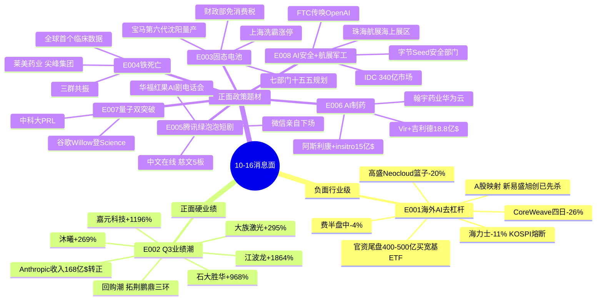

# 2026年10月16日(周五) · **消息面事件驱动**

> **数据源新鲜度**: ok · **降级状态**: false · **置信度**: 0.66
> **覆盖窗口**: 10-13 ~ 10-16 06:00 · **主源**: 财联社/新浪快讯(2980条) + 取阅RSS 14个公众号(87篇,含盘前纪要+财联社早知道) + 5焦点群(358条) + 东财业绩预告(433条/24h新增152条)

## 一句话结论

**外空内多、业绩托底**:海外AI杠杆链(算力租赁/存储/光模块)隔夜继续去杠杆砸盘,国内由**固态电池政策+铁死亡新题材+腾讯绿泡泡短剧**三条非科技/题材线接力,江波龙等Q3硬业绩是硬件链唯一对冲;**唯一负面对冲=E001行业级利空,开盘硬件链低开无悬念,仓位向非科技强势主线倾斜**。

## 🗺️ 消息面全景图

## 🎯 顶级事件详解(每事件三问 + 首推票思维链)

### E20261016_001 · 海外AI杠杆链去杠杆 · strength=high · polarity=**负面** · bearish_scope=**行业级**

**事件摘要**: 隔夜美股AI链按"借钱依赖度"分层杀跌——算力租赁(CoreWeave盘中-16%/Nebius-11%)>集成商(戴尔-11/HPE-8/甲骨文-9)>存储(海力士-11%/美光-6%)>芯片(费半盘中-4%)>云巨头(微软+0.43%创新高/Meta+2.63%)。韩国KOSPI盘中跌9%触发熔断,外资连续8日净卖出134亿$,科技股占86%。高盛Neocloud篮子5日-20%为十年最极端1%情形,大型云厂投资级债券利差单周+7.4bp。(六源:财联社/sina多条+傅里叶的猫GS/UBS点评+贩财局分层复盘+颜哥群+猫笔刀官资ETF+安静拆主线)

**推理深度三问**:
- **大资金意图**: 债权投资者先于股市重新定价AI基建风险——CoreWeave模式本质是"举债买GPU→长约回收",融资成本上升直接压缩项目IRR,边际项目延期→服务器/芯片订单兑现节奏下修。资金不是否定AI需求(Token消耗仍超预期),而是**从"讲故事的高杠杆中间商"撤向"自有现金流的云巨头"**,这是一次融资结构挤兑而非需求证伪。
- **为什么走强(反向:为什么继续跌)**: 三星/海力士回购结束→稳定买盘退出+外资集中卖盘占80-87%+跌破心理关口触发融资盘强平,三杀闭环。A股10-15已提前反应(新易盛-7.49%/旭创-5.19%/江波龙-6.14%),但隔夜美股收盘仅小幅收复(道指+1.08%),**A股硬件链开盘仍有补跌缺口**。
- **逻辑够不够硬**: **硬,但是价格层面的硬而非需求层面的硬**。海力士/三星2027年营业利润预测过去四周反而上调2%/6%,PB降到1.36/1.49倍——估值与盈利背离说明这是资金面冲击。低估值不构成短线反转理由,需等外资流出减弱+信用利差企稳。A股对冲变量:10-15尾盘官资买入510310/588000/159915约400-500亿(510310单日194亿超过去一月总和)。

**板块杀伤面(bearish_impact_sectors)**: A股光模块/CPO(新易盛、中际旭创、天孚通信)、存储(江波龙、兆易创新、澜起科技)、PCB(沪电、深南、胜宏)、算力租赁/GPU(海光、沐曦)、半导体设备(拓荆、北方华创)。**操作含义:硬件链开盘不接飞刀,除非竞价出现异常抗跌+大单回流;E002业绩票可在恐慌释放后做分离**。

### E20261016_002 · AI硬件Q3业绩硬共振 + Anthropic转正 · strength=high · polarity=正面

**事件摘要**: 东财业绩预告24h内152条:江波龙预增1864-1991%(扣非2782%)、嘉元科技+1196-1319%、石大胜华+968-1032%、荣盛石化+778%、大族激光扣非+296-313%、沐曦股份+270-308%、复旦微电+188-248%、光库科技+202-222%。同步回购潮:拓荆科技2-3亿、鹏鼎控股3-5亿、三环集团2.5-5亿、欧派1-2亿。Anthropic盘后披露Q3收入168亿$,环比+46%、同比20倍,调整后营业利润与现金流转正。

**推理深度三问**:
- **大资金意图**: 在海外杀估值窗口,国内硬业绩是机构**调仓而非撤退**的锚——把高杠杆海外映射切到有订单有利润的国产链。回购潮是产业资本对"股价跌破基本面"的集体回应。
- **为什么走强**: 江波龙138-148亿扣非净利润对应存储涨价周期兑现;嘉元科技(铜箔)同时叠加固态电池β,是E002×E003叉乘点。Anthropic营业利润转正打破"大模型永远烧钱"叙事,对冲E001的信用利差恐慌。
- **逻辑够不够硬**: 业绩数字硬,但**时间点尴尬**——业绩预告披露当日板块正被海外映射拖累(江波龙当日-6.14%),属"利好撞上系统性杀跌"。若10-16开盘随板块低开后快速收回,是经典分离确认信号;若低开低走则说明资金选择兑现。

#### 江波龙 301308 · role=存储业绩首推
- **买入理由**: Q3归母净利140-149亿、预增1864-1991%,为全部fresh预告中科技板块最高增速;企业级DRAM+自研封测直接受益涨价周期;10-15已-6.14%释放部分海外压力,成交27.6亿换手充分
- **风险点**: 海力士隔夜-11%情绪压制;业绩公告日"利好兑现"风险;若KOSPI 10-16白天继续崩,存储板块无分离环境
- **止损条件**: 228.0元(参考价244 × -6.6%,跌破10日线230确认),硬止损-7%
- **可验证假设**: 开盘30分钟若竞价低开<-3%且主力净额翻红、板块内江波龙跌幅显著小于兆易/澜起=分离成立;若随波逐流跌破240不回头→假设失败,当日放弃

### E20261016_003 · 固态电池双政策 · strength=high · polarity=正面

**事件摘要**: 工信部等七部门《新型电池产业发展"十五五"规划》明确2030全固态初步规模化;财政部等三部门明确2026.9.1-2028.12.31钠电/固态免征消费税。10-15板块直线拉升上海洗霸涨停(成交12.7亿),盟固利+12.15%。宝马第六代动力电池沈阳工厂量产下线。

**推理深度三问**:
- **大资金意图**: 免税是真金白银的需求侧补贴+规划给产业5年确定性,在科技主线被杀时,政策驱动的新能源中位板块成为资金避险式进攻方向。
- **为什么走强**: 上海洗霸8日区间+18.97%已有预热,政策落地是"预期→兑现"的板上确认;2027量产节点叙事可炒到年底。
- **逻辑够不够硬**: 政策硬、业绩软(板块普遍无当期利润),本质是主题接力。龙头1板后次日接力盈亏比下降,需等盘中分歧。

#### 上海洗霸 603200 · role=板块龙头
- **买入理由**: 硫化物电解质中试+中科院硅酸盐所合作,10-15直线封板成为板块情绪锚,龙虎榜资金验证
- **风险点**: 1板后一致性过高,若竞价一字开>+7%接力盘拥挤;固态题材历史上多次一日游
- **止损条件**: 49.6元(53.35 × -7%),破板不走弱转强即止损,强势股不做T
- **可验证假设**: 竞价封单>3亿且板块跟风≥3只红盘=持有;若开盘炸板后10分钟不能回封→放弃

### E20261016_004 · 铁死亡全球首个临床数据 · strength=high · polarity=正面

**事件摘要**: 全球首个铁死亡(Ferroptosis)抗癌药临床数据出炉,新型细胞死亡通路成药性首次临床验证。10-15晚19:07-22:48在专注核心、一手盘中新闻、题材基本面摩天轮**三个群独立扩散**,尖峰集团(慧宝源生物,铁死亡抗肿瘤组合物专利)涨停+10.06%,莱美药业+2.91%但晚间异动公告自认"纳米炭铁联合放疗仍处II期临床",德展健康(铁死亡+动脉粥样硬化)在群内被挖。

**推理深度三问**:
- **大资金意图**: 科技退潮期游资需要**全新名词+小市值+临床故事**的题材容器,铁死亡满足"听不懂但看起来硬核+无老套牢盘"三条件,尖峰集团33亿市值被点名为"新XX集团妖股苗子"。
- **为什么走强**: 全球首次成药验证=0→1叙事;三群共振属于情绪扩散早期;莱美公告客观上给题材加热(监管关注=热度证明)。
- **逻辑够不够硬**: **题材硬、标的软**。莱美自己泼冷水(II期),尖峰集团的铁死亡资产在子公司且无收入,属纯情绪博弈。这类钱按超短纪律做,不按价值做。

#### 尖峰集团 600668 · role=情绪弹性
- **买入理由**: 33亿小市值+子公司慧宝源铁死亡专利+JFAN-1001获FDA临床,10-15涨停确认资金选择;游资"XX集团"名号叙事
- **风险点**: 纯群内KOL扩散无官方/研报硬源;莱美公告自证早期可能引发板块降温;涨停成交仅2.7亿,容量小
- **止损条件**: 7.43元(7.99 × -7%);一字板追高直接放弃,只做回封确认
- **可验证假设**: 若莱美药业开盘被核按钮(-5%以下)→题材证伪,尖峰同步放弃;若莱美横盘+尖峰高开3-6%后换手回封=情绪延续

### E20261016_005 · 腾讯绿泡泡短剧 · strength=high · polarity=正面

**事件摘要**: 腾讯低调上线"绿泡泡短剧"小程序,微信首次亲自下场做统一短剧入口,免费+广告+社交分发(朋友在看/地区榜),联合发行模式。华福证券20:30开"红果AI剧"专家会(马梓燕),2026前8月上线微短剧43万部超2025全年。盘面:慈文传媒5连板、新经典4板、新华传媒10连板累计+159%后10-16复牌。安静拆主线/盘口逻辑拆解均把短剧列为非科技强势主线之一。

**推理深度三问**:
- **大资金意图**: 微信入口=给短剧赛道发"官方营业执照",行业从红果单极变成红果×绿泡泡双平台,IP方议价权提升;资金在指数下跌中抱团有板块效应的传媒,属典型弱势炒传媒。
- **为什么走强**: 事件级别高(腾讯亲自下场)+板块已有5板高度(慈文)打开补涨空间+AI降本叙事叠加。
- **逻辑够不够硬**: 平台逻辑硬,但高位股风险已现——华是科技10-15 -12.09%、德才股份-6.81%,说明纯蹭概念的在被清算,**只做有IP/AI实质的中位补涨**。

#### 中文在线 300364 · role=IP+AI剧首推
- **买入理由**: A股网文IP储量第一,中文逍遥/万相大模型量产AI短剧,直接适配绿泡泡联合发行;10-15在板块杀跌中仅-4.97%,成交34.5亿抗跌且容量足
- **风险点**: 慈文5板若断板带崩板块;新华传媒复牌表现成为日内情绪锚(复牌补跌则拖累)
- **止损条件**: 23.50元(25.26 × -7%),跌破20日线23.0加速
- **可验证假设**: 开盘观察慈文传媒封单与新华传媒竞价;中文在线竞价量能>10-15同时段且红盘=资金切补涨,可介入

### E20261016_006 · AI制药海外大单双锚 · strength=medium · polarity=正面

**事件摘要**: Vir Biotechnology与吉利德签署最高18.8亿$实体瘤合作(PRO-XTEN+dAIsY AI平台);阿斯利康15亿$牵手AI制药公司insitro;机构预测2035全球AI制药市场460亿$;中信建投称AI4S迈向产业化临界点。A股映射:翰宇药业(华为云多肽AI工艺,研发周期-45%)、泓博医药(CADD/AIDD平台服务53家客户)。10-15两股均小跌,资金尚未认领。

**推理深度三问**:
- **大资金意图**: 海外MNC真金白银的BD大单是AI应用落地最硬证据,机构可能在杀硬件时切AI应用(制药/安全)做高低切。
- **为什么走强/尚未走强**: 逻辑正但A股映射间接,10-15无板块效应,需10-16开盘资金表态。
- **逻辑够不够硬**: 海外事件硬,A股标的弹性中等,翰宇业务合作最实。

#### 翰宇药业 300199 · role=映射首推
- **买入理由**: 与华为云联合"多肽AI工艺优化助手"已投用,10万条工艺数据,批次合格率+22%;GLP-1多肽主业本身有β
- **风险点**: 10-15 -1.33%未获资金响应,可能继续冷遇;开盘若AI应用全线无表现不硬做
- **止损条件**: 22.80元(24.55 × -7.1%);开盘30分钟无主力净流入直接弃单
- **可验证假设**: 竞价红盘+泓博医药同步走强=板块启动;低开则全天观察不介入

### E20261016_007 · 量子双突破(谷歌+中科大) · strength=medium · polarity=正面

**事件摘要**: 谷歌量子AI团队在Willow处理器实证"魔态培育"(magic state distillation),误差降低约40倍,登《Science》(10-16凌晨);中科大潘建伟团队实现393-1550nm高效低噪声量子频率转换刷新国际纪录,登PRL。麦肯锡预测2035量子通信市场105-149亿$。

**推理深度三问**:
- **大资金意图**: 纯主题催化,在硬主线退潮时量子作为"高冷科技名词"容易获脉冲资金;谷歌+中科大同日双突破给了媒体集中传播的由头。
- **为什么走强**: 海外顶刊背书+国盾量子10-15仅-2.16%位置不高,开盘容易借科技反弹做脉冲;但历史上量子题材多为一日游。
- **逻辑够不够硬**: 论文硬、业绩零。国盾量子10-15 -2.16%位置不高但成交仅5.6亿,只适合小仓分歧低吸。

#### 国盾量子 688027
- **买入理由**: 中科大体系量子整机唯一平台,双突破直接映射,科创板20cm弹性
- **风险点**: 高开冲高回落是量子题材一贯走势;无业绩支撑
- **止损条件**: 264.70元(284.60 × -7%);高开>5%不追
- **可验证假设**: 仅在低开或平开后30分钟不破均价线才考虑小仓

### E20261016_008 · AI安全政策+FTC传票 × 珠海航展 · strength=medium · polarity=正面

**事件摘要**: IDC预测2030中国AI安全市场340亿(5年CAGR>50%);字节Seed新设大模型安全与对齐部门全球招10名研究员;美国FTC就安全事件向OpenAI和Anthropic发出民事传票。吉大正元10-15涨停。另:第十六届珠海航展12.7-13首开高栏港海上展区,中船集团500吨级无人舰艇参展,中船科技10-15逆势+1.48%。

**推理深度三问**:
- **大资金意图**: AI安全是"卖铲人的卖铲人",FTC传票(监管加压)+字节Seed扩编(产业投入)+IDC市场预测三重共振,机构在杀硬件时倾向切AI应用/安全做高低切;军工为12月远期预期,资金提前左侧预选。
- **为什么走强**: 吉大正元首板已确认AI安全板块情绪,政策与海外监管同步加码;中船科技在军工板块-4%当日逆势+1.48%,属于聪明钱提前埋伏航展催化。
- **逻辑够不够硬**: AI安全有1板锚(吉大正元)可做补涨;军工板块10-15整体大跌(中国船舶-7%),中船科技逆势属资金预选,但板块合力未成。

#### 中船科技 600072
- **买入理由**: 中船集团央企平台,500吨无人舰艇+海上展区核心主体;军工板块中少数逆势红盘
- **风险点**: 航展12月才兑现,预期遥远;板块若继续杀Beta则独木难支
- **止损条件**: 9.00元(9.58 × -6%),破20日线走
- **可验证假设**: 仅在军工板块出现第二只红盘呼应时介入,否则放弃

## 📊 板块 × 事件极性叉乘矩阵

| 板块 | E001海外去杠杆 | E002硬业绩 | E003固态 | E004铁死亡 | E005短剧 | E006 AI制药 | E007量子 | E008安全军工 | 净极性 |
|------|:-:|:-:|:-:|:-:|:-:|:-:|:-:|:-:|:--:|
| 光模块/CPO | -- |  |  |  |  |  |  |  | 🔴 强负 |
| 算力租赁/GPU | -- | + |  |  |  |  |  |  | 🔴 负 |
| 存储 | -- | ++ |  |  |  |  |  |  | 🟡 分歧(外空内多) |
| PCB/CCL | - | + |  |  |  |  |  |  | 🟡 分歧偏正 |
| 半导体设备 | - | +(回购) |  |  |  |  |  |  | 🟡 分歧 |
| 固态电池/材料 |  | ++ | ++ |  |  |  |  |  | 🟢 强正(双共振) |
| 创新药-铁死亡 |  |  |  | ++ |  | + |  |  | 🟢 强正 |
| 短剧/AI剧/IP |  |  |  |  | ++ |  |  |  | 🟢 强正 |
| AI制药/CXO |  |  |  | + |  | ++ |  |  | 🟢 正 |
| 量子 |  |  |  |  |  |  | ++ |  | 🟢 正(主题) |
| AI安全 |  |  |  |  |  |  |  | ++ | 🟢 正 |
| 军工海空军 |  |  |  |  |  |  |  | + | 🟢 正(远期) |
| 云巨头/现金牛AI | ++避险 | + |  |  |  |  |  |  | 🟢 正 |
| 宽基ETF/大金融 | +官资托底 |  |  |  |  |  |  |  | 🟢 中性偏正 |
| 高股息/消费防御 | +跷跷板 |  |  |  |  |  |  |  | 🟢 正 |

**叉乘结论**: 双正共振格只有 **固态电池(E002业绩×E003政策)**——嘉元科技(铜箔+预增1196%)、石大胜华(溶剂+预增968%)是交叉点;**存储是最大分歧格**(海力士-11% vs 江波龙+1864%),开盘分离确认是日内关键观察点。

## 🔥 三季报业绩预告命中(硬 alpha 交叉验证)

| 代码 | 名称 | 预告增速下限-上限 | notice日 | 事件命中 | 10-15涨跌 | 逻辑强度 |
|------|------|------|------|------|:-:|:--:|
| 301308.SZ | 江波龙 | +1864%~+1991% | 10-15 | E002×E001存储分歧 | -6.14% | 🟢🟢🟢 |
| 688388.SH | 嘉元科技 | +1196%~+1319% | 10-15 | E002×E003固态铜箔 | +9.43% | 🟢🟢🟢 |
| 603026.SH | 石大胜华 | +968%~+1032% | 10-15 | E002×E003固态溶剂 | -4.57% | 🟢🟢 |
| 002493.SZ | 荣盛石化 | +778%~+823% | 10-15 | 化工周期(无题材共振) | -2.70% | 🟢 |
| 002008.SZ | 大族激光 | +296%~+313%(扣非) | 10-16 | E002设备 | 未取价 | 🟢🟢 |
| 688802.SH | 沐曦股份 | +270%~+308% | 10-16 | E002国产GPU vs E001压制 | -4.39% | 🟢🟢 |
| 300620.SZ | 光库科技 | +202%~+222% | 10-15 | E002光器件(被E001压制) | -3.91% | 🟢🟢 |
| 688385.SH | 复旦微电 | +188%~+248% | 10-16 | E002芯片 | -4.12% | 🟢🟢 |
| 603893.SH | 瑞芯微 | +68%~+73% | 10-16 | AIoT/机器人端侧AI | -2.81% | 🟢🟢 |
| 301282.SZ | 金禄电子 | +193%~+219% | 10-14 | E002 PCB(20cm已兑现) | +20.00% | 🟢🟢(追高风险) |
| 301200.SZ | 大族数控 | 营收+101%/净利+214% | 10-15 | E002 PCB设备 | -6.35% | 🟢🟢(错杀观察) |

## 关键证据

- 证据1: 高盛Neocloud股票篮子5日-20%、云厂投资级债利差+7.4bp · 来源 傅里叶的猫引GS/UBS · 2026-10-15
- 证据2: KOSPI盘中-9%熔断、海力士-11.1%/三星-9.5%、外资8日净卖134亿$科技占86% · 来源 sina/10jqka · 2026-10-15
- 证据3: 江波龙Q3归母140-149亿、预增1864-1991% · 来源 eastmoney_earnings_predict · 2026-10-15
- 证据4: 七部门固态电池十五五规划+财政部免税至2028末 · 来源 财联社VIP/政策原文 · 2026-10-14/15
- 证据5: 铁死亡临床数据三群(专注核心/一手盘中/摩天轮)19:07-22:48独立扩散;莱美药业异动公告自认II期 · 2026-10-15
- 证据6: 腾讯"绿泡泡短剧"上线+华福证券红果AI剧专家会20:30 · 来源 财联社早知道/陆家嘴群 · 2026-10-15
- 证据7: 官资尾盘买入510310/588000/159915约400-500亿,510310单日194亿超一月总和 · 来源 猫笔刀分时验证 · 2026-10-15
- 证据8: 谷歌Willow"魔态培育"误差-40倍登Science;中科大393-1550nm转换登PRL · 2026-10-16凌晨

## 数据源审计

| 源 | 日期 | 状态 | 备注 |
|---|---|:-:|---|
| tushare/news_cls | 2026-10-16 | 🟢 | 2980条·72h,费半/KOSPI/FTC/谷歌量子全覆盖 |
| tushare/news_major | 2026-10-16 | 🟢 | 800条 |
| eastmoney/earnings_predict | 2026-10-16 | 🟢 | 433条·24h新增152条 |
| wechat_official_rss | 2026-10-16 | 🟢 | 87篇·14/15 feeds(含盘前纪要/财联社早知道) |
| wechat_cli_5groups | 2026-10-16 | 🟢 | 358条·5群(匿名) |
| hithink_market_query | 2026-10-16 | 🟡 | 盘前"今日涨幅"返回0(行情未生成),tushare daily替代 |
| hithink_business_query | 2026-10-16 | 🟡 | 未逐票跑主营,以公告/公众号交叉,相关度为LLM评估 |
| R7_capital_flow | 2026-10-16 | 🟡 | 未落盘,所有top_pick资金字段=stale,待11:35增量 |
| xtick_hot_news | 2026-10-16 | ⚪ | 未调用,news_cls已覆盖财联社/新浪同源 |
| weflow-analytics | 2026-10-16 | 🔴 | MCP DOWN(R3域,不影响R4) |

## 不确定性 / 反证

1. **E001 vs E002谁主导开盘是最大分歧**:美股尾盘收窄跌幅(道指+1.08%)、Anthropic盘后转正属正面变量,若A股硬件链竞价低开幅度<-2%且30分钟回流,可能直接演绎"利空出尽";反之补跌则E002全部降级为观察。
2. **铁死亡为纯KOL情绪源**:无研报/官方硬确认,莱美公告自认II期是监管降温信号;尖峰集团成交2.7亿容量小,只适合小仓,不进execution核心。
3. **固态电池1板接力风险**:上海洗霸若一字开,接力盘拥挤,历史上固态主题多次一日游;嘉元科技虽E002×E003双共振,但10-15已+9.43%提前反应。
4. **官资ETF托底不可外推**:猫笔刀明确"今天买400-500亿不代表明天继续买",不能把托底当趋势。
5. **R7资金面缺席**:本卷所有个股的capital_flow_verification均为stale,D1在R7/11:35增量到位前不应给满仓位;proxy类标注0只,全部picks为LLM选择。

## 与其他 R/D/E 的关系

- 依赖: data/raw/20261016 五源(fetch层06:00-06:11完成)
- 被消费: R2主线(建议非科技强势线:短剧/固态优先,铁死亡题材线单列)、R5个股画像(江波龙/嘉元科技/中文在线优先)、R6反证(E001为行业级利空须压硬件候选)、D1预案(开盘硬件链不接飞刀)

## Sub-Agent 元数据

- skill: analyze_news_impact_v1@1.4
- artifact: data/research/20261016/R4_news.json
- method: llm_v1(五源齐备·8硬事件·板块极性叉乘·v1.4正反两面拆分)
- 生成时刻: 2026-10-16T06:35:07+08:00
