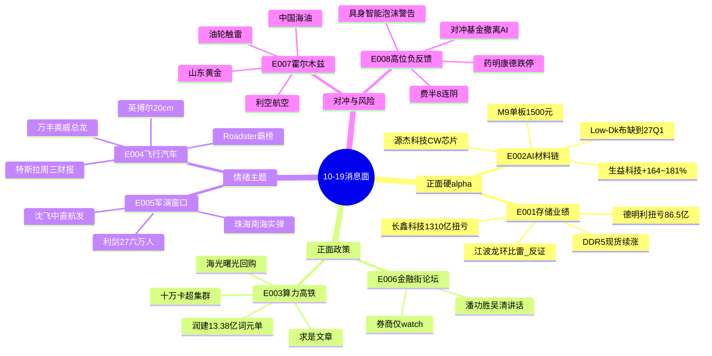

# 2026年10月19日(周一) · **消息面事件驱动**

> **数据源新鲜度**: ok · **降级状态**: false · **置信度**: 0.72
> **覆盖窗口**: 10-16 ~ 10-19 05:56(72h+) · **主源**: 财联社2270条 + 取阅RSS 51篇 + 5焦点群127条 + 东财业绩预告485条
> **特殊日历**: ⚠️ 重阳节翌日**沪深股通休市、无北向**,纯内资博弈日,量能天然比周五1.56万亿再降一档;10:00 三季度GDP发布会;金融街论坛四掌门讲话

## 一句话结论

**存储+AI材料链业绩硬alpha是主线锚(长鑫1310亿扭亏),飞车/军工是情绪两翼,霍尔木兹油轮触雷给油气黄金对冲仓;但CRO跌停+费半8连阴+信通院泡沫警告=高位科技负反馈未解除,高位利好只做龙头低吸不追一致。**

## 🗺️ 消息面全景图

## 🎯 顶级事件详解(每事件三问 + 首推票思维链)

### E20261019_001 · 存储三季报炸裂 · strength=high · polarity=正面 · 加权0.574(衰减中,公告日10-16)

**事件摘要**: 长鑫科技(688825)前三季营收2650-2700亿、净利1310-1325亿扭亏(同比+2581%~2609%),全球DRAM份额Q2逼近10%、第五代工艺平台9月量产,公告夜董事长提议10-20亿回购;德明利(001309)净利86.5-89.5亿扭亏(+32046%),企业级存储82.37亿批量供头部云商;TrendForce:DDR5 16Gb现货续涨。4个独立源。

**推理深度三问**:
- **大资金意图**: 存储是本轮AI资本开支最确定的"量价齐升"环节,长鑫作为国产DRAM总龙给出巨型利润,给机构在科创综指周跌8.26%后提供了**唯一一个业绩能接住估值的旗帜**——回购10-20亿是公司层面真金白银的共识背书
- **为什么走强**: 不是预期博弈,是已兑现利润+现货涨价仍在途;企业级存储从0到82亿说明需求从消费电子切到AI服务器,第二增长曲线成立
- **逻辑够不够硬**: **硬,但有内部分化**。江波龙同晚公告前三季+1864%~1991%,但按v1.5协议拆单季:Q3 34-43亿 vs Q2 53-67亿,**环比-36%~-49%**——周期股累计同比是后视镜,环比转负=资金可能借利好出货。同板块要去弱留强,只做原厂(长鑫)和企业级放量(德明利)

**首推票思维链**:

#### 长鑫科技 688825 · role=存储总龙 · 参考价45.02
- **买入理由**: 净利1310亿量级的硬业绩+份额10%+回购;次新大盘股,机构配置盘主战场
- **风险点**: 周五已+3.28%提前反应;大盘纯内资日缩量,科创50是本轮领跌指数;45元上方套牢盘
- **止损条件**: 41.87(参考价-7%);跌破且存储板块竞价无第二只高开股=逻辑不被市场认可,当日不做
- **可验证假设**: 周一竞价存储板块≥3只高开2%以上、长鑫竞价成交额居科创板前三;若德明利/兆易竞价翻绿则降级为观察

#### 德明利 001309 · role=弹性次选 · 参考价206.01
- **买入理由**: 企业级82亿+越南量产+扭亏,模组里业绩弹性最大
- **风险点**: 高位股周五-2.39%,模组环节壁垒弱于原厂,最先被砸
- **止损条件**: 189.53(-8%),开盘30分钟不能翻红即撤
- **可验证假设**: 高开≤5%有承接可参与;高开>8%直接放弃(一致性陷阱)

#### 江波龙 301308 · role=反证观察,不给买点
- 累计同比+1864%极炸眼,但Q3环比-36%~-49%、净利率回落,公告后已连跌三周-25%(市场正在按周期见顶定价)。**R6应将其列入Ⅱ象限(高位业绩出货陷阱)评估**,不与长鑫同池处理

### E20261019_002 · AI材料链业绩+涨价共振 · high · 正面 · 加权0.732(1日内,最强新鲜度)

**事件摘要**: 生益科技前三季+164%~181%(64.6-68.7亿)+2-3亿回购;亨通光电+151%~168%;源杰科技Q3净利+579%~660%、284家机构调研;广合科技+100%~107%。斗山专家会纪要(10-18全网转发):M8单板1200元毛利45%、M9 1500-1600元,英伟达锁价、AWS 9月涨价15%、光模块CCL涨30%,**Low-Dk二代电子布月供仅250万米、Q4缺口200万米、紧到2027Q1**。

**推理深度三问**:
- **大资金意图**: 市场砍AI高位估值时,资金从"讲故事的算力"向"已兑现利润的材料"做高低切;CCL/光芯片是AI链里PEG最低的一档
- **为什么走强**: 电子布是物理瓶颈(织机+窑炉+认证周期),不是喊单题材;涨价从消费类(+40%)传导到AI链,业绩逐季上修能见度到2027
- **逻辑够不够硬**: **硬**。业绩公告+专家微观数据+机构调研三方互证;瑕疵是生益2700亿市值弹性有限,弹性要看源杰/广合

**首推票思维链**:

#### 生益科技 600183 · CCL总龙 · 参考价114.60
- **买入理由**: M8/M9国产核心+覆铜板涨价+回购,业绩确定度全链第一
- **风险点**: 周五平收,大盘股弹性弱;若市场风格切向题材它会被抽血
- **止损条件**: 106.58(-7%)
- **可验证假设**: 竞价高开1-3%且成交温和放大;若低开>1%说明业绩已price-in,等回踩5日线

#### 源杰科技 688498 · 光芯片弹性首推 · 参考价1028.58
- **买入理由**: Q3扣非+678%~776%,CW芯片供CSP/AI大厂,284家机构周调研第一,二期设备年底-27年初释放
- **风险点**: 千元高股性、周五-3.56%波动大;光模块板块受费半8连阴拖累
- **止损条件**: 946.29(-8%)
- **可验证假设**: 中际旭创/新易盛竞价不翻绿是前提;源杰竞价高开3%内可低吸,高开>7%放弃

### E20261019_003 · 算力政策三连击 · high · 正面 · 加权0.689

**事件摘要**: 10-18央视:全国产首个**十万卡AI超集群**深圳真机亮相;《求是》发刘韵洁《发展中国的算力高铁》;新闻联播头条乌兰察布绿色算力考察;海光信息5-8亿/中科曙光3-5亿/澜起3-5亿/格科微1.5-3亿回购潮;润建股份(002920)签**2亿美元(13.38亿)AI词元跨境保底合同**,10-19起算。

**推理深度三问**:
- **大资金意图**: 官媒规格拉满(求是+新闻联播+央视)为科技线托底,叠加董事长提议式回购潮,是政策面+产业资本对"市场调整接近尾声"(中信10-18观点)的合力表态
- **为什么走强**: 国产算力前期跌幅深(科创-8.9%),十万卡集群给"全国产替代"提供了工程实证,回购给股价下方提供了托底参考价
- **逻辑够不够硬**: 政策**硬**、个股弹性**分化**——曙光周五已+5.21%抢跑;跨界算力单(申昊/蜂助手模式)被官媒自己点名"含金量待检验",润建合同有保底条款相对硬但也只值小仓试错

**首推票思维链**:

#### 中科曙光 603019 · 国产算力首推 · 参考价70.48
- **买入理由**: 曙光8000十大成果+十万卡集群整机映射+3-5亿回购,政策受益最直接
- **风险点**: 周五+5.21%提前兑现一波;追高性价比下降
- **止损条件**: 65.55(-7%),跌破周五启动平台即走
- **可验证假设**: 分歧低吸为主——高开3%以上不追,盘中回踩70元整数关不破再上

#### 海光信息 688041 · 龙二 · 参考价192.54
- **买入理由**: 年内第三次回购,国产CPU/DCU稀缺标的
- **风险点**: 190元上方筹码重;周三美股科技财报(特斯拉/Meta/TI)外盘扰动
- **止损条件**: 179.06(-7%)
- **可验证假设**: 与曙光同涨同跌,买二选一看竞价强度

#### 润建股份 002920 · 首板候选(小仓) · 参考价73.80
- **买入理由**: 公告级硬催化,2亿美元年度保底、当日起算,llm_pure_no_verification降级对待
- **风险点**: 跨界运营、公告自述履行多重不确定;高位股
- **止损条件**: 68.00(-7.9%)
- **可验证假设**: 竞价高开3-6%+封单坚决才考虑;高开>8%或竞价不及预期直接弃

### E20261019_004 · Roadster飞行汽车周末霸榜 · high · 正面 · 加权0.646

**事件摘要**: 特斯拉二代Roadster飞行演示持续发酵,中国官网33.2万意向金预订;周末百度热搜第一;华创计算机15:30专家会、长城机械邓宇亮"飞车有可能复制22年机器人的疯狂"在3个群转发;技术亮点:冷气反推、4680电芯、碳纤维缠绕高压储气瓶、Optimus技术外溢。周五板块已批量涨停。

**推理深度三问**:
- **大资金意图**: 弱势期资金最爱的是"新叙事+无业绩压力+想象空间大",飞车完美符合;券商周末密集办会是在帮周一的持仓造接力
- **为什么走强**: 特斯拉+2028投产+国产供应链想象,但本质是**情绪博弈事件**,10-21(周三)特斯拉财报电话会是下一个验证/证伪点
- **逻辑够不够硬**: 逻辑**软**(无近期业绩),情绪**硬**(热搜+多群共振+周五板块423亿成交)。纪律上这是典型的"只做龙头、躲杂毛"场景——总龙封不住=板块退潮信号,中位股一律不碰

**首推票思维链**:

#### 万丰奥威 002085 · 飞车情绪总龙 · 参考价9.91
- **买入理由**: 周五首板封死、股吧人气第一、通航整机唯一映射;9元低价适合情绪接力
- **风险点**: 飞机制造仅占收入14.84%,纯情绪;周一一致高开容易被砸
- **止损条件**: 9.12(-8%),炸板不回封直接走
- **可验证假设**: 高开5%内+竞价量能≥周五10%+板块≥2只一字助攻才打;高开>8%放弃,等炸板回封

#### 英搏尔 300681 · 20cm弹性龙二 · 参考价20.84
- **买入理由**: 周五20cm涨停,电驱动直接映射Roadster高功率电驱
- **风险点**: 20cm炸板当日-10%起步,盈亏比要求更苛刻
- **止损条件**: 18.96(-9%)
- **可验证假设**: 只做万丰封死前提下的套利,不独立持仓

### E20261019_005 · 地缘军演窗口 · high · 正面(军工) · 加权0.519

**事件摘要**: 日美"利剑27"10-19至29日军演(6万人、8国、首次多国),抖音热搜第一;珠海海事局:10-20南海实弹射击;我六海同步军演;12月珠海航展机构连续吹风。中航沈飞+3.1%、航发动力+3.46%、航天电子+3.48%周五已启动。

**推理深度三问**:
- **大资金意图**: 军演11天窗口+航展预期=时间锚密集,地缘升级期军工是少数"越乱越受益"的板块,内资抱团防御+进攻双属性
- **为什么走强**: 周五军工全线爆发先于周末热搜,说明有先手资金;周一热搜第一带来接力盘
- **逻辑够不够硬**: 事件驱动**中等偏硬**(时间窗确定),但军工无业绩催化,本质仍是题材节奏;总装三家(沈飞/中直/航发)优于配套杂毛

**首推票思维链**:

#### 中航沈飞 600760 · 战机总装首推 · 参考价45.88
- **买入理由**: 歼击机唯一总装平台,军演最直接映射,流动性好
- **风险点**: 周五已+3.1%,大盘若低开被拖下水
- **止损条件**: 43.13(-6%)
- **可验证假设**: 竞价板块≥3只高开、沈飞高开1-3%可跟;低开则等10:00数据发布后方向明朗

### E20261019_006 · 金融街论坛今日开幕 · medium · 正面 · 加权0.500

**事件摘要**: 10-19至22日,潘功胜、丁向群、吴清、朱鹤新四掌门主题演讲;10:00统计局发布前三季经济数据。

- **大资金意图**: 连跌4周后多头需要制度性反击抓手,论坛是政策预期的唯一时间锚;但资金真实态度是"听其言观其行",不会提前押注
- **为什么走强**: 仅在出现超预期资本市场表述(平准基金/长钱/并购)时脉冲走强;否则券商已被Q3业绩(东兴-25%、信达-42%)压住
- **逻辑够不够硬**: **不硬,弱催化**——无具体增量前不给高置信。中信证券仅watch,不进execution;盘中有增量表述再右侧跟随
- **止损条件(观察标的中信证券600030)**: 24.50(-6.2%),政策不及预期即证伪

### E20261019_007 · 霍尔木兹油轮触雷+法国骚乱 · high · 正面(油气金)/负面(风险偏好) · 加权0.650

**事件摘要(正反两面必须拆两条看)**: 10-19 05:30央视:伊朗革命卫队海军宣布一艘"违规"油轮在霍尔木兹海峡南部触雷爆炸起火;万斯称伊朗正试图掐断全球能源供应;欧洲天然气开盘+2%;法国55万人抗议2397人被捕、欧元-0.5%;现货金4180美元。但伊朗外长"7日内重开霍尔木兹"提议仍有效——**这是随时可反转的开关**。

- **大资金意图**: 油气/黄金是资金在无北向、量能收缩日的对冲选择,不是主攻仓;欧洲气价+2%与金4180是周一开盘最直接的定价输入
- **为什么走强**: 触雷是10-19凌晨最新增量(05:30),未经周末充分定价;叠加法国55万人骚乱、欧元走弱,避险链条有持续一天以上的燃料
- **逻辑够不够硬**: **事件硬、持续性软**——伊朗外长"7日内重开霍尔木兹"提议仍在桌上,谈判缓和即反转;只做日内-隔日,不转趋势仓
- **中国海油 600938**(参考34.74):止损32.66(-6%);若亚盘油价冲高回落、伊朗谈判缓和,当日兑现不留
- **山东黄金 600547**(参考26.37):止损24.79(-6%);金价站稳4180持有,跌回4150下方止盈
- **bearish对冲**: 航空机场、化工下游、整体风险资产——若外盘风险偏好继续恶化,A股高开预期本身要下修

### E20261019_008 · 高位科技负反馈(唯一行业级负面) · high · polarity=负面 · 加权-0.383

**事件摘要**: ①药明康德10-16尾盘触及跌停收-6.6%、成交123亿,龙虎榜2机构净卖5.95亿,CRO板块C联亚-20%、美迪西/康龙化成/昭衍新药跟跌;②中国信通院《具身智能发展报告2026》:**泡沫风险积聚、未来2-3年完成首轮行业出清**(颜哥群10-18转发);③彭博:对冲基金正加速撤离AI交易;④费城半导体指数8连阴。

- **大资金意图**: 机构在最拥挤的高位赛道去杠杆,先从CRO出货(尾盘跌停+龙虎榜净卖),是科创周跌8.9%的微观注脚;信通院报告为撤退提供了官方叙事
- **为什么走强(反向:为什么走弱)**: 费半8连阴+对冲基金撤离AI交易+具身智能泡沫官方警告三重共振,高位科技的边际买家在消失
- **逻辑够不够硬**(作为负面信号): **硬**——有盘面(跌停)、有资金席位(机构净卖)、有官方文件三重验证。与E001-E004正面利好的叉乘结论:只做业绩已兑现+回购的龙头,回避纯估值票和中位股;机器人板块与OpenAI利好对冲后只看高低切
- **药明康德 603259**:规避标的,不给多头买点;持仓者反抽5日线减仓。push R6评估CRO全链

## 📊 板块 × 事件极性叉乘矩阵

| 板块 | 事件锚 | 首推龙头 | 独立源数 | 业绩硬alpha | 负面叉乘 | 净置信 |
|------|--------|----------|:--:|--|--|:--:|
| 存储/DRAM | E001 | 长鑫科技/德明利 | 4 | 1310亿扭亏/+32046% | 江波龙环比雷(内部分化) | 🟢🟢🟢 |
| CCL/PCB | E002 | 生益科技/广合科技 | 4 | +164%~181%/+100% | 无 | 🟢🟢🟢 |
| 光芯片/光模块 | E002 | 源杰科技 | 3 | Q3+579%~660% | 费半8连阴 | 🟢🟢 |
| 国产算力 | E003 | 中科曙光/海光 | 4 | 回购托底 | 高位负反馈/抢跑 | 🟢🟢 |
| 飞行汽车 | E004 | 万丰奥威/英搏尔 | 5 | 无(2028投产) | 一致性兑现风险 | 🟢🟢(纯情绪) |
| 军工 | E005+E007 | 中航沈飞/中直 | 4 | 无 | 无 | 🟢🟢 |
| 油气/黄金 | E005+E007 | 中国海油/山东黄金 | 3 | 无 | 7日重开提议=反转开关 | 🟢🟢(对冲仓) |
| 券商 | E006 | 中信证券(watch) | 2 | 东兴/信达Q3暴雷 | — | 🟡 |
| CRO | E008 | 规避(药明康德) | 3 | — | 机构净卖出 | 🔴 |
| 机器人高位 | E008 vs OpenAI利好 | 不追高 | 2 | — | 信通院泡沫警告 | 🟡分歧 |

## 🔥 三季报业绩预告命中(硬alpha交叉验证)

| 代码 | 名称 | 增速(归母) | 公告日 | 事件命中 | 极性判定 |
|------|------|-----------|--------|----------|:--:|
| 688825 | 长鑫科技 | 扭亏1310-1325亿(+2581%~2609%) | 10-16 | E001/E003 | 🟢🟢🟢 |
| 001309 | 德明利 | 扭亏86.5-89.5亿(+32046%) | 10-16 | E001 | 🟢🟢🟢 |
| 301308 | 江波龙 | +1864%~1991% 但Q3环比-36%~-49% | 10-15 | E001反证 | 🔴 v1.5周期见顶 |
| 600183 | 生益科技 | +164%~181%(64.6-68.7亿) | 10-16 | E002 | 🟢🟢🟢 |
| 600487 | 亨通光电 | +151%~168%(59.7-63.7亿) | 10-16 | E002 | 🟢🟢🟢 |
| 001389 | 广合科技 | +100%~107%(14.5-15亿) | 10-10 | E002 | 🟢🟢 |
| 688498 | 源杰科技 | Q3单季+579%~660%(预告,调研纪要) | 10-15 | E002 | 🟢🟢🟢 |
| 600346 | 恒力石化 | +104.2%(102.6亿) | 10-18 | 炼化(非主线) | 🟢观察 |
| 600958 | 东方证券系 | 东兴-24.85%/信达-42.03% | 10-18 | E006反证 | 🔴券商分化 |

## 关键证据

- 证据1: 长鑫科技前三季营收2650-2700亿、净利1310-1325亿扭亏 + 董事长提议10-20亿回购 · 公告/财联社 2026-10-16
- 证据2: 斗山专家会:Low-Dk二代电子布月供250万米、Q4缺口200万米、紧到2027Q1;M9单板1500-1600元 · 公众号纪要多群转发 2026-10-18
- 证据3: 全国产首个十万卡AI超集群真机亮相(央视新闻)+《求是》"算力高铁" · 2026-10-18
- 证据4: 润建股份五象云谷2亿美元AI词元跨境保底合同,2026-10-19起算 · 公司公告 2026-10-18
- 证据5: 伊朗革命卫队:违规油轮霍尔木兹南部触雷爆炸;万斯"伊朗试图掐断全球能源" · 央视/财联社 2026-10-19 05:30
- 证据6: 日美利剑27军演10-19至29日、6万人、8国参加 · 共同社 2026-10-17
- 证据7: 药明康德尾盘跌停、龙虎榜机构净卖5.95亿;信通院"具身智能泡沫2-3年出清" · 财联社/信通院 2026-10-16
- 证据8: ASML暂缓接2029-2030订单(需求能见度至2028) · 韩国时报/web交叉 2026-10-17(远期利好,今日不计入top事件)

## 数据源审计

| 源 | 日期 | 状态 | 备注 |
|---|---|:--:|---|
| tushare/news_cls | 2026-10-19 | 🟢 | 2270条,隔夜至05:56 |
| tushare/news_major | 2026-10-19 | 🟢 | 800条 |
| eastmoney/earnings_predict | 2026-10-19 | 🟢 | 485条 |
| wechat_official_rss | 2026-10-19 | 🟢 | 51篇/15源;盘前纪要未发文 |
| wechat_cli_5groups | 2026-10-19 | 🟢 | 127条/5群(匿名) |
| xtick_core_price | 2026-10-19 | 🟢 | 10-16全市场收盘快照 |
| hithink_business_query | — | 🟡 | 未调用,主营验证降级(用公告/调研引述) |
| R7资金面 | — | 🟡 | 未产出,r7_status=unavailable,待回填 |
| weflow | — | 🔴 | ngrok离线(不影响R4) |

## 不确定性 / 反证

1. **最大反证=指数自身**:全部硬利好落在本周暴跌8%的高位科技里,创业板/科创无止跌信号(和讯《下周看法》:下降趋势左侧博弈)。若周一存储/算力高开低走,所有E001-E003买点后置,不接第一笔抛压
2. **江波龙范式可能蔓延**:Q3环比转负的不止江波龙一只,财报季后半段可能出现更多"同比暴增+环比暴降"的周期股利好出尽,业绩票必须拆单季
3. **飞车是纯情绪无业绩**:万丰封单靠散户接力,周三特斯拉财报若对Roadster淡化,周二晚就是兑现点
4. **地缘双向开关**:伊朗"7日重开霍尔木兹"提议仍有效,油气黄金是事件对冲不是趋势仓
5. **纯内资日**:无北向+重阳翌日,量能萎缩下板块轮动会更快,单票仓位按建议下限执行
6. **10:00 GDP数据 + 论坛讲话**是日内两个变量,数据弱于预期则政策预期升温(券商脉冲),强于预期则顺周期占优——预案两头都要留观察位

## 与其他 R/D/E 的关系

- 依赖: R1风格/情绪周期(high_chop高位震荡,本卷候选已按龙头+对冲收缩)、R7资金面(暂缺,买入前必须等竞价/资金确认)
- 被消费: R2主线(存储/CCL建议作为主线候选,飞车/军工作情绪线)、R5个股画像(长鑫/生益/曙光/万丰/沈飞优先)、R6反证(江波龙周期见顶、药明CRO出货、高位利好兑现三议题)、D1预案(首板候选3只+watch:中信证券)

## Sub-Agent 元数据

- skill: analyze_news_impact_v1@1.6
- artifact: data/research/20261019/R4_news.json
- method: llm_v1.6(五源硬约束 + v1.5业绩极性协议 + v1.6首板候选)
- 生成时刻: 2026-10-19T07:38+08:00
