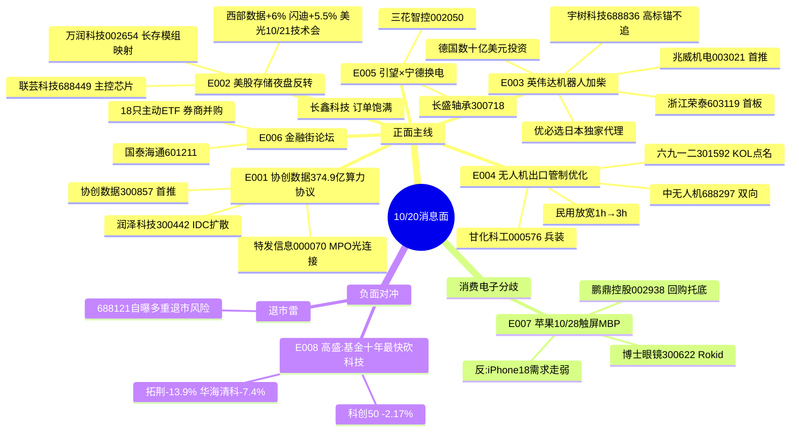

# 2026年10月20日(周二) · **消息面事件驱动**

> **数据源新鲜度**: partial(主源全ok,盘前纪要未入窗) · **降级状态**: false · **置信度**: 0.62
> **覆盖窗口**: 10/19 15:00 → 10/20 06:00(盘后+隔夜) · **主源**: 财联社/新浪快讯 + 上海证券报/证券时报 + 5焦点群 + 东财业绩预告 + cninfo公告窗
> **情绪周期锚(R1)**: 高位震荡(炸板率31.3%,涨停46/跌停22) → 只接龙头与首板补涨,不追高标,不碰中位杂毛

## 一句话结论

**消息面双主线:协创375亿算力大单+美股存储夜盘反转,机器人有英伟达海外加柴;但高盛证实对冲基金十年最快砍科技股——今天是"低位硬公告 vs 高位机构撤退"的竞价对决日,只做强确认,不做情绪接力。**

## 🗺️ 消息面全景图

## 🎯 顶级事件详解(每事件三问 + 首推票思维链)

### E20261020_001 · 协创数据子公司签374.9亿算力云服务协议 · strength=high · polarity=正面

**事件摘要**: 10/19 18:00公告,全资子公司协创智算与客户签《算力云服务协议》,预计总金额**不超过374.9亿元**,服务期60个月,协议已生效。上海证券报21:25、证券时报21:10跟进,5群18:14链接转发。协创19日+1.22%逆势收红(科创50当日-2.17%)。

**推理深度三问**:
- **大资金意图**: 375亿/5年=年化约62.5亿,对比公司当前营收量级(2025年约38亿)是**营收再造级**公告。盘后定点放出,意在给连续调整的算力租赁线打一根"订单真实存在"的桩;同晚微软退出英国Nscale项目(供电问题)又给行业埋雷——资金会优先选"已签已生效"的订单股,放弃讲故事的IDC
- **为什么走强**: 19日全天科技杀跌中协创逆势红盘,说明公告前已有资金卡位;群内13:48流传"英伟达物理AI独家承接方"小作文(未经证实,只当情绪加分不当事实)
- **逻辑够不够硬**: **公告硬,客户身份待验**。金额封顶表述("不超过")+客户未具名+60个月长周期,需要后续追问客户与首批确认收入;硬在协议已生效,软在履约节奏。置信度给0.85但只给事件分,仓位要等竞价

**首推票思维链**:

#### 协创数据 300857 · role=首推 · 收盘216.77
- **买入理由**: 盘后硬公告+三源独立确认+19日逆势强度;算力是本期少数有"新订单"证据的方向
- **风险点**: ①公告未具名客户 ②金额"不超过"的封顶弹性 ③E008机构砍科技的大背景 ④股价216元高位,盈亏比天然差
- **止损条件**: 201.60(参考价-7%);开盘高开>7%不追,等回落;竞价量能不足或开盘30分钟净流出则放弃
- **可验证假设**: 10/20竞价涨幅2-6%且竞价成交额进两市前50 → 强确认;若高开>9%被砸翻绿 → 公告兑现,当日不碰

#### 润泽科技 300442 · role=龙二(proxy·仅入watch) · 收盘56.16
- **买入理由**: AIDC批发龙头,控股股东5-10亿增持进行中(19日公告已增持149万股),19日+3.03%与算力同向
- **风险点**: 东财lead_stock代理归属,非LLM独立选股;同样面临海外IDC供电/撤单叙事扰动
- **止损条件**: 52.23(-7%)
- **可验证假设**: 协创强封板时润泽放量跟随,才考虑;协创走弱则同链全部放弃

### E20261020_002 · 美股存储夜盘反转+美光10/21技术会 · strength=high · polarity=正面

**事件摘要**: 隔夜美股存储盘初普涨——美光+4.33%、闪迪+5.70%、SK海力士+4.75%、西部数据+3.93%(收涨6.09%);美光官宣10/21 8:00技术研讨会(DRAM/HBM/NAND);美银10/16研报称存储股估值已现周期底部;长鑫科技19日股东会表态"合肥北京两厂高产能利用率、订单饱满"。A股存储19日盘中大跌(拓荆-13.88%、长鑫科技-7.77%)。

**推理深度三问**:
- **大资金意图**: 海外存储股自6月高点腰斩,美银选在美光会前喊"见底",配合夜盘拉涨,是**超跌反弹的机构自救窗口**,不一定是周期新主升
- **为什么走强**: 19日A股设备端先杀(拓荆-13.9%)释放空头力量,隔夜外盘给正反馈,今天开盘存在"昨日割错了"的回补盘;10/21美光会是最近的兑现锚
- **逻辑够不够硬**: **中等偏硬但分叉**。模组/原厂(涨价+订单)硬,设备端(估值仍杀)软。江波龙预告+1864%、德明利+32046%累计同比,但按v1.5业绩协议,周期股看单季环比——Q2拆分未取到(earnings_qoq_unverified),不能把累计同比当利好追

**首推票思维链**:

#### 万润科技 002654 · role=首推(长存模组映射) · 收盘11.10
- **买入理由**: 长江存储关联模组公司,群KOL 10:39点名"长存IPO加速";11元低位,外盘反转时低位映射票弹性优先
- **风险点**: llm_pure无独立验证;长存IPO时间未定;纯映射无自身业绩证据
- **止损条件**: 10.32(-7%);存储板块开盘15分钟整体走弱即撤
- **可验证假设**: 美光A股映射(江波龙/德明利/佰维)竞价集体高开>2% → 成立;只港股映射A股不动则放弃

#### 联芸科技 688449 · role=龙二(主控芯片) · 收盘46.96
- **买入理由**: SSD主控芯片+长存资本关联,19日+4.59%已有先手资金,抗跌强度真实
- **风险点**: 科创板高波动;先手资金可能借外盘高开兑现
- **止损条件**: 43.67(-7%)
- **可验证假设**: 高开后不补缺口、半小时量能超19日同期

### E20261020_003 · 英伟达德国投资+机器人布局 优必选进日本 · strength=high · polarity=正面

**事件摘要**: 德总理默茨称英伟达计划在德投资数十亿美元+工业AI合作;黄仁勋官宣投资敏捷机器人等4家公司;Bitcoin Japan签优必选人形机器人日本独家代理;智元×英伟达等WorldOracle世界模型平台发布。19日A股机器人ETF领涨4.72%,板块20只涨停(兆威机电/浙江荣泰/日盈电子/福莱新材/宁波东力/东安动力),宇树+16.15%、凡拓数创20cm。

**推理深度三问**:
- **大资金意图**: 海外催化(英伟达投资+优必选出海)是给**19日已经自己走强的板块**递梯子——板块先于消息启动,说明内资主线共识在先,隔夜消息负责吸引跟风盘
- **为什么走强**: R1板块排名机器人概念#1(3天3板)、人形机器人#4(2天2板),工业机器人前三季产量+29.1%(统计局)有产业数据底;这是当前唯一"板块效应+梯队+外盘催化"三者齐备的方向
- **逻辑够不够硬**: **梯队硬,位置不便宜**。高位震荡期纪律:龙头(宇树)只当情绪锚,首板(兆威/浙江荣泰)等弱转强,20cm情绪票(凡拓数创,群内喊"总龙头"的游资话术)不接力

**首推票思维链**:

#### 兆威机电 003021 · role=首推 · 收盘67.22(19日涨停)
- **买入理由**: 灵巧手微型驱动核心供应商,19日10cm首板,板块当日最强主线的前排
- **风险点**: 涨停次日接力天然高风险;若竞价被宇树高开拖累后跳水,首板补涨股同步被砸
- **止损条件**: 62.51(-7%);开盘跌破19日涨停价且15分钟收不回,直接放弃
- **可验证假设**: 竞价高开3-6%+封单结构健康;机器人板块竞价涨停家数>5家 → 弱转强成立可右侧跟;低开>-2%直接不看

#### 浙江荣泰 603119 · role=龙二(首板) · 收盘45.87(涨停)
- **买入理由**: 机器人绝缘件+新能源车双主业,与兆威同批首板梯队
- **风险点**: 首板次日二进三成功率受总情绪制约(昨日二板以上表现-3.81%)
- **止损条件**: 42.66(-7%)
- **可验证假设**: 同E003板块假设,兆威封板则它才有二封价值

#### 宇树科技 688836 · role=高标情绪锚(**不进execution**) · 收盘495.92
- 19日+16.15%,只用来判断板块温度:宇树高开高走则梯队可做;宇树杀跌则全线回避。495元价位盈亏比不支持开仓。

### E20261020_004 · 无人机出口管制优化调整(49号公告) · strength=high · polarity=正面(双向)

**事件摘要**: 10/19 15:02商务部/海关总署/中央军委装备发展部联合公告2026年第49号,优化调整特定无人驾驶航空器出口管制,11/18落地。KOL解读:续航门槛1h→3h、喷洒载荷20L→80L,民用农林工业无人机审批简化;"满足特定特性物项未经许可不得出口"保留高性能/军用收紧。同期日美"利剑27"军演(10/19-29,6万人)。军工板块rank#8(3天3板),甘化科工涨停,中无人机+4.59%。布油突破110美元、燃料油期货+6%。

**推理深度三问**:
- **大资金意图**: 民用放宽是给**农林/工业无人机出口链**松绑(增量市场),高性能收紧是保护技术外流——政策本身是结构性的,市场会先按"放开"炒作民用链,再分化
- **为什么走强**: 15:02收盘前公告,盘面只反应了一部分(军工午后异动);KOL 22:08长文点名六九一二,今天有二次定价空间
- **逻辑够不够硬**: **官方源最硬的一档**(三部门公告),但板块容量小,容易一日游;兵装重组+军演+油价地缘给情绪续了命

**首推票思维链**:

#### 六九一二 301592 · role=首推(KOL点名) · 收盘117.89
- **买入理由**: 军工训练装备+无人机产业链,出口管制放宽的直接受益叙事;19日+0.93%几乎未抢跑,位置给了定价空间
- **风险点**: 业务与"农林无人机出口放宽"的实际相关度未获公告验证(llm_pure);百元股弹性受限
- **止损条件**: 109.64(-7%);板块竞价无第二家高开确认则放弃
- **可验证假设**: 中无人机/航天彩虹/宗申动力竞价同涨>1.5%形成板块效应 → 成立

#### 中无人机 688297 · role=龙二(proxy·仅入watch) · 收盘42.60
- **买入理由**: 翼龙整机龙头,19日+4.59%已有先手
- **风险点**: **双向政策的受损面也在它身上**——高性能察打一体机型属收紧范围,多空交织
- **止损条件**: 39.62(-7%)
- **可验证假设**: 只做情绪脉冲,不做趋势;开盘冲高不板即走

#### 甘化科工 000576 · role=兵装弹性 · 收盘9.65(19日涨停)
- 低价兵装重组票,只看二板分歧承接,不板不碰;止损8.97。

### E20261020_005 · 引望×宁德时代×时代电服三方战略协议 智界获独立资质 · strength=medium · polarity=正面

**事件摘要**: 19日晚引望(华为车BU)与宁德时代、时代电服签约:巧克力换电网络与华为乾崑智驾系统级打通,引望加入换电生态;工信部412批公示智界拟获独立生产资质。新能源汽车板块rank#2(21天12板)。但宁德时代本体19日-3.60%。

**推理深度三问**:
- **大资金意图**: 华为智驾+宁德换电从竞争变结盟,意在共同压低电动化补能成本,利好**生态伙伴与零部件**,利润让渡方(宁德)反被资金解读为利空
- **为什么走强**: 汽车零部件rank#6(2天2板),三花+3.91%、长盛轴承+8.08%已有资金沿"机器人+汽车"双主线选股
- **逻辑够不够硬**: 题材级偏中,框架协议无订单金额;智界独立资质是华为合作模式微调。**不作主攻方向,只作机器人主线的汽车侧映射**

**首推票思维链**:

#### 三花智控 002050 · role=首推(双主线) · 收盘32.65
- **买入理由**: 热管理龙头同时是人形机器人执行器标的,E003/E005双事件交集,19日+3.91%趋势完好
- **风险点**: 大市值弹性弱;若机器人主线分歧它跟跌
- **止损条件**: 30.36(-7%)
- **可验证假设**: 机器人竞价强+汽车零部件红盘,双确认才上

#### 长盛轴承 300718 · role=龙二 · 收盘47.86
- 19日+8.08%未封板,关节轴承+汽车双逻辑;止损44.51;高开>5%不追。

### E20261020_006 · 金融街论坛:18只主动ETF+券商并购+稳市表态 · strength=high · polarity=正面

**事件摘要**: 吴清19日金融街论坛:同意首批18只主动ETF注册、支持证券业并购重组和后续整合、稳市机制、北证50ETF/新股市值配售、警惕境外挂钩A股个股杠杆产品;潘功胜:退出存贷款基准利率、金融支持AI;丁向群:风险总体可控。银行19日领涨,IH +1.45%。

**推理深度三问**:
- **大资金意图**: 高位震荡+外盘动荡窗口,监管给的是**指数下限**(主动ETF增量资金+稳市)和**改革叙事**(券商并购),不是给题材股放水
- **为什么走强**: 银行已先行(银行ETF+1.5%),资金在高切低;券商是期权式配置
- **逻辑够不够硬**: 政策硬但弹性温和;券商合并老题材,"并购后续整合"无时间表

**首推票思维链**:

#### 国泰海通 601211 · role=首推(proxy·watch) · 收盘16.75
- **买入理由**: 国泰+海通合并落地,头部整合样板,并购政策直接对标
- **风险点**: 券商是β工具不是连板题材;代理选股非LLM独立验证
- **止损条件**: 15.58(-7%)
- **可验证假设**: 大盘若低开杀跌,银行券商护盘拉升时跟随;题材亢奋日则无超额

### E20261020_007 · 苹果10/28发布会(触屏MacBook)与iPhone18需求走弱同框 · strength=medium · polarity=分歧

**事件摘要**: 苹果官宣10/28"Pro and tell"发布会,首款触屏MacBook Pro;同日杰富瑞称iPhone18 Pro/Pro Max需求下滑(交付周期缩短、二手价跌),折叠Duo等货90天+;Rokid与博士眼镜签AI眼镜线下验配合作;鹏鼎控股公告3-5亿回购。

**推理深度三问**:
- **大资金意图**: 苹果链当前缺新东西,触屏Mac+折叠Duo是唯二增量;资金更可能借发布会做**低位AI眼镜/新硬件**的事件脉冲,而不是重回果链大票
- **为什么走强**: PCB/果链周线在退潮(生益电子预增68-75%仍-2.36%,鹏鼎-1.98%),板块自身没有上攻形态,消息只能托底
- **逻辑够不够硬**: **不硬,事件驱动的短打**。博士眼镜位置低(+0.65%未发酵)是唯一有预期差的票

**首推票思维链**:

#### 博士眼镜 300622 · role=首推(AI眼镜渠道) · 收盘13.94
- **买入理由**: Rokid合作19日签约,市场未定价(+0.65%);AI眼镜是消费电子里少数有新品催化的分支
- **风险点**: 合作对业绩贡献未知;AI眼镜板块无板块效应,孤军难行
- **止损条件**: 12.96(-7%);竞价无溢价直接放弃
- **可验证假设**: 消费电子板块竞价翻红+博士眼镜高开>2%

#### 鹏鼎控股 002938 · role=龙二(proxy·watch) · 收盘72.70
- 苹果核心PCB+3-5亿回购托底,但PCB退潮期业绩利好都不涨,只当板块情绪观察标;止损67.61。

### E20261020_008 · 高盛:对冲基金十年最快砍科技股 · strength=high · polarity=**负面(行业级)**

**事件摘要**: 高盛主经纪商数据:截至10/15的五个交易日,对冲基金削减科技股幅度创2016年统计以来最大。隔夜费半结束八连跌(超跌反弹),纳指+1.11%。A股映射:科创50 19日-2.17%,拓荆科技-13.88%、华海清科-7.39%、长鑫科技-7.77%。

**推理深度三问**:
- **大资金意图**: 机构在主动降科技敞口,夜盘反弹更像空头回补而非新买入;这条是给E001/E002所有科技利好**压估值上限**的对冲项
- **为什么必须并列**: 只看375亿大单和存储反弹会得到单边进攻结论;但19日A股设备端的崩盘就是撤资的实时证据。多空两条都摆出来,交给竞价裁决
- **逻辑够不够硬**: 高盛PB数据是硬证据;A股映射已发生。**纪律动作:高位算力/半导体设备/CPO/PCB一律不追;只有"低位+当日硬公告"的票允许进候选**

**负面杀伤面**: AI算力高位股、半导体设备高位股、CPO/PCB高位股、美股七姐妹映射、20cm妖股(吴清同日提示境外杠杆产品风险)。

## 📊 板块 × 事件热力矩阵

| 板块 | 事件锚 | 首推龙头 | 独立源数 | 业绩预告交叉 | 净综合置信 |
|------|--------|----------|:--:|------|:--:|
| 算力租赁/IDC | E001 协创375亿 | 协创数据300857 | 4 | 无 | 🟢🟢🟢 |
| 存储/HBM | E002 美光会+外盘 | 万润科技/联芸科技 | 4 | 江波龙+1864%⚠️周期顶 | 🟢🟢 |
| 人形机器人 | E003 英伟达加柴 | 兆威机电003021 | 4+盘面 | 无 | 🟢🟢🟢 |
| 无人机/军工 | E004 49号公告 | 六九一二301592 | 3(官方) | 无 | 🟢🟢 |
| 华为汽车/换电 | E005 引望×宁德 | 三花智控002050 | 3 | 无 | 🟢🟡 |
| 大金融 | E006 金融街论坛 | 国泰海通601211 | 5 | 无 | 🟢🟡 |
| 消费电子/AI眼镜 | E007 苹果发布会 | 博士眼镜300622 | 2 | 鹏鼎回购 | 🟡 |
| 科技高位股(负) | E008 高盛PB | — | 2 | — | 🔴🔴 |

## 🔥 三季报业绩预告命中(硬alpha交叉验证)

从 eastmoney_earnings_predict(493条)与本期事件板块取交集:

| 代码 | 名称 | 预告类型 | 增速/内容 | 事件命中 | 逻辑强度 |
|------|------|----------|-----------|----------|:--:|
| 605358.SH | 立昂微 | 扭亏 | 前三季净利1.74亿(+2.82亿),12英寸硅片量价齐升 | E002 半导体 | 🟢🟢(19日-0.43%未定价) |
| 688469.SH | 芯联集成 | 扭亏 | 前三季营收77.58亿+43.09%,净利6.90亿扭亏 | E002 代工 | 🟢🟡(19日-3.47% 板块拖累) |
| 688183.SH | 生益电子 | 预增 | 18.69-19.52亿,+68%~75% | E007 PCB | 🟡(利好不涨 退潮证据) |
| 001309.SZ | 德明利 | 预增 | 86.5-89.5亿,+32046%~33154% | E002 存储模组 | ⚠️ v1.5:周期股单季环比未验证 |
| 301308.SZ | 江波龙 | 预增 | 140-149亿,+1864%~1991% | E002 存储模组 | 🔴 错题本004:Q3环比-36~49% 周期见顶判负面 |
| 002108.SZ | 沧州明珠 | 预增 | 净利1.96亿+40.33% | 无事件交集 | — |
| 深市整体 | — | — | 近八成预增(证券时报21:41) | 情绪底 | 🟢 背景 |

> 注:协创数据/兆威机电/六九一二等本期首推均不在业绩预告名单,事件驱动属性纯;业绩面背书弱是置信度未给更高的原因之一。

## 关键证据

- 证据1: 协创数据《算力云服务协议》公告 总金额不超过374.9亿元 已生效 · 来源 cninfo/上海证券报 · 2026-10-19
- 证据2: 商务部等三部门2026年第49号公告(无人机出口管制优化) · 来源 财联社 · 2026-10-19 15:02
- 证据3: 西部数据+6.09%/闪迪+5.53% 美光10/21技术研讨会 · 来源 新浪/美光官方 · 2026-10-20
- 证据4: 高盛PB:对冲基金五日砍科技股创2016年来最大 · 来源 新浪转引高盛 · 2026-10-20 01:41
- 证据5: 英伟达拟在德投资数十亿美元+投资4家机器人公司 · 来源 新浪 · 2026-10-20
- 证据6: 引望与宁德时代/时代电服战略合作框架 · 来源 财联社 · 2026-10-19 20:28
- 证据7: 证监会同意首批18只主动ETF注册 · 来源 新华社 · 2026-10-19 17:07
- 证据8: 19日机器人板块20只涨停 R1板块rank#1 · 来源 xtick全市场收盘 · 2026-10-19

## 数据源审计

| 源 | 日期 | 状态 | 备注 |
|---|---|:--:|---|
| tushare/news_cls | 2026-10-20 | 🟢 | 2227条·72h回看 |
| tushare/news_major | 2026-10-20 | 🟢 | 800条 |
| eastmoney/earnings_predict | 2026-10-20 | 🟢 | 493条·报告期9/30 |
| wechat_official_rss | 2026-10-20 | 🟡 | 94篇;21号当日盘前纪要7点未入窗 |
| wechat_cli_5groups | 2026-10-20 | 🟢 | 536条·5群全通 |
| anns_window | 2026-10-20 | 🟢 | 1267条·24h窗口 |
| xtick/kline | 2026-10-20 | 🟢 | 5566只10/19收盘(止损锚) |
| hithink-*-query | 2026-10-20 | 🔴 | 未调用:受益股池接口盘前时限内未调,3只proxy票(润泽/中无人机/国泰海通/鹏鼎)仅入watch |
| R7 资金面 | 2026-10-20 | 🟡 | 并行未出,capital_verification=unavailable |
| weflow | 2026-10-20 | 🔴 | MCP down(manifest已记 R4不依赖) |

## 不确定性 / 反证

1. **E001客户不具名**: 375亿是"不超过"封顶额且客户未披露,若今天公司无进一步说明,资金可能按"预期管理"处理,高开即是兑现点
2. **存储是反弹不是反转**: 美银喊底+美光会(10/21)是事件窗口,会开完毕若指引平淡,超跌反弹一日游;江波龙/德明利的周期见顶风险(v1.5协议)没有解除
3. **机器人位置矛盾**: 板块已是当日最强+20只涨停,高位震荡期次日接力胜率天然下降;昨日"二板以上表现-3.81%"是前车之鉴,只做弱转强不做加速
4. **E008的空头证据实时存在**: 拓荆-13.9%不是偶然,若今天科创50继续破位,所有科技利好降级处理
5. **首板候选池含4只llm_pure/proxy票**: 业务相关度未经hithink接口验证,必须经R5画像+竞价确认才能从watch升入execution
6. **个体雷**: 688121(*ST卓然/华卓精科)20cm涨停后自曝市值退市+重大违法强制退市双重风险,典型高位出货陷阱,已推送R6重点反证

## 与其他 R/D/E 的关系

- 依赖: data/raw/20261020 六主源;R1 emotion_cycle(高位震荡口径);xtick 10/19收盘价
- 被消费: R2主线(板块催化排序) / R5个股画像(first_board_candidates 10只) / R6反证(E008+688121+协创客户不具名) / D1预案(首板池+proxy票只入watch)

## Sub-Agent 元数据

- skill: analyze_news_impact_v1@1.6
- artifact: data/research/20261020/R4_news.json
- method: llm_v1(六源聚合·v1.5业绩极性协议·v1.6首板候选)
- 生成时刻: 2026-10-20T07:25:00+08:00
