# 2026年10月21日 周三 · **消息面事件驱动**

> **数据源新鲜度**: ok(6/8源) · **降级状态**: false · **置信度**: 0.74
> **覆盖窗口**: 10/20 06:00 → 10/21 05:59 · **主源**: 财联社/新浪快讯(2632条) + 21号公众号盘前纪要 + 5焦点群(537条) + 东财业绩预告(500条) + 公告窗(2178条)

## 一句话结论

**今日消息面双主线:AI算力硬件(光纤缺口+存储涨价,产业级硬数据) × 物理AI/机器人(GTC+世界模型大会明牌但已批量涨停);辅线=三季报业绩浪(云南锗业/天齐/海思科)与数据集团新题材;唯一对冲=美制裁中企+韩国崩盘的外围情绪扰动,定性为买点后置而非趋势破坏。**

## 🗺️ 消息面全景图

```mermaid
mindmap
  root((10/21消息面))
    正面主线
      E1光纤缺口1.8亿芯公里
        亨通光电(首推·Q3+151%)
        长飞光纤/中天科技
        东田微(1.6T组件)
        空芯光纤:烽火通信
      E2存储涨价+美光研讨会
        澜起科技(Q3+154%)
        大普微/德明利/普冉
        亚马逊50亿GB300
      E3物理AI
        GTC柏林黄仁勋21日演讲
        南京世界模型大会60亿签约
        索辰科技/富临精工
        数据采集:利亚德/玉禾田
        宇树22日生态大会
      E4国家数据集团
        丁薛祥揭牌·雄安
        数字认证(映射待验证)
        紫光股份(代理)
      E5宁德400亿回购
        换电链:绿能慧充
        电电增程1.3万台
      E6三季报业绩浪
        云南锗业+2642%磷化铟
        天齐锂业+27至32倍
        海思科+297至321%
        中船特气+363%
      E7智驾蓝绿灯国标
        浙江世宝
    负面风险
      E8外围扰动
        美制裁5家中企
        美机构停用DeepSeek
        KOSPI-3.73%
        费半盘中-2.3%后收复
      业绩雷
        中国移动Q3-12.2%
        福耀玻璃Q3-9.87%
      宇树科技风险提示
    时间锚
      10/21美光研讨会08:00
      10/21智能网联汽车大会
      10/22宇树生态大会
      10/28苹果发布会
```

## 🎯 顶级事件详解(每事件三问 + 首推票思维链)

### E20261021_001 · 全球光纤缺口1.8亿芯公里 · strength=high · polarity=正面 · weighted=0.82

**事件摘要**: TrendForce 10/20晚通过财联社VIP发布:AI数据中心+跨数据中心互连推升光纤需求,2026年全球光纤供需缺口1.8亿芯公里,现货价年增2.8-5倍,紧缺持续至2028;电信商转向长约锁量。央视财经同日报道高速光模块组件订单排到2027年底、一片玻璃11年价值涨60倍。6独立源。

**推理深度三问**:
- **大资金意图**: 光纤是AI算力capep里唯一一个"量价齐升数据由第三方机构给出+持续到2028"的硬缺口环节,机构在三季报窗口需要产业确定性资产;亨通Q3预增151%-168%给了资金"涨价→利润"的当期验证,属于从主题炒作切到业绩兑现的第二段。
- **为什么走强**: 10/20亨通已涨停且居同花顺/东财双热榜第一,说明市场20日盘中已开始定价;晚间TrendForce数据+央视背书把"个股逻辑"升级为"行业景气",21日大概率高开,核心矛盾是一致性过强后的承接。
- **逻辑够不够硬**: **硬**。供给端2025年底起紧张、预制棒扩产周期18-24个月、海外康宁/Coherent同步映射;风险是短线涨幅与高开幅度,不是逻辑本身。

#### 亨通光电 600487 · role=首推 · 参考价 52.07
- **买入理由**: 光棒-光纤-光缆一体化+海缆,光纤量价齐升直接受益,Q3净利59.7-63.7亿同比+151%-168%;板块联动:10/20涨停 热榜双第一(同花顺+东财) 光通信板块绝对核心
- **风险点**: 业绩预告:151.27%~168.10%;验证法=llm_with_hithink_verification
- **止损条件**: 48.95 元(10/20收盘52.07×(1-6%)=48.95;跌破5日线或板块竞价分歧转弱二次确认)
- **可验证假设**: 竞价 9:25 溢价为正且板块≥2只跟风高开 → 假设成立;若竞价平开/低开且龙头炸板,降级观察不进
#### 长飞光纤 601869 · role=龙二 · 参考价 339.09
- **买入理由**: 光纤预制棒/光纤全球龙头,AI数据中心光纤长约采购最直接受益;板块联动:TrendForce缺口1.8亿芯公里,在手订单排产27Q1,10/20微跌-0.27%位置低于亨通
- **风险点**: 无业绩预告锚,纯事件/情绪驱动;验证法=llm_with_hithink_verification
- **止损条件**: 318.74 元(10/20收盘339.09×(1-6%)=318.74;跌破5日线或板块竞价分歧转弱二次确认)
- **可验证假设**: 竞价 9:25 溢价为正且板块≥2只跟风高开 → 假设成立;若竞价平开/低开且龙头炸板,降级观察不进
#### 中天科技 600522 · role=龙三 · 参考价 28.24
- **买入理由**: 光纤光缆+海缆,2026全球光纤光缆大会分享AI算力中心成果;板块联动:板块联动跟随,10/20仅+0.64%涨幅落后有补涨空间
- **风险点**: 无业绩预告锚,纯事件/情绪驱动;验证法=llm_with_hithink_verification
- **止损条件**: 26.55 元(10/20收盘28.24×(1-6%)=26.55;跌破5日线或板块竞价分歧转弱二次确认)
- **可验证假设**: 竞价 9:25 溢价为正且板块≥2只跟风高开 → 假设成立;若竞价平开/低开且龙头炸板,降级观察不进
#### 东田微 301183 · role=光模块组件弹性 · 参考价 227.86
- **买入理由**: 南昌光学元器件,2.5G PON到1.6T光模块滤光片,央视报道样本企业;板块联动:央视:一片玻璃价值11年60倍+组件订单排到2027底,10/20 +4.06%
- **风险点**: 无业绩预告锚,纯事件/情绪驱动;验证法=llm_with_hithink_verification
- **止损条件**: 209.63 元(10/20收盘227.86×(1-8%)=209.63;跌破5日线或板块竞价分歧转弱二次确认)
- **可验证假设**: 竞价 9:25 溢价为正且板块≥2只跟风高开 → 假设成立;若竞价平开/低开且龙头炸板,降级观察不进

### E20261021_002 · 存储涨价+亚马逊50亿GB300+美光研讨会 · strength=high · polarity=正面 · weighted=0.80

**事件摘要**: 新浪财经10/21 02:32快讯亚马逊云拟购英伟达GB300整机机架价值50亿美元;美光10/21上午8时开技术研讨会(DRAM/HBM/NAND路线图);TrendForce Q4预测eSSD合约价环比+23-28%、NAND+15-20%;澜起科技18:22公告Q3预增153.6%-174.7%(DDR5出货大增)。7独立源。

**推理深度三问**:
- **大资金意图**: 美光研讨会是机构日历上的明牌时间锚,资金提前一个交易日埋伏存储链;亚马逊GB300订单把"资本开支担忧"证伪,继续强化北美云厂商capep上行叙事。
- **为什么走强**: 澜起业绩是存储链里第一块落地的硬利润,公司直接点名"Q4互连类芯片需求进一步提升",涨价→出货→利润三段全部打通;外围MU 10/19收涨2.97%、闪迪涨逾5%形成隔夜共振。
- **逻辑够不够硬**: **硬但有外围杂音**。韩国KOSPI 20日暴跌3.73%(三星权重)是亚太半导体情绪的暗雷,若21日日韩开盘继续杀,存储链会高开分歧;看竞价分歧能否转强,不追开盘第一波。

#### 澜起科技 688008 · role=首推(业绩硬验证) · 参考价 169.27
- **买入理由**: DDR5内存接口/模组配套芯片直接对标AI服务器存储升级,Q3营收20.79亿+46%;板块联动:Q3预增153.6%-174.7%公告,互连芯片Q4需求继续提升,存储链唯一硬业绩
- **风险点**: 业绩预告:153.6%~174.7%;验证法=llm_with_hithink_verification
- **止损条件**: 159.11 元(10/20收盘169.27×(1-6%)=159.11;跌破5日线或板块竞价分歧转弱二次确认)
- **可验证假设**: 竞价 9:25 溢价为正且板块≥2只跟风高开 → 假设成立;若竞价平开/低开且龙头炸板,降级观察不进
#### 大普微 688584 · role=存储弹性 · 参考价 21.22
- **买入理由**: 企业级SSD主控+模组,云厂商追加eSSD采购直接受益;板块联动:美股闪迪涨逾5%+Q4 eSSD合约价+23-28%,10/20 +2.27%
- **风险点**: 无业绩预告锚,纯事件/情绪驱动;验证法=llm_with_hithink_verification
- **止损条件**: 19.95 元(10/20收盘21.22×(1-6%)=19.95;跌破5日线或板块竞价分歧转弱二次确认)
- **可验证假设**: 竞价 9:25 溢价为正且板块≥2只跟风高开 → 假设成立;若竞价平开/低开且龙头炸板,降级观察不进
#### 德明利 001309 · role=存储弹性 · 参考价 219.55
- **买入理由**: 主控+模组+存储封测,NAND涨价受益;板块联动:盘前纪要存储映射标的,10/20平盘位置未透支
- **风险点**: 无业绩预告锚,纯事件/情绪驱动;验证法=llm_with_hithink_verification
- **止损条件**: 206.38 元(10/20收盘219.55×(1-6%)=206.38;跌破5日线或板块竞价分歧转弱二次确认)
- **可验证假设**: 竞价 9:25 溢价为正且板块≥2只跟风高开 → 假设成立;若竞价平开/低开且龙头炸板,降级观察不进
#### 普冉股份 688766 · role=存储弹性 · 参考价 280.08
- **买入理由**: NOR Flash/EEPROM小容量存储,涨价传导偏间接;板块联动:10/20 -1.78%走势偏弱,仅作观察
- **风险点**: 无业绩预告锚,纯事件/情绪驱动;验证法=llm_with_hithink_verification
- **止损条件**: 263.28 元(10/20收盘280.08×(1-6%)=263.28;跌破5日线或板块竞价分歧转弱二次确认)
- **可验证假设**: 竞价 9:25 溢价为正且板块≥2只跟风高开 → 假设成立;若竞价平开/低开且龙头炸板,降级观察不进

### E20261021_003 · 物理AI三重催化(GTC+南京大会+宇树) · strength=high · polarity=正面 · weighted=0.78

**事件摘要**: 英伟达GTC柏林10/20-22举行,黄仁勋21日主题演讲核心=Physical AI+Robotics+Agentic AI;2026物理AI与世界模型大会10/20在南京开幕,超60亿项目签约;宇树10/22办生态大会。10/20盘面机器人9家涨停+物理AI 3家涨停,盘后宇树科技发风险提示(商业化早期、估值回归)。7独立源。

**推理深度三问**:
- **大资金意图**: 这是10月下旬市场选出的情绪总主线,国金/东吴两家计算机首席同日背书"GPT-6是机器人大脑里程碑""正被盘面追认",游资+机构在物理AI上罕见合流。
- **为什么走强**: 催化密度(21日GTC演讲+22日宇树大会)形成连续两天的事件日历,数据采集训练场是20日刚发酵的新分支(全国70+已建成、40+在建),符合资金"高低切"需求。
- **逻辑够不够硬**: **产业逻辑硬,但位置不便宜**。20日已批量涨停属主升中段明牌,宇树盘后风险提示是高标降温信号;只做①首板后分歧弱转强的核心(索辰)②盘后新公告(富临精工5亿电关节)③低位数据采集补涨(利亚德),不接20cm高标竞价一致。

#### 索辰科技 688507 · role=首推(物理AI 20cm标杆) · 参考价 162.07
- **买入理由**: 物理AI仿真/科学计算平台,直接对应英伟达Physical AI仿真训练链;板块联动:10/20 20cm涨停,物理AI板块涨幅第一标杆,东吴计算机点名追认
- **风险点**: 无业绩预告锚,纯事件/情绪驱动;验证法=llm_with_hithink_verification
- **止损条件**: 149.1 元(10/20收盘162.07×(1-8%)=149.1;跌破5日线或板块竞价分歧转弱二次确认)
- **可验证假设**: 竞价 9:25 溢价为正且板块≥2只跟风高开 → 假设成立;若竞价平开/低开且龙头炸板,降级观察不进
#### 富临精工 300432 · role=机器人电关节(盘后公告) · 参考价 13.72
- **买入理由**: 机器人智能电关节(丝杠/执行器)核心标的,子公司班巧智能5亿投建绵阳产线;板块联动:盘后公告5亿机器人电关节项目,机器人零部件分支
- **风险点**: 无业绩预告锚,纯事件/情绪驱动;验证法=llm_with_hithink_verification
- **止损条件**: 12.9 元(10/20收盘13.72×(1-6%)=12.9;跌破5日线或板块竞价分歧转弱二次确认)
- **可验证假设**: 竞价 9:25 溢价为正且板块≥2只跟风高开 → 假设成立;若竞价平开/低开且龙头炸板,降级观察不进
#### 利亚德 300296 · role=数据采集低位补涨 · 参考价 4.69
- **买入理由**: OptiTrack光学动作捕捉亚毫米级数据采集,人形动作数据库已沉淀;板块联动:全国70+具身智能训练场建设热,物理AI数据采集分支低位补涨
- **风险点**: 无业绩预告锚,纯事件/情绪驱动;验证法=llm_with_hithink_verification
- **止损条件**: 4.41 元(10/20收盘4.69×(1-6%)=4.41;跌破5日线或板块竞价分歧转弱二次确认)
- **可验证假设**: 竞价 9:25 溢价为正且板块≥2只跟风高开 → 假设成立;若竞价平开/低开且龙头炸板,降级观察不进
#### 玉禾田 300815 · role=智元数据采集合作 · 参考价 15.6
- **买入理由**: 与智元机器人在深圳大湾区落地具身机器人数据采集训练中心(环卫场景);板块联动:10/20 +5.9%已异动,数据采集分支辨识度标的
- **风险点**: 无业绩预告锚,纯事件/情绪驱动;验证法=llm_with_hithink_verification
- **止损条件**: 14.66 元(10/20收盘15.6×(1-6%)=14.66;跌破5日线或板块竞价分歧转弱二次确认)
- **可验证假设**: 竞价 9:25 溢价为正且板块≥2只跟风高开 → 假设成立;若竞价平开/低开且龙头炸板,降级观察不进

### E20261021_004 · 国家数据集团成立 · strength=high · polarity=正面 · weighted=0.72

**事件摘要**: 国家数据集团10/20在雄安成立,丁薛祥出席揭牌,中国联通总经理简勤任董事长、陈荣辉任总经理,100家央企名录同步公布,定位=数据资源开发利用国家队。5独立源(新华社/财联社/财新/同花顺+群传播)。

**推理深度三问**:
- **大资金意图**: 副总理出席的新央企=数据要素板块等了一年的"国家队落地"政策锚,资金会先炒情绪辨识度(国资数据/数据安全),再等待业务注入预期。
- **为什么走强**: 板块10/20未提前反应(数字认证仅+1.9%),是今日罕见的干净新题材;参考历史新央企成立首日,数据要素小票弹性最大。
- **逻辑够不够硬**: **政策硬、个股软**。没有明确受益订单或业绩锚,数字认证"北京数字集团"映射牵强;只能按新题材情绪票做,竞价强度定去留,仓位顶格观察仓。

#### 数字认证 300579 · role=群内首推(映射待验证) · 参考价 25.07
- **买入理由**: 电子认证/密码/数据安全,市场按'北京数字集团-国资数据'映射,业务相关性偏弱;板块联动:国家数据集团成立当日群内自发首推,10/20已涨1.9%,无板块联动数据
- **风险点**: 无业绩预告锚,纯事件/情绪驱动;验证法=llm_pure_no_verification
- **止损条件**: 23.57 元(10/20收盘25.07×(1-6%)=23.57;跌破5日线或板块竞价分歧转弱二次确认)
- **可验证假设**: 竞价 9:25 溢价为正且板块≥2只跟风高开 → 假设成立;若竞价平开/低开且龙头炸板,降级观察不进
#### 紫光股份 000938 · role=数据基础设施 · 参考价 25.71
- **买入理由**: 新华三服务器/数据中心基础设施,国家数据集团基建方向潜在供应商;板块联动:10/20 +0.43%未提前反应,位置干净
- **风险点**: 无业绩预告锚,纯事件/情绪驱动;验证法=proxy_ths_member_top10
- **止损条件**: 24.17 元(10/20收盘25.71×(1-6%)=24.17;跌破5日线或板块竞价分歧转弱二次确认)
- **可验证假设**: 竞价 9:25 溢价为正且板块≥2只跟风高开 → 假设成立;若竞价平开/低开且龙头炸板,降级观察不进

### E20261021_005 · 宁德时代Q3+400亿回购+换电放量(正反两面) · strength=medium · polarity=正面 · weighted=0.55

**事件摘要**: 宁德Q3营收1652亿+58.58%、净利212.46亿同比+14.54%(增速明显放缓),前三季645.3亿+31.6%;同步披露最高400亿元回购并注销;电电增程换电方案首批签约1.3万台、计划明年建成2000座重卡换电站;摩根大通H股多头增至6.46%,但港股评级被下调至中性。5独立源。

**推理深度三问**:
- **大资金意图**: 400亿注销式回购是管理层对估值的真金白银背书,意在对冲"增速放缓+港股下调评级"的负面叙事;换电生态绑定华为乾崑,资金更愿意炒弹性设备链而非宁王本体。
- **为什么走强**: 宁王10/20已跌-2.97%,市场20日已在交易"增速放缓",21日回购落地后利空出尽概率大;**但注意向上弹性受限**——本体向上空间受限于14.54%的增速,资金弹性在绿能慧充这类换电设备小票。
- **逻辑够不够硬**: 回购硬、业绩中性。按v1.5协议这是非周期白马,增速放缓即边际减弱,**不把同比+14.54%当强利好**,正股给谨慎配置、弹性给换电链。

#### 宁德时代 300750 · role=正股(利好兑现谨慎) · 参考价 259.08
- **买入理由**: 全球动力电池龙头,Q3营收1652亿+58.58%,400亿回购注销+换电生态;板块联动:Q3净利212.46亿+14.54%增速放缓 港股被下调中性,本体中性偏多,分支更强
- **风险点**: 业绩预告:前三季+31.60%;验证法=llm_with_hithink_verification
- **止损条件**: 246.13 元(10/20收盘259.08×(1-5%)=246.13;跌破5日线或板块竞价分歧转弱二次确认)
- **可验证假设**: 竞价 9:25 溢价为正且板块≥2只跟风高开 → 假设成立;若竞价平开/低开且龙头炸板,降级观察不进
#### 绿能慧充 600212 · role=换电设备弹性 · 参考价 5.35
- **买入理由**: 宁德换电体系设备端合作方,与时代电服/时代骐骥战略协议(群内多次口播);板块联动:电电增程首批签约1.3万台+明年2000座重卡换电站,单源群聊待验证
- **风险点**: 无业绩预告锚,纯事件/情绪驱动;验证法=llm_pure_no_verification
- **止损条件**: 4.98 元(10/20收盘5.35×(1-7%)=4.98;跌破5日线或板块竞价分歧转弱二次确认)
- **可验证假设**: 竞价 9:25 溢价为正且板块≥2只跟风高开 → 假设成立;若竞价平开/低开且龙头炸板,降级观察不进

### E20261021_006 · 三季报硬业绩潮 · strength=high · polarity=正面 · weighted=0.70

**事件摘要**: 隔夜业绩预告/财报密集:云南锗业Q3净利1.02亿+2642%(磷化铟放量,章建平Q3增持1962万股成第三大股东);天齐锂业前三季51-60亿预增2735%-3235%;海思科13.2-14亿预增297%-321%;中船特气Q3+362.79%;澜起+153.6%-174.7%。同时中国移动Q3净利-12.2%、福耀玻璃-9.87%为业绩雷。6独立源。

**推理深度三问**:
- **大资金意图**: 10月下旬进入三季报强制披露窗口,资金从"纯题材"切向"题材+业绩交集",化合物半导体(云南锗业)和周期反转低位资源(天齐,自高点回撤56%)是两条不同的业绩线。
- **为什么走强**: 云南锗业=产品涨价(磷化铟/锗)+牛散真金白银+AXT美股映射三重;天齐=锂价同比回升+SQM收益+低基数+深度回撤;海思科=创新药内需+回撤26%。
- **逻辑够不够硬**: 按v1.5周期股协议:天齐是**周期反转而非见顶**(锂产品均价同比明显增长、股价低位、扣非+6957%-8220%);云南锗业Q3单季环比需R5进一步拆,先按业绩+题材双驱动做;雷区在运营商/汽车玻璃,持仓需回避。

#### 云南锗业 002428 · role=首推(磷化铟+牛散) · 参考价 78.92
- **买入理由**: 国内锗/磷化铟化合物半导体材料龙头,磷化铟销量同比大增,光通信上游材料卡位;板块联动:Q3净利+2642%+章建平Q3增持1962万股成第三大股东+AXT磷化铟映射
- **风险点**: 业绩预告:前三季+869.79%;验证法=llm_with_hithink_verification
- **止损条件**: 73.4 元(10/20收盘78.92×(1-7%)=73.4;跌破5日线或板块竞价分歧转弱二次确认)
- **可验证假设**: 竞价 9:25 溢价为正且板块≥2只跟风高开 → 假设成立;若竞价平开/低开且龙头炸板,降级观察不进
#### 天齐锂业 002466 · role=锂矿低位反转 · 参考价 36.5
- **买入理由**: 锂矿+锂盐+SQM权益,锂价同比明显回升直接受益,股价自高点回撤56%低位反转;板块联动:前三季预增2735%-3235%(扣非+6957%-8220%),周期反转低位
- **风险点**: 业绩预告:2734.97%~3235.26%;验证法=llm_with_hithink_verification
- **止损条件**: 34.31 元(10/20收盘36.5×(1-6%)=34.31;跌破5日线或板块竞价分歧转弱二次确认)
- **可验证假设**: 竞价 9:25 溢价为正且板块≥2只跟风高开 → 假设成立;若竞价平开/低开且龙头炸板,降级观察不进
#### 海思科 002653 · role=创新药业绩龙头 · 参考价 59.6
- **买入理由**: 创新药(麻醉/肠内营养)高增长,前三季创新药国内销售快速增长;板块联动:前三季预增297%-321%,股价自年内高点回撤26%
- **风险点**: 业绩预告:297.02%~321.08%;验证法=llm_with_hithink_verification
- **止损条件**: 56.02 元(10/20收盘59.6×(1-6%)=56.02;跌破5日线或板块竞价分歧转弱二次确认)
- **可验证假设**: 竞价 9:25 溢价为正且板块≥2只跟风高开 → 假设成立;若竞价平开/低开且龙头炸板,降级观察不进
#### 中船特气 688146 · role=电子特气Q3+363% · 参考价 153.81
- **买入理由**: 电子特气(六氟化钨等)国产替代,半导体材料景气;板块联动:Q3净利3.13亿+362.79%,10/20仅+1.35%
- **风险点**: 业绩预告:Q3+362.79%;验证法=llm_with_hithink_verification
- **止损条件**: 144.58 元(10/20收盘153.81×(1-6%)=144.58;跌破5日线或板块竞价分歧转弱二次确认)
- **可验证假设**: 竞价 9:25 溢价为正且板块≥2只跟风高开 → 假设成立;若竞价平开/低开且龙头炸板,降级观察不进

### E20261021_007 · 智驾蓝绿灯国标征求意见 · strength=medium · polarity=正面 · weighted=0.50

**事件摘要**: 工信部装备一司20日发布强制性国标征求意见稿:L3及以上才允许装ADS标志灯(专用蓝绿色),L2及以下禁用;同时工信部表态坚决防范未经充分验证汽车产品入市;10/21世界智能网联汽车大会在北京举办。5独立源。

**推理深度三问**:
- **大资金意图**: 标志灯国标=L3权责边界的物理化落地,政策在为高阶智驾量产开路、同时出清尾部贴牌;叠加比亚迪海鸥全系天神之眼B,智驾平权是产业趋势。
- **为什么走强**: 大会今日开幕是时间锚,但该事件10/20盘中已有部分反应,强度中等。
- **逻辑够不够硬**: 政策方向硬、个股弹性一般,浙江世宝为盘前纪要直接点名标的,按观察仓处理。

#### 浙江世宝 002703 · role=盘前纪要点名 · 参考价 15.15
- **买入理由**: 线控转向+智能驾驶执行层,L3准入标准直接相关;板块联动:智驾蓝绿灯国标征求意见+21日世界智能网联汽车大会(北京)时间锚
- **风险点**: 无业绩预告锚,纯事件/情绪驱动;验证法=llm_with_hithink_verification
- **止损条件**: 14.24 元(10/20收盘15.15×(1-6%)=14.24;跌破5日线或板块竞价分歧转弱二次确认)
- **可验证假设**: 竞价 9:25 溢价为正且板块≥2只跟风高开 → 假设成立;若竞价平开/低开且龙头炸板,降级观察不进

### E20261021_008 · 外围扰动:美制裁5家中企+DeepSeek禁令+韩国崩盘 · strength=high · polarity=负面 · weighted=-0.60(行业级)

**事件摘要**: 美方10/19以窃取商业秘密为由制裁5家中国企业,商务部20日回应"性质恶劣、坚决反对";美政府要求机构停用DeepSeek,外交部反对泛化国家安全;韩国KOSPI 10/20暴跌3.73%(振幅4.17%);美股半导体周一盘中跳水、费半一度-2.3%,22:21转涨收复;纳指收+1.11%,MU+2.97%。5独立源。

**推理深度三问**:
- **大资金意图**: 这是情绪面的开盘压力测试,不是基本面逆转——费半当日收复、亚马逊隔夜50亿GB300订单都说明全球AI capep趋势未被破坏。
- **为什么走强(反指解读)**: 利空本身不产生多头,但DeepSeek同日开源DeepInfer推理框架、国产算力自主可控逻辑被反向强化;外围砸出的低开若是假摔,恰是E1/E2龙头的胜率买点。
- **逻辑够不够硬**: 利空性质=情绪级非基本面级(费半收复+纳指+1.11%+MU收涨),但韩国-3.73%原因未明,定为"需要开盘验证"的对冲项而非清仓信号。
- **影响谁**: ①半导体/CPO高位股竞价情绪;②DeepSeek映射的AI应用小票;③与5家被制裁企业有供应链关联的个股(名单待公告核实)。

_本事件无个股首推,作用=开盘情绪压力测试。_

## 📊 板块 × 事件热力矩阵

| 板块 | 事件锚 | 首推龙头 | 独立源数 | 三季报验证 | 净综合置信 |
|------|--------|----------|:--:|--|:--:|
| 光纤光缆 | E001 | 亨通光电 | 6 | Q3+151%~168% | 🟢🟢🟢 |
| 存储/互连 | E002+E006 | 澜起科技 | 7 | Q3+154%~175% | 🟢🟢🟢 |
| 物理AI/机器人 | E003 | 索辰科技/富临精工 | 7 | 无(富临5亿订单) | 🟢🟢(高位) |
| 数据要素 | E004 | 数字认证(弱映射) | 5 | 无 | 🟢🟡(竞价定) |
| 换电链 | E005 | 绿能慧充 | 5 | 宁王回购400亿 | 🟢🟡 |
| 化合物半导体 | E006 | 云南锗业 | 6 | Q3+2642% | 🟢🟢🟢 |
| 锂矿 | E006 | 天齐锂业 | 4 | +2735%~3235% | 🟢🟢 |
| 创新药 | E006 | 海思科 | 3 | +297%~321% | 🟢🟢 |
| L3智驾 | E007 | 浙江世宝 | 5 | 无 | 🟢🟡 |
| 半导体(情绪) | E008 | — | 5 | 外围利空 | 🔴 买点后置 |

## 🔥 三季报业绩预告命中(硬 alpha 交叉验证)

从 eastmoney_earnings_predict 提取 10/20-10/21 隔夜30条预告,与今日事件板块交集:

| 代码 | 名称 | 类型 | 增速区间 | 事件命中 | 逻辑强度 |
|------|------|------|----------|----------|:--:|
| 002428.SZ | 云南锗业 | Q3财报 | Q3净利+2642%/前三季+869.79% | E006磷化铟+E001光纤材料 | 🟢🟢🟢 |
| 002466.SZ | 天齐锂业 | 预增 | +2735%~3235%(扣非+6957%~8220%) | E006周期反转 | 🟢🟢 |
| 002653.SZ | 海思科 | 预增 | +297%~321% | E006创新药 | 🟢🟢 |
| 688008.SH | 澜起科技 | 预增 | Q3+153.6%~174.7% | E002存储 | 🟢🟢🟢 |
| 688146.SH | 中船特气 | Q3财报 | +362.79% | E006半导体材料 | 🟢🟢 |
| 605358.SH | 立昂微 | 预增 | 扭亏(增2.82亿) | E006硅片 | 🟢🟡 |
| 600188.SH | 兖矿能源 | 预增 | +56% | 资源(非主线) | 🟢🟡 |
| 300750.SZ | 宁德时代 | Q3财报 | Q3+14.54%/前三季+31.6% | E005 | 🟢🟡 增速放缓 |
| 600941.SH | 中国移动 | Q3财报 | **-12.2%** | 业绩雷 | 🔴 |
| 600660.SH | 福耀玻璃 | Q3财报 | **-9.87%** | 业绩雷 | 🔴 |

## 关键证据

- 证据1: TrendForce光纤缺口1.8亿芯公里、现货价年增2.8-5倍、持续至2028 · 财联社VIP明日主题前瞻 2026-10-20晚
- 证据2: 央视财经"高速光模块组件订单排到2027年底 一片玻璃价值提升超60倍" · 2026-10-20 09:02群转载
- 证据3: 澜起科技Q3预增153.6%-174.7%、DDR5出货大幅增加、看好Q4互连需求 · 公司公告 2026-10-20 18:22
- 证据4: 亚马逊云拟购英伟达GB300机架50亿美元 · 新浪财经 2026-10-21 02:32
- 证据5: 国家数据集团雄安成立 丁薛祥揭牌 简勤任董事长 · 新华社/财联社 2026-10-20 19:23
- 证据6: 宁德时代Q3 212.46亿+14.54% + 400亿回购注销 + 电电增程签约1.3万台 · 公司公告 2026-10-20
- 证据7: 云南锗业Q3+2642% 章建平增持1962万股成第三大股东 · 财联社 2026-10-20 18:51/20:29
- 证据8: 天齐锂业前三季51-60亿 预增2735%-3235% 扣非+6957%-8220% · 公司公告
- 证据9: 美制裁5家中企+美机构停用DeepSeek;商务部/外交部回应 · 新华社 2026-10-20
- 证据10: 费半盘中-2.3%后转涨收复、纳指+1.11%、MU+2.97% · 财联社 2026-10-20 22:21

## 数据源审计

| 源 | 日期 | 状态 | 备注 |
|---|---|:--:|---|
| tushare/news_cls | 2026-10-21 | 🟢 | 2632条·72h回看·覆盖至05:59 |
| tushare/news_major | 2026-10-21 | 🟢 | 800条·长篇要闻 |
| eastmoney/earnings_predict | 2026-10-21 | 🟢 | 500条·隔夜新增30条 |
| wechat_official_rss(21号池) | 2026-10-21 | 🟢 | 86篇·12个号有更新·含盘前纪要/明日主题前瞻 |
| wechat_cli_5groups | 2026-10-21 | 🟢 | 537条·5焦点群全ok(匿名) |
| anns_window | 2026-10-21 | 🟢 | 2178条/970家·当日965条 |
| overseas_snapshot | 2026-10-21 | 🟡 | 美股为10/19收盘·大宗商品跳过 |
| weflow | 2026-10-21 | 🔴 | ngrok离线·R4不依赖 |
| hithink-market-query | — | 🟡 | 未CLI直调·受益股由盘前纪要结构化归因替代·R5复核 |
| vibe_research_reports | — | 🔴 | 未调用·留R5机构验证 |

## 不确定性 / 反证

1. **一致性风险(最大)**: E1/E2/E3 三条主线10/20均已涨停或大涨,21日若集体高开5%+,盈亏比迅速恶化,所有首推票的止损假设建立在"分歧低吸"而非"追高开"上。
2. **外围暗雷**: 韩国KOSPI单日-3.73%未完全解释(三星/半导体权重),若21日日韩继续杀+费半夜盘转跌,E8会从情绪扰动升级为板块级压制。
3. **E4映射牵强**: 数字认证与"国家数据集团"无股权/业务实锤,纯资金记忆映射,竞价不及预期必须立即放弃。
4. **周期股单季拆分缺口**: 云南锗业Q3单季1.02亿的环比、锗/磷化铟现货价方向尚未取数(v1.5协议要求),R5必须补;若单季环比走平,降级为题材票。
5. **R7资金验证缺失**: 本批次所有 top_pick_logic 的5日主力净流入为 unavailable(并行时序),D1需以R7 07:30产出做最后闸门;无资金确认的利好只是新闻。
6. 绿能慧充换电逻辑仅群聊单源多次口播,无公告级实锤,已标 llm_pure_no_verification,顶格观察仓。

## 与其他 R/D/E 的关系

- 依赖: fetch层六源(全部ok);R1风格/R7资金(并行,07:30后可交叉)
- 被消费: R2主线板块(E1/E2/E3提供板块事件锚) · R5个股画像(首推票六维+业绩单季拆分) · R6反证(E8+宇树风险提示+业绩雷为弹药) · D1预案(first_board_candidates 12只供竞价强弱确认)

## Sub-Agent 元数据

- skill: analyze_news_impact_v1@1.6
- artifact: data/research/20261021/R4_news.json
- method: llm_v1(六源硬约束·时间衰减λ=0.15·v1.2 top_pick_logic·v1.5周期股极性协议·v1.6首板候选)
- 生成时刻: {now}
