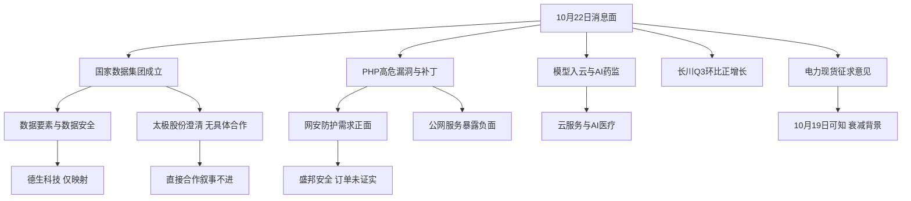

# 2026年10月22日 · 消息面事件驱动

> 数据源新鲜度：partial · 降级：true · 置信度：0.67 · 状态：partial。
> 新闻窗口为前72小时；公众号及群聊约前24小时；业绩表为2026Q3。公开资料可知时间优先，盘后发布顺延次交易日。

## 一句话结论
观察数据、网安与硬业绩；太极澄清和PHP暴露风险必须并列，消息映射不进执行。

## 市场、段位、地位与计划
- 市场在付钱的证据：本会话实时问财回查10月21日数据要素前5，利亚德涨20.04%、三维天地涨20%、慧辰股份涨20%。这些是板块效应证据，不证明上涨全由国家数据集团驱动。
- 段位：当日emotion_cycle采用10月21日口径，判为高位震荡；炸板率27.54%，未触发35%砍半阈值。
- 主线 = 未完成R2确认；持续性 = 未核验；封板率 = 未核验；明日预期 = 待R1/R2。拒绝为了填表虚构数值。
- 地位：未取得R2龙头认定；主模板未选定。不把涨幅前5自动认作龙头，不把概念成分代理当真实受益。
- 今天做：输出8条硬事实的极性事件与板块叉乘。今天不做：按消息直接开仓、猜资金、给虚构止损或交易目标。
- 8条极性事件对应7个根事件；PHP同一漏洞按正负影响拆成两条，不当作两个独立催化给同板块叠加分。

## 🗺️ 消息面全景图

## 🎯 八条硬事件详解
“硬”指事件事实可追溯，不等于高胜率、超预期或可以买。大资金意图均为待验证假设。行业风险无需强行绑定一只可买股票。

### E20261022_001 · 国家数据集团成立：数据资源开发利用主体落地
- 态度：观察；极性：正面；强度：high。
- 首次记录：2026-10-20 18:31；可知交易日：2026-10-21；衰减天数：1；原分：0.85；衰减分：0.731602。
- 独立原始/采编来源：2；官方例外：True；原文直读：False。
- **大资金意图**：若资金延续昨日数据方向 可能偏好可验证数据资产与服务收入。
- **为什么走强**：制度供给由政策预期转为经营主体 不代表上市公司立即取得订单。
- **逻辑够不够硬**：成立事实经人民邮电报与财经报道交叉；个股订单映射仍弱。
- 风险与反面：太极股份公告直接否定合作 不得把板块利好外推为个股合同。

#### 德生科技 002908.SZ · 事件映射，非交易首推
- **买入理由**：本次不进执行。可验证的业务关联为：hithink：人社运营及大数据服务收入占比43.0389%；不等于国家数据集团订单。
- **风险点**：主营相关不等于获得事件订单；板型未判、龙头地位未认定、盈亏比未算、禁止清单未完整核验。
- **止损条件**：没有获准买入及有效入场价，不填虚构止损价；若合作/收入映射被公告否定则消息假设失效，由R6/D1处理，不替其下hard_reject。
- **可验证假设**：后续需取得对应业务订单或公告，并由R2确认核心地位、R5给有效价格及RR≥2、止损距离≥5%、D1通过禁止清单；缺一项继续观察。
- 业绩交叉：当日500条Q3预告样本未命中；不等于没有中报或三季报公告。

太极股份负面仅计入E002一次；E001不重复记该股负面票数。
- 关键证据：
  - data/raw/20261022/news_cls.jsonl:2204。
  - data/raw/20261022/wechat_official_20.jsonl:1。
  - 人民邮电报 · 2026-10-21 · https://www.cnii.com.cn/rmydb/202610/t20261021_765418.html
  - 财经杂志 · 2026-10-21 · https://news.sohu.com/a/1090787167_115571

### E20261022_002 · 太极股份澄清：与国家数据集团尚无具体合作
- 态度：不进；极性：负面；强度：high。
- 首次记录：2026-10-21 19:08:31；可知交易日：2026-10-22；衰减天数：0；原分：-0.9；衰减分：-0.9。
- 独立原始/采编来源：2；官方例外：True；原文直读：True。
- **大资金意图**：若交易拥挤 资金可能转向订单证据更强的标的；没有实测资金证据。
- **为什么走强**：本事件不是走强理由 而是题材兑现链被公告切断。
- **逻辑够不够硬**：PDF原文200并提取全文确认；澄清对直接合作假设构成明确反证。
- 风险与反面：不进理由限定为国家数据集团直接合作叙事 不输出R6 hard_reject。
- 负面杀伤面：个股级；数据要素。

#### 太极股份 002368.SZ · 事件映射，非交易首推
- **买入理由**：本次不进执行。可验证的业务关联为：巨潮公告：数据业务约占H1收入2% 尚无具体合作。
- **风险点**：主营相关不等于获得事件订单；板型未判、龙头地位未认定、盈亏比未算、禁止清单未完整核验。
- **止损条件**：没有获准买入及有效入场价，不填虚构止损价；若合作/收入映射被公告否定则消息假设失效，由R6/D1处理，不替其下hard_reject。
- **可验证假设**：后续需取得对应业务订单或公告，并由R2确认核心地位、R5给有效价格及RR≥2、止损距离≥5%、D1通过禁止清单；缺一项继续观察。
- 业绩交叉：当日500条Q3预告样本未命中；不等于没有中报或三季报公告。
- 关键证据：
  - data/raw/20261022/news_cls.jsonl:761。
  - data/raw/20261022/anns_window.jsonl:1976。
  - 太极股份公告 · 2026-10-22 · https://static.cninfo.com.cn/finalpage/2026-10-22/1225614667.PDF
  - 每日经济新闻 · 2026-10-21 · http://finance.sina.com.cn/roll/2026-10-21/doc-inivzcqc5377310.shtml

### E20261022_003 · PHP高危漏洞：补丁与Web防护需求被触发
- 态度：观察；极性：正面；强度：high。
- 首次记录：2026-10-21 22:25:10；可知交易日：2026-10-22；衰减天数：0；原分：0.82；衰减分：0.82。
- 独立原始/采编来源：2；官方例外：False；原文直读：False。
- **大资金意图**：若市场交易应急安全需求 资金可能寻找有真实漏洞检测产品的低位前排。
- **为什么走强**：漏洞修复具有短时刚需 海外安全公司上涨仅为映射参考。
- **逻辑够不够硬**：财联社与华尔街见闻独立采编及腾讯云通告转述；公司订单未验证。
- 风险与反面：补丁已上线导致催化寿命缩短 不把所有网安公司视为受益。

#### 盛邦安全 688651.SH · 事件映射，非交易首推
- **买入理由**：本次不进执行。可验证的业务关联为：hithink核验网络安全产品与服务收入占比78.3199%；群聊点名但未核验新增订单。
- **风险点**：主营相关不等于获得事件订单；板型未判、龙头地位未认定、盈亏比未算、禁止清单未完整核验。
- **止损条件**：没有获准买入及有效入场价，不填虚构止损价；若合作/收入映射被公告否定则消息假设失效，由R6/D1处理，不替其下hard_reject。
- **可验证假设**：后续需取得对应业务订单或公告，并由R2确认核心地位、R5给有效价格及RR≥2、止损距离≥5%、D1通过禁止清单；缺一项继续观察。
- 业绩交叉：当日500条Q3预告样本未命中；不等于没有中报或三季报公告。
- 关键证据：
  - data/raw/20261022/news_cls.jsonl:314。
  - data/raw/20261022/news_cls.jsonl:381。
  - data/raw/20261022/wechat_cli_5groups.jsonl:329。
  - 财联社 · 2026-10-22 · https://www.163.com/dy/article/L9QDCL2V05198CJN.html
  - 华尔街见闻 · 2026-10-21 · https://news.futunn.com/post/1001831327/government-websites-in-multiple-european-countries-were-urgently-taken-offline

### E20261022_004 · PHP高危漏洞：多国网站下线与公网服务暴露风险
- 态度：不进；极性：负面；强度：high。
- 首次记录：2026-10-21 22:24:21；可知交易日：2026-10-22；衰减天数：0；原分：-0.78；衰减分：-0.78。
- 独立原始/采编来源：2；官方例外：False；原文直读：False。
- **大资金意图**：可能出现防护服务与暴露资产间的风险重估 不能先验认定国内受损公司。
- **为什么走强**：本事件为行业风险传导 不是上涨催化。
- **逻辑够不够硬**：多国下线及官方补丁事实；谷歌称云本身不存在漏洞 限定到受影响用户系统。
- 风险与反面：未确认任何A股公司受攻击 不做点名损失指控。
- 负面杀伤面：行业级；互联网服务、云服务。
- 关键证据：
  - data/raw/20261022/news_cls.jsonl:384。
  - data/raw/20261022/news_cls.jsonl:393。
  - data/raw/20261022/news_cls.jsonl:352。
  - 财联社 · 2026-10-22 · https://www.163.com/dy/article/L9QDCL2V05198CJN.html
  - 华尔街见闻 · 2026-10-21 · https://news.futunn.com/post/1001831327/government-websites-in-multiple-european-countries-were-urgently-taken-offline

### E20261022_005 · OpenAI前沿模型与Codex将在未来几周登陆谷歌云
- 态度：观察；极性：正面；强度：high。
- 首次记录：2026-10-21 20:02:11；可知交易日：2026-10-22；衰减天数：0；原分：0.7；衰减分：0.7。
- 独立原始/采编来源：2；官方例外：False；原文直读：False。
- **大资金意图**：若资金交易模型商业化 可能偏好有收入兑现的企业服务 不预设A股直接受益者。
- **为什么走强**：模型分发扩大可降低企业采购摩擦 并非国内服务商已有海外合同。
- **逻辑够不够硬**：财联社标题与IT之家新闻正文交叉；上线仍为未来几周。
- 风险与反面：PHP风险并存 同为云服务不能用利好一键覆盖安全风险。
- 关键证据：
  - data/raw/20261022/news_cls.jsonl:632。
  - data/raw/20261022/news_major.jsonl:159。
  - IT之家 · 2026-10-21 · http://news.10jqka.com.cn/19700122/c680946742.shtml

### E20261022_006 · 国家药监局推进人工智能赋能药品监管
- 态度：观察；极性：正面；强度：medium。
- 首次记录：2026-10-20 16:23；可知交易日：2026-10-21；衰减天数：1；原分：0.62；衰减分：0.533639。
- 独立原始/采编来源：1；官方例外：True；原文直读：False。
- **大资金意图**：若延续AI垂直应用定价 可能筛选有医疗医保主营收入的公司。
- **为什么走强**：政策支持给应用场景和审评服务路径 未给出采购金额。
- **逻辑够不够硬**：会议为官方表态 多次转载只算一原始主体 故strength上限medium。
- 风险与反面：久远银海控制权变动仅为拟议；不能把群聊国家数据集团核心说法当事实。

#### 久远银海 002777.SZ · 事件映射，非交易首推
- **买入理由**：本次不进执行。可验证的业务关联为：hithink医疗医保收入占比54.3525%；与药品监管并非等同 另有控股股东拟公开征集转让公告。
- **风险点**：主营相关不等于获得事件订单；板型未判、龙头地位未认定、盈亏比未算、禁止清单未完整核验。
- **止损条件**：没有获准买入及有效入场价，不填虚构止损价；若合作/收入映射被公告否定则消息假设失效，由R6/D1处理，不替其下hard_reject。
- **可验证假设**：后续需取得对应业务订单或公告，并由R2确认核心地位、R5给有效价格及RR≥2、止损距离≥5%、D1通过禁止清单；缺一项继续观察。
- 业绩交叉：当日500条Q3预告样本未命中；不等于没有中报或三季报公告。

#### 国新健康 000503.SZ · 事件映射，非交易首推
- **买入理由**：本次不进执行。可验证的业务关联为：hithink数字医保52.3828%及数字医药14.6936%；监管政策受益仍需订单验证。
- **风险点**：主营相关不等于获得事件订单；板型未判、龙头地位未认定、盈亏比未算、禁止清单未完整核验。
- **止损条件**：没有获准买入及有效入场价，不填虚构止损价；若合作/收入映射被公告否定则消息假设失效，由R6/D1处理，不替其下hard_reject。
- **可验证假设**：后续需取得对应业务订单或公告，并由R2确认核心地位、R5给有效价格及RR≥2、止损距离≥5%、D1通过禁止清单；缺一项继续观察。
- 业绩交叉：当日500条Q3预告样本未命中；不等于没有中报或三季报公告。
- 关键证据：
  - data/raw/20261022/news_cls.jsonl:2312。
  - data/raw/20261022/wechat_official_20.jsonl:1。
  - data/raw/20261022/anns_window.jsonl:1919。
  - 界面 · 2026-10-20 · https://it.sohu.com/a/1090223538_313745

### E20261022_007 · 长川科技三季报预告：单季利润环比仍增长
- 态度：观察；极性：正面；强度：medium。
- 首次记录：2026-10-21 20:56:41；可知交易日：2026-10-22；衰减天数：0；原分：0.76；衰减分：0.76。
- 独立原始/采编来源：1；官方例外：True；原文直读：True。
- **大资金意图**：若市场奖励真实订单与利润加速 可能偏好业绩兑现而非只靠叙事的设备公司。
- **为什么走强**：单季环比正增长 扣非增速更高 可排除仅累计同比和补助驱动两种误读。
- **逻辑够不够硬**：PDF全文和H1/Q1数据可重算；全数值源头是公司披露 不冒充多个盈利预测。
- 风险与反面：测试设备亦受半导体资本开支周期影响 产品价格及一致预期未验证 不代表超预期。
- 单季拆分：H1归母9.6367246069亿元；Q1归母3.5254031934亿元；Q2 = H1 − Q1 = 6.1113214135亿元。
- Q3 = 17.15—18.15 − 9.6367246069 = 7.5133—8.5133亿元；环比 = 22.94%—39.30%。
- 扣非累计16.67—17.67亿元、增111.39%—124.07%，高于归母同比98.17%—109.73%；非经损益0.48亿元，增长不是主要靠补助。
- 设备公司不直接按存储现货涨价判极性；仍受半导体CapEx周期影响。产品价格方向、一致预期和20日涨幅未核验，不能宣称超预期。
- 源冲突修正：快讯中“17.15万—18.15亿元”存在单位污染；PDF原文为171500—181500万元，采用17.15—18.15亿元。

#### 长川科技 300604.SZ · 事件映射，非交易首推
- **买入理由**：本次不进执行。可验证的业务关联为：公告、东财及hithink核验归母17.15-18.15亿元 扣非16.67-17.67亿元。
- **风险点**：主营相关不等于获得事件订单；板型未判、龙头地位未认定、盈亏比未算、禁止清单未完整核验。
- **止损条件**：没有获准买入及有效入场价，不填虚构止损价；若合作/收入映射被公告否定则消息假设失效，由R6/D1处理，不替其下hard_reject。
- **可验证假设**：后续需取得对应业务订单或公告，并由R2确认核心地位、R5给有效价格及RR≥2、止损距离≥5%、D1通过禁止清单；缺一项继续观察。
- 业绩交叉：命中2026Q3预告，见单季拆分。
- 关键证据：
  - data/raw/20261022/news_cls.jsonl:529。
  - data/raw/20261022/news_cls.jsonl:1589。
  - data/raw/20261022/anns_window.jsonl:1795。
  - 长川科技公告 · 2026-10-22 · https://static.cninfo.com.cn/finalpage/2026-10-22/1225614937.PDF
  - 证券时报 · 2026-10-21 · https://stock.hexun.com/2026-10-21/225152607.html

### E20261022_008 · 电力现货规则征求意见：新能源与配储拟联合报价
- 态度：观察；极性：正面；强度：medium。
- 首次记录：2026-10-19 12:03；可知交易日：2026-10-19；衰减天数：3；原分：0.6；衰减分：0.382577。
- 独立原始/采编来源：1；官方例外：True；原文直读：False。
- **大资金意图**：若资金交易新型经营主体入场 可能偏好有聚合调度和结算能力的业务。
- **为什么走强**：现货交易机制有助于调节资源定价 不是新增补贴或保底收益。
- **逻辑够不够硬**：官方征求意见事实由快讯和行业转述交叉；尚未获得正式生效文本。
- 风险与反面：距可知日3日 只作衰减背景 不能冒充10月22日新政或即时利润。
- 关键证据：
  - data/raw/20261022/news_cls.jsonl:2946。
  - data/raw/20261022/news_major.jsonl:5。
  - data/raw/20261022/news_major.jsonl:566。
  - 协鑫能科官微 · 2026-10-21 · http://news.10jqka.com.cn/19700122/c680941171.shtml

## 📊 板块 × 事件极性叉乘
完整矩阵为8事件 × 10板块 = 80单元。下表0表示无直接证据映射，不表示行业无风险。数值为消息衰减分，不是上涨概率或买入分。

| 板块 | E001 | E002 | E003 | E004 | E005 | E006 | E007 | E008 | 判定 |
|---|---:|---:|---:|---:|---:|---:|---:|---:|---|
| AI医疗 | 0 | 0 | 0 | 0 | 0 | +0.534 | 0 | 0 | 正面：观察 |
| AI应用 | 0 | 0 | 0 | 0 | +0.700 | +0.534 | 0 | 0 | 正面：观察 |
| 云服务 | 0 | 0 | 0 | -0.780 | +0.700 | 0 | 0 | 0 | 正负交织：降级 |
| 互联网服务 | 0 | 0 | 0 | -0.780 | 0 | 0 | 0 | 0 | 负面：不进 |
| 半导体测试设备 | 0 | 0 | 0 | 0 | 0 | 0 | +0.760 | 0 | 正面：观察 |
| 数据安全 | +0.732 | 0 | +0.820 | 0 | 0 | 0 | 0 | 0 | 正面：观察 |
| 数据要素 | +0.732 | -0.900 | 0 | 0 | 0 | 0 | 0 | 0 | 正负交织：降级 |
| 新型储能 | 0 | 0 | 0 | 0 | 0 | 0 | 0 | +0.383 | 正面：观察 |
| 网络安全 | 0 | 0 | +0.820 | 0 | 0 | 0 | 0 | 0 | 正面：观察 |
| 虚拟电厂 | 0 | 0 | 0 | 0 | 0 | 0 | 0 | +0.383 | 正面：观察 |

- 数据要素：成立事件正面，但太极股份公司级澄清并列；不能把公司风险外推为所有数据要素公司利空，也不能用政策抵消澄清。
- 云服务：模型分发扩大正面与PHP用户系统暴露负面并存；谷歌明确云本身没有漏洞，禁止写成云底座已被攻破。
- 网安与互联网服务：PHP是同一根事件的受益/暴露两面，分别映射；网络安全受益是假设，不等于已签订单。
- 储能/虚拟电厂：征求意见而非正式生效，3日衰减至原分约63.8%，只能作背景。

## 消息侧首板候选（仅观察）
未验证前一日是否已首板、连续板、位置或竞价。因此这些是命名命中的消息池，不是合格首板交易池。没有lead_stock代理，没有execution候选。

| 代码 | 名称 | 质量 | 独立点名源数 | 板型 | 龙头认定 | RR | 禁止清单 | 态度 |
|---|---|---|---:|---|---|---|---|---|
| 300604.SZ | 长川科技 | medium | 1 | 未判定 | 未认定 | 未核验 | 未核验≠无命中 | 观察 |
| 002777.SZ | 久远银海 | medium | 1 | 未判定 | 未认定 | 未核验 | 未核验≠无命中 | 观察 |
| 002908.SZ | 德生科技 | medium | 1 | 未判定 | 未认定 | 未核验 | 未核验≠无命中 | 观察 |
| 688651.SH | 盛邦安全 | medium | 1 | 未判定 | 未认定 | 未核验 | 未核验≠无命中 | 观察 |
| 000503.SZ | 国新健康 | medium | 1 | 未判定 | 未认定 | 未核验 | 未核验≠无命中 | 观察 |

## 🔥 中报业绩预告命中（本次输入实际为2026Q3）
本次读取全部500条，分开归母与扣非口径；最近7日归母预告有88条，按累计同比上限检查top20。禁止把同比大增自动判利好。数据不是全市场完整中报库。

| 代码 | 名称 | 公告日期 | 累计同比下限—上限 | 与8条事件的精确交集 | 态度 |
|---|---|---|---|---|---|
| 001309.SZ | 德明利 | 2026-10-17 | 32046.52%—33154.49% | 无直接交集 | 观察（单季未核验） |
| 000703.SZ | 恒逸石化 | 2026-10-16 | 3318.59%—3405.13% | 无直接交集 | 观察（单季未核验） |
| 002466.SZ | 天齐锂业 | 2026-10-21 | 2734.97%—3235.26% | 无直接交集 | 观察（单季未核验） |
| 688825.SH | 长鑫科技 | 2026-10-17 | 2581.06%—2609.47% | 无直接交集 | 观察（单季未核验） |
| 301308.SZ | 江波龙 | 2026-10-15 | 1864.55%—1990.84% | 无直接交集 | 观察（单季未核验） |
| 688388.SH | 嘉元科技 | 2026-10-15 | 1196.6%—1318.92% | 无直接交集 | 观察（单季未核验） |
| 603991.SH | 领先股份 | 2026-10-21 | 1238.57%—1238.57% | 无直接交集 | 观察（单季未核验） |
| 603026.SH | 石大胜华 | 2026-10-15 | 968.14%—1032.45% | 无直接交集 | 观察（单季未核验） |
| 000626.SZ | 远大控股 | 2026-10-15 | 890%—1018% | 无直接交集 | 观察（单季未核验） |
| 002493.SZ | 荣盛石化 | 2026-10-15 | 777.93%—822.95% | 无直接交集 | 观察（单季未核验） |
| 301292.SZ | 海科新源 | 2026-10-16 | 592%—601% | 无直接交集 | 观察（单季未核验） |
| 000973.SZ | 佛塑科技 | 2026-10-15 | 367.7%—445.65% | 无直接交集 | 观察（单季未核验） |
| 002167.SZ | 东方锆业 | 2026-10-15 | 261.93%—365.34% | 无直接交集 | 观察（单季未核验） |
| 601233.SH | 桐昆股份 | 2026-10-16 | 332.64%—358.47% | 无直接交集 | 观察（单季未核验） |
| 688257.SH | 新锐股份 | 2026-10-17 | 318%—355% | 无直接交集 | 观察（单季未核验） |
| 002653.SZ | 海思科 | 2026-10-21 | 297.02%—321.08% | 无直接交集 | 观察（单季未核验） |
| 688802.SH | 沐曦股份 | 2026-10-16 | 269.84%—307.58% | 无直接交集 | 观察（单季未核验） |
| 605358.SH | 立昂微 | 2026-10-20 | 261.31%—261.31% | 无直接交集 | 观察（单季未核验） |
| 002845.SZ | 同兴达 | 2026-10-15 | 217.02%—249.53% | 无直接交集 | 观察（单季未核验） |
| 688385.SH | 复旦微电 | 2026-10-16 | 187.63%—248.18% | 无直接交集 | 观察（单季未核验） |

- top20无直接的AI医疗软件、数据要素、网安、现货调度或测试设备事件交集；海思科为药品企业，不强行等同AI医保软件；芯片设计不强行等同测试设备。
- 另行命中长川科技：归母累计同比98.17%—109.73%、扣非111.39%—124.07%；单季拆分已完成。
- 德生科技、盛邦安全、久远银海、国新健康未在500条样本命中，不据此排除事件资格，也不追加硬业绩置信度。

## 关键证据与未决风险
- 太极公告已读取全文HTTP200：无具体合作，数据业务约占H1收入2%，会计差错鉴证延期至10月31日前。
- 长川公告已读取全文HTTP200；hithink补齐H1/Q1，算出Q3单季环比正增长。
- 久远银海另有控股股东及第二大股东拟公开征集转让公告（anns_window第1919条），不能把“拟”写成控制权已经变更。
- 特斯拉CapEx存在口径冲突：05:48快讯称由超过250亿美元下调至200亿美元；06:01新浪外盘头条仍写超过250亿美元。列入未决风险队列，不计8条已确认事件，不擅自取有利版本。
- OpenAI模型路由器新政策快讯尚未足够交叉核验，未塞入硬事件凑数。

## 数据源审计

| 源 | 日期 | 状态 | 记录数 | 备注 |
|---|---|:---:|---:|---|
| news_cls | 2026-10-22 | 🟢 | 2986 | 当日fetch输入 非本会话实时直采；新闻覆盖72h 群聊/RSS约24h |
| news_major | 2026-10-22 | 🟢 | 800 | 当日fetch输入 非本会话实时直采；新闻覆盖72h 群聊/RSS约24h |
| wechat_official_20 | 2026-10-22 | 🟢 | 87 | 当日fetch输入 非本会话实时直采；新闻覆盖72h 群聊/RSS约24h |
| wechat_cli_5groups | 2026-10-22 | 🟢 | 548 | 当日fetch输入 非本会话实时直采；新闻覆盖72h 群聊/RSS约24h |
| anns_window | 2026-10-22 | 🟢 | 2113 | 当日fetch输入 非本会话实时直采；新闻覆盖72h 群聊/RSS约24h |
| eastmoney_earnings_predict | 2026-10-22 | 🟢 | 500 | 2026Q3预告500条 非全市场全量；未命中不可断言无预告 |
| hithink_news_search | 2026-10-22 | 🟢 | 不计 | 本会话实时新闻交叉检索；不将同花顺与新浪转载机械算双独立源 |
| announcement_search | 2026-10-22 | 🟢 | 2 | 实时检索太极股份与长川科技公告 并读取2份巨潮PDF全文HTTP200 |
| hithink_business_query | 2026-10-22 | 🟢 | 4 | 实时核验4家公司主营；4为公司数 非业务表行数 |
| hithink_event_query | 2026-10-22 | 🟢 | 1 | 长川科技Q1/H1及前三季预告核验；最新价是盘前最近交易价 不视作今日成交 |
| hithink_market_query | 2026-10-22 | 🟢 | 5 | 20261021数据要素涨幅前5；只验证市场有板块效应 不反推R2龙头 |
| primary_cnii | 2026-10-22 | 🔴 | 0 | 直接页面TLS证书链验证失败；certifi重试仍失败 仅使用实时搜索索引原文 不标raw_url_verified |
| R3_sentiment | 未知 | 🔴 | 0 | 尚未落盘 无法完成独立KOL交叉验证 |

## 不确定性 / 反证
1. R1/R2/R5/R7尚无当日配套画像；所有票只作事件映射。R3未落盘，KOL独立确认不能完成。
2. 成立政策不等于订单；太极是最直接的题材映射反证，必须保留负面占位。
3. PHP安全需求可能因补丁快速发布而短命，且不能反推任何A股公司已经受攻击。
4. 业绩预告只证明盈利路径，市场一致预期、价格位置和产品价格未核验，不能宣称“符合即利好”。
5. 人读与机读均标partial。旧skill每事件强制首推及具体止损与宏观风险事件不相容；本次明确列契约例外，不为过字段检验伪造交易参数。

## 与其他 R/D/E 的关系
- 依赖：当日manifest/mcp_health、五路原始文本、500条Q3预告、emotion_cycle、实时hithink与巨潮原文。
- 消费：R2验证主线与模板；R5验证业务及RR；R6独立反证并保留唯一hard_reject权；D1决定试错资格。
- 本次不写交易计划，不输出R6 hard_reject，不操作持仓。

## Sub-Agent 元数据
- skill: analyze_news_impact_v1@1.6
- artifact: data/research/20261022/R4_news.json
- method: llm_v1（文本事实抽取与实时交叉验证；非规则代替语义分析）
- 生成时刻: 2026-10-22T06:17:25+08:00
- 产出状态: partial（消息8条及矩阵已完成；交易参数和R3交叉缺失）
- JSON采用本次显式Pydantic契约验证；不宣称仓库存在或已通过不存在的R4全量Pydantic模型。
