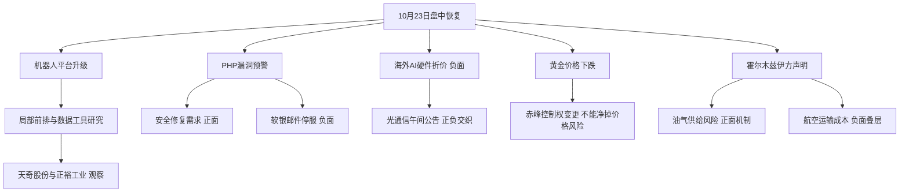

# 2026年10月23日 · 消息面事件驱动（intraday_recovery）

> 本次为用户明确授权的午间/盘中生产恢复。实际生成：2026-10-23T13:09:43+08:00。
> 分析状态 complete；数据质量 partial；总状态 partial；置信度 0.64。不能把“分析做完”解释为“数据完整”。
> 不是盘前重建；不得用于证明早晨预测正确。CHZL_RESEARCH_RUN_ID 环境未设置，记录为 null。
> 8条主事件 + 1条同母事件成本风险叠层；8×16＝128个主矩阵格。研究提名2只；首板消息观察1只；执行候选0只。

## 一句话结论
情绪=震荡/主跌；大金融白酒相对抗跌，机器人局部前排仅观察，算力公告与黄金并购不抵销负面。

## 先认市场：市场在奖励什么

午间实时新闻而非昨日模板显示：沪指半日跌1.2%，深成指跌1.6%，创业板指跌2.14%；东方财富午评报道643只上涨、4872只下跌、19只涨停、46只跌停。格隆汇与新浪午评同时描述大金融、白酒相对抗跌，算力硬件回调。财联社午评点名华阳智能、正裕工业、襄阳轴承2连板。含义是“系统性承压中的局部前排与相对防守”，不是科技板块已普遍修复。这些是11:30附近新闻口径，不是13点逐笔市场扫描；成交额的全市场/沪深口径不同，本文不混算。

主线 = 未确认可交易主线；研究方向 = 人形机器人、网络安全、光通信经营澄清、黄金并购、油气供给风险；持续性 = 未核验；封板率 = 未核验；下一交易日预期 = 分歧（研究假设）。没有以空缺指标编造1/3/5日确定性。

昨日炸板率41.07%来自 emotion_cycle.json、metrics_date=20261022，不是今日炸板率。候选观察覆盖5只：华阳智能流通市值低于20亿元被逐票拦截执行；其余4只研究备选按纪律减半，聚焦天奇股份与正裕工业。襄阳轴承、三六零保留覆盖观察，不清空研究。首板隔日仅是消息候选筛查主模板，已2板的票不冒称首板。

今天做：核实催化、保留正反面、给R2/R5真实研究对象。今天不做：为澄清公告抄底高位老龙、推断资金已净买、给缺证据的票造止损目标或买入资格。北向净买没有同口径核验值，记null；它只是可选参考，不用于关闭研究或激活全局R7_STALE。

## 🗺️ 消息面全景图

## 🎯 八条硬事件：事实、推演与证伪分开

“硬”指能定位的公告/报道动作，不表示八条都足够构成买入理由。新闻转载不增加独立源数；PHP漏洞与软银停服属于同一因果链的不同动作；霍尔木兹正负两面只计一个母事件。

### E20261023_001 · 海外AI硬件遭抛售与资本开支回报担忧

极性=负面；strength=high；态度=观察；可知日=2026-10-23；原始分=-0.92；衰减分=-0.92。

事件摘要：海外AI硬件普跌放大算力链风险偏好压力。观察时点为本次盘中；原始发布时间 2026-10-23 04:00:52。

- **大资金意图**：可验证的是海外硬件下跌；去杠杆与估值重估是解释假设，不能等同国内主力净流出。
- **为什么走强**：不是走强事件。资本开支能否产生现金回报受到质疑，海外可比估值下修对A股硬件形成压力。
- **逻辑够不够硬**：行情与多家媒体记录相互印证，风险传导成立；不能从跌幅反推出国内订单已被取消。
- 证伪条件：海外硬件止跌且国内核心重获承接只能缓释风险；恢复执行资格仍须R1/R2/R5/R6。

个股映射：不硬映射A股，宏观/运营风险以板块覆盖。均为研究观察，不是首推；板型、地位、RR及禁止清单未齐者不能执行。

证据锚：
- data/raw/20261023/news_cls.jsonl:51（来源日期2026-10-23；本次重新核对）
- data/raw/20261023/news_cls.jsonl:335（来源日期2026-10-22；本次重新核对）

### E20261023_002 · 英伟达扩展Isaac机器人开发平台

极性=正面；strength=high；态度=观察；可知日=2026-10-22；原始分=0.74；衰减分=0.636924。

事件摘要：Isaac平台扩展强化机器人训练仿真工具链催化。观察时点为本次盘中；原始发布时间 2026-10-21 18:28:00。

- **大资金意图**：潜在交易叙事是从高估值算力硬件向具身应用寻找增量，是否已发生资金切换未验证。
- **为什么走强**：新增参考平台与学习工具缩短研发流程；产业催化不等于A股次日有接力资金。
- **逻辑够不够硬**：平台更新有当日检索与不同媒体印证，但并未给出A股公司新增订单金额，不能当业绩兑现。
- 证伪条件：平台更新不等于A股订单；午间局部前排强势可支持研究，但全市场普跌未解除新仓逐票门禁。

个股映射：索辰科技、斯菱智驱、天奇股份、正裕工业、襄阳轴承、华阳智能。均为研究观察，不是首推；板型、地位、RR及禁止清单未齐者不能执行。

证据锚：
- data/raw/20261023/news_cls.jsonl:2353（来源日期2026-10-21；本次重新核对）
- data/raw/20261023/wechat_official_20.jsonl:1（来源日期2026-10-22；本次重新核对）
- 本次官方OpenAPI检索：扩展Isaac平台 英伟达加速卡位人形机器人生态位 · https://news.10jqka.com.cn/20261022/c680971250.shtml

### E20261023_003 · PHP高危漏洞触发紧急修复与安全防护需求

极性=正面；strength=high；态度=观察；可知日=2026-10-23；原始分=0.78；衰减分=0.78。

事件摘要：PHP漏洞推动应急排查需求但免费服务不等于新增收入。观察时点为本次盘中；原始发布时间 2026-10-22 17:09:57。

- **大资金意图**：潜在防守型科技交易寻找刚需安全支出，未取得实际资金流数据，不认定主力已经买入。
- **为什么走强**：高危漏洞影响网站运行，催化来自必须修复的真实需求而非泛AI概念。
- **逻辑够不够硬**：PHP官网已读取安全公告，国内预警与新闻吻合；商业合同及付费转化仍未证实。
- 证伪条件：补丁快速完成且未形成收费订单，则催化持续性缩短。负面业务中断另列X001。

个股映射：启明星辰、亚信安全、三六零。均为研究观察，不是首推；板型、地位、RR及禁止清单未齐者不能执行。

证据锚：
- data/raw/20261023/news_cls.jsonl:1228（来源日期2026-10-22；本次重新核对）
- data/raw/20261023/news_cls.jsonl:1401（来源日期2026-10-22；本次重新核对）
- 本次原文核验：https://www.php.net/archive/2026.php
- 本次官方OpenAPI检索：PHP差点被远程“开门”？OpenAI先发现，官方紧急补墙 · https://www.163.com/dy/article/L9SJ3JTQ051180F7.html

### E20261023_004 · 光通信公司午间集体公告经营正常与订单充足

极性=正面；strength=medium；态度=观察；可知日=2026-10-23；原始分=0.5；衰减分=0.5。

事件摘要：光通信公司午间披露经营正常但回购方案不等于已成交。观察时点为本次盘中；原始发布时间 2026-10-23 12:48:00。

- **大资金意图**：公司用订单与回购方案修复预期，不能推出二级市场主力已经回流。
- **为什么走强**：午间公告降低停产断单极端叙事的可信度；能否转强尚无13点后证据。
- **逻辑够不够硬**：财联社原文与公司调研PDF已核；新易盛8亿至10亿元是12个月内回购方案，不是已成交或当日净买。
- 证伪条件：午后若只有公告无承接则不成立右侧修复；与E001负面必须并看。

个股映射：天孚通信、中际旭创。均为研究观察，不是首推；板型、地位、RR及禁止清单未齐者不能执行。

证据锚：
- data/raw/20261023/anns_window.jsonl:801（来源日期20261022；本次重新核对）
- data/raw/20261023/news_cls.jsonl:806（来源日期2026-10-22；本次重新核对）
- 本次原文核验：https://www.cls.cn/detail/2513252

### E20261023_005 · 国际黄金白银价格显著下跌

极性=负面；strength=high；态度=观察；可知日=2026-10-23；原始分=-0.86；衰减分=-0.86。

事件摘要：黄金跌2.71%与白银跌5.87%压制贵金属价格敞口。观察时点为本次盘中；原始发布时间 2026-10-23 05:31:35。

- **大资金意图**：已知事实是金银同跌；流动性抛售只是可能解释，不把评论写成资金净流出结论。
- **为什么走强**：不是走强事件。黄金未对地缘升级作正向反应，不能机械套用避险上涨模板。
- **逻辑够不够硬**：数值与实时检索快讯一致，但多篇高度同文的行情转载按一个源簇处理，强度保守降为medium。
- 证伪条件：价格持续修复可缓释，但不以单次反抽判风险解除；E006并购不能净掉商品风险。

个股映射：赤峰黄金、紫金矿业。均为研究观察，不是首推；板型、地位、RR及禁止清单未齐者不能执行。

证据锚：
- data/raw/20261023/news_cls.jsonl:6（来源日期2026-10-23；本次重新核对）
- xtick/华尔街-资讯 · https://wallstreetcn.com/articles/3784279 · 2026-10-23

### E20261023_006 · 紫金黄金完成取得赤峰黄金控制权

极性=正面；strength=medium；态度=观察；可知日=2026-10-23；原始分=0.66；衰减分=0.66。

事件摘要：控制权交割完成带来整合预期但遭金价下跌反向约束。观察时点为本次盘中；原始发布时间 2026-10-22 18:26:44。

- **大资金意图**：潜在定价是从交易不确定性转向整合能力；交割完成并不代表机构即时加仓。
- **为什么走强**：确权降低交易失败风险，长期矿山运营协同需后续披露证明，不等于次日抢筹。
- **逻辑够不够硬**：公告PDF与上市公司公告快讯一致，25.85%为交割后权益口径；不是新签收购意向。
- 证伪条件：协同兑现慢于预期或金价继续下跌，正面公司事件不足以形成短线买入理由。

个股映射：赤峰黄金、紫金矿业。均为研究观察，不是首推；板型、地位、RR及禁止清单未齐者不能执行。

证据锚：
- data/raw/20261023/anns_window.jsonl:1489（来源日期20261023；本次重新核对）
- data/raw/20261023/news_cls.jsonl:1009（来源日期2026-10-22；本次重新核对）
- 本次原文核验：http://static.cninfo.com.cn/finalpage/2026-10-23/1225617077.PDF
- 本次官方OpenAPI检索：紫金矿业：紫金黄金完成赤峰黄金交割，持股25.85% · http://www.nbd.com.cn/articles/2026-10-22/4613010.html

### E20261023_007 · 霍尔木兹船只遇袭提升油气供给风险溢价

极性=正面；strength=medium；态度=观察；可知日=2026-10-23；原始分=0.67；衰减分=0.67。

事件摘要：船只遇袭强化油气供给风险溢价并非所有能源链都受益。观察时点为本次盘中；原始发布时间 2026-10-22 19:13:40。

- **大资金意图**：潜在资金诉求是寻找受供给扰动支持的相对强方向；没有R7验证，不认定防守主线成立。
- **为什么走强**：供给与运输扰动可能影响能源价格；炼化还受采购成本与成品价差影响，不作无差别利好。
- **逻辑够不够硬**：新华社与央视报道伊方声明相互印证。已发生的是声明与报道，具体损失及通航数量仍待独立核实。
- 证伪条件：外交缓和、有效供给恢复或油价未维持溢价，则相对强逻辑失效；负面拆为E008。

个股映射：不硬映射A股，宏观/运营风险以板块覆盖。均为研究观察，不是首推；板型、地位、RR及禁止清单未齐者不能执行。

证据锚：
- data/raw/20261023/news_cls.jsonl:850（来源日期2026-10-22；本次重新核对）
- data/raw/20261023/wechat_official_20.jsonl:7（来源日期2026-10-22；本次重新核对）
- 本次原文核验：http://stock.10jqka.com.cn/20261022/c680990428.shtml
- 本次官方OpenAPI检索：伊朗革命卫队：3艘船只试图非法通过霍尔木兹海峡时触雷起火，另有4艘船只非法运输石油时被击中并起火 · https://www.sohu.com/a/1091225374_122014422

### E20261023_009 · 软银应对PHP漏洞暂停紧急速报邮件服务

极性=负面；strength=medium；态度=观察；可知日=2026-10-23；原始分=-0.65；衰减分=-0.65。

事件摘要：软银暂停紧急速报邮件服务暴露PHP漏洞的运营中断成本。观察时点为本次盘中；原始发布时间 2026-10-23 12:07:30。

- **大资金意图**：这是运营连续性风险，不把停服推演为A股所有软件企业收入减少。
- **为什么走强**：不是走强事件；与安全修复需求的正面映射分开保留。
- **逻辑够不够硬**：新浪、格隆汇、东财均报道同一软银声明，仅一个母源，故medium；财联社快讯也有同事报道。
- 证伪条件：服务恢复且无新增受影响系统可缩短风险持续性；不据此取消安全修复需求。

个股映射：不硬映射A股，宏观/运营风险以板块覆盖。均为研究观察，不是首推；板型、地位、RR及禁止清单未齐者不能执行。

证据锚：
- xtick/东方财富-快讯 · https://finance.eastmoney.com/a/202610233905841537.html · 2026-10-23
- xtick/格隆汇-快讯 · https://www.gelonghui.com/live/2725937 · 2026-10-23

## 同母事件负面对冲（不充作第九条独立事实）

### E20261023_008 · 霍尔木兹事件增加航空与运输成本风险

与E007共享伊方袭船声明。油气上游可能受益，不等于炼化、航空、航运无差别受益。部分油轮运价可能上涨，但航次安全、保费与燃油成本可能同时恶化；船型、航线、套保和票价转嫁能力须分别验证。

- **大资金意图**：这是成本敞口风险推演，不写成机构已卖出航空股。
- **为什么走强**：不是走强事件；负面作用于航空运输、航运物流、化工成本敏感链。
- **逻辑够不够硬**：伊方声明已有新华社转述原文；实际通航数量未独立核验。12点特朗普称运输量创新高与风险叙事相冲突，两种说法并列，不以单方声明断言海峡完全关闭。
- 证伪：航路稳定恢复、油价与保费回落会削弱负面。本文不量化未经核验的A股利润下调。

## 📊 板块 × 事件极性叉乘

以下0表示未建立直接映射，不等于风险为零。正负不强制净额；尤其光模块/CPO与黄金不能让一条利好覆盖另一条利空。E008成本侧以矩阵外负面叠层保留。

| 事件 | 光模块 | CPO | 半导体 | 存储 | AI算力 | 人形机器人 | 工业软件 | 网络安全 | AI安全 | 黄金 | 白银 | 并购重组 | 油气开采 | 油服 | 线上公共服务 | 网络平台 |
|---|---:|---:|---:|---:|---:|---:|---:|---:|---:|---:|---:|---:|---:|---:|---:|---:|
| E20261023_001 | − | − | − | − | − | 0 | 0 | 0 | 0 | 0 | 0 | 0 | 0 | 0 | 0 | 0 |
| E20261023_002 | 0 | 0 | 0 | 0 | 0 | + | + | 0 | 0 | 0 | 0 | 0 | 0 | 0 | 0 | 0 |
| E20261023_003 | 0 | 0 | 0 | 0 | 0 | 0 | 0 | + | + | 0 | 0 | 0 | 0 | 0 | 0 | 0 |
| E20261023_004 | + | + | 0 | 0 | 0 | 0 | 0 | 0 | 0 | 0 | 0 | 0 | 0 | 0 | 0 | 0 |
| E20261023_005 | 0 | 0 | 0 | 0 | 0 | 0 | 0 | 0 | 0 | − | − | 0 | 0 | 0 | 0 | 0 |
| E20261023_006 | 0 | 0 | 0 | 0 | 0 | 0 | 0 | 0 | 0 | + | 0 | + | 0 | 0 | 0 | 0 |
| E20261023_007 | 0 | 0 | 0 | 0 | 0 | 0 | 0 | 0 | 0 | 0 | 0 | 0 | + | + | 0 | 0 |
| E20261023_009 | 0 | 0 | 0 | 0 | 0 | 0 | 0 | 0 | 0 | 0 | 0 | 0 | 0 | 0 | − | − |

关键交叉：光模块/CPO＝E001负面×E004公告澄清；黄金＝E005商品价格负面×E006控制权变更正面；网络安全修复需求正面×线上服务中断负面。油气开采正面×航空/运输成本负面需分产业链，不把全顺周期视作同一方向。

## 研究观察与交易候选分层

所有价格为官方OpenAPI is_cache=0实时请求返回的“最新价”，供应商只给20261023日期、未给逐笔时间；返回中的“收盘价”不是今日最终收盘价。本表取价观察时点见每票JSON。没有额外拉取技术走势，也没有把取价当可成交报价。

| 代码 | 名称 | 观察价 | 涨跌幅 | 流通市值亿元 | 板型/辨识度 | 态度与边界 |
|---|---|---:|---:|---:|---|---|
| 002009.SZ | 天奇股份 | 16.91 | 7.50% | 59.9005 | 未验证；仅知盘中上涨；龙头条款未逐项核验 | 观察；研究提名 |
| 603089.SH | 正裕工业 | 11.89 | 9.99% | 32.7830 | 午评报道2连板；龙头条款未逐项核验 | 观察；研究提名 |
| 000678.SZ | 襄阳轴承 | 13.23 | 9.98% | 60.8066 | 午评报道2连板；龙头条款未逐项核验 | 观察；不列本次聚焦提名 |
| 301502.SZ | 华阳智能 | 64.8 | 20.00% | 15.3387 | 午评报道2连板；龙头条款未逐项核验 | 拦截执行；风险覆盖 |
| 601360.SH | 三六零 | 8.11 | -1.58% | 567.6641 | 未验证；龙头条款未逐项核验 | 观察；不列本次聚焦提名 |

### 天奇股份 002009.SZ · 研究观察，不进执行

- **买入理由**：这里仅陈述待验证研究假设，不是买入许可。群内原文点名工业具身数据采集；官方OpenAPI返回物流自动化装备系统收入占比50.76%，支持工业场景关联，但会计期间缺失，不能写成机器人收入占比，更不是英伟达确定订单。行情回报相对强，能进入研究提名。
- **风险点**：群聊“8000小时/近2万小时”等不同数字并未查证同口径，不能合并成硬经营数据。是否真正首板、龙头地位及付费数据订单均未验证；涨幅不等于可持续利润。
- **止损条件**：交易止损价=null；目标价=null；原始RR=null。没有经独立验证的取价、止损与目标组合，执行不进。研究上若公司否认相关业务、证实只为规划或无商业化则降级。
- **可验证假设**：R5核对官方数据业务进展和收费订单，R2核对地位，D1独立给出取价/目标/止损及RR=(目标−取价)/(取价−止损)。不从当前涨幅倒推RR。

### 正裕工业 603089.SH · 局部前排研究观察，不进执行

- **买入理由**：午间财联社报道机器人局部前排2连板，群内也有具身采集材料映射，因此保留辨识度研究。它不是已确认首板，也不直接授予总龙身份；事件受益业务尚待公告核对。
- **风险点**：流通市值32.7830亿元落20—50亿元逐票风险区间，不作50亿元一刀切硬剔除。群内概念映射可能过度，高位接力/T+1承接风险仍在。
- **止损条件**：交易止损价、目标与原始RR均null，执行不进；板型与地位由下游独立复核，不以模拟授权放宽。研究逻辑若仅剩概念联想而无主营/订单证据则降级。
- **可验证假设**：R5验证主营与材料关联，R2确认连板地位和低位/中位属性；D1逐票门禁后才可能产生买点。不存在“研究入选＝开仓资格”。

其他覆盖对象：襄阳轴承有局部2板辨识度但缺本次公司级新增订单，仍保留观察；三六零确有PHP应急服务报道但免费体检不等于收入，实时请求返回跌1.58%，不以高危漏洞自动认定股价强；华阳智能流通市值15.3387亿元命中20亿元硬线，仅拦截这一票的执行，不扩展为全池否定。未核验的禁止项记“未知”，不伪报全部未命中。

首板消息观察仅天奇股份1只，source=direct_name_match、quality=medium。跨群同文按一个来源簇；首板状态未验证。正裕/襄阳已有2板报道，不放进首板候选冒数。首推票0只，execution_candidates为空。执行空池原因是逐票门禁缺证据，不是研究无对象，也不因一票RR未知得出其他票RR_FAIL。

## 🔥 中报业绩预告命中（实际数据为2026Q3，不冒称中报）

已完整读取500条指标记录，去重公司数见JSON；按归母/净利润指标对公司去重后排序，交叉核对top15。下列累计同比只是覆盖记录：缺单季拆分、扣非与一致预期，全部为中性背景，不升级正面硬alpha。没有用周期股夸张累计同比直接判断买入。

| 代码 | 名称 | 累计同比下限—上限 | 事件板块交集 | 本次结论 |
|---|---|---:|---|---|
| 001309.SZ | 德明利 | 32046.52%—33154.49% | 存储 | 中性；earnings_qoq_unverified |
| 300821.SZ | 东岳硅材 | 19047.97%—19748.08% | 未建立直接交集 | 中性；earnings_qoq_unverified |
| 000703.SZ | 恒逸石化 | 3318.59%—3405.13% | 油气开采(间接且成本方向不等同) | 中性；earnings_qoq_unverified |
| 002466.SZ | 天齐锂业 | 2734.97%—3235.26% | 未建立直接交集 | 中性；earnings_qoq_unverified |
| 688825.SH | 长鑫科技 | 2581.06%—2609.47% | 存储 | 中性；earnings_qoq_unverified |
| 002812.SZ | 恩捷股份 | 1884%—2474.8% | 未建立直接交集 | 中性；earnings_qoq_unverified |
| 688808.SH | 联讯仪器 | 1866%—2072.95% | 光模块、CPO | 中性；earnings_qoq_unverified |
| 301308.SZ | 江波龙 | 1864.55%—1990.84% | 存储 | 中性；earnings_qoq_unverified |
| 605189.SH | 富春染织 | 1347.69%—1519.01% | 未建立直接交集 | 中性；earnings_qoq_unverified |
| 603991.SH | 领先股份 | 1238.57%—1238.57% | 未建立直接交集 | 中性；earnings_qoq_unverified |
| 688388.SH | 嘉元科技 | 1196.6%—1318.92% | 未建立直接交集 | 中性；earnings_qoq_unverified |
| 603026.SH | 石大胜华 | 968.14%—1032.45% | 未建立直接交集 | 中性；earnings_qoq_unverified |
| 000626.SZ | 远大控股 | 890%—1018% | 未建立直接交集 | 中性；earnings_qoq_unverified |
| 002493.SZ | 荣盛石化 | 777.93%—822.95% | 油气开采(间接且成本方向不等同) | 中性；earnings_qoq_unverified |
| 301536.SZ | 星宸科技 | 663.13%—697.75% | AI算力 | 中性；earnings_qoq_unverified |

每只事件映射和研究对象均与这批预告交叉；匹配数量及区间写入各票earnings_cross_check。无匹配不等于公司未发布公告。top15之外没有因排名低而禁止研究。超过7日窗口的旧预告不作为今日新增催化；没有单季利润时不编造环比。

## 关键证据与时间血缘

- 晨批必读源已重新读取：manifest、公众号90条、匿名群聊436条、news_cls 2987条、news_major 800条、公告窗口2672条、东财预告500条、mcp_health。晨批文件保留各自06点观察时间；本次未改写raw。
- XTick实时新闻1140条与Tushare盘中快讯541条为本次直接请求；转载高度重叠，不能按1681条认定1681个独立事件。八条主事件证据及全文片段保存在R4_recovery_evidence.json。
- 12:48财联社公告汇总是午间新增事实：新易盛8亿—10亿元为回购方案、期限12个月，不是已经回购成交，更不是本系统成交。
- 公告原文更正口径：赤峰黄金PDF披露过户登记日期为10月21日、10月22日收到确认并完成H股发行；不把快讯所称“22日完成过户”替代精确法律登记时间。25.85%为紫金黄金及一致行动人交割后合计权益口径。
- PHP原文提取首次超时，已用直接HTTP取得官网安全公告标题；不把首次失败写成成功。霍尔木兹原文明确是伊方声明，损失与通航仍待独立核验。

## 数据源审计

群名匿名化。日期仅列日，不把晨批和实时请求混为同一观察点；精确时点、来源哈希及原始响应在JSON/证据文件中。

| 源 | 来源日期 | 状态 | 本次实际覆盖与限制 |
|---|---|:--:|---|
| manifest | 2026-10-23 | 🟡 | 晨批已读；不代表午间重新抓取，新闻用live MCP补足 |
| mcp_health | 2026-10-23 | 🟡 | 晨批已读；不代表午间重新抓取，新闻用live MCP补足 |
| eastmoney_earnings_predict | 2026-10-23 | 🟢 | 公告/预告为晨批覆盖；午间新公告另以财联社补充，不能宣称完整 |
| news_cls | 2026-10-23 | 🟡 | 晨批已读；不代表午间重新抓取，新闻用live MCP补足 |
| news_major | 2026-10-23 | 🟡 | 晨批已读；不代表午间重新抓取，新闻用live MCP补足 |
| wechat_official_20 | 2026-10-23 | 🟡 | 晨批已读；不代表午间重新抓取，新闻用live MCP补足 |
| wechat_cli_5groups | 2026-10-23 | 🟡 | 晨批已读；不代表午间重新抓取，新闻用live MCP补足 |
| anns_window | 2026-10-23 | 🟢 | 公告/预告为晨批覆盖；午间新公告另以财联社补充，不能宣称完整 |
| xtick_hot_news | 2026-10-23 | 🟢 | 240分钟实时MCP直采；含转载重复，不能按条数算独立源 |
| tushare_live_news | 2026-10-23 | 🟢 | 06:00至请求时点的盘中快讯；与xtick同源新浪不重复计确认 |
| hithink_news_search | 2026-10-23 | 🟢 | 4次实时检索，过滤过期/缺时点项 |
| hithink_market_query | 2026-10-23 | 🟢 | is_cache=0；5票返回仅日期，无逐笔时间，不能冒充最终收盘价 |
| hithink_business_query | 2026-10-23 | 🟢 | 天奇/三六零主营已返回，但会计期间字段缺失；不臆造机器人收入占比 |
| announcement_search | 2026-10-23 | 🟡 | HTTP200但以历史公告为主；不得视为当日冲突核验通过；已用指定PDF及午间财联社原文核实事件 |

## 不确定性 / 反证

1. 06点R1/R2/R3/R7已读取但不是本次fresh run；没有把它们旧complete或旧空池解释成本次完整上游，更没有预判R6硬否决。R3跨主题KOL验证记未核验，不虚填✅。
2. 公告搜索虽HTTP200，但检索结果以历史公告为主；指定PDF与午间报道可核事件，不能证明每只票当日无减持/澄清冲突。analysis_status=complete不消除该缺口。
3. 资金意图均是条件性解释；本单元没有直接判定主力、游资、ETF净买，更不把ETF成交额当流入。北向缺口不扩大为全局unavailable。
4. 光通信公司经营澄清与跨市场估值压力可以同时为真；赤峰控制权变更与金价下跌也同时为真，不能按正负事件数相抵后机械给买点。
5. 研究对象的止损、目标、RR和禁止清单未完整核验。当前SOUL已有执行约束继续保留；用户没有选择新的1、1.8、2统一阈值，本次不改规则。缺证据留观察，不造价格以满足旧首推字段。
6. 软银消息多媒体同转一则声明，强度medium；安全修复的正面传导不等于相关公司已获付费订单。霍尔木兹亦不把多转载变成战损独立验证。

## 与其他R/D/E的关系

R2接收真实研究方向与事件对象，即便预算为0也继续研究；R5逐票画像，不把禁新仓当跳过理由。R6只读本次可追溯上游，空hard_rejects不能称全票通过。D1独立决定交易资格，必须保持实盘关闭；模拟授权也不代表已有预算或已成交。本单元没有访问券商账户、私人持仓、QMT/IB、下单或外发推送。

## Sub-Agent元数据与验收边界

- skill：analyze_news_impact_v1@1.6；run_type=intraday_recovery。
- artifact：data/research/20261023/R4_news.json。
- evidence：data/research/20261023/R4_recovery_evidence.json。
- 八条主事件的有符号叉乘、计数、来源门槛、衰减、非未来时间和研究观察字段通过本次严格Pydantic校验；该校验不是旧版“每事件必须首推”契约全部满足，更不是交易资格验收。
- 旧技能要求每事件给首推和数值止损，与本次用户禁止造票/缺证据留观察冲突，按当前指令保留null与partial，明确记录contract_deviations。
- 原件备份由主控保存在用户指定production-recovery-before目录；本单元不越权向备份区或其他生产目录写入。
