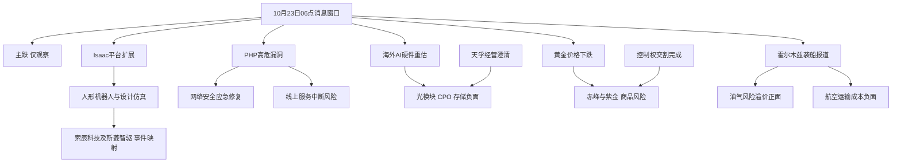

# 2026年10月23日 · 消息面事件驱动

> 数据源新鲜度：partial · 降级：true · 置信度：0.62 · 状态：partial
> 本文是06点早批，不是07:30全窗口终稿。新闻回看72小时；公告窗口为10月22日至23日的24小时；预告数据为2026Q3而非中报。

## 一句话结论
情绪=主跌；机器人与安全仅观察，算力澄清和黄金并购均不能抵销跨市场负面冲击。

## 先认市场：今天做什么、不做什么

- 上游 emotion_cycle 的昨日收盘口径：主跌，炸板率41.07%，跌停48家；不是今日尚未开盘的实时情绪。
- 市场在为什么付钱：消息端有机器人工具链、安全修复与油气供给风险三个方向；没有R1/R2/R7确认，不把叙事命名为已确认主线，不编造封板率或持续性。
- 谁有地位：本单元不做总龙或梯队认定。点名公司仅是事件映射，不是首推、龙头或执行候选。
- 今天做：核对八条核心事件，分别保留正负影响与证伪条件。今天不做：消息选股、左侧抄底、生成买卖价格和仓位。
- 候选纪律：炸板率≥35%本应候选减半；主跌更严，候选直接为0。first_board_candidates与execution_candidates均为空。

## 🗺️ 消息面全景图

图中公司名称仅代表已点名的事件映射。两条相反箭头不是正负相抵：外盘重估与公司澄清、金价与并购应并行消费。

## 🎯 八条核心硬事件：事实、机制与证伪

“硬事件”表示有可定位的事实证据，不表示八条全部为high，更不表示有八个交易机会。E007/E008是一个母事件的正反两条传导，八条方向对应七个母事件。个股推导不取代主营与资金验证。

### E20261023_001 · 海外AI硬件遭抛售与资本开支回报担忧

态度：观察 · 极性：负面 · 强度：high · 可知日：2026-10-23 · 时间衰减分：-0.92 → -0.92

事实摘要：海外AI硬件普跌放大算力链风险偏好压力。

可核对事实：新浪快讯记录费城半导体指数下跌6.7%，该快讯未明示收盘口径，本文不将其冒称官方收盘数据。海外AI资本开支回报担忧是媒体解释，不是国内订单证据。

- **大资金意图**：可验证的是海外硬件下跌；去杠杆与估值重估是解释假设，不能等同国内主力净流出。
- **为什么走强**：不是走强事件。资本开支能否产生现金回报受到质疑，海外可比估值下修对A股硬件形成压力。
- **逻辑够不够硬**：行情与多家媒体记录相互印证，风险传导成立；不能从跌幅反推出国内订单已被取消。

板块传导：光模块=负面（海外可比资产折价通过风险偏好传导而非证明国内订单取消）；CPO=负面（海外可比资产折价通过风险偏好传导而非证明国内订单取消）；半导体=负面（海外可比资产折价通过风险偏好传导而非证明国内订单取消）；存储=负面（海外可比资产折价通过风险偏好传导而非证明国内订单取消）；AI算力=负面（海外可比资产折价通过风险偏好传导而非证明国内订单取消）。

事件映射：无个股映射；不以常识代理拼凑首推。

证伪条件：海外硬件止跌且国内核心重获承接只能缓释风险；恢复执行资格仍须R1/R2/R5/R6。

关键证据：
- 新浪行情快讯 · 2026-10-23 · `data/raw/20261023/news_cls.jsonl:51`
- 新浪行情快讯 · 2026-10-22 · `data/raw/20261023/news_cls.jsonl:335`
- 证券时报原报道 · 2026-10-22 · `data/raw/20261023/wechat_official_20.jsonl:6`
- 实时检索：[费城半导体指数日内跌5%](https://finance.sina.cn/7x24/2026-10-22/detail-iniwchph8281441.d.html) · 2026-10-22
- 实时检索：[费城半导体指数跌幅扩大至5%](https://finance.stockstar.com/IG2026102200043330.shtml) · 2026-10-22

### E20261023_002 · 英伟达扩展Isaac机器人开发平台

态度：观察 · 极性：正面 · 强度：high · 可知日：2026-10-22 · 时间衰减分：0.74 → 0.636924

事实摘要：Isaac平台扩展强化机器人训练仿真工具链催化。

- **大资金意图**：潜在交易叙事是从高估值算力硬件向具身应用寻找增量，是否已发生资金切换未验证。
- **为什么走强**：新增参考平台与学习工具缩短研发流程；产业催化不等于A股次日有接力资金。
- **逻辑够不够硬**：平台更新有当日检索与不同媒体印证，但并未给出A股公司新增订单金额，不能当业绩兑现。

板块传导：人形机器人=正面（训练与仿真工具降低开发门槛）；工业软件=正面（设计仿真工具链需求映射）。

事件映射：索辰科技 688507.SH、斯菱智驱 301550.SZ。

观察票四段核验（不构成首推）：
- **买入理由**：本次不成立。只有事件相关性，今日核心/主线补涨/计划内试错均未获R2确认，因此不进执行。
- **风险点**：板型、龙头地位、RR与禁止清单未完整核验；R7未提供资金确认。
- **止损条件**：未建立交易方案，不编造数值止损或目标价。R5/D1若将来恢复资格，须给出具体价位及RR≥2；目前观察。
- **可验证假设**：若只有孤立高开而无板块效应，右侧确认假设失败；主跌阶段仍不出交易候选。

关键证据：
- 同花顺新闻 · 2026-10-21 · `data/raw/20261023/news_cls.jsonl:2353`
- 财联社主题前瞻 · 2026-10-22 · `data/raw/20261023/wechat_official_20.jsonl:1`
- 实时检索：[英伟达扩展Isaac机器人开发平台](http://www.nbd.com.cn/articles/2026-10-21/4611526.html) · 2026-10-21
- 实时检索：[扩展Isaac平台 英伟达加速卡位人形机器人生态位](https://news.10jqka.com.cn/20261022/c680971250.shtml) · 2026-10-22

### E20261023_003 · PHP高危漏洞触发紧急修复与安全防护需求

态度：观察 · 极性：正面 · 强度：high · 可知日：2026-10-23 · 时间衰减分：0.78 → 0.78

事实摘要：PHP漏洞推动应急排查需求但免费服务不等于新增收入。

- **大资金意图**：潜在防守型科技交易寻找刚需安全支出，未取得实际资金流数据，不认定主力已经买入。
- **为什么走强**：高危漏洞影响网站运行，催化来自必须修复的真实需求而非泛AI概念。
- **逻辑够不够硬**：PHP官网已读取安全公告，国内预警与新闻吻合；商业合同及付费转化仍未证实。

板块传导：网络安全=正面（漏洞排查与应急响应需求增加）；AI安全=正面（自动发现漏洞与机器速度攻防需求）。

事件映射：启明星辰 002439.SZ、亚信安全 688225.SH、三六零 601360.SH。

观察票四段核验（不构成首推）：
- **买入理由**：本次不成立。只有事件相关性，今日核心/主线补涨/计划内试错均未获R2确认，因此不进执行。
- **风险点**：板型、龙头地位、RR与禁止清单未完整核验；R7未提供资金确认。
- **止损条件**：未建立交易方案，不编造数值止损或目标价。R5/D1若将来恢复资格，须给出具体价位及RR≥2；目前观察。
- **可验证假设**：补丁快速完成且未形成收费订单，则催化持续性缩短。负面业务中断另列X001。

关键证据：
- 国家网络安全通报中心 · 2026-10-22 · `data/raw/20261023/news_cls.jsonl:1228`
- CNVD · 2026-10-22 · `data/raw/20261023/news_cls.jsonl:1401`
- 新浪科技 · 2026-10-22 · `data/raw/20261023/news_cls.jsonl:993`
- 实时检索：[腾讯云、谷歌紧急预警，PHP高危漏洞波及全球互联网](https://k.sina.com.cn/article_1887344341_707e96d502001wz3y.html) · 2026-10-22
- 实时检索：[PHP存在两个远程代码执行超危漏洞，工信部NVDB发风险提示](http://news.10jqka.com.cn/19700122/c680971067.shtml) · 2026-10-22

### E20261023_004 · 天孚通信披露CPO提产节奏未变与物料改善

态度：观察 · 极性：正面 · 强度：high · 可知日：2026-10-23 · 时间衰减分：0.5 → 0.5

事实摘要：CPO经营澄清缓释订单担忧但不抵销海外重估压力。

- **大资金意图**：消息试图修复经营预期与市场价格的裂口，不能推导资金已经回流。
- **为什么走强**：只解释潜在修复理由，不断言走强。提产未变与物料改善压低基本面极端恶化概率。
- **逻辑够不够硬**：公告正文明确FAU及ELS基础与NPO样品阶段，也明确难以预判利润率；不是上修利润指引。

板块传导：光模块=正面（经营与交付正常提供事实澄清）；CPO=正面（FAU及ELS配套与提产节奏未明显变化）。

事件映射：天孚通信 300394.SZ、中际旭创 300308.SZ。

观察票四段核验（不构成首推）：
- **买入理由**：本次不成立。只有事件相关性，今日核心/主线补涨/计划内试错均未获R2确认，因此不进执行。
- **风险点**：板型、龙头地位、RR与禁止清单未完整核验；R7未提供资金确认。
- **止损条件**：未建立交易方案，不编造数值止损或目标价。R5/D1若将来恢复资格，须给出具体价位及RR≥2；目前观察。
- **可验证假设**：只有澄清没有持续交付与订单验证，不成立趋势反转。必须同时消费E001负面。

关键证据：
- 天孚通信公告 · 20261022 · `data/raw/20261023/anns_window.jsonl:801`
- 中际旭创互动平台 · 2026-10-22 · `data/raw/20261023/news_cls.jsonl:806`
- 证券时报 · 2026-10-22 · `data/raw/20261023/wechat_official_20.jsonl:8`
- 实时检索：[光模块龙头中际旭创跌超8%！公司称供应链稳定，产能利用率充足](https://m.sohu.com/a/1091329769_260616) · 2026-10-22
- 实时检索：[生产经营正常有序！“易中天”、东山精密，最新发声！](http://news.10jqka.com.cn/19700122/c680996759.shtml) · 2026-10-22

### E20261023_005 · 国际黄金白银价格显著下跌

态度：观察 · 极性：负面 · 强度：medium · 可知日：2026-10-23 · 时间衰减分：-0.86 → -0.86

事实摘要：黄金跌2.71%与白银跌5.87%压制贵金属价格敞口。

纽约尾盘现货黄金4028.58美元/盎司，跌2.71%；白银54.5746美元/盎司，跌5.87%。相同数字被多处转载，按一个行情源簇，不虚增独立源数。

- **大资金意图**：已知事实是金银同跌；流动性抛售只是可能解释，不把评论写成资金净流出结论。
- **为什么走强**：不是走强事件。黄金未对地缘升级作正向反应，不能机械套用避险上涨模板。
- **逻辑够不够硬**：数值与实时检索快讯一致，但多篇高度同文的行情转载按一个源簇处理，强度保守降为medium。

板块传导：黄金=负面（金价下跌压制矿企收入与风险偏好）；白银=负面（银价跌幅更大形成价格压力）。

事件映射：赤峰黄金 600988.SH、紫金矿业 601899.SH。

观察票四段核验（不构成首推）：
- **买入理由**：本次不成立。只有事件相关性，今日核心/主线补涨/计划内试错均未获R2确认，因此不进执行。
- **风险点**：板型、龙头地位、RR与禁止清单未完整核验；R7未提供资金确认。
- **止损条件**：未建立交易方案，不编造数值止损或目标价。R5/D1若将来恢复资格，须给出具体价位及RR≥2；目前观察。
- **可验证假设**：价格持续修复可缓释，但不以单次反抽判风险解除；E006并购不能净掉商品风险。

关键证据：
- 华尔街见闻经新浪转载 · 2026-10-23 · `data/raw/20261023/news_cls.jsonl:6`
- 实时检索：[国际金价跌2.7%](http://goodsfu.10jqka.com.cn/20261023/c680997935.shtml) · 2026-10-23
- 实时检索：[国际金价跌2.7%，逼近4000美元整数位心理关口](https://finance.sina.cn/7x24/2026-10-23/detail-iniwecsw8013978.d.html) · 2026-10-23

### E20261023_006 · 紫金黄金完成取得赤峰黄金控制权

态度：观察 · 极性：正面 · 强度：high · 可知日：2026-10-23 · 时间衰减分：0.66 → 0.66

事实摘要：控制权交割完成带来整合预期但遭金价下跌反向约束。

上市公司披露协议受让A股及定向增发H股交割完成，紫金体系合计持股25.85%。交割进展是新节点，不把3月已启动的交易包装成新签意向。

- **大资金意图**：潜在定价是从交易不确定性转向整合能力；交割完成并不代表机构即时加仓。
- **为什么走强**：确权降低交易失败风险，长期矿山运营协同需后续披露证明，不等于次日抢筹。
- **逻辑够不够硬**：公告PDF与上市公司公告快讯一致，25.85%为交割后权益口径；不是新签收购意向。

板块传导：黄金=正面（公司层面控制权交割与资源整合）；并购重组=正面（协议转让与H股配售完成交割）。

事件映射：赤峰黄金 600988.SH、紫金矿业 601899.SH。

观察票四段核验（不构成首推）：
- **买入理由**：本次不成立。只有事件相关性，今日核心/主线补涨/计划内试错均未获R2确认，因此不进执行。
- **风险点**：板型、龙头地位、RR与禁止清单未完整核验；R7未提供资金确认。
- **止损条件**：未建立交易方案，不编造数值止损或目标价。R5/D1若将来恢复资格，须给出具体价位及RR≥2；目前观察。
- **可验证假设**：协同兑现慢于预期或金价继续下跌，正面公司事件不足以形成短线买入理由。

关键证据：
- 赤峰黄金公告 · 20261023 · `data/raw/20261023/anns_window.jsonl:1489`
- 紫金矿业公告 · 2026-10-22 · `data/raw/20261023/news_cls.jsonl:1009`
- 证券时报 · 2026-10-22 · `data/raw/20261023/wechat_official_20.jsonl:10`
- 实时检索：[紫金矿业完成入主赤峰黄金，持股25.85%成控股股东](http://news.10jqka.com.cn/19700122/c680995580.shtml) · 2026-10-22
- 实时检索：[紫金矿业：公司取得赤峰黄金控制权](http://news.10jqka.com.cn/19700122/c680989353.shtml) · 2026-10-22

### E20261023_007 · 霍尔木兹船只遇袭提升油气供给风险溢价

态度：观察 · 极性：正面 · 强度：high · 可知日：2026-10-23 · 时间衰减分：0.67 → 0.67

事实摘要：船只遇袭强化油气供给风险溢价并非所有能源链都受益。

- **大资金意图**：潜在资金诉求是寻找受供给扰动支持的相对强方向；没有R7验证，不认定防守主线成立。
- **为什么走强**：供给与运输扰动可能影响能源价格；炼化还受采购成本与成品价差影响，不作无差别利好。
- **逻辑够不够硬**：新华社与央视报道伊方声明相互印证。已发生的是声明与报道，具体损失及通航数量仍待独立核实。

板块传导：油气开采=正面（航运受阻可能抬升油气供给风险溢价）；油服=正面（高油价若持续可能改善资本开支预期）。

事件映射：无个股映射；不以常识代理拼凑首推。

证伪条件：外交缓和、有效供给恢复或油价未维持溢价，则相对强逻辑失效；负面拆为E008。

关键证据：
- 新华社 · 2026-10-22 · `data/raw/20261023/news_cls.jsonl:850`
- 央视及新华社 · 2026-10-22 · `data/raw/20261023/wechat_official_20.jsonl:7`
- 实时检索：[伊朗说7艘“违规”船只在波斯湾起火](http://finance.sina.com.cn/roll/2026-10-22/doc-iniwarrm5162648.shtml) · 2026-10-22
- 实时检索：[伊朗称7艘“违规”船只在霍尔木兹海峡周边海域起火](http://news.10jqka.com.cn/19700122/c680990428.shtml) · 2026-10-22

### E20261023_008 · 霍尔木兹事件增加航空与运输成本风险

态度：观察 · 极性：负面 · 强度：high · 可知日：2026-10-23 · 时间衰减分：-0.76 → -0.76

事实摘要：同一地缘事件对航空运输与成本敏感化工形成反向冲击。

- **大资金意图**：风险管理对象是燃油与运输成本敏感敞口，不将油气受益扩大为整个顺周期利好。
- **为什么走强**：不是走强事件。航运风险可能推升部分油轮运价却同时损害航次安全与保险成本，必须分船型。
- **逻辑够不够硬**：袭船报道有官方新闻核对；A股航空利润影响为机制推演，不能伪造量化盈利下调。

板块传导：航空运输=负面（燃油与空域扰动提高成本）；航运物流=负面（通航安全与保险成本风险；不等同所有船型运价下跌）；化工成本敏感链=负面（原料成本传导不畅可能压缩利润）。

事件映射：无个股映射；不以常识代理拼凑首推。

证伪条件：若航路恢复与油价回落则风险缓释。与E007共享母事件不重复计独立源及事实数量。

关键证据：
- 新华社 · 2026-10-22 · `data/raw/20261023/news_cls.jsonl:850`
- 美国航空披露 · 2026-10-22 · `data/raw/20261023/news_cls.jsonl:855`
- 央视及新华社 · 2026-10-22 · `data/raw/20261023/wechat_official_20.jsonl:7`
- 实时检索：[伊朗说7艘“违规”船只在波斯湾起火](http://finance.sina.com.cn/roll/2026-10-22/doc-iniwarrm5162648.shtml) · 2026-10-22
- 实时检索：[伊朗称7艘“违规”船只在霍尔木兹海峡周边海域起火](http://news.10jqka.com.cn/19700122/c680990428.shtml) · 2026-10-22

## 📊 板块 × 事件极性叉乘

下表“+/-/·”分别为正面机制、负面机制、无直接映射，不代表胜率或收益率。完整17板块×8事件的136单元矩阵写入JSON的sector_polarity_cross_product。

| 板块 | E001 | E002 | E003 | E004 | E005 | E006 | E007 | E008 | 消息结论 |
|---|---|---|---|---|---|---|---|---|---|
| 光模块 | - | · | · | + | · | · | · | · | 正负交织：观察 |
| CPO | - | · | · | + | · | · | · | · | 正负交织：观察 |
| 半导体 | - | · | · | · | · | · | · | · | 负面：观察 |
| 存储 | - | · | · | · | · | · | · | · | 负面：观察 |
| AI算力 | - | · | · | · | · | · | · | · | 负面：观察 |
| 人形机器人 | · | + | · | · | · | · | · | · | 正面：观察 |
| 工业软件 | · | + | · | · | · | · | · | · | 正面：观察 |
| 网络安全 | · | · | + | · | · | · | · | · | 正面：观察 |
| AI安全 | · | · | + | · | · | · | · | · | 正面：观察 |
| 黄金 | · | · | · | · | - | + | · | · | 正负交织：观察 |
| 白银 | · | · | · | · | - | · | · | · | 负面：观察 |
| 并购重组 | · | · | · | · | · | + | · | · | 正面：观察 |
| 油气开采 | · | · | · | · | · | · | + | · | 正面：观察 |
| 油服 | · | · | · | · | · | · | + | · | 正面：观察 |
| 航空运输 | · | · | · | · | · | · | · | - | 负面：观察 |
| 航运物流 | · | · | · | · | · | · | · | - | 负面：观察 |
| 化工成本敏感链 | · | · | · | · | · | · | · | - | 负面：观察 |

三组不能做简单净额抵消的冲突：

1. 光模块/CPO：E004是生产与提产事实澄清；E001是海外风险偏好重估。两者可以同时为真，经营正常不是次日承接保证。
2. 黄金：E006公司控制权确权；E005商品价格显著下跌。长周期资源整合并不能保证短周期矿企估值不受压。
3. 油气与航空：E007/E008共享同一地缘事件。上游可能受益不代表整个能源链、炼化、航运都受益；运输与保险成本必须单独保留。

## 🔥 中报业绩预告命中（本期实际为2026Q3）

已读取500条指标记录。500不等于500家公司：同一公司存在归母、扣非、营收和每股收益多条。以下限定归母净利润/净利润可比口径，按增速下限排序取15家，不将扣非同比或营业收入同比混入。

本批事件映射公司在这500条预告记录中均未命中，不能据此声称它们未发布预告。本期无硬业绩加分、无earnings正面事件。下表即使同比很高，未取得前季累计、单季利润、产品价格和一致预期，也只能中性；earnings_qoq_unverified。

| 代码 | 名称 | 前三季归母/净利累计同比 | 消息板块交集 | 七日事件窗 | 终判 |
|---|---|---|---|---|---|
| 001309.SZ | 德明利 | 32046.52%~33154.49% | 存储 | 窗内 | 中性·环比未验证 |
| 300821.SZ | 东岳硅材 | 19047.97%~19748.08% | 无明确交集 | 窗外背景 | 中性·环比未验证 |
| 000703.SZ | 恒逸石化 | 3318.59%~3405.13% | 油气开采(间接且成本方向不等同) | 窗内 | 中性·环比未验证 |
| 002466.SZ | 天齐锂业 | 2734.97%~3235.26% | 无明确交集 | 窗内 | 中性·环比未验证 |
| 688825.SH | 长鑫科技 | 2581.06%~2609.47% | 存储 | 窗内 | 中性·环比未验证 |
| 002812.SZ | 恩捷股份 | 1884%~2474.8% | 无明确交集 | 窗外背景 | 中性·环比未验证 |
| 688808.SH | 联讯仪器 | 1866%~2072.95% | 光模块、CPO | 窗外背景 | 中性·环比未验证 |
| 301308.SZ | 江波龙 | 1864.55%~1990.84% | 存储 | 窗外背景 | 中性·环比未验证 |
| 605189.SH | 富春染织 | 1347.69%~1519.01% | 无明确交集 | 窗外背景 | 中性·环比未验证 |
| 603991.SH | 领先股份 | 1238.57%~1238.57% | 无明确交集 | 窗内 | 中性·环比未验证 |
| 688388.SH | 嘉元科技 | 1196.6%~1318.92% | 无明确交集 | 窗外背景 | 中性·环比未验证 |
| 603026.SH | 石大胜华 | 968.14%~1032.45% | 无明确交集 | 窗外背景 | 中性·环比未验证 |
| 000626.SZ | 远大控股 | 890%~1018% | 无明确交集 | 窗外背景 | 中性·环比未验证 |
| 002493.SZ | 荣盛石化 | 777.93%~822.95% | 油气开采(间接且成本方向不等同) | 窗外背景 | 中性·环比未验证 |
| 301536.SZ | 星宸科技 | 663.13%~697.75% | AI算力 | 窗外背景 | 中性·环比未验证 |

特别拦截误读：江波龙等存储周期票不能凭累计同比大增判利好。本次未取得足够数据倒推单季，未编造环比数字，也不将超过七日的旧预告重新包装成今日催化。时间窗按公告次交易日保守口径；因预告源只有日期没有发布分钟，不能称精确可知时点。

## 补充负面与非核心消息

- X20261023_001：PHP漏洞对线上公共服务与网络平台的业务中断为独立负面事件。新华社及IT之家报道日本机构预防性暂停服务；未证实A股客户遭入侵，不扩大为国内全行业停摆。已拆入additional_events，不被E003安全需求利好覆盖。
- X20261023_002：*ST卓然强制退市风险提示属于公司层面的“不进”风险映射，证据见anns_window第1267/1268行；不是R6 hard_reject。债券到期兑付或转债摘牌不能误判上市公司股票退市。
- 科技创新与产业创新融合政策、国家数据集团、主动ETF自购等已扫描，不为凑八条而将旧政策重复升级为首推理由。国家数据集团概念需逐票合作公告核实，不能靠“数据”名称映射订单。

## 去重、衰减与可知日

- 跨源同实体同小时转载合并。相同新华社/公告原文经新浪、同花顺与公众号再发，不能按入口数量计算独立源。
- 重复同方向事件评分取绝对值最强的原符号，不累加；负面不能用max变成更弱的负分。
- weighted_score=raw_score×exp(-0.15×days_since)。按可知日计龄，10月21日盘后的Isaac消息可知日为22日，今天衰减一天；晚间报道与当日凌晨消息可知日为23日。不会用转载时间重置事件年龄。
- E007/E008两条方向不能被语义去重折叠成单个“利好”；母事件只计一次。公众号和群聊视为同一二次传播类，未从群聊再造独立源数。

## 数据源审计

| 源 | 日期 | 状态 | 记录与边界 |
|---|---|:--:|---|
| wechat_official_20 | 2026-10-23 | 🟢 | 90 · 当日fetch产物；不是本会话MCP直采 |
| wechat_cli_5groups | 2026-10-23 | 🟢 | 436 · 当日fetch产物；不是本会话MCP直采 |
| news_cls | 2026-10-23 | 🟢 | 2987 · 当日fetch产物；不是本会话MCP直采 |
| news_major | 2026-10-23 | 🟢 | 800 · 当日fetch产物；不是本会话MCP直采 |
| anns_window | 2026-10-23 | 🟢 | 2672 · 当日fetch产物；不是本会话MCP直采 |
| eastmoney_earnings_predict | 2026-10-23 | 🟢 | 500 · 500条是财务指标记录；归母净利/净利润去重公司196家；并非500只票；2026Q3非中报 |
| hithink_news_search | 2026-10-23 | 🟢 | 59 · 本会话两批12个有效关键词查询，另一次宽泛Isaac查询被丢弃；当日及相关内容筛选结果，过期与百科命中不得用于验证 |
| primary_documents | 2026-10-23 | 🟢 | 3 · 已读取PHP安全归档、天孚活动记录、赤峰控制权变更PDF；每经页面正文抽取不完整不计原文核实 |
| hithink_business_query | 2026-10-23 | 🔴 | 0 · 主跌期禁止选股；无交易首推，不推算主营重叠率 |
| beneficiary_pool | 2026-10-23 | 🔴 | 0 · 受益股池及冲突公告专项核验未完成；现有个股仅原文点名映射 |
| MCP_cross_verification | 2026-10-23 | 🔴 | 0 · 当前profile主控禁止直接MCP；delegation工具检索无匹配，未调用，不标源故障 |
| R3_sentiment | 2026-10-23 | 🔴 | 0 · 运行时无文件；公众号群聊不当独立验证 |
| R7_capital_flow | 2026-10-23 | 🔴 | 0 · 运行时无文件；不伪造资金验证 |
| hithink_symbol_lookup | 2026-10-23 | 🟢 | 5 · 只核对原文点名代码，不作选股；附带最新价为盘前上一时段报价，未用于制定买点 |

当日raw目录是06点fetch落盘，已明确与本会话实时检索区分；不是历史缓存回放。MCP健康文件标global_severity=2，但未调用的MCP路径不能写成网络失败。没有delegation能力可用，故没有满足skill指定的全部直采交叉链，status=partial与degraded=true保留，不能视为完整生产验收通过。

## 不确定性 / 反证

1. 主跌与41.07%炸板率使用昨日收盘状态；今日尚未竞价，不能宣布风格已切换，更不能从消息强度推导资金正在交易什么。
2. 8条核心方向仅7个母事件，不能将油气和航空两个相反传导冒称两个独立事实。
3. 黄金行情多处同文转载按一个源簇，medium；其负面影响仍保留，不因为并购事件更硬而删掉。
4. 受益股池、主营重叠、逐票冲突公告、机构研报与R7验证不完整。严格skill里每事件首推与数值止损没有执行，因为主跌只观察与禁止编造优先；不允许D1直接转执行池。
5. 群聊图片仅识别为占位，未做OCR，不声称覆盖图片内容；当日07点盘前纪要尚未发布，后续新增公告也未包含。本产物不是全天终稿。

## 与其他 R/D/E 的关系

- 依赖：当日manifest、mcp_health、五类消息与公告窗口、2026Q3预告、emotion_cycle；实时官方OpenAPI新闻检索与代码核对、PHP官网和公司PDF。
- R2：消费叙事与板块正负叉乘；R5：补全主营与单季环比、板型、价格和RR；R6：完整消费所有负面，保留唯一hard_reject权；D1：本次只观察，不把映射股当候选。
- R3：文件缺失，kol_confirm保持未核对，不能把本地群聊的同源转述当R3独立确认。

## Sub-Agent 元数据

- skill：analyze_news_impact_v1@1.6
- artifact：data/research/20261023/R4_news.json
- method：llm_v1_live_news_crosscheck
- status：partial；非规则版聚类替代，非完整MCP生产验收
- 生成时刻：2026-10-23T06:18:09+08:00
