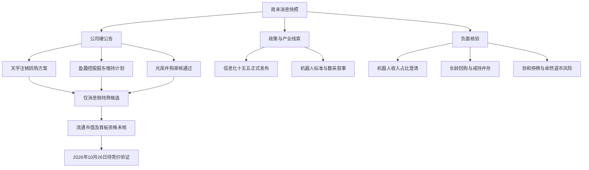

# 2026年10月24日 · 周末轻量消息面

> **只做消息核验，不提供非交易日买卖建议、买卖点、仓位或价格目标。**
> 本文是周六消息快照，不是周一行情预测。所有事件及消息侧首板待验证候选统一标记：**待周一竞价验证（2026-10-26）**；停牌标的只核状态，不存在可用竞价。
> 新鲜度 `partial` · 研究置信度 `0.175`：按共享公式保守计算，表示覆盖与独立验证完整度，不是上涨概率。公告事实核验与投资结论严格分开。

## 🧭 一句话结论

**新增硬消息以回购、增持、并购进展为主；机器人澄清、重组障碍及退市风险必须并列。**

## 🕰️ 覆盖窗口与新旧消息

- `manifest.lookback_hours=36`，群聊起点为 **10月23日06:01**，不是周五15:00之后才开始。公告按10月23—24日自然日返回，没有发布时间，不能逐分钟切窗。
- 全量程序读取五个JSONL共 **7,674条**，另完整读取东财预告 **500条/195家公司**；筛选同时使用正文和标题。公众号有 `117,977` 字正文；major的800条 `content` 全为空，不能当800篇已读原文。
- 快讯按实际 `datetime` / `pub_time` 分层：窗口外83条排除；窗口内周五盘前64条、盘中173条、收盘后至周六2,004条。major的800条均在周五收盘后，但只有标题。快讯最后消息为周六08:59，major至09:00；**不宣称两源覆盖了周六全天**。
- 群聊619条中周五568条、周六51条，最晚周六17:58；去除时间字段后的同文精确去重为498条，剩余仍须语义合并。公众号与群聊同一转述、新闻聚合转载、同公司公告与媒体复述，均不增加独立源数。

| 时间层 | 已核对样本 | 本文处理 |
|---|---|---|
| 周五盘前/盘中旧信息 | `wechat_official_20:L2`盘前纪要；`L83`新易盛午间回购报道 | 只作背景，不包装成周末首次催化 |
| 周五收盘后新增 | 天孚方案、盈趣增持、光库过会、协和停牌、机器人异动澄清 | 进入本次硬事件清单；新闻时间与公告落款分列 |
| 周六继续传播 | `wechat_cli_5groups:L253/L397/L614`同一物理AI数据观点；`L390`德马数采视频 | 相同内容不算三源；链接、图片未取得原文不作核验 |
| 周末新产品线索 | `wechat_official_20:L5/L52`Kimi新模型；`wechat_cli_5groups:L612-L613`AI for CAD | 前者仍需厂商原文，后者为用户/群聊观点；均不直接映射A股收入 |

## 🗺️ 消息传导与约束图

## 🎯 Top事件：正负并列，不作交易排序

**评级规则：**官方单源可入选，但强度最多 `medium`。本次不设 `high`：转载与原公告是同一事实源；不同公司回购也不是对同一家公司事实的双源确认。E01为回购主题篮子，三家公司条款分别核验，不混加金额。

| ID | 事件与主体 | 极性 / 类型 | 信息已公开时间 / 公告日期 | 下游可知日 | 独立源 / 强度 | raw_score → weighted_score |
|---|---|---|---|---|---|---|
| E01 | 天孚、广合、长龄回购条款分层 | 正面 / insider | 快讯10月23日18:38、20:06、17:17；公告索引10月24日 | 10月26日 | 每主体1 / medium | 0.70 → 0.6025 |
| E02 | 盈趣：控股股东增持计划 | 正面 / insider | 快讯10月23日19:20；公告10月24日 | 10月26日 | 1 / medium | 0.60 → 0.5164 |
| E03 | 光库：安捷讯交易过会，未注册 | 正面 / insider | 快讯10月23日20:38；公告10月24日 | 10月26日 | 1 / medium | 0.65 → 0.5595 |
| E04 | 协和：筹划控制权变更，周一起停牌 | 中性 / insider | 快讯10月23日18:40；公告10月24日 | 10月26日 | 1 / medium | 0.25 → 0.2152 |
| E05 | 长龄：同一回购公告披露减持仍在实施 | 负面 / insider | 公告10月24日；正文未给首发时分 | 10月26日 | 1 / medium | -0.55 → -0.4734 |
| E06 | 鸣志、睿能、兆威：机器人业绩映射边界 | 负面 / sentiment | 快讯10月23日17:45—20:23；公告10月24日 | 10月26日 | 每主体1 / medium | -0.80 → -0.6886 |
| E07 | *ST卓然：交易类及重大违法退市风险 | 负面 / insider | 公告10月24日；正文未给首发时分 | 10月26日 | 1 / medium | -0.95 → -0.8177 |
| E08 | 国家信息化“十五五”规划发布 | 正面 / policy | 网信网10月23日18:00公开页面 | 10月26日 | 1 / medium | 0.55 → 0.4734 |

衰减只表达消息存续，不是收益预测：`weighted_score = raw_score × exp(-0.15 × days_since)`，以原消息公开自然日10月23日至报告日10月24日计 `days_since=1`，`decayed=false`。E05/E07仅有24日公告日期，**首次公开时间未核验**，保守沿用窗口上界年龄1日，不伪造发布时间；若按24日计算则应为0日，本表不借此抬高强度。可知日单列，绝不把10月26日的未来信息用于10月24日判断。分数为消息影响的主观标准化标记，绝对值超过0.2才入选；中性E04的0.25表示事项重要性，不表示方向。

### E01 · 回购不是一种条款：注销、激励与提议须区分

**证据：**`anns_window:L2921`天孚公告第1、3、7页：资金1亿—1.5亿元、股份注销减资，董事会通过但仍待股东会，实施期限为股东会通过后6个月。`L3533`广合第1—3页：0.5亿—1亿元只是董事长提议，拟用于激励/员工持股，尚待审批。`L2045`长龄第1—3页：0.7亿—1.3亿元方案董事会通过，用于激励/员工持股，期限12个月；同时存在E05。原文中的回购上限是公司行为条款，**不是本文价格目标**。

- **大资金意图**: 无机构行为数据，不能断言机构在配置。可证的是公司或提议人的公开目的；提议、审批、实施不能互换。
- **为什么走强**: 只能提出消息可能改善信心的假设，未核验其引发的实际行情。注销与未来激励用途的影响也不能等同。
- **逻辑够不够硬**: 条款硬在三份公告正文，短板在执行尚未来临及独立来源均只有一个。天孚和广合可进入消息侧待筛；长龄因E05隔离。

**状态：待周一竞价验证（2026-10-26）**；先复核新增更正、审批和实施公告，不假定周一发生回购。

### E02 · 盈趣：不少于1亿元是计划承诺，不是完成额

**证据：**`anns_window:L3126`，公告2026-087第1—3页；控股股东万利达工业计划自公告披露起6个月内集中竞价增持，不设价格区间，资金为自有与自筹。`news_cls:L777/L1642`为同源转述，不能算双源。

- **大资金意图**: 可描述控股股东增持意愿，不可推导市场机构同步参与。
- **为什么走强**: 可能构成公司层面信心催化，但没有已实现行情证据，也没有新增订单证据。
- **逻辑够不够硬**: 公告明确主体、下限、期限；未核见本轮实际增持完成额，不能把计划额列为已流入金额。

**状态：待周一竞价验证（2026-10-26）**；消息候选来源为公告直接点名，不借机器人标签扩张业务映射。

### E03 · 光库：审核通过不等于交割完成

**证据：**`anns_window:L2856`公告2026-067第1页；10月23日并购重组委审议，拟收购安捷讯99.97%股份的交易符合重组条件及信息披露要求，仍需证监会同意注册。`news_cls:L577`同源报道。索引还含10月23日三季报，但本事件不是盈利增速判断。

- **大资金意图**: 未提供机构立场，不能从审核进度反推机构意图。
- **为什么走强**: 消息侧可能减少流程不确定性，无法证明交易协同或盈利兑现已发生。
- **逻辑够不够硬**: 审核阶段经公告正文确认；缺注册与交割是明确边界。不得把安捷讯全部收入提前并入上市公司。

**状态：待周一竞价验证（2026-10-26）**；可作为并购进展待筛候选，注册、对价和整合风险继续保留。

### E04 · 协和：控制权事项先核停牌，不产生周一候选资格

**证据：**`anns_window:L2052`公告2026-021第1—2页及`news_cls:L904`；10月26日开市起停牌，预计不超过两个交易日，事项仅在筹划。没有已确定受让方、交易对价或复牌日期。

- **大资金意图**: 不知道；控股股东筹划也不能直接解释为外部机构增持。
- **为什么走强**: 不作行情判断。控制权变化不天然正面，信息不足保持中性。
- **逻辑够不够硬**: 停牌起始日硬，交易条款不硬；不编收购方、不编注入资产。

**状态：待周一竞价验证（2026-10-26，仅核停牌状态；按当前公告无竞价）**。从首板待验证名单排除。

### E05 · 长龄负面拆条：回购与现存减持不能相互抵销

**证据：**E01同一份`anns_window:L2045`第1—2、6—7页明确：董事、总经理夏泽民及一致行动人此前减持计划仍在实施；另有持股5%以上股东及一致行动人未排除后续增减持可能。这不是“回购期间所有股东都不减持”。

- **大资金意图**: 无法从两个相反公司行为判断净意图，不能猜测“回购配合出货”。
- **为什么走强**: 未核行情；回购叙事不足以抹去现存权益变动风险。
- **逻辑够不够硬**: 同一原文已核出冲突，负面边界是个股级，不扩大为整个液压行业。

**状态：待周一竞价验证（2026-10-26）**；与E01正面拆条，候选只保留冲突隔离记录。

### E06 · 机器人负面：行业进展不等于每家公司收入兑现

**证据：**`anns_window:L2124`鸣志2026-030第1—2页：上半年机器人（含人形）相关收入约9%；`L2087`睿能2026-051第1—2页：不制造机器人，前三季度机器人领域收入不足2%；`L3085`兆威2026-052第1—2页：上半年人形机器人收入不超过1%，近期未新增大客户或大额订单。三个不同主体各自的公告不能当成某一家公司的三源确认。

- **大资金意图**: 不知道，不以异动或群聊热度证明主力行为。
- **为什么走强**: 本文只指出“机器人收入已大规模兑现”的叙事不成立，不解释或外推价格。
- **逻辑够不够硬**: 收入占比及业务阶段有原文，反证强于KOL口播；但不能由此断言机器人行业整体衰退。

**负面范围：个股级，外溢风险为机器人概念映射失真**。大洋电机“相关业务未形成收入”另见`news_cls:L743/L1624`，本次尚未补其PDF，不与三家已核原文混记。**状态：待周一竞价验证（2026-10-26）**，上述主体不据该题材进入本文消息候选。

### E07 · *ST卓然：风险提示不是“重整反转”催化

**证据：**`anns_window:L2007`公告2026-114第1—4页：公司称截至10月23日连续17个交易日收盘市值低于3亿元，按其公告测算即使后续三个交易日连续涨停仍会触及交易类退市；同时存在重大违法强制退市风险，正式行政处罚决定尚未收到。前述属于**发行人公告陈述**，不是本文独立法律裁定。

- **大资金意图**: 无法观察；禁止将低市值或退市风险编成机构博弈理由。
- **为什么走强**: 不适用，不建立反转假说。
- **逻辑够不够硬**: 多重风险经公告正文确认，但终止上市最终决定不能提前冒充已作出。

**负面范围：个股级**。`元道退、*ST萃华、*ST康佳A`在同窗存在退市相关标题，未逐一核正文，不推广精确条款。**状态：待周一竞价验证（2026-10-26，仅风险及交易状态核验）**，不进入候选。

### E08 · 信息化“十五五”：政策主线明确，受益公司仍不能跳步

**证据：**中国网信网10月23日18:00正式发布页，以及由页面真实下载链接取得的14页规划PDF；附件第1—6页确认2030年目标、算力网、芯片技术、工业软件、具身智能等任务，第12—13页同时规定AI治理与法规标准。`news_cls:L1018/L1051`、`wechat_official_20:L23`为传播链，不能额外算独立政策源。官方答问的本地转述提及10个方面25项任务，未独立取得答问网页，不据此增加源数。

- **大资金意图**: 不可观察；官方提出长期资本支持安排，也不证明已经配置任何股票。
- **为什么走强**: 只提出可能提高相关产业关注度的因果假设，不宣称主线行情已经验证。
- **逻辑够不够硬**: 政策存在及目标可核；公司受益仍需项目、预算、合同及收入证据。不能将宽泛政策变成一长串首板股票。

**状态：待周一竞价验证（2026-10-26）**；只记录板块方向，不做成分股代理，不产生新增个股推荐。

## 📋 消息侧首板待验证候选：4个普通待筛项＋1个冲突隔离项

**“候选”只表示消息文本直接点名；不是已经确认的首板，不保证周五未涨停、不是连板、周一可交易或适合任何账户。**本次没有取得可靠流通市值，五项均为 **尚未完成20亿元流通市值过滤，不可推荐**。同时缺少首板资格、周末新增冲突与周一竞价证据；`first_board_status=unverified`，不伪造通过。

| 待筛对象 | 消息来源与验证证据 | 事件硬度与缺口 | 周一验证状态 |
|---|---|---|---|
| 天孚通信 `300394.SZ` | E01；`anns_window:L2921`，PDF2026-059第1/7页；`news_cls:L917` | 注销回购方案已核；股东会未通过、非实施完成 | 待周一竞价验证（2026-10-26）；20亿过滤及首板资格未核 |
| 盈趣科技 `002925.SZ` | E02；`anns_window:L3126`，PDF2026-087第1—3页；`news_cls:L777` | 控股股东不少于1亿元增持计划已核；非完成额 | 待周一竞价验证（2026-10-26）；20亿过滤及首板资格未核 |
| 光库科技 `300620.SZ` | E03；`anns_window:L2856`，PDF2026-067第1页；`news_cls:L577` | 安捷讯交易审核通过已核；仍待注册与交割 | 待周一竞价验证（2026-10-26）；20亿过滤及首板资格未核 |
| 广合科技 `001389.SZ` | E01；`anns_window:L3533`，PDF2026-081第1—3页；`news_cls:L657` | 0.5亿—1亿元仅董事长提议；尚待公司审批 | 待周一竞价验证（2026-10-26）；20亿过滤及首板资格未核 |
| 长龄液压 `605389.SH` · **冲突隔离** | E01＋E05；`anns_window:L2045`，PDF2026-056第1—2/6—7页 | 回购方案正面与现有减持负面并列，不能按纯利好纳入 | 待周一竞价验证（2026-10-26）；先核权益冲突，20亿过滤及首板资格未核 |

排序仅按公告状态展示，不代表收益、强弱或优先推荐；五项均为 `direct_name_match`，不是 `lead_stock_proxy`。同窗对五家公司全部公告索引做了冲突扫描，但**没有同窗标题命中不等于未来不存在风险**，也不替代历史公告审查。

### 四段消息核验卡（替代旧版买卖链）

| 对象 | 入池事实 | 风险点 | 失效/隔离条件（仅事实，不是交易指令） | 可验证假设 |
|---|---|---|---|---|
| 天孚 | 正式方案；用途注销 | 股东会未过；实际实施规模未定 | 方案否决、更正、取消则改标 | 下一份股东会/实施公告是否确认E01条款 |
| 盈趣 | 有主体、有下限、有期限 | 计划非完成；自筹资金落实未核 | 计划更正、取消或未按承诺落实则改标 | 后续增持进展是否披露实际金额与期限一致 |
| 光库 | 审核节点明确；标的比例明确 | 注册、交割、协同未兑现 | 注册否决或交易取消则改标 | 后续注册及交易进度公告是否延续E03 |
| 广合 | 董事长书面提议；用途明确 | 尚需审批；实施尚未发生 | 未形成方案或公司变更提议则改标 | 是否出现董事会正式方案，未出现就维持“提议” |
| 长龄 | 董事会方案已核 | 现存减持；非即时注销 | 现有冲突未澄清即维持隔离 | 后续权益进度能否与回购分别核清，不将二者净额化 |

**以上验证不是承诺24—72小时内一定发布公告**。截至本报告没有周一竞价、首板状态或新增实施结果。

## 🧩 次级硬事件与未核线索

| 事项 | 已读证据及正确边界 | 处理 |
|---|---|---|
| 三安光电实控人被批捕 | `anns_window:L2481`2026-092第1页已核；10月23日收到家属通知，公司同时称经营管理正常、当事人已多年不任职 | 个股治理负面，与经营正常陈述并列；待周一竞价验证（2026-10-26），不扩散为半导体行业结论 |
| 海汽重组存在重大障碍 | `anns_window:L2266`2026-045第4—5页已核；标的剔除华庭项目后2025年亏损14,554万元，事项能否完成存在重大不确定性 | 负面，不将“进展公告”标题误作重组推进利好；待周一竞价验证（2026-10-26） |
| 中贝回购口径冲突 | `news_cls:L878`0.5亿—1亿元，与`L882`1亿—2亿元口径不同 | 未核PDF，金额不合并、不择有利数字，剔出候选；待周一竞价验证（2026-10-26） |
| 机器人六项国家标准 | 公众号`L65`正文已读，实施日声称2027年4月1日；未取得全国标准平台原始条目 | 正面产业线索，未完成标准原文验证；不按多媒体转载升为high；待周一竞价验证（2026-10-26） |
| 物理AI数据采集/世界模型 | 周六群聊同文及未展示的链接、图片；同文跨三群不是三个独立源 | 昆仑万维、奥比中光、德马科技只列待核线索，不列首板候选；待周一竞价验证（2026-10-26） |
| 美国拟限制生物技术对外投资 | `news_cls:L1993`为记者提问转述，关键词是“提议” | 海外监管负面背景，尚未核美方规则原文，不能写成生效禁令；待周一竞价验证（2026-10-26） |

## 🔥 业绩预告交叉验证：数据存在，但不能同比一键判利好

已完整读取 `eastmoney_earnings_predict.json`：`report_date=2026-09-30`，500条指标记录，195家公司。**不是500家，更不是全市场穷尽表。**按归母净利润指标004、同比下限降序取本地前15项作背景交叉：

| 公司 | 累计同比预告区间 | 预告日期 | 与本文产业线索交集 |
|---|---|---|---|
| 德明利 | 32046.52%—33154.49% | 2026-10-17 | 存储背景，不是周末新增 |
| 东岳硅材 | 19047.97%—19748.08% | 2026-10-08 | 新材料背景，低基数需核 |
| 恒逸石化 | 3318.59%—3405.13% | 2026-10-16 | 无直接候选交集 |
| 天齐锂业 | 2734.97%—3235.26% | 2026-10-21 | 无直接候选交集 |
| 长鑫科技 | 2581.06%—2609.47% | 2026-10-17 | 存储背景，不是周末新增 |
| 恩捷股份 | 1884%—2474.8% | 2026-10-14 | 无直接候选交集 |
| 联讯仪器 | 1866%—2072.95% | 2026-10-13 | 光通信测试背景，非直接候选 |
| 江波龙 | 1864.55%—1990.84% | 2026-10-15 | 存储背景；不据累计增速判断周期 |
| 富春染织 | 1347.69%—1519.01% | 2026-10-14 | 无直接候选交集 |
| 领先股份 | 1238.57%—1238.57% | 2026-10-21 | 半导体材料背景，非直接候选 |
| 嘉元科技 | 1196.6%—1318.92% | 2026-10-15 | 无直接候选交集 |
| 石大胜华 | 968.14%—1032.45% | 2026-10-15 | 无直接候选交集 |
| 远大控股 | 890%—1018% | 2026-10-15 | 无直接候选交集 |
| 荣盛石化 | 777.93%—822.95% | 2026-10-15 | 无直接候选交集 |
| 星宸科技 | 663.13%—697.75% | 2026-10-13 | AI视觉背景，非直接候选 |

这些是**预告原数字，不是经正式季报重算后的业绩结论**；不少已早于7日事件窗，只作历史背景，不进入Top事件计分。上述15项均未完成原始报表单季环比、扣非主因及预期差核验，统一 **中性 `earnings_qoq_unverified`**，不得凭累计同比加候选置信度。

| 消息候选 | 本地预告命中 | 核验结论 |
|---|---|---|
| 天孚通信 | 本地500条未命中 | 不能据此说公司没有预告；单季拆分未核，中性 |
| 盈趣科技 | 本地500条未命中 | 同上，中性 |
| 光库科技 | 10月15日归母同比142%—162%；扣非202%—222% | 旧预告非本周末新增；缺上季单季及完整原报表，中性 `earnings_qoq_unverified` |
| 广合科技 | 10月10日归母100.33%—107.23%；扣非101.84%—108.94% | 旧预告不重包装；缺单季拆分，中性 `earnings_qoq_unverified` |
| 长龄液压 | 本地500条未命中 | 同窗有三季报索引未深拆，不据标题补财务结论，中性 |

寒武纪在公众号`L63`有Q3/Q2净利14.04/12.98亿元及环比测算，但**尚未取得公司两期原始报表独立复核**，仅记报道，不提升为业绩硬结论。风华高科、金海通、东岳硅材同样存在季报快讯，不能只按累计同比把题材归为正面。周一前如需升级业绩事件，必须补原始单季拆分；本次轻量不扩成财务研究。

## 🔎 关键证据索引与核验方法

本地 `L数字` 均为JSONL物理行号，可逐行复现；以下公告以该行保留的URL为准。**公告索引不是正文**：本次对12份原PDF执行HTTPS下载，内存解析全部页，依据金额、审批、期限、业务占比及风险段落作摘录。全部12份正文提取成功：

| 文件ID / 本地索引 | 公告主体及编号 | 正文核验页 |
|---|---|---|
| `1225620748` / L2921 | 天孚2026-059 | 1—7 |
| `1225621171` / L3126 | 盈趣2026-087 | 1—3 |
| `1225619765` / L2045 | 长龄2026-056 | 1—8 |
| `1225621543` / L3533 | 广合2026-081 | 1—3 |
| `1225620540` / L2007 | 卓然2026-114 | 1—4 |
| `1225620941` / L2052 | 协和2026-021 | 1—2 |
| `1225621483` / L2087 | 睿能2026-051 | 1—3 |
| `1225621624` / L2124 | 鸣志2026-030 | 1—3 |
| `1225619689` / L2481 | 三安临2026-092 | 1 |
| `1225619876` / L3085 | 兆威2026-052 | 1—3 |
| `1225619042` / L2266 | 海汽2026-045 | 1—5 |
| `1225621540` / L2856 | 光库2026-067 | 1—2 |

政策原始页面定位：`https://www.cac.gov.cn/2026-10/23/c_1794509028407372.htm`。该地址经联网搜索发现并用真实浏览器打开，页面显示10月23日18:00；随后从页面DOM取得真实附件下载链接，HTTPS成功取得362,482字节、14页PDF，内存提取并定位关键章节。此前尝试的非页面真实下载地址出现403，已改用真实链接完成核验，不能把先前失败误记为当前正文缺失。官方答问网页搜索未命中，答问相关内容仅引本地新闻转述；不宣称读过该网页。

## 数据源审计

| 源 | 日期 | 状态 | 备注 |
|---|---|:--:|---|
| manifest | 2026-10-24 | 🟢 | 已读；36小时，非收盘起算；global_severity=0是抓取层状态，不覆盖本文质检 |
| wechat_cli_5groups | 2026-10-23—2026-10-24 | 🟢 | 619条；5焦点群匿名；周六51条；精确同文去重498条 |
| wechat_official_20 | 2026-10-23—2026-10-24 | 🟢 | 104篇兼容文件，正文全量程序读取；短文/空壳式标题不能当独立证据 |
| tushare/news_cls | 2026-10-22—2026-10-24 | 🟡 | 2324条；真实src含sina/cls；超出36h的83条排除；源至周六上午 |
| tushare/news_major | 2026-10-23—2026-10-24 | 🟡 | 800条标题、正文全部缺失；只用于线索定位 |
| anns_window | 2026-10-23—2026-10-24 | 🟢 | 3827条；10月23日1784、24日2043；仅日期，12份正文另行核验 |
| eastmoney/earnings_predict | 2026-10-24 | 🟢 | 500指标记录/195公司；报告期2026-09-30；完整读取并查前15及5候选 |
| 公告PDF主源 | 2026-10-24 | 🟢 | 12份正文内存提取成功；同源转载不叠加 |
| 中国网信网HTML及附件 | 2026-10-23 | 🟢 | 发布页及真实链接的14页政策PDF已核；答记者问仅本地转述，不计新增源 |
| mcp_health | 2026-10-24 | 🔴 | 本日文件不存在；不推测具体MCP服务存活情况 |
| events_20261023 / anns_classified | 2026-10-24 | 🟡 | 检索data未找到；可选源缺失，本项本身不追加降级 |
| 公告规则化人读快照 | 2026-10-24 | 🟡 | 已读；“停复牌0”漏分协和停牌，因此正文回到anns原行核验，不信分类计数 |
| 周六热榜 | 2026-10-24 | 🟡 | manifest当日各榜0条；状态not_available；不制造周六排名，不据此降级 |
| 受益股池/主营及流通市值 | 2026-10-24 | 🟡 | 轻量范围未调用扩池、行情、资金或估值工具；仅公告直接点名，资格缺口显式保留 |

## 🧯 不确定性 / 反证

1. **时间盲区**：两类新闻源停在周六上午，下午由公众号及群聊补充；不能以manifest生成于18时证明所有源同步新鲜。公告日期不能证明首次公开分钟，也不能把整个23日公告当作盘后新增。
2. **独立性盲区**：同公告、同记者、同群友重复传播属于同一事实链。本文没有凑出任何high事件；三个机器人公司公告只证明各自业务边界，不证明某一公司的三源共识。
3. **热度不等于兑现**：标准实施、模型发布、数据时长目标都未自动转化成收入；群聊“已100万小时”未验证口径，不把计划建设规模当已交付数据量。
4. **正负交织**：长龄回购与现存减持必须同时保留；天孚方案尚需股东会；光库过会尚未注册；协和控制权筹划伴随停牌，均不构成确定性业绩。
5. **业绩边界**：预告源虽可读但截断在500条指标；缺失不等于无预告。累计高增长、单季同比和新闻里的环比测算，都不替代公司原报表核验。
6. **首板资格未完成**：无20亿流通市值过滤、无周五首板/连板排查、无周一竞价，故所有消息候选不可推荐。本报告不替代周一重新核验，也不提供买卖点。

## 🔗 与其他R/D/E的关系

- 本次只依赖本日raw、manifest及公告主源；不读取或改写其他研究产物，不开展技术、资金、估值研究。
- 可供后续R2/R5/R6进行事件核验与反证；周末内容**不直接生成执行池或买卖指令**。
- 旧版skill中的首推、止损、目标价、仓位和机读JSON写入要求，被本次用户周末轻量边界覆盖：**仅写本MD及同目录临时/备份文件，不写data/research、不改配置/skill/cron**。

## 🧾 Sub-Agent元数据与自检

- skill：`analyze_news_impact_v1@1.6`；渲染依据为共享写作契约和`render_kg_md_v1`，交易性旧模板不适用于本次。
- prompt_version：`r4_weekend_light_20261024`；方法：全量程序读取→按正文与实际时间筛选→语义去重→公告原文核验→人工归纳。
- 事件计数：Top主题8项，普通消息候选4项，冲突隔离1项。主题分组不是全量事件去重后的市场总量，不计算虚假的全市场event_density或去重率。
- summary_comma_replaced：0（无CSV导出）；衰减分数仅轻量标记，非交易评分。
- 本次无机读artifact，明确不创建`R4_news.json`。本日目标原先不存在，不需要覆盖备份；最终使用同目录`.tmp`原子替换。
- 程序自检通过：frontmatter必填字段齐全；8个Top逐项三问齐全；Mermaid共15节点；候选五项（普通4、隔离1）及代码去重计数一致；置信度重算0.175一致；数据源审计、业绩中性约束、20亿过滤缺口、周一日期存在；未出现交易价格/仓位字段或买卖链标题。正文另作语义检查：公告提议与方案、过会与注册、计划与完成均已区分，负面未被利好覆盖。
