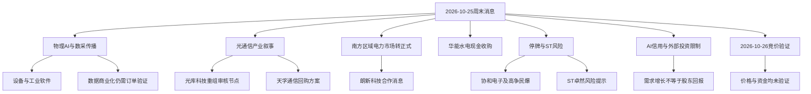

# 2026年10月25日（周日）· 周末轻量消息面

> **结论：物理AI/数采是本地周末传播焦点；电力市场转正式运行、收购与回购增持是较可核验的事件锚。热度不能替代订单、利润、业务纯度或周一价格验证。**
>
> 本文只梳理消息与反证，不输出交易指令。下文每项事件、候选及附录记录，均为**待2026-10-26（周一）竞价验证；资金意图未证实，价格待验证**。停牌对象先核验停牌状态，停牌时不存在竞价验证，不假定可交易。

## 一、先看证据边界，而不是把转发量当真实性

- 六个指定输入中的五份JSONL已逐行解析并对所有可用文本字段完成关键词/实体筛查：合计**3387条**，无解析错误；另完整解析业绩预告JSON **500条**。公告文件只有日期、代码、名称、标题、PDF地址，不能声称读完2051份公告正文。
- `manifest.lookback_hours=24`指距上次抓取间隔，并不等于所有文件都是同一24小时窗口。新闻实际数据均只覆盖10月24日上午至10月25日上午，**10月25日09点以后新闻存在缺口**；不能因目录写“20261025”就视为周日晚间全覆盖。
- 公众号、群聊转载同一研报/会议通知/媒体原文，只算一个传播链。新闻接口与门户展示同一通讯社稿、公告原文，也不算两条独立事实证据。**不输出虚假的独立源总数或“多源高置信”分数。**
- 公众号正文41篇均有文本；其中“标题说利好”的财报统一拆解为财报信息，不直接判正面。新闻要闻618条正文全部为空，只能做标题级线索；精确标题去重后595条。
- 群聊以“匿名群A—E”指代，不展示群名、人员联系方式、会议密码和私人身份。图片、打不开的链接/文件、系统消息不补写内容。“统一股份”谐音式点名无经营证据，不成为候选。
- 本次为用户授权的周末轻量文档，旧技能中的首推票、买卖点和机读研究JSON不适用。没有经过流通市值、业务、历史涨停状态筛查的标的，不能获得首板准入资格。

## 二、消息传导图

## 三、主要事件卡片（E01—E16，正负并列）

### E01｜物理AI、机器人数采：传播偏正，商业化中性待证

**证据与时间**：匿名群对应原始行21、24—26、30—34、37、39—43、52；公众号第38、40篇；新闻`news_cls`第448条（10月24日）点名上纬新材旗下启元机器人开放开发平台。第34/42条为同一专题会议重复通知，39/40条是同一研报正文与链接，不能各计独立源。群第21、34条所述10月25日晚间会议在抓取时尚未举行，不可当成已兑现的新进展。

- **大资金意图**：可能围绕“数据瓶颈→设备/数据资产”重估叙事展开关注，但没有实际机构成交或净流入证明，资金意图未证实。
- **为什么走强**：这里解释的是传播增强机制，不是断言行情已走强。多家机构周末专题把本体、数采、仿真、工业Agent串联，扩大关注面；历史股价涨幅引用不作为周一证据。
- **逻辑够不够硬**：产业问题明确，订单归属、收入占比、客户验收仍不足。海天瑞声、福莱新材、华依科技等仅有直接点名线索；前两者本地有异常波动公告，不能因题材热就算“首板”。公众号所述英伟达周五具体发布未做精确外核；保留`external_exact_event_unverified`。

**反证/验证**：未完成数据价格、采集量、订单兑现和主营占比复核；待2026-10-26竞价验证，资金意图未证实，价格待验证。

### E02｜MPO/DFAU、光模块需求：订单叙事偏正，业绩极性中性

**证据与时间**：匿名群第43条（10月25日）转述仕佳光子、致尚科技单季环比及杰普特订单、致尚客户备忘录；公众号第33篇和`news_cls`第276条转述AWS访谈。后两者同一访谈链，不是两个独立源。群里的客户需求预测备忘录不等于刚性采购合同。

- **大资金意图**：可能试图用订单与回购修复AI硬件信用，但本地消息无法证明实际增配，资金意图未证实。
- **为什么走强**：订单、产业并购和产能需求放在同一叙事中，形成“景气未塌”的反驳；这是可能的传播机制，不是行情结论。
- **逻辑够不够硬**：群消息虽给了部分单季环比，仍未完成公告正文及扣非交叉核验，财报分支统一`earnings_qoq_unverified`中性。AWS产能预订不是A股具体企业订单，不能顺推确定受益。

**反证/验证**：AI信用融资压力见E12；待2026-10-26竞价验证，资金意图未证实，价格待验证。

### E03｜光库科技收购安捷讯：审核节点偏正，不等于交割

**证据与时间**：公告索引A1072（`anns_window`行1072，公告日10月24日）；公众号第6篇称公司10月23日披露并购重组审核通过。直接下载并全文解析巨潮2页PDF，确认10月23日审议、拟购买安捷讯99.97%股份，尚需证监会同意注册；16.40亿元对价来自本地公众号，当前2页公告未列对价，不能称对价已独立外核。[W03] 公告日、报道日、事件审议日分别保留，不把转载日当新发生日。

- **大资金意图**：可形成光无源器件整合的产业叙事，但不能由审核结论推断机构已介入，资金意图未证实。
- **为什么走强**：若市场认可，可能源于交易不确定性下降与产业协同预期，而非三季报同比数字本身。
- **逻辑够不够硬**：审核节点由原始PDF核验，比观点更硬；尚需注册/后续实施、交割及业绩兑现，不能写成“并购完成”。PDF公告落款10月24日，公众号“10月23日发布”表述与公告落款不完全一致，保留字段差异，不修改本地原文。

**反证/验证**：关联交易、融资摊薄、整合及审批链后续风险；待2026-10-26竞价验证，资金意图未证实，价格待验证。

### E04｜南方区域电力市场转正式运行＋朗新科技合作：制度偏正，收益中性

**证据与时间**：`news_cls`第71/446/500/612条、公众号第32篇是一组官方发布的传播；直接读取国家能源局原文确认10月24日转正式运行。[W02] 另第247条直接点名广汽能源与朗新科技合作，涉及虚拟电厂、电力交易等，属于另外一个公司事件，但仍为框架合作，不是收入合同；朗新合作尚未单独外核。

- **大资金意图**：制度边界清晰后，市场可能关注运营和交易服务，但未取得资金数据，资金意图未证实。
- **为什么走强**：政策正式运行使业务场景更明确，叠加具体合作主体，传播链比单纯“利好电力”更具体。
- **逻辑够不够硬**：制度事件硬；朗新最终订单、利润率与收入占比不硬。市场化交易也可能使部分发电主体承受电价竞争，不是电力全板块无差别受益。

**反证/验证**：无量化新增合同和主营验证；待2026-10-26竞价验证，资金意图未证实，价格待验证。

### E05｜华能水电收购HNYL：整合预期偏正，现金与关联交易风险并列

**证据与时间**：公众号第2篇10月25日点名600025，拟现金收购HNYL100%股权约87.01亿元。实读同花顺转载北京商报10月25日报道，明确为关联交易、**不构成重大资产重组**；不是“已完成注入”。该事件未在本地2051条公告索引中命中，属于公告窗口漏项，由公众号及外部补足，不能称本地公告已经核验。[W09]

- **大资金意图**：可能围绕同业竞争解决及资产整合重新评估现金流，但资金意图未证实。
- **为什么走强**：若获得市场认同，来自现金流资产并表预期与平台整合，不应仅靠“87亿元”标题。
- **逻辑够不够硬**：主体、股权和对价相对明确；现金支出、估值合理性、审批与并表时间仍需跟踪。并表扩大规模不等于每股收益或回报率改善。

**反证/验证**：关联交易定价和资金安排未深入核验；待2026-10-26竞价验证，资金意图未证实，价格待验证。

### E06｜回购：方案、首次实施、完成、激励注销须分开

**证据与时间**：本地标题含“回购”71条，不是71个新增回购事件。A1135天孚通信为方案；实读7页PDF确认资金总额1—1.5亿元、自有资金、用于注销，仍需股东会审议，通过后6个月内实施；21经济网10月23日财联社转载与此一致。[W04、W10] A43中创股份、A61星球石墨、A305格林达、A659伊利股份为首次实施；A775广东明珠为增加金额。A199腾景科技、A411美湖股份、A1750广合科技为提议。

- **大资金意图**：可确认的是公司/提议人的公告行为，不是二级市场主力净买入，资金意图未证实。
- **为什么走强**：新增注销承诺或首次实际实施可能改变市场对资本回报的认知，但完成旧计划不是周末新资金。
- **逻辑够不够硬**：首次实施比提议更硬，仍需正文核实金额、用途、期限；限制性股票激励回购注销不是主动市场托举。附录按性质拆分，不能把71条全部涂绿。

**反证/验证**：方案未实施、规模有限和旧计划重播；待2026-10-26竞价验证，资金意图未证实，价格待验证。

### E07｜增持与减持：盈趣新计划和多家公司进展并列

**证据与时间**：A1343盈趣科技为控股股东增持计划；实读3页PDF确认万利达工业拟增持不低于1亿元、披露起6个月、自有与自筹资金结合，计划可能不达预期。[W05] A693北汽蓝谷、A700先导基电、A819兖矿能源为进展；A817哈空调、A834兴发集团、A1557国创高新为完成/结果。负面分支：A586白银有色减持进展；A727 ST中珠减至5%；A1576乐通股份质押股份拟以股抵债。其他权益变动仅凭标题不能判增持或减持。

- **大资金意图**：公告可反映股东公开安排，但增持动机与机构市场行为不同，资金意图未证实。
- **为什么走强**：新增增持安排可能传递信心；已完成、时间过半和刻度变化不可都算新增刺激。
- **逻辑够不够硬**：新计划是明确线索；承诺金额、兑现率、增持主体资金来源尚未逐份读取，不能认定强度或确定正收益。

**反证/验证**：减持和抵债供给需同时观察；待2026-10-26竞价验证，资金意图未证实，价格待验证。

### E08｜控制权/重组停牌：协和电子、高争民爆不列周一首板候选

**证据与时间**：协和电子A268及实读巨潮2页PDF明确2026-10-26起停牌、预计不超过2个交易日，控制权事项仍在筹划。[W06] 高争民爆公众号第3篇称筹划发行股份购买紫隆矿业51%、紫源铜业51%、晟源矿业100%股权，10月26日起停牌；两次外部检索无结果，高争事件未命中本地公告索引，标单一媒体传播链、待官方公告核验，不混成已读PDF。

- **大资金意图**：控制权/资产重塑可能产生重估讨论，但资金意图未证实。
- **为什么走强**：只能解释未来复牌阶段可能的预期变化，**不能描述周一正在走强**。
- **逻辑够不够硬**：停牌事实比受益猜测更硬；交易尚不确定，停牌也意味着不能参与当日竞价验证。

**反证/验证**：待2026-10-26核验停牌状态；若仍停牌则无竞价与价格验证。无“停牌就确定上涨”结论。

### E09｜ST/退市风险与申请撤销警示：不能把申请当批准

**证据与时间**：A222 *ST卓然：实读4页PDF确认已连续17个交易日收盘市值低于3亿元，公告明确即使后续3个交易日连续涨停仍将触及市值交易类强制退市条件，且交易类强制退市不进入退市整理期；另有重大违法退市风险，但正式处罚决定尚未收到。[W07] A223为严重异常波动。A821 *ST瑞茂为警示进展标题。A237 ST思科瑞实读4页PDF，确认申请撤销其他风险警示，审核期间不申请停牌，**不等于获批摘帽**。[W08]

- **大资金意图**：不能从风险博弈推断“资金救壳”或“机构埋伏”，资金意图未证实。
- **为什么走强**：撤销申请可能带来讨论，但风险名称本身不是上涨逻辑，价格待验证。
- **逻辑够不够硬**：风险提示或申请状态明确，最终监管决定未知。风险极性负面；思科瑞申请事件中性偏正线索但不作准入。

**反证/验证**：待2026-10-26竞价及最新监管状态验证；资金意图未证实，价格待验证。

### E10｜业绩：同比再高，也不跳过单季环比和扣非

**证据与时间**：完整解析东财500条，覆盖195家公司；是**指标记录**而非500家公司，公告日期跨8月25日—10月24日，不能当500条周末新增预告。标题财报、业绩说明会与更正也不等于新增业绩预告。

| 对象 | 本地证据 | 尚缺 | 极性/状态 |
|---|---|---|---|
| 恒逸石化 | 公众号5称Q3归母21.09亿元、同比82008%；东财有累计归母及扣非预告 | Q2正式单季、Q3扣非单季、产品价格与现金流交叉核验 | 中性，earnings_qoq_unverified |
| 云汉芯城 | 公众号16含Q1、Q2及Q3预告；东财有累计归母3.353335—3.706317亿元、扣非3.283059—3.628644亿元 | 单季扣非及原始公告复核；不能用累计扣非替代单季 | 中性，earnings_qoq_unverified |
| 生益电子 | 东财有累计归母及扣非；公众号10经营信息 | 上季单季和本季扣非拆分 | 中性，earnings_qoq_unverified |
| 光库科技 | 东财累计归母/扣非预告；公众号6季度数字 | 单季扣非环比核验 | 业绩中性，earnings_qoq_unverified；并购事件另列E03 |
| 仕佳光子/致尚科技 | 匿名群43给出单季环比 | 报表及单季扣非独立验证 | 中性，earnings_qoq_unverified |
| 泛亚微透/*ST天宜 | 东财分别为利润预减、持续亏损/流动性风险描述 | 同样缺完整单季链 | 业绩极性中性，earnings_qoq_unverified；经营与流动性风险单列负面 |

- **大资金意图**：不能把“利润暴增”标题等同机构认可，资金意图未证实。
- **为什么走强**：强同比可能吸引传播，但市场边际定价需看环比、扣非和预期差，本文未据标题认定走强。
- **逻辑够不够硬**：现有数据不足完成完整协议，所有未核验业绩事件均中性。东财`PREDICT_HBMEAN`虽存在，但未查清定义及底层单季输入，**不直接当已验证净利润环比**。

**反证/验证**：周期行业同比低基数、非经常性损益、毛利与现金流背离；待2026-10-26竞价验证，资金意图未证实，价格待验证。

### E11｜美国对外投资限制拟议规则：科技/出海的负面分支

**证据与时间**：公众号18/31、`news_cls`283/543/545为同一商务部答问转载链，称美方10月23日发布新版拟议规则、10月24日回应；本轮外部检索无结果，未取得商务部独立原文确认，保留本地转载口径。**拟议不等于已经全面生效**。

- **大资金意图**：可能促使市场重新评估跨境融资与科技合作风险，但未验证资金实际变化，资金意图未证实。
- **为什么走强**：这是对科技主线走强的反证，不应包装成普遍利好国产替代。
- **逻辑够不够硬**：本地文本称源于官方答问，但未独立外核；具体企业暴露与美国条款尚未逐项核实，不凭概念推断直接损失。

**负面范围**：跨境科技投资、相关出海链；`news_major`第9条“40项关键技术出口管控”仅标题，不能与美国对外投资拟议规则混为同一政策。待2026-10-26竞价验证，资金意图未证实，价格待验证。

### E12｜AI信用与拥挤风险：需求向上也可能压缩股东回报

**证据与时间**：公众号4/25/39、`news_cls`68/70有AI融资、CDS与拥挤交易讨论；公众号33同时有AWS需求强的正面链。它们并不互相抵消，更不能只留正面。

- **大资金意图**：风险预算可能收缩，也可能出现结构再分配；均只是解释假设，资金意图未证实。
- **为什么走强**：产业订单消息可能缓解需求担忧，却不能解决融资成本、现金流和估值问题；本文不声称信用危机已经全面爆发。
- **逻辑够不够硬**：券商/评论反证有提示价值，但无完整债券与资金原始数据，不量化为系统性风险已经落地。

**负面范围**：资本密集AI基础设施及高拥挤科技链；待2026-10-26竞价验证，资金意图未证实，价格待验证。

### E13｜企业微信外挂安全事件＋短剧/AIGC：正面流量和负面信任分开

**证据与时间**：`news_cls`376/430、`news_major`35/344为同一企业微信回应链；第323条为小云雀并入即梦；26/34条为广州AIGC合作与中心落地。匿名群27的短剧会议不是上市公司订单，18/46的播放量未识别原作，不用于确定公司映射。

- **大资金意图**：网安和应用流量可能获得关注，但没有实际资金证据，资金意图未证实。
- **为什么走强**：攻击事件增加安全关注，内容平台变化增加应用讨论；二者都不能直接推导A股供应商收入。
- **逻辑够不够硬**：本地回应指向第三方外挂服务，不可改写为微信核心平台已整体被攻破。产品整合和平台流量也不等于可识别上市公司业绩。

**正负范围**：应用端场景偏正，品牌客户与外挂使用方安全/信任负面；不凑网安或短剧票。待2026-10-26竞价验证，资金意图未证实，价格待验证。

### E14｜中东冲突、航运与能源：保留说法和反说法

**证据与时间**：公众号15/20、`news_cls`83/89/170/199/210/253等涉及袭击、旅行警告、海峡谈判。第170条说“愿谈判开放海峡换解除封锁”，第89条随后称伊朗否认该方案；第209条指出沙特未立即证实胡塞声明。它们是冲突信息，**不裁剪成单边确定结论**。

- **大资金意图**：可能形成避险和成本风险重估，但没有资金确认，资金意图未证实。
- **为什么走强**：油气价格叙事可能受供应风险影响，同时航空、航运、化工成本承压；不把任何一端写成必然受益。
- **逻辑够不够硬**：本地各方说法未全部外核，具体设施损毁与断供量不确认；所谓周末“暗盘”报价不是周一正式价格验证。

**负面范围**：风险资产、运输/能源密集下游；待2026-10-26竞价验证，资金意图未证实，价格待验证。

### E15｜解禁、异动与经营风险：不能被主线热度淹没

**证据与时间**：`news_cls`257/537为同一“下周44股解禁”报道链，点名西安奕材-U、索辰科技等；解禁不等于必然减持。A17海天瑞声、A256福莱新材存在异常波动公告；公众号21为海洋王澄清热点概念关系；A1538及公众号19为晶澳科技终止员工持股计划。要闻199璞泰来利润率压力、389/419维信诺定增遭否决、611华润三九减值均为标题线索，不能捏造金额或结论。

- **大资金意图**：不能将异动或解禁想象成“洗盘后拉升”，资金意图未证实。
- **为什么走强**：这些是强势叙事的约束条件；概念被澄清、潜在供给增加时，题材传播放大也不等于价格增强。
- **逻辑够不够硬**：异动、终止计划等标题存在；更细经营或股东行为需原始文件，不根据标题断定违法或实际减持。

**负面范围**：点名个股及高拥挤题材；待2026-10-26竞价验证，资金意图未证实，价格待验证。

### E16｜上证系列综合指数编制调整：周一时间锚，不是新增利好

**证据与时间**：公众号14/27、`news_cls`53同源于上交所9月24日公告。直接读取上交所官网确认10月26日实施，样本权重上限15%，风险警示证券剔除时间锚调整；这是**旧公告到生效日**，不是周末首次发布。[W01]

- **大资金意图**：跟踪相关指数的资金可能调整，但本文无实际跟踪规模或申赎证据，资金意图未证实。
- **为什么走强**：机械规则会影响样本配置，不能据此推断指数方向或所有权重股走强。
- **逻辑够不够硬**：官方规则与日期硬，市场影响方向未验证。标普风格指数12月21日变更是另一个海外时间锚，不与周一A股规则混同。

**验证**：待2026-10-26竞价验证，资金意图未证实，价格待验证。

## 四、2026-10-26首板消息候选：仅消息侧，准入数为0

> 下列4个直接点名对象只是待筛查的消息候选，**不是确定首板、不是已通过首板筛选的股票池**。流通市值、业务真实性/收入占比、前一交易日是否已经涨停、当前连板状态、停复牌以及周一竞价均未完整验证。不得把本表送入执行池或凭本表确定首板。

| 消息候选 | 直接证据 | 对象为何进入消息核对名单 | 硬缺口及反证 | 验证状态 |
|---|---|---|---|---|
| 光库科技 300620.SZ | A1072＋实读PDF W03＋公众号6 | 重组审核节点直接指向公司；不是板块龙头代理 | 尚需注册；未核验流通市值、主营及历史涨停；业绩中性 | 待2026-10-26竞价验证；资金意图未证实，价格待验证 |
| 朗新科技（本表不补未核对代码） | news_cls247 | 公司被合作新闻直接点名，连接电力交易/虚拟电厂 | 框架合作无收入金额；未核验主营、流通市值、前日涨停 | 待2026-10-26竞价验证；资金意图未证实，价格待验证 |
| 华能水电 600025.SH | 公众号2＋外部公告转载 | 股权收购直接点名，不通过概念成分股映射 | 非重大资产重组；现金及关联交易风险；本地公告索引漏项；首板资格未筛查 | 待2026-10-26竞价验证；资金意图未证实，价格待验证 |
| 盈趣科技 002925.SZ | A1343＋实读PDF W05 | 控股股东不低于1亿元增持计划直接点名 | 计划未必兑现；无流通市值、主营及涨停资格验证 | 待2026-10-26竞价验证；资金意图未证实，价格待验证 |

**不列为首板消息候选**：协和电子、高争民爆（周一停牌）；海天瑞声、福莱新材（题材传播与本地异动证据并存，未核验此前涨停）；统一股份（只有谐音式点名）；短剧/网安泛映射（无直接公司订单证据）。其他数采公司留在E01的传播证据层，不从机构名单批量制造候选。

## 五、数据源审计：真实窗口、去重和缺失

| 来源 | 实际解析/状态 | 本地真实时间范围 | 审计结论 |
|---|---|---|---|
| manifest.json | 🟢 已读 | 2026-10-25生成；距上次10月24日抓取24小时 | 全球severity=0是抓取自报，不覆盖本文正文质量降级 |
| wechat_cli_5groups | 🟢 53条，5个匿名群 | since=2026-10-24T18:01:55；实际消息10月24日20:36—10月25日16:48 | 与manifest53条一致；系统/媒体占位不当新闻 |
| wechat_official_20 | 🟢 41篇 | 10月24日18:05—10月25日17:36 | 与manifest一致；15订阅源不等于20源都出文；空订阅不算抓取失败 |
| news_cls | 🟡 624条，内容可读 | 10月24日09:00:01—10月25日08:59:51 | 与manifest一致；实际是新浪/同花顺聚合，文件名不能证明全部财联社独立原稿；全文精确去重624 |
| news_major | 🟡 618条，正文为空618条 | 10月24日09:00—10月25日09:00 | 与manifest一致；精确标题唯一595，重复23；不能按72小时完整覆盖宣传 |
| anns_window | 🟡 2051条，714家公司 | ann_date=10月24日2044条、10月25日7条 | 与manifest一致；标题键去重2049，URL唯一2051；两条同公司同日同标题重复，不算两个事件 |
| eastmoney_earnings_predict | 🟡 文件真实存在，500指标/195公司 | captured_at=10月25日；NOTICE_DATE=8月25日—10月24日；REPORT_DATE指向9月30日 | 不是缺文件；也不是500条当日新增。500条可能是截断/分页上限，未证明市场全覆盖 |
| mcp_health.json | 🔴 missing | 当日目录不存在 | 无法据此证明MCP健康；本次主要读取本地，不谎称直采成功 |
| events_20261023.json / anns_classified.json | 🟡 missing | 当日原始目录未找到 | 补充分类腿缺失；未生成替代数据 |
| 周日热榜 | ⚪ not_available | manifest当日四类热榜均0 | 周末不可用，不因此降级；不冒用10月24日榜单当当日事实 |
| 业务/流通市值/资金/历史涨停核验 | 🔴 not_checked | 本次轻量范围未获取 | 不能据消息直接给确定准入、资金结论或价格结论 |

**窗口细节**：公告记录只有日粒度，本地文件无逐条采集时刻，不能证明已覆盖周日全部新公告。华能水电、高争民爆在公众号及外部媒体出现而索引没有，已直接记录为窗口漏项。新闻虽原技能提72小时回看，但本次必须以真实时间字段为准；本文不补写缺失的10月23日新闻与10月25日下午新闻。

**去重层级**：输入记录数、精确去重数、语义事件数不同。正文E01—E16为16张合并事件/风险卡片，不代表全市场只有16件事；同公司的一次并购审核、同一回购方案的多篇文件只记一个事件链。附录保留标题索引以便回查，附录行数不作为独立信源或新增事件总数。

## 六、外部核验与冲突台账

- 实际执行MCP多引擎搜索，搜索过窄为空时改用宽查询；MCP正文读取均因匿名阅读器IP信誉返回401，通用extract后端为search-only也失败。随后使用终端直接HTTPS请求官方网页/PDF，官网正文和6份PDF均成功读取；不把失败的接口报告为成功。
- 初次PDF解析误载同名fitz包，改用pymupdf后实读：光库2页、天孚7页、盈趣3页、协和2页、*ST卓然4页、ST思科瑞4页；未下载到仓库或写任何原始数据。正文索引W03—W08可定位原始PDF。
- 已直接读取上交所、国家能源局官网，以及同花顺转载北京商报华能报道、21经济网转载财联社天孚报道。高争民爆、商务部答问多次检索仍为空，朗新合作未单独外核；这些明确保留本地线索层，不谎称外部确认。
- 核心核验：天孚为1—1.5亿元方案且仍需股东会；盈趣不低于1亿元计划而非已经完成；*ST卓然原PDF的退市紧迫性强于泛化标题，应保留原文风险强度。
- 日期差异：光库审议发生10月23日、PDF落款10月24日；公众号“23日发布”与落款不完全一致，保留冲突。天孚本地ann_date10月24日而PDF落款10月23日，区分接口公告日与文件落款，不擅改原始字段。
- 本地海峡谈判提议与否认并存；“所有星链限制解除”与部分能力恢复测试表述并存。保留冲突，不裁定最终状态。物理AI周五具体发布与数采公司业务未精确外核，不用其他日期资料替代。

### 外部证据定位（URL仅作代码形式留档）

| 编号 | 实际读取的原文/转载及状态 | 定位 |
|---|---|---|
| W01 | 上交所9月24日公告，HTTP200正文 | `https://www.sse.com.cn/market/sseindex/diclosure/c/c_20260924_10833342.shtml` |
| W02 | 国家能源局10月24日公告，HTTP200正文 | `https://www.nea.gov.cn/20261024/5507e2777ede4b7e97ae56de1d275d46/c.html` |
| W03 | 光库科技原始公告，2页全文 | `https://static.cninfo.com.cn/finalpage/2026-10-24/1225621540.PDF` |
| W04 | 天孚通信原始方案，7页全文 | `https://static.cninfo.com.cn/finalpage/2026-10-24/1225620748.PDF` |
| W05 | 盈趣科技原始增持计划，3页全文 | `https://static.cninfo.com.cn/finalpage/2026-10-24/1225621171.PDF` |
| W06 | 协和电子原始停牌公告，2页全文 | `https://static.cninfo.com.cn/finalpage/2026-10-24/1225620941.PDF` |
| W07 | *ST卓然原始风险公告，4页全文 | `https://static.cninfo.com.cn/finalpage/2026-10-24/1225620540.PDF` |
| W08 | ST思科瑞原始申请公告，4页全文 | `https://static.cninfo.com.cn/finalpage/2026-10-24/1225620096.PDF` |
| W09 | 北京商报/同花顺10月25日报道，HTTP200正文 | `https://stock.10jqka.com.cn/20261025/c681055580.shtml` |
| W10 | 财联社/21经济网10月23日报道，HTTP200正文 | `https://www.21jingji.com/article/20261023/herald/80323cd13a476137b882d7e5b7729dc3.html` |

## 七、下周一验证清单（只验证，不产生指令）

1. 2026-10-26先核验协和电子、高争民爆是否仍停牌；停牌对象没有竞价观测。
2. 对4个消息候选补齐业务原文、流通市值、历史涨停/连板和冲突公告，再讨论是否具备首板观察资格；当前合格数为0。
3. 区分真实新增订单、预测备忘录、框架协议、公司计划与首次实际实施；不把旧闻重播当新增催化。
4. 财报补齐Q2/Q3单季归母和扣非、现金流、产品价格及预期差之前，坚持`earnings_qoq_unverified`中性。
5. 对消息驱动与价格、资金的关系仅作事后观测；没有周一竞价数据时保持“资金意图未证实，价格待验证”。

## 八、范围与落盘说明

本次仅输出本篇Markdown；原有目标文件读取结果为不存在，无旧版可备份。写入同目录`.tmp`，完成结构与匿名化检查后原子替换。若提交瞬间出现既有目标，将先保留为`.md.bak`。不改原始数据、研究JSON、技能、cron或配置。以下附录由全量解析结果生成，保留标题证据与行号，**不冒充公告正文已核验**。

## 附录A｜全量公告标题筛查索引（折叠阅读）
A编号对应anns_window.jsonl原始行；本附录为标题层归类，同公司同事件多份方案/法律意见归并展示，不计独立来源。不带方向的权益变动保持中性。所有记录资金意图未证实、价格待验证；业绩项全部为中性earnings_qoq_unverified。分类按下表先后排他归属，非manifest原分类。

ST退市与撤销申请：3个唯一标题／3组公司日期线索

| 公司/代码 | 公告日 | 合并标题或类型 | 原始行 | 状态 |
|---|---|---|---|---|
| *ST卓然 688121.SH | 2026-10-24 | 关于公司股票可能存在因市值低于3亿元而终止上市的第九次风险提示暨公司股票可能被实施重大违法强制退市的风险提示公告 | A222 | 待2026-10-26竞价验证 |
| ST思科瑞 688053.SH | 2026-10-24 | 成都思科瑞微电子股份有限公司关于申请撤销对公司股票实施其他风险警示的公告 | A237 | 待2026-10-26竞价验证 |
| *ST瑞茂 600180.SH | 2026-10-24 | 关于公司股票被实施退市风险警示及其他风险警示相关事项的进展公告 | A821 | 待2026-10-26竞价验证 |

停复牌：1个唯一标题／1组公司日期线索

| 公司/代码 | 公告日 | 合并标题或类型 | 原始行 | 状态 |
|---|---|---|---|---|
| 协和电子 605258.SH | 2026-10-24 | 关于控股股东筹划公司控制权变更的停牌公告 | A268 | 待2026-10-26核验停牌；停牌无竞价 |

并购控制权及要约：12个唯一标题／12组公司日期线索

| 公司/代码 | 公告日 | 合并标题或类型 | 原始行 | 状态 |
|---|---|---|---|---|
| 会通股份 688219.SH | 2026-10-24 | 会通新材料股份有限公司关于收购境外公司股权进展的自愿性公告 | A195 | 待2026-10-26竞价验证 |
| 望变电气 603191.SH | 2026-10-24 | 关于签署股权收购意向协议暨关联交易的公告 | A447 | 待2026-10-26竞价验证 |
| 海汽集团 603069.SH | 2026-10-24 | 海汽集团关于重大资产重组事项的进展公告 | A482 | 待2026-10-26竞价验证 |
| 万盛股份 603010.SH | 2026-10-24 | 浙江万盛股份有限公司关于收购青岛金博行新材料科技有限公司控制权的公告 | A503 | 待2026-10-26竞价验证 |
| 中国神华 601088.SH | 2026-10-24 | 关于收购国能新疆煤制气有限公司50%股权暨关联交易的公告 | A608 | 待2026-10-26竞价验证 |
| 建设机械 600984.SH | 2026-10-24 | 建设机械关于重大资产重组的进展公告 | A638 | 待2026-10-26竞价验证 |
| *ST华幸 600340.SH | 2026-10-24 | 华夏幸福基业股份有限公司关于债务重组进展等事项的公告 | A790 | 待2026-10-26竞价验证 |
| 光库科技 300620.SZ | 2026-10-24 | 关于公司发行股份、可转换公司债券及支付现金购买资产并募集配套资金暨关联交易事项获深圳证券交易所并购重组审核委员会审核通过的公告 | A1072 | 待2026-10-26竞价验证 |
| 中能电气 300062.SZ | 2026-10-24 | 关于对外投资收购股权的公告 | A1222 | 待2026-10-26竞价验证 |
| 永达股份 001239.SZ | 2026-10-24 | 关于收到深圳证券交易所并购重组审核委员会审核公司发行股份及支付现金购买资产并募集配套资金暨关联交易事项会议安排的公告 | A1789 | 待2026-10-26竞价验证 |
| *ST数源 000909.SZ | 2026-10-24 | 国联民生关于数源科技重组项目使用部分闲置募集资金暂时补充流动资金的核查意见 | A1835 | 待2026-10-26竞价验证 |
| 冰轮环境 000811.SZ | 2026-10-24 | 关于收购烟台铭祥控股有限公司45%的股权进展暨完成公司变更登记的公告 | A1856 | 待2026-10-26竞价验证 |

增减持与权益变动：29个唯一标题／19组公司日期线索

| 公司/代码 | 公告日 | 合并标题或类型 | 原始行 | 状态 |
|---|---|---|---|---|
| 均普智能 688306.SH | 2026-10-24 | 宁波均普智能制造股份有限公司关于控股股东、实际控制人及其一致行动人权益变动跨越5%的提示性公告 | A167 | 待2026-10-26竞价验证 |
| 浩瀚深度 688292.SH | 2026-10-24 | 北京浩瀚深度信息技术股份有限公司关于持股5%以上股东权益变动触及1%刻度的提示性公告 | A169 | 待2026-10-26竞价验证 |
| ST南新 688189.SH | 2026-10-24 | 简式权益变动报告书；关于持股5%以上股东权益变动触及1%刻度的提示性公告 | A200、A202 | 待2026-10-26竞价验证 |
| 天创股份 603608.SH | 2026-10-24 | 关于控股股东权益变动触及5%刻度的提示性公告 | A363 | 待2026-10-26竞价验证 |
| 立航科技 603261.SH | 2026-10-24 | 简式权益变动报告书修订版（转让方-刘随阳）；成都立航科技股份有限公司关于控股股东协议转让公司部分股份暨权益变动的进展公告；简式权益变动报告书修订版（受让方-海南泓川源-泓川源） | A425、A426、A427 | 待2026-10-26竞价验证 |
| 白银有色 601212.SH | 2026-10-24 | 白银有色集团股份有限公司股东减持股份进展暨权益变动触及1%整数倍的提示性公告 | A586 | 待2026-10-26竞价验证 |
| 北汽蓝谷 600733.SH | 2026-10-24 | 关于控股股东增持股份计划的进展公告 | A693 | 待2026-10-26竞价验证 |
| 先导基电 600641.SH | 2026-10-24 | 上海先导基电科技股份有限公司关于董事、高级管理人员首次增持公司股份暨增持计划实施进展公告 | A700 | 待2026-10-26竞价验证 |
| ST中珠 600568.SH | 2026-10-24 | 中珠医疗控股股份有限公司关于持股5%以上股东减持股份至5%的权益变动提示性公告；中珠医疗控股股份有限公司简式权益变动报告书（萧妃英） | A727、A728 | 待2026-10-26竞价验证 |
| 哈空调 600202.SH | 2026-10-24 | 哈尔滨空调股份有限公司关于控股股东增持股份计划完成的公告；黑龙江大地律师事务所关于哈尔滨工业投资集团有限公司与一致行动人哈尔滨电碳厂有限责任公司增持哈尔滨空调股份有限公司股份法律意见书 | A817、A818 | 待2026-10-26竞价验证 |
| 兖矿能源 600188.SH | 2026-10-24 | 兖矿能源集团股份有限公司关于控股股东增持计划进展的公告 | A819 | 待2026-10-26竞价验证 |
| 宁科生物 600165.SH | 2026-10-24 | 宁科生物关于部分董事、高级管理人员增持股份计划时间过半暨增持股份进展公告；宁科生物关于实际控制人及一致行动人增持股份计划时间过半暨增持股份进展公告 | A825、A826 | 待2026-10-26竞价验证 |
| 兴发集团 600141.SH | 2026-10-24 | 湖北兴发化工集团股份有限公司关于董事、高级管理人员增持股份结果公告 | A834 | 待2026-10-26竞价验证 |
| 挖金客 301380.SZ | 2026-10-24 | 关于相关股东解除一致行动关系暨控股股东、实际控制人减少及权益变动的提示性公告；简式权益变动报告书（李征）；简式权益变动报告书（陈坤） | A927、A928、A929 | 待2026-10-26竞价验证 |
| 海伦哲 300201.SZ | 2026-10-24 | 关于公司副总经理增持股份计划实施进展暨增持时间过半的公告 | A1183 | 待2026-10-26竞价验证 |
| 盈趣科技 002925.SZ | 2026-10-24 | 关于控股股东增持公司股份计划的公告 | A1343 | 待2026-10-26竞价验证 |
| 广田集团 002482.SZ | 2026-10-24 | 关于持股5%以上股东股份变动达到1%及5%整数倍暨披露简式权益变动报告书的提示性公告；简式权益变动报告书 | A1530、A1531 | 待2026-10-26竞价验证 |
| 国创高新 002377.SZ | 2026-10-24 | 关于控股股东增持股份计划期限届满暨实施完成的公告 | A1557 | 待2026-10-26竞价验证 |
| 乐通股份 002319.SZ | 2026-10-24 | 关于控股股东之一致行动人所持部分质押股份拟以股抵债暨权益变动可能触及5%整数倍的提示性公告；珠海市乐通化工股份有限公司简式权益变动报告书（大晟资产、优悦美晟） | A1576、A1577 | 待2026-10-26竞价验证 |

回购市场行为与计划：71个唯一标题／45组公司日期线索

| 公司/代码 | 公告日 | 合并标题或类型 | 原始行 | 状态 |
|---|---|---|---|---|
| 中创股份 688695.SH | 2026-10-24 | 首次实施：关于以集中竞价交易方式首次回购公司股份的公告 | A43 | 待2026-10-26竞价验证 |
| 星球石墨 688633.SH | 2026-10-24 | 首次实施：关于以集中竞价交易方式首次回购股份的公告 | A61 | 待2026-10-26竞价验证 |
| 威迈斯 688612.SH | 2026-10-24 | 进展或配套文件：关于以集中竞价交易方式回购公司股份比例达到总股本1%暨回购进展公告 | A64 | 待2026-10-26竞价验证 |
| 汇成股份 688403.SH | 2026-10-24 | 方案或其他（需正文定性）：关于以集中竞价交易方式回购公司股份的预案 | A115 | 待2026-10-26竞价验证 |
| 腾景科技 688195.SH | 2026-10-24 | 提议：腾景科技关于公司控股股东、实际控制人、董事长兼总经理提议回购公司股份的公告 | A199 | 待2026-10-26竞价验证 |
| 生益电子 688183.SH | 2026-10-24 | 进展或配套文件：生益电子关于回购股份事项前十大股东和前十大无限售条件股东持股情况的公告 | A204 | 待2026-10-26竞价验证 |
| 澜起科技 688008.SH | 2026-10-24 | 完成或结果：澜起科技关于A股股份回购实施结果的公告 | A243 | 待2026-10-26竞价验证 |
| 长龄液压 605389.SH | 2026-10-24 | 方案或其他（需正文定性）：江苏长龄液压股份有限公司关于以集中竞价交易方式回购股份方案的公告 | A261 | 待2026-10-26竞价验证 |
| 华丰股份 605100.SH | 2026-10-24 | 激励注销或调整（非市场新增回购）：上海市锦天城律师事务所关于华丰动力股份有限公司2024年限制性股票激励计划部分限制性股票回购注销实施的法律意见书；华丰动力股份有限公司2024年限制性股票激励计划部分限制性股票回购注销实施公告 | A276、A277 | 待2026-10-26竞价验证 |
| 格林达 603931.SH | 2026-10-24 | 首次实施：杭州格林达电子材料股份有限公司关于以集中竞价交易方式首次回购公司股份的公告 | A305 | 待2026-10-26竞价验证 |
| 长久物流 603569.SH | 2026-10-24 | 进展或配套文件：长久物流：关于以集中竞价交易方式回购公司股份的进展公告 | A369 | 待2026-10-26竞价验证 |
| 爱玛科技 603529.SH | 2026-10-24 | 激励注销或调整（非市场新增回购）：爱玛科技关于部分限制性股票回购注销完成调整“爱玛转债”转股价格的公告 | A371 | 待2026-10-26竞价验证 |
| 豪威集团 603501.SH | 2026-10-24 | 进展或配套文件：关于回购A股股份事项前十大股东、前十大无限售条件股东持股情况的公告 | A381 | 待2026-10-26竞价验证 |
| 豪威集团 603501.SH | 2026-10-24 | 方案或其他（需正文定性）：关于以集中竞价交易方式回购A股股份的回购报告书 | A382 | 待2026-10-26竞价验证 |
| 科沃斯 603486.SH | 2026-10-24 | 激励注销或调整（非市场新增回购）：科沃斯股权激励限制性股票回购注销实施公告 | A384 | 待2026-10-26竞价验证 |
| 美湖股份 603319.SH | 2026-10-24 | 提议：关于公司控股股东、实际控制人提议回购公司股份的公告 | A411 | 待2026-10-26竞价验证 |
| 中贝通信 603220.SH | 2026-10-24 | 方案或其他（需正文定性）：关于以集中竞价交易方式回购股份的方案暨回购报告书；关于以集中竞价交易方式回购股份的方案 | A431、A432 | 待2026-10-26竞价验证 |
| 小方制药 603207.SH | 2026-10-24 | 激励注销或调整（非市场新增回购）：关于调整2025年、2026年限制性股票激励计划回购价格的公告；关于回购注销2025年限制性股票激励计划部分限制性股票的公告；君合律师事务所上海分所关于上海小方制药股份有限公司2025年限制性股票激励计划回购价格调整及回购注销部分限制性股票的法律意见书；关于回购注销2026年限制性股票激励计划部分限制性股票的公告；君合律师事务所上海分所关于上海小方制药股份有限公司2026年限制性股票激励计划回购价格调整及回购注销部分限制性股票的法律意见书；关于回购注销部分限制性股票暨通知债权人公告 | A435、A437、A438、A439、A441、A443 | 待2026-10-26竞价验证 |
| 海通发展 603162.SH | 2026-10-24 | 进展或配套文件：福建海通发展股份有限公司关于回购股份事项前十大股东和前十大无限售条件股东持股情况的公告 | A464 | 待2026-10-26竞价验证 |
| 金海通 603061.SH | 2026-10-24 | 完成或结果：关于股份回购实施结果暨股份变动的公告 | A487 | 待2026-10-26竞价验证 |
| 金海通 603061.SH | 2026-10-24 | 进展或配套文件：关于回购股份事项前十大股东和前十大无限售条件股东持股情况的公告 | A490 | 待2026-10-26竞价验证 |
| 明阳智能 601615.SH | 2026-10-24 | 进展或配套文件：关于注销回购股份减少注册资本通知债权人的公告 | A554 | 待2026-10-26竞价验证 |
| 伊利股份 600887.SH | 2026-10-24 | 首次实施：内蒙古伊利实业集团股份有限公司关于以集中竞价交易方式首次回购公司股份的公告 | A659 | 待2026-10-26竞价验证 |
| 华润江中 600750.SH | 2026-10-24 | 激励注销或调整（非市场新增回购）：华润江中关于第二期限制性股票激励计划回购注销部分限制性股票的公告；华润江中董事会薪酬与考核委员会对关于回购注销部分激励对象已获授但尚未解除限售的限制性股票事项的核查意见；国浩律师（上海）事务所关于华润江中药业股份有限公司第二期限制性股票激励计划回购注销部分限制性股票事宜的法律意见书；华润江中关于回购注销部分限制性股票通知债权人的公告 | A683、A684、A685、A687 | 待2026-10-26竞价验证 |
| 方正科技 600601.SH | 2026-10-24 | 激励注销或调整（非市场新增回购）：方正科技关于回购注销部分限制性股票通知债权人的公告；方正科技关于回购注销部分限制性股票的公告；北京市中伦（深圳）律师事务所关于方正科技集团股份有限公司2025年限制性股票激励计划调整及回购注销部分限制性股票相关事项的法律意见书 | A720、A721、A725 | 待2026-10-26竞价验证 |
| 广东明珠 600382.SH | 2026-10-24 | 方案或其他（需正文定性）：广东明珠集团股份有限公司关于增加回购股份金额的公告 | A775 | 待2026-10-26竞价验证 |
| 铜峰电子 600237.SH | 2026-10-24 | 激励注销或调整（非市场新增回购）：铜峰电子关于回购注销部分限制性股票及调整回购价格的公告；铜峰电子关于回购注销部分限制性股票通知债权人的公告；安徽天禾律师事务所关于安徽铜峰电子股份有限公司2023年限制性股票激励计划预留授予部分第一个解除限售期解除限售条件成就及回购注销部分限制性股票相关事项的法律意见书 | A810、A811、A813 | 待2026-10-26竞价验证 |
| 生益科技 600183.SH | 2026-10-24 | 方案或其他（需正文定性）：生益科技关于以集中竞价交易方式回购股份的回购报告书 | A820 | 待2026-10-26竞价验证 |
| 华创云信 600155.SH | 2026-10-24 | 完成或结果：华创云信关于股份回购实施结果暨股份变动的公告 | A832 | 待2026-10-26竞价验证 |
| 朗坤科技 301305.SZ | 2026-10-24 | 完成或结果：关于回购股份实施结果暨股份变动的公告 | A948 | 待2026-10-26竞价验证 |
| 达瑞电子 300976.SZ | 2026-10-24 | 方案或其他（需正文定性）：关于回购公司股份方案的公告 | A989 | 待2026-10-26竞价验证 |
| 菲利华 300395.SZ | 2026-10-24 | 激励注销或调整（非市场新增回购）：湖北今天律师事务所关于湖北菲利华石英玻璃股份有限公司2025年限制性股票激励计划首次授予部分第一个解除限售期解除限售条件成就及回购注销部分限制性股票的法律意见书；关于回购注销部分限制性股票减少注册资本暨通知债权人的公告；关于回购注销2025年限制性股票激励计划部分限制性股票的公告 | A1129、A1133、A1134 | 待2026-10-26竞价验证 |
| 天孚通信 300394.SZ | 2026-10-24 | 方案或其他（需正文定性）：关于回购股份方案的公告 | A1135 | 待2026-10-26竞价验证 |
| 安科生物 300009.SZ | 2026-10-24 | 激励注销或调整（非市场新增回购）：关于部分限制性股票回购注销完成的公告 | A1273 | 待2026-10-26竞价验证 |
| 探路者 300005.SZ | 2026-10-24 | 激励注销或调整（非市场新增回购）：关于回购注销2026年限制性股票激励计划部分限制性股票的公告；董事会提名与薪酬考核委员会关于回购注销部分限制性股票的核查意见；北京市天元律师事务所关于探路者控股集团股份有限公司2026年限制性股票激励计划回购注销部分限制性股票的法律意见 | A1287、A1288、A1289 | 待2026-10-26竞价验证 |
| 惠威科技 002888.SZ | 2026-10-24 | 完成或结果：关于回购公司股份实施完成暨股份变动的公告 | A1352 | 待2026-10-26竞价验证 |
| 良信股份 002706.SZ | 2026-10-24 | 方案或其他（需正文定性）：关于以集中竞价交易方式回购股份方案的公告 | A1437 | 待2026-10-26竞价验证 |
| 亚太科技 002540.SZ | 2026-10-24 | 激励注销或调整（非市场新增回购）：关于调整第二期股票期权和限制性股票激励计划股票期权行权价格和限制性股票回购价格的公告；江苏世纪同仁律师事务所关于公司第二期股票期权和限制性股票激励计划调整股票期权行权价格和限制性股票回购价格的法律意见书 | A1512、A1513 | 待2026-10-26竞价验证 |
| 富安娜 002327.SZ | 2026-10-24 | 激励注销或调整（非市场新增回购）：关于回购注销部分第六期限制性股票的公告；董事会薪酬与考核委员会关于回购注销部分第六期限制性股票的核查意见；北京市君泽君（深圳）律师事务所关于深圳市富安娜家居用品股份有限公司调整第六期限制性股票激励计划回购价格及回购注销部分限制性股票的法律意见书；关于调整第六期限制性股票激励计划回购价格的公告 | A1565、A1567、A1568、A1569 | 待2026-10-26竞价验证 |
| 永太科技 002326.SZ | 2026-10-24 | 激励注销或调整（非市场新增回购）：关于部分限制性股票回购注销完成的公告 | A1572 | 待2026-10-26竞价验证 |
| 歌尔股份 002241.SZ | 2026-10-24 | 方案或其他（需正文定性）：关于控股子公司向其部分股东回购股份并减资涉及关联交易的公告 | A1619 | 待2026-10-26竞价验证 |
| 广合科技 001389.SZ | 2026-10-24 | 提议：关于董事长提议公司以集中竞价方式回购公司A股股份的提示性公告 | A1750 | 待2026-10-26竞价验证 |
| 红太阳 000525.SZ | 2026-10-24 | 激励注销或调整（非市场新增回购）：关于回购注销公司2025年限制性股票激励计划部分限制性股票的公告；北京因诺律师事务所关于南京红太阳股份有限公司2025年限制性股票激励计划回购注销部分限制性股票的法律意见书 | A1989、A1990 | 待2026-10-26竞价验证 |
| 东阿阿胶 000423.SZ | 2026-10-24 | 进展或配套文件：关于注销回购股份并减少注册资本的公告 | A2007 | 待2026-10-26竞价验证 |
| 东阿阿胶 000423.SZ | 2026-10-24 | 激励注销或调整（非市场新增回购）：关于调整第一期限制性股票激励计划回购价格及回购注销部分限制性股票的公告；北京金诚同达律师事务所关于东阿阿胶股份有限公司第一期限制性股票激励计划调整回购价格和回购注销部分限制性股票相关事项的法律意见书；董事会薪酬与考核委员会关于调整第一期限制性股票激励计划回购价格及回购注销部分限制性股票相关事项的核查意见；关于回购注销部分限制性股票并减少注册资本暨通知债权人的公告 | A2008、A2010、A2015、A2016 | 待2026-10-26竞价验证 |

监管诉讼经营及异动风险：45个唯一标题／40组公司日期线索

| 公司/代码 | 公告日 | 合并标题或类型 | 原始行 | 状态 |
|---|---|---|---|---|
| 海天瑞声 688787.SH | 2026-10-24 | 海天瑞声股票交易异常波动的公告 | A17 | 待2026-10-26竞价验证 |
| 元琛科技 688659.SH | 2026-10-24 | 关于公司诉讼进展的公告 | A52 | 待2026-10-26竞价验证 |
| 罗普特 688619.SH | 2026-10-24 | 罗普特科技集团股份有限公司关于子公司涉及诉讼进展的公告 | A62 | 待2026-10-26竞价验证 |
| *ST卓然 688121.SH | 2026-10-24 | 股票交易异常波动、严重异常波动公告 | A223 | 待2026-10-26竞价验证 |
| 福莱新材 605488.SH | 2026-10-24 | 福莱新材关于股票交易异常波动的公告；一致行动人嘉兴市进取企业管理合伙企业（有限合伙）关于《浙江福莱新材料股份有限公司股票交易异常波动问询函》的回函；控股股东及实际控制人关于《浙江福莱新材料股份有限公司股票交易异常波动问询函》的回函 | A256、A257、A258 | 待2026-10-26竞价验证 |
| 睿能科技 603933.SH | 2026-10-24 | 睿能科技股票交易异常波动公告 | A304 | 待2026-10-26竞价验证 |
| 四通股份 603838.SH | 2026-10-24 | 四通股份股票交易异常波动的公告 | A320 | 待2026-10-26竞价验证 |
| 海天股份 603759.SH | 2026-10-24 | 关于子公司收到《行政判决书》暨诉讼进展的公告 | A337 | 待2026-10-26竞价验证 |
| 鸣志电器 603728.SH | 2026-10-24 | 股票交易异常波动公告；《关于公司股票交易异常波动情况的征询函》的回函 | A340、A341 | 待2026-10-26竞价验证 |
| 多伦科技 603528.SH | 2026-10-24 | 多伦科技股票交易异常波动公告 | A376 | 待2026-10-26竞价验证 |
| *ST沐邦 603398.SH | 2026-10-24 | 江西沐邦高科股份有限公司关于业绩承诺补偿相关重大诉讼事项的公告；江西沐邦高科股份有限公司关于累计诉讼、仲裁事项的公告 | A386、A387 | 待2026-10-26竞价验证 |
| 南方路机 603280.SH | 2026-10-24 | 福建南方路面机械股份有限公司股票交易异常波动公告 | A422 | 待2026-10-26竞价验证 |
| 大业股份 603278.SH | 2026-10-24 | 大业股份股票交易异常波动公告 | A423 | 待2026-10-26竞价验证 |
| 格尔软件 603232.SH | 2026-10-24 | 格尔软件股份有限公司关于公司涉及诉讼的公告 | A429 | 待2026-10-26竞价验证 |
| 万林物流 603117.SH | 2026-10-24 | 江苏万林现代物流股份有限公司关于诉讼进展的公告 | A470 | 待2026-10-26竞价验证 |
| 正裕工业 603089.SH | 2026-10-24 | 股票交易风险提示公告 | A474 | 待2026-10-26竞价验证 |
| 赛福天 603028.SH | 2026-10-24 | 股票交易异常波动公告 | A500 | 待2026-10-26竞价验证 |
| 重庆建工 600939.SH | 2026-10-24 | 重庆建工关于公司及子公司涉及诉讼的公告 | A646 | 待2026-10-26竞价验证 |
| 上海九百 600838.SH | 2026-10-24 | 上海九百股票交易风险提示公告 | A675 | 待2026-10-26竞价验证 |
| 绿地控股 600606.SH | 2026-10-24 | 绿地控股关于公司及控股子公司逾期债务和新增诉讼的公告 | A705 | 待2026-10-26竞价验证 |
| 华阳新材 600281.SH | 2026-10-24 | 山西华阳新材料股份有限公司关于诉讼进展的公告 | A801 | 待2026-10-26竞价验证 |
| 时代万恒 600241.SH | 2026-10-24 | 辽宁时代万恒股份有限公司股票交易异常波动公告 | A807 | 待2026-10-26竞价验证 |
| 长春一东 600148.SH | 2026-10-24 | 长春一东关于股票交易异常波动的公告 | A833 | 待2026-10-26竞价验证 |
| 西测测试 301306.SZ | 2026-10-24 | 关于2026年度向特定对象发行股票摊薄即期回报的风险提示及填补回报措施和相关主体承诺的公告；关于最近五年被证券监管部门和交易所处罚或采取监管措施及整改情况的公告 | A942、A944 | 待2026-10-26竞价验证 |
| 兆威机电 003021.SZ | 2026-10-24 | 股票交易异常波动公告 | A1302 | 待2026-10-26竞价验证 |
| 盛视科技 002990.SZ | 2026-10-24 | 股票交易异常波动公告 | A1311 | 待2026-10-26竞价验证 |
| 文科股份 002775.SZ | 2026-10-24 | 关于新增重大诉讼的公告 | A1409 | 待2026-10-26竞价验证 |
| 海洋王 002724.SZ | 2026-10-24 | 关于股票交易异常波动公告 | A1435 | 待2026-10-26竞价验证 |
| 林州重机 002535.SZ | 2026-10-24 | 股票交易异常波动公告 | A1518 | 待2026-10-26竞价验证 |
| 晶澳科技 002459.SZ | 2026-10-24 | 关于终止实施2025年员工持股计划的公告 | A1538 | 待2026-10-26竞价验证 |
| 升达林业 002259.SZ | 2026-10-24 | 关于证券虚假陈述责任纠纷诉讼的进展公告 | A1611 | 待2026-10-26竞价验证 |
| 大洋电机 002249.SZ | 2026-10-24 | 股票交易异常波动公告 | A1615 | 待2026-10-26竞价验证 |
| 澳洋健康 002172.SZ | 2026-10-24 | 江苏澳洋健康产业股份有限公司股票交易异常波动公告 | A1670 | 待2026-10-26竞价验证 |
| ST惠程 002168.SZ | 2026-10-24 | 关于公司涉及诉讼的公告 | A1672 | 待2026-10-26竞价验证 |
| 慕思股份 001323.SZ | 2026-10-24 | 股票交易异常波动公告 | A1768 | 待2026-10-26竞价验证 |
| 华瓷股份 001216.SZ | 2026-10-24 | 关于股票交易异常波动的公告 | A1796 | 待2026-10-26竞价验证 |
| 锦龙股份 000712.SZ | 2026-10-24 | 股票交易异常波动公告 | A1894 | 待2026-10-26竞价验证 |
| 襄阳轴承 000678.SZ | 2026-10-24 | 股票交易异常波动公告 | A1909 | 待2026-10-26竞价验证 |
| ST三木 000632.SZ | 2026-10-24 | 关于重大诉讼的公告 | A1927 | 待2026-10-26竞价验证 |
| *ST皇庭 000056.SZ | 2026-10-24 | 关于子公司签署和解协议暨重大诉讼进展的公告 | A2036 | 待2026-10-26竞价验证 |

业绩及定期报告线索：439个唯一标题／389组公司日期线索

标题可能仅是说明会、季度报告或配套财报，不据标题判增长；统一earnings_qoq_unverified。

| 公司/代码 | 公告日 | 合并标题或类型 | 原始行 | 状态 |
|---|---|---|---|---|
| 汇丽B 900939.SH | 2026-10-24 | 中性earnings_qoq_unverified；季度/财务报告 | A6 | 待2026-10-26竞价验证 |
| 珠海冠宇 688772.SH | 2026-10-24 | 中性earnings_qoq_unverified；季度/财务报告；说明会 | A18、A19 | 待2026-10-26竞价验证 |
| 胜科纳米 688757.SH | 2026-10-24 | 中性earnings_qoq_unverified；季度/财务报告；说明会 | A22、A23 | 待2026-10-26竞价验证 |
| 屹唐股份 688729.SH | 2026-10-24 | 中性earnings_qoq_unverified；说明会 | A25 | 待2026-10-26竞价验证 |
| 爱科赛博 688719.SH | 2026-10-24 | 中性earnings_qoq_unverified；季度/财务报告 | A30 | 待2026-10-26竞价验证 |
| 佳驰科技 688708.SH | 2026-10-24 | 中性earnings_qoq_unverified；说明会 | A32 | 待2026-10-26竞价验证 |
| 振华新材 688707.SH | 2026-10-24 | 中性earnings_qoq_unverified；季度/财务报告 | A34 | 待2026-10-26竞价验证 |
| 东威科技 688700.SH | 2026-10-24 | 中性earnings_qoq_unverified；季度/财务报告 | A39 | 待2026-10-26竞价验证 |
| 海泰新光 688677.SH | 2026-10-24 | 中性earnings_qoq_unverified；季度/财务报告 | A46 | 待2026-10-26竞价验证 |
| 四方光电 688665.SH | 2026-10-24 | 中性earnings_qoq_unverified；季度/财务报告 | A50 | 待2026-10-26竞价验证 |
| 逸飞激光 688646.SH | 2026-10-24 | 中性earnings_qoq_unverified；季度/财务报告 | A59 | 待2026-10-26竞价验证 |
| 九联科技 688609.SH | 2026-10-24 | 中性earnings_qoq_unverified；季度/财务报告 | A66 | 待2026-10-26竞价验证 |
| 瑞联新材 688550.SH | 2026-10-24 | 中性earnings_qoq_unverified；说明会 | A75 | 待2026-10-26竞价验证 |
| 广钢气体 688548.SH | 2026-10-24 | 中性earnings_qoq_unverified；季度/财务报告 | A76 | 待2026-10-26竞价验证 |
| 兴福电子 688545.SH | 2026-10-24 | 中性earnings_qoq_unverified；季度/财务报告；说明会 | A80、A81 | 待2026-10-26竞价验证 |
| 耐科装备 688419.SH | 2026-10-24 | 中性earnings_qoq_unverified；季度/财务报告；说明会 | A107、A110 | 待2026-10-26竞价验证 |
| 山外山 688410.SH | 2026-10-24 | 中性earnings_qoq_unverified；预告 | A114 | 待2026-10-26竞价验证 |
| 硕世生物 688399.SH | 2026-10-24 | 中性earnings_qoq_unverified；季度/财务报告 | A122 | 待2026-10-26竞价验证 |
| 华润微 688396.SH | 2026-10-24 | 中性earnings_qoq_unverified；说明会 | A123 | 待2026-10-26竞价验证 |
| 泛亚微透 688386.SH | 2026-10-24 | 中性earnings_qoq_unverified；预告 | A131 | 待2026-10-26竞价验证 |
| 帝奥微 688381.SH | 2026-10-24 | 中性earnings_qoq_unverified；季度/财务报告 | A132 | 待2026-10-26竞价验证 |
| 昊海生科 688366.SH | 2026-10-24 | 中性earnings_qoq_unverified；季度/财务报告 | A133 | 待2026-10-26竞价验证 |
| 深科达 688328.SH | 2026-10-24 | 中性earnings_qoq_unverified；说明会 | A151 | 待2026-10-26竞价验证 |
| 恒誉科技 688309.SH | 2026-10-24 | 中性earnings_qoq_unverified；季度/财务报告 | A161 | 待2026-10-26竞价验证 |
| 万润新能 688275.SH | 2026-10-24 | 中性earnings_qoq_unverified；说明会 | A171 | 待2026-10-26竞价验证 |
| 寒武纪 688256.SH | 2026-10-24 | 中性earnings_qoq_unverified；季度/财务报告 | A182 | 待2026-10-26竞价验证 |
| 南网科技 688248.SH | 2026-10-24 | 中性earnings_qoq_unverified；说明会 | A190 | 待2026-10-26竞价验证 |
| 华峰测控 688200.SH | 2026-10-24 | 中性earnings_qoq_unverified；说明会 | A197 | 待2026-10-26竞价验证 |
| 腾景科技 688195.SH | 2026-10-24 | 中性earnings_qoq_unverified；季度/财务报告 | A198 | 待2026-10-26竞价验证 |
| 麒麟信安 688152.SH | 2026-10-24 | 中性earnings_qoq_unverified；说明会 | A207 | 待2026-10-26竞价验证 |
| 莱特光电 688150.SH | 2026-10-24 | 中性earnings_qoq_unverified；说明会 | A208 | 待2026-10-26竞价验证 |
| 聚辰股份 688123.SH | 2026-10-24 | 中性earnings_qoq_unverified；说明会；季度/财务报告 | A213、A219 | 待2026-10-26竞价验证 |
| 华大智造 688114.SH | 2026-10-24 | 中性earnings_qoq_unverified；季度/财务报告 | A229 | 待2026-10-26竞价验证 |
| 华依科技 688071.SH | 2026-10-24 | 中性earnings_qoq_unverified；说明会 | A233 | 待2026-10-26竞价验证 |
| 派能科技 688063.SH | 2026-10-24 | 中性earnings_qoq_unverified；季度/财务报告 | A234 | 待2026-10-26竞价验证 |
| ST思科瑞 688053.SH | 2026-10-24 | 中性earnings_qoq_unverified；季度/财务报告 | A236 | 待2026-10-26竞价验证 |
| 德邦科技 688035.SH | 2026-10-24 | 中性earnings_qoq_unverified；季度/财务报告 | A238 | 待2026-10-26竞价验证 |
| *ST天宜 688033.SH | 2026-10-24 | 中性earnings_qoq_unverified；预告 | A240 | 待2026-10-26竞价验证 |
| 乐鑫科技 688018.SH | 2026-10-24 | 中性earnings_qoq_unverified；季度/财务报告 | A242 | 待2026-10-26竞价验证 |
| 天准科技 688003.SH | 2026-10-24 | 中性earnings_qoq_unverified；季度/财务报告 | A251 | 待2026-10-26竞价验证 |
| 国邦医药 605507.SH | 2026-10-24 | 中性earnings_qoq_unverified；季度/财务报告；说明会 | A253、A254 | 待2026-10-26竞价验证 |
| 长龄液压 605389.SH | 2026-10-24 | 中性earnings_qoq_unverified；季度/财务报告 | A259 | 待2026-10-26竞价验证 |
| 立昂微 605358.SH | 2026-10-24 | 中性earnings_qoq_unverified；说明会；季度/财务报告 | A264、A266 | 待2026-10-26竞价验证 |
| 协和电子 605258.SH | 2026-10-24 | 中性earnings_qoq_unverified；季度/财务报告 | A269 | 待2026-10-26竞价验证 |
| 神通科技 605228.SH | 2026-10-24 | 中性earnings_qoq_unverified；说明会；季度/财务报告 | A270、A271 | 待2026-10-26竞价验证 |
| 冠盛股份 605088.SH | 2026-10-24 | 中性earnings_qoq_unverified；季度/财务报告 | A279 | 待2026-10-26竞价验证 |
| 洛阳钼业 603993.SH | 2026-10-24 | 中性earnings_qoq_unverified；季度/财务报告 | A284 | 待2026-10-26竞价验证 |
| 威派格 603956.SH | 2026-10-24 | 中性earnings_qoq_unverified；说明会；季度/财务报告 | A291、A292 | 待2026-10-26竞价验证 |
| 建业股份 603948.SH | 2026-10-24 | 中性earnings_qoq_unverified；季度/财务报告 | A293 | 待2026-10-26竞价验证 |
| 三孚股份 603938.SH | 2026-10-24 | 中性earnings_qoq_unverified；季度/财务报告 | A297 | 待2026-10-26竞价验证 |
| 博敏电子 603936.SH | 2026-10-24 | 中性earnings_qoq_unverified；说明会；季度/财务报告 | A299、A302 | 待2026-10-26竞价验证 |
| 铁流股份 603926.SH | 2026-10-24 | 中性earnings_qoq_unverified；说明会 | A306 | 待2026-10-26竞价验证 |
| 建发合诚 603909.SH | 2026-10-24 | 中性earnings_qoq_unverified；季度/财务报告；说明会 | A308、A311 | 待2026-10-26竞价验证 |
| 数据港 603881.SH | 2026-10-24 | 中性earnings_qoq_unverified；季度/财务报告 | A316 | 待2026-10-26竞价验证 |
| 海程邦达 603836.SH | 2026-10-24 | 中性earnings_qoq_unverified；说明会 | A321 | 待2026-10-26竞价验证 |
| ST嘉澳 603822.SH | 2026-10-24 | 中性earnings_qoq_unverified；季度/财务报告 | A323 | 待2026-10-26竞价验证 |
| 华友钴业 603799.SH | 2026-10-24 | 中性earnings_qoq_unverified；季度/财务报告 | A329 | 待2026-10-26竞价验证 |
| 宁波高发 603788.SH | 2026-10-24 | 中性earnings_qoq_unverified；说明会 | A331 | 待2026-10-26竞价验证 |
| 隆鑫通用 603766.SH | 2026-10-24 | 中性earnings_qoq_unverified；季度/财务报告 | A336 | 待2026-10-26竞价验证 |
| 秦安股份 603758.SH | 2026-10-24 | 中性earnings_qoq_unverified；季度/财务报告 | A339 | 待2026-10-26竞价验证 |
| 博迈科 603727.SH | 2026-10-24 | 中性earnings_qoq_unverified；季度/财务报告 | A343 | 待2026-10-26竞价验证 |
| 香飘飘 603711.SH | 2026-10-24 | 中性earnings_qoq_unverified；说明会；季度/财务报告 | A344、A346 | 待2026-10-26竞价验证 |
| 石英股份 603688.SH | 2026-10-24 | 中性earnings_qoq_unverified；季度/财务报告；说明会 | A352、A353 | 待2026-10-26竞价验证 |
| 灵康药业 603669.SH | 2026-10-24 | 中性earnings_qoq_unverified；季度/财务报告 | A357 | 待2026-10-26竞价验证 |
| 泰禾智能 603656.SH | 2026-10-24 | 中性earnings_qoq_unverified；说明会 | A358 | 待2026-10-26竞价验证 |
| ST东尼 603595.SH | 2026-10-24 | 中性earnings_qoq_unverified；季度/财务报告 | A365 | 待2026-10-26竞价验证 |
| 地素时尚 603587.SH | 2026-10-24 | 中性earnings_qoq_unverified；说明会 | A367 | 待2026-10-26竞价验证 |
| 爱玛科技 603529.SH | 2026-10-24 | 中性earnings_qoq_unverified；季度/财务报告 | A374 | 待2026-10-26竞价验证 |
| 淳中科技 603516.SH | 2026-10-24 | 中性earnings_qoq_unverified；说明会 | A378 | 待2026-10-26竞价验证 |
| 爱慕股份 603511.SH | 2026-10-24 | 中性earnings_qoq_unverified；说明会 | A380 | 待2026-10-26竞价验证 |
| 永杉锂业 603399.SH | 2026-10-24 | 中性earnings_qoq_unverified；说明会 | A385 | 待2026-10-26竞价验证 |
| *ST东珠 603359.SH | 2026-10-24 | 中性earnings_qoq_unverified；说明会 | A393 | 待2026-10-26竞价验证 |
| 华达科技 603358.SH | 2026-10-24 | 中性earnings_qoq_unverified；说明会 | A394 | 待2026-10-26竞价验证 |
| 博隆技术 603325.SH | 2026-10-24 | 中性earnings_qoq_unverified；季度/财务报告 | A407 | 待2026-10-26竞价验证 |
| 迪贝电气 603320.SH | 2026-10-24 | 中性earnings_qoq_unverified；季度/财务报告；说明会 | A409、A410 | 待2026-10-26竞价验证 |
| 小方制药 603207.SH | 2026-10-24 | 中性earnings_qoq_unverified；季度/财务报告 | A442 | 待2026-10-26竞价验证 |
| 皇马科技 603181.SH | 2026-10-24 | 中性earnings_qoq_unverified；季度/财务报告；说明会 | A457、A460 | 待2026-10-26竞价验证 |
| 税友股份 603171.SH | 2026-10-24 | 中性earnings_qoq_unverified；说明会；季度/财务报告 | A462、A463 | 待2026-10-26竞价验证 |
| 华翔股份 603112.SH | 2026-10-24 | 中性earnings_qoq_unverified；季度/财务报告 | A472 | 待2026-10-26竞价验证 |
| 新疆火炬 603080.SH | 2026-10-24 | 中性earnings_qoq_unverified；季度/财务报告 | A476 | 待2026-10-26竞价验证 |
| 乐惠国际 603076.SH | 2026-10-24 | 中性earnings_qoq_unverified；说明会 | A481 | 待2026-10-26竞价验证 |
| 金海通 603061.SH | 2026-10-24 | 中性earnings_qoq_unverified；说明会；季度/财务报告 | A483、A484 | 待2026-10-26竞价验证 |
| 中策橡胶 603049.SH | 2026-10-24 | 中性earnings_qoq_unverified；季度/财务报告；说明会 | A493、A496 | 待2026-10-26竞价验证 |
| 大豪科技 603025.SH | 2026-10-24 | 中性earnings_qoq_unverified；说明会 | A501 | 待2026-10-26竞价验证 |
| 奥康国际 603001.SH | 2026-10-24 | 中性earnings_qoq_unverified；季度/财务报告；说明会 | A506、A508 | 待2026-10-26竞价验证 |
| 丰林集团 601996.SH | 2026-10-24 | 中性earnings_qoq_unverified；季度/财务报告 | A509 | 待2026-10-26竞价验证 |
| 中国银行 601988.SH | 2026-10-24 | 中性earnings_qoq_unverified；说明会 | A511 | 待2026-10-26竞价验证 |
| 东贝集团 601956.SH | 2026-10-24 | 中性earnings_qoq_unverified；季度/财务报告 | A516 | 待2026-10-26竞价验证 |
| 建设银行 601939.SH | 2026-10-24 | 中性earnings_qoq_unverified；说明会 | A517 | 待2026-10-26竞价验证 |
| 新集能源 601918.SH | 2026-10-24 | 中性earnings_qoq_unverified；季度/财务报告 | A519 | 待2026-10-26竞价验证 |
| 南方传媒 601900.SH | 2026-10-24 | 中性earnings_qoq_unverified；季度/财务报告 | A529 | 待2026-10-26竞价验证 |
| 紫金矿业 601899.SH | 2026-10-24 | 中性earnings_qoq_unverified；季度/财务报告 | A531 | 待2026-10-26竞价验证 |
| 中煤能源 601898.SH | 2026-10-24 | 中性earnings_qoq_unverified；季度/财务报告 | A534 | 待2026-10-26竞价验证 |
| 江河集团 601886.SH | 2026-10-24 | 中性earnings_qoq_unverified；说明会 | A535 | 待2026-10-26竞价验证 |
| 中海油服 601808.SH | 2026-10-24 | 中性earnings_qoq_unverified；季度/财务报告 | A541 | 待2026-10-26竞价验证 |
| 中国交建 601800.SH | 2026-10-24 | 中性earnings_qoq_unverified；说明会 | A543 | 待2026-10-26竞价验证 |
| 宁波建工 601789.SH | 2026-10-24 | 中性earnings_qoq_unverified；季度/财务报告 | A545 | 待2026-10-26竞价验证 |
| 华泰证券 601688.SH | 2026-10-24 | 中性earnings_qoq_unverified；说明会 | A547 | 待2026-10-26竞价验证 |
| 明泰铝业 601677.SH | 2026-10-24 | 中性earnings_qoq_unverified；说明会；季度/财务报告 | A548、A549 | 待2026-10-26竞价验证 |
| 中国建筑 601668.SH | 2026-10-24 | 中性earnings_qoq_unverified；说明会 | A553 | 待2026-10-26竞价验证 |
| 上海医药 601607.SH | 2026-10-24 | 中性earnings_qoq_unverified；说明会 | A562 | 待2026-10-26竞价验证 |
| 工商银行 601398.SH | 2026-10-24 | 中性earnings_qoq_unverified；说明会 | A569 | 待2026-10-26竞价验证 |
| 绿色动力 601330.SH | 2026-10-24 | 中性earnings_qoq_unverified；季度/财务报告 | A574 | 待2026-10-26竞价验证 |
| 中国平安 601318.SH | 2026-10-24 | 中性earnings_qoq_unverified；季度/财务报告 | A580、A581 | 待2026-10-26竞价验证 |
| 骆驼股份 601311.SH | 2026-10-24 | 中性earnings_qoq_unverified；季度/财务报告 | A582 | 待2026-10-26竞价验证 |
| 农业银行 601288.SH | 2026-10-24 | 中性earnings_qoq_unverified；说明会 | A585 | 待2026-10-26竞价验证 |
| 新城控股 601155.SH | 2026-10-24 | 中性earnings_qoq_unverified；说明会 | A591 | 待2026-10-26竞价验证 |
| 中国神华 601088.SH | 2026-10-24 | 中性earnings_qoq_unverified；季度/财务报告 | A607 | 待2026-10-26竞价验证 |
| 宝泰隆 601011.SH | 2026-10-24 | 中性earnings_qoq_unverified；季度/财务报告；说明会 | A612、A613 | 待2026-10-26竞价验证 |
| 柳钢股份 601003.SH | 2026-10-24 | 中性earnings_qoq_unverified；季度/财务报告 | A614 | 待2026-10-26竞价验证 |
| 九州通 600998.SH | 2026-10-24 | 中性earnings_qoq_unverified；说明会；季度/财务报告 | A624、A629 | 待2026-10-26竞价验证 |
| 赤峰黄金 600988.SH | 2026-10-24 | 中性earnings_qoq_unverified；季度/财务报告 | A636 | 待2026-10-26竞价验证 |
| 宁波能源 600982.SH | 2026-10-24 | 中性earnings_qoq_unverified；季度/财务报告 | A639 | 待2026-10-26竞价验证 |
| 北矿科技 600980.SH | 2026-10-24 | 中性earnings_qoq_unverified；季度/财务报告 | A641 | 待2026-10-26竞价验证 |
| 博汇纸业 600966.SH | 2026-10-24 | 中性earnings_qoq_unverified；季度/财务报告 | A642 | 待2026-10-26竞价验证 |
| 中国海油 600938.SH | 2026-10-24 | 中性earnings_qoq_unverified；说明会 | A647 | 待2026-10-26竞价验证 |
| 雪天盐业 600929.SH | 2026-10-24 | 中性earnings_qoq_unverified；季度/财务报告 | A650 | 待2026-10-26竞价验证 |
| 中泰证券 600918.SH | 2026-10-24 | 中性earnings_qoq_unverified；说明会 | A654 | 待2026-10-26竞价验证 |
| 大晟文化 600892.SH | 2026-10-24 | 中性earnings_qoq_unverified；说明会 | A658 | 待2026-10-26竞价验证 |
| 创业环保 600874.SH | 2026-10-24 | 中性earnings_qoq_unverified；季度/财务报告 | A662 | 待2026-10-26竞价验证 |
| 百大集团 600865.SH | 2026-10-24 | 中性earnings_qoq_unverified；季度/财务报告 | A663、A664 | 待2026-10-26竞价验证 |
| 哈投股份 600864.SH | 2026-10-24 | 中性earnings_qoq_unverified；季度/财务报告 | A665 | 待2026-10-26竞价验证 |
| 人民同泰 600829.SH | 2026-10-24 | 中性earnings_qoq_unverified；说明会 | A676 | 待2026-10-26竞价验证 |
| 兰生股份 600826.SH | 2026-10-24 | 中性earnings_qoq_unverified；季度/财务报告 | A677 | 待2026-10-26竞价验证 |
| 新奥股份 600803.SH | 2026-10-24 | 中性earnings_qoq_unverified；说明会 | A680 | 待2026-10-26竞价验证 |
| 富邦新材 600768.SH | 2026-10-24 | 中性earnings_qoq_unverified；季度/财务报告 | A681 | 待2026-10-26竞价验证 |
| 华润江中 600750.SH | 2026-10-24 | 中性earnings_qoq_unverified；季度/财务报告 | A686 | 待2026-10-26竞价验证 |
| *ST闻泰 600745.SH | 2026-10-24 | 中性earnings_qoq_unverified；季度/财务报告 | A691 | 待2026-10-26竞价验证 |
| 东百集团 600693.SH | 2026-10-24 | 中性earnings_qoq_unverified；季度/财务报告 | A699 | 待2026-10-26竞价验证 |
| 国脉文化 600640.SH | 2026-10-24 | 中性earnings_qoq_unverified；季度/财务报告 | A701 | 待2026-10-26竞价验证 |
| 市北高新 600604.SH | 2026-10-24 | 中性earnings_qoq_unverified；季度/财务报告 | A710 | 待2026-10-26竞价验证 |
| 国睿科技 600562.SH | 2026-10-24 | 中性earnings_qoq_unverified；说明会；季度/财务报告 | A729、A732 | 待2026-10-26竞价验证 |
| 天士力 600535.SH | 2026-10-24 | 中性earnings_qoq_unverified；季度/财务报告 | A734 | 待2026-10-26竞价验证 |
| 海南机场 600515.SH | 2026-10-24 | 中性earnings_qoq_unverified；说明会 | A738 | 待2026-10-26竞价验证 |
| 黑牡丹 600510.SH | 2026-10-24 | 中性earnings_qoq_unverified；季度/财务报告；说明会 | A741、A742 | 待2026-10-26竞价验证 |
| 上海能源 600508.SH | 2026-10-24 | 中性earnings_qoq_unverified；季度/财务报告 | A748 | 待2026-10-26竞价验证 |
| 安徽建工 600502.SH | 2026-10-24 | 中性earnings_qoq_unverified；说明会 | A750 | 待2026-10-26竞价验证 |
| 津药药业 600488.SH | 2026-10-24 | 中性earnings_qoq_unverified；季度/财务报告；说明会 | A752、A753 | 待2026-10-26竞价验证 |
| 好当家 600467.SH | 2026-10-24 | 中性earnings_qoq_unverified；季度/财务报告 | A762 | 待2026-10-26竞价验证 |
| 北方导航 600435.SH | 2026-10-24 | 中性earnings_qoq_unverified；季度/财务报告；说明会 | A763、A766 | 待2026-10-26竞价验证 |
| *ST柳化 600423.SH | 2026-10-24 | 中性earnings_qoq_unverified；季度/财务报告 | A769 | 待2026-10-26竞价验证 |
| 昆药集团 600422.SH | 2026-10-24 | 中性earnings_qoq_unverified；季度/财务报告 | A770 | 待2026-10-26竞价验证 |
| 红星发展 600367.SH | 2026-10-24 | 中性earnings_qoq_unverified；说明会；季度/财务报告 | A785、A787 | 待2026-10-26竞价验证 |
| 农发种业 600313.SH | 2026-10-24 | 中性earnings_qoq_unverified；季度/财务报告；说明会 | A795、A798 | 待2026-10-26竞价验证 |
| 恒顺醋业 600305.SH | 2026-10-24 | 中性earnings_qoq_unverified；季度/财务报告 | A800 | 待2026-10-26竞价验证 |
| 赣粤高速 600269.SH | 2026-10-24 | 中性earnings_qoq_unverified；季度/财务报告 | A803 | 待2026-10-26竞价验证 |
| 北方股份 600262.SH | 2026-10-24 | 中性earnings_qoq_unverified；说明会 | A805 | 待2026-10-26竞价验证 |
| ST椰岛 600238.SH | 2026-10-24 | 中性earnings_qoq_unverified；季度/财务报告 | A809 | 待2026-10-26竞价验证 |
| 铜峰电子 600237.SH | 2026-10-24 | 中性earnings_qoq_unverified；季度/财务报告 | A812 | 待2026-10-26竞价验证 |
| 卧龙新能 600173.SH | 2026-10-24 | 中性earnings_qoq_unverified；季度/财务报告 | A824 | 待2026-10-26竞价验证 |
| 巨化股份 600160.SH | 2026-10-24 | 中性earnings_qoq_unverified；说明会；季度/财务报告 | A829、A830 | 待2026-10-26竞价验证 |
| 太极集团 600129.SH | 2026-10-24 | 中性earnings_qoq_unverified；季度/财务报告；说明会 | A838、A842 | 待2026-10-26竞价验证 |
| 杭钢股份 600126.SH | 2026-10-24 | 中性earnings_qoq_unverified；说明会；季度/财务报告 | A843、A846 | 待2026-10-26竞价验证 |
| 北方稀土 600111.SH | 2026-10-24 | 中性earnings_qoq_unverified；季度/财务报告 | A847 | 待2026-10-26竞价验证 |
| 永鼎股份 600105.SH | 2026-10-24 | 中性earnings_qoq_unverified；说明会；季度/财务报告 | A851、A854 | 待2026-10-26竞价验证 |
| 华润双鹤 600062.SH | 2026-10-24 | 中性earnings_qoq_unverified；说明会 | A861 | 待2026-10-26竞价验证 |
| 万东医疗 600055.SH | 2026-10-24 | 中性earnings_qoq_unverified；说明会；季度/财务报告 | A862、A863 | 待2026-10-26竞价验证 |
| 招商银行 600036.SH | 2026-10-24 | 中性earnings_qoq_unverified；说明会 | A864 | 待2026-10-26竞价验证 |
| 民生银行 600016.SH | 2026-10-24 | 中性earnings_qoq_unverified；说明会 | A869 | 待2026-10-26竞价验证 |
| 包钢股份 600010.SH | 2026-10-24 | 中性earnings_qoq_unverified；说明会 | A871 | 待2026-10-26竞价验证 |
| 首创环保 600008.SH | 2026-10-24 | 中性earnings_qoq_unverified；说明会 | A872 | 待2026-10-26竞价验证 |
| 超纯应材 301717.SZ | 2026-10-24 | 中性earnings_qoq_unverified；季度/财务报告 | A874 | 待2026-10-26竞价验证 |
| 电科思仪 301689.SZ | 2026-10-24 | 中性earnings_qoq_unverified；季度/财务报告 | A885 | 待2026-10-26竞价验证 |
| 泽润新能 301636.SZ | 2026-10-24 | 中性earnings_qoq_unverified；季度/财务报告 | A892 | 待2026-10-26竞价验证 |
| 壹连科技 301631.SZ | 2026-10-24 | 中性earnings_qoq_unverified；季度/财务报告 | A896 | 待2026-10-26竞价验证 |
| 强达电路 301628.SZ | 2026-10-24 | 中性earnings_qoq_unverified；季度/财务报告 | A900 | 待2026-10-26竞价验证 |
| 慧翰股份 301600.SZ | 2026-10-24 | 中性earnings_qoq_unverified；季度/财务报告 | A902 | 待2026-10-26竞价验证 |
| 中集环科 301559.SZ | 2026-10-24 | 中性earnings_qoq_unverified；季度/财务报告 | A903 | 待2026-10-26竞价验证 |
| 骏鼎达 301538.SZ | 2026-10-24 | 中性earnings_qoq_unverified；季度/财务报告 | A908 | 待2026-10-26竞价验证 |
| 尚水智能 301513.SZ | 2026-10-24 | 中性earnings_qoq_unverified；季度/财务报告 | A910 | 待2026-10-26竞价验证 |
| 波长光电 301421.SZ | 2026-10-24 | 中性earnings_qoq_unverified；季度/财务报告 | A919 | 待2026-10-26竞价验证 |
| 昊帆生物 301393.SZ | 2026-10-24 | 中性earnings_qoq_unverified；季度/财务报告 | A924 | 待2026-10-26竞价验证 |
| 维峰电子 301328.SZ | 2026-10-24 | 中性earnings_qoq_unverified；季度/财务报告；说明会 | A930、A932 | 待2026-10-26竞价验证 |
| 朗坤科技 301305.SZ | 2026-10-24 | 中性earnings_qoq_unverified；季度/财务报告 | A950 | 待2026-10-26竞价验证 |
| 宇邦新材 301266.SZ | 2026-10-24 | 中性earnings_qoq_unverified；季度/财务报告 | A959 | 待2026-10-26竞价验证 |
| 联合化学 301209.SZ | 2026-10-24 | 中性earnings_qoq_unverified；季度/财务报告 | A973 | 待2026-10-26竞价验证 |
| 力诺药包 301188.SZ | 2026-10-24 | 中性earnings_qoq_unverified；季度/财务报告 | A974 | 待2026-10-26竞价验证 |
| 兆讯传媒 301102.SZ | 2026-10-24 | 中性earnings_qoq_unverified；季度/财务报告 | A976 | 待2026-10-26竞价验证 |
| 星华新材 301077.SZ | 2026-10-24 | 中性earnings_qoq_unverified；季度/财务报告 | A978 | 待2026-10-26竞价验证 |
| 金百泽 301041.SZ | 2026-10-24 | 中性earnings_qoq_unverified；季度/财务报告 | A982、A985 | 待2026-10-26竞价验证 |
| 奕帆传动 301023.SZ | 2026-10-24 | 中性earnings_qoq_unverified；季度/财务报告 | A987 | 待2026-10-26竞价验证 |
| 商络电子 300975.SZ | 2026-10-24 | 中性earnings_qoq_unverified；季度/财务报告 | A992 | 待2026-10-26竞价验证 |
| 本川智能 300964.SZ | 2026-10-24 | 中性earnings_qoq_unverified；季度/财务报告 | A996 | 待2026-10-26竞价验证 |
| 建工修复 300958.SZ | 2026-10-24 | 中性earnings_qoq_unverified；季度/财务报告 | A1000 | 待2026-10-26竞价验证 |
| 华骐环保 300929.SZ | 2026-10-24 | 中性earnings_qoq_unverified；季度/财务报告 | A1016 | 待2026-10-26竞价验证 |
| 金春股份 300877.SZ | 2026-10-24 | 中性earnings_qoq_unverified；季度/财务报告 | A1029 | 待2026-10-26竞价验证 |
| 东岳硅材 300821.SZ | 2026-10-24 | 中性earnings_qoq_unverified；季度/财务报告 | A1036 | 待2026-10-26竞价验证 |
| 广康生化 300804.SZ | 2026-10-24 | 中性earnings_qoq_unverified；季度/财务报告 | A1038 | 待2026-10-26竞价验证 |
| 仙乐健康 300791.SZ | 2026-10-24 | 中性earnings_qoq_unverified；说明会；季度/财务报告 | A1043、A1044、A1046 | 待2026-10-26竞价验证 |
| 拉卡拉 300773.SZ | 2026-10-24 | 中性earnings_qoq_unverified；季度/财务报告 | A1047 | 待2026-10-26竞价验证 |
| 立华股份 300761.SZ | 2026-10-24 | 中性earnings_qoq_unverified；季度/财务报告 | A1050 | 待2026-10-26竞价验证 |
| 岱勒新材 300700.SZ | 2026-10-24 | 中性earnings_qoq_unverified；季度/财务报告 | A1054、A1055 | 待2026-10-26竞价验证 |
| 蠡湖股份 300694.SZ | 2026-10-24 | 中性earnings_qoq_unverified；季度/财务报告 | A1058 | 待2026-10-26竞价验证 |
| 双一科技 300690.SZ | 2026-10-24 | 中性earnings_qoq_unverified；季度/财务报告 | A1059 | 待2026-10-26竞价验证 |
| 隆盛科技 300680.SZ | 2026-10-24 | 中性earnings_qoq_unverified；季度/财务报告 | A1061 | 待2026-10-26竞价验证 |
| 华大基因 300676.SZ | 2026-10-24 | 中性earnings_qoq_unverified；季度/财务报告 | A1063 | 待2026-10-26竞价验证 |
| 沪宁股份 300669.SZ | 2026-10-24 | 中性earnings_qoq_unverified；季度/财务报告 | A1070 | 待2026-10-26竞价验证 |
| 安靠智电 300617.SZ | 2026-10-24 | 中性earnings_qoq_unverified；季度/财务报告 | A1073 | 待2026-10-26竞价验证 |
| 尚品宅配 300616.SZ | 2026-10-24 | 中性earnings_qoq_unverified；季度/财务报告 | A1081 | 待2026-10-26竞价验证 |
| 江龙船艇 300589.SZ | 2026-10-24 | 中性earnings_qoq_unverified；季度/财务报告 | A1086 | 待2026-10-26竞价验证 |
| 天能重工 300569.SZ | 2026-10-24 | 中性earnings_qoq_unverified；季度/财务报告 | A1089 | 待2026-10-26竞价验证 |
| 和仁科技 300550.SZ | 2026-10-24 | 中性earnings_qoq_unverified；季度/财务报告 | A1095 | 待2026-10-26竞价验证 |
| 陇神戎发 300534.SZ | 2026-10-24 | 中性earnings_qoq_unverified；季度/财务报告 | A1096 | 待2026-10-26竞价验证 |
| 三德科技 300515.SZ | 2026-10-24 | 中性earnings_qoq_unverified；季度/财务报告 | A1099 | 待2026-10-26竞价验证 |
| 金冠股份 300510.SZ | 2026-10-24 | 中性earnings_qoq_unverified；季度/财务报告 | A1103 | 待2026-10-26竞价验证 |
| 富祥股份 300497.SZ | 2026-10-24 | 中性earnings_qoq_unverified；季度/财务报告 | A1108、A1109 | 待2026-10-26竞价验证 |
| 蓝海华腾 300484.SZ | 2026-10-24 | 中性earnings_qoq_unverified；季度/财务报告 | A1110 | 待2026-10-26竞价验证 |
| 汤姆猫 300459.SZ | 2026-10-24 | 中性earnings_qoq_unverified；季度/财务报告 | A1113 | 待2026-10-26竞价验证 |
| 五洋自控 300420.SZ | 2026-10-24 | 中性earnings_qoq_unverified；季度/财务报告 | A1115 | 待2026-10-26竞价验证 |
| 道氏技术 300409.SZ | 2026-10-24 | 中性earnings_qoq_unverified；季度/财务报告 | A1127 | 待2026-10-26竞价验证 |
| 菲利华 300395.SZ | 2026-10-24 | 中性earnings_qoq_unverified；季度/财务报告 | A1132 | 待2026-10-26竞价验证 |
| 飞天诚信 300386.SZ | 2026-10-24 | 中性earnings_qoq_unverified；季度/财务报告 | A1140 | 待2026-10-26竞价验证 |
| 汇中股份 300371.SZ | 2026-10-24 | 中性earnings_qoq_unverified；季度/财务报告；说明会 | A1142、A1143 | 待2026-10-26竞价验证 |
| 汇金股份 300368.SZ | 2026-10-24 | 中性earnings_qoq_unverified；季度/财务报告 | A1144 | 待2026-10-26竞价验证 |
| 我武生物 300357.SZ | 2026-10-24 | 中性earnings_qoq_unverified；季度/财务报告 | A1148 | 待2026-10-26竞价验证 |
| 联创股份 300343.SZ | 2026-10-24 | 中性earnings_qoq_unverified；季度/财务报告 | A1153 | 待2026-10-26竞价验证 |
| 润和软件 300339.SZ | 2026-10-24 | 中性earnings_qoq_unverified；季度/财务报告 | A1158、A1159 | 待2026-10-26竞价验证 |
| 宜安科技 300328.SZ | 2026-10-24 | 中性earnings_qoq_unverified；季度/财务报告 | A1162 | 待2026-10-26竞价验证 |
| ST凯利 300326.SZ | 2026-10-24 | 中性earnings_qoq_unverified；季度/财务报告 | A1164、A1165 | 待2026-10-26竞价验证 |
| 旋极信息 300324.SZ | 2026-10-24 | 中性earnings_qoq_unverified；季度/财务报告 | A1166 | 待2026-10-26竞价验证 |
| 海达股份 300320.SZ | 2026-10-24 | 中性earnings_qoq_unverified；季度/财务报告 | A1167、A1168 | 待2026-10-26竞价验证 |
| 中威电子 300270.SZ | 2026-10-24 | 中性earnings_qoq_unverified；季度/财务报告 | A1171 | 待2026-10-26竞价验证 |
| 新天科技 300259.SZ | 2026-10-24 | 中性earnings_qoq_unverified；季度/财务报告 | A1172 | 待2026-10-26竞价验证 |
| 东宝生物 300239.SZ | 2026-10-24 | 中性earnings_qoq_unverified；季度/财务报告 | A1177 | 待2026-10-26竞价验证 |
| 开尔新材 300234.SZ | 2026-10-24 | 中性earnings_qoq_unverified；季度/财务报告 | A1180 | 待2026-10-26竞价验证 |
| 森远股份 300210.SZ | 2026-10-24 | 中性earnings_qoq_unverified；季度/财务报告 | A1181 | 待2026-10-26竞价验证 |
| *ST纳川 300198.SZ | 2026-10-24 | 中性earnings_qoq_unverified；季度/财务报告 | A1184 | 待2026-10-26竞价验证 |
| 国投智能 300188.SZ | 2026-10-24 | 中性earnings_qoq_unverified；说明会；季度/财务报告 | A1187、A1188 | 待2026-10-26竞价验证 |
| 元力股份 300174.SZ | 2026-10-24 | 中性earnings_qoq_unverified；季度/财务报告 | A1192 | 待2026-10-26竞价验证 |
| 汤臣倍健 300146.SZ | 2026-10-24 | 中性earnings_qoq_unverified；季度/财务报告 | A1196 | 待2026-10-26竞价验证 |
| 锐奇股份 300126.SZ | 2026-10-24 | 中性earnings_qoq_unverified；季度/财务报告 | A1197 | 待2026-10-26竞价验证 |
| ST亚光 300123.SZ | 2026-10-24 | 中性earnings_qoq_unverified；季度/财务报告 | A1199 | 待2026-10-26竞价验证 |
| ST荃银 300087.SZ | 2026-10-24 | 中性earnings_qoq_unverified；季度/财务报告 | A1208 | 待2026-10-26竞价验证 |
| 旗天科技 300061.SZ | 2026-10-24 | 中性earnings_qoq_unverified；季度/财务报告 | A1241 | 待2026-10-26竞价验证 |
| 东方财富 300059.SZ | 2026-10-24 | 中性earnings_qoq_unverified；季度/财务报告 | A1244 | 待2026-10-26竞价验证 |
| 亿纬锂能 300014.SZ | 2026-10-24 | 中性earnings_qoq_unverified；季度/财务报告 | A1271 | 待2026-10-26竞价验证 |
| 安科生物 300009.SZ | 2026-10-24 | 中性earnings_qoq_unverified；季度/财务报告 | A1274 | 待2026-10-26竞价验证 |
| 莱美药业 300006.SZ | 2026-10-24 | 中性earnings_qoq_unverified；季度/财务报告 | A1282 | 待2026-10-26竞价验证 |
| 探路者 300005.SZ | 2026-10-24 | 中性earnings_qoq_unverified；季度/财务报告 | A1284、A1286 | 待2026-10-26竞价验证 |
| 乐普医疗 300003.SZ | 2026-10-24 | 中性earnings_qoq_unverified；季度/财务报告 | A1294 | 待2026-10-26竞价验证 |
| 张  裕Ｂ 200869.SZ | 2026-10-24 | 中性earnings_qoq_unverified；季度/财务报告 | A1297 | 待2026-10-26竞价验证 |
| 闽灿坤Ｂ 200512.SZ | 2026-10-24 | 中性earnings_qoq_unverified；季度/财务报告 | A1298 | 待2026-10-26竞价验证 |
| 深深房Ｂ 200029.SZ | 2026-10-24 | 中性earnings_qoq_unverified；季度/财务报告 | A1301 | 待2026-10-26竞价验证 |
| 中天火箭 003009.SZ | 2026-10-24 | 中性earnings_qoq_unverified；季度/财务报告 | A1305 | 待2026-10-26竞价验证 |
| 百亚股份 003006.SZ | 2026-10-24 | 中性earnings_qoq_unverified；季度/财务报告 | A1306 | 待2026-10-26竞价验证 |
| 北摩高科 002985.SZ | 2026-10-24 | 中性earnings_qoq_unverified；季度/财务报告 | A1315 | 待2026-10-26竞价验证 |
| 安宁股份 002978.SZ | 2026-10-24 | 中性earnings_qoq_unverified；季度/财务报告 | A1319 | 待2026-10-26竞价验证 |
| 科安达 002972.SZ | 2026-10-24 | 中性earnings_qoq_unverified；季度/财务报告 | A1325 | 待2026-10-26竞价验证 |
| 科瑞技术 002957.SZ | 2026-10-24 | 中性earnings_qoq_unverified；季度/财务报告 | A1330 | 待2026-10-26竞价验证 |
| 泰永长征 002927.SZ | 2026-10-24 | 中性earnings_qoq_unverified；季度/财务报告 | A1338 | 待2026-10-26竞价验证 |
| 润都股份 002923.SZ | 2026-10-24 | 中性earnings_qoq_unverified；季度/财务报告 | A1345 | 待2026-10-26竞价验证 |
| 德生科技 002908.SZ | 2026-10-24 | 中性earnings_qoq_unverified；季度/财务报告 | A1346 | 待2026-10-26竞价验证 |
| 川恒股份 002895.SZ | 2026-10-24 | 中性earnings_qoq_unverified；季度/财务报告 | A1348 | 待2026-10-26竞价验证 |
| 弘宇股份 002890.SZ | 2026-10-24 | 中性earnings_qoq_unverified；季度/财务报告 | A1351 | 待2026-10-26竞价验证 |
| 绿茵生态 002887.SZ | 2026-10-24 | 中性earnings_qoq_unverified；季度/财务报告 | A1354 | 待2026-10-26竞价验证 |
| 瀛通通讯 002861.SZ | 2026-10-24 | 中性earnings_qoq_unverified；季度/财务报告 | A1363 | 待2026-10-26竞价验证 |
| 科达利 002850.SZ | 2026-10-24 | 中性earnings_qoq_unverified；季度/财务报告 | A1371 | 待2026-10-26竞价验证 |
| 同为股份 002835.SZ | 2026-10-24 | 中性earnings_qoq_unverified；季度/财务报告 | A1373 | 待2026-10-26竞价验证 |
| 名雕股份 002830.SZ | 2026-10-24 | 中性earnings_qoq_unverified；季度/财务报告 | A1376 | 待2026-10-26竞价验证 |
| 黄山胶囊 002817.SZ | 2026-10-24 | 中性earnings_qoq_unverified；季度/财务报告 | A1395 | 待2026-10-26竞价验证 |
| 山东赫达 002810.SZ | 2026-10-24 | 中性earnings_qoq_unverified；季度/财务报告 | A1400 | 待2026-10-26竞价验证 |
| 华源控股 002787.SZ | 2026-10-24 | 中性earnings_qoq_unverified；季度/财务报告 | A1404 | 待2026-10-26竞价验证 |
| 文科股份 002775.SZ | 2026-10-24 | 中性earnings_qoq_unverified；季度/财务报告 | A1411 | 待2026-10-26竞价验证 |
| 众兴菌业 002772.SZ | 2026-10-24 | 中性earnings_qoq_unverified；季度/财务报告 | A1415 | 待2026-10-26竞价验证 |
| 国恩股份 002768.SZ | 2026-10-24 | 中性earnings_qoq_unverified；季度/财务报告 | A1420 | 待2026-10-26竞价验证 |
| 世龙实业 002748.SZ | 2026-10-24 | 中性earnings_qoq_unverified；季度/财务报告 | A1426 | 待2026-10-26竞价验证 |
| 雄韬股份 002733.SZ | 2026-10-24 | 中性earnings_qoq_unverified；季度/财务报告 | A1430 | 待2026-10-26竞价验证 |
| 良信股份 002706.SZ | 2026-10-24 | 中性earnings_qoq_unverified；季度/财务报告 | A1436 | 待2026-10-26竞价验证 |
| 红旗连锁 002697.SZ | 2026-10-24 | 中性earnings_qoq_unverified；季度/财务报告 | A1440 | 待2026-10-26竞价验证 |
| *ST冀凯 002691.SZ | 2026-10-24 | 中性earnings_qoq_unverified；季度/财务报告 | A1441 | 待2026-10-26竞价验证 |
| 珠江钢琴 002678.SZ | 2026-10-24 | 中性earnings_qoq_unverified；季度/财务报告 | A1443 | 待2026-10-26竞价验证 |
| 顺威股份 002676.SZ | 2026-10-24 | 中性earnings_qoq_unverified；季度/财务报告 | A1447 | 待2026-10-26竞价验证 |
| 东江环保 002672.SZ | 2026-10-24 | 中性earnings_qoq_unverified；季度/财务报告 | A1454 | 待2026-10-26竞价验证 |
| 康达新材 002669.SZ | 2026-10-24 | 中性earnings_qoq_unverified；季度/财务报告 | A1460 | 待2026-10-26竞价验证 |
| TCL智家 002668.SZ | 2026-10-24 | 中性earnings_qoq_unverified；季度/财务报告 | A1462 | 待2026-10-26竞价验证 |
| 茂硕电源 002660.SZ | 2026-10-24 | 中性earnings_qoq_unverified；季度/财务报告 | A1466 | 待2026-10-26竞价验证 |
| 申科股份 002633.SZ | 2026-10-24 | 中性earnings_qoq_unverified；季度/财务报告 | A1467 | 待2026-10-26竞价验证 |
| 东方精工 002611.SZ | 2026-10-24 | 中性earnings_qoq_unverified；季度/财务报告 | A1476、A1484 | 待2026-10-26竞价验证 |
| 捷顺科技 002609.SZ | 2026-10-24 | 中性earnings_qoq_unverified；季度/财务报告 | A1488 | 待2026-10-26竞价验证 |
| 江苏国信 002608.SZ | 2026-10-24 | 中性earnings_qoq_unverified；季度/财务报告 | A1490 | 待2026-10-26竞价验证 |
| 雷柏科技 002577.SZ | 2026-10-24 | 中性earnings_qoq_unverified；季度/财务报告 | A1494 | 待2026-10-26竞价验证 |
| 徐家汇 002561.SZ | 2026-10-24 | 中性earnings_qoq_unverified；季度/财务报告 | A1498 | 待2026-10-26竞价验证 |
| 新联电子 002546.SZ | 2026-10-24 | 中性earnings_qoq_unverified；季度/财务报告 | A1501 | 待2026-10-26竞价验证 |
| 亚太科技 002540.SZ | 2026-10-24 | 中性earnings_qoq_unverified；季度/财务报告 | A1510 | 待2026-10-26竞价验证 |
| 海联金汇 002537.SZ | 2026-10-24 | 中性earnings_qoq_unverified；季度/财务报告 | A1517 | 待2026-10-26竞价验证 |
| 齐峰新材 002521.SZ | 2026-10-24 | 中性earnings_qoq_unverified；季度/财务报告 | A1520 | 待2026-10-26竞价验证 |
| 恺英网络 002517.SZ | 2026-10-24 | 中性earnings_qoq_unverified；说明会 | A1525 | 待2026-10-26竞价验证 |
| *ST宝馨 002514.SZ | 2026-10-24 | 中性earnings_qoq_unverified；季度/财务报告 | A1526 | 待2026-10-26竞价验证 |
| 辉丰股份 002496.SZ | 2026-10-24 | 中性earnings_qoq_unverified；季度/财务报告 | A1529 | 待2026-10-26竞价验证 |
| 常宝股份 002478.SZ | 2026-10-24 | 中性earnings_qoq_unverified；季度/财务报告 | A1532 | 待2026-10-26竞价验证 |
| 申通快递 002468.SZ | 2026-10-24 | 中性earnings_qoq_unverified；季度/财务报告 | A1534 | 待2026-10-26竞价验证 |
| 国星光电 002449.SZ | 2026-10-24 | 中性earnings_qoq_unverified；季度/财务报告 | A1540 | 待2026-10-26竞价验证 |
| ST百灵 002424.SZ | 2026-10-24 | 中性earnings_qoq_unverified；季度/财务报告 | A1545 | 待2026-10-26竞价验证 |
| 毅昌科技 002420.SZ | 2026-10-24 | 中性earnings_qoq_unverified；季度/财务报告；说明会 | A1546、A1547 | 待2026-10-26竞价验证 |
| 齐翔腾达 002408.SZ | 2026-10-24 | 中性earnings_qoq_unverified；季度/财务报告 | A1550 | 待2026-10-26竞价验证 |
| 富安娜 002327.SZ | 2026-10-24 | 中性earnings_qoq_unverified；季度/财务报告 | A1571 | 待2026-10-26竞价验证 |
| 理工能科 002322.SZ | 2026-10-24 | 中性earnings_qoq_unverified；季度/财务报告 | A1573 | 待2026-10-26竞价验证 |
| 焦点科技 002315.SZ | 2026-10-24 | 中性earnings_qoq_unverified；季度/财务报告 | A1583 | 待2026-10-26竞价验证 |
| *ST南置 002305.SZ | 2026-10-24 | 中性earnings_qoq_unverified；季度/财务报告 | A1585 | 待2026-10-26竞价验证 |
| 奇正藏药 002287.SZ | 2026-10-24 | 中性earnings_qoq_unverified；季度/财务报告 | A1590 | 待2026-10-26竞价验证 |
| 神开股份 002278.SZ | 2026-10-24 | 中性earnings_qoq_unverified；季度/财务报告 | A1597 | 待2026-10-26竞价验证 |
| 浙富控股 002266.SZ | 2026-10-24 | 中性earnings_qoq_unverified；季度/财务报告 | A1602 | 待2026-10-26竞价验证 |
| 建设工业 002265.SZ | 2026-10-24 | 中性earnings_qoq_unverified；季度/财务报告 | A1608 | 待2026-10-26竞价验证 |
| 恩华药业 002262.SZ | 2026-10-24 | 中性earnings_qoq_unverified；季度/财务报告 | A1609 | 待2026-10-26竞价验证 |
| 泰和新材 002254.SZ | 2026-10-24 | 中性earnings_qoq_unverified；季度/财务报告 | A1613 | 待2026-10-26竞价验证 |
| 大洋电机 002249.SZ | 2026-10-24 | 中性earnings_qoq_unverified；季度/财务报告 | A1617 | 待2026-10-26竞价验证 |
| 华东数控 002248.SZ | 2026-10-24 | 中性earnings_qoq_unverified；季度/财务报告 | A1618 | 待2026-10-26竞价验证 |
| 歌尔股份 002241.SZ | 2026-10-24 | 中性earnings_qoq_unverified；季度/财务报告 | A1621 | 待2026-10-26竞价验证 |
| 恒邦股份 002237.SZ | 2026-10-24 | 中性earnings_qoq_unverified；季度/财务报告 | A1629 | 待2026-10-26竞价验证 |
| 大华股份 002236.SZ | 2026-10-24 | 中性earnings_qoq_unverified；季度/财务报告 | A1640 | 待2026-10-26竞价验证 |
| 鸿博股份 002229.SZ | 2026-10-24 | 中性earnings_qoq_unverified；季度/财务报告 | A1641 | 待2026-10-26竞价验证 |
| 鱼跃医疗 002223.SZ | 2026-10-24 | 中性earnings_qoq_unverified；季度/财务报告 | A1643 | 待2026-10-26竞价验证 |
| 大为股份 002213.SZ | 2026-10-24 | 中性earnings_qoq_unverified；季度/财务报告 | A1648 | 待2026-10-26竞价验证 |
| 飞马国际 002210.SZ | 2026-10-24 | 中性earnings_qoq_unverified；季度/财务报告 | A1649 | 待2026-10-26竞价验证 |
| 金风科技 002202.SZ | 2026-10-24 | 中性earnings_qoq_unverified；季度/财务报告 | A1653 | 待2026-10-26竞价验证 |
| 交投生态 002200.SZ | 2026-10-24 | 中性earnings_qoq_unverified；季度/财务报告 | A1663 | 待2026-10-26竞价验证 |
| 全 聚 德 002186.SZ | 2026-10-24 | 中性earnings_qoq_unverified；季度/财务报告 | A1667 | 待2026-10-26竞价验证 |
| 悦心健康 002162.SZ | 2026-10-24 | 中性earnings_qoq_unverified；季度/财务报告 | A1680 | 待2026-10-26竞价验证 |
| 安 纳 达 002136.SZ | 2026-10-24 | 中性earnings_qoq_unverified；季度/财务报告 | A1683 | 待2026-10-26竞价验证 |
| 康强电子 002119.SZ | 2026-10-24 | 中性earnings_qoq_unverified；季度/财务报告 | A1689 | 待2026-10-26竞价验证 |
| 信隆健康 002105.SZ | 2026-10-24 | 中性earnings_qoq_unverified；季度/财务报告 | A1696 | 待2026-10-26竞价验证 |
| 浔兴股份 002098.SZ | 2026-10-24 | 中性earnings_qoq_unverified；季度/财务报告 | A1697 | 待2026-10-26竞价验证 |
| 中材科技 002080.SZ | 2026-10-24 | 中性earnings_qoq_unverified；季度/财务报告 | A1701 | 待2026-10-26竞价验证 |
| 远光软件 002063.SZ | 2026-10-24 | 中性earnings_qoq_unverified；季度/财务报告 | A1717 | 待2026-10-26竞价验证 |
| 广东建工 002060.SZ | 2026-10-24 | 中性earnings_qoq_unverified；季度/财务报告 | A1722 | 待2026-10-26竞价验证 |
| 横店东磁 002056.SZ | 2026-10-24 | 中性earnings_qoq_unverified；季度/财务报告 | A1726 | 待2026-10-26竞价验证 |
| ST得润 002055.SZ | 2026-10-24 | 中性earnings_qoq_unverified；季度/财务报告 | A1728 | 待2026-10-26竞价验证 |
| 思源电气 002028.SZ | 2026-10-24 | 中性earnings_qoq_unverified；季度/财务报告 | A1736 | 待2026-10-26竞价验证 |
| 亿帆医药 002019.SZ | 2026-10-24 | 中性earnings_qoq_unverified；季度/财务报告 | A1739 | 待2026-10-26竞价验证 |
| 德豪润达 002005.SZ | 2026-10-24 | 中性earnings_qoq_unverified；季度/财务报告 | A1744 | 待2026-10-26竞价验证 |
| 信通电子 001388.SZ | 2026-10-24 | 中性earnings_qoq_unverified；季度/财务报告 | A1751 | 待2026-10-26竞价验证 |
| 华纬科技 001380.SZ | 2026-10-24 | 中性earnings_qoq_unverified；说明会；季度/财务报告 | A1759、A1761 | 待2026-10-26竞价验证 |
| 百通能源 001376.SZ | 2026-10-24 | 中性earnings_qoq_unverified；季度/财务报告 | A1763 | 待2026-10-26竞价验证 |
| 元创股份 001325.SZ | 2026-10-24 | 中性earnings_qoq_unverified；季度/财务报告 | A1765 | 待2026-10-26竞价验证 |
| 长青科技 001324.SZ | 2026-10-24 | 中性earnings_qoq_unverified；季度/财务报告 | A1767 | 待2026-10-26竞价验证 |
| 福恩股份 001312.SZ | 2026-10-24 | 中性earnings_qoq_unverified；季度/财务报告 | A1778 | 待2026-10-26竞价验证 |
| 铖昌科技 001270.SZ | 2026-10-24 | 中性earnings_qoq_unverified；季度/财务报告 | A1787 | 待2026-10-26竞价验证 |
| 青岛食品 001219.SZ | 2026-10-24 | 中性earnings_qoq_unverified；季度/财务报告 | A1791 | 待2026-10-26竞价验证 |
| 大中矿业 001203.SZ | 2026-10-24 | 中性earnings_qoq_unverified；季度/财务报告 | A1806 | 待2026-10-26竞价验证 |
| 华润三九 000999.SZ | 2026-10-24 | 中性earnings_qoq_unverified；季度/财务报告 | A1807 | 待2026-10-26竞价验证 |
| 大庆华科 000985.SZ | 2026-10-24 | 中性earnings_qoq_unverified；季度/财务报告 | A1814 | 待2026-10-26竞价验证 |
| 山金国际 000975.SZ | 2026-10-24 | 中性earnings_qoq_unverified；季度/财务报告 | A1817 | 待2026-10-26竞价验证 |
| 中科三环 000970.SZ | 2026-10-24 | 中性earnings_qoq_unverified；季度/财务报告 | A1819 | 待2026-10-26竞价验证 |
| 东方钽业 000962.SZ | 2026-10-24 | 中性earnings_qoq_unverified；季度/财务报告 | A1822 | 待2026-10-26竞价验证 |
| 重药控股 000950.SZ | 2026-10-24 | 中性earnings_qoq_unverified；季度/财务报告 | A1828 | 待2026-10-26竞价验证 |
| 中粮科技 000930.SZ | 2026-10-24 | 中性earnings_qoq_unverified；季度/财务报告 | A1831 | 待2026-10-26竞价验证 |
| 沃顿科技 000920.SZ | 2026-10-24 | 中性earnings_qoq_unverified；季度/财务报告 | A1834 | 待2026-10-26竞价验证 |
| *ST数源 000909.SZ | 2026-10-24 | 中性earnings_qoq_unverified；季度/财务报告 | A1838 | 待2026-10-26竞价验证 |
| 赣能股份 000899.SZ | 2026-10-24 | 中性earnings_qoq_unverified；季度/财务报告 | A1841 | 待2026-10-26竞价验证 |
| 天山股份 000877.SZ | 2026-10-24 | 中性earnings_qoq_unverified；季度/财务报告 | A1842 | 待2026-10-26竞价验证 |
| 张  裕Ａ 000869.SZ | 2026-10-24 | 中性earnings_qoq_unverified；季度/财务报告 | A1845 | 待2026-10-26竞价验证 |
| 三湘印象 000863.SZ | 2026-10-24 | 中性earnings_qoq_unverified；季度/财务报告 | A1847 | 待2026-10-26竞价验证 |
| 承德露露 000848.SZ | 2026-10-24 | 中性earnings_qoq_unverified；季度/财务报告 | A1848 | 待2026-10-26竞价验证 |
| ST京机 000821.SZ | 2026-10-24 | 中性earnings_qoq_unverified；季度/财务报告 | A1853 | 待2026-10-26竞价验证 |
| 创维数字 000810.SZ | 2026-10-24 | 中性earnings_qoq_unverified；季度/财务报告 | A1862 | 待2026-10-26竞价验证 |
| 山高环能 000803.SZ | 2026-10-24 | 中性earnings_qoq_unverified；季度/财务报告 | A1865 | 待2026-10-26竞价验证 |
| 北京文化 000802.SZ | 2026-10-24 | 中性earnings_qoq_unverified；季度/财务报告 | A1867 | 待2026-10-26竞价验证 |
| 英洛华 000795.SZ | 2026-10-24 | 中性earnings_qoq_unverified；季度/财务报告 | A1873 | 待2026-10-26竞价验证 |
| 万年青 000789.SZ | 2026-10-24 | 中性earnings_qoq_unverified；季度/财务报告 | A1874 | 待2026-10-26竞价验证 |
| 新兴铸管 000778.SZ | 2026-10-24 | 中性earnings_qoq_unverified；季度/财务报告 | A1878 | 待2026-10-26竞价验证 |
| 漳州发展 000753.SZ | 2026-10-24 | 中性earnings_qoq_unverified；季度/财务报告 | A1881 | 待2026-10-26竞价验证 |
| 振华科技 000733.SZ | 2026-10-24 | 中性earnings_qoq_unverified；季度/财务报告 | A1886 | 待2026-10-26竞价验证 |
| 西安饮食 000721.SZ | 2026-10-24 | 中性earnings_qoq_unverified；季度/财务报告 | A1888 | 待2026-10-26竞价验证 |
| 中兴商业 000715.SZ | 2026-10-24 | 中性earnings_qoq_unverified；季度/财务报告 | A1889 | 待2026-10-26竞价验证 |
| 国投丰乐 000713.SZ | 2026-10-24 | 中性earnings_qoq_unverified；季度/财务报告 | A1892 | 待2026-10-26竞价验证 |
| 国城矿业 000688.SZ | 2026-10-24 | 中性earnings_qoq_unverified；季度/财务报告 | A1896 | 待2026-10-26竞价验证 |
| 东方电子 000682.SZ | 2026-10-24 | 中性earnings_qoq_unverified；季度/财务报告 | A1900 | 待2026-10-26竞价验证 |
| 风华高科 000636.SZ | 2026-10-24 | 中性earnings_qoq_unverified；季度/财务报告 | A1917 | 待2026-10-26竞价验证 |
| *ST西旅 000610.SZ | 2026-10-24 | 中性earnings_qoq_unverified；季度/财务报告 | A1930 | 待2026-10-26竞价验证 |
| 渤海股份 000605.SZ | 2026-10-24 | 中性earnings_qoq_unverified；季度/财务报告 | A1936 | 待2026-10-26竞价验证 |
| 韶能股份 000601.SZ | 2026-10-24 | 中性earnings_qoq_unverified；季度/财务报告 | A1941 | 待2026-10-26竞价验证 |
| 新能股份 000595.SZ | 2026-10-24 | 中性earnings_qoq_unverified；季度/财务报告 | A1942 | 待2026-10-26竞价验证 |
| 万向钱潮 000559.SZ | 2026-10-24 | 中性earnings_qoq_unverified；季度/财务报告 | A1955 | 待2026-10-26竞价验证 |
| 湖南投资 000548.SZ | 2026-10-24 | 中性earnings_qoq_unverified；季度/财务报告 | A1963 | 待2026-10-26竞价验证 |
| 柳    工 000528.SZ | 2026-10-24 | 中性earnings_qoq_unverified；季度/财务报告 | A1976 | 待2026-10-26竞价验证 |
| 红太阳 000525.SZ | 2026-10-24 | 中性earnings_qoq_unverified；季度/财务报告 | A1986 | 待2026-10-26竞价验证 |
| 岭南控股 000524.SZ | 2026-10-24 | 中性earnings_qoq_unverified；季度/财务报告 | A1993 | 待2026-10-26竞价验证 |
| 渝 开 发 000514.SZ | 2026-10-24 | 中性earnings_qoq_unverified；季度/财务报告 | A2000 | 待2026-10-26竞价验证 |
| 丽珠集团 000513.SZ | 2026-10-24 | 中性earnings_qoq_unverified；季度/财务报告 | A2002 | 待2026-10-26竞价验证 |
| 东阿阿胶 000423.SZ | 2026-10-24 | 中性earnings_qoq_unverified；季度/财务报告 | A2013 | 待2026-10-26竞价验证 |
| 通程控股 000419.SZ | 2026-10-24 | 中性earnings_qoq_unverified；季度/财务报告 | A2018 | 待2026-10-26竞价验证 |
| 云鼎科技 000409.SZ | 2026-10-24 | 中性earnings_qoq_unverified；季度/财务报告 | A2022 | 待2026-10-26竞价验证 |
| 长虹华意 000404.SZ | 2026-10-24 | 中性earnings_qoq_unverified；季度/财务报告 | A2023 | 待2026-10-26竞价验证 |
| 中成股份 000151.SZ | 2026-10-24 | 中性earnings_qoq_unverified；季度/财务报告 | A2025 | 待2026-10-26竞价验证 |
| 深圳机场 000089.SZ | 2026-10-24 | 中性earnings_qoq_unverified；季度/财务报告 | A2034 | 待2026-10-26竞价验证 |
| *ST皇庭 000056.SZ | 2026-10-24 | 中性earnings_qoq_unverified；季度/财务报告 | A2035 | 待2026-10-26竞价验证 |
| 深深房Ａ 000029.SZ | 2026-10-24 | 中性earnings_qoq_unverified；季度/财务报告 | A2039 | 待2026-10-26竞价验证 |
| 平安银行 000001.SZ | 2026-10-24 | 中性earnings_qoq_unverified；季度/财务报告 | A2044 | 待2026-10-26竞价验证 |
| 乐普医疗 300003.SZ | 2026-10-25 | 中性earnings_qoq_unverified；季度/财务报告 | A2048 | 待2026-10-26竞价验证 |

### 排他分类审计
全量2051条→同代码/公告日/标题去重2049条→上述指定硬事件标题命中600条，其他治理、融资、激励及一般事项1449条。筛查并不等于全部命中都构成独立新事件。
要约标题命中0条；复牌标题命中0条，未发现不等于市场没有，窗口覆盖有限。

## 附录B｜业绩预告全量解析审计
500条已逐条解析，195家公司，不按指标行重复计公司。类型分布：预减31条；略减23条；减亏16条；预增282条；略增82条；续盈15条；扭亏29条；首亏18条；不确定1条；续亏3条。这些类型只是原始标签，本文不据标签给正面极性。
字段PREDICT_HBMEAN未独立验证，不用于绕过单季环比及扣非核验。新鲜度依据NOTICE_DATE而非抓取日。
预告指标公告日期分布：2026-10-24=7；2026-10-23=6；2026-10-22=4；2026-10-21=22；2026-10-20=8；2026-10-19=2；2026-10-17=40；2026-10-16=52；2026-10-15=110；2026-10-14=48；2026-10-13=56；2026-10-12=14；2026-10-10=11；2026-10-09=19；2026-10-08=19；2026-09-29=2；2026-09-24=4；2026-09-23=3；2026-09-22=3；2026-09-21=3；2026-09-18=2；2026-09-17=2；2026-09-16=6；2026-09-15=4；2026-09-14=3；2026-09-10=4；2026-09-07=3；2026-09-04=4；2026-09-03=6；2026-09-01=3；2026-08-31=6；2026-08-28=2；2026-08-27=5；2026-08-26=8；2026-08-25=9。

## 生成与验收戳
生成时间：2026-10-25T18:16:38.580186+08:00；读取与分类无JSON解析错误；仅本报告及临时/备份路径获准写入。
