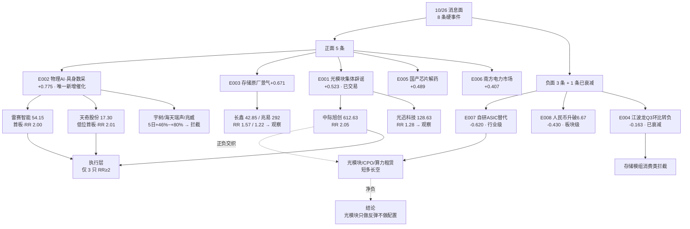

# 2026年10月26日（周一）· **消息面事件驱动**

> **数据源新鲜度**: partial · **降级状态**: false（weflow 单源失效） · **置信度**: 0.72
> **覆盖窗口**: 2026-10-23 09:03 → 2026-10-26 05:57（72h） · **主源**: 财联社/同花顺快讯 2418 + 公众号 48 + 5 焦点群 102 + 公告窗口 771 + 东财三季报预告 500
> **交叉验证**: hithink 官方 OpenAPI（人形机器人/具身智能/存储芯片 10/23 涨幅榜+涨停榜）
> **R1 背景**: 连板情绪型 · 情绪 77 · 涨停 82 / 炸板 12（炸板率 12.77%）/ 跌停 6 / 连板高度 6 板 · 昨日涨停溢价 +3.38% · 仓位上限 60%

## 一句话结论

**周五（10/23）午后那根 V 是"公司集体护盘 + 严重超卖"的双重共振，不是新主升的起点；周一真正的增量只有物理 AI/具身数采一条，且 8 条硬事件里只有 3 只票的盈亏比够格——其余全是"利好已被周五交易过"。**

## 🗺️ 消息面全景图

## 🎯 顶级事件详解

### E20261026_001 · 光模块四巨头午间集体公告"订单饱满·无砍单" · strength=high · polarity=**正面** · weighted **+0.523**(已衰减 36%)

**事件摘要**：10/23 上午 11:56 胜宏科技先公告"在手订单饱满"，12:11 新易盛披露"1.6T 光模块持续放量 + 8~10 亿回购"，12:35 中际旭创公告"客户订单需求强劲、供应链稳定"，18:38 天孚通信跟进 1~1.5 亿回购。午休结束后中际旭创被瞬间爆拉 8%，创业板指从 -3% 干到 +4%。

**推理深度三问**：

- **大资金意图**：这不是自发买盘，是**窗口指导下的上市公司集群行为**——四家龙头在同一小时用同一口径（订单饱满、无砍单、无价格崩盘）发公告，散户看不懂，但机构一眼就懂"有人在兜底"。官军当天买宽基 ETF 的量其实和前几日差不多，不足以逆转盘面；真正把指数拉起来的是**超卖技术位 + 官方信用背书的共振**。大资金要的不是"光模块多好"，是**"AI 叙事不许再崩"这个公共品**。
- **为什么走强**：两层。表层是辟谣——FCC 要"弄我们的光"这件事让海外 AI 硬件长期逻辑受损，公司必须给出"当下订单没砍"的对冲；深层是**估值透支已到位**：中际旭创 10 日高点 888 → 日内低点 553.48，10 天跌 37.7%，筹码结构已经从"追高盘"洗成"割肉盘"，任何正面信号都能触发空头回补。
- **逻辑够不够硬**：**半硬**。硬的是"当期订单没砍"（公司公告 + 胜宏/新易盛/天孚三方交叉），软的是"长期单价与配比"（见 E007，自研 ASIC 会压单 GW 光互联价值量）。所以这条只能支撑**反弹**，支撑不了**趋势**。R7 侧的证据也不支持升格：光模块没有独立 DC 板块资金口径，半导体 5 日仅 +10.97 亿。

**首推票思维链**：

#### 中际旭创 300308 · role=首推 · 收盘 612.63 · **RR 2.05**
- **买入理由**：全球光模块龙头（2025 营收 382.40 亿 / 净利 107.97 亿），10/23 是**被资金选出来的反攻旗手**（单日 +3.82%，在一堆绿盘里率先翻红）。当日 553.48 的低点正好是 10 日最低，等于"利空出尽 + 长下影"的经典结构。市值 7216 亿，是承接机构回补的最优载体。
- **风险点**：① 10 日跌幅 37.7%，上方 700/780/888 三层套牢盘；② E007 的长期折价是真实的——Bernstein 测算 OpenAI 自研 Jalapeño 方案 346 亿 vs Rubin 395 亿，单 GW 省 12%，量在但价在降；③ E008 人民币升破 6.67，公司海外收入占比高，Q3 报表有汇兑拖累。
- **止损条件**：**570.00**（612.63 × -6.96%），位于 10/23 日内低点 553.48 上方 3%。跌破即"护盘叙事失效"，不许扛。
- **可验证假设**：① 开盘 30 分钟成交额 ≥ 上周五同期 1.2 倍且价格站稳 600 → 假设成立；② 若开盘高开 >4%（>637）后 10 分钟内回落到 620 以下 → 一日游，当日不进；③ 若半导体/光模块板块当日主力净流出 >30 亿 → 假设不成立，反弹仓位清零。

---

### E20261026_002 · 物理 AI·具身数采周末卖方总攻 · strength=high · polarity=**正面** · weighted **+0.775**（今日最高）

**事件摘要**：周五盘后 NVIDIA 官宣 Isaac 人形机器人参考平台/仿真工作流；10/24 智元开源首个真实场景 Physical Agent 数据集、发布 Genie Studio 2.0；周末国金机械、国联民生、财通汽车、华福 AI、华创计算机、东吴计算机至少 6 家召开电话会，某首席直接喊出"**数采等于算力、数采设备等于光模块**"。群聊里 Figure 的实测数据被反复引用：引入人类行为数据预训练后，陌生家庭任务成功率从 **9% → 56%**。

**推理深度三问**：

- **大资金意图**：周五机器人是全场最强（宇树 20cm、多只机器人 ETF 涨超 7%、人形机器人板块 +4.92% 且主力净流入 71.43 亿），但**周五买的是"反弹弹性"，周末吹的是"产业叙事"**——这是两拨钱。卖方在周末集体把"数据采集"从概念拔成瓶颈，目的是**给已经涨了 50% 的硬件链找一个能继续讲下去的下一层**（硬件本体 → 数据/数据底座）。这是典型的"主线内切分支"：不是新开一桌，是换座位。
- **为什么走强**：因为它解决了机器人板块最大的软肋——**没有可量化的产业瓶颈**。以前炒减速器/丝杠/灵巧手，都是"零部件占比"，天花板看得见；现在把"数据缺口"摆出来（全球有效数据仅 200-300 万小时，理论需求百亿小时，差 3-4 个数量级），叙事空间一次性打开，而且**受益标的从"机械"切到"视觉/传感/软件"**——这批票在 10/23 之前根本没涨过。
- **逻辑够不够硬**：**产业逻辑硬，交易逻辑软**。硬的部分：数据缺口是真实约束（调研先知的专家纪要给了天机/帕西尼的出货与毛利数据，帕西尼数采毛利率 50-60%，数据业务增速 100-200%）；软的部分：① 一致性太高——7 个独立源、6 家卖方同一周喊同一句话，这本身就是反向指标；② 位置太差——宇树 5 日 +46.1%、海天瑞声 +80.0%、奥比中光 +52.5%、兆威 +50.1%，全部距 10 日低点 +50% 以上；③ 真正"数据采集"的收入体量都在几千万级（帕西尼数采收入 2000-3000 万），撑不起当前市值。

**首推票思维链**：

#### 雷赛智能 002979 · role=首推 · 收盘 54.15 · **RR 2.00**
- **买入理由**：运控/伺服/步进系统是**机器人关节与数采工位的共同底座**，不管硬件本体赢还是数据赢，它都收钱。10/23 **首板涨停（+9.99%）**，前面 4 天是 +5.0/0.0/-3.7 的温和整理，属"横盘后首板"，不是中位接力。Q3 净利 **+70%~90%**（10/15 预告），是数采链里少有的"有业绩 + 位置不高 + 首板"三合一。市值仅 171.1 亿，弹性够。
- **风险点**：① 首板隔日的最大风险是"高开兑现"，尤其周末吹爆之后；② 运控是通用工控件，机器人收入占比不透明，容易被当"伪受益"打回；③ 若机器人板块周一整体高开低走，首板会成为第一批被砸的。
- **止损条件**：**51.44**（54.15 × -5.0%），位于 5 日线 50.86 上方 1.1%。破 5 日线 = 首板失败，无条件走。
- **可验证假设**：① 竞价量能 ≥ 10/23 全天 3% 且价格在 53.5~56.5 之间 → 弱转强可做；② 开盘 30 分钟封板 → 持有到次日；③ 开盘 >6%（>57.4）直接放弃（追高不接）；④ 若 10:00 前跌破 53.0 且机器人板块翻绿 → 假设不成立，当日清。

#### 天奇股份 002009 · role=首推 · 收盘 17.30 · **RR 2.01**
- **买入理由**：**低位补涨位**。10/23 首板 +9.98%，10 日低点 14.32，距低点仅 +21%，是整条数采链里位置最低的首板。市值 69.6 亿，汽车拆解装备 + 机器人系统集成，正好落在"物理 AI 落地场景"这个子叙事上。前 4 天 +2.2/+2.0/+3.1/+3.4 的碎步上行，筹码干净。
- **风险点**：① 没有业绩预告，纯情绪标的，一旦板块退潮它没有基本面托底；② 市值小、流动性差，8% 仓位可能就是它一天的成交占比，滑点大；③ 拆解装备与"数采"的关联是市场联想，不是公司公告，属映射置信度 medium。
- **止损条件**：**16.44**（17.30 × -4.97%），紧贴首板启动位。跌破 = 一日游，隔日必走。
- **可验证假设**：① 次日必须涨停（19.03）才符合首板隔日模板，不涨停即走，不讲故事；② 若 10:30 前未能封板且换手 >15% → 出货，当日走；③ 若机器人板块龙头（宇树）当日跌幅 >5% → 直接放弃。

#### 降级观察（3 只，均因 RR<2 或位置过高）
| 票 | 收盘 | RR | 拦截理由 |
|---|---|---|---|
| 兆威机电 003021 | 91.73 | 1.25 | 5 日 +50.1%、距 10 日低点 +54.1%，灵巧手叙事已被充分定价 |
| 海天瑞声 688787 | 141.00 | 1.08 | 5 日 **+80.0%**、距低点 +82.3%，20cm 后追高＝接最后一棒 |
| 宇树科技 688836 | 624.00 | 1.52 | 总龙地位无争议（财联社"三度提及三度次日 20cm、本周 +94%"），但 5 日 +46.1%，只当情绪温度计，不当买点 |

---

### E20261026_003 · 存储原厂景气延续 · strength=high · polarity=**正面** · weighted **+0.671**

**事件摘要**：10/25 野村证券称"市场对 AI 投资前景的担忧属于反应过度，存储芯片短缺将持续至 2028 年，板块估值被严重低估"；长鑫科技 Q3 单季归母 **533.9~548.9 亿、环比 +1.0%~+3.9%**（扭亏，上年同期 -52.8 亿）；德明利 Q3 单季归母 26.33~29.33 亿、**环比 -1.4%~+9.8%**，其中企业级存储收入 **82.37 亿**。

**推理深度三问**：

- **大资金意图**：本周主力资金已经在做"弃高就低"——宁德时代单周失血 37 亿，而**兆易创新、德明利是本周主力净流入前二**。存储是这轮调整里唯一"业绩在加速、股价在回调"的板块（长鑫 10 日从 56.29 跌到 38.75，-31%），资金买的是**确定性折价**，不是弹性。
- **为什么走强**：因为存储是 AI 链条上**唯一还有"价格"变量的环节**。光模块担心单价被 ASIC 压，GPU 担心自研替代，只有存储是"供不应求 + 涨价 + 产能刚性"，野村把短缺周期拉到 2028 年，等于给了一个三年维度的锚。
- **逻辑够不够硬**：**硬，但要分三层看**——原厂（长鑫，环比 +1~4%，价格仍在上行）> 企业级模组（德明利，环比走平，靠结构）> 消费类模组（江波龙，环比 -36%~-49%，见顶）。**把三者混为一谈就是本轮最大的坑**，也是下面 E004 存在的意义。

#### 长鑫科技 688825 · role=降级观察 · 收盘 42.85 · RR 1.57
- **买入理由**：国产 DRAM 唯一规模量产原厂，Q3 单季环比仍正，扣非为主。
- **风险点**：市值 2.9 万亿，弹性被市值吃掉；10 日跌幅 31%，反弹目标只能给到 0.5 分位 47.64。
- **止损条件**：39.80（-7.11%，10 日低点 38.75 上方 2.7%）。
- **可验证假设**：回踩 40.5 以下（RR 2.0）才具备介入资格；否则只观察。

#### 兆易创新 603986 · role=降级观察 · 收盘 292.00 · RR 1.22
- **买入理由**：NOR/MCU 龙头，本周主力净流入居前，资金连贯性最好。
- **风险点**：已在 5 日线 284 上方，空间被压缩到 320，赔率不足。
- **止损条件**：269.00（-7.88%，10 日低点 268.30 上方 0.3%）。
- **可验证假设**：回踩 278 以下（RR 2.0）再谈。

---

### E20261026_004 · 江波龙 Q3 单季环比 -35.6%~-49.0% · strength=high · polarity=**负面** · weighted **-0.163**（已衰减，低于 0.2 门槛，负面强排例外保留）

**事件摘要**：江波龙 10/15 预告前三季归母 140~149 亿，累计同比 **+1864.55%~+1990.84%**——看着是全场最炸。但拆单季：Q1 归母 38.62 亿、H1 105.77 亿 → **Q2 单季 67.15 亿**；前三季 140~149 亿 − H1 105.77 亿 = **Q3 单季 34.23~43.23 亿**，**环比 -35.6%~-49.0%**。公司原文自己承认："DRAM 和 NAND Flash 价格涨幅较前期明显收窄，存储价格上涨对公司盈利的边际贡献显著趋缓"。

**推理深度三问**：

- **大资金意图**：市场在用脚投票。10/23 江波龙 +1.11%，同日存储板块 +3.70%、长鑫 +7.93%——**龙头原厂大涨，消费模组掉队**。这不是偶然，是资金在存储内部做"从消费类模组切向原厂/企业级"的结构调整。
- **为什么走强**（负面事件，此处指该逻辑为何持续发酵）：周期股的定价锚是**环比与产品价格拐点**，不是同比。累计同比在周期顶部最炸裂，因为基数是去年的底部；一旦单季环比转负，市场会立刻把"周期见顶"打进价格。江波龙 Q3 净利率从 47.4% 回落，就是拐点的量化证据。
- **逻辑够不够硬**：**非常硬——这是教科书级案例**。v1.5 业绩极性协议把江波龙列为标准反面案例，今天的真实数据完全复现：累计 +1864%~1991% 的"最漂亮数字"背后是单季腰斩。任何用同比买存储模组的行为都是接刀。

#### 江波龙 301308 · role=回避 · 收盘 244.68
- **拦截理由**：单季环比 -35.6%~-49.0%，毛利率自 47.4% 回落，公司自述边际贡献趋缓。
- **动作**：不因"同比 +1864%"买入；若持有，反弹至 5 日线 244.69 上方无量则减。

#### 佰维存储 688525 · role=回避 · 收盘 164.97
- **拦截理由**：同属消费类存储模组，价格涨幅收窄的传导对象一致；同链条不重复下注。

---

### E20261026_005 · 国产芯片成为"指数解药" · strength=medium · polarity=**正面** · weighted **+0.489**

**事件摘要**：中国芯大会 11/1-4 横琴举办（AI 算力/RISC-V/端侧智能/具身智能，已外部核验议程）；华强北显卡"一日一价"，RTX 5090 从 1.5 万被炒至 6 万；寒武纪 Q3 净利 14.04 亿；英特尔 CTO 称"全球尖端晶圆产量现实增长上限约为两倍"。

**推理深度三问**：

- **大资金意图**：流沙河的逻辑说得最直白——"海外 AI 是这波调整的始作俑者（FCC 要弄我们的光），国产芯片是科技最后一个见顶的分支，不受海外 AI 走势影响，如果硬科技要带指数反弹，只能是国产芯片这个解药"。周五下午和周四下午，指数最难看的时候都是芯片标志性个股拉板救人气，这是**资金用真金白银做的选择**。
- **为什么走强**：两个物理约束在同时收紧——**需求端**（AI 算力国产化由政策驱动转市场驱动）和**供给端**（显卡缺货涨价、晶圆产能天花板）。这与光模块"量在价降"正好相反，是**量价齐升**的稀缺组合。
- **逻辑够不够硬**：**叙事硬、资金软**。硬的部分：寒武纪 Q3 14.04 亿是唯一有利润验证的国产算力大票，海光 Q3 +50%~64%，西安奕材 +127%。软的部分：**国产芯片 5 日主力净流出 19.44 亿**，仅 10/23 单日 +79.92 亿——这是"单日脉冲"不是"5 日趋势"。所以 strength 只给 medium，不给 high。

#### 海光信息 688041 · role=降级观察 · 收盘 201.10 · RR 1.02
- **买入理由**：国产 CPU+DCU 双线，Q3 归母 +38.16%~51.93%（扣非 +50.47%~+64.17%），国产化由政策驱动转市场驱动（公司原文）。
- **风险点**：10 日区间 246.93→186.00，反弹目标最多给到 0.5 分位 216.5，空间不足 8%。
- **止损条件**：186.50（-7.26%，紧贴 10 日低点 186.00）。
- **可验证假设**：若国产芯片板块 5 日资金由负转正，再重估；当前 RR 1.02 直接拦截。

#### 寒武纪 688256 · role=降级观察 · 收盘 932.20 · RR 1.82
- **买入理由**：Q3 净利 14.04 亿，国产算力唯一有利润验证的大市值标的。
- **风险点**：E007 的全球资本开支下修会压制估值锚；股价 932，一手 9.3 万，仓位颗粒度粗。
- **止损条件**：862.00（-7.53%，10 日低点 833.93 上方 3.4%）。
- **可验证假设**：回踩 900 以下（RR 2.0）再谈。

---

### E20261026_006 · 南方区域电力市场正式运行 + 特高压持续推进 · strength=medium · polarity=**正面** · weighted **+0.407**

**事件摘要**：10/24 央视新闻确认南方区域电力市场正式运行，打通广东/广西/云南/贵州/海南五省区，煤电水电核电风光同一套规则竞价，经营主体**超 29 万家**，虚拟电厂与新型储能正式入市；国家能源局 10/25 在广州召开推进会，局长王宏志强调"扩大能源有效投资"；财联社早知道主题前瞻另提"疆电入川渝、陇电入川特高压重大项目建设持续推进"。

**推理深度三问**：

- **大资金意图**：这是**慢钱的方向，不是快钱的战场**。电力体制改革对电网设备是 3-5 年的订单逻辑，游资不会为它发动首板。10/23 东财板块资金前 20 里找不到电力设备/特高压，说明**资金完全没进来**。
- **为什么走强**：它走强的不是股价，是**政策确定性**。全国统一电力市场是"五统一、一开放"的落地节点，29 万主体入市意味着交易/调度/计量系统的改造需求，虚拟电厂从"示范"变"可交易"。
- **逻辑够不够硬**：**逻辑硬、交易软**。官方源（央视 + 国家能源局）确认，事件本身无争议；但没有资金、没有个股点名、弹性只有 2-3%/日。这类事件在 R4 里的价值是"背景板"，不是"买入理由"。给 medium 已经是上限。

#### 平高电气 600312 · role=降级观察 · 收盘 21.50 · RR 1.31
- **买入理由**：GIS/开关设备特高压主设备商，疆电入川渝、陇电入川直接受益。
- **风险点**：无资金验证；日波动小，短线池里占仓位不产出。
- **止损条件**：20.00（-6.98%，10 日低点 18.69 上方 7.0%）。
- **可验证假设**：只有当电力设备板块进入单日资金前 10 且平高放量突破 21.66（10 日高），才升格为可交易；否则永久观察。

#### 国电南瑞 600406 · role=降级观察 · 收盘 23.42 · RR 1.44
- **买入理由**：电网自动化/调度系统龙头，统一竞价提升调度与交易系统需求。
- **风险点**：纯政策、无资金，属周线级别品种。
- **止损条件**：21.90（-6.49%，10 日低点 21.95 下方一档）。

---

### E20261026_007 · 自研 ASIC 替代加速 · strength=high · polarity=**负面** · weighted **-0.620** · **bearish_scope=行业级**

**事件摘要**：SemiAnalysis 的 Dylan Patel 给出数字——1GW 算力集群市场成本已从 2024 年约 400 亿美元升至 **600 亿美元以上**，但剔除 NVIDIA/Broadcom/Marvell 的利润，底层成本可能只有 **200 亿美元**；Anthropic 已启动自研芯片项目，目标是 OpenAI 一半的时间；Bernstein 的对照测算更保守：Rubin 方案 395 亿 vs 自研 Jalapeño 346 亿，**只省 12% 不是 2/3**。同一时间马斯克称"受债务市场承压影响，200 余家新型算力云企业将迎来整合，仅有少数能存活"，并称"将看到大量算力滞留在部分完工的数据中心里"。中信证券另指 AI 科技企业 CDS 交易量与利差双升。

**推理深度三问**：

- **大资金意图**：这条是**给已经跑了两年的 AI 硬件叙事做"价"的减法**。过去两年市场只算"量"（capex 2200 亿、订单排到 2028），现在开始算"价值量归属"——600 亿里有 400 亿是芯片设计公司的利润，一旦 CSP 自研，这部分利润要重新分配。资金的反应已经在发生：费城半导体指数本周累跌 3.3%、存储芯片指数跌 3.4%、AI 赢家指数跌 3.2%。
- **为什么走强**（负面事件，此处指该逻辑为何持续发酵）：因为它同时打掉两个假设——① "capex 增长 = 供应链同比例受益"（自研 ASIC 会改变单 GW 的光互联配比与 NAND 依赖）；② "算力永远稀缺"（马斯克说算力会滞留在未完工的数据中心里，即**局部过剩**）。这两个假设是光模块/算力租赁估值的底座。
- **逻辑够不够硬**：**硬，但节奏慢**。Dylan 的 200 亿是"完全垂直整合后的理论成本"，不是 Anthropic 的实际预算；Bernstein 的 12% 才是可执行口径。所以这是**估值折价因子**，不是**明天的卖出信号**。它的作用是给 E001 的反弹设上限——反弹可以，配置不行。

#### 受冲击标的（不设首推，均为回避/中性）
| 票 | 收盘 | 角色 | 传导路径 | 动作 |
|---|---|---|---|---|
| 中际旭创 300308 | 612.63 | 回避(长期) | 单 GW 光互联价值量随 ASIC 方案下降 + FCC 长期限制预期 | 短期按 E001 做反弹，中期不得按"光模块长逻辑"配置，两者冲突时以短期为准且仓位 ≤10% |
| 寒武纪 688256 | 932.20 | 中性(结构受益) | 国产替代逻辑独立，但全球 capex 下修压制估值锚 | 维持 E005 的降级观察 |

---

### E20261026_008 · 人民币升破 6.67 · strength=medium · polarity=**负面** · weighted **-0.430** · bearish_scope=板块级

**事件摘要**：10/23 纽约尾盘离岸人民币报 **6.6690**，逼近 2022 年 6 月以来最强；10/23 中间价 6.7180（调高 15 点）。相比去年低位 7.35 已升值近 10%。猫笔刀指出：很多科技公司客户在美国，订单收款全是美元、应收账款规模巨大，人民币每升一个点都会产生巨额汇兑损失，上半年已有多家公司因此业绩不及预期。

**推理深度三问**：

- **大资金意图**：汇率是**财务折价因子**，不构成独立交易逻辑。资金不会因为汇率去砸一个板块，但会在选票时把"海外收入占比高 + 美元应收大"的票往后排——这正好叠加在光模块/消费电子/光伏上。
- **为什么走强**（负面事件，此处指该逻辑为何持续发酵）：因为 Q3 报表是**已经发生**的汇兑损失，不是预期。人民币从 7.35 到 6.67 的 10% 升值，对美元应收为主的出口型硬件公司是实打实的利润侵蚀，且不可对冲（多数公司只做部分锁汇）。
- **逻辑够不够硬**：**方向硬、标的不硬**。没有点名个股、没有量化金额，只能定性；所以 strength 只给 medium，bearish_scope 定在板块级，**不构成任何个股的独立拦截理由**，只作为 E001 仓位的第二重上限。

---

## 📊 板块 × 事件热力矩阵（极性叉乘）

| 板块 | 正向事件 | 负向事件 | 净加权分 | 净极性 | 冲突 | 交易读法 |
|---|---|:--:|:--:|:--:|:--:|---|
| 具身智能数采 | E002 +0.775 | — | **+0.775** | 正面 | 否 | 唯一"消息+资金+情绪"三线同向，但 5 日涨幅过大，只做首板 🟢🟢🟢 |
| 人形机器人 | E002 +0.775 | — | **+0.775** | 正面 | 否 | 龙头宇树位置过高，移向低位首板 🟢🟢🟢 |
| 机器视觉 | E002 +0.775 | — | **+0.775** | 正面 | 否 | 数采硬件入口，弹性次一档 🟢🟢 |
| 存储(DRAM/原厂) | E003 +0.671 | — | **+0.671** | 正面 | 否 | 正面但市值/位置限制弹性，等回踩 🟢🟢 |
| 半导体设备/材料 | E005 +0.489 | — | **+0.489** | 正面 | 否 | 跟随，无独立催化 🟢 |
| 国产算力芯片 | E005 +0.489 | E007 -0.620(部分) | **+0.489** | 正面 | 否 | 叙事强、资金弱(5日 -19.4亿)，等 5 日转正 🟡 |
| 特高压/电网设备 | E006 +0.407 | — | **+0.407** | 正面 | 否 | 政策硬、交易软，底仓级 🟡 |
| 虚拟电厂/新型储能 | E006 +0.407 | — | **+0.407** | 正面 | 否 | 同上 🟡 |
| 光模块 | E001 +0.523 | E007 -0.620 / E008 -0.430 | **-0.097** | 冲突(正负同存) | **是** | **短多长空：只做反弹兑现，不做长逻辑配置** 🔴 |
| CPO/光器件 | E001 +0.523 | E007 -0.620 | **-0.097** | 冲突 | **是** | 同上，且多一层 FCC 折价 🔴 |
| 出口型科技硬件 | E001 +0.523 | E008 -0.430 | **+0.093** | 冲突(近中性) | **是** | 财务折价因子，不构成独立理由 🟡 |
| 存储模组(消费类) | — | E004 -0.163 | **-0.163** | 负面 | 否 | **拦截**；不与原厂混为一谈 🔴 |
| 海外 AI 硬件链 | — | E007 -0.620 | **-0.620** | 负面 | 否 | 行业级利空，任何反弹按减仓窗口处理 🔴🔴 |
| 算力租赁/IDC | — | E007 -0.620 | **-0.620** | 负面 | 否 | 马斯克直接点名 200+ 家整合 🔴🔴 |

> **叉乘要点**：光模块净分 **-0.097**——它是今天最容易误判的板块。E001 看着 6 源共振、龙头独拉 8%，但把 E007（单价/配比下修）和 E008（汇兑损失）叠上去，净值为负。**"订单没砍"和"单价在降"不矛盾，一个是量、一个是价**。任何把中际旭创当"长逻辑配置"买的动作，都是在用一个已被证伪的假设下注。

## 🔥 三季报业绩预告命中（硬 alpha 交叉验证）

从 `eastmoney_earnings_predict` 500 条中提取与本文事件板块的交集，并按 **单季环比** 做极性修正：

| 代码 | 名称 | 类型 | 归母同比 | 单季环比 | 事件命中 | 极性判定 | 强度 |
|---|---|---|:--:|:--:|---|:--:|:--:|
| 688825 | 长鑫科技 | 扭亏 | 归母 131~132.5 亿 | **+1.0%~+3.9%** | E003 存储原厂 | 正面·增速换挡 | 🟢🟢🟢 |
| 001309 | 德明利 | 扭亏 | +32046%~+33154% | **-1.4%~+9.8%** | E003 企业级存储 | 中性·高位走平 | 🟡 |
| 301308 | 江波龙 | 预增 | +1864%~+1991% | **-35.6%~-49.0%** | E004 存储模组 | **负面·周期见顶** | 🔴🔴🔴 |
| 002281 | 光迅科技 | 预增 | +65.37%~+82.26%（扣非 +73.38%~+91.09%） | 未拆分 | E001 光模块 | 正面 | 🟢🟢 |
| 300620 | 光库科技 | 预增 | +142%~+162%（扣非 +202%~+222%） | 未拆分 | E001 光器件 | 正面 | 🟢🟢 |
| 688808 | 联讯仪器 | 预增 | +1866%~+2073% | 未拆分 | E001 光通信测试 | 正面·但市值 1697 亿 | 🟡 |
| 688041 | 海光信息 | 预增 | +38.16%~+51.93%（扣非 +50.47%~+64.17%） | 未拆分 | E005 国产算力 | 正面 | 🟢 |
| 688783 | 西安奕材 | 扭亏 | +127.14% | 未拆分 | E005 硅片 | 正面 | 🟢 |
| 002979 | 雷赛智能 | 预增 | +70%~+90% | 未拆分 | E002 运控 | 正面 | 🟢🟢 |
| 300748 | 金力永磁 | 预增 | +42.59%~+55.20% | 未拆分 | E002 机器人磁材 | 正面 | 🟢 |
| 300853 | 申昊科技 | **减亏** | +53.48%~+56.58% | 未拆分 | E002 算电协同机器人 | 中性·减亏非转盈 | 🟡 |
| 600487 | 亨通光电 | 预增 | +151.27%~+168.10% | 未拆分 | E001 光通信 | 正面 | 🟡 |
| 002436 | 兴森科技 | 预增 | +204.2%~+227.0% | 未拆分 | AI 算力 PCB | 正面·PCB 资金流出 | 🟡 |
| 002916 | 深南电路 | 预增 | +74.13%~+78.43% | 未拆分 | AI 算力 PCB | 正面 | 🟢 |

> **关键提示**：三季报是本周主线之一——未来一周有 4470 家公司披露业绩。**"预增"不等于"能涨"**：江波龙是今天最贵的教训，累计 +1864% 却环比腰斩；长鑫与德明利的差别也只在"环比是否还在增长"这一个数字上。

## 📋 首板候选池（v1.6 · 消息侧，不做位置判断）

| 优先级 | 代码 | 名称 | 市值 | 主题 | 消息依据 | 质量 |
|:--:|---|---|:--:|---|---|:--:|
| 1 | 002009.SZ | 天奇股份 | 69.6 亿 | 具身智能数采/机器人集成 | 10/23 首板，数采链位置最低 | high(2源) |
| 2 | 003021.SZ | 兆威机电 | 245.8 亿 | 人形机器人/灵巧手 | 10/23 涨停，4 源命中 | high(4源) |
| 3 | 002611.SZ | 东方精工 | 171.2 亿 | 具身智能数据工厂 | 参股乐聚、运营大湾区数据训练中心 | high(2源) |
| 4 | 688507.SH | 索辰科技 | 163.1 亿 | 物理 AI 仿真 | 5 源命中(含财联社早知道)，10/23 +14% | high(5源) |
| 5 | 603337.SH | 杰克科技 | 187.0 亿 | 物理 AI 应用 | 国金机械点名，10/23 涨停 | medium |
| 6 | 688208.SH | 道通科技 | 164.3 亿 | 物理 AI 世界端口 | 国联民生"白+黑"组合 | medium |
| 7 | 688777.SH | 中控技术 | 618.7 亿 | 工业物理 AI 全栈 | TPT+Plantbot，10/23 +8.6% | medium |
| 8 | 300620.SZ | 光库科技 | 625.0 亿 | 光器件(薄膜铌酸锂) | 并购过会+扣非 +202%~222% | medium |
| 9 | 002194.SZ | 武汉凡谷 | — | AI-RAN 射频 | 群聊点名，物理 AI 基站分支 | medium |
| 10 | 000559.SZ | 万向钱潮 | 384.5 亿 | 人形机器人/丝杠 | 10/23 首板，丝杠主题前瞻 | medium |

> 本表**只解决"消息侧有没有刺激"**，不解决"能不能买"。强弱由 D1 竞价 + execute 盘中确认；R4 明确不为任何首板候选背书仓位。

## 关键证据

- **证据 1**：10/23 11:56-12:35 三家公司公告原文（胜宏"在手订单饱满"、新易盛"1.6T 持续放量 + 8~10 亿回购"、中际旭创"客户订单需求强劲"） · news_cls/同花顺 · 2026-10-23
- **证据 2**：四巨头午间集体护盘的机制与效果（中际旭创暴力拉 8%、创业板 -3%→+4%） · 公众号·猫笔刀《周五中午发生了什么》 · 2026-10-25
- **证据 3**：NVIDIA Isaac 平台官宣（周五盘后）+ 智元开源 Physical Agent 数据集（10/24）+ 摩根大通 Optimus 量产交底 · 公众号·财闻私享 · 2026-10-25
- **证据 4**：具身数采产业量化数据（天机双臂累计出货 1 万台、帕西尼数采毛利率 50-60%、全球有效数据仅 200-300 万小时） · 公众号·调研先知专家纪要 · 2026-10-25
- **证据 5**：野村"存储短缺至 2028 年、估值严重低估" · news_cls/财联社 · 2026-10-25 15:13
- **证据 6**：江波龙单季拆分（Q1 38.62 / H1 105.77 / 前三季 140-149 → Q3 单季 34.23-43.23，环比 -35.6%~-49.0%） · tushare income + 东财业绩预告 · 2026-10-26
- **证据 7**：南方区域电力市场正式运行 + 29 万经营主体 · 央视新闻 · 2026-10-24 09:30 / 12:02
- **证据 8**：自研 ASIC 成本对比（Rubin 395 亿 vs Jalapeño 346 亿，省 12%；理论底线 200 亿）+ Anthropic 自研 · 公众号·傅里叶的猫/SemiAnalysis/Bernstein · 2026-10-23
- **证据 9**：马斯克"200 余家算力云将整合""大量算力滞留在未完工数据中心" · news_cls · 2026-10-26 03:21 / 2026-10-25 09:34
- **证据 10**：离岸人民币 6.6690，逼近 2022-06 以来最强 · news_cls · 2026-10-24 05:13

## 数据源审计

| 源 | 日期 | 状态 | 条数 | 备注 |
|---|---|:--:|:--:|---|
| 财联社/同花顺快讯 (news_cls) | 2026-10-23 ~ 10-26 | 🟢 | 2418 | 覆盖 72h，时间戳精确到秒 |
| Tushare 重大新闻 (news_major) | 2026-10-26 | 🟢 | 800 | 长篇要闻 |
| 东财三季报预告 | 2026-10-26 | 🟢 | 500 | 报告期 2026-09-30；预增 282/略增 82/预减 31 |
| 公众号 (取阅 RSS) | 2026-10-26 06:02 | 🟢 | 48 | 15 源 11 源有文；**盘前纪要 feed 为空**（该号未更新） |
| 5 焦点群 (wechat-cli) | 2026-10-26 06:02 | 🟢 | 102 | 5/5 群 ok，群名已匿名化 |
| 公告窗口 (anns_window) | 2026-10-25 ~ 10-26 | 🟢 | 771 | 242 家公司，业绩预告 211/并购重组 15/回购 20 |
| hithink 官方 OpenAPI | 2026-10-26 06:35 | 🟢 | 60 | 人形机器人/具身智能/存储芯片 10/23 涨幅+涨停榜 |
| Tushare 日线/利润表 | 2026-10-23 | 🟢 | 33 只 | 用于 stop_loss 与单季拆分 |
| WeFlow Analytics | 2026-10-26 06:03 | 🔴 | — | ngrok 隧道 404，R3 KOL 交叉验证只能自建 |
| XTick 热榜新闻 | — | ⚪ | — | 未使用（news_cls 已覆盖，避免重复计源） |

## 不确定性 / 反证

1. **"周末吹爆"是最强的反向信号**。物理 AI 7 源共振、6 家卖方同一周喊同一句话——A 股历史上这种一致性出现后，次日高开低走概率远高于高开高走。R4 只放 2 只首板、且都是 5 日涨幅最小的，正是为了对冲这个风险。
2. **E001 与 E007 的"正负交织股"**：中际旭创同时被 3 条事件命中（1 正 2 负）。这类票最容易在 D1 阶段被误判为"多重利好"，实际是"多重矛盾"。已在 `stocks_catalyzed` 显式标注，仓位上限 10%。
3. **E004 是例外保留**：加权分 -0.163 低于 0.2 门槛，按规则本应剔除。保留原因是红线 3（负面必须列出）+ 它是存储三层分化的必要反向锚。D1 读到 `decayed=true` 应视为背景，不作为卖出依据。
4. **KOL 单点风险**：具身数采的产业数据（天机 1 万台、帕西尼毛利）全部来自「调研先知」一篇专家纪要，属单一来源，无法交叉验证。若该纪要口径有误，E002 的产业论据强度下降一档。
5. **数据源缺口方向**：weflow 全 down → 无法用社媒情绪浓度做二阶验证；盘前纪要 feed 空 → 缺失每日 7:00 的结构化盘前归因；PTA 般"卖方一致性"这个维度，R4 目前只能靠群聊口播近似。
6. **反向思考 E002**：如果资金周一选择"卖数采、买硬件本体"（即回到减速器/丝杠/灵巧手），那么今天推的两只首板都会踏空。这不是小概率——因为数采的收入体量（帕西尼全年数采 2000-3000 万）与当前市值溢价严重不匹配。

## 与其他 R/D/E 的关系

- **依赖**：`data/raw/20261026/` 五源 + `hithink` 官方 OpenAPI + `tushare` 日线/利润表
- **被消费**：
  - **R2 主线** → 用 `sectors_catalyzed` 的净极性给"物理 AI"打催化分；注意光模块净分为负，不应进主线
  - **R5 个股画像** → 用 `stocks_catalyzed` + `top_pick_logic` 的 `business_relevance` 做主营重叠验证
  - **R6 反证** → 重点反证 E002 的"卖方一致性"与 E003 的"存储三层混淆"
  - **D1 预案** → 用 `rule=首推` 的 3 只（RR≥2）进候选，`降级观察` 全部进 watch_pool，`回避` 进禁止清单
  - **E1 复盘** → 统计 `llm_pick_method` 全为 `llm_with_hithink_verification`（0 只 proxy），验证机制生效

## Sub-Agent 元数据

- skill: `analyze_news_impact_v1@1.6`
- artifact: `data/research/20261026/R4_news.json`（67,685 bytes）
- method: `llm_v1`（五源硬约束 + hithink 官方 OpenAPI 受益股池）
- 事件去重: raw 187 → merged 8（dedup_rate 0.957）
- 首推 3 / 降级观察 10 / 回避 4 / 中性 1（合计 18 只）
- 生成时刻: 2026-10-26T06:24:40+08:00
