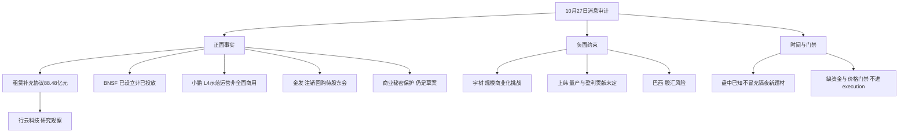

# 2026年10月27日 · 消息面事件驱动

## 一句话结论

观察合同兑现与运营许可；保留机器人商业化及巴西风险；全部不进execution。

实际截止：2026-10-27T06:19:35+08:00；生成：2026-10-27T06:24:43+08:00。重点回看72小时，但各源实际覆盖不同，不声称完整补齐。最新已完成交易日20261026，Tushare交易日历已核。

## 先认市场：四问与权限边界

市场在为什么付钱：媒体复盘显示物理AI、机器人叙事活跃；R4没有资金确认，不能授予可交易主线身份。主线=未确认，持续性=未知，封板率=未知，明日预期=未知，交由R1/R2/R7确认。

现在在哪一段：上游emotion_cycle.json标高位震荡，指标日10月26日，炸板率29.49%，含intraday_fallback。本口径未触发35%候选减半门槛，但不是R4独立情绪计算，仍待R1复核。

谁有地位：未知。媒体点名、涨幅或合同金额不等于龙头；没有选定五日主模板。

今天做什么、不做什么：2只正面研究映射只观察，2只负面映射降级。无首推票、无开仓权；不生成技术止损、目标价、资金排名、主营比例或仓位。R6硬否决权不被本文替代。

## 🗺️ 消息面全景图

## 🎯 八条可验证事件：每事件三问

strength描述事实证据硬度，不是股价确定性。7条由官方原文准入；巴西经央视报道与法新社传播路径核实，保留medium。转载数量不等于独立原始来源数。

### E20261027_001 · 行云科技V客户租赁补充协议总额升至88.48亿元

态度=观察；极性=正面；strength=high；新旧=老方向新增催化；可交易日=20261027。

事件事实：五年协议总额由65.23亿元调整为88.48亿元；第一批按旧价；第二批及后续批次适用新标准。每批须交付改配并书面验收且最终客户起租后计租。

时间锚：原文发布=2026-10-26（精度=day）；最早可支持公开=2026-10-26T18:47:43+08:00；核取=2026-10-27T06:17:23+08:00。XTick东方财富(财联社稿) 2026-10-26 18:47:43；原公告署10月26日但目录日期10月27日；精确公告上线时分未知。

衰减：raw=+0.78 → weighted=+0.725764；days_since=0.4805；λ=0.15。评分是LLM事件强度，非概率或RR。

- **大资金意图**：资金意图未核实。若资金寻找AI需求可兑现的证据，已签补充协议比泛化模型叙事更具体；这只是选择逻辑，不是主力已买入的事实。
- **为什么走强**：算力租赁可能由需求热度转向合同兑现；本次是存量合同调价，不是新增88.48亿元订单，也不能解释10月26日盘中走势。
- **逻辑够不够硬**：合同原文明确金额与起租条件，事件本身硬；利润和现金流并未被锁死，新增租金不等于新增毛利。

反面与边界：五年履约及交付风险；租金为静态测算；配件、备机、停机扣租可能侵蚀收益；不推断V客户身份。

验证点：后续分批验收、实际起租、回款及利润率与公告口径一致才支持传导。

关键证据：
- https://static.cninfo.com.cn/finalpage/2026-10-27/1225626017.PDF
- https://finance.eastmoney.com/a/202610263908212295.html
- https://mp.weixin.qq.com/s?__biz=MjM5NDEzMTAwMA==&mid=2652701022&idx=1&sn=e52a702612c2f59414eb39980bf5d0c1&chksm=bc16613aace94c1065e81777ac4503b03c434a87fb78bdf236c0ae660994ad7703977dbd6b04

### E20261027_005 · 宇树科技异动公告警示物理AI规模化商业落地风险

态度=观察；极性=负面；strength=high；新旧=老方向新增催化；可交易日=20261027。

事件事实：公司确认连续三日涨幅偏离累计超过30%；不存在应披露未披露重大信息；物理AI感知、控制、数据与软硬协同均仍有规模化挑战。

时间锚：原文发布=2026-10-27（精度=day）；最早可支持公开=2026-10-26T18:12:10+08:00；核取=2026-10-27T06:17:23+08:00。news_cls.jsonl第1003行 新浪 10月26日18:12:10；巨潮目录及署名日期10月27日。不以署名日期覆盖已公开时间。

衰减：raw=-0.72 → weighted=-0.667459；days_since=0.5051；λ=0.15。评分是LLM事件强度，非概率或RR。

- **大资金意图**：不能由提示公告推断大资金出货。真正需要检验的是前期强叙事能否转换为规模交付，而不是用群聊预言当卖出事实。
- **为什么走强**：这条是负向修正，不是走强原因；它削弱无条件外推商业化速度的论据，冲击同叙事高预期公司的接力假设。
- **逻辑够不够硬**：风险内容及公司自查来自正式公告；硬的是风险披露，不能由此推出次日必跌或全行业订单恶化。

反面与边界：行业级传导为研究推断；不可把公告PE自行扩写成R4估值结论，也不能替代R6硬否决。

验证点：R5核公司交付及数据闭环进度；R7核真实承接；R6独立决定是否存在硬否决。

关键证据：
- https://static.cninfo.com.cn/finalpage/2026-10-27/1225625659.PDF

### E20261027_006 · 上纬新材提示机器人量产爬坡与盈利贡献尚不确定

态度=观察；极性=负面；strength=high；新旧=老方向新增催化；可交易日=20261027。

事件事实：消费级机器人已上市销售但处规模化量产爬坡与商业验证；相关机器人及模型开发产品仍研发中；公司不能预测对全年营收和盈利的影响。

时间锚：原文发布=2026-10-27（精度=day）；最早可支持公开=2026-10-26T19:38:00+08:00；核取=2026-10-27T06:17:23+08:00。news_cls.jsonl第1665行同花顺10月26日19:38及第657行新浪19:38:10；正式文件署10月27日。

衰减：raw=-0.67 → weighted=-0.626686；days_since=0.4455；λ=0.15。评分是LLM事件强度，非概率或RR。

- **大资金意图**：资金意图未知。公告要求区分已经卖出的消费级产品与仍在研发的产品，不应把题材涨停反过来当收入证据。
- **为什么走强**：这是对物理AI、数据采集热度的负向约束；10月26日午后上涨早于晚间披露，不能用晚间公告解释此前行情。
- **逻辑够不够硬**：原公告直接确认阶段与不确定性；不是否认公司有机器人业务，也不是证明业务完全失败。

反面与边界：旧中报亏损是风险背景而非本次新业绩；不能拿旧累计同比单独定性新的单季趋势。

验证点：后续量产交付、商业合同、收入贡献口径和研发转销售情况，区分不同产品线。

关键证据：
- https://static.cninfo.com.cn/finalpage/2026-10-27/1225626961.PDF

### E20261027_002 · 央行设立债市非银大额赎回互换便利BNSF

态度=观察；极性=正面；strength=high；新旧=老方向新增催化；可交易日=20261027。

事件事实：工具已设立；特定系统性压力情景下以央票互换、市场回购融资支持合格机构；不是已启动投放，也不是正常时期全面放水。

时间锚：原文发布=2026-10-26T17:00:11+08:00（精度=second）；最早可支持公开=2026-10-26T17:00:11+08:00；核取=2026-10-27T06:17:23+08:00。央行官网正文2026-10-26 17:00:11；10月19日已有预告而本次为正式设立。

衰减：raw=+0.62 → weighted=+0.570463；days_since=0.5551；λ=0.15。评分是LLM事件强度，非概率或RR。

- **大资金意图**：大资金意图未知。机制可降低资管集中赎回的尾部流动性顾虑，不能据此声称机构增配股票。
- **为什么走强**：风险缓释可能改善非银资管及银行理财经营预期；它针对债券流动性负反馈，不直接等同券商股票承销或证券自营收入增长。
- **逻辑够不够硬**：央行官网原文确认设立与适用对象，制度事实硬；额度、实际使用与盈利弹性未确认。

反面与边界：10月19日已有政策预告；审慎约束仍在；信用损失与不审慎经营不因工具自动消失。

验证点：操作细则、适用机构和真实使用披露，而非把工具设立理解为当日救市资金。

关键证据：
- https://www.pbc.gov.cn/goutongjiaoliu/113456/113469/2026102616264823100/index.html

### E20261027_003 · 小鹏获批广州全域L4级Robotaxi示范运营资格

态度=观察；极性=正面；strength=high；新旧=已交易后的延续；可交易日=20261026。

事件事实：公司官网确认广州全域示范运营资质；初期以邀请码逐步开放体验；不等于无条件开放商业收费或全国运营许可。

时间锚：原文发布=2026-10-26（精度=day）；最早可支持公开=2026-10-26T11:23:00+08:00；核取=2026-10-27T06:17:23+08:00。news_cls.jsonl第2393行同花顺转南方plus 10月26日11:23；财联社原始电报11:29:48；官网仅有日期。主题前瞻页面08:54与聚合20:54冲突不用于回溯最早公开。

衰减：raw=+0.58 → weighted=+0.515241；days_since=0.7893；λ=0.15。评分是LLM事件强度，非概率或RR。

- **大资金意图**：资金意图未知。产业叙事从测试转向运营验证，若资金认可则更偏真实交付环节，而不是任意车联网标签。
- **为什么走强**：资质减少场景准入不确定性；但10月26日上午已公开，10月27日只是延续研究，不是隔夜全新题材。
- **逻辑够不够硬**：小鹏官网直接确认，资格事实硬；规模、付费用户与单位经济性没有给出可核验承诺。

反面与边界：运营安全、调度效率与成本待验证；国投智能、数码视讯仅在媒体映射，无该项目直接供货合同证据。

验证点：正式服务范围、付费规则、车队规模及运营指标披露后再判断A股供应关系。

时间冲突：财联社主题前瞻网页标08:54；XTick/major_news标20:54；公众号镜像19:02。不能据此证明整个综合稿08:54已公开。

关键证据：
- https://www.xiaopeng.com/news/company_news/5605.html
- https://www.cls.cn/detail/2514797

### E20261027_004 · 金发科技3至5亿元注销式回购预案进入董事会方案阶段

态度=观察；极性=正面；strength=high；新旧=老方向新增催化；可交易日=20261027。

事件事实：拟回购3至5亿元并全部注销；尚需股东会批准；回购价上限19.57元不是止损价。10月20日已披露董事长同金额提议。

时间锚：原文发布=2026-10-27（精度=day）；最早可支持公开=2026-10-26T16:19:00+08:00；核取=2026-10-27T06:17:23+08:00。董事会方案消息news_cls.jsonl第2151行10月26日16:19；底层同金额董事长提议已在10月20日公开。区别新阶段与旧计划。

衰减：raw=+0.35 → weighted=+0.320657；days_since=0.5837；λ=0.15。评分是LLM事件强度，非概率或RR。

- **大资金意图**：公司明示维护股东价值；市场大资金是否跟随未知。注销相较员工激励回购减少股本的传导更直接，但不能视作已经买入。
- **为什么走强**：事件只直接作用于本公司资本安排；不会自动令全部改性塑料走强。金额早已公开，本轮增量是董事会方案及贷款承诺。
- **逻辑够不够硬**：回购用途、资金区间和程序由原公告确认；意向至实际执行仍隔着股东会及市场价格条件。

反面与边界：10月20日已知金额与注销用途；价格越过上限或审批不通过可导致不实施；银行承诺函不等于实际提款或回购完成。

验证点：股东会批准及回购进展公告，不能把未实施金额计为当日资金流入。

旧信息审计：10月20日已知同金额与注销用途；本次仅记方案进展，不把夜间转载当首次公开。

关键证据：
- https://static.cninfo.com.cn/finalpage/2026-10-27/1225622684.PDF

### E20261027_007 · 商务部就保护中国商业秘密特别规定公开征求意见

态度=观察；极性=正面；strength=high；新旧=老方向新增催化；可交易日=20261027。

事件事实：已发布征求意见通知；反馈截止11月24日；是商业秘密保护的制度拟议进程，不是已生效制裁或软件采购预算。

时间锚：原文发布=2026-10-26T15:39:00+08:00（精度=second）；最早可支持公开=2026-10-26T15:39:00+08:00；核取=2026-10-27T06:16:38+08:00。商务部条法司原通知2026-10-26 15:39；征求意见非生效。

衰减：raw=+0.31 → weighted=+0.282830；days_since=0.6115；λ=0.15。评分是LLM事件强度，非概率或RR。

- **大资金意图**：资金意图未知。若形成研究方向，应检验商业秘密管理和合规服务的真实付费需求，而不是扩大到所有安全软件。
- **为什么走强**：制度保护可能增加合规及知识产权服务需求；这是条件性产业传导，未确认板块走强，更无A股新订单。
- **逻辑够不够硬**：商务部通知原文硬；具体条款生效、执法对象和上市公司营收映射不硬。

反面与边界：草案不等于法律已经实施；限制外方的安排可能增加跨境合作合规摩擦，但不当作已发生的贸易损失。

验证点：正式文本和生效日期，以及真实商业秘密保护服务合同；不为抽象政策强配个股。

关键证据：
- https://tfs.mofcom.gov.cn/lfzqyj/art/2026/art_db6a858a9d4e4ec0a3dbeece659c324d.html

### E20261027_008 · 巴西股市触发熔断并伴随雷亚尔剧烈波动

态度=观察；极性=负面；strength=medium；新旧=全新风险事件；可交易日=20261027。

事件事实：央视报道当地10月26日股指跌10%触发暂停30分钟；复盘所述盘中更大跌幅不等于收盘跌幅。法新社经联合早报亦报道熔断。

时间锚：原文发布=2026-10-27T04:28:00+08:00（精度=second）；最早可支持公开=2026-10-26T21:02:00+08:00；核取=2026-10-27T06:16:51+08:00。news_cls.jsonl第1592行同花顺10月26日21:02及第482行新浪21:02:33；央视后续原报道转载时间10月27日04:28；当地事件日10月26日。

衰减：raw=-0.56 → weighted=-0.528401；days_since=0.3872；λ=0.15。评分是LLM事件强度，非概率或RR。

- **大资金意图**：大资金意图未知。股汇同步波动提示当地风险溢价重估，不能泛化为中国资金已撤离A股。
- **为什么走强**：负向路径是巴西业务的汇兑、融资及风险偏好；对A股实际冲击取决于公司的净敞口与对冲，不按出口概念一刀切。
- **逻辑够不够硬**：熔断由央视与法新社报道可追溯；未取B3原始公告、准确收盘数据及上市公司逐票敞口，事件强度保留medium，不声称两家媒体必然两个独立原始文件。

反面与边界：巴西大选及股汇冲击为当地事件；资源价格与中国风险资产传导方向可能不同，不能凭该事件推导铁矿或油价必跌。

验证点：B3正式记录、巴西最终收盘与后续发行安排，以及具体公司巴西收入、资产和汇率对冲披露。

关键证据：
- https://finance.eastmoney.com/a/202610273908715762.html
- https://www.zaobao.com.sg/news/world/story20261026-9899226

## 个股研究映射：不冒充首推

| 代码 | 名称 | 板型 | 龙头认定/纪律通过条数 | RR | 禁止清单 | 态度 | 机会归属 |
|---|---|---|---|---|---|---|---|
| 300209.SZ | 行云科技 | 未知 | 未知/未知 | 未知 | 未完成全量核验 | 观察 | 今日核心/主线补涨/计划内试错均未确认 |
| 688836.SH | 宇树科技 | 未知 | 未知/未知 | 未知 | 未完成全量核验 | 降级 | 今日核心/主线补涨/计划内试错均未确认 |
| 688585.SH | 上纬新材 | 未知 | 未知/未知 | 未知 | 未完成全量核验 | 降级 | 今日核心/主线补涨/计划内试错均未确认 |
| 600143.SH | 金发科技 | 未知 | 未知/未知 | 未知 | 未完成全量核验 | 观察 | 今日核心/主线补涨/计划内试错均未确认 |

只有研究观察层，没有可交易层。以下四段是研究假设，不是买入指令。

### 行云科技 300209.SZ

- **买入理由**：只支持研究：合同调价原文可核，不授予买入理由。
- **风险点**：五年履约、验收、回款和成本均影响兑现；研报未找到覆盖。
- **止损条件**：价格未知；实际验收起租或毛利与预期脱钩则研究降级，不造数值。
- **可验证假设**：后续验收、真实起租、回款及利润兑现支持传导。

### 宇树科技 688836.SH

- **买入理由**：不进：仅保留风险研究映射，无新增订单及交易门禁。
- **风险点**：商业化面临数据与工程挑战；公告不证明主力出货。
- **止损条件**：价格未知；不生成清仓计划，R5/R6/R7独立复核。
- **可验证假设**：真实交付与规模部署能否改善公告所列风险。

### 上纬新材 688585.SH

- **买入理由**：不进：产品上市销售不等于盈利兑现，仅作风险映射。
- **风险点**：研发产品与已销售消费级产品阶段不同，全年贡献未知。
- **止损条件**：价格未知；商业化与收入贡献无法验证则继续降级。
- **可验证假设**：分产品披露销量、交付、收入及费用后再检验。

### 金发科技 600143.SH

- **买入理由**：只支持研究：注销用途可核；金额10月20日已知，不是新题材。
- **风险点**：股东会未批准；拟回购不等于已执行。
- **止损条件**：价格未知；19.57元是回购上限，不是止损；取消或未获批则假设失效。
- **可验证假设**：股东会通过并出现实际回购进展。

## 板块 × 事件极性叉乘表

正负表示条件性经济传导，不代表资金轮动。跨板块正负不抵销，弱映射不加总排名。

| 事件组合 | 正向传导 | 负向/约束 | 叉乘结论 | 态度 |
|---|---|---|---|---|
| 001,005,006 | 算力租赁合同兑现 | 物理AI商业化高预期 | 合同调价可验证而机器人收入弹性仍待验证；不等价资金跷跷板 | 观察 |
| 003,005,006 | Robotaxi运营验证 | 人形机器人规模化外推 | 示范运营资格不能证成人形机器人全链盈利；不把整车许可映射成任意A股订单 | 观察 |
| 002,008 | 国内非银流动性缓释 | 巴西及新兴市场风险敞口 | BNSF不消除海外汇率及经营损失；不宣称资金已从海外流向A股 | 观察 |
| 004,008 | 注销回购资本安排 | 海外风险资产定价压力 | 拟回购不能锁定次日价格；先确认执行再计现金需求 | 观察 |
| 007 | 商业秘密合规与知识产权服务 | 跨境合作合规成本(条件性) | 保护本土商业秘密与增加跨境合规摩擦可能共存；没有新订单和实际制裁事实，负面不独立造事件 | 观察 |

### 单板块净极性（不代替主线判定）

| 板块 | 事件 | 极性 | 资金确认 |
|---|---|---|---|
| 算力租赁 | 001 | 正面 | 未知 |
| AI基础设施 | 001 | 正面 | 未知 |
| 人形机器人 | 005,006 | 负面 | 未知 |
| 物理AI | 005,006 | 负面 | 未知 |
| 非银资管 | 002 | 正面 | 未知 |
| 银行理财 | 002 | 正面 | 未知 |
| Robotaxi | 003 | 正面 | 未知 |
| 智能驾驶 | 003 | 正面 | 未知 |
| 改性塑料 | 004 | 正面 | 未知 |
| 知识产权服务 | 007 | 正面 | 未知 |
| 数据安全 | 007 | 正面 | 未知 |
| 巴西业务敞口 | 008 | 负面 | 未知 |
| 新兴市场风险资产 | 008 | 负面 | 未知 |

## 🔥 中报业绩预告命中（兼容标题；实际为三季报交叉验证）

报告期为2026-09-30。500条是记录数而非公司数。按累计归母净利润预告同比上限降序核查15条，这是覆盖检查而不是业绩选股排名。累计同比、扭亏、低基数不能替代单季环比、扣非、现货价格和预期差。以下均缺完整单季拆分，统一中性，不作为新首推硬alpha。超过7日的旧预告仅为背景，不进top_events。

| 代码 | 名称 | 公告日 | 累计归母同比下限~上限 | 板块粗映射(待R5) | 事件交集 | 单季与终判 |
|---|---|---|---|---|---|---|
| 001309.SZ | 德明利 | 2026-10-17 | 32046.52%~33154.49% | 存储 | 算力基础设施需求的弱间接背景 | 环比未核；中性 |
| 300821.SZ | 东岳硅材 | 2026-10-08 | 19047.97%~19748.08% | 有机硅 | 无直接事件命中 | 环比未核；中性 |
| 000703.SZ | 恒逸石化 | 2026-10-16 | 3318.59%~3405.13% | 炼化 | 无直接事件命中 | 环比未核；中性 |
| 002466.SZ | 天齐锂业 | 2026-10-21 | 2734.97%~3235.26% | 锂资源 | 无直接事件命中 | 环比未核；中性 |
| 688825.SH | 长鑫科技 | 2026-10-17 | 2581.06%~2609.47% | 存储 | 算力基础设施需求的弱间接背景 | 环比未核；中性 |
| 002812.SZ | 恩捷股份 | 2026-10-14 | 1884%~2474.8% | 锂电隔膜 | 无直接事件命中 | 环比未核；中性 |
| 688808.SH | 联讯仪器 | 2026-10-13 | 1866%~2072.95% | 测试仪器 | 无直接事件命中 | 环比未核；中性 |
| 301308.SZ | 江波龙 | 2026-10-15 | 1864.55%~1990.84% | 存储 | 算力基础设施需求的弱间接背景 | 环比未核；中性 |
| 605189.SH | 富春染织 | 2026-10-14 | 1347.69%~1519.01% | 印染 | 无直接事件命中 | 环比未核；中性 |
| 688388.SH | 嘉元科技 | 2026-10-15 | 1196.6%~1318.92% | 铜箔 | 无直接事件命中 | 环比未核；中性 |
| 603991.SH | 领先股份 | 2026-10-21 | 1238.57%~1238.57% | 待核 | 无直接事件命中 | 环比未核；中性 |
| 603026.SH | 石大胜华 | 2026-10-15 | 968.14%~1032.45% | 电解液材料 | 无直接事件命中 | 环比未核；中性 |
| 000626.SZ | 远大控股 | 2026-10-15 | 890%~1018% | 贸易 | 无直接事件命中 | 环比未核；中性 |
| 002493.SZ | 荣盛石化 | 2026-10-15 | 777.93%~822.95% | 炼化 | 无直接事件命中 | 环比未核；中性 |
| 300497.SZ | 富祥股份 | 2026-09-18 | 658%~785% | 医药中间体 | 无直接事件命中 | 环比未核；中性 |

### 四只研究/风险映射逐票交叉核查

| 代码 | 快照命中 | 预告及限制 |
|---|---|---|
| 300209.SZ | 是 | 预计2026年1-9月扣除非经常性损益后的净利润盈利:24,500万元至29,500万元。；预计2026年1-9月归属于上市公司股东的净利润盈利:24,000万元至29,000万元。。仅历史累计利润区间；缺环比不提升正面置信度 |
| 688836.SH | 未检得 | 500行截断快照未检得，不能证明公司未披露。500条截断快照未命中不等于未披露预告 |
| 688585.SH | 未检得 | 500行截断快照未检得，不能证明公司未披露。500条截断快照未命中不等于未披露预告 |
| 600143.SH | 未检得 | 500行截断快照未检得，不能证明公司未披露。500条截断快照未命中不等于未披露预告 |

行云科技10月8日历史累计预告不加分。上纬重述中报亏损是旧风险背景。药明康德看到上调指引也看到扣非环比回落与非经常收益，未逐表核验前不以累计同比判正面。本次没有earnings事件偷渡入8条top_events。

## 覆盖、剔除与待证项

- OpenAI三项科学突破：新浪05:54称解决多个重大数学问题；缺官方论文、Lean证明及独立学术核验，不计硬事件、不借标题映射买票。
- Kimi K3.1 Pro模型与11月4日前开放权重：财联社综合稿可追溯但未查到厂商原文；性能与未来开放时间待证；不把媒体复述充作另一独立源。
- AWS容量排至2028年：缺CEO原始访谈/电话会；转载链不能确认真实新增订单或A股受益名单。
- 药明康德上调全年指引与三季报：已读新闻及公众号；同时存在扣非单季环比回落、处置收益，未逐表核验，本次不以累计同比定义正面硬alpha。
- 小鹏事件A股映射国投智能/数码视讯：媒体点名不是项目供货合同；无主营独立验证、R2地位及价格门禁；不进入研究候选或execution。
- 算力租赁概念涨幅前10代理名单：已实时调用扩大覆盖；10只均未证明为行云V客户项目供应商，不选作该事件受益票；其中920092.BJ命中用户execution禁用前缀，不授予交易权。

实时算力租赁受益池覆盖10只：奥雅股份、汉鑫科技、大名城、顺网科技、纵横通信、京源环保、品高股份、申昊科技、万马科技、宇信科技。只说明覆盖，不把涨幅前10当龙头。汉鑫科技920092.BJ命中execution禁用前缀；其余无本次合同直接受益证明，均未进本次研究候选。

## 数据源审计

只列日期，不列群名或个人身份。精确抓取时间保留在JSON与frontmatter；内容时间不以mtime替代。

| 来源 | 日期 | 状态 | 实际覆盖及缺口 |
|---|---|:--:|---|
| wechat_official_20 | 2026-10-27（本次审计；精确抓取时分未记录） | 🟢 | 81条/份；RSS兼容镜像仅计一次；发布时间10月26日06:52至10月27日00:21；manifest未给本源精确抓取完成时分 |
| wechat_cli_5groups | 2026-10-27（本次审计；精确抓取时分未记录） | 🟢 | 544条/份；匿名群A-E共53/138/130/27/196条；消息07:41至23:59；177条含图片未OCR；不当独立原始消息源 |
| news_cls | 2026-10-27 | 🟢 | 2696条/份；文件实际新浪1489+同花顺1207；无cls原始记录；新闻10月24日09:04至10月27日05:59:23 |
| news_major | 2026-10-27 | 🟢 | 800条/份；实际10月26日17:08至10月27日04:36:20；800条封顶不能声称覆盖72h完整内容；多数仅标题 |
| eastmoney_earnings_predict | 2026-10-27 | 🟢 | 500条/份；实际2026-09-30三季报累计期；500行非500家公司；不同利润指标分行；非中报 |
| anns_window | 2026-10-27（本次审计；精确抓取时分未记录） | 🟢 | 4283条/份；1287家公司公告目录；日期10月26/27；只对4份重点公告取原文；发布日期与最早公众知情日分开 |
| xtick_hot_news | 2026-10-27（本次审计；精确抓取时分未记录） | 🟡 | 2594条/份；本次实时请求返回数据仅18:12:22至次日01:01:37；缺后半夜，不把请求时刻当内容新鲜度 |
| official_originals | 2026-10-27 | 🟢 | 7条/份；6份direct_http原文成功；商务部web_extract成功06:16:38，直连SSL失败不抹去已核原文 |
| brazil_reports | 2026-10-27 | 🟢 | 2条/份；未取B3底稿；保留medium；两媒体不直接计两份独立原始文件 |
| hithink_market_query | 2026-10-27（本次审计；精确抓取时分未记录） | 🟢 | 10条/份；指定20261026算力租赁概念涨幅前10成功；仅扩大研究覆盖，不认定事件供应商或龙头 |
| hithink_business_query | 2026-10-27（本次审计；精确抓取时分未记录） | 🔴 | 0条/份；本次未调用逐票主营验证，不表示接口故障；无首推，不伪填主营比例及相关性分数 |
| news_search | 2026-10-27 | 🟢 | 10条/份；HTTP200；行云科技新闻返回10条，总计total=15；未作为完整新闻覆盖 |
| announcement_search | 2026-10-27 | 🟡 | 10条/份；HTTP200但10条均为4至8月历史公告；total=15未全翻页；不能核当日冲突公告，改用当日anns_window+巨潮直读 |
| datapro | 2026-10-27（本次审计；精确抓取时分未记录） | 🔴 | 0条/份；4013 Agent Plan订阅失效或未分配席位；不是key缺失也不是空新闻 |
| get_research_reports | 2026-10-27（本次审计；精确抓取时分未记录） | 🔴 | 0条/份；no research coverage found；不能填机构一致预期或研报认可 |
| get_stock_news | 2026-10-27（本次审计；精确抓取时分未记录） | 🟢 | 16条/份；分别5/5/3/3条；行云与金发交叉有效；上纬/宇树前3条未含风险公告，用原文补核 |
| R3_cross_validation | 2026-10-27（本次审计；精确抓取时分未记录） | 🔴 | 0条/份；读取时不存在；群传播不替代R3交叉共振打分 |

manifest与mcp_health已读，global_severity=2。公众号15个feed、13个有文章，不是完整21号池；RSS与镜像不重复计数。匿名群A-E为53/138/130/27/196条，177条含图片未OCR。盘前纪要仅10月26日版本，当日7点版在截止前未出现，不猜未来内容。前晚events_20261026、anns_classified未检得；补充腿缺失不独立增加严重度，当日公告窗口已读。

实时直采已执行XTick、Tushare日历、Datapro、问财官方新闻/公告/受益池、四只股票新闻和行云研报。Datapro4013是Agent Plan失效；问财官方OpenAPI200成功，不混写key缺失。公告搜索返回历史资料，未核当日冲突；重点4家公司当日目录与相关原文已核，但不声称全市场冲突公告穷尽。

## 不确定性 / 反证

1. 机器人风险披露不是机构已出货事实，R6须独立反证，R4不制造hard_reject。
2. 同一公告经十个平台仍一份底稿，不重复评分。巴西两媒体是否共用B3底稿未核，保留medium。
3. 小鹏综合稿时间冲突已隔离，采用上午电报及官网记延续；公告目录日期不能抹去前一晚已公开的事实。
4. R3未落盘不能写群聊共振；无R7不能填资金或认定龙头；177条图片有漏检风险。
5. news_cls无cls原始记录，major_news窗口封顶，XTick仅到01:01；本次截止前仍有漏窗，不声称全天穷尽。

## 校验与真实contract_failures

采用本次显式Pydantic模型R4Envelope/EventModel/StockMapping，覆盖公共信封、事件、代码、时区、衰减与负面作用面。公共信封参照src/research/orchestrator.py；未检得生产R4专用Pydantic模型，不冒称通过生产专用模型。

仓库check_r4_top_pick_logic只检查role含“首推”个股；本次0首推，返回[]是条件未触发，不等于旧skill全部通过。status=partial与degraded=true保留。

1. skill_v1.2_each_event_has_top_pick_logic：8条事件均无授予首推身份的top_pick_logic；宏观及风险事件保留，不按旧契约造票。
2. skill_v1.2_numeric_stop_target_position：4只研究/风险映射无技术价位证据；stop_loss/target/RR/建议仓位不生成；不具备execution资格。
3. skill_v1.2_business_linkage_capital_verification：未取得逐票主营比例、板块联动分、R7五日资金确认；空值保真。
4. skill_step6_R3_cross_validation：R3当日artifact读取时未落盘；kol_confirm未核。
5. full_required_source_window：公众号/群约24h；major_news800条封顶；news_cls无cls原始源；实时XTick最新01:01，未补全72h逐条新闻。
6. production_pydantic_research_unit_model：已查src/research、src/schemas、trading/schema；未找到生产ResearchUnit/R4专属Pydantic模型。使用本次明确声明的Pydantic结构模型验证，不宣称通过不存在的生产模型。

未通过验证腿：Datapro4013；研报无覆盖；公告搜索当日窗口不匹配；逐票主营本次未调用；R3未完成。BNSF网页提取超时后直连成功；商务部直连SSL失败但web_extract官方原文已核，均如实保留补救路径。

## 与其他R/D/E的关系

R2负责主线、地位、主模板；R5补业务、单季业绩、估值与技术价位；R7单独确认资金承接；R6独立硬否决。D1须独立通过全部门禁才能开仓。first_board_candidates仅为消息侧研究入口，不是已确认首板或执行池。E1不能把条件未触发的空错误列表当首推质量达标。

## Sub-Agent元数据

skill=analyze_news_impact_v1@1.6；method=llm_v1；artifact=data/research/20261027/R4_news.json。

真实事件8条（5正、3负），13板块，4只映射（2正面研究、2风险）；首推0、execution0。

实际截止=2026-10-27T06:19:35+08:00；生成=2026-10-27T06:24:43+08:00。
