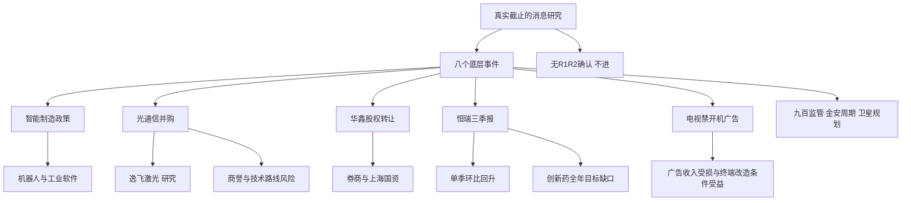

# 2026年10月28日 · 消息面事件驱动（研究partial）

> 截止：2026-10-28T06:22:45+08:00（中国时间）；生成：2026-10-28T06:26:34+08:00。不是07:30预填快照。

> 8个底层硬事件，正反拆成10条：正面5、负面4、中性1。官方同文转载不增加独立源。

> 情绪=主跌，引用T-1炸板率40.58%；候选研究额度8减半至4。可交易候选0，不授予开仓资格。

## 一句话结论

观察智能制造、光通信与券商新增催化；拦截高位监管风险，创新药利润修复不掩盖收入目标缺口。

## 市场先于个股：今天做什么与不做什么

市场在为什么付钱：R4不能仅凭新闻认定资金偏好。主线=未确认，持续性=未知，封板率=未知，明日预期=未知；R1/R2交易主线与资金确认未取得。

阶段：只引用emotion_cycle的主跌结论，不自行重做情绪模型。谁有地位：四只观察对象的当日交易龙头身份均未确认，不能把公司行业地位直接改写成总龙或龙二。

今天做：研究公告新增信息、公司真实业务传导与反面风险；不做：开仓授权、预设主模板、编造止损/目标价/主营重叠比例、用盘后公告解释27日涨跌。

## 🗺️ 消息面全景图

## 硬事件计数与来源独立性

B1智能制造、B2有线/IPTV规则、B3华鑫易主、B4逸飞并购、B5九百风险、B6恒瑞季报、B7金安季报、B8卫星规划，共8项。B4/B6各拆正负，形成10条方向行。B2两项配套规定按同一监管政策包计1项；B5监管函和公司异动风险按同一事件簇计1项，不用文件数量凑事件。

“high”表示官方事实证据硬，不是预期股价涨幅高。每项底层官方来源计1个；公众号、问财、东方财富转载是传播通道，不计第二原始来源。

## 🎯 顶级事件详解（逐事件三问）

### E20261028_001 · 上海发布新一代智能制造行动方案 · 正面 · 观察

- 底层事件：B1；新旧分类：老方向新增催化；可交易日：20261028。

- 原发布时间：2026-10-27；文件落款：2026-10-22；最早已核公众时间：2026-10-27T17:34:57+08:00。

- 最早可知证据：news_cls.jsonl 行1212：算力设施；官网仅日期；范围为本次已核材料，不保证全网首发。

- 实际官方抓取：2026-10-28T06:21:41+08:00 → 2026-10-28T06:22:00+08:00；源URL：https://www.sheitc.sh.gov.cn/cyfz/20261027/b04b3f2de4c44304ae05dcf3d7e1f6f8.html

- 原始分：0.78；距最早已核公开自然日：1；加权分：0.671352；λ=0.15；decayed=false。分数为R4事件主观权重而非概率，同文不叠加。

- 事实与时序边界：官网发布日为27日；成文22日不是公众可知日。最早带时分快讯在收盘后，不能解释27日盘中机器人上涨。

**大资金意图**：资金可能寻找能够将物理AI叙事转为工业订单的设备与软件载体；这是假设，不是已查资金流。

**为什么走强**：8000台进厂和工业智能体目标使终端场景更具体；尚无R2确认，不能声称板块已经因该文件走强。

**逻辑够不够硬**：政策原文硬、兑现约束弱：未公布逐家公司采购合同或预算，须看项目招标与交付。

- 直接传导：人形机器人=正面；工业软件=正面；工业母机=正面。

- 反向叉乘：潜在受损=低附加值自动化集成。均为条件推断，不是额外硬事件；须验证业务敞口、订单或替代关系。

- 传播路径：https://mp.weixin.qq.com/s?__biz=MjM5NDEzMTAwMA==&mid=2652701200&idx=1&sn=5a8469cf209a4c46284d4b40f1829ff7&chksm=bc4606c28523272575886bb301d9ae9245c2d0c5066fefd1507376cd7073182e4c6d19b7db8b；https://mp.weixin.qq.com/s?__biz=MjM5MDIwNDEyMg==&mid=2651274857&idx=2&sn=12991be0210836bd32c3556484fb6b7e&chksm=bc88557722bfca1b5d7587f5795b9f4d8af4bb03a914ecf2d67355865dc92657bcc74430c445

### E20261028_002 · 有线电视及IPTV不得播放开机广告 · 负面 · 拦截

- 底层事件：B2；新旧分类：老方向新增催化；可交易日：20261027。

- 原发布时间：2026-10-27T09:00:00+08:00；文件落款：2026-10-24；最早已核公众时间：2026-10-27T09:00:00+08:00。

- 最早可知证据：广电总局第17/18号令网页显示09:00；范围为本次已核材料，不保证全网首发。

- 实际官方抓取：2026-10-28T06:21:41+08:00 → 2026-10-28T06:22:00+08:00；源URL：https://www.nrta.gov.cn/art/2026/10/27/art_1588_74295.html

- 原始分：-0.65；距最早已核公开自然日：1；加权分：-0.55946；λ=0.15；decayed=false。分数为R4事件主观权重而非概率，同文不叠加。

- 事实与时序边界：10月27日公布；11月27日起施行；10月24日落款不是施行日。

**大资金意图**：若资金重估广告现金流，受冲击的是依赖开机曝光和不透明收费的经营模式，不是全部传媒。

**为什么走强**：不是走强催化；行业广告变现受限，设备改造可能反向受益，但必须以实际采购而非文本联想确认。

**逻辑够不够硬**：第17/18号令直接确认禁播与施行日期；公司广告收入敞口未知，不能机械外推收入降幅。

- 直接传导：电视开机广告=负面；有线电视/IPTV运营=负面。

- 反向叉乘：潜在受益=便捷视听终端。均为条件推断，不是额外硬事件；须验证业务敞口、订单或替代关系。

- 传播路径：https://mp.weixin.qq.com/s?__biz=MjM5NDEzMTAwMA==&mid=2652701140&idx=1&sn=b7fc105b66eda6be42ac0e9612749250&chksm=bc3f6be858c6ef80162c975beecb0acf8d00f08996cadca282828e7cf65ecf641986d7ff608a

### E20261028_003 · 华鑫股份拟更换控股股东并复牌 · 正面 · 观察

- 底层事件：B3；新旧分类：老方向新增催化；可交易日：20261028。

- 原发布时间：2026-10-28；文件落款：2026-10-28；最早已核公众时间：2026-10-27T18:58:00+08:00。

- 最早可知证据：news_cls.jsonl 同花顺18:58；新浪18:58:31；公告落款28日；范围为本次已核材料，不保证全网首发。

- 实际官方抓取：2026-10-28T06:21:41+08:00 → 2026-10-28T06:22:00+08:00；源URL：http://static.cninfo.com.cn/finalpage/2026-10-28/1225632083.PDF

- 原始分：0.68；距最早已核公开自然日：1；加权分：0.585281；λ=0.15；decayed=false。分数为R4事件主观权重而非概率，同文不叠加。

- 事实与时序边界：25日筹划易主已公开；27日晚新增受让方和复牌安排。框架协议不是已过户；实控人仍为上海市国资委，不等于券商合并。

**大资金意图**：可能交易股东资源与差异化经营预期，不应将同一实控人下的股权转让包装为实际控制权更换。

**为什么走强**：受让方及复牌是新增信息，金融方向是否取得市场地位仍要板块效应与R2/R7确认。

**逻辑够不够硬**：转让26.99%和复牌有公告依据；尚需审批及正式协议，不构成业绩承诺或合并方案。

- 直接传导：券商=正面；上海国资改革=正面。

- 反向叉乘：潜在受损=无明确反向行业。均为条件推断，不是额外硬事件；须验证业务敞口、订单或替代关系。

- 传播路径：https://mp.weixin.qq.com/s?__biz=MjM5MDIwNDEyMg==&mid=2651274834&idx=1&sn=5da1dbc9519ad6c1a57cf1a69d0eb7f4&chksm=bcde69e1641d5d3d9c08eef7ce4cba55428fc7927a535aa803fc76f70f2f9d53b915c3d19183

### E20261028_004 · 逸飞激光拟以4亿元收购兴启航·正面 · 正面 · 观察

- 底层事件：B4；新旧分类：老方向新增催化；可交易日：20261028。

- 原发布时间：2026-10-28；文件落款：2026-10-28；最早已核公众时间：2026-10-27T20:36:00+08:00。

- 最早可知证据：news_cls.jsonl 同花顺20:36；新浪20:39:31；公告28日落款；范围为本次已核材料，不保证全网首发。

- 实际官方抓取：2026-10-28T06:21:41+08:00 → 2026-10-28T06:22:00+08:00；源URL：http://static.cninfo.com.cn/finalpage/2026-10-28/1225632610.PDF

- 原始分：0.74；距最早已核公开自然日：1；加权分：0.636924；λ=0.15；decayed=false。分数为R4事件主观权重而非概率，同文不叠加。

- 事实与时序边界：拟收购100%股权；董事会通过但尚非完成交割。技术向CPO延伸不代表已有CPO量产收入。

**大资金意图**：可能寻找新能源设备向光通信设备迁移的新增业务预期，不等于即刻获得光模块收入。

**为什么走强**：拟收购标的具备封装耦合设备业务，叙事映射较清楚；公告在盘后，不能倒因解释27日走势。

**逻辑够不够硬**：4亿元现金收购及标的业务有原文；交割、客户验收与协同仍有条件，正面与负面分列。

- 直接传导：光通信设备=正面；精密激光设备=正面。

- 反向叉乘：潜在受损=原有光封装设备竞争者。均为条件推断，不是额外硬事件；须验证业务敞口、订单或替代关系。

- 传播路径：https://mp.weixin.qq.com/s?__biz=MjM5MDIwNDEyMg==&mid=2651274881&idx=2&sn=d0aa2483154dcd8ad23302896a7b9ed7&chksm=bc99f1d5f291a64d8abf179e93545c0d7f0117bf0642e262177ebe92d45791e4ae5c619829cf

### E20261028_005 · 逸飞激光拟以4亿元收购兴启航·反面 · 负面 · 降级

- 底层事件：B4；新旧分类：老方向新增催化；可交易日：20261028。

- 原发布时间：2026-10-28；文件落款：2026-10-28；最早已核公众时间：2026-10-27T20:36:00+08:00。

- 最早可知证据：news_cls.jsonl 同花顺20:36；新浪20:39:31；公告28日落款；范围为本次已核材料，不保证全网首发。

- 实际官方抓取：2026-10-28T06:21:41+08:00 → 2026-10-28T06:22:00+08:00；源URL：http://static.cninfo.com.cn/finalpage/2026-10-28/1225632610.PDF

- 原始分：-0.53；距最早已核公开自然日：1；加权分：-0.456175；λ=0.15；decayed=false。分数为R4事件主观权重而非概率，同文不叠加。

- 事实与时序边界：拟收购100%股权；董事会通过但尚非完成交割。技术向CPO延伸不代表已有CPO量产收入。

**大资金意图**：资金也可能要求并购风险折价；这是公告风险识别，不推断已经出现资金出逃。

**为什么走强**：不是利多延续：532.56%评估增值率及商誉减值、技术路线适配风险对收购方形成反向约束。

**逻辑够不够硬**：风险由官方收购公告直接披露；属于条件风险，不是已经发生商誉减值或行业订单坍塌。

- 直接传导：高溢价并购=负面；光通信设备=负面。

- 反向叉乘：潜在受益=现金充足的内生研发设备商。均为条件推断，不是额外硬事件；须验证业务敞口、订单或替代关系。

- 传播路径：https://mp.weixin.qq.com/s?__biz=MjM5MDIwNDEyMg==&mid=2651274881&idx=2&sn=d0aa2483154dcd8ad23302896a7b9ed7&chksm=bc99f1d5f291a64d8abf179e93545c0d7f0117bf0642e262177ebe92d45791e4ae5c619829cf

### E20261028_006 · 上海九百股价异动监管及风险提示 · 负面 · 拦截

- 底层事件：B5；新旧分类：老方向新增催化；可交易日：20261028。

- 原发布时间：2026-10-28；文件落款：2026-10-28；最早已核公众时间：2026-10-27T20:23:00+08:00。

- 最早可知证据：news_cls.jsonl 同花顺20:23/新浪20:23:13；公告及上证报23:30传播；范围为本次已核材料，不保证全网首发。

- 实际官方抓取：2026-10-28T06:22:00+08:00 → 2026-10-28T06:22:12+08:00；源URL：https://static.sse.com.cn/disclosure/listedinfo/announcement/c/new/2026-10-28/600838_20261028_JFG1.pdf

- 原始分：-0.77；距最早已核公开自然日：1；加权分：-0.662745；λ=0.15；decayed=false。分数为R4事件主观权重而非概率，同文不叠加。

- 事实与时序边界：监管在五连板形成后的盘后公开；不能解释此前涨停。非停牌或行政处罚结论。

**大资金意图**：高位连板筹码可能重新衡量监管与基本面支撑，但R4不能给出持仓减仓或认定出货。

**为什么走强**：并非消费全行业利空；股价已五连板后的盘后风险，主要约束同类高位接力外溢。

**逻辑够不够硬**：异动公告明确短期炒作和经营无重大变化；监管函报道与公告同属风险簇，停牌处罚并未被确认。

- 直接传导：高位零售接力=负面。

- 反向叉乘：潜在受益=无监管敞口的低位消费。均为条件推断，不是额外硬事件；须验证业务敞口、订单或替代关系。

- 传播路径：https://mp.weixin.qq.com/s?__biz=MjM5MDIwNDEyMg==&mid=2651274869&idx=1&sn=8277cb8715f124246d1c5c01c87483d7&chksm=bcd3fd9367327961aa707c3d59cfa0b42f91a5bf5cc6769e2ee7099ead734ff1ab192ec75547

### E20261028_007 · 恒瑞医药三季报利润修复及收入目标风险·正面 · 正面 · 观察

- 底层事件：B6；新旧分类：老方向新增催化；可交易日：20261028。

- 原发布时间：2026-10-27；文件落款：2026-10-27；最早已核公众时间：2026-10-27T16:42:00+08:00。

- 最早可知证据：news_cls.jsonl 同花顺16:42/新浪16:42:06；负面目标风险最迟澎湃19:34已公开；范围为本次已核材料，不保证全网首发。

- 实际官方抓取：2026-10-28T06:22:00+08:00 → 2026-10-28T06:22:12+08:00；源URL：http://static.cninfo.com.cn/finalpage/2026-10-28/1225629197.PDF

- 原始分：0.66；距最早已核公开自然日：1；加权分：0.568067；λ=0.15；decayed=false。分数为R4事件主观权重而非概率，同文不叠加。

- 事实与时序边界：利润与指引来自同一份三季报，拆成正负两条但独立底层文件只计1份。

**大资金意图**：可能寻找利润修复与对外许可兑现，不能把累计同比直接当作资金偏好。

**为什么走强**：Q3单季归母24.5796亿元较Q2的21.8317亿元回升，扣非利润也有支撑；不解释27日盘中下跌。

**逻辑够不够硬**：三季报与问财前期数据可复算；对外许可收入是重要驱动，不能假设每季线性复制。

- 直接传导：创新药=正面；药品对外许可=正面。

- 反向叉乘：潜在受损=同靶点落后管线。均为条件推断，不是额外硬事件；须验证业务敞口、订单或替代关系。

- 业绩拆分：累计同比+20.38%仅作背景；Q3单季=24.579648亿元，Q2单季=21.831712亿元，环比=12.586901%。扣非Q3=25.135733亿元；周期=False；现货=不适用；预期差=未核。

- 终判：单季回升与全年目标风险并存。前期数据：同花顺问财 hithink-event-query；Q2/H1/Q1均实查；trace_id 0254981bf99baf272402ee62912269df7ab16238ea5ca8722c6f4273498e06e6 和 64c516733cb1e9ba133275406fbb1ab21ad4f63ec2a9edcb1cacbec356ab6747。

- 传播路径：https://mp.weixin.qq.com/s?__biz=MjM5MDIwNDEyMg==&mid=2651274848&idx=2&sn=3eafdc19de79a82616abcf498c21169d&chksm=bc50140844784f14d670735720a68f08e8ac0b85a53cd668ca4de5019a0e7c93aa235282e888

### E20261028_008 · 恒瑞医药三季报利润修复及收入目标风险·反面 · 负面 · 降级

- 底层事件：B6；新旧分类：老方向新增催化；可交易日：20261028。

- 原发布时间：2026-10-27；文件落款：2026-10-27；最早已核公众时间：2026-10-27T19:34:00+08:00。

- 最早可知证据：同一季报风险段；最早已核带时间传播为澎湃19:34；不能用16:42仅含利润的快讯证明目标风险同刻已被公众知悉；范围为本次已核材料，不保证全网首发。

- 实际官方抓取：2026-10-28T06:22:00+08:00 → 2026-10-28T06:22:12+08:00；源URL：http://static.cninfo.com.cn/finalpage/2026-10-28/1225629197.PDF

- 原始分：-0.66；距最早已核公开自然日：1；加权分：-0.568067；λ=0.15；decayed=false。分数为R4事件主观权重而非概率，同文不叠加。

- 事实与时序边界：利润与指引来自同一份三季报，拆成正负两条但独立底层文件只计1份。

**大资金意图**：资金可能更看重创新药内生增速目标缺口而非授权收入一次性确认，需与正面利润并列评估。

**为什么走强**：不是行业已全面退潮：公司称全年创新药销售增速与年初目标存在差距，准入与竞争问题才是负面传导。

**逻辑够不够硬**：三季报第5页原话直接确认；对行业只作风险提醒，不声称全部创新药企业都下修目标。

- 直接传导：创新药=负面；成熟抗肿瘤药=负面。

- 反向叉乘：潜在受益=准入进度更快的差异化新药。均为条件推断，不是额外硬事件；须验证业务敞口、订单或替代关系。

- 传播路径：https://mp.weixin.qq.com/s?__biz=MjM5MDIwNDEyMg==&mid=2651274848&idx=2&sn=3eafdc19de79a82616abcf498c21169d&chksm=bc50140844784f14d670735720a68f08e8ac0b85a53cd668ca4de5019a0e7c93aa235282e888

### E20261028_009 · 金安国纪三季报增长及覆铜板周期验证 · 中性 · 观察

- 底层事件：B7；新旧分类：老方向新增催化；可交易日：20261028。

- 原发布时间：2026-10-28；文件落款：2026-10-28；最早已核公众时间：2026-10-27T15:59:00+08:00。

- 最早可知证据：news_cls.jsonl 同花顺15:59；证券时报16:55；公告28日落款；范围为本次已核材料，不保证全网首发。

- 实际官方抓取：2026-10-28T06:22:00+08:00 → 2026-10-28T06:22:12+08:00；源URL：http://static.cninfo.com.cn/finalpage/2026-10-28/1225627667.PDF

- 原始分：0.62；距最早已核公开自然日：1；加权分：0.533639；λ=0.15；decayed=false。分数为R4事件主观权重而非概率，同文不叠加。

- 事实与时序边界：报告数字已核，单季环比正增长；当前现货方向与一致预期未核，极性保留中性而非只看累计同比。

**大资金意图**：可能比较涨价兑现和高基数后的边际变化，不能将千倍同比或散户讨论当作机构买入。

**为什么走强**：Q3单季利润环比回升并由售价与销量驱动；未查当前现货价和一致预期，暂不授予正面交易催化。

**逻辑够不够硬**：季报数字硬，但周期股定性缺价格与预期差；中性保留真实研究对象，不凭同比强化买入。

- 直接传导：覆铜板=中性；PCB成本端=中性。

- 反向叉乘：潜在受损=PCB议价能力弱的制造商。均为条件推断，不是额外硬事件；须验证业务敞口、订单或替代关系。

- 业绩拆分：累计同比+1012.67%仅作背景；Q3单季=11.582909亿元，Q2单季=5.640467亿元，环比=105.353731%。扣非Q3=11.627404亿元；周期=True；现货=未查；预期差=未核。

- 终判：环比增长已核但现货与预期差未核；中性观察。前期数据：同花顺问财 Q2单季；trace_id 1bdbdbe9a48a914851ca61bc6b73568341f1e67ca6b76f58d22ffe5f35a1cc04。

- 传播路径：https://mp.weixin.qq.com/s?__biz=MjM5NDEzMTAwMA==&mid=2652701172&idx=1&sn=dc457d35f420189c76a560a07398ecc9&chksm=bcd1ed67c59719573ae45407bf777817bc1577b5d1187e50507640d9ce6263ef374d75f3694b；https://mp.weixin.qq.com/s?__biz=MjM5MDIwNDEyMg==&mid=2651274834&idx=2&sn=af3f6993d0099587bcf6ad21708a6e7d&chksm=bc6e9b9847c70dc1fa778c356053b2227bb1682248e798ae73961c4f5c84de66943d34c2b2be

### E20261028_010 · 上海卫星互联网2027至2030行动方案 · 正面 · 观察

- 底层事件：B8；新旧分类：已交易后的延续；可交易日：20261027。

- 原发布时间：2026-10-26；文件落款：2026-10-22；最早已核公众时间：仅2026-10-26日期可知，时分未知。

- 最早可知证据：官网发布日期26日且无时分；上证报27日12:33已传播；范围为本次已核材料，不保证全网首发。

- 实际官方抓取：2026-10-28T06:22:00+08:00 → 2026-10-28T06:22:12+08:00；源URL：https://www.sheitc.sh.gov.cn/cmsres/17/17ef2c9827134ebda9c7c8edf7cb02c4/45485823f0a89343ca07517eeecc947f.pdf

- 原始分：0.61；距最早已核公开自然日：2；加权分：0.451899；λ=0.15；decayed=false。分数为R4事件主观权重而非概率，同文不叠加。

- 事实与时序边界：26日已公开，不把27日转载当全新题材。因官网无时分，保守映射27日为可交易日，不断言26日盘前可知；800亿元是2030产业目标非财政预算。

**大资金意图**：资金可能寻找组网、载荷与地面终端订单；政策文字不等于已发生的资本流入。

**为什么走强**：3000颗在轨卫星与400Gbps星间链路等目标提供产业路径，但26日已公开，属于延续而非今日全新方向。

**逻辑够不够硬**：官方文件已核；2030规划不是2026订单或预算，需验证后续发射、采购与运营收入。

- 直接传导：卫星互联网=正面；星间激光通信=正面；地面终端=正面。

- 反向叉乘：潜在受损=传统专用卫星通信的高价服务。均为条件推断，不是额外硬事件；须验证业务敞口、订单或替代关系。

- 传播路径：https://mp.weixin.qq.com/s?__biz=MjM5MDIwNDEyMg==&mid=2651274697&idx=2&sn=1b6b982d933aeed333cb9cac0e35837a&chksm=bc630f1d29e0191d8377d425a04539f3ad82b88a78c14fd6d2d88c57ed1ac7102fd21462b944

## 📊 事件×板块极性矩阵

下表按事件为行、板块为列，分两张连续列窗展示同一完整10×27矩阵。正/负为直接方向，条正/条负为条件性反向受益/受损，中为中性，—为没有明确传导。禁止将“条正”读取为已确认买入信号。

| 事件 | PCB成本端 | PCB议价能力弱的制造商 | 上海国资改革 | 人形机器人 | 传统专用卫星通信的高价服务 | 低附加值自动化集成 | 便捷视听终端 | 光通信设备 | 准入进度更快的差异化新药 | 创新药 | 券商 | 卫星互联网 | 原有光封装设备竞争者 | 同靶点落后管线 |
|---|---|---|---|---|---|---|---|---|---|---|---|---|---|---|
| E001 | — | — | — | 正 | — | 条负 | — | — | — | — | — | — | — | — |
| E002 | — | — | — | — | — | — | 条正 | — | — | — | — | — | — | — |
| E003 | — | — | 正 | — | — | — | — | — | — | — | 正 | — | — | — |
| E004 | — | — | — | — | — | — | — | 正 | — | — | — | — | 条负 | — |
| E005 | — | — | — | — | — | — | — | 负 | — | — | — | — | — | — |
| E006 | — | — | — | — | — | — | — | — | — | — | — | — | — | — |
| E007 | — | — | — | — | — | — | — | — | — | 正 | — | — | — | 条负 |
| E008 | — | — | — | — | — | — | — | — | 条正 | 负 | — | — | — | — |
| E009 | 中 | 条负 | — | — | — | — | — | — | — | — | — | — | — | — |
| E010 | — | — | — | — | 条负 | — | — | — | — | — | — | 正 | — | — |
| 事件 | 地面终端 | 工业母机 | 工业软件 | 成熟抗肿瘤药 | 星间激光通信 | 有线电视/IPTV运营 | 现金充足的内生研发设备商 | 电视开机广告 | 精密激光设备 | 药品对外许可 | 覆铜板 | 高位零售接力 | 高溢价并购 |
|---|---|---|---|---|---|---|---|---|---|---|---|---|---|
| E001 | — | 正 | 正 | — | — | — | — | — | — | — | — | — | — |
| E002 | — | — | — | — | — | 负 | — | 负 | — | — | — | — | — |
| E003 | — | — | — | — | — | — | — | — | — | — | — | — | — |
| E004 | — | — | — | — | — | — | — | — | 正 | — | — | — | — |
| E005 | — | — | — | — | — | — | 条正 | — | — | — | — | — | 负 |
| E006 | — | — | — | — | — | — | — | — | — | — | — | 负 | — |
| E007 | — | — | — | — | — | — | — | — | — | 正 | — | — | — |
| E008 | — | — | — | 负 | — | — | — | — | — | — | — | — | — |
| E009 | — | — | — | — | — | — | — | — | — | — | 中 | — | — |
| E010 | 正 | — | — | — | 正 | — | — | — | — | — | — | — | — |

## 正负叉乘如何落到研究判断

1. 工业AI政策 × 高位监管：政策受益不抵消个股接力风险。机器人和工业软件只能研究；九百监管只向高位消费接力外溢，不泛化为全部消费利空。

2. 逸飞光通信切入 × 高溢价并购：正面是拟增加封装耦合设备业务；反面是商誉、整合和CPO/NPO技术适配。技术升级可使新设备受益、旧路线资产受损，不能给全行业同一符号。

3. 恒瑞利润修复 × 内生销售增速缺口：授权收入兑现的正面和全年创新药目标风险同时存在，净判断为观察，不得用盈利同比掩盖指引。竞争者潜在受益仍待份额证据。

4. 禁开机广告 × 便捷终端：广告曝光变现端直接受约束，终端改造可能受益；后者需采购证据。新规11月27日施行，不宣称当日已削减收入。

5. 覆铜板利润 × 下游成本：金安利润环比增长支持研究，不代表PCB下游同等受益；议价弱者可能承受材料涨价。当前现货未核，所以直接事件保持中性，条件成本传导不冒充已实现损失。

6. 星间激光 × 地面光互联：两方向可共享技术叙事，但本次未确认共享供应商或订单，不将卫星规划作为逸飞光通信交易的第二独立证据。

## 研究观察对象与可交易候选分层

候选研究额度从8减半为4；这是对主跌/高炸板率的研究聚焦，不是按数量凑票。四者都是实际点名公告对象，不授予“首推”身份。所有可交易候选=0。

| 对象 | 板型 | 龙头认定 | 盈亏比 | 禁止清单 | 计划归属 | 态度 |
|---|---|---|---|---|---|---|
| 华鑫股份 600621.SH | 未核 | 未认定/已核条数0 | 未核 | 未完成，不代表无命中 | 未取得今日核心/补涨/计划内试错资格 | 观察；交易不进 |
| 逸飞激光 688646.SH | 未核 | 未认定/已核条数0 | 未核 | 未完成，不代表无命中 | 未取得今日核心/补涨/计划内试错资格 | 观察；交易不进 |
| 恒瑞医药 600276.SH | 未核 | 未认定/已核条数0 | 未核 | 未完成，不代表无命中 | 未取得今日核心/补涨/计划内试错资格 | 观察；交易不进 |
| 金安国纪 002636.SZ | 未核 | 未认定/已核条数0 | 未核 | 未完成，不代表无命中 | 未取得今日核心/补涨/计划内试错资格 | 观察；交易不进 |

### 华鑫股份 · 仅研究，非首推

**买入理由**：不进；仅研究：转让框架和复牌有官方公告；研究股东协同而非臆测券商合并。

**风险点**：主跌背景和验证缺口；不得仅凭新闻买入。

**止损条件**：数值止损未核，禁止开仓；逻辑证伪交下游逐票确认；stop_loss=null，不能据此执行。

**可验证假设**：仅当R2确认可交易地位且R5通过风险收益与禁止清单后才可交D1重审。

业绩预告交叉：500条Q3预告中未命中；不等于没有预告，不赋予置信度加成。主营重叠比例=null；官方点名关系不等于百分比已查。

### 逸飞激光 · 仅研究，非首推

**买入理由**：不进；仅研究：光通信设备业务由拟收购切入；商誉与交割条件必须同时研究。

**风险点**：主跌背景和验证缺口；不得仅凭新闻买入。

**止损条件**：数值止损未核，禁止开仓；逻辑证伪交下游逐票确认；stop_loss=null，不能据此执行。

**可验证假设**：仅当R2确认可交易地位且R5通过风险收益与禁止清单后才可交D1重审。

业绩预告交叉：500条Q3预告中未命中；不等于没有预告，不赋予置信度加成。主营重叠比例=null；官方点名关系不等于百分比已查。

### 恒瑞医药 · 仅研究，非首推

**买入理由**：不进；仅研究：利润修复与销售目标风险正反并列；不能只看同比。

**风险点**：主跌背景和验证缺口；不得仅凭新闻买入。

**止损条件**：数值止损未核，禁止开仓；逻辑证伪交下游逐票确认；stop_loss=null，不能据此执行。

**可验证假设**：仅当R2确认可交易地位且R5通过风险收益与禁止清单后才可交D1重审。

业绩预告交叉：500条Q3预告中未命中；不等于没有预告，不赋予置信度加成。主营重叠比例=null；官方点名关系不等于百分比已查。

### 金安国纪 · 仅研究，非首推

**买入理由**：不进；仅研究：单季环比已核；周期现货与预期差缺口使极性保留中性。

**风险点**：主跌背景和验证缺口；不得仅凭新闻买入。

**止损条件**：数值止损未核，禁止开仓；逻辑证伪交下游逐票确认；stop_loss=null，不能据此执行。

**可验证假设**：仅当R2确认可交易地位且R5通过风险收益与禁止清单后才可交D1重审。

业绩预告交叉：500条Q3预告中未命中；不等于没有预告，不赋予置信度加成。主营重叠比例=null；官方点名关系不等于百分比已查。

## 🔥 中报业绩预告命中（实际为2026Q3口径）

沿用契约章节名，不伪称中报。读取eastmoney_earnings_predict全部500行，先筛归母净利润口径，再按累计增速上限取top20交叉；下表均为背景筛查，不是今日新增硬alpha。多项预告早于7日窗口；对未拆单季环比的对象不判正面。

| 代码/名称 | 公告日期 | 累计同比区间% | 本文板块交集 | 处理 |
|---|---|---|---|---|
| 001309.SZ 德明利 | 2026-10-17 | 32046.52 ~ 33154.49 | 无已确认直接交集 | 背景；不因同比进候选 |
| 300821.SZ 东岳硅材 | 2026-10-08 | 19047.97 ~ 19748.08 | 无已确认直接交集 | 背景；不因同比进候选 |
| 000703.SZ 恒逸石化 | 2026-10-16 | 3318.59 ~ 3405.13 | 无已确认直接交集 | 背景；不因同比进候选 |
| 002466.SZ 天齐锂业 | 2026-10-21 | 2734.97 ~ 3235.26 | 无已确认直接交集 | 背景；不因同比进候选 |
| 688825.SH 长鑫科技 | 2026-10-17 | 2581.06 ~ 2609.47 | 无已确认直接交集 | 背景；不因同比进候选 |
| 002812.SZ 恩捷股份 | 2026-10-14 | 1884 ~ 2474.8 | 无已确认直接交集 | 背景；不因同比进候选 |
| 688808.SH 联讯仪器 | 2026-10-13 | 1866 ~ 2072.95 | 光通信设备（业务关联还需核验） | 背景；不因同比进候选 |
| 301308.SZ 江波龙 | 2026-10-15 | 1864.55 ~ 1990.84 | 无已确认直接交集 | 背景；不因同比进候选 |
| 605189.SH 富春染织 | 2026-10-14 | 1347.69 ~ 1519.01 | 无已确认直接交集 | 背景；不因同比进候选 |
| 688388.SH 嘉元科技 | 2026-10-15 | 1196.6 ~ 1318.92 | 覆铜板/PCB上游铜箔（需区分电池箔与电子箔） | 背景；不因同比进候选 |
| 603991.SH 领先股份 | 2026-10-21 | 1238.57 ~ 1238.57 | 无已确认直接交集 | 背景；不因同比进候选 |
| 603026.SH 石大胜华 | 2026-10-15 | 968.14 ~ 1032.45 | 无已确认直接交集 | 背景；不因同比进候选 |
| 000626.SZ 远大控股 | 2026-10-15 | 890 ~ 1018 | 无已确认直接交集 | 背景；不因同比进候选 |
| 002493.SZ 荣盛石化 | 2026-10-15 | 777.93 ~ 822.95 | 无已确认直接交集 | 背景；不因同比进候选 |
| 300497.SZ 富祥股份 | 2026-09-18 | 658 ~ 785 | 无已确认直接交集 | 背景；不因同比进候选 |
| 301536.SZ 星宸科技 | 2026-10-13 | 663.13 ~ 697.75 | 无已确认直接交集 | 背景；不因同比进候选 |
| 301511.SZ 德福科技 | 2026-10-14 | 560.72 ~ 620.78 | 无已确认直接交集 | 背景；不因同比进候选 |
| 002552.SZ 宝鼎科技 | 2026-10-14 | 536.88 ~ 614.07 | 覆铜板/PCB上游电子铜箔（映射待独立核验） | 背景；不因同比进候选 |
| 301292.SZ 海科新源 | 2026-10-16 | 592 ~ 601 | 无已确认直接交集 | 背景；不因同比进候选 |
| 688378.SH 奥来德 | 2026-10-13 | 442.16 ~ 537.83 | 无已确认直接交集 | 背景；不因同比进候选 |

本次候选四票均未在这500条预告中命中。恒瑞与金安使用已核正式季报替代预告判断；华鑫与逸飞事件是转让/并购，不将标的财务或历史季报标题冒作本公司新业绩催化。

恒瑞复算：H1归母44.65439428亿元−Q1归母22.82268233亿元=Q2归母21.83171195亿元；9M归母69.2340421625亿元−H1=24.57964788亿元，Q3/Q2−1=12.586901%。

金安复算：Q3报告直接给出11.5829090129亿元，问财Q2为5.6404667888亿元，环比=105.353731%。未查当前现货与一致预期，终判中性。

## 其他负面与未入硬事件队列

折叠屏内屏投诉/换机回应：负面，已读证券时报原创采访，但未回核苹果原始回应，不升high。上纬机器人规模化与物理AI研发风险：负面，26日已披露，保留个股风险背景。泡泡玛特业务更新：累计/单季同比不足以替代利润环比，earnings_qoq_unverified，中性降级；不把标题当新卖出理由。

## 关键证据

- 八个官方原文URL与实际抓取时间均在逐事件段及JSON中保留；同一文件正反共享底层事件ID。

- 上海两政策落款22日与公众发布26/27日严格区分；公司公告28日落款与27日晚已知快讯分别保留。

- 本地news_cls文件名误导：实际新浪1488条、同花顺1500条；news_major800条只有标题。官方直读补盲不能宣称完整72小时新闻面已经覆盖。

## 数据源审计

| 源 | 日期 | 状态 | 条数/范围 | 备注 |
|---|---|:---:|---|---|
| wechat_official_20 | 2026-10-28 | 🟢 | 86 | 86篇/15个订阅；RSS镜像只计一次，盘前纪要当前仅27日06:57，不宣称28日早报已覆盖 |
| wechat_cli_5groups | 2026-10-28 | 🔴 | 271 | 5个匿名群4个成功；271条消息；群A超时；唯一相关片段为群内对标九百，非独立验证 |
| news_cls | 2026-10-28 | 🔴 | 2988 | 2988条实际仅新浪1488+同花顺1500，没有财联社原始快讯；覆盖始于26日17:30，未达到完整72小时 |
| news_major | 2026-10-28 | 🟡 | 800 | 800条全部content为空，仅标题；69条来源标签财联社不代表有原文核验 |
| anns_window | 2026-10-28 | 🟢 | 7309 | 7309条/2041家公司；按自然日27-28覆盖，不把ann_date零时当精确首发时间 |
| eastmoney_earnings_predict | 2026-10-28 | 🟡 | 500 | 2026Q3预告500行；并非全市场完整覆盖；逐项利润口径筛查top20，旧日期非今日新催化 |
| official_primary_live | 2026-10-28 | 🟢 | 8 | 官方单源可入top_events；转载不加独立源 |
| hithink_business_query | 2026-10-28 | 🟡 | 部分字段 | 实际调用成功但默认主营构成缺报告期；多公司查询code_count3返回10行主要首家公司，has_more=false并不保证完整；不采用为精确主营重叠比例。恒瑞2026Q3专查未返回主营字段 |
| hithink_event_query | 2026-10-28 | 🟢 | 3行 | 3次实查/4个利润字段；API trace保留；精确调用时秒未保留故captured_at=null |
| datapro | 2026-10-28 | 🔴 | 0 | 4013：Agent Plan失效或未分配席位 |
| vibe_read_url | 2026-10-28 | 🔴 | 0 | 远程reader HTTP401/IP reputation；web_extract官方直读替代成功 |
| vibe_stock_news | 2026-10-28 | 🟢 | 60 | 华鑫/逸飞/恒瑞各请求20条；含旧新闻，只按发布时间取交叉证据；不同转载不作独立来源 |

匿名群审计：群A超时0条；群B78条、群C87条、群D22条、群E84条，合计271条。命中的“对标九百”只是对标口播，不是独立原始研究。RSS兼容镜像不重复计数；28日盘前纪要尚未捕获，不能把尚未发布或未抓到的文章写作已读。

## 校验、契约缺口与反证

结构校验使用本次执行内声明的Pydantic v2模型，模型schema随JSON保留。不是仓库生产schema。允许未知值为null，但交易资格始终为false；结构通过与完整skill契约通过明确分离。本次严格首推完整性检查实际为14项未满足（10条方向事件和4只研究对象）。

旧校验器对没有“首推”标签的事件会跳过；即使退出码0，也只能说明其有限检查通过，不代表10条事件有完整首推逻辑。严格完整首推检查应失败，不能用0/0自称全部通过。

- 生产R4 Pydantic类缺失：仅采用本次显式内联schema，结构通过不能声称仓库生产schema通过

- 完整首推契约不通过：10条方向事件无合格首推；4只研究观察对象缺数值止损/目标价/RR及完整top_pick_logic，非以空首推规避

- R1/R2未提供本次可交易主线与资金确认；未授予开仓资格；禁止清单和龙头认定未完成

- news_cls实际没有财联社原始快讯且不足72h；news_major只有标题，公众号覆盖15订阅而非21号满覆盖；群A超时

- Datapro订阅4013、vibe read_url401；已采用官方直读，但专业检索与机构研报验证仍不完整

- 主营查询未提供可信统一报告期和事件重叠比例；不将默认返回百分比当作事件受益比例

- 首发时分不全：上海两政策仅官网日期；公告落款与27日晚公众传播不同；不能断言真正最早分钟

- 预告500行非全市场全量，4只观察股未命中不能等同无预告；top20多数超7日且单季未拆，不作为新业绩alpha

- 金安国纪环比已核但当前现货价与一致预期差未核，极性中性；恒瑞一致预期差未独立核验

- R3独立KOL、R7五日资金及R5画像尚未完成逐票对接；正式首板能力未完成全市场名称索引和代理池验证

- 月度prompt漂移校准无本次证据；仅记录prompt_version，不声称校准完成

## 与其他R/D/E的关系

- 依赖：只读manifest/mcp_health/必需新闻、公众号、匿名群、公告窗口、预告和emotion_cycle；偏好只读，active thesis为空。未递归委派。

- 被消费：R2筛市场地位与主线；R5研究四只真实对象的技术/业务/风险收益；R6独立反证，R4不产生或覆盖hard_reject；D1独立决定计划与权限。

- R3：独立KOL未核，不写共振确认。R7：不把新闻检索当资金验证。

## Sub-Agent元数据

- skill: analyze_news_impact_v1@1.6

- artifact: data/research/20261028/R4_news.json

- method: llm_v1；Python仅用于数据汇总、计算、渲染、结构校验与原子写盘。

- status: partial；full_skill_contract_status: failed。

- 写入边界：仅本单元JSON与指定MD；未修改raw/计划/执行/配置/src/tests/skills。目标不存在，不创建md.bak；临时落盘文件仅用于同盘原子替换。

## 实际落盘后校验结果

- 内联Pydantic：对真实已落盘JSON重新读取校验通过；不是仓库生产schema。
- 严格完整性：14项断言全部通过（数量/极性/矩阵/三问/mermaid/预告20项/frontmatter与前30行/群匿名/零开仓授权/衰减/抓取截止/完整契约失败保留/文件非空）。
- 仓库旧校验器实际退出码：0。打印10条“无首推个股”，首推为0/0；不将其泛称全部通过。
- 非空首推完整skill检查实际执行：14项不满足，已逐项保存在JSON；研究状态仍为partial，完整契约failed。
