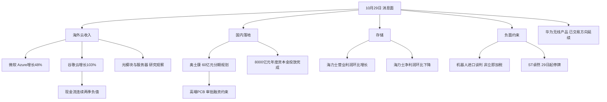

# 2026年10月29日 · 消息面事件驱动

> 情绪=震荡。上游暂报昨日炸板率48.94%，研究候选上限由8只减为4只。
> 8个底层硬事件，按正反两面拆为12条方向记录；6正、6负，不能称为12条独立催化。
> 本报告是研究交付，不是交易指令。状态partial；预算、否决、不交易决定与既有保护均不改变。

## 一句话结论
观察海外云需求及高端PCB；降级现金回报承压的算力与出口机器人；拦截退市风险。

## 先认市场：四问与权限

市场在为什么付钱？消息侧有云收入、服务器存储与高端PCB升级证据；实时问财可见昨日光模块部分核心上涨，但这不等于全市场主线及资金确认。
现在处在哪一段？采用上游“高位震荡”的保守提示；其文件虽名为closed，实际_is_closed=false且有intraday_fallback，不能冒充正式R1结论。
谁有地位？4只对象只有主营与事件映射，龙头地位均未由R2确认。中位/杂毛不能靠新闻热度获得资格。
今天做什么、不做什么？做8底层事件核查及4对象研究；不授予新仓资格、不编止损和目标价、不使用旧预告制造新催化。

主线=尚未确认可交易主线；持续性=未核；封板率=未核；次日预期=未定。这里不硬填1/3/5日或加速/分歧/退潮，以免新闻Agent越权冒充R1/R2。五日主模板由R2选择，本报告不拼装五套策略。

## 🗺️ 消息面全景图

## 8条硬事件总览：不是8个买点

| 底层 | 官方核实事实 | 时间与新旧 | 态度 |
|---|---|---|---|
| B1 微软FY27Q1 | Azure同比48%；GAAP净利润366.29亿美元 | 中国29日凌晨新增披露 | 云链观察；PC链降级 |
| B2 AlphabetQ3 | 云收入307.09亿美元；FCF -90.65亿美元 | 中国29日凌晨新增披露 | 云需求观察；高估值算力降级 |
| B3 美国232措施 | 先开展机器人与工业机械谈判；180日汇报 | 中国29日凌晨新负面 | 出口链降级；不是已加税 |
| B4 奥士康PCB | 60亿元总规划；一期25亿元；尚待股东会与审批 | 28日16:24已公开；公告落款29日 | 观察；融资风险并列 |
| B5 金融工具 | 年度8000亿元资本金投放完成 | 28日盘后落地确认 | 观察；不是新增8000亿元预算 |
| B6 海力士Q3 | 营业利润环比约+38%；净利润环比-58% | 28日已经交易 | 存储需求观察；财报极性降级 |
| B7 ST卓然 | 触及市值退市条件；29日起停牌 | 28日盘后已知；公告落款29日 | 拦截；不是已完成摘牌 |
| B8 华为无线 | VitaAAU、UBBPi等产品与商用进展 | 28日08:53已有快讯；活动日期27/28口径并存 | 观察；不是当日全新方向 |

## 🎯 方向事件详解：每事件三问

### E20261029_003 · 谷歌利润及现金回报承压

态度=降级；极性=负面；strength=high；raw=-0.85；衰减后=-0.850000。

事件摘要：FCF连续两季负值；不把投资损益与主营恶化混为一谈。底层事实：云收入307.09亿美元；普通股净利润261.70亿美元；经营利润405.76亿美元。

- **大资金意图**：资金可能在云收入增长与资本回报不足之间选择性定价，而不是无差别追逐AI概念。
- **为什么走强**：云需求增长是硬件链正向因子；现金流恶化是估值负向因子。二者同源不可当两次独立验证。
- **逻辑够不够硬**：SEC原始财报已核；营收和经营利润低于市场预期来自实时快讯；EPS预测口径有差异，不仅凭EPS下结论。

核验：[官方原文](https://www.sec.gov/Archives/edgar/data/1652044/000165204426000080/googexhibit991q32026.htm)；独立底层原始来源=1，官方直接确认。转载与群转不增加独立源。

传导板块：AI算力、光模块、AI服务器、数据中心液冷。这是产业推断，不是订单或资金确认。

负面杀伤面=行业级：AI算力、光模块、AI服务器、数据中心液冷。行业级负面不被利好抵消。

单季检验：本季261.7 / 上季1121.07（亿美元 普通股股东净利润）；环比-76.6562%。净利润受股权估值损益影响；经营利润环比近持平且现金流承压。Q2 other income 979.83亿美元；Q3 other income -82.21亿美元，不能把GAAP净利环比崩落全归为云业务衰退。

时间审计：原文发布时间=2026-10-28（America/Los_Angeles）；本次最早核到公众可知=2026-10-29T04:05:36+08:00，证据=news_cls.jsonl:101；抓取=2026-10-29T06:19:34+08:00。不以落款、入库日期或可交易日覆盖原始时间。

### E20261029_001 · 微软Azure增长及盈利兑现

态度=观察；极性=正面；strength=high；raw=+0.82；衰减后=+0.820000。

事件摘要：官方收入和利润已确认；A股客户名单和供货份额待证。底层事实：Azure同比48%；营收922.79亿美元；净利润366.29亿美元。

- **大资金意图**：海外AI投入已能形成云收入；资金可能优先区分能够兑现现金回报的供应链。这是行为假设而非R7流入事实。
- **为什么走强**：Azure增长高于快讯记录的44.8%预期，为算力需求提供支持；不能用29日财报解释28日A股上涨。
- **逻辑够不够硬**：官方财报直接确认收入和利润；A股公司是否直接供货、订单份额与资金合力仍未核。

核验：[官方原文](https://www.microsoft.com/en-us/Investor/earnings/FY-2027-Q1/press-release-webcast)；独立底层原始来源=1，官方直接确认。转载与群转不增加独立源。

传导板块：光模块、AI服务器、数据中心液冷。这是产业推断，不是订单或资金确认。

单季检验：本季366.29 / 上季357.66（亿美元 GAAP净利润）；环比+2.4129%。净利润环比增长且Azure超预期；OpenAI投资收益单列。本季OpenAI收益2.07亿美元；上季另有Anthropic收益及退休计划等离散项目，不把净利润增速直接当主营增速。

时间审计：原文发布时间=2026-10-28（America/Los_Angeles）；本次最早核到公众可知=2026-10-29T04:05:06+08:00，证据=news_cls.jsonl:103；抓取=2026-10-29T06:19:34+08:00。不以落款、入库日期或可交易日覆盖原始时间。

### E20261029_005 · 美国机器人进口谈判增加贸易不确定性

态度=降级；极性=负面；strength=high；raw=-0.82；衰减后=-0.820000。

事件摘要：启动谈判并留出180日；没有立即新增税率，逐票核美国敞口。底层事实：指示开展进口协议谈判；180日内汇报；保留未来关税及配额等措施。

- **大资金意图**：资金可能先压缩美国终端敞口不透明的机器人出口风险，而不是把国内机器人全部视作利空。
- **为什么走强**：它不能证明机器人走强；它对昨日物理AI叙事形成新的贸易约束，须逐票核对海外收入和客户。
- **逻辑够不够硬**：总统公告原文硬；当前已加税的说法不成立，国内替代获益仅为条件性推断。

核验：[官方原文](https://www.whitehouse.gov/presidential-actions/2026/10/adjusting-imports-of-robotics-industrial-machinery-and-their-parts-and-components-into-the-united-states/)；独立底层原始来源=1，官方直接确认。转载与群转不增加独立源。

传导板块：人形机器人、工业机器人、工业母机。这是产业推断，不是订单或资金确认。

负面杀伤面=行业级：人形机器人、工业机器人、工业母机。行业级负面不被利好抵消。

时间审计：原文发布时间=2026-10-28（America/New_York）；本次最早核到公众可知=2026-10-29T04:05:17+08:00，证据=news_cls.jsonl:102；抓取=2026-10-29T06:19:34+08:00。不以落款、入库日期或可交易日覆盖原始时间。

### E20261029_011 · ST卓然停牌及交易类退市风险

态度=拦截；极性=负面；strength=high；raw=-0.95；衰减后=-0.817673。

事件摘要：标的是*ST卓然688121.SH；不将负面泛化至全体石化装备股。底层事实：连续20个交易日收盘市值低于3亿元；29日开市起停牌；已收到事先告知书。

- **大资金意图**：资金若回避交易类退市的不连续流动性风险，应由公告规则而非所谓壳反弹叙事驱动。
- **为什么走强**：本事件不支持做多；交易类退市不进入退市整理期，不能把低价误作低风险。
- **逻辑够不够硬**：公司两份原始公告确认触发条件与停牌；尚是事先告知及听证程序，不写成已完成摘牌。

核验：[官方原文](https://static.cninfo.com.cn/finalpage/2026-10-29/1225636485.PDF)；独立底层原始来源=1，官方直接确认。转载与群转不增加独立源。

传导板块：ST及退市风险股。这是产业推断，不是订单或资金确认。

负面杀伤面=个股级：ST及退市风险股。行业级负面不被利好抵消。

时间审计：原文发布时间=2026-10-29（Asia/Shanghai）；本次最早核到公众可知=2026-10-28T17:55:16+08:00，证据=news_cls.jsonl:1345；抓取=2026-10-29T06:19:42+08:00。不以落款、入库日期或可交易日覆盖原始时间。

时间差异：公告落款29日；28日17:55已有快讯；事先告知书与停牌公告分文件但归一个退市程序事件。

### E20261029_004 · 谷歌云及TPU销售增长

态度=观察；极性=正面；strength=high；raw=+0.72；衰减后=+0.720000。

事件摘要：云收入307.09亿美元同比103%；是业务分项正向信号，不改写整体财报风险。底层事实：云收入307.09亿美元；普通股净利润261.70亿美元；经营利润405.76亿美元。

- **大资金意图**：资金可能在云收入增长与资本回报不足之间选择性定价，而不是无差别追逐AI概念。
- **为什么走强**：云需求增长是硬件链正向因子；现金流恶化是估值负向因子。二者同源不可当两次独立验证。
- **逻辑够不够硬**：SEC原始财报已核；营收和经营利润低于市场预期来自实时快讯；EPS预测口径有差异，不仅凭EPS下结论。

核验：[官方原文](https://www.sec.gov/Archives/edgar/data/1652044/000165204426000080/googexhibit991q32026.htm)；独立底层原始来源=1，官方直接确认。转载与群转不增加独立源。

传导板块：光模块、AI服务器、ASIC、数据中心液冷。这是产业推断，不是订单或资金确认。

时间审计：原文发布时间=2026-10-28（America/Los_Angeles）；本次最早核到公众可知=2026-10-29T04:05:36+08:00，证据=news_cls.jsonl:101；抓取=2026-10-29T06:19:34+08:00。不以落款、入库日期或可交易日覆盖原始时间。

### E20261029_006 · 奥士康规划南通高端PCB基地

态度=观察；极性=正面；strength=high；raw=+0.76；衰减后=+0.654138。

事件摘要：总额60亿分三期；一期25亿；尚需股东会和用地等审批。底层事实：规划总投资60亿元；一期25亿元；董事会通过且尚待股东会和用地审批。

- **大资金意图**：资金可能寻找AI高端PCB国产产能升级的明确公司载体，但规划投资不能替代客户订单。
- **为什么走强**：高多层及高频高速产品方向可连接智算需求；真实受益需后续土地、审批、设备和客户验证。
- **逻辑够不够硬**：公司公告可追溯；二三期可自行决定是否启动，融资和建设存在风险，不能写成立即新增60亿元收入。

核验：[官方原文](https://static.cninfo.com.cn/finalpage/2026-10-29/1225633781.PDF)；独立底层原始来源=1，官方直接确认。转载与群转不增加独立源。

传导板块：高端PCB、PCB设备。这是产业推断，不是订单或资金确认。

时间审计：原文发布时间=2026-10-29（Asia/Shanghai）；本次最早核到公众可知=2026-10-28T16:24:00+08:00，证据=news_cls.jsonl:2074；抓取=2026-10-29T06:19:34+08:00。不以落款、入库日期或可交易日覆盖原始时间。

时间差异：公告落款与URL日期29日；28日16:24已有公开快讯，公众可知按28日盘后，不回填为29日零时首发。

### E20261029_010 · 海力士服务器内存需求及长期合约

态度=观察；极性=正面；strength=high；raw=+0.70；衰减后=+0.602496。

事件摘要：产品需求与长单支持；不引用未经原文确认的2029全部产能售罄。底层事实：Q3营收104.6155万亿韩元；营业利润83.3338万亿；净利润39.7756万亿。

- **大资金意图**：资金可能追逐服务器DRAM/HBM供应约束，但应区分经营利润与投资收益波动，不能沿用同比暴增口号。
- **为什么走强**：公司称主要产品价格上涨且服务器DDR5及HBM4销售增长；28日已经交易，不是29日全新题材。
- **逻辑够不够硬**：原始韩文财报确认营业利润环比增长约38%而净利润环比下降58%；2027至2028产能50%以上有长单，不等于全部2029产能售罄。

核验：[官方原文](https://news.skhynix.co.kr/q3-2026-business-results/)；独立底层原始来源=1，官方直接确认。转载与群转不增加独立源。

传导板块：存储芯片、HBM、半导体设备。这是产业推断，不是订单或资金确认。

时间审计：原文发布时间=2026-10-28（Asia/Seoul）；本次最早核到公众可知=2026-10-28T08:22:24+08:00，证据=http://news.cnfol.com/guojicaijing/20261028/32409560.shtml；抓取=2026-10-29T06:19:42+08:00。不以落款、入库日期或可交易日覆盖原始时间。

### E20261029_008 · 政策性金融工具完成年度资本金投放

态度=观察；极性=正面；strength=high；raw=+0.68；衰减后=+0.585281。

事件摘要：年度已投规模并非追加新额度；不将项目总投资当短期收入。底层事实：三家政策行分别投放3650、1200、3150亿元；用于补充项目资本金。

- **大资金意图**：资金可能寻找项目资本金到实物工作量的传导对象，不能将其理解为直接流入股票账户。
- **为什么走强**：AI、数字经济和基建项目资本金约束缓解；板块是否走强须R2/R7确认。
- **逻辑够不够硬**：新华社记者向三家银行核实；年度投放完成不是再次新增8000亿元，项目总投资也不是当日支出。

核验：[官方原文](https://www.news.cn/20261028/ca09d57a56b94728bb96458d0a8804c0/c.html)；独立底层原始来源=1，官方直接确认。转载与群转不增加独立源。

传导板块：AI算力、数字经济、城市更新、绿色低碳。这是产业推断，不是订单或资金确认。

时间审计：原文发布时间=2026-10-28T20:58:39+08:00（Asia/Shanghai）；本次最早核到公众可知=2026-10-28T18:52:00+08:00，证据=news_cls.jsonl:1762；抓取=2026-10-29T06:19:42+08:00。不以落款、入库日期或可交易日覆盖原始时间。

### E20261029_012 · 华为VitaAAU及UBBPi通信产品

态度=观察；极性=正面；strength=high；raw=+0.66；衰减后=+0.568067。

事件摘要：技术参数为厂商口径；未查定上市供应商订单。底层事实：发布VitaAAU、GigaGreen Plus和UBBPi；厂商称体验及能效改善。

- **大资金意图**：资金可能寻找网络上行、射频和基带升级的产业映射，但不能把厂商产品发布等同A股供应商订单。
- **为什么走强**：AI终端可能提高上行带宽和稳时延需求；产品技术改善只说明产业方向，不说明当日资金排名。
- **逻辑够不够硬**：官网确认产品及阿联酋商用部署；27日活动说法与官网28日发布日期并列保留，精确首发时分未知。

核验：[官方原文](https://www.huawei.com/cn/news/2026/10/communications-network-wireless)；独立底层原始来源=1，官方直接确认。转载与群转不增加独立源。

传导板块：5G-A、射频天线、通信设备。这是产业推断，不是订单或资金确认。

时间审计：原文发布时间=2026-10-28（Asia/Shanghai）；本次最早核到公众可知=2026-10-28T08:53:00+08:00，证据=news_cls.jsonl:2376；抓取=2026-10-29T06:19:42+08:00。不以落款、入库日期或可交易日覆盖原始时间。

时间差异：通信世界/上海证券报写27日活动；华为官网记28日，活动日期未完全查定。最早可追溯中文快讯28日08:53，不把官网日期等同首发时间。

### E20261029_009 · 海力士净利润环比下降与周期警报

态度=降级；极性=负面；strength=high；raw=-0.58；衰减后=-0.499211。

事件摘要：净利润-58%但营业利润+38%；仅作为财报极性风控，不宣称全行业已见顶。底层事实：Q3营收104.6155万亿韩元；营业利润83.3338万亿；净利润39.7756万亿。

- **大资金意图**：资金可能追逐服务器DRAM/HBM供应约束，但应区分经营利润与投资收益波动，不能沿用同比暴增口号。
- **为什么走强**：公司称主要产品价格上涨且服务器DDR5及HBM4销售增长；28日已经交易，不是29日全新题材。
- **逻辑够不够硬**：原始韩文财报确认营业利润环比增长约38%而净利润环比下降58%；2027至2028产能50%以上有长单，不等于全部2029产能售罄。

核验：[官方原文](https://news.skhynix.co.kr/q3-2026-business-results/)；独立底层原始来源=1，官方直接确认。转载与群转不增加独立源。

传导板块：存储芯片、HBM。这是产业推断，不是订单或资金确认。

负面杀伤面=行业级：存储芯片、HBM。行业级负面不被利好抵消。

单季检验：本季39.7756 / 上季93.9226（万亿韩元 单季净利润）；环比-57.6507%。按周期股净利润环比规则将earnings降为负面；营业层面改善另拆供需事件，不认定已经周期见顶。原文披露铠侠投资收益及特别分红；净利润环比基数受投资收益扰动，不能仅据净利润推断DRAM价格拐点。

时间审计：原文发布时间=2026-10-28（Asia/Seoul）；本次最早核到公众可知=2026-10-28T08:22:24+08:00，证据=http://news.cnfol.com/guojicaijing/20261028/32409560.shtml；抓取=2026-10-29T06:19:42+08:00。不以落款、入库日期或可交易日覆盖原始时间。

### E20261029_002 · 微软Windows及设备收入下降

态度=降级；极性=负面；strength=high；raw=-0.45；衰减后=-0.450000。

事件摘要：Windows OEM和设备收入同比-22%；不可外推为全部云硬件利空。底层事实：Azure同比48%；营收922.79亿美元；净利润366.29亿美元。

- **大资金意图**：海外AI投入已能形成云收入；资金可能优先区分能够兑现现金回报的供应链。这是行为假设而非R7流入事实。
- **为什么走强**：Azure增长高于快讯记录的44.8%预期，为算力需求提供支持；不能用29日财报解释28日A股上涨。
- **逻辑够不够硬**：官方财报直接确认收入和利润；A股公司是否直接供货、订单份额与资金合力仍未核。

核验：[官方原文](https://www.microsoft.com/en-us/Investor/earnings/FY-2027-Q1/press-release-webcast)；独立底层原始来源=1，官方直接确认。转载与群转不增加独立源。

传导板块：消费电子、PC产业链。这是产业推断，不是订单或资金确认。

负面杀伤面=板块级：消费电子、PC产业链。行业级负面不被利好抵消。

时间审计：原文发布时间=2026-10-28（America/Los_Angeles）；本次最早核到公众可知=2026-10-29T04:05:06+08:00，证据=news_cls.jsonl:103；抓取=2026-10-29T06:19:34+08:00。不以落款、入库日期或可交易日覆盖原始时间。

### E20261029_007 · 奥士康投资融资及履约约束

态度=降级；极性=负面；strength=high；raw=-0.40；衰减后=-0.344283。

事件摘要：融资、土地竞得、审批和税收考核均有条件；只是已披露风险，不声称融资已经失败。底层事实：规划总投资60亿元；一期25亿元；董事会通过且尚待股东会和用地审批。

- **大资金意图**：资金可能寻找AI高端PCB国产产能升级的明确公司载体，但规划投资不能替代客户订单。
- **为什么走强**：高多层及高频高速产品方向可连接智算需求；真实受益需后续土地、审批、设备和客户验证。
- **逻辑够不够硬**：公司公告可追溯；二三期可自行决定是否启动，融资和建设存在风险，不能写成立即新增60亿元收入。

核验：[官方原文](https://static.cninfo.com.cn/finalpage/2026-10-29/1225633781.PDF)；独立底层原始来源=1，官方直接确认。转载与群转不增加独立源。

传导板块：高端PCB。这是产业推断，不是订单或资金确认。

负面杀伤面=个股级：高端PCB。行业级负面不被利好抵消。

时间审计：原文发布时间=2026-10-29（Asia/Shanghai）；本次最早核到公众可知=2026-10-28T16:24:00+08:00，证据=news_cls.jsonl:2074；抓取=2026-10-29T06:19:34+08:00。不以落款、入库日期或可交易日覆盖原始时间。

时间差异：公告落款与URL日期29日；28日16:24已有公开快讯，公众可知按28日盘后，不回填为29日零时首发。

## 📊 板块 × 事件极性叉乘

下表保留两轴。净分为空是有意设计：同一财报的云收入增长不能把现金流负面“一加一减”洗掉，跨板块的条件性受益也不是新的硬事件。

| 板块 | 正向事件 | 负向事件 | 态度与验证条件 |
|---|---|---|---|
| AI算力 | E20261029_008 | E20261029_003 | 降级；主营敞口/资金/龙头资格待下游确认 |
| 光模块 | E20261029_001、E20261029_004 | E20261029_003 | 降级；主营敞口/资金/龙头资格待下游确认 |
| AI服务器 | E20261029_001、E20261029_004 | E20261029_003 | 降级；主营敞口/资金/龙头资格待下游确认 |
| 数据中心液冷 | E20261029_001、E20261029_004 | E20261029_003 | 降级；主营敞口/资金/龙头资格待下游确认 |
| 人形机器人 | 无 | E20261029_005 | 降级；主营敞口/资金/龙头资格待下游确认 |
| 工业机器人 | 无 | E20261029_005 | 降级；主营敞口/资金/龙头资格待下游确认 |
| 工业母机 | 无 | E20261029_005 | 降级；主营敞口/资金/龙头资格待下游确认 |
| ST及退市风险股 | 无 | E20261029_011 | 降级；主营敞口/资金/龙头资格待下游确认 |
| ASIC | E20261029_004 | 无 | 观察；主营敞口/资金/龙头资格待下游确认 |
| 高端PCB | E20261029_006 | E20261029_007 | 降级；主营敞口/资金/龙头资格待下游确认 |
| PCB设备 | E20261029_006 | 无 | 观察；主营敞口/资金/龙头资格待下游确认 |
| 存储芯片 | E20261029_010 | E20261029_009 | 降级；主营敞口/资金/龙头资格待下游确认 |
| HBM | E20261029_010 | E20261029_009 | 降级；主营敞口/资金/龙头资格待下游确认 |
| 半导体设备 | E20261029_010 | 无 | 观察；主营敞口/资金/龙头资格待下游确认 |
| 数字经济 | E20261029_008 | 无 | 观察；主营敞口/资金/龙头资格待下游确认 |
| 城市更新 | E20261029_008 | 无 | 观察；主营敞口/资金/龙头资格待下游确认 |
| 绿色低碳 | E20261029_008 | 无 | 观察；主营敞口/资金/龙头资格待下游确认 |
| 5G-A | E20261029_012 | 无 | 观察；主营敞口/资金/龙头资格待下游确认 |
| 射频天线 | E20261029_012 | 无 | 观察；主营敞口/资金/龙头资格待下游确认 |
| 通信设备 | E20261029_012 | 无 | 观察；主营敞口/资金/龙头资格待下游确认 |
| 消费电子 | 无 | E20261029_002 | 降级；主营敞口/资金/龙头资格待下游确认 |
| PC产业链 | 无 | E20261029_002 | 降级；主营敞口/资金/龙头资格待下游确认 |

7个板块同时存在正负轴：不合成为正面。机器人“出口风险→国内替代”以及通信“技术升级→旧设备挤压”属于条件性反向映射，需有国内订单或竞争替代证据才能成立。

## 4只研究对象：不首推、不进execution

候选数已从8的工作上限砍半至4；这不是已经找到8只合格票再任意裁掉。全部是有真实业务证据的研究观察对象，尚无开仓权限。

| 代码 | 名称 | 消息映射 | 主营核验 | 板型 | 龙头认定 | 盈亏比 | 禁止清单与门禁 |
|---|---|---|---|---|---|---|---|
| 002913.SZ | 奥士康 | B4 / 高端PCB | PCB制造占比89.53%；期别未返 | 未核 | 未核；不冒认过§2条数 | 未核 | 禁止清单未运行；开仓资格/RR/地位缺口 |
| 300308.SZ | 中际旭创 | B1 / 光模块 | 光通信收发模块占比98.99%；期别未返 | 未核 | 未核；不冒认过§2条数 | 未核 | 禁止清单未运行；开仓资格/RR/地位缺口 |
| 603986.SH | 兆易创新 | B6 / 存储芯片 | 存储芯片销售收入占比84.97%；期别未返 | 未核 | 未核；不冒认过§2条数 | 未核 | 禁止清单未运行；开仓资格/RR/地位缺口 |
| 002792.SZ | 通宇通讯 | B8 / 射频天线 | 通信天线及射频器件占比90.68%；期别未返 | 未核 | 未核；不冒认过§2条数 | 未核 | 禁止清单未运行；开仓资格/RR/地位缺口 |

### 奥士康 002913.SZ · 观察（研究层）

- **买入理由**：当前没有已获授权的买入理由。公告直接点名且主营PCB；仅作为计划内试错的研究对象，不代表已纳入交易计划。
- **风险点**：总规划60亿不是订单；一期仍有股东会、用地、融资和建设条件；27日还有异动公告。
- **止损条件**：无执行级价格；不得编造。R5须核出入场、止损及目标，止损距不足5%或RR不足2即降级观察；零预算/不交易决定保持有效。
- **可验证假设**：股东会、用地和审批节点以及后续真实客户/设备采购披露。

业绩交叉：已查当日东财500条Q3预告样本，未命中该票。样本未命中不等于公司无预告，更不等于没有三季报；不额外加置信度。

### 中际旭创 300308.SZ · 观察（研究层）

- **买入理由**：当前没有已获授权的买入理由。光通信收发模块主营与海外云基础设施需求有关；不把主营占比当对微软或谷歌的销售份额。
- **风险点**：谷歌现金流压力同样映射光模块；核心地位与位置未核，昨日上涨不能保证次日溢价。
- **止损条件**：无执行级价格；不得编造。R5须核出入场、止损及目标，止损距不足5%或RR不足2即降级观察；零预算/不交易决定保持有效。
- **可验证假设**：R2确认核心地位、R5核供货敞口、R7给资金确认后再检查逐票RR。

业绩交叉：已查当日东财500条Q3预告样本，未命中该票。样本未命中不等于公司无预告，更不等于没有三季报；不额外加置信度。

### 兆易创新 603986.SH · 降级（研究层）

- **买入理由**：当前没有已获授权的买入理由。实时问财显示存储芯片业务；映射存储需求研究，不等同HBM直接供应关系。
- **风险点**：海力士净利润环比下滑并伴投资收益扰动；本公司单季利润与产品现货价未核。
- **止损条件**：无执行级价格；不得编造。R5须核出入场、止损及目标，止损距不足5%或RR不足2即降级观察；零预算/不交易决定保持有效。
- **可验证假设**：本公司单季环比、扣非利润、产品价格和实际客户结构均需核实。

业绩交叉：已查当日东财500条Q3预告样本，未命中该票。样本未命中不等于公司无预告，更不等于没有三季报；不额外加置信度。

### 通宇通讯 002792.SZ · 观察（研究层）

- **买入理由**：当前没有已获授权的买入理由。主营通信天线及射频器件，对应无线产品升级的研究方向；没有证据证明是本次新品指定供应商。
- **风险点**：华为已商用产品并不等于公司新增订单；问财概念查询也不等于供应商确认。
- **止损条件**：无执行级价格；不得编造。R5须核出入场、止损及目标，止损距不足5%或RR不足2即降级观察；零预算/不交易决定保持有效。
- **可验证假设**：核实本次产品供货关系、业务期别及可追溯合同，再交R2判断地位。

业绩交叉：已查当日东财500条Q3预告样本，未命中该票。样本未命中不等于公司无预告，更不等于没有三季报；不额外加置信度。

### 首板能力覆盖及剔除

first_board_candidates为空：未使用7日缓存股名表；缺全市场实时名称映射与首板过滤，不能把业务映射票伪装成direct_name_match或lead_stock_proxy。空首板池不等于停止个股研究，上述4对象仍交R5。

拦截*ST卓然688121.SH：ST、退市程序与停牌明确命中；这是R4风险事实标注，不代替R6的hard_reject。深南电路不进入本次60亿事件映射，公告主体实际是奥士康。未验证“2029产能全部售罄”和媒体把事先告知写成已摘牌的表述均不采用。

## 🔥 中报业绩预告命中（实际报告期为2026Q3）

已读取500条记录；筛出归母净利润口径187条，按增速下限排序交叉检查前15。旧模板标题保留，但不得称为中报新预告：本批报告期是2026-09-30，最新NOTICE_DATE仅10月24日。

以下15条公告均超7日，只作背景，均不进入top_events；命中板块也不自动认定正面。特别是江波龙，不能按累计同比暴增忽视单季环比。

| 代码 | 名称 | 原公告日期 | 累计同比区间 | 与本文板块交集 | 处理 |
|---|---|---|---|---|---|
| 001309.SZ | 德明利 | 2026-10-17 | 32046.52%~33154.49% | 存储芯片 | 观察背景；非新催化 |
| 300821.SZ | 东岳硅材 | 2026-10-08 | 19047.97%~19748.08% | 无明确交集 | 观察背景；非新催化 |
| 000703.SZ | 恒逸石化 | 2026-10-16 | 3318.59%~3405.13% | 无明确交集 | 观察背景；非新催化 |
| 002466.SZ | 天齐锂业 | 2026-10-21 | 2734.97%~3235.26% | 无明确交集 | 观察背景；非新催化 |
| 688825.SH | 长鑫科技 | 2026-10-17 | 2581.06%~2609.47% | 存储芯片 | 观察背景；非新催化 |
| 002812.SZ | 恩捷股份 | 2026-10-14 | 1884%~2474.8% | 无明确交集 | 观察背景；非新催化 |
| 688808.SH | 联讯仪器 | 2026-10-13 | 1866%~2072.95% | 光模块测试 | 观察背景；非新催化 |
| 301308.SZ | 江波龙 | 2026-10-15 | 1864.55%~1990.84% | 存储芯片 | 观察背景；非新催化 |
| 605189.SH | 富春染织 | 2026-10-14 | 1347.69%~1519.01% | 无明确交集 | 观察背景；非新催化 |
| 603991.SH | 领先股份 | 2026-10-21 | 1238.57%~1238.57% | 半导体材料 | 观察背景；非新催化 |
| 688388.SH | 嘉元科技 | 2026-10-15 | 1196.6%~1318.92% | 无明确交集 | 观察背景；非新催化 |
| 603026.SH | 石大胜华 | 2026-10-15 | 968.14%~1032.45% | 无明确交集 | 观察背景；非新催化 |
| 000626.SZ | 远大控股 | 2026-10-15 | 890%~1018% | 无明确交集 | 观察背景；非新催化 |
| 002493.SZ | 荣盛石化 | 2026-10-15 | 777.93%~822.95% | 无明确交集 | 观察背景；非新催化 |
| 301536.SZ | 星宸科技 | 2026-10-13 | 663.13%~697.75% | 端侧AI | 观察背景；非新催化 |

## 覆盖窗口、证据与新鲜度

- 近72小时为重点目标，不是已完成的全覆盖承诺。news_cls最早10月27日16:54、最新29日05:58:41；来源为新浪1484条、同花顺1500条，不能因为文件名叫cls就宣称财联社2984条。
- news_major共800条，来源同花顺328、财联社81、新浪财经386、中新经纬4、财新1；该文件只有约半日覆盖，标题可用于检索，不假装全文核实。
- 公众号兼容快照95篇只计一次，实际13号有文章，不宣称21号全部覆盖；盘前纪要是28日06:57的旧文，29日07点尚未到，不写成已读取今日盘前纪要。
- 群消息614条，覆盖28日07:41至29日05:44；海力士段落在多群重复转发不能算独立验证。R3未落盘，kol_confirm保留“未独立核验”，不是✅。
- 公告窗口8598条是28至29日两个自然日集合，并非精确24小时裁切；已读当日盘前追踪摘要并抽核奥士康、卓然原始PDF。events_20261028.json及anns_classified.json未找到，不把其缺失当已读取。
- 原始内容扫描、关键词归并与官方原文核验分层记录。8/4493的event_density只衡量入选事件密度，不是4493条全部已达到原文逐项核实。

## 数据源审计

| 来源 | 日期 | 状态 | 记录数 | 备注 |
|---|---|:--:|---:|---|
| news_cls | 2026-10-29 | 🟡 | 2984 | 快讯不满72h且不含cls；major正文为空/窗口受限；公众号为昨日文章 |
| news_major | 2026-10-29 | 🟡 | 800 | 快讯不满72h且不含cls；major正文为空/窗口受限；公众号为昨日文章 |
| wechat_official_20 | 2026-10-29 | 🟡 | 95 | 快讯不满72h且不含cls；major正文为空/窗口受限；公众号为昨日文章 |
| wechat_cli_5groups | 2026-10-29 | 🟢 | 614 | 已核；详见JSON来源与时间字段 |
| anns_window | 2026-10-29 | 🟢 | 8598 | 已核；详见JSON来源与时间字段 |
| eastmoney_earnings_predict | 2026-10-29 | 🟡 | 500 | 报告期2026Q3；最新公告10月24日，不是29日预告全集 |
| official_primary_live | 2026-10-29 | 🟢 | 8 | 已核；详见JSON来源与时间字段 |
| hithink_business_query | 2026-10-29 | 🟢 | 4 | 主营期别未返回；相关性比例评分未编造 |
| hithink_market_query | 2026-10-29 | 🟢 | 3 | 概念与主营仅用于研究对象，不当龙头认定 |
| announcement_search | 2026-10-29 | 🟢 | 未知 | 已核；详见JSON来源与时间字段 |
| MCP_cross_verification | 2026-10-29 | 🔴 | 未知 | 本profile主控禁止直接MCP且本会话无delegation工具；未执行，已用官方原文及问财OpenAPI替代但不宣称等价完成 |
| R3_R7_same_day | 2026-10-29 | 🔴 | 0 | 检查时R1-R7尚未落盘；不反向依赖等待，KOL独立核验及资金确认未完成 |

## 不确定性 / 反证

1. 官方硬事实不等于A股直接受益、龙头资格或资金进场。供应商关系和真实敞口仍是最大缺口。
2. 同一财报分正负不能翻倍算催化；海力士净利润-58%与营业利润+38%不能互相删除，也不能据此直接断言DRAM周期见顶。
3. 谷歌Q2投资收益抬高净利润基数，Q3持股估值损失压低利润。经营利润环比约-0.48%与GAAP普通股净利环比约-76.66%必须分开解释。
4. 机器人进口公告未立即加税；政策风险对美国出口链的冲击可能大于国内链。国内替代受益要等订单，不能机械做跷跷板推导。
5. 8000亿元是年度投放完成，奥士康60亿元是分期规划，两者均不能写成上市公司当期收入。
6. 公众号/RSS和新闻受条数与时间窗口限制，东财预告旧且有限；本次实时补核不能自动补齐所有遗漏。
7. R1/R2/R3/R7未形成可消费同日产物；上游情绪提示自身也未闭合。本报告只收紧，不扩大权限。

## 契约校验与未完成项

Pydantic研究层结构校验通过；8底层/12方向/22板块/7组正负叉乘/4研究对象计数已程序校验。完整旧版首推契约未通过：没有每事件首推、执行止损、逐票RR和资金验证。不能靠塞假价格或把负面政策硬配做多票冒充通过。

指定的MCP交叉、机构研报和个股新闻工具未执行：本profile主控禁直接MCP且会话没有delegation能力。已实际执行官方原文、问财news-search、announcement-search、market/business官方OpenAPI替代，但不宣称原工具已成功，也不把未执行写成网络故障。

## 与其他 R/D/E 的关系

- R2：从8底层事件与4对象继续研究，选定主模板，确认主线与龙头；消息强不代替开仓资格。
- R5：逐票补主营期别、供货关系、财务环比、板型、止损与RR；零交易权限不妨碍画像研究。
- R6：全部行业级负面保留原貌，R4没有hard_reject权；R6结论不由本报告过滤。
- D1：执行候选为空，本报告不改变现有预算、否决、不交易决定、交易授权或保护。

## Sub-Agent 元数据

- skill：analyze_news_impact_v1@1.6
- artifact：data/research/20261029/R4_news.json
- 真实生成：2026-10-29T06:23:34+08:00
- 资料截止：2026-10-29T06:19:42+08:00
- mode：pre_delivery；非回放，不能从目标08:30倒推资料时间。
- 08:30是观察性目标，不强杀、不撤单、不清池。
- 5000万token是连续任务努力目标，不是硬限或每日额度；usage_unknown不当作0，不能保证低于目标。
