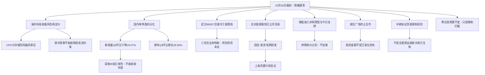

# 2026年10月30日 · 消息面事件驱动

> 数据源新鲜度：partial · 降级状态：true · 研究置信度：0.67
> 结论层级：8条硬事件已交付；首推价位与执行资格未闭环，status=partial。
> 情绪=震荡。昨日炸板率39.06%，研究候选上限由8只减至4只；风险覆盖不减。

## 一句话结论
国产算力与环比兑现只做研究观察，海外科技再定价和交付回落优先拦截；零交易预算不变。

## 先认市场，再认个股

市场为什么付钱：目前只有消息侧的工程交付与盈利分化证据，尚无R1/R2/R7终稿确认资金主线。阶段引用当日已落盘emotion_cycle：高位震荡，基于10月29日已完成交易时段，不用今晨新消息倒推昨日资金动机。

主线 = 未确认；持续性 = 未核定；封板率 = 未核定；明日预期 = 待R2确认。R4不得凭新闻声量捏造板块资金、封板率、连板地位或持续天数。四只研究对象均未过龙头认定与板型、RR门禁。今天做事件核验和反证交付；今天不做新仓、不接复牌盲板、不把低位猜测当右侧确认。

研究对象不等于可交易对象。本文没有首推买入票，execution_candidates为空；所有position_size_suggestion=0。止损与目标价没有R5/D1可验证锚时保持null，不能人为设定目标价把RR凑到2。旧版“每事件强配一票与具体止损”的条款因此显式标为未满足，而非冒充完整执行产物。R6仍是唯一hard_reject来源，R4的“拦截”只表示消息侧研究态度。

## 时间窗口与来源保真

这是10月30日真实盘前运行，不是回放。交易日历已实时核验：今日开市，上个交易日10月29日。冻结输入的SHA256及知识截止保存在JSON timing，真实生成时刻保存在generated_at，不回填成此前预测。

重点观察近72小时；财联社分段直采实际最早10月27日06:18:25、最新10月30日05:42:15。原news_cls只有新浪1491条、同花顺1500条，最早只到10月28日16:39；news_major为800条无正文标题，最早只到10月29日16:22:27。两个文件均不能声称完整72小时。直采财联社1284条补盲，但“最新一条到05:42”不表示此后无新闻。

公众号实际为取阅RSS15号池83篇，最早10月29日06:49、最新10月30日00:05；兼容文件和RSS镜像只计一次。5个匿名群312条、295条去重消息，不把同一份卖方报告跨群转发当多个独立来源。公众号“盘前纪要”现有是10月29日版，尚不能假设今日07时新稿已经获取。

美国10月29日16:00纽约收盘经America/New_York时区换算为北京时间10月30日04:00。谷歌季报不及预期最迟10月29日盘前已知，今晨新增是收盘风险确认，不是全新财报；武汉950DT有“28日大会点亮/29日报道今日上线”的口径差异，保留双时间而非擅自统一。

## 🗺️ 消息面全景图

## 🎯 八条优先硬事件详解

下列按事实强度及加权绝对分排序。评分为R4研究判断，不是API提供的概率；正面不自动入执行池。每条官方披露或原始快讯可追溯。公司季报经Tushare和巨潮两条通道取得仍只算同一底层文件，不宣称两个独立源。

### E20261030_001 · 隔夜美股科技收跌确认海外AI链风险再定价

极性：负面 · strength=high · 原始分=-0.88 · 加权分=-0.880000 · 态度=拦截。

**事件摘要**：谷歌收跌12.34%且纳指跌1.38%。

首次可知：2026-10-30T04:00:31+08:00；首次可交易日：20261030；新旧分类：老方向新增催化。这是本次样本内最早可追溯报道，不宣称全球首次；公告名义日期另存。

- **大资金意图**：无法从新闻确认大资金实际意图；风险资产去杠杆是待资金面验证的解释。
- **为什么走强**：本条解释海外科技承压，不是A股新主线走强；不因海外跌价就武断推定国产替代受益。
- **逻辑够不够硬**：收盘涨跌为已发生事实；A股映射是风险偏好推断而非订单证伪。

**事实与推断边界**：海外现金流担忧经风险偏好传导至A股硬件；不是国内订单取消证据。谷歌业绩最迟10月29日盘前已知，本条新增仅为美国10月29日收盘确认，不得解释此前A股下跌为事后新闻。

**负面杀伤面**：行业级；AI算力、CPO光模块、存储芯片、液冷散热、算力租赁。不转换成自动卖出或R6硬否决。

**关键证据**：
- 纳指收跌1.4% 谷歌大跌12% · 财联社原始快讯/Tushare实时MCP · data/research/20261030/R4_primary_evidence.json#/cls_live/22
- Alphabet债务风险指标上升 财报令AI举债担忧再起 · 财联社原始快讯/Tushare实时MCP · data/research/20261030/R4_primary_evidence.json#/cls_live/30

### E20261030_002 · 新易盛Q3环比下滑与订单需求不可混为利好

极性：负面 · strength=high · 原始分=-0.78 · 加权分=-0.780000 · 态度=拦截。

**事件摘要**：新易盛Q3净利环比下降19.07%。

首次可知：2026-10-29T18:15:21+08:00；首次可交易日：20261030；新旧分类：老方向新增催化。这是本次样本内最早可追溯报道，不宣称全球首次；公告名义日期另存。

- **大资金意图**：若资金要求利润逐季兑现，交付不畅会使高估值容忍度下降；实际交易行为由R7确认。
- **为什么走强**：不是走强证据；订单旺盛与当季利润环比回落可以同时成立。
- **逻辑够不够硬**：三份累计利润可复算单季；缺一致预期和产品现货价格，不能升级为全行业需求见顶。

**事实与推断边界**：单季归母38.4316亿元低于Q2的47.4895亿元；累计同比79.74%不能代替环比。对CPO为交付压力警示，不泛化为所有公司业绩见顶。深夜IR另作为正面独立事件保留。

**负面杀伤面**：板块级；CPO光模块。不转换成自动卖出或R6硬否决。

**单季拆分**：前三季累计归母113.723305亿元 − 半年累计75.291680亿元 = Q3 38.431625亿元；半年累计 − Q1 = Q2 47.489451亿元；环比-19.0733%。扣非净利36.297461亿元，非经常损益占归母5.5531%。累计同比+79.74%仅背景。产品价格：未查；一致预期：未核实。终判：边际交付承压；不等于需求崩塌。

**关键证据**：
- 新易盛：Q3净利润同比增长61% 环比下降19% · 财联社原始快讯/Tushare实时MCP · data/research/20261030/R4_primary_evidence.json#/cls_live/190
- 巨潮公司原始披露 · 巨潮公司原始披露 · https://static.cninfo.com.cn/finalpage/2026-10-30/1225642947.PDF

### E20261030_003 · 普冉Q3环比改善且扣非验证但并表基数需剥离

极性：正面 · strength=high · 原始分=+0.74 · 加权分=+0.740000 · 态度=观察。

**事件摘要**：普冉Q3净利环比增长26.50%且扣非7.20亿元。

首次可知：2026-10-29T19:00:14+08:00；首次可交易日：20261030；新旧分类：老方向新增催化。这是本次样本内最早可追溯报道，不宣称全球首次；公告名义日期另存。

- **大资金意图**：资金可能寻找环比向上且扣非兑现的存储分支；只有价格与资金确认后才能证明。
- **为什么走强**：利润环比与产品价方向相互印证，但昨日股价走弱，尚不证明正反馈形成。
- **逻辑够不够硬**：原始季报扣非接近归母且价格上涨有披露；并表和低基数削弱同比外推。

**事实与推断边界**：Q3归母7.2816亿元和扣非7.2004亿元接近；公告称存储价格上行。SHM并表贡献Q3收入20.39亿元，不能把同比3875.57%全当内生增长。现货价格未独立复核，一致预期未核，降级观察。

**单季拆分**：前三季累计归母15.549032亿元 − 半年累计8.267459亿元 = Q3 7.281573亿元；半年累计 − Q1 = Q2 5.756338亿元；环比+26.4966%。扣非净利7.200369亿元，非经常损益占归母1.1152%。累计同比+2533.23%仅背景。产品价格：公告披露上行；未独立核现货；一致预期：未核实。终判：环比改善但并表基数不可外推。

**关键证据**：
- 普冉股份：Q3净利润同比增长3876% 环比增长26% · 财联社原始快讯/Tushare实时MCP · data/research/20261030/R4_primary_evidence.json#/cls_live/148
- 巨潮公司原始披露 · 巨潮公司原始披露 · https://static.cninfo.com.cn/finalpage/2026-10-30/1225644653.PDF

#### 普冉股份 688766.SH · 研究对象，不是首推 · 观察

- **买入理由**：当前不授予买入理由；仅研究因果：芯片收入100%；业务返回未标报告期。季报扣非7.2004亿元支撑主营兑现，但SHM并表收入占比不得忽略。
- **风险点**：产品现货独立核验缺失；一致预期缺失；板型及龙头门禁未审。R7五日净流入未核，不填虚构资金数。
- **止损条件**：研究逻辑证伪即移出；价格止损须R5/D1在真实入场与风险锚确定后重新推导。具体止损价与目标价均null，RR未验证，仅watch。参考价270.50元，实际成交日20261029；不作为入场报价。
- **可验证假设**：若产品现货价格和后续扣非利润不能维持环比改善，存储分支逻辑降级；并表增长不得冒充内生增长。

板型：未知。龙头认定：NOR/存储分支研究对象；龙头地位未过R2认定，已核通过条数0。盈亏比：未知。禁止清单：产品现货独立核验缺失、一致预期缺失、板型及龙头门禁未审。路径标签：计划内试错，尚非D1今日授权计划。

业绩预告交叉：本次东财2026Q3预告500条截面未命中；不是“无预告”，也不是“无业绩”。中报预告未取得，不伪造区间。正式Q3原文已核，可用扣非与环比，而非用累计同比夸大硬alpha。

### E20261030_006 · 博盈特焊披露海工收购预案并于今日复牌

极性：正面 · strength=high · 原始分=+0.72 · 加权分=+0.720000 · 态度=观察。

**事件摘要**：博盈拟购罗克莱55%股权并于今日复牌。

首次可知：2026-10-29T18:51:18+08:00；首次可交易日：20261030；新旧分类：老方向新增催化。这是本次样本内最早可追溯报道，不宣称全球首次；公告名义日期另存。

- **大资金意图**：可能为复牌重估寻找新资产，但这不是已确认主线资金意图。
- **为什么走强**：主业同源并购使海工扩展可解释，然而预案尚待审批，不能当作并表收入。
- **逻辑够不够硬**：交易、价格与复牌有公司原文；标的未经审计及摊薄风险削弱价格推导。

**事实与推断边界**：暂估4.95亿元且审计评估未完成；10月19日停牌意味着筹划并非新方向，新增是预案细节与复牌安排。10月16日停牌前价28.14元不能冒充10月29日成交价。

**关键证据**：
- 博盈特焊：拟收购苏州罗克莱55%股份 股票明起复牌 · 财联社原始快讯/Tushare实时MCP · data/research/20261030/R4_primary_evidence.json#/cls_live/157
- 巨潮公司原始披露 · 巨潮公司原始披露 · https://static.cninfo.com.cn/finalpage/2026-10-30/1225643549.PDF
- 巨潮公司原始披露 · 巨潮公司原始披露 · https://static.cninfo.com.cn/finalpage/2026-10-30/1225643546.PDF

#### 博盈特焊 301468.SZ · 研究对象，不是首推 · 降级

- **买入理由**：当前不授予买入理由；仅研究因果：防腐耐磨堆焊产品36.7477%；未标报告期。并购预案确认同源耐腐蚀技术拓展海工，现价仍待复牌重新发现。
- **风险点**：停牌前价过旧；复牌跳空风险；审批与摊薄风险；RR未验证。R7五日净流入未核，不填虚构资金数。
- **止损条件**：研究逻辑证伪即移出；价格止损须R5/D1在真实入场与风险锚确定后重新推导。具体止损价与目标价均null，RR未验证，仅watch。参考价28.14元，实际成交日20261016；不作为入场报价。
- **可验证假设**：只有审计评估、审批与实际成交价完成后才可能重新评估；复牌不等于可买。

板型：未知。龙头认定：单一复牌事件对象；非已确认主线龙头，已核通过条数0。盈亏比：未知。禁止清单：停牌前价过旧、复牌跳空风险、审批与摊薄风险、RR未验证。路径标签：计划内试错，尚非D1今日授权计划。

业绩预告交叉：本次东财2026Q3预告500条截面未命中；不是“无预告”，也不是“无业绩”。中报预告未取得，不伪造区间。本节不以无预告记录给予置信度加分。

### E20261030_007 · 湖北广电终止光谷智算中心合作削弱转型预期

极性：负面 · strength=high · 原始分=-0.72 · 加权分=-0.619710 · 态度=拦截。

**事件摘要**：湖北广电终止与华鑫信共同建设智算中心。

首次可知：2026-10-28T16:00:36+08:00；首次可交易日：20261029；新旧分类：已交易后的延续。这是本次样本内最早可追溯报道，不宣称全球首次；公告名义日期另存。

- **大资金意图**：可能淘汰缺实付资本的算力叙事；不据一例推定整个算力产业资金撤退。
- **为什么走强**：不是走强理由；阻断把项目规划额当落地业绩的叙事。
- **逻辑够不够硬**：终止和生效资金未到有原文；25亿元只是规划，不能写成损失。

**事实与推断边界**：至少3亿元协议生效资金未到账；原计划25亿元不是已损失25亿元。公司称不对现有经营财务产生重大不利影响；研究判断是增长期权落空而不是断言经营危机。

**负面杀伤面**：个股级；算力租赁、广电传媒。不转换成自动卖出或R6硬否决。

**关键证据**：
- 湖北广电：终止与华鑫信共同投资建设光谷智算中心 · 财联社原始快讯/Tushare实时MCP · data/research/20261030/R4_primary_evidence.json#/cls_live/730
- 巨潮公司原始披露 · 巨潮公司原始披露 · https://static.cninfo.com.cn/finalpage/2026-10-29/1225633028.PDF

### E20261030_004 · 武汉950DT液冷超节点上线验证国产算力工程落地

极性：正面 · strength=medium · 原始分=+0.66 · 加权分=+0.568067 · 态度=观察。

**事件摘要**：武汉950DT千卡超节点采用全液冷。

首次可知：2026-10-29T12:15:00+08:00；首次可交易日：20261029；新旧分类：已交易后的延续。这是本次样本内最早可追溯报道，不宣称全球首次；公告名义日期另存。

- **大资金意图**：可能区分国产工程交付与海外融资压力，选择有实际产品交付的环节；目前只是研究假设。
- **为什么走强**：千卡超节点与全液冷提高产业验证度，不等于今日板块涨停或资金回流。
- **逻辑够不够硬**：存在记者原始稿和公司IR；本项目供货归属未核，三花只能业务映射。

**事实与推断边界**：科创板日报记者稿与大会转述可追溯；IT之家称28日大会点亮，29日报道称今日上线，保留时间口径差异。三花IR确认CDU零部件供货但未证明供货本项目；禁止把通用供应链关系写成武汉定点订单。

**关键证据**：
- 【电报解读】全国首个昇腾950DT超节点集群采取全液冷设计，机构称AI机柜液冷投资主线切换至整机柜热管理，这家公司已为全球大量客户提供CDU及服务器机柜等产品 · 财联社 · https://api3.cls.cn/b/2518933
- 全国首个华为昇腾 950DT 超节点集群在武汉上线，全面支撑万亿参数大模型训练与智能体推理 · IT之家 · http://www.c114.net.cn/industry/139451.html
- 巨潮公司原始披露 · 巨潮公司原始披露 · https://static.cninfo.com.cn/finalpage/2026-10-29/1225644889.PDF

#### 三花智控 002050.SZ · 研究对象，不是首推 · 观察

- **买入理由**：当前不授予买入理由；仅研究因果：制冷业务单元61.8039%；该比例不是液冷收入占比。10月29日IR确认一次侧与CDU零部件批量供货，未确认武汉项目客户身份。
- **风险点**：具体项目供应商归属未核；R7资金确认缺失；主线资格未确认。R7五日净流入未核，不填虚构资金数。
- **止损条件**：研究逻辑证伪即移出；价格止损须R5/D1在真实入场与风险锚确定后重新推导。具体止损价与目标价均null，RR未验证，仅watch。参考价34.50元，实际成交日20261029；不作为入场报价。
- **可验证假设**：只有公司或项目方明确供应商归属后，才能从泛液冷映射升级为本项目受益。

板型：未知。龙头认定：热管理产业地位不等于今日板块龙头，已核通过条数0。盈亏比：未知。禁止清单：具体项目供应商归属未核、R7资金确认缺失、主线资格未确认。路径标签：主线补涨，尚非D1今日授权计划。

业绩预告交叉：本次东财2026Q3预告500条截面未命中；不是“无预告”，也不是“无业绩”。中报预告未取得，不伪造区间。本节不以无预告记录给予置信度加分。

### E20261030_008 · 商务部回应欧方拟议限制中欧贸易存在条件风险

极性：负面 · strength=medium · 原始分=-0.52 · 加权分=-0.520000 · 态度=拦截。

**事件摘要**：中方反对欧方拟议歧视性贸易限制。

首次可知：2026-10-29T15:13:33+08:00；首次可交易日：20261030；新旧分类：老方向新增催化。这是本次样本内最早可追溯报道，不宣称全球首次；公告名义日期另存。

- **大资金意图**：资金或重新评估欧洲需求与出口敞口，暂无逐票敞口及资金证据。
- **为什么走强**：不是走强结论；国内替代若受益也需要订单与竞争格局另证。
- **逻辑够不够硬**：官方发布会口径可核；限制仍拟议且触发条件未定，只计风险折价不计已执行禁令。

**事实与推断边界**：欧方正研究将安排延伸至化工，发言为条件性反制，并非已出台新的全面禁运或关税。中欧对话有进展一并保留，未核企业欧洲敞口，不强造受益股。

**负面杀伤面**：板块级；化工出口、汽车出口。不转换成自动卖出或R6硬否决。

**关键证据**：
- 商务部：如欧方对中国产品采取歧视性限制措施 中方必将采取一切必要措施 · 财联社原始快讯/Tushare实时MCP · data/research/20261030/R4_primary_evidence.json#/cls_live/313
- 商务部：如欧方对中国产品采取歧视性限制措施，中方必将采取一切必要措施 · 财闻 · http://news.10jqka.com.cn/19700122/c681234692.shtml

### E20261030_005 · 北京新型能源规划支持储能与电网技术研发

极性：正面 · strength=medium · 原始分=+0.53 · 加权分=+0.456175 · 态度=观察。

**事件摘要**：北京规划推进固态液流电池与智能电网研发。

首次可知：2026-10-28T15:11:00+08:00；首次可交易日：20261029；新旧分类：已交易后的延续。这是本次样本内最早可追溯报道，不宣称全球首次；公告名义日期另存。

- **大资金意图**：可能围绕能源转型做低位分支研究；无资金确认不推定机构配置。
- **为什么走强**：政策扩展储能需求叙事，但公开于28日，已被交易过，持续性不能凭转载增加。
- **逻辑够不够硬**：政府规划经财联社原稿确认；没有落到公司合同和预算，交易硬度有限。

**事实与推断边界**：15:11财联社报道已出现，15:12:33详述固态/液流与60万千瓦装机目标；不把29日晚公众号转载改写为全新政策。规划不等于财政预算或企业合同；上海洗霸亏损构成个股反向校验。

**关键证据**：
- 《北京市“十五五”时期新型能源体系规划》：聚焦钙钛矿太阳能电池及高效光伏组件研发及设备制造 推广建筑光伏一体化 · 财联社原始快讯/Tushare实时MCP · data/research/20261030/R4_primary_evidence.json#/cls_live/746
- 《北京市“十五五”时期新型能源体系规划》印发，本市勾勒五年能源转型新图景 · 北京日报 · https://www.ncsti.gov.cn/kjdt/xwjj/202610/t20261029_259992.html

#### 上海洗霸 603200.SH · 研究对象，不是首推 · 降级

- **买入理由**：当前不授予买入理由；仅研究因果：新能源先进材料行业口径2.5793%与另一产品口径5.7245%混合返回；报告期未标不能混算。原文确认0.5GWh固液混合电芯及500吨固态电解质项目为计划。
- **风险点**：Q3扣非亏损；经营现金流为负；低业务敞口；龙头与RR门禁未审。R7五日净流入未核，不填虚构资金数。
- **止损条件**：研究逻辑证伪即移出；价格止损须R5/D1在真实入场与风险锚确定后重新推导。具体止损价与目标价均null，RR未验证，仅watch。参考价47.02元，实际成交日20261029；不作为入场报价。
- **可验证假设**：需看到固态材料商业订单与收入改善足以覆盖当期亏损，政策规划不能替代。

板型：未知。龙头认定：政策映射弱于公司亏损反证；不得以低价或政策标签替代龙头认定，已核通过条数0。盈亏比：未知。禁止清单：Q3扣非亏损、经营现金流为负、低业务敞口、龙头与RR门禁未审。路径标签：计划内试错，尚非D1今日授权计划。

业绩预告交叉：本次东财2026Q3预告500条截面未命中；不是“无预告”，也不是“无业绩”。中报预告未取得，不伪造区间。正式Q3原文确认扣非亏损1712.96万元及累计经营现金流-8096.91万元，政策映射降级。

## 📊 板块 × 事件极性叉乘

8条主事件与15个板块完整叉乘，共120格。＋/－后的数值是时间衰减后研究分，0表示该事件未映射该板块，不表示板块无风险。E1海外收盘、E2新易盛季报、E3普冉季报、E4武汉950DT、E5北京能源规划、E6博盈重组、E7湖北项目终止、E8中欧条件风险。

| 板块 | E1 | E2 | E3 | E4 | E5 | E6 | E7 | E8 | 净极性 | 明确态度 |
|---|---:|---:|---:|---:|---:|---:|---:|---:|---|---|
| AI算力 | -0.880 | 0 | 0 | +0.568 | 0 | 0 | 0 | 0 | 负面 | 降级 |
| CPO光模块 | -0.880 | -0.780 | 0 | 0 | 0 | 0 | 0 | 0 | 负面 | 拦截 |
| 光伏钙钛矿 | 0 | 0 | 0 | 0 | +0.456 | 0 | 0 | 0 | 正面 | 观察 |
| 化工出口 | 0 | 0 | 0 | 0 | 0 | 0 | 0 | -0.520 | 负面 | 拦截 |
| 固态电池 | 0 | 0 | 0 | 0 | +0.456 | 0 | 0 | 0 | 正面 | 观察 |
| 国产算力 | 0 | 0 | 0 | +0.568 | 0 | 0 | 0 | 0 | 正面 | 观察 |
| 存储芯片 | -0.880 | 0 | +0.740 | 0 | 0 | 0 | 0 | 0 | 负面 | 降级 |
| 并购重组 | 0 | 0 | 0 | 0 | 0 | +0.720 | 0 | 0 | 正面 | 观察 |
| 广电传媒 | 0 | 0 | 0 | 0 | 0 | 0 | -0.620 | 0 | 负面 | 拦截 |
| 智能电网 | 0 | 0 | 0 | 0 | +0.456 | 0 | 0 | 0 | 正面 | 观察 |
| 汽车出口 | 0 | 0 | 0 | 0 | 0 | 0 | 0 | -0.520 | 负面 | 拦截 |
| 海工装备 | 0 | 0 | 0 | 0 | 0 | +0.720 | 0 | 0 | 正面 | 观察 |
| 液冷散热 | -0.880 | 0 | 0 | +0.568 | 0 | 0 | 0 | 0 | 负面 | 降级 |
| 液流储能 | 0 | 0 | 0 | 0 | +0.456 | 0 | 0 | 0 | 正面 | 观察 |
| 算力租赁 | -0.880 | 0 | 0 | 0 | 0 | 0 | -0.620 | 0 | 负面 | 拦截 |

净值不是买卖评分。存储同时有E1负面与E3正面，液冷同时有E1负面与E4正面，不能“相减以后正数就买”。新易盛深夜IR正面、上海洗霸个股亏损负面另列补充层，不悄悄塞进主矩阵改变8事件口径。湖北广电终止仅直接影响其项目期权，不据此断言全行业停建；中欧贸易只有条件风险，不强造A股确定受益名单。

## 正反两面与补充事件：不占八条主事件计数

### S001 新易盛深夜IR的正面必须单列

原始投资者关系记录真实入库10月29日22:54:32；公司称已经为Q4与明年交付准备原料和产能，NPO已看到2027年订单指引、预计2027年批量出货。公司同时称泰国洪灾未损坏货物、未影响生产，但9月发货物流受阻。故不能把Q3回落简单外推成需求崩塌，也不能用未来指引删除当期回落。本条是独立company_guidance正面事件，态度=观察；并非新易盛的新仓许可。

### S002 上海洗霸的个股负面不能被固态政策覆盖

Q3归母-1361.50万元，Q2由累计数拆分为-844.54万元；按负数分母绝对值计算亏损扩大61.21%。Q3扣非-1712.96万元，前三季经营现金流-8096.91万元。正文描述的新能源材料占比来自不同口径、未标报告期，不能混成统一比例。固液混合电芯和电解质项目仍属建设规划，固态政策是方向叙事而非本公司盈利转折，态度=降级，不进执行。

### B001 即梦工作室是四日前旧催化

实时同花顺问财搜索找到10月26日14:22:52的上线报道及同日下午新浪科技采访；10月29日晚财联社公众号仅复述。原始分+0.50、4日自然日衰减后+0.274406，decayed=true，仅背景，不作为首推理由。3D导演台是视频分镜预演，不是物理世界模型。

反面另列为传导假设：同一平台集成剧本、图像与分镜能力可能挤压同质化中间工具商价值，尚无A股利润受损原文，因此作为未证实的负面假设，不凑成第九条“硬事件”。有IP/分发能力者与单点工具商不能一律贴利好标签。态度=降级。

### B002 商业航天候选公示不是已落袋合同

蓝箭航天9500万元、中科宇航1亿元均为投标报价；公示期10月28日至11月2日，交付承诺为合同后5年。未直接取得招投标平台原始页面，多平台报道追溯同一份公示，独立性不足；放在观察层，不包装成新合同、不强映射斯瑞等供应商已分得订单。同一国金卖方材料跨多个群转发只算一条传播链。群材料中的SpaceX利润与太空算力预测未有本次独立原文核验，不能当硬事实。

### B003 安徽凤凰个人调查是合规风险线索

上海证券报报道董事长因涉嫌内幕交易被立案，但本次未直取立案公告原文，保留medium/待核验；个人调查不等于公司被立案、更不等于确定退市。920000.BJ命中北交所自动买入禁用前缀，态度=拦截研究执行资格并交R6；R4不自行签发hard_reject。

## 研究对象与剔除覆盖

| 对象 | 消息映射 | 参考价/成交日 | 板型与龙头 | RR | 态度 |
|---|---|---|---|---|---|
| 普冉股份 688766.SH | 单季与扣非改善 | 270.50 / 10月29日 | 未认定 | 未验证 | 观察 |
| 三花智控 002050.SZ | 液冷供货业务；非武汉项目定点确认 | 34.50 / 10月29日 | 未认定 | 未验证 | 观察 |
| 博盈特焊 301468.SZ | 预案与复牌 | 28.14 / 10月16日停牌前 | 未认定 | 未验证 | 降级 |
| 上海洗霸 603200.SH | 固态政策与亏损交叉 | 47.02 / 10月29日 | 未认定 | 未验证 | 降级 |

四只只是研究观察额度，不是四只可交易候选，执行池为0。低价、产业知名度与概念成分身份均不能替代今日龙头地位。

剔除/未提升：短剧宽口径99只仅抽样15条，包含旅游、广告和多主题交叉；不按概念标签机械造票。湖北广电虽也出现在短剧池，却有独立项目终止风险，不因多概念加分。商业航天没有核到A股供应商获得本公示订单；未提升为执行票。即梦为旧闻，不扩大传媒票池。欧洲业务敞口未核的公司不强行填入贸易事件。新易盛只作风险与正面反证双向对象，不假设下跌就是低吸机会。

## 🔥 中报业绩预告命中（本次输入实际为2026Q3）

已审计东财500条中的归母净利润记录，按预增下限排序交叉前20条，超过top15最低覆盖要求。它不是全市场公告全量，也不是H1中报表；下表只做覆盖检查，不当新的正面事件。前20条公告均已超过7日，累计同比不可直接授予正面极性。存储、芯片和电池材料与本次板块有交集的仍须单季环比与现货方向复核；没有为填表将旧预告恢复成新催化。

| 代码 | 名称 | 公告日 | 累计同比区间 | 板块交集 | 处理 |
|---|---|---|---|---|---|
| 001309.SZ | 德明利 | 2026-10-17 | 32046.52%~33154.49% | 存储/芯片 | 超7日背景，不评级为正面 |
| 300821.SZ | 东岳硅材 | 2026-10-08 | 19047.97%~19748.08% | 无直接确认交集 | 超7日背景，不评级为正面 |
| 000703.SZ | 恒逸石化 | 2026-10-16 | 3318.59%~3405.13% | 无直接确认交集 | 超7日背景，不评级为正面 |
| 002466.SZ | 天齐锂业 | 2026-10-21 | 2734.97%~3235.26% | 电池材料 | 超7日背景，不评级为正面 |
| 688825.SH | 长鑫科技 | 2026-10-17 | 2581.06%~2609.47% | 存储/芯片 | 超7日背景，不评级为正面 |
| 002812.SZ | 恩捷股份 | 2026-10-14 | 1884%~2474.8% | 电池材料 | 超7日背景，不评级为正面 |
| 688808.SH | 联讯仪器 | 2026-10-13 | 1866%~2072.95% | 无直接确认交集 | 超7日背景，不评级为正面 |
| 301308.SZ | 江波龙 | 2026-10-15 | 1864.55%~1990.84% | 存储/芯片 | 超7日背景，不评级为正面 |
| 605189.SH | 富春染织 | 2026-10-14 | 1347.69%~1519.01% | 无直接确认交集 | 超7日背景，不评级为正面 |
| 603991.SH | 领先股份 | 2026-10-21 | 1238.57%~1238.57% | 无直接确认交集 | 超7日背景，不评级为正面 |
| 688388.SH | 嘉元科技 | 2026-10-15 | 1196.6%~1318.92% | 电池材料 | 超7日背景，不评级为正面 |
| 603026.SH | 石大胜华 | 2026-10-15 | 968.14%~1032.45% | 电池材料 | 超7日背景，不评级为正面 |
| 000626.SZ | 远大控股 | 2026-10-15 | 890%~1018% | 无直接确认交集 | 超7日背景，不评级为正面 |
| 002493.SZ | 荣盛石化 | 2026-10-15 | 777.93%~822.95% | 无直接确认交集 | 超7日背景，不评级为正面 |
| 301536.SZ | 星宸科技 | 2026-10-13 | 663.13%~697.75% | 存储/芯片 | 超7日背景，不评级为正面 |
| 300497.SZ | 富祥股份 | 2026-09-18 | 658%~785% | 无直接确认交集 | 超7日背景，不评级为正面 |
| 301292.SZ | 海科新源 | 2026-10-16 | 592%~601% | 无直接确认交集 | 超7日背景，不评级为正面 |
| 301511.SZ | 德福科技 | 2026-10-14 | 560.72%~620.78% | 电池材料 | 超7日背景，不评级为正面 |
| 002552.SZ | 宝鼎科技 | 2026-10-14 | 536.88%~614.07% | 无直接确认交集 | 超7日背景，不评级为正面 |
| 300199.SZ | 翰宇药业 | 2026-10-13 | 502.65%~530.68% | 无直接确认交集 | 超7日背景，不评级为正面 |

正式Q3交叉不止看预告：普冉用公告扣非与环比确认；新易盛用单季回落与深夜交付指引分层；上海洗霸用亏损和现金流反证。不得因500条截面没命中就断言公司没有预告。问财“最新业绩预告”查询返回公司名但解析到年报，未给区间，因此此条查询判无效，不算交叉验证成功。

## 关键证据与可复算路径

- 财联社实时1284条及8份巨潮原始PDF文本：data/research/20261030/R4_primary_evidence.json。每事件source_evidence含数组定位、原始时区与原文链接。
- 同花顺问财6项新闻、2项公告查询的完整HTTP响应：data/research/20261030/R4_live_search_evidence.json。每项实际返回10条/段，不能把total=15误报成已获取15条；按文件而非段落计算独立性。
- 单季复算公式：Q3=前三季累计−H1；Q2=H1−Q1；环比=(Q3−Q2)/abs(Q2)。新易盛/普冉/上海洗霸的元级输入与输出均在JSON earnings_breakdown.calculation，不把亿元四舍五入后再计算。
- Tushare anns_d多股票拼接首次返回空后，已按单股重新查新易盛、普冉并成功；未将空返回解释成无公告。
- 同花顺问财业务与定向价格查询已成功，业务比例可能混合报告期。博盈10月29日价格查询填充28.14，经Tushare实际日线与公司停牌公告确认是10月16日停牌前价格，不当新成交价。

## 数据源审计

只列日期，不展示群名、个人身份或秒级抓取时刻；精确抓取与发布字段留机读JSON。绿色代表该腿可用，不代表整段历史全量。

| 源 | 日期 | 状态 | 备注 |
|---|---|:---:|---|
| wechat_official_20 | 2026-10-30 | 🟢 | 83；取阅RSS实际15号池，非21号全覆盖；RSS/compat为同一83篇只计一次；最早2026-10-29 06:49 最新2026-10-30 00:05。 manifest无本文件独立精确抓取时刻，mtime不替代抓取。 |
| wechat_cli_5groups | 2026-10-30 | 🟢 | 312；5个匿名群；295条去重消息；同一卖方报告跨群转发不独立。 manifest无本文件独立精确抓取时刻，mtime不替代抓取。 |
| news_cls | 2026-10-30 | 🟡 | 2991；实际sina=1491和10jqka=1500；未含cls。最早2026-10-28 16:39 最新2026-10-30 05:56:48；同花顺触1500上限，非完整72h。 |
| news_major | 2026-10-30 | 🟡 | 800；800条均为标题无正文；窗口仅2026-10-29 16:22:27至2026-10-30 04:36:15，不能冒称72h完整。 |
| eastmoney_earnings_predict | 2026-10-30 | 🟡 | 500；2026Q3截面500条非H1且未证明全量；top20预增公告均已超过7日；本次4只研究对象未命中不能解读为无预告。 |
| tushare_cls_live | 2026-10-30 | 🟢 | 1284；实时MCP分三个互不重叠时间窗直采财联社；实际最早2026-10-27 06:18:25 最新2026-10-30 05:42:15。非每小时新闻均有、不能证明截止以后无新消息。 |
| anns_window | 2026-10-30 | 🟢 | 9857；覆盖20261029/30自然日，非精确24h；标题分类不能当原文核验。 |
| previous_evening_events | 2026-10-30 | 🟢 | 4297；读取上一晚4297条分类作为漏检控制；绝大多数仅标题，无重复打分。 |
| primary_pdf | 2026-10-30 | 🟢 | 8；8份巨潮PDF实时下载HTTP200，关键章节核验；正文保存在证据包。 |
| news_search | 2026-10-30 | 🟢 | 60；同花顺问财官方OpenAPI；6个新闻问句各返回10条；total=15不等于已取15；TLS证书校验关闭已审计。 |
| announcement_search | 2026-10-30 | 🟢 | 20；2个公告搜索问句各10段，按PDF文件去重，不计20份独立公告。 |
| hithink_business_query | 2026-10-30 | 🟢 | 39；逐票普冉6/三花5/上海洗霸22/博盈6行；trace_ids见data_sources_audit；部分业务记录缺报告期。 |
| hithink_market_query | 2026-10-30 | 🟢 | 4；逐票4行价格；宽口径短剧概念99只仅取15行，未冒称全市场候选覆盖；停牌填充价经Tushare核出。 |
| hithink_event_query | 2026-10-30 | 🔴 | 4；返回4家公司但未给所需预告区间，自动解析到2026年年报，不作有效预告核验。 |
| R3_sentiment | 2026-10-30 | 🔴 | 未知；本阶段截止未落盘；kol_confirm不冒填✅。 |
| R7_capital_flow | 2026-10-30 | 🔴 | 未知；仅发现R7工作证据而非最终artifact；不替R7计算资金。 |

news-search与announcement-search未提供文档示例路径scripts/cli.py，本次按SKILL.md正式HTTP契约直调官方OpenAPI已恢复；不是key未配置或网页爬虫403。请求关闭TLS证书校验，传输层信任降低已记录，未掩盖成完全健康。受本阶段工具权限约束未调vibe/datapro；机构研报、一致预期与独立现货价格未核，不以“已核”填空。不存在热榜/东财lead_stock自动代理首推。

## 不确定性 / 反证

1. 正面消息不是合力确认。R1/R2/R7最终主线资格、板块封板率和资金持续性未形成可消费证明；R3终稿也未落盘，kol_confirm不填✅。股价尚未形成右侧证据，严禁因利润增长去抄底。
2. 同一季报经MCP、搜索、巨潮和公众号四路出现仍是一份文件；媒体数、群数不能抬高独立原始源数。本次高强度事件主要依赖官方原文或原始官方新闻例外，single_source=true是透明披露而非掩饰。
3. 普冉并表和低基数令累计同比极高，公告现货方向也不替代独立报价；新易盛物流与备货短缺可能后移交付，也可能继续约束兑现；两者都需要后续真实业务验证。
4. 北京政策在28日已公开；武汉集群“点亮/上线”日期有差异；即梦26日已上线。凡最早可知时间未查定就保留未知或双源差异，不把29日晚转载包装成新方向。
5. 博盈复牌不是审批完成；湖北规划25亿元不是损失25亿元；中欧拟议限制不是已生效禁运。价格、订单和预算的状态不可混用。
6. 预告500条截面与标题流存在覆盖截断；8条优先事件并非全市场负面穷尽。前晚4297条标题分类及今晨9857条窗口已读作漏检控制，但仅8份PDF完成本次原文关键章节核验，不宣称所有公司财务合规审查完成。

## 与其他 R/D/E 的关系

- 依赖：当日manifest、mcp_health、公众号/群消息、新闻和公告窗口，前晚event_tracker分类，及emotion_cycle的阶段温度。人类观点active目录本次为空，未编造主观预设。
- 交付R2：15板块×8事件的正负传导矩阵和缺口，不能凭新闻净分确认主线。
- 交付R5：四只真实研究对象及业务证据、单季拆分、价位缺口。止损、目标价与RR须重新论证，不承接人为凑数。
- 交付R6：行业级海外风险、新易盛交付回落、上海洗霸亏损、复牌审批风险与贸易条件风险。R4不替R6过滤或改写hard_reject。
- 交付D1：研究对象4、执行对象0；有效零预算、不交易决定及原有授权保护均不改变。

## Sub-Agent 元数据

- skill：analyze_news_impact_v1@1.6
- artifact：data/research/20261030/R4_news.json
- method：llm_v1，真实MCP与原文取证，未启动其他模型/CLI执行同阶段。
- 结果：8条主硬事件（4正4负），15板块/120格，4只研究映射，0只执行票。
- 校验：Pydantic类型及语义约束通过；旧版强制首推止损契约未通过且未冒称通过，status=partial。仓库tests/check_r4_top_pick_logic.py不存在，不能声称跑过该脚本。
- 硬限制：不授予开仓、卖出、撤单或清池权限，不写交易计划和执行目录。
- 用量：usage_unknown，不当作0，不保证低于努力目标；08:30仅观察式交付目标。

- 真实生成时刻：2026-10-30T06:23:39+08:00
- 知识截止：2026-10-30T06:19:12+08:00
