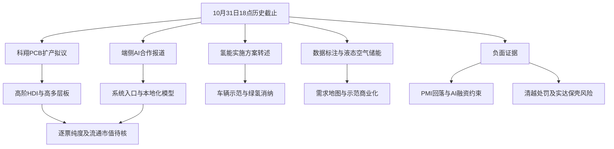

# 2026年10月31日 · 周末消息面历史补档

> 截止：2026-10-31 18:00:00（北京时间）。这是事后依据目标日目录留存材料补写的人读情报包，不是当时已发布的周末预测，不参加事前胜率统计。实际补档时间见 generated_at。historically_retrieved 只说明历史材料被事后读取，不证明当时已封存。

## 一句话结论
端侧AI与PCB有具体消息锚；需求回落、AI融资约束及公司合规风险必须并列保留。

## 判断边界：先认市场，再认对象

本次只恢复消息研究。没有使用11月2日研究、行情或11月1日目录材料，不能回答当时市场究竟在为什么付钱、处于哪段、谁有市场地位。以下“观察”指证据研究，不是主线确认、买卖建议或交易资格。市场温度、竞价、涨停指标、资金意图的事实认定均未知；不编造行情来填空。下一个交易时段的具体交易日历未独立核验，统一写“下个交易日”。

## 消息传导图

## 事件研究与反证

下列时间均为留存记录中的报道/更新标签，不等于原始发布系统的可验证日志。“最早已见”限定于本日授权输入，不能宣称全网首发。多个平台转载同一底层文件只算一个事件；无官方原文的报道不升级为双源独立确认。

### E31-01 · Apple智能接入千问：观察，合作报道与功能边界分开

- 证据：news_cls.jsonl:66，10月31日06:06:19；同文件:43，07:27:08；RSS:22，09:17；RSS:50，10:20。同属合作事件，不累计为四条利好。最早已见为06:06:19，原始公告时分未查。
- 留存内容称合作覆盖Siri、写作工具、视觉智能，并称11月4日开发者Beta测试、12月正式版本推出。另一条明确下一代Siri AI不在本轮范围；“在Siri调用千问”不等于“下一代Siri AI已全面上线”。未来日期只是目标日前报道的计划，未回核厂商本年排期及改期，不能当最终日历。
- **大资金意图**：未知。可检验的传导假设是系统入口扩大模型使用，而不是据新闻断言资金切向果链。
- **为什么走强**：本任务未核板块走强事实；消息增量在本地化接入范围，不在泛AI标签。
- **逻辑够不够硬**：留存报道较具体，但没有厂商原文快照、最终可用机型和收费分成证明。维持中等证据，不把同一公告多次转载计为独立验证。
- 正反映射：模型调用及端侧生态可能扩张；同质化独立应用也可能被系统能力挤压。没有供应商定点证据，不映射A股整条消费电子名单。
- 下个交易日待验证：厂商原文、测试范围、实际开放与新增订单，分别核验，不能用后来的结果改写本日认知。

### E31-02 · 科翔股份PCB投资：观察，拟扩产不是当期订单收入

- 证据：news_cls:893，10月30日19:07:33，江西项目拟投30亿元；:891，19:07:53，惠州项目拟投35亿元。news_major:234，23:30，仅有“总投资85亿元”标题，无正文。anns_window:3360、3361为10月30日公告索引，代码300903.SZ、附巨潮PDF地址。
- 去重：两项具名项目保留各自内容；“85亿元三项目”在本日只查到标题，不能倒入次日晚文章补齐剩余项目细节。公告日期可证明早于本日截止，但PDF未下载，项目金额以快讯转述为限。
- **大资金意图**：未知；假设是扩产结构向AI算力升级受到研究者重视，尚无资金验证。
- **为什么走强**：未核市场走强；事件可解释研究关注来源，不能解释10月30日收盘前涨跌，因为报道在盘后。
- **逻辑够不够硬**：有具名公司、项目及公告索引，比泛概念映射硬；但仍是拟投资，融资、土地、建设、良率、客户认证均未完成核验。
- 反证：需求及融资约束可能使扩产晚于预期，建设规模不能直接视为利润。研究观察对象仅科翔股份，不外推整个PCB成分榜。
- 下个交易日待验证：项目原文、资本开支来源、客户认证及产能释放进度；须查同日冲突公告。

### E31-03 · 北京氢能方案：观察政策，不能把目标规模当合同

- 证据：RSS:13《北京，重磅发布！》，10月31日17:45；内容称10月30日印发《北京市氢能产业发展实施方案（2026—2030年）》。本次没有原政策网站页面，最早公众可知时刻仅能定位到该留存更新标签，政策原发时分未知。
- 文本目标包括2030年燃料电池汽车推广、加氢站建设、绿氢消纳及产业链规模；这些是规划目标，不是财政拨款、已签订单或上市公司收入。
- **大资金意图**：未知；潜在传导是示范车辆与制氢装备需求，而非已发生资金流入。
- **为什么走强**：未核走强；政策把交通示范、工业消纳和制氢装备串联，是研究价值来源。
- **逻辑够不够硬**：政策名称与目标具体，但当前仅存媒体转述，证据为单一底层政策的二手文本，不能标官方原文已核。
- 反证：成本下降、利用率及绿氢采购执行是约束。没有点名上市公司，不造燃料电池候选清单。
- 下个交易日待验证：官方文件及附件、试点招标和资金来源；没有项目落地就保留政策观察。

### E31-04 · 数据标注部署：观察，旧会议再传播不算新题材

- 证据：RSS:43，10月31日15:35，注明来源为国家数据局公众号；正文指会议发生于10月27日下午，要求“以需定供”“以用促建”、需求地图与数据集登记。
- **大资金意图**：未知；可研究需求从数据集建设转向应用验证的路径，不推定买盘。
- **为什么走强**：未核走强；本次只看到旧会议的新传播载体，不把10月31日文章日期写成政策首次发布日。
- **逻辑够不够硬**：具体部署可读，但未回核官方页面，未见招标或企业收入；作为背景政策，不作为单股首推依据。
- 正反映射：高质量标注及场景交付可能受益；只重数量、缺实际用途的数据供给叙事可能受约束。没有具名企业订单，不借“数据要素”扩张股票池。
- 下个交易日待验证：需求地图、质量评测及登记制度是否形成可确认采购。

### E31-05 · 液态空气储能并网：观察工程事实，商业回报待证

- 证据：news_cls:49，10月31日07:16:48，正文标注央视新闻并称“昨天从中国绿发集团获悉”；news_major:27，08:12:48仅标题。同一示范项目合并，不算两个独立原始来源。
- 留存称格尔木60兆瓦液态空气储能国家示范项目成功并网；并网日期仅能从相对日期推知报道指向10月30日，精确原发时刻未知。
- **大资金意图**：未知；假设传导到长时储能工程化和设备交付，尚未验证。
- **为什么走强**：未核走强；核心是示范项目并网状态，不是新增一份宏观储能口号。
- **逻辑够不够硬**：比概念预热更具体，仍未读工程验收、实际效率、运营收入及供应商清单。保留“媒体转述官方”的层级。
- 反证：示范成功不等于全国复制盈利；不能把所有储能或空压设备公司都列为受益股。
- 下个交易日待验证：运营指标、设备定点与后续订单。

### E31-06 · PMI回落：负面必须保留，新动能相对稳定另列

- 证据：RSS:20，10月31日11:54；RSS:45，13:34。两文都引用同一统计发布，不算两份独立数据。制造业PMI49.3、非制造业49.7、综合产出49.7；另一文列制造业新订单49.4、高技术制造业PMI51.3、装备制造业50.6。
- **大资金意图**：未知；“倒逼政策”只是可能的反应，不能把弱需求直接改写成利好。
- **为什么走强**：没有价格证据；新动能处扩张区间只是结构事实，不证明全市场已奖励科技。
- **逻辑够不够硬**：统计数字具有明确引用主体，但本次未核国家统计局原始页面。负面范围为需求敏感制造及建筑链；正向结构仅限新动能相对扩张。
- 反证：节假日前置需求和季节性可能解释部分回落；仍不能抹掉需求不足风险。研究态度为观察结构差异，不给政策出台概率。

### E31-07 · AI融资与海外科技风险：负面观察，不把增长与融资混为一谈

- 证据：news_cls:29，10月31日08:07为本日输入最早已见融资缩减短讯；:26，08:19:18为详细报道，称OpenAI融资目标下调100亿美元，主体拒绝置评。news_cls:127，05:04:55记录标普将Meta展望下调至负面；这些是不同主体的风险，不归为同一原始事件。
- **大资金意图**：不能从媒体报道推断；对AI产业投资回报和融资可持续性的审视是传导假设。
- **为什么走强**：未核国内强弱；融资压力不等于算力需求全部消失，也不等于A股供应链不受影响。
- **逻辑够不够硬**：评级报道与知情人士融资消息分层，后者未获当事方确认，不能升级为已完成融资结果。
- 负面杀伤面：高资本开支算力建设、依赖融资兑现的项目与高增长预期链条；不因此全局禁止研究。下个交易日核融资交割、资本开支指引及客户付款，而不是只找利好转载。

## 群聊发酵补充：观察传播，不认定资金事实

匿名群记录wechat_cli_5groups.jsonl:90在10月31日16:35转发ETF与板块偏好标题。它是链接标题而非原文资金数据，本次未展开链接，也不在R4越权推定银行或机器人已成为主线。较早群消息与转载只作传播线索，未读图片不计独立验证。不因群多、转发多就加分或扩张候选数。

## 公告硬事件与真实风险台账

公告文件是“标题、代码、日期、URL”索引，不是已读PDF全文。日期为10月31日但无时分的3185条全部排除出本日截止证据池；如有本日之前的带时分报道，则只引用报道本身，不借公告索引补不存在的时间。

| 对象 | 本日能核到的材料 | 研究态度与反证 |
|---|---|---|
| 开普云 688228.SH | anns_window:592，10月30日《关于签订重大合同的公告》；PDF尾号1225643673 | 观察。只有标题，金额、客户、交付及收入影响待核，不将合同定性为AI新增订单 |
| 深南电A 000037 | news_cls:990，10月30日18:38:11，拟收购天合跟踪51%—70%股权 | 观察意向状态，不等同并购完成；RSS:52载主营及扣非压力，仅作二手风险线索，未拆单季环比，不授业绩正面判断 |
| *ST实达 600734 | news_cls:813，10月30日19:37:30；RSS:16、47；拟收购凯特科技不低于51%股权 | 不进正向候选研究映射。重组预计不影响2026年财务，不能当保壳已解决；立案、退市风险按来源原样交下游，不伪称R6已硬否决 |
| *ST清越 688496 | news_cls:1201，10月30日17:42:37处罚报道；:642纪律处分报道；RSS:49为延续 | 不进正向候选研究映射。欺诈发行与财务造假风险不能被显示、XR题材覆盖；未下载处罚决定书，处罚细节为报道转述 |

## 候选研究映射，不是首推票

| 研究对象 | 证据与类型 | 纯度 / 流通市值 | 龙头、板型与禁止清单核验 | 下个交易日的研究验证条件 |
|---|---|---|---|---|
| 科翔股份 300903.SZ | 具名PCB扩产，公司硬事件观察 | 均待核，不以扩产额替代纯度 | 未核，不认定龙头，不授予执行资格 | 查项目全文、融资与客户认证，正反公告同时核 |
| 开普云 688228.SH | 公告标题明确合同，只是待核线索 | 均待核 | 未核；合同所属业务尚未知 | 先补合同对象与条款，未补前不升格为事件受益结论 |
| 深南电A 000037 | 具名重组意向观察 | 均待核 | 未核，不与“深南电路”混淆 | 正式协议、收购资金及原业务风险 |

没有“今日核心 / 主线补涨 / 计划内试错”归属的市场证据，故上述仅为公司事件研究，不是开仓机会。没有依据就不输出价位、概率或预算，不用空值价位模板冒充完整交易方案。

## 🔥 中报业绩预告命中（本次不作命中承诺）

本次授权输入不包含eastmoney_earnings_predict，未读取该源，也未做top15预告交叉，不能写“无预告”或“有硬业绩”。留存三季报标题和累计同比不替代单季环比、扣非及预期差核验。涉及业绩的公司一律 earnings_qoq_unverified，不能据累计增速定性正面。此为明确的业绩维度缺口，不是整份消息研究作废。

## 下个交易日待验证条件

1. 市场事实由相应合法生产阶段重新确认：资金奖励的方向、扩散、核心地位。本报告没有提供这些确认。
2. 先查点名公司公告全文、同日冲突公告，再讨论事件传导；合同、拟投产与并购意向的状态不得升级。
3. 日期仍是报道计划的发布事项，应回核官方排期；不把未来发布结果或后来的涨跌纳入本日。
4. PMI负面与AI融资风险和利好并列交R2/R5/R6；R6的独立硬否决权限不被本报告替代。

## 来源窗口、完整性与补档局限

## 数据源审计

manifest：generated_at=2026-10-31T18:00:05（原字段无时区；按本地采集语境解释为北京时间，未获独立时区凭证），声明回看36小时；理由：距上次成功抓取 35.9h（上次 2026-10-30 06:03）。这只是采集意图，不是各源实际覆盖承诺。

全文件解析记录合计12434条，解析错误0；时间筛选及文件内去重后9137条。后者是源记录数，不是独立事件数。跨源底层事件由正文按主体、项目及文件归并，不按转载数量加分。

| 留存文件 | 全量 / 截止内去重 | 记录标签覆盖（北京时间） | 截止未证剔除 / 文件内重复 | 本次观察的文件mtime（不是抓取凭证） | 状态 |
|---|---:|---|---:|---|---|
| news_cls.jsonl | 2477 / 2473 | 2026-10-29T21:01:00+08:00 ～ 2026-10-31T08:59:47+08:00 | 0 / 4 | 2026-10-31T18:01:09.392847+08:00 | 🟡 留存可解析，事前持有未证 |
| news_major.jsonl | 800 / 774 | 2026-10-30T17:13:43+08:00 ～ 2026-10-31T09:00:00+08:00 | 0 / 26 | 2026-10-31T18:01:09.395298+08:00 | 🟡 留存可解析，事前持有未证 |
| anns_window.jsonl | 8761 / 5576 | 2026-10-30T00:00:00+08:00 ～ 2026-10-31T00:00:00+08:00 | 3185 / 0 | 2026-10-31T18:01:12.684792+08:00 | 🟡 留存可解析，事前持有未证 |
| wechat_official_rss.jsonl | 58 / 29 | 2026-10-31T07:35:00+08:00 ～ 2026-11-01T12:43:00+08:00 | 29 / 0 | 2026-11-01T12:56:20.688696+08:00 | 🟡 留存可解析，事前持有未证 |
| wechat_cli_5groups.jsonl | 338 / 285 | 2026-10-30T06:50:00+08:00 ～ 2026-10-31T17:23:00+08:00 | 0 / 53 | 2026-10-31T18:01:05.244441+08:00 | 🟡 留存可解析，事前持有未证 |

公众号update_time秒级时间戳已逐条按Asia/Shanghai换算，与update_time_str逐分钟一致。公告仅有日期：较早日期按其日期标签保留，目标日无时分记录保守排除，未伪填00:00首发。所有来源真实captured_at未提供，均记null。

| 补充维度 | 状态 | 限定 |
|---|---|---|
| eastmoney_earnings_predict | 🔴 未纳入授权输入 | 未查，不等于没有预告；不作top15命中声明 |
| 官方原始页面及PDF全文 | 🟡 未联网、未下载 | 有URL索引不等于已读原文；转载不算独立官方确认 |
| 逐票业务纯度 / 流通市值 / 市场地位 | 🔴 未核 | 不输出交易池、价位或预算 |

- 所有五份JSONL均逐行解析、逐条检查时间、按URL或规范化标题/正文去重，再提取相关事件；不是把文件前缀当全量阅读。全量清洗不等于对每篇原始网页或PDF全文逐一核验。正文未对全部有效记录作穷尽业务复述。
- news_cls实际src只有sina与10jqka，并非文件名暗示的财联社专源；news_major有财联社标签，但选中标题空正文不能冒充原文验证。
- RSS现存58条，manifest曾记112篇，且mtime已到11月1日；现存文件不是可证明的10月31日18点封存快照。只用其中时间标签不晚于截止的29条，其他29条全部隔离。两者数量不一致，不能宣称当日公众号全覆盖。
- RSS兼容镜像wechat_official_20未重复计数。本次未补抓公众号或群聊，不解读图片、未展开外链，不复原真实群名或个人身份。
- 当日公告仅日期无法证明18点前已公开，所以保守排除；保留下来的较早日期也只证明索引标记早于截止，原始发布系统独立取证不足。
- 目标日18点前“公众信息时间标签”与“本系统当时已持有”是两件事。manifest和各文件均不能证明完整链路事前封存；实际首次抓取时间多数未知，文件mtime仅为本次观察到的文件时间，不充当captured_at。
- 本次无研究JSON或summary写入；未读取账户、持仓、业务数据库或凭据；未使用联网和行情工具。新生成文件是历史补档，不用于事前统计，也不证明当时已对外发布。

## 与其他阶段的关系

供R2/R5/R6在各自授权范围理解历史事件线索与证据缺口；不是D1预案、交易授权或R6硬否决结论。本次只交付本MD，机读产物不生成、不修订。
