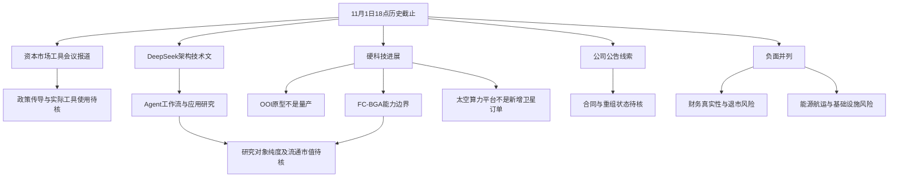

# 2026年11月1日 · 周末消息面历史补档

> 截止：2026-11-01 18:00:00（北京时间）。这是事后依据目标日目录留存材料补写的人读情报包，不是当时已发布的周末预测，不参加事前胜率统计。实际补档时间见 generated_at。historically_retrieved 只说明历史材料被事后读取，不证明当时已封存。

## 一句话结论
资本市场工具会议预期与Agent架构是新增观察；硬科技传导须核业务，财务合规与地缘风险不能省略。

## 判断边界：研究仍做，市场确认不补造

仅使用11月1日目标目录指定文件，不用11月2日研究与行情，不把已经发生的后来结果写成当时预测。市场在为什么付钱、处于哪一段、谁有地位均未核，因此不授予任何交易资格，也不因缺少行情停止消息研究。本文“观察”只表示研究处理档位；没有买卖建议、价位、概率或预算。下个交易日的市场状态及官方交易日历未独立核验，不编造竞价、涨停或交易日情绪。

## 消息传导图

## 事件研究与反证

时间均为目标日留存记录的报道/更新标签。first-known只能解释为“本次授权留存中最早已见”，不是全网首发；原官方发布时分和实际抓取时点不明时保持未知。消息由多个API或媒体转载仍只有一个底层事件。

### E01-01 · 金融管理部门拟开会：观察新增政策预期，不写政策已落地

- 证据：RSS:19《金融管理部门将召开会议，研究推动支持资本市场工具使用》，11月1日16:25；RSS:4，16:38。都属于证券时报体系的业内采访报道，本次没有证据证明是两个独立采访源，合并为一个底层事件。
- 文本称11月2日央行、证监会召集证券及基金机构研究支持资本市场工具使用；同日有关部门召集银行研究优化股票回购增持再贷款。是“拟开会、研究优化”，不是已经出台新额度、降息或放款。
- **大资金意图**：未知。可能的传导是政策稳定预期与工具使用改善，不代表现有资金已买入券商或银行。
- **为什么走强**：本任务没有核板块走强。新增点在未来会议安排的报道，不在2024年已有工具的重新命名。
- **逻辑够不够硬**：消息具体但尚无官方通知原文，证据按中等、同一媒体采访底层源处理，不因两篇文章就升级“官方确认”。
- 正反映射：制度传导可能改善资本市场预期；若只有议题没有增量执行，预期兑现落差仍在。没有点名上市公司受益，不生成泛券商榜。
- 下个交易日待验证：会议是否召开、正式政策内容、资格范围和实际使用；本文绝不引用11月2日后来会议结果。

### E01-02 · DeepSeek Super-agent：观察技术路线，不当新模型或开放权重

- 证据：news_cls:197，10月31日22:42:32；news_major:111，22:45:27仅标题；RSS:28，23:48正文转述并注明DeepSeek Harness团队公众号。最早已见22:42:32，官方原发精确时分未知，且已经晚于10月31日18点，不能纳入前一日补档。
- 留存介绍Router/Worker双层、事件驱动、异步交互、存算分离及Watchdog，称内部实例在运行。这是技术设计与内部实例，不等于发布全新基础模型、开放权重或全量商用。
- **大资金意图**：未知。研究假设是应用从单次对话向持续工作流延伸，不是推断软件资金必然流入。
- **为什么走强**：未核行情；架构能否提高持续任务可靠性是增量问题，不是给所有软件贴Agent标签。
- **逻辑够不够硬**：有具名团队和具体设计，但本次未打开官方全文，也未验证可下载代码、产品收入或外部使用表现；多个转载只算同一文章。
- 正反映射：有真实场景与交付能力的应用服务可能受益；基础模型自带工作流能力也可能压缩薄封装应用价值。没有A股合作公告，不直接映射“DeepSeek概念”名单。
- 下个交易日待验证：官方文章与实现状态、稳定性、真实付费场景及上市公司合作披露。

### E01-03 · 英伟达OOI原型：观察技术演进，同时保留替代风险

- 证据：RSS:30，10月31日22:06；news_cls:213，22:13:05。最早已见22:06；报道指向“近日”展会，展会展示的精确日期和最早公开时刻未核，不能标为周末全球首发。
- 文本把光引擎移至与计算芯片共用的硅中介层，已拿到原型样品；明确未公布商业化时间表。文章中的更远量产年份是业内预测，不能升级为英伟达承诺。
- **大资金意图**：未知。假设价值向硅光、封装、热管理及测试环节重分配，而不是已发生订单迁移。
- **为什么走强**：未核国内板块强弱；事件的新意是封装形态变化，不是“现有光模块将立即被替代”。
- **逻辑够不够硬**：原型状态具体，但没有厂商原始演示材料和量产验证；研究态度为观察，不外推短期收入。
- 正反拆分：长期先进封装与光电集成需求为潜在正向；传统形态价值量可能受压为潜在负向。两者都只是技术传导假设，不能把整条光模块链简单定为单边利好或利空。
- 下个交易日待验证：官方演示与样品边界、量产障碍、现有订单周期及真正参与者。正文提到天孚通信等旧生态，并不证明其已拿到OOI新增订单，本次不据此造候选。

### E01-04 · 深南电路FC-BGA：观察能力分层，不能把打样写成量产

- 证据：news_cls:40，11月1日07:55:27；:483为08:01的同事件转载。留存称近日机构调研中披露26层及以下已具备批量生产能力，30层及以上研发及打样按期推进。最早已见07:55:27，原调研记录时间未知。
- **大资金意图**：未知。可能的传导是国产高端封装基板供给能力，尚无资金及新增客户验证。
- **为什么走强**：没有行情验证；应研究产品能力而不是用“先进封装”泛概念解释涨幅。
- **逻辑够不够硬**：具名公司及层数边界较清楚，但只有单一调研转述，未核原始活动记录，证据不升级为高确认。
- 反证：技术能力不等于当期产能利用率、良率、收入及利润；30层及以上仍是研发打样。正向研究对象只映射公司本身，代码002916.SZ由当日公告索引核到，不与深南电A混同。
- 下个交易日待验证：调研全文、客户认证和收入结构。

### E01-05 · 达安基因检测产品获批报道：观察，注册与商业规模两回事

- 证据：news_cls:57，11月1日07:15:28；称广药集团消息，基孔肯雅病毒抗原检测试剂盒（胶体金法）获三类医疗器械注册，记录注册编号“国械注准20263402223”。编号仅按原文保留，本次未查监管数据库，不宣称已验真。
- **大资金意图**：未知；潜在传导是产品可销售资格，不是疫情需求或医疗资金必然回流。
- **为什么走强**：未核行情；产品获批与销售放量需要分阶段验证。
- **逻辑够不够硬**：具名产品、企业及编号可追索，但没有药监局原文或公司公告正文，维持单一转述研究线索。
- 反证：获批不等于采购、放量或利润增厚。达安基因002030.SZ仅作具名映射，不能外推整个检测板块。
- 下个交易日待验证：注册原件、产品归属、产能及实际采购，不能由单一消息推断疾病传播规模。

### E01-06 · 太空算力平台：观察已公开事件的周末延续

- 证据：news_major:383，10月31日16:06:41仅标题；news_cls:331，16:06:46称平台10月30日发布；RSS:25，11月1日09:35有较完整正文。授权输入最早已见为10月31日16:06:41，实际首发时分未知。虽事件早于前日截止，但这份证据来自11月1日目录，本次不会反向塞入10月31日报告。
- 文本称北京太空算力创新中心平台完成核心功能、覆盖40余颗卫星资源，与地面CPU/GPU/NPU统一调度，并与百度智能云平台互通。
- **大资金意图**：未知；假设是星地协同资源利用，而不是已确认卫星建设采购。
- **为什么走强**：未核走强；重点是资源纳管及在轨推理流程，不是“新增40余颗卫星发射订单”。
- **逻辑够不够硬**：平台状态和路径具体，但本次未核原始发布、付费客户或运营数据；只是老事件的周末延续，不标全新方向。
- 反证：技术平台与收入闭环之间还有成本、可靠性和付费需求。正文具名首批企业不等于A股供应商，不列泛商业航天股票榜。

### E01-07 · 地缘与能源：负面并列，冲突报道不能只取一面

- 证据：news_cls:170，11月1日00:09:47为匿名官员称地区AI基础设施进入报复目标；:113，02:08:34称美国尚未决定恢复打击且偏向外交；:90，03:02:54记录伊方海峡立场；:127，01:28:56记录美方对通航恢复的相反表述；:77，04:26:58称OPEC+原则同意维持目标、正式线上会议尚待举行。
- **大资金意图**：未知；航运、能源供应及算力建设安全的传导只写假设。
- **为什么走强**：没有A股行情验证，不借地缘消息编造油运、军工或贵金属涨幅。
- **逻辑够不够硬**：存在多个主体的报道，但“准备军事行动”“原则同意”不是行动已发生或最终决议。匿名报复目标消息单独降级，不能当官方已确认清单。
- 负面范围：航运、航空及高耗能制造成本，区域数据中心建设安全；能源价格与运价方向仍依赖实际供应与航线。外交进展或通航改善是反向条件，应与升级风险并列，不能只留风险溢价叙事。
- 下个交易日待验证：正式声明、航线与设施运营、OPEC+最终决定；不以暗盘报价或群聊预测替代。

## 周末发酵的低等级线索：观察，不进入已核硬催化

- 物理AI与机器人：news_cls:173在11月1日00:06:09称Meta与傅利叶研发原型，来源为知情人士，尚未设上市时间；不能写量产订单。匿名群:8在12:22的视觉、触觉及供应链推荐属于卖方/群聊判断，不构成供应商关系验证，整串股票不照抄。
- 匿名群:3、4、5、10、11、13围绕华宇软件、井松智能电话会传播，按两家公司主题归并，链接和文字不是独立多源。电话会安排不等于内容已发生、收入已核，未展开会议或图片。仅保留井松智能为点名场景待核对象；不把群里“龙头”称谓认定为市场地位。
- news_cls:91所谓“证伪指数时间假说”为单条异常重大断言，没有论文、作者或可追溯原文；不纳入已证事件，不映射加密安全受益股。
- RSS:15、32长鑫架构与业绩讨论，分别是技术样片/送样计划和管理层判断。原文活动记录、单季利润及产品价格未核，不据高累计增速定性景气延续，保留待核，不抄成买入逻辑。
- RSS:1端侧AI专家访谈为10月31日21:10更新，内含未来产品及供应链判断，不能回填10月31日18点。其引用预测与财务数字本次未核，不据此扩充候选。

## 公告硬事件与合规风险台账

anns_window只存日期、公司、标题、URL，没有PDF正文。10月31日日期索引早于本日截止，11月1日仅日期的7条则无法证明18点前公开，全部排除。下列合同或重组不按标题补细节。

| 对象 | 留存证据 | 态度与必要反证 |
|---|---|---|
| 兰剑智能 688557.SH | anns_window:241，10月31日，日常经营重大合同；PDF尾号1225648274 | 观察。客户、金额、收入占比与履约条件待核，不能将其归入特定机器人链主 |
| 中国稀土 000831.SZ | anns_window:3079，10月31日，筹划重大资产重组事项停牌公告；PDF尾号1225649917 | 观察事项状态，不将重组完成或复牌日期补造；不扩大成全行业已获注资 |
| 协和电子 605258.SH | anns_window:739、741，10月31日，协议转让/控制权拟变更及复牌标题 | 观察。拟变更不等于已完成，实际协议与复牌安排须读原文 |
| *ST清越 688496.SH | anns_window:313，10月31日处罚公告索引；RSS:8，11月1日11:38转述高管合计被罚2800万元 | 不进正向候选研究映射。处罚是历史事项延续，非本日首次发生；造假风险不被显示题材掩盖 |
| *ST航图 688066 | RSS:14，10月31日21:24，称独董及财务总监无法保证三季报真实性并有退市风险 | 不进正向候选研究映射。名称、代码按原文保留，本次未独立核名与公告；重大财务真实性风险原样交R5/R6，不能用重整预期冲淡 |

*ST清越与*ST航图是不同主体的合规风险，不因都属于ST而合并为一个事件。R4只交证据与研究处理，不宣称已替R6行使硬否决权。

## 候选研究映射，不是交易候选池

| 对象 | 映射依据 | 纯度 / 流通市值 | 地位、板型、禁止清单 | 下一步验证，不是操作条件 |
|---|---|---|---|---|
| 深南电路 002916.SZ | FC-BGA具名能力报道 | 均待核 | 均未核，不认定龙头 | 读调研原件、收入分部与认证进度 |
| 达安基因 002030.SZ | 具名注册产品报道 | 均待核 | 均未核 | 核监管注册和产品权益，再核销售证据 |
| 兰剑智能 688557.SH | 重大合同标题 | 均待核 | 均未核 | 合同全文与风险条款先行，业务类别未核前不作链主映射 |
| 科翔股份 300903.SZ | RSS:29，10月31日23:48扩产报道；当日公告目录能核公司代码 | 均待核 | 均未核 | 属10月30日拟投资的周末延续，不是11月1日新增订单；查资金来源与建设安排 |
| 井松智能（代码本次未核） | 匿名群电话会及物理AI场景文字 | 均待核 | 均未核，单群链条不确认龙头 | 须查公司业务与收入原件；未核前只留线索 |

市场主线与模板归属未确认，不能把这些对象定义为今日核心、主线补涨或计划内试错。无执行池、无首推票；本报告不输出交易价位、收益概率、仓位或预算。

## 🔥 中报业绩预告命中（本次不作命中承诺）

授权输入未包括eastmoney_earnings_predict，未读取该源，top15预告交叉未执行，不得写“无预告”。科翔、长鑫等媒体累计数字没有完整单季环比、扣非和预期差验证，一律 earnings_qoq_unverified，业绩极性不据累计同比直接标正面。媒体提到增长不能替代硬业绩核验，不编造具体同比区间。

## 下个交易日待验证条件

1. 先核官方会议及政策文件，把拟议与生效、讨论工具与实际使用分开；不让会议消息单独授予开仓资格。
2. 技术文、样片、研发打样、注册、合同及投产各有不同证据要求，分别补官方原件，不能串成已经兑现的收入链。
3. 真实研究对象先查主营纯度、流通市值与冲突公告；市场地位与资金确认由对应阶段负责，本报告不代做。
4. 保留财务真实性及地缘风险，R6在只读上游材料的边界内独立判断；必要补证交有权限生产者，不令R6临时联网。
5. 所有未来事项仍以本日认知表述。不能用11月2日会议、价格或研究结果回改本日“当时已知”。

## 来源窗口、完整性与补档局限

## 数据源审计

manifest：generated_at=2026-11-01T18:00:39（原字段无时区；按本地采集语境解释为北京时间，未获独立时区凭证），声明回看24小时；理由：距上次成功抓取 24.0h（上次 2026-10-31 18:01）。这只是采集意图，不是各源实际覆盖承诺。

全文件解析记录合计4493条，解析错误0；时间筛选及文件内去重后4465条。后者是源记录数，不是独立事件数。跨源底层事件由正文按主体、项目及文件归并，不按转载数量加分。

| 留存文件 | 全量 / 截止内去重 | 记录标签覆盖（北京时间） | 截止未证剔除 / 文件内重复 | 本次观察的文件mtime（不是抓取凭证） | 状态 |
|---|---:|---|---:|---|---|
| news_cls.jsonl | 536 / 536 | 2026-10-31T09:00:48+08:00 ～ 2026-11-01T08:58:24+08:00 | 0 / 0 | 2026-11-01T18:04:25.760722+08:00 | 🟡 留存可解析，事前持有未证 |
| news_major.jsonl | 702 / 681 | 2026-10-31T09:00:00+08:00 ～ 2026-11-01T09:00:00+08:00 | 0 / 21 | 2026-11-01T18:04:25.774172+08:00 | 🟡 留存可解析，事前持有未证 |
| anns_window.jsonl | 3195 / 3188 | 2026-10-31T00:00:00+08:00 ～ 2026-11-01T00:00:00+08:00 | 7 / 0 | 2026-11-01T18:04:27.606365+08:00 | 🟡 留存可解析，事前持有未证 |
| wechat_official_rss.jsonl | 40 / 40 | 2026-10-31T18:04:00+08:00 ～ 2026-11-01T17:34:00+08:00 | 0 / 0 | 2026-11-01T18:01:41.931692+08:00 | 🟡 留存可解析，事前持有未证 |
| wechat_cli_5groups.jsonl | 20 / 20 | 2026-10-31T19:44:00+08:00 ～ 2026-11-01T17:12:00+08:00 | 0 / 0 | 2026-11-01T18:04:20.966303+08:00 | 🟡 留存可解析，事前持有未证 |

公众号update_time秒级时间戳已逐条按Asia/Shanghai换算，与update_time_str逐分钟一致。公告仅有日期：较早日期按其日期标签保留，目标日无时分记录保守排除，未伪填00:00首发。所有来源真实captured_at未提供，均记null。

| 补充维度 | 状态 | 限定 |
|---|---|---|
| eastmoney_earnings_predict | 🔴 未纳入授权输入 | 未查，不等于没有预告；不作top15命中声明 |
| 官方原始页面及PDF全文 | 🟡 未联网、未下载 | 有URL索引不等于已读原文；转载不算独立官方确认 |
| 逐票业务纯度 / 流通市值 / 市场地位 | 🔴 未核 | 不输出交易池、价位或预算 |

- 五份JSONL全部逐行解析、逐条筛时，按URL或规范化标题/正文去重后提取相关事件；没有把截断前缀冒充全量阅读。全量清洗不代表每条原网页和PDF全文都核验，更不代表所有有效记录均在正文穷尽复述。
- news_cls中实际src为sina和10jqka，没有财联社专源；news_major存在财联社标签，但多为标题、正文为空。不能用文件名、工具名或转载平台数量计算独立原始源。
- RSS本日40条与manifest一致，但不能据数量一致证明事前封存。news_cls实际只覆盖至11月1日08:58:24、news_major至09:00，18点manifest不代表新闻覆盖到18点；午后主要依靠公众号，新闻漏窗明确存在。
- 群源5组仅3组成功，2组超时；成功组中一组0条。留存20条包括图片和链接，图片未解读，外链未展开。群名、个人标识、联系方式和会议号码不输出，不能把缺失当成没有消息。
- 真实captured_at多数未知；表列文件mtime只是本次观察到的落盘时间，不用它覆盖原始发布时间。manifest为18点后生成，各源亦有晚于截止的落盘时间，均不能证明系统18点已完整持有。
- 所有正文来源只来自11月1日目标日目录；没有借10月31日补档或11月2日数据增加本日证据。旧事件保留发生/报道日期，不把本次生成日伪装成事前封存日。
- 缺官方原文、业绩预告、逐票业务纯度及流通市值核验；负面未查全不能写“无负面”。本次未联网、不读取凭据、账户、持仓或业务数据库，不修改机读研究与计划执行产物。

## 与其他阶段的关系

仅交R2/R5/R6历史消息研究与缺口；不是交易计划、买卖授权或R6硬否决结论。本次只补本MD，研究JSON与summary不生成、不修改。
