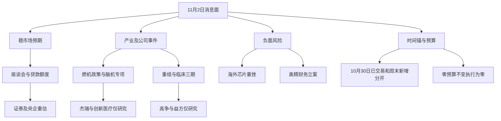

# 2026年11月2日 · 消息面事件驱动

> 情绪=震荡/主跌。8条事件不等于8只可交易票；研究观察4只，执行0只，零交易预算保持。

> 截止09:21（中国时区）；本次为真实迟交研究，不是回放，不冒充08:30前预测。实际生成时刻见frontmatter。

## 一句话结论

观察稳市场与产业新增催化；科技外盘风险和财务立案并列拦截，不把政策预期当入场确认。

## 市场先于个股

上一完成交易日为10月30日：47股涨停、31股封板未遂、82股跌停。炸板率39.74%，候选上限由8降到4。上游状态机把补跌信号强制修正为main_up，该标签与实测冲突，本阶段不采信。

主线 = 消费白酒（上一交易日已交易方向），持续性 = 1日（本次证据窗口），封板率 = 未知（板块分母缺失），下一交易时段预期 = 分歧。全市场封板率60.26%不是白酒封板率。消息面候选方向是燃机、脑机、矿业重组和临床进展，尚未获得当日资金确认，不能直接替换市场主线。

## 🗺️ 消息面全景图

## 🎯 八条硬事件：先分事实与推断

“硬”指已找到原始公告或专业原始快讯，不表示已转化为公司利润、已发生资金流入或必然上涨。中强度项目保留其证据缺口。

### E20261102_001 · 美股芯片重挫向A股科技风险偏好传导 · high · 负面

态度：不进。类型：老方向新增催化。可交易日：20261102。

事实：美股10月30日费城半导体指数收跌7.2%；纳指跌2.86%；英特尔跌28.58%。

时间：原始标示 2026-10-31；本次最早核到公众可知 2026-10-30。CLS当日16:59已报道芯片盘前下跌；7.2%收盘结果到10月31日才可知。

原始分 -0.90 → 衰减分 -0.6455；经过 2.22 日；仅研究排序。

- **大资金意图**: 可能降低高波动科技暴露；这是跨市场传导假设而非已证实的A股资金行为。

- **为什么走强**: 只能确认海外走弱；周五A股科技已弱不能全归因于其后发生的美股收盘。

- **逻辑够不够硬**: 财联社原始收盘综述确认价格事实；A股是否补跌须由开盘承接证伪。

- 反面与证伪：纳指期货11月2日07:00涨0.36%为反向证据；不能把海外下跌机械外推为所有国产替代票下跌。 下一交易时段比较科技板块涨跌广度及回补幅度；若科技扩散修复则风险传导假设减弱。

- 证据：tushare/news(src=cls) 2026-11-02 08:20:14早间精选第21项；news_cls.jsonl:1102。底层独立来源计数 1；转载不加分。

### E20261102_002 · 奥精医疗因涉嫌财务数据虚假记载被立案 · high · 负面

态度：拦截。类型：老方向新增催化。可交易日：20261102。

事实：公司11月1日收到证监会立案告知书；涉嫌定期报告等财务数据虚假记载。若最终认定触及重大违法条件存在强制退市风险；不是已经退市。

时间：原始标示 2026-11-02；本次最早核到公众可知 2026-11-01。财联社11月1日晚快讯早于公告标示日期；PDF时分未知。

原始分 -0.95 → 衰减分 -0.8795；经过 0.51 日；仅研究排序。

- **大资金意图**: 合规风险可能促使持有人重新评估退出可行性；未取得席位或卖出数据不推断已出货。

- **为什么走强**: 立案冲击公司财务可信度；不据此判断全体医疗器械企业造假。

- **逻辑够不够硬**: 已直接提取公司公告PDF；同一公告经问财和Tushare提供仍只算一个底层来源。

- 反面与证伪：立案不等于处罚落地；强制退市取决于最终认定。 将公告风险送R6逐票复核；R4不代行R6唯一hard_reject权。

- 证据：奥精医疗2026-051号公告；CLS 2026-11-01 21:01:16。底层独立来源计数 1；转载不加分。

  - 原文链接：https://static.cninfo.com.cn/finalpage/2026-11-02/1225651093.PDF

### E20261102_003 · 高争民爆披露矿业资产注入预案并复牌 · high · 正面

态度：观察。类型：老方向新增催化。可交易日：20261102。

事实：拟发行股份购买紫源铜业51%及晟源矿业100%股权并配套融资；11月2日复牌。审计评估未完成且交易作价未定。

时间：原始标示 2026-11-02；本次最早核到公众可知 2026-11-01。CLS披露具体资产及复牌安排；10月26日筹划停牌已公开不是全新重组方向。

原始分 0.80 → 衰减分 0.7158；经过 0.74 日；仅研究排序。

- **大资金意图**: 可能交易国资矿权注入的业务结构变化；不把发行股份当成已增厚的盈利。

- **为什么走强**: 已知重组从停牌筹划推进到具体预案与复牌时间；价格重估幅度和接力尚无核实。

- **逻辑够不够硬**: 官方复牌公告直接核验；资产比例和复牌日明确。未知交易定价是重要缺口。

- 反面与证伪：审批、估值、股权摊薄和复牌跳空都可能使静态RR失效。 核验后续审计评估及重组问询；若核心资产或方案变化需重建逻辑。

- 证据：高争民爆2026-060号公告及重大资产重组预案；CLS 2026-11-01 15:34:13。底层独立来源计数 1；转载不加分。

  - 原文链接：https://static.cninfo.com.cn/finalpage/2026-11-02/1225650638.PDF

### E20261102_004 · 益方生物D-2570银屑病三期达到主要终点 · high · 正面

态度：观察。类型：老方向新增催化。可交易日：20261102。

事实：391例随机双盲安慰剂对照三期；两个治疗组第16周PASI90比例均超70%；PGA0/1均超80%。公司明示本次结果不会对业绩产生重大影响。

时间：原始标示 2026-11-02；本次最早核到公众可知 2026-11-01。CLS周日公告摘要；公司PDF落款11月2日且具体披露时分未知。

原始分 0.80 → 衰减分 0.7169；经过 0.73 日；仅研究排序。

- **大资金意图**: 可能为研发成功率提升重估管线；不是已落地销售收入或即期利润。

- **为什么走强**: 临床成功降低该适应症部分研发风险；未确认A股当日资金或价格强度。

- **逻辑够不够硬**: 直接读取公司PDF并核到样本量及终点；仍缺头对头及商业化最终结果。

- 反面与证伪：临床达标不等于获批上市；同靶点竞争和长期安全性会影响兑现。 未来24至72小时核公司补充说明及有无冲突公告；中期等待申报与监管进度。

- 证据：益方生物2026-045号公告；CLS 2026-11-01 15:47:40。底层独立来源计数 1；转载不加分。

  - 原文链接：https://static.cninfo.com.cn/finalpage/2026-11-02/1225650958.PDF

### E20261102_005 · 金融管理部门拟召开资本市场工具座谈会 · medium · 正面

态度：观察。类型：老方向新增催化。可交易日：20261102。

事实：报道11月2日央行与证监会召集券商基金讨论支持资本市场工具；另与金融监管总局召集银行讨论回购增持再贷款。尚未核到会议已举行或新政策生效。

时间：原始标示 2026-11-01；本次最早核到公众可知 2026-11-01。新浪转21财经记录早于CLS 15:17；不是会议决议公布时间。

原始分 0.65 → 衰减分 0.5805；经过 0.75 日；仅研究排序。

- **大资金意图**: 可能先交易尾部风险下降；是否形成新增资金和风险预算需会议结果及R7数据确认。

- **为什么走强**: 这是周五收盘后新增的会议预期；不能倒推解释周五消费股已发生的涨停。

- **逻辑够不够硬**: 存在不同媒体独立采访与CLS记者署名；仍属拟开会消息不等于官方新政策。

- 反面与证伪：若仅重复既有工具而无增量措施则预期可能落空；“救市必涨”不是事实。 核验当日正式通稿的工具条款、对象和生效时间；没有通稿即保持预期层。

- 证据：21世纪经济报道；CLS记者李婷11月1日15:31:01；上证报16:22:09。底层独立来源计数 2；转载不加分。

### E20261102_006 · 国有大行拟向国新诚通各增千亿级回购贷款额度 · medium · 正面

态度：观察。类型：老方向新增催化。可交易日：20261102。

事实：记者获悉某国有超大型银行计划向中国国新、中国诚通各新增股票回购增持贷款额度；单家新增或达1000亿元。未公布银行名称和实际放款。

时间：原始标示 2026-11-01；本次最早核到公众可知 2026-11-01。CLS记者方彦博独家原始采访；后续转载不加独立来源数。

原始分 0.60 → 衰减分 0.5511；经过 0.57 日；仅研究排序。

- **大资金意图**: 可能抬升国资托底预期；季度加仓名单不代表这次额度已买入同一批股票。

- **为什么走强**: 与会议预期相互支持但同属稳市场簇；合成时取簇内最大值不相加。

- **逻辑够不够硬**: CLS原始独家采访可追溯但只有一个底层采访；措辞是“计划、或可”故不升high。

- 反面与证伪：额度不是贷款投放、股票成交或企业收入；把两笔意向额度直接叫2000亿入市属于夸大。 后续核银行授信、合同、提款与回购公告；未披露之前不确认资金落地。

- 证据：CLS独家记者方彦博 2026-11-01 19:44:53。底层独立来源计数 1；转载不加分。

### E20261102_007 · 四部门发布燃气轮机创新发展指导意见 · medium · 正面

态度：观察。类型：老方向新增催化。可交易日：20261102。

事实：到2030年提升自主创新能力并建成研发制造验证维护全产业链体系；重型燃机试点应用取得阶段性成效。政策目标不等于新增预算或订单。

时间：原始标示 2026-10-30；本次最早核到公众可知 2026-10-30。本地同花顺16:14报道；官方发布会更早时间未核到；公开日明确但时分不全。

原始分 0.65 → 衰减分 0.4327；经过 2.71 日；仅研究排序。

- **大资金意图**: 可能寻找算力电力缺口与国产装备交集；不能从政策直接推定下游厂商拿到合同。

- **为什么走强**: 发布会与指导意见补充产业支持；政策10月30日已报道周末转载不是全新题材。

- **逻辑够不够硬**: 检索核到新华网与科技日报的具体引文；同一政策文件只计一个底层事件且未直读能源局原文所以medium。

- 反面与证伪：首台套可靠性验证周期长；海外项目合规与燃料价格影响设备需求。 后续核官方政策全文与公司订单执行；杰瑞31亿美元订单为公众号引用半年报待二次确认不作为本次新合同。

- 证据：国家能源局指导意见经新华网记者报道；科技日报刘园园报道；界面新闻蒋习报道；财联社主题前瞻。底层独立来源计数 1；转载不加分。

  - 原文链接：https://t.cj.sina.com.cn/articles/view/5182171545/134e1a99902002l158

  - 原文链接：http://news.10jqka.com.cn/19700122/c681315539.shtml

  - 原文链接：http://news.10jqka.com.cn/19700122/c681309946.shtml

  - 原文链接：http://news.10jqka.com.cn/19700122/c681313559.shtml

  - 原文链接：http://news.10jqka.com.cn/19700122/c681302773.shtml

  - 原文链接：http://news.10jqka.com.cn/19700122/c681320361.shtml

  - 原文链接：http://news.10jqka.com.cn/19700122/c681314572.shtml

  - 原文链接：http://news.10jqka.com.cn/19700122/c681321752.shtml

### E20261102_008 · 脑科学与类脑研究三项国家重大专项启动 · medium · 正面

态度：观察。类型：已交易后的延续。可交易日：20261030。

事实：北京脑科学与类脑研究所承担的三项专项启动；包括半侵入式系统、医用馈通、运动编解码。未核到A股公司为项目承担方。

时间：原始标示 2026-10-30；本次最早核到公众可知 2026-10-30。人民财讯经和讯转发10:42；周末财联社主题前瞻为复述。

原始分 0.55 → 衰减分 0.3537；经过 2.94 日；仅研究排序。

- **大资金意图**: 可能将临床应用进展映射到脑机概念；这只是研究假设没有确认机构买入。

- **为什么走强**: 周五上午即已公开；周末文章增加传播而非新增项目或新订单。

- **逻辑够不够硬**: 人民财讯消息是可追溯专业原始快讯；未取得研究所原文且无法确认项目名单映射故只给medium。

- 反面与证伪：概念成分不等于项目参与；问财对创新医疗参股表述与公众号并表表述不一致。 核研究所项目名单及创新医疗最新股权/收入披露；未核清前降级观察不授予交易身份。

- 证据：人民财讯10月30日10:42经和讯转载；财联社早知道11月1日主题前瞻。底层独立来源计数 1；转载不加分。

  - 原文链接：https://stock.hexun.com/2026-10-30/225198407.html

  - 原文链接：http://sc.stock.cnfol.com/shichangceping/20261102/32412945.shtml

  - 原文链接：https://www.sohu.com/a/1095803591_130887

  - 原文链接：https://www.163.com/dy/article/LANB941I05198CJN.html

  - 原文链接：https://mp.weixin.qq.com/s?__biz=MzUxMTg3MDc3OA==&chksm=f87dae4159e0d458891f7a56f7f1403fdb8e1f322735cfbf5c2f63031b8041fda62872f6e05b&idx=1&mid=2247516630&sn=78d104d105826aed6908523f20efc3e4

## 📊 板块 × 事件极性全叉乘

15个板块×8事件=120格。+为正向传导研究假设，−为负向风险传导，0为没有核到直接映射。不是资金实测，不据正负格子个数选股。E005会议与E006额度同属稳市场簇，聚合取max而非叠加。

| 板块    | E001 | E002 | E003 | E004 | E005 | E006 | E007 | E008 | 结论   |
| ----- | ---- | ---- | ---- | ---- | ---- | ---- | ---- | ---- | ---- |
| 证券    | 0    | 0    | 0    | 0    | +    | +    | 0    | 0    | 正面   |
| 银行    | 0    | 0    | 0    | 0    | +    | +    | 0    | 0    | 正面   |
| 央企重估  | 0    | 0    | 0    | 0    | +    | +    | 0    | 0    | 正面   |
| 消费白酒  | 0    | 0    | 0    | 0    | +    | 0    | 0    | 0    | 正面   |
| 燃气轮机  | 0    | 0    | 0    | 0    | 0    | 0    | +    | 0    | 正面   |
| 高温合金  | 0    | 0    | 0    | 0    | 0    | 0    | +    | 0    | 正面   |
| 脑机接口  | 0    | 0    | 0    | 0    | 0    | 0    | 0    | +    | 正面   |
| 医疗器械  | 0    | −    | 0    | 0    | 0    | 0    | 0    | +    | 正负交织 |
| 创新药   | 0    | 0    | 0    | +    | 0    | 0    | 0    | 0    | 正面   |
| CRO   | 0    | 0    | 0    | +    | 0    | 0    | 0    | 0    | 正面   |
| 有色铜   | 0    | 0    | +    | 0    | 0    | 0    | 0    | 0    | 正面   |
| 矿服民爆  | 0    | 0    | +    | 0    | 0    | 0    | 0    | 0    | 正面   |
| 半导体   | −    | 0    | 0    | 0    | 0    | 0    | 0    | 0    | 负面   |
| 存储    | −    | 0    | 0    | 0    | 0    | 0    | 0    | 0    | 负面   |
| CPO算力 | −    | 0    | 0    | 0    | 0    | +    | 0    | 0    | 正负交织 |

CPO算力同时承受E001海外估值冲击、获得E006国资增量预期的间接映射；后者仅0.1传导假设，不等于额度已经流入CPO。医疗器械的专项催化与奥精个股财务风险并存，不做全板块一刀切。

## 四只顶部研究观察：不是执行首推

四票均为计划内试错的研究提名，但当前未纳入今日交易计划，因此计划外开仓被拦截。龙头认定均0条已证实，不虚授龙头身份。数值价位只满足研究风险场景复现，不是技术支撑、估值目标、挂单或卖单；真实入场后必须由R5/D1重建。

### 高争民爆 002827.SZ · 观察

板型：未确认首板；复牌事件观察。龙头认定：0条通过。禁止项：plan_outside_scan；中位杂毛、主线及趋势等仍未核清不能当通过。

- **买入理由**: 仅研究假设：拟发行股份购买紫源铜业51%及晟源矿业100%股权并配套融资；11月2日复牌。审计评估未完成且交易作价未定。 本票仅研究映射；未获开仓资格。 问财民爆器材收入占比35.1445%、爆破服务55.0296%；拟注入矿业业务不应写成既有业务。

- **风险点**: 审批、估值、股权摊薄和复牌跳空都可能使静态RR失效。 缺板块地位、真实开盘承接及资金验证。

- **止损条件**: 研究参考价51.80元（20261023）×0.93 → 48.17元；若未来有效计划采用此价，仅作为风险场景。事件核心事实被否定即撤销研究逻辑，不是当前自动交易指令。

- **可验证假设**: 核验后续审计评估及重组问询；若核心资产或方案变化需重建逻辑。

研究目标场景59.57—62.68元；毛RR=2.14；止损距离=7.01%。未计交易成本及跳空，净RR未知，所以只能观察。

业绩交叉：未命中当日500行三季报预告截面；不能推断无预告，更不能将未核业绩写成利好。实际新仓预算0。

### 益方生物 688382.SH · 观察

板型：10月30日未涨停；今日板型未知。龙头认定：0条通过。禁止项：plan_outside_scan；中位杂毛、主线及趋势等仍未核清不能当通过。

- **买入理由**: 仅研究假设：391例随机双盲安慰剂对照三期；两个治疗组第16周PASI90比例均超70%；PGA0/1均超80%。公司明示本次结果不会对业绩产生重大影响。 本票仅研究映射；未获开仓资格。 问财医药制造业/专利技术转让收入均返回100%但金额口径不同且报告期缺失；不据此量化D2570收入。

- **风险点**: 临床达标不等于获批上市；同靶点竞争和长期安全性会影响兑现。 缺板块地位、真实开盘承接及资金验证。

- **止损条件**: 研究参考价12.39元（20261030）×0.93 → 11.52元；若未来有效计划采用此价，仅作为风险场景。事件核心事实被否定即撤销研究逻辑，不是当前自动交易指令。

- **可验证假设**: 未来24至72小时核公司补充说明及有无冲突公告；中期等待申报与监管进度。

研究目标场景14.25—14.99元；毛RR=2.14；止损距离=7.02%。未计交易成本及跳空，净RR未知，所以只能观察。

业绩交叉：未命中当日500行三季报预告截面；不能推断无预告，更不能将未核业绩写成利好。实际新仓预算0。

### 杰瑞股份 002353.SZ · 观察

板型：10月30日未涨停；今日板型未知。龙头认定：0条通过。禁止项：plan_outside_scan；中位杂毛、主线及趋势等仍未核清不能当通过。

- **买入理由**: 仅研究假设：到2030年提升自主创新能力并建成研发制造验证维护全产业链体系；重型燃机试点应用取得阶段性成效。政策目标不等于新增预算或订单。 本票仅研究映射；未获开仓资格。 问财主营返回油气行业收入占比93.0341%、高端装备制造54.7865%；未带报告期且不等于燃机收入占比。

- **风险点**: 首台套可靠性验证周期长；海外项目合规与燃料价格影响设备需求。 缺板块地位、真实开盘承接及资金验证。

- **止损条件**: 研究参考价88.40元（20261030）×0.93 → 82.21元；若未来有效计划采用此价，仅作为风险场景。事件核心事实被否定即撤销研究逻辑，不是当前自动交易指令。

- **可验证假设**: 后续核官方政策全文与公司订单执行；杰瑞31亿美元订单为公众号引用半年报待二次确认不作为本次新合同。

研究目标场景101.66—106.96元；毛RR=2.14；止损距离=7.00%。未计交易成本及跳空，净RR未知，所以只能观察。

业绩交叉：未命中当日500行三季报预告截面；不能推断无预告，更不能将未核业绩写成利好。实际新仓预算0。

### 创新医疗 002173.SZ · 降级

板型：10月30日未涨停；今日板型未知。龙头认定：0条通过。禁止项：plan_outside_scan；中位杂毛、主线及趋势等仍未核清不能当通过。

- **买入理由**: 仅研究假设：北京脑科学与类脑研究所承担的三项专项启动；包括半侵入式系统、医用馈通、运动编解码。未核到A股公司为项目承担方。 本票仅研究映射；未获开仓资格。 问财医疗服务收入占比99.8302%；概念原因仍称参股而公众号称2025年并表；最新股权事实未核清。

- **风险点**: 概念成分不等于项目参与；问财对创新医疗参股表述与公众号并表表述不一致。 缺板块地位、真实开盘承接及资金验证。

- **止损条件**: 研究参考价17.22元（20261030）×0.93 → 16.01元；若未来有效计划采用此价，仅作为风险场景。事件核心事实被否定即撤销研究逻辑，不是当前自动交易指令。

- **可验证假设**: 核研究所项目名单及创新医疗最新股权/收入披露；未核清前降级观察不授予交易身份。

研究目标场景19.80—20.84元；毛RR=2.13；止损距离=7.03%。未计交易成本及跳空，净RR未知，所以只能观察。

业绩交叉：未命中当日500行三季报预告截面；不能推断无预告，更不能将未核业绩写成利好。实际新仓预算0。

## 🔥 中报业绩预告命中

本次实际源是2026年三季报预告，不是中报。500行含归母净利润、扣非、收入等多个指标；按归母净利润、代码去重后，核查增幅上限最高15只与本文事件的交集。以下预告均早于7日事件窗口，不入新催化；累计同比不能代替单季环比。

| 代码        | 名称   | 归母累计同比区间%         | 公告日        | 事件交集          | 处理         |
| --------- | ---- | ----------------- | ---------- | ------------- | ---------- |
| 001309.SZ | 德明利  | 32046.52—33154.49 | 2026-10-17 | E20261102_001 | 旧背景；不作正面首推 |
| 300821.SZ | 东岳硅材 | 19047.97—19748.08 | 2026-10-08 | 无直接映射         | 旧背景；不作正面首推 |
| 000703.SZ | 恒逸石化 | 3318.59—3405.13   | 2026-10-16 | 无直接映射         | 旧背景；不作正面首推 |
| 002466.SZ | 天齐锂业 | 2734.97—3235.26   | 2026-10-21 | 无直接映射         | 旧背景；不作正面首推 |
| 688825.SH | 长鑫科技 | 2581.06—2609.47   | 2026-10-17 | E20261102_001 | 旧背景；不作正面首推 |
| 002812.SZ | 恩捷股份 | 1884—2474.8       | 2026-10-14 | 无直接映射         | 旧背景；不作正面首推 |
| 688808.SH | 联讯仪器 | 1866—2072.95      | 2026-10-13 | E20261102_001 | 旧背景；不作正面首推 |
| 301308.SZ | 江波龙  | 1864.55—1990.84   | 2026-10-15 | E20261102_001 | 旧背景；不作正面首推 |
| 605189.SH | 富春染织 | 1347.69—1519.01   | 2026-10-14 | 无直接映射         | 旧背景；不作正面首推 |
| 688388.SH | 嘉元科技 | 1196.6—1318.92    | 2026-10-15 | 无直接映射         | 旧背景；不作正面首推 |
| 603991.SH | 领先股份 | 1238.57—1238.57   | 2026-10-21 | 无直接映射         | 旧背景；不作正面首推 |
| 603026.SH | 石大胜华 | 968.14—1032.45    | 2026-10-15 | 无直接映射         | 旧背景；不作正面首推 |
| 000626.SZ | 远大控股 | 890—1018          | 2026-10-15 | 无直接映射         | 旧背景；不作正面首推 |
| 002493.SZ | 荣盛石化 | 777.93—822.95     | 2026-10-15 | 无直接映射         | 旧背景；不作正面首推 |
| 300497.SZ | 富祥股份 | 658—785           | 2026-09-18 | 无直接映射         | 旧背景；不作正面首推 |

行业交集仅用于识别科技风险敞口，不是主业精确映射。周期股产品价格与单季环比未完成核实，不能因高同比升级为正面。四只观察票在样本内均无命中；这不构成全市场无预告结论。

## 负面补盲与未入八事件的风险

以下已扫描到的风险不能因8条上限消失；公司风险不泛化为全行业硬否决。

- 不进：海洋王称AI智慧照明收入有限且不属核电或深海科技概念。来源：CLS原始公告摘要（2026-11-01）；个股级。

- 不进：近岸蛋白AI相关业务收入不足2%且商业化有重大不确定性。来源：CLS原始公告摘要（2026-11-01）；个股级。

- 不进：ST合纵因涉嫌信披违法违规被立案。来源：CLS原始公告摘要（2026-11-01）；个股级。

- 观察：赛力斯10月新能源车销量同比下降51.57%。来源：CLS公司公告摘要（2026-11-01）；个股级。

- 观察：10月制造业PMI49.3%较上月下降0.8个百分点。来源：CLS早间精选转国家统计局（2026-11-02）；行业级。

- 观察：美方限制中国实验室电子设备检测业务遭中方反对。来源：CLS转央视外交部例行记者会（2026-10-30）；行业级。

- 地缘风险双面保留：新浪11月2日转央视称油轮触雷，同时报道美伊“两天计划”与谈判进展。事故与停航属于当事方说法，尚未独立核到船名；不能只取油气涨价一面，也不能把谈判计划写成海峡已经恢复通行。

- 对临床达标同时保留公司原文“不对业绩产生重大影响”；对矿业重组同时保留未定价和多重审批；这些是状态边界，不重复包装成独立新事件。

## 覆盖、剔除与缺口

- 燃机首次问财误命中城燃10票（含洪通燃气等）全部剔除；已用杰瑞、豪迈、应流定向重新取证，不能以错误概念涨幅排名授予燃机龙头。

- 脑机10只成分已覆盖；澳洋健康连板并不证明本次专项中标；倍益康为920前缀，不进入本次执行提名。创新医疗仅保留业务冲突待核研究。

- 华大九天并购、亨通与弘信回购、其他车企销量和宏观PMI均扫描；本次顶部4票不是全市场穷尽名单。

- 机器人多群同一作者转发只算一条；爱仕达、力鼎光电等链主映射未取得官方原始订单，不以群数冒充独立来源。

- 官方公众号RSS与兼容文件只计一次。当前47篇均为11月1日，不能把mtime当成已覆盖当日盘前纪要。群聊图片未做OCR，不声称已经读懂。

## 关键证据

- 三份公司原始公告全文：data/research/20261102/R4_primary_documents.json。

- 实时问财新闻和映射原始结果：R4_live_cross_checks.json；主营与纠偏：R4_business_checks.json。

- 日历直采确认11月2日开市，前一交易日10月30日。高争参考价单独回溯10月23日；绝不冒用不存在的10月30日收盘。

- 搜索返回包含未来标时、旧公告、Baidu摘要及无时戳最新价，这些均未用于本次消息截止和行情判断。

## 数据源审计

| 源 | 日期 | 状态 | 记录与缺口 |
|---|---|:--:|---|
| news_cls | 2026-11-02 | 🟢 | 2429；2429条实际为sina1493+10jqka936；非财联社；新浪截断于10月30日晚；不能声称完整72h |
| news_major | 2026-11-02 | 🟢 | 800；800条为单次上限；最早10月31日21:12；多数无正文；未覆盖完整72h |
| wechat_official_20 | 2026-11-02 | 🟡 | 47；取阅RSS兼容镜像只计一次；47篇全部11月1日；本次尚无11月2日盘前纪要 |
| wechat_cli_5groups | 2026-11-02 | 🟢 | 67；67条包含系统、图片与重复转发；未OCR图片不作原文事实；五群匿名 |
| anns_window | 2026-11-02 | 🟢 | 146；仅覆盖11月1至2日自然日；manifest回看24h不能代表完整周末窗口 |
| eastmoney_earnings_predict | 2026-11-02 | 🟢 | 500；500行多财务指标；report_date=2026-09-30；不是500家公司或中报全量 |
| tushare_news_cls_live | 2026-11-02 | 🟢 | 未核总数；本次直采11月1日14:00至11月2日09:21:10及10月30日两个窄窗；不冒称全72h完整；MCP响应抓取时分由会话提供但工具无独立时戳 |
| hithink_business_query | 2026-11-02 | 🟢 | 4；四票均有返回；报告期缺失及主营粒度不足不量化关联比例 |
| hithink_market_query | 2026-11-02 | 🟢 | 20；初次燃机池语义错配城燃10票全剔除；脑机10票仅作成分检索；定向补查杰瑞豪迈应流3票 |
| announcement_search | 2026-11-02 | 🟢 | 未核总数；奥精命中；益方精确词为空且放宽后返回旧公告；使用Tushare及PDF兜底不采纳旧结果 |
| official_pdf | 2026-11-02 | 🟢 | 3；三份原始PDF全部抓取和提取正文 |
| mcp_health | 2026-11-02 | 🟢 | 未核总数；全局severity2；WeFlow不可用不抹去CLI五群可读事实 |
| R3_sentiment | 2026-11-02 | 🔴 | 0；当前未存在最终artifact；不使用热榜证据替代KOL最终裁决 |

## 不确定性 / 反证

1. 直采CLS仅补关键窄窗；底稿news_cls并非CLS、长篇800条达到接口上限，因此不声称完成72小时全量覆盖。

2. 国家级政策及专项尚未直读发布机关完整原文，medium不升级high；具体公司受益是研究映射，不是官方订单。

3. 医疗公司主营/股权表述不一，燃机收入分项报告期缺失；无法给出精确业务相关系数，null保真。

4. R3最终情绪/KOL摘要未落盘，不以其巨大热榜证据文件替代最终判断；CLI群消息可读并不意味着WeFlow正常。

5. 价位是风险几何而非技术面或估值结论；T+1实际风险可能超静态止损，未授予执行资格。

## 与其他 R/D/E 的关系

- 输入：manifest、mcp_health、五类新闻公告池、业绩截面；emotion_cycle_closed仅用其数值并披露标签冲突。R7已存在但本次四票未取得可复核个股资金验证。

- R2确认当日主线、模板与地位；R5核主营、单季业绩、板型和价格；R6保留唯一hard_reject权；D1继续有效零预算与不交易决定。

- 研究观察不改变现有持仓、T计划、交易授权、保护单或任何计划文件。

## Sub-Agent 元数据

- skill: analyze_news_impact_v1@1.7

- artifact: data/research/20261102/R4_news.json

- method: llm_v1；事实层与传导层分栏；pydantic校验后原子写入。

- 真实生成时刻：见frontmatter；08:30为观察性目标，本次迟交不改写时间。

- 用量仅部分计量，未知不是0；5000万token不是硬限或新额度，不保证低于目标。
