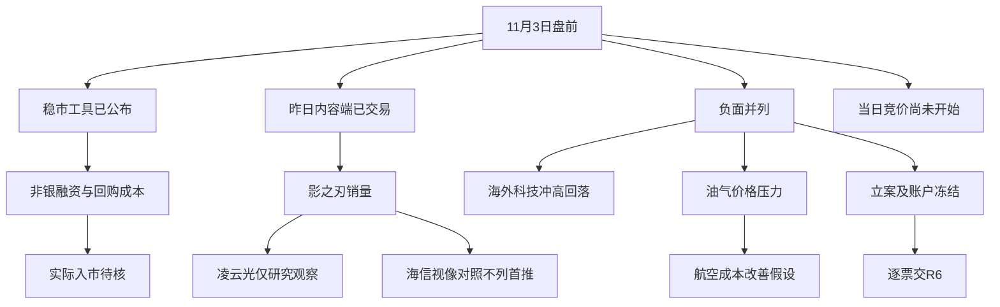

# 2026年11月3日 · 消息面事件驱动

> 数据源新鲜度：partial · 局部降级：true · 置信度：0.63
> 实际盘前研究，不是冻结回放。证据截止及真实生成时刻见frontmatter；未覆盖此后06点至开盘的新增消息。

## 一句话结论
观察传媒内容合力及政策落实；海外科技反转、油价下跌与逐票合规风险不被利好冲销。

## 先认市场，再认个股
昨日市场奖励传媒、游戏与AI内容，不是银行或油气。上证涨1.08%，深成涨1.63%，创业板涨1.87%，超4600股上涨。它是上一交易日事实，不是今日盘中确认。
本轮温度沿用emotion_cycle的高位震荡，情绪=震荡；炸板率18.3%来自11月2日口径，未触发≥35%候选砍半条件。主线 = 传媒/游戏/AI内容（价格观察），持续性 = 1日，封板率 = 未知，明日预期 = 分歧（对应本次盘前下一交易时段的研究推断）。
只有一个研究观察对象；今日核心地位、板型、RR和禁止清单未核，不授开仓资格。不从旧市场性停买继承永久零预算；真实账户限制及R6权力不变。

## 🗺️ 消息面全景图

## 🎯 实际事件详解
事件按事实逐项落盘，不凑8条；油价正负两面分列但底层证据只算一次。分数仅消息排序，不是仓位、买权或机械净分。

### E20261103_006 · 晶华微及控股股东被立案且部分账户被冻结 · 负面 / high
态度：降级；分类：老方向新增催化；原始分-0.95，衰减分-0.95，days_since=0。
事实：原文确认涉嫌信披违法违规等被立案;4个证券账户/7个募集资金银行账户冻结6个月;其他银行账户未受影响。触及法定条件可能重大违法强制退市。
资金/价格反应：尚无20261103 A股竞价或盘中反应;昨收/海外反应不能替代今日资金确认
已查来源与窗口：pdf:jinghua / pdf:jinghua_freeze / news_cls.jsonl:L416 / news_major.jsonl:L53；各证据实际发布与抓取时刻在JSON内。未核不写无负面。
- **大资金意图**：资金意图未查;不能从立案推断机构已出逃。
- **为什么走强**：本条不是走强证据；个股合规与资金可用性出现实质风险;保留给R6逐票审议。
- **逻辑够不够硬**：立案与冻结原文硬;最终认定待监管。
反面/失效条件：仅涉嫌/立案非处罚结论;不能写已经财务造假成立或确定退市;公司预计正常经营不受重大影响。

### E20261103_003 · 美股科技冲高回落及光通信并购双方大跌 · 负面 / high
态度：降级；分类：老方向新增催化；原始分-0.85，衰减分-0.85，days_since=0。
事实：财联社收盘原文确认纳指-1.07%;Marvell约-12.7%及Lumentum约-18.6%。新浪分别-12.88%/-18.71%;同花顺费半-3.37%。
资金/价格反应：2026-11-02美国交易时段收盘价格已反映;不是20261103 A股资金数据。
已查来源与窗口：web:cls_usclose / news_cls.jsonl:L40 / news_cls.jsonl:L1450；各证据实际发布与抓取时刻在JSON内。未核不写无负面。
- **大资金意图**：市场重新计价AI资本开支融资成本与回报;具体抛售动机仍为采访解释。
- **为什么走强**：本条不是走强证据；海外科技风险偏好压缩可能抵消国内稳市政策对高弹性硬件的短线提振。
- **逻辑够不够硬**：价格反应硬;对A股的因果传导及资金选择未知。
反面/失效条件：中概股与消费类海外上涨;不能据美股单夜下跌推出全部A股科技停买。并购利好另列观察。

### E20261103_007 · 奥精医疗涉嫌财务数据虚假记载被立案 · 负面 / high
态度：降级；分类：已交易后的延续；原始分-0.94，衰减分-0.809065，days_since=1。
事实：公司11月1日收到立案告知书;涉嫌定期报告等财务数据虚假记载;11月2日披露。若处罚认定触及条件可能重大违法强制退市。
资金/价格反应：尚无20261103 A股竞价或盘中反应;昨收/海外反应不能替代今日资金确认
已查来源与窗口：pdf:aojing；各证据实际发布与抓取时刻在JSON内。未核不写无负面。
- **大资金意图**：未查询该票资金流向;不宣称已被机构抛售。
- **为什么走强**：本条不是走强证据；财务真实性风险不因政策稳市消失;交R6财务合规必要风险审查。
- **逻辑够不够硬**：财务数据相关立案已核原文;是否触及强制退市尚待认定。
反面/失效条件：非已经行政处罚定案;不能外推医疗器械全行业财务风险。

### E20261103_004 · 国际油价大幅回落压缩上游及油服价格预期 · 负面 / high
态度：降级；分类：老方向新增催化；原始分-0.78，衰减分-0.78，days_since=0。
事实：新浪结算快讯:WTI 96.46美元/-7.36%;布油104.77美元/-7.63%;国内SC夜盘-8.62%。财联社确认能源板块-3.97%。
资金/价格反应：尚无20261103 A股竞价或盘中反应;昨收/海外反应不能替代今日资金确认
已查来源与窗口：web:cls_usclose / news_cls.jsonl:L49 / news_cls.jsonl:L147；各证据实际发布与抓取时刻在JSON内。未核不写无负面。
- **大资金意图**：地缘溢价回吐与需求担忧可能同时存在;不把两者混为确定原因。
- **为什么走强**：本条不是走强证据；上游利润预期受价格下跌冲击;油服订单反馈通常滞后于油价。
- **逻辑够不够硬**：油价方向硬;油服实际合同和未来产量尚未核。
反面/失效条件：海峡“两日计划”仍以条件满足为前提;05时许爆炸报道性质未定;不是永久和平/供给完全恢复。

### E20261103_010 · 中基健康重整获受理并今日停牌及明日起退市风险警示 · 负面 / high
态度：降级；分类：老方向新增催化；原始分-0.9，衰减分-0.774637，days_since=1。
事实：法院11月2日受理公司及子公司重整;11月3日停牌一天;11月4日复牌实施退市风险警示;原文明确日涨跌幅限制仍为10%。
资金/价格反应：尚无20261103 A股竞价或盘中反应;昨收/海外反应不能替代今日资金确认
已查来源与窗口：pdf:zhongji / news_cls.jsonl:L660；各证据实际发布与抓取时刻在JSON内。未核不写无负面。
- **大资金意图**：未核资金;程序事实不等同资金认可。
- **为什么走强**：本条不是走强证据；程序推进带来重整机会叙事但流动性与失败退市风险更直接;今日不作为可交易对象。
- **逻辑够不够硬**：停复牌及风险警示安排硬;重整成功率未知。
反面/失效条件：重整受理不等于重整完成;不把风险警示一律改写5%限制;投资款到位不保证成功。

### E20261103_001 · 三部门将回购增持再贷款转为长期制度安排并降至1% · 正面 / high
态度：观察；分类：老方向新增催化；原始分0.86，衰减分0.740209，days_since=1。
事实：新华社原文确认再贷款利率1.25%降至1%;银行仍按市场化原则加点。31家机构申请第三批SFISF超过1000亿元;11月3日开展操作。
资金/价格反应：尚无20261103 A股竞价或盘中反应;昨收/海外反应不能替代今日资金确认
已查来源与窗口：web:xinhua_policy / news_cls.jsonl:L640 / search:policy_first；各证据实际发布与抓取时刻在JSON内。未核不写无负面。
- **大资金意图**：资金可能由被动降杠杆转向稳市配置;这是可检验假设不是主力资金实测。
- **为什么走强**：降低合格主体回购融资成本并改善非银流动性约束;不等同新增1000亿元今日全部入市。
- **逻辑够不够硬**：传导机制硬但个股收益不确定;使用率/融资完成/实际买入需分别核实。
反面/失效条件：会议预告11月1日已经传播;SFISF 11月2日盘后有预告。缺实际投放与成交反馈。

### E20261103_009 · 科力远及控股股东涉嫌信披违法违规被立案 · 负面 / high
态度：降级；分类：老方向新增催化；原始分-0.8，衰减分-0.688566，days_since=1。
事实：原文确认公司及控股股东分别11月2日收到立案告知书;公司称经营正常。
资金/价格反应：尚无20261103 A股竞价或盘中反应;昨收/海外反应不能替代今日资金确认
已查来源与窗口：pdf:keliyuan / news_cls.jsonl:L696；各证据实际发布与抓取时刻在JSON内。未核不写无负面。
- **大资金意图**：资金面未查;不是已确认撤退。
- **为什么走强**：本条不是走强证据；压低公司层面事件兑现可信度;不能连带否决电池链其他公司。
- **逻辑够不够硬**：公告原文足以确认必要合规风险;责任结论未知。
反面/失效条件：调查尚未终结;不能直接等同已认定财务造假。

### E20261103_002 · 证监会披露主动ETF募资超350亿元并拟优化回购及两融 · 正面 / high
态度：观察；分类：老方向新增催化；原始分0.76，衰减分0.654138，days_since=1。
事实：证监会问答经新华财经完整转载:18只主动ETF募集超350亿元;引导建仓。回购规则抓紧修订;两融指标统筹研究优化。
资金/价格反应：尚无20261103 A股竞价或盘中反应;昨收/海外反应不能替代今日资金确认
已查来源与窗口：web:cnfin_csrc / news_cls.jsonl:L542；各证据实际发布与抓取时刻在JSON内。未核不写无负面。
- **大资金意图**：潜在配置资金等待建仓;不能把公告字面金额相加为净增量。
- **为什么走强**：政策下限改善可能扩散至券商与权益工具;拟议条款不构成今日券商融资额度已下调。
- **逻辑够不够硬**：募集事实可核;回购与两融为拟议部分;不能当新规则已生效。
反面/失效条件：募资不是新净买入;主动ETF可选择持仓并非固定指向传媒。融资保证金比例新数值未公布。

### E20261103_008 · 万辰集团因未及时披露关联交易等事项被立案 · 负面 / high
态度：降级；分类：老方向新增催化；原始分-0.75，衰减分-0.645531，days_since=1。
事实：原文确认未及时履行关联交易临时信息披露义务等;公司称已整改且日常经营正常。
资金/价格反应：尚无20261103 A股竞价或盘中反应;昨收/海外反应不能替代今日资金确认
已查来源与窗口：pdf:wanchen / news_cls.jsonl:L808 / news_cls.jsonl:L1593；各证据实际发布与抓取时刻在JSON内。未核不写无负面。
- **大资金意图**：未核资金反应;不把新闻负面等同已经跌停。
- **为什么走强**：本条不是走强证据；合规折价可能干扰个股接力;风险交R6而非R4硬否决。
- **逻辑够不够硬**：立案事实硬但处罚及损失规模未知。
反面/失效条件：不能与奥精医疗财务虚假记载混为一谈;整改自述不等于调查结束。

### E20261103_011 · 沈阳机床澄清不从事具身智能机器人及配套零部件 · 负面 / high
态度：降级；分类：老方向新增催化；原始分-0.72，衰减分-0.61971，days_since=1。
事实：原文明确无具身智能机器人及配套零部件业务收入;同时披露前三季归母净亏损。
资金/价格反应：尚无20261103 A股竞价或盘中反应;昨收/海外反应不能替代今日资金确认
已查来源与窗口：pdf:shenyang / news_cls.jsonl:L522；各证据实际发布与抓取时刻在JSON内。未核不写无负面。
- **大资金意图**：未核买方意图;上涨可能来自其他主题而非机器人。
- **为什么走强**：本条不是走强证据；机器人题材映射被公司澄清;不能拿公司涨停反证它有该业务。
- **逻辑够不够硬**：对业务有无的澄清硬;不是对其他题材或股价的预测。
反面/失效条件：仅剔除该题材映射;不推导机床真实业务无价值或整个机器人行业无催化。

### E20261103_013 · Anthropic长期算力采购承诺引出的融资兑现风险 · 负面 / medium
态度：降级；分类：老方向新增催化；原始分-0.66，衰减分-0.66，days_since=0。
事实：财联社原文引述最新招股材料称计入9月30日后合同的采购和租赁承诺约8954亿美元且付款延至2045年;本轮未独立取得招股文件。
资金/价格反应：尚无20261103 A股竞价或盘中反应;昨收/海外反应不能替代今日资金确认
已查来源与窗口：web:cls_usclose；各证据实际发布与抓取时刻在JSON内。未核不写无负面。
- **大资金意图**：资金对AI投入回报产生疑虑有采访佐证;该招股材料是否直接导致当夜跌幅未证实。
- **为什么走强**：本条不是走强证据；长期采购支持需求但融资规模与收入兑现不匹配可能提升产业链应收及资本成本压力;不是已发生违约或订单取消。
- **逻辑够不够硬**：报道原文可核;底层SEC文件未核仅medium。此项负面来自资金承诺兑现风险而非按累计同比裁财报极性。
反面/失效条件：承诺不等于当期支出或供应商当期收入;不能把融资兑现风险外推所有A股公司;经营亏损的单季财报拆分尚未核。

### E20261103_012 · 影之刃零72小时销量破400万已于昨日盘中公开 · 正面 / medium
态度：观察；分类：已交易后的延续；原始分0.68，衰减分0.585281，days_since=1。
事实：财联社公开页面确认销量新闻;RSS正文点名凌云光参股青瞳视觉动捕及海信视像画质模式。10:07 IT之家转载已报道;不是19:02公众号首次披露。
资金/价格反应：11月2日A股传媒/游戏涨停扩散且游戏概念前10涨幅由官方OpenAPI实取;今日资金反应未知。
已查来源与窗口：web:cls_game / wechat_official_20.jsonl:L1 / api:pool / search:game_first；各证据实际发布与抓取时刻在JSON内。未核不写无负面。
- **大资金意图**：11月2日价格广度显示资金奖励内容端;今日接力强弱仍未知。
- **为什么走强**：产品热销强化国产内容工业化预期;映射供应商要看真实合同和利润占比而非直接获得游戏流水。
- **逻辑够不够硬**：销量媒体证据可核;发行商官方原帖及供应商合同尚未取得;受益股不授交易资格。
反面/失效条件：该作由灵游坊自主研发发行;不能把游戏板块涨幅前列公司都视为分成方;AI漫剧强势与该单机销量不是同一底层事件。

### E20261103_005 · 油价回落带来航空等燃油使用行业成本改善假设 · 正面 / medium
态度：观察；分类：老方向新增催化；原始分0.4，衰减分0.4，days_since=0。
事实：财联社原文记载全球航空业ETF+4.16%;美国联合航空+4.8%及西南航空+3.6%。底层油价与E004相同。
资金/价格反应：尚无20261103 A股竞价或盘中反应;昨收/海外反应不能替代今日资金确认
已查来源与窗口：web:cls_usclose / news_cls.jsonl:L49；各证据实际发布与抓取时刻在JSON内。未核不写无负面。
- **大资金意图**：海外交易已反映成本改善;国内资金尚未开盘确认。
- **为什么走强**：航空成本可能下降但国内航油传导、票价和汇率决定净利润;正面单独列出不与油气负面相抵消。
- **逻辑够不够硬**：成本机制可解释但不是中国航空利润预测或买入权限。
反面/失效条件：海外航空表现不是A股航空已确认;运费下滑或需求疲弱会抵消成本收益。

## 研究观察对象与对照裁决
### 凌云光 688400.SH · 观察而非首推
- **买入理由**：这里只成立研究理由——新闻明确参股动捕企业参与该作制作。假设归为主线补涨，不代表今日计划已形成。
- **风险点**：未核参股收益及本作业务占比；主营API报告期缺失且不同层级数据混合。光通信相关业务还可能受海外科技压力交叉影响。公告搜索返回历史减持计划及已终止结果，不可写当前无减持。
- **止损条件**：业务关系被澄清、实际订单与收益假设被证伪则取消研究正面映射。数值止损=null，目标价=null，RR=null；无结构依据不造价。
- **可验证假设**：R2确认内容主线和核心地位；R5补合同/参股收益与必要风险；R7补真实资金；D1再独立做逐票门禁。
板型=未知；龙头认定通过条数=未知；盈亏比=未知；禁止清单命中=未知。今日计划内身份=未知，非false。Q3预告500行无该代码，但不是发行人未发预告。

### 为什么不选对照对象
| 对照 | 处置 | 具体原因 |
|---|---|---|
| 央行两场座谈会 | 采用复核议题而非沿用旧状态 | 日历截止昨天07:36结果待核;本轮新华社原文和实时MCP已经提供会后结果;不能仍写今日9点待召开 |
| 奥精医疗 | 风险对象不进候选 | 较高争民爆/通威/TCL等重组叙事而言财务真实性风险更实质;本次已直接核立案PDF且原样交R6 |
| TCL中环/中国稀土 | 观察且不授今日可交易资格 | 截取只确认11/2停牌安排;未实时核11/3续停/复牌与重组新增进展;并非基于行业偏好剔除 |
| 高争民爆 | 不列本轮消息首推 | 本地已筛到11/2复牌风险提示标题;日历已说明评估未完成作价缺;11/2已交易不是盘后新催化;未核核心地位及新增进展不强造矿业票 |
| 通威股份 | 观察不列首推 | 日历发行价格修订不等同盈利改善/现金到账;本轮未核完整交易条件和新进展 |
| *ST实达 | 不列首推并保留风险待核 | 截取同时写立案/年度退市条件且重组无法当年完成;不能仅按收购科技资产归科技机会;本轮未追加原文复核 |
| PMI及其他未来会期 | deferred | 未核统计局原文/本年官方排期与改期;不把日历摘要直接变成本轮高强度事件 |
| 海信视像 vs 凌云光 | 凌云光保留研究观察;海信不列首推 | 同为财联社点名但画质定制到终端销售的利润传导更间接;主营API智慧显示终端77.9548%不是本作收益;两票均缺核心地位/RR和完整公告核验 |
| 游戏概念涨幅前10 | 保留市场对照不自动选票 | 富春/冰川/宝通等涨幅领先只证明板块价格表现;未核本作分成、核心地位与必要风险;不以排名代替资格 |

first_board_candidates为空不是停止研究：本轮没有核全市场首板板型，不能拿股票名出现或涨幅前10冒充首板。研究观察对象已单列。

## 📊 板块 × 事件极性叉乘
| 板块 | 正面事件 | 负面事件 | 裁决 |
|---|---|---|---|
| 模拟芯片 | 无本轮已核正面（非无催化） | E20261103_006 | 负面；今日资金待核 |
| AI算力 | 无本轮已核正面（非无催化） | E20261103_003 / E20261103_013 | 负面；今日资金待核 |
| 光模块 | 无本轮已核正面（非无催化） | E20261103_003 / E20261103_013 | 政策/产业正面与海外价格负面并存；今日资金待核 |
| CPO | 无本轮已核正面（非无催化） | E20261103_003 | 负面；今日资金待核 |
| 存储 | 无本轮已核正面（非无催化） | E20261103_003 / E20261103_013 | 政策/产业正面与海外价格负面并存；今日资金待核 |
| 半导体 | 无本轮已核正面（非无催化） | E20261103_003 | 政策/产业正面与海外价格负面并存；今日资金待核 |
| 医疗器械 | 无本轮已核正面（非无催化） | E20261103_007 | 负面；今日资金待核 |
| 油气开采 | 无本轮已核正面（非无催化） | E20261103_004 | 负面；今日资金待核 |
| 油服 | 无本轮已核正面（非无催化） | E20261103_004 | 负面；今日资金待核 |
| 食品加工 | 无本轮已核正面（非无催化） | E20261103_010 | 负面；今日资金待核 |
| 非银金融 | E20261103_001 / E20261103_002 | 未核到本轮对应负面（非无风险） | 正面；今日资金待核 |
| 权重指数 | E20261103_001 / E20261103_002 | 未核到本轮对应负面（非无风险） | 正面；今日资金待核 |
| 科技核心 | E20261103_001 | 未核到本轮对应负面（非无风险） | 正面；今日资金待核 |
| 电池材料 | 无本轮已核正面（非无催化） | E20261103_009 | 负面；今日资金待核 |
| 金融科技 | E20261103_002 | 未核到本轮对应负面（非无风险） | 正面；今日资金待核 |
| 量贩零食 | 无本轮已核正面（非无催化） | E20261103_008 | 负面；今日资金待核 |
| 具身智能映射 | 无本轮已核正面（非无催化） | E20261103_011 | 负面；今日资金待核 |
| 机床 | 无本轮已核正面（非无催化） | E20261103_011 | 负面；今日资金待核 |
| 游戏 | E20261103_012 | 未核到本轮对应负面（非无风险） | 正面；今日资金待核 |
| AI内容 | E20261103_012 | 未核到本轮对应负面（非无风险） | 正面；今日资金待核 |
| 动作捕捉 | E20261103_012 | 未核到本轮对应负面（非无风险） | 正面；今日资金待核 |
| 航空 | E20261103_005 | 未核到本轮对应负面（非无风险） | 正面；今日资金待核 |
| 物流 | E20261103_005 | 未核到本轮对应负面（非无风险） | 正面；今日资金待核 |

光通信并购整合的正面和并购双方股价大跌的负面不能互相消去。国内稳市融资支持不自动覆盖海外AI回报与资本开支融资压力。油价下跌利空上游但可能利好燃油使用者；不自动利好所有化工炼化，需看库存与产品价差。

## 补充催化与负面风险（不静默删除）
- Marvell拟收购Lumentum的产业整合正面：观察 / 正面。新浪全文及财联社报道已核签最终协议但预计2028上半年完成仍需股东及监管审批。未取得发行人原始公告;不以多家转述同一公告算独立;与E003价格负面并列。
- 浙江龙盛11月1日起活性染料审批价上调3000-5000元/吨：观察 / 正面。财联社公众号及news-search当前报道存在。厂商原始调价函未取得且已有昨日盘前提及;非全新催化。
- 同一染料涨价对下游印染及外购中间体厂商的成本压力：待证实 / 负面。涨价与原料成本说法来自同一报道。原始函及实际成交/毛利未核。
- 苹果第四财季总营收高于预期但大中华及可穿戴低于预期：降级 / 中性。财联社原文:总营收1144.8亿美元vs1134.7亿;大中华175.4亿vs187.5亿;可穿戴83亿vs90亿;EPS关税退款影响新浪已披露。未核苹果发行人财报及上季利润;不按累计同比判正面。
- Anthropic再度经营亏损及近8954亿美元算力承诺报道：观察 / 负面。财联社收盘全文引述最新招股材料;本轮未独立取得招股书。底层SEC文件未核;不把预期估值1.5万亿美元口播当融资完成。
- 纽约尾盘黄金反弹与昨日A股贵金属弱势方向不同：观察 / 正面。新浪05:55报现货金+1.88%/3947.57美元;昨日日内A股贵金属弱势。本轮未取交易所/现货主源;不以旧弱势冻结今日板块资格。
- 亚玛顿控制权变更意向并11月3日停牌：观察 / 中性。已核停牌PDF;仍属意向阶段且预计不超过2个交易日。停牌不授今日交易资格;不把意向当成交或已注入潮玩业务。

其他当前快讯风险（只核快讯，未核发行人全文，不作为完整风险豁免）：
- 【*ST威领：股票交易异常波动 控制权或变更】*ST威领公告称，公司股票连续3个交易日（2026年10月29日、10月30日、11月2日）涨幅累计偏离值达20%，属于股票交易异常波动。经核查，近期公司第一大股东变更为山南锑金，截至2026年10月29日，山南锑金持股13.33%，且其拟继续增持不低于2065.23万股（含已竞得股份）；公司2025年末净资产为负，被叠加实施退市风险警示及其他风险警示；公司补选董事议案尚待股东会审议，若董事当选并完成董事会改组，公司控制权可能发生变更。公司生产经营正常，不存在应披露未披露重大事项，敬请投资者理性投资、注意风险。 证据：news_cls.jsonl:L825
- 【*ST岭南：2026年前三季度营收1.02亿元 亏损扩大】*ST岭南公告称，2026年1-9月公司营业收入为1.02亿元，同比减少59.81%；归属于上市公司股东的净亏损4.11亿元，亏损较上年同期扩大99.42%。“岭南转债”已无法按期兑付本息，公司存在持续经营、增信抵质押资产变现、股票及转债终止上市、诉讼等多项风险。公司股票因连续20个交易日收盘价低于1元，已触及交易类强制退市情形，自2026年10月13日起停牌，深交所拟终止公司股票及可转债上市交易。 证据：news_cls.jsonl:L830
- 【*ST岭南：岭南转债违约处置进展及多项风险提示】*ST岭南公告称，“岭南转债”已到期无法按期兑付本息，主体及债项信用等级均为C。公司2025年营收1.12亿元，同比下降86.99%，净亏损23.36亿元，亏损同比扩大137.29%；2026年前三季度营收1.02亿元，同比下降59.81%，净亏损4.11亿元，亏损同比扩大99.42%。公司股票因连续20个交易日收盘价低于1元，已触及交易类强制退市情形，目前处于停牌状态，深交所拟终止公司股票及岭南转债上市。公司增信计划抵质押资产担保设立和可变现价值存在不确定性，涉诉案件较多，存在持续经营及诉讼风险。 证据：news_cls.jsonl:L833
- 【*ST航图：股票交易异常波动 提示多项风险】*ST航图公告称，公司股票于2026年10月30日、11月2日连续两个交易日收盘价格涨幅偏离值累计超30%，属于股票交易异常波动情形。经核查，公司及控股股东、实控人不存在应披露未披露的重大事项，生产经营正常。公司2026年前三季度营收7688.04万元，同比下降80.90%；净亏损4.61亿元，期末归母净资产-11.16亿元，已被实施退市风险警示，若2026年年报触及相关指标将被终止上市。公司被债权人申请重整，因尚在证监会立案调查期，重整能否受理存在重大不确定性。此外公司存在债务违约、宏图转债兑付风险等多项风险，敬请投资者注意。 证据：news_cls.jsonl:L973
- 【ST新元：披露股票交易其他风险警示相关事项进展】ST新元公告称，公司目前仍存在三项其他风险警示情形：近三个会计年度扣非前后净利润孰低者均为负且持续经营能力存疑、主要银行账户被冻结、收到证监会行政处罚事先告知书。其中内部控制否定意见相关其他风险警示情形已消除。公司预重整已确定随锐科技集团为牵头产业投资人、绿技行（武汉）投资合伙企业（有限合伙）为联合产业投资人，已签署《重整投资协议》。截至2026年9月30日，公司归母净资产为202.84万元，若2026年末净资产为负、或法院受理重整申请，股票将被实施退市风险警示；重整失败则可能被宣告破产并终止上市。 证据：news_cls.jsonl:L991
- 【ST恒信：披露股票被实施其他风险警示相关进展】ST恒信公告称，公司股票因触及相关上市规则，于2026年4月8日起被实施其他风险警示。公司已就《行政处罚决定书》所涉事项完成2022年年度报告差错更正，将在中国证监会作出行政处罚决定书之日起满12个月后，向深交所申请撤销其他风险警示。2026年7月27日，公司及控股股东、实控人因涉嫌信息披露违法违规收到证监会立案告知书，目前正配合调查。公司各项经营活动正常有序开展。 证据：news_cls.jsonl:L1143
- 【ST东时：募集资金账户13.88万元被司法划扣】ST东时公告称，公司兴业银行北京西直门支行募集资金账户被北京市大兴区人民法院司法划扣13.88万元，划扣后该账户余额59.92元，处于冻结状态。截至公告披露日，公司共有3个募集资金专用账户处于冻结状态，合计余额1054.58元。公司募集资金投资项目已全部终止，本次划扣不会对募投项目及正常生产经营造成不利影响。公司预重整尚未正式进入重整程序，若法院受理重整申请，公司股票将被实施退市风险警示。 证据：news_cls.jsonl:L705
- 【益坤电气：平阳益焱创业服务中心（有限合伙）拟减持公司不超过1%股份】益坤电气公告，持股5%以上股东平阳益焱创业服务中心（有限合伙）持有公司股份639.13万股，占公司总股本比例7.4623%，拟于自本公告披露之日起15个交易日后的3个月内，通过集中竞价方式减持不超过85.65万股，占公司总股本比例1%，减持价格根据减持时的市场价格及交易方式确定，拟减持原因为自身资金需求。 证据：news_cls.jsonl:L1165

## 🔥 中报业绩预告命中
当前文件实际为2026Q3而非中报。已解析500行，按归母净利润预告同比上限提取top15并逐项交叉；公告日期为8月25日至10月24日，全部早于7日新闻窗口。不得把极高累计同比当新利好，也不能用本表证明无中报预告。
| 代码 | 名称 | 累计同比区间% | 事件交集 | 裁决 |
|---|---|---|---|---|
| 001309.SZ | 德明利 | 32046.52~33154.49 | AI算力/存储风险背景 | 旧背景；单季环比未核 |
| 300821.SZ | 东岳硅材 | 19047.97~19748.08 | 非本轮核心事件直接映射 | 旧背景；单季环比未核 |
| 000703.SZ | 恒逸石化 | 3318.59~3405.13 | 油价/炼化两面背景 | 旧背景；单季环比未核 |
| 002466.SZ | 天齐锂业 | 2734.97~3235.26 | 非本轮核心事件直接映射 | 旧背景；单季环比未核 |
| 688825.SH | 长鑫科技 | 2581.06~2609.47 | AI算力/存储风险背景 | 旧背景；单季环比未核 |
| 002812.SZ | 恩捷股份 | 1884~2474.8 | 非本轮核心事件直接映射 | 旧背景；单季环比未核 |
| 688808.SH | 联讯仪器 | 1866~2072.95 | AI算力/存储风险背景 | 旧背景；单季环比未核 |
| 301308.SZ | 江波龙 | 1864.55~1990.84 | AI算力/存储风险背景 | 旧背景；单季环比未核 |
| 605189.SH | 富春染织 | 1347.69~1519.01 | 非本轮核心事件直接映射 | 旧背景；单季环比未核 |
| 688388.SH | 嘉元科技 | 1196.6~1318.92 | 非本轮核心事件直接映射 | 旧背景；单季环比未核 |
| 603991.SH | 领先股份 | 1238.57~1238.57 | 非本轮核心事件直接映射 | 旧背景；单季环比未核 |
| 603026.SH | 石大胜华 | 968.14~1032.45 | 非本轮核心事件直接映射 | 旧背景；单季环比未核 |
| 000626.SZ | 远大控股 | 890~1018 | 非本轮核心事件直接映射 | 旧背景；单季环比未核 |
| 002493.SZ | 荣盛石化 | 777.93~822.95 | 油价/炼化两面背景 | 旧背景；单季环比未核 |
| 300497.SZ | 富祥股份 | 658~785 | 非本轮核心事件直接映射 | 旧背景；单季环比未核 |

周期股须补单季利润环比、产品现价、扣非及预期差后重判。德明利、江波龙、长鑫科技等极高同比不是本轮买入理由；数据中的内部数字也未做财报级勾稽，不复述为确定盈利改善。

## 关键证据
- web:xinhua_policy：新华社 · 2026-11-02 · https://www.news.cn/fortune/20261102/94ebd5fc6c1644d5a7f4844503f2abbb/c.html；public_page_text。
- web:cnfin_csrc：新华财经转载证监会问答 · 2026-11-02 · https://www.cnfin.com/yw-lb/detail/20261102/4489934_1.html；public_page_text。
- web:cls_usclose：财联社 · 2026-11-03 · https://www.cls.cn/detail/2523159；public_article_text。
- pdf:jinghua：上市公司公告 · 2026-11-03 · https://static.cninfo.com.cn/finalpage/2026-11-03/1225654385.PDF；full_pdf_text_extracted。
- pdf:jinghua_freeze：上市公司公告 · 2026-11-03 · https://static.cninfo.com.cn/finalpage/2026-11-03/1225654384.PDF；full_pdf_text_extracted。
- pdf:aojing：上市公司公告 · 2026-11-02 · https://static.cninfo.com.cn/finalpage/2026-11-02/1225651093.PDF；full_pdf_text_extracted。
- pdf:wanchen：上市公司公告 · 2026-11-02 · https://static.cninfo.com.cn/finalpage/2026-11-02/1225653869.PDF；full_pdf_text_extracted。
- pdf:keliyuan：上市公司公告 · 2026-11-03 · https://static.cninfo.com.cn/finalpage/2026-11-03/1225654143.PDF；full_pdf_text_extracted。
- pdf:zhongji：上市公司公告 · 2026-11-02 · https://static.cninfo.com.cn/finalpage/2026-11-03/1225654160.PDF；full_pdf_text_extracted。
- pdf:shenyang：上市公司公告 · 2026-11-02 · https://static.cninfo.com.cn/finalpage/2026-11-03/1225654296.PDF；full_pdf_text_extracted。
- web:cls_game：财联社 · 2026-11-02 · https://www.cls.cn/detail/2522357；public_teaser_only_paywall。

## 专题来源裁决与投影边界
context_sha256=15d70c1145bbb2e5b08a32c91a457a0d626d269f8e2db798d825883fa9bb4f4d
只读并比较本次运输截取，不宣称53566字全文已读。索引身份、哈希、时点、limitations完整保存在JSON；内容做明确精简。旧版的会议待核被本轮会后原文更新；奥精医疗线索被公告确认，其余对象未自动升级。没有内嵌上游source_id被忽略（本次upstream_knowledge为空）。

## 数据源审计
| 源 | 日期 | 状态 | 备注 |
|---|---|---|---|
| news_cls | 2026-11-03 | 🟢 | 新浪1438条+同花顺559条;实际最早20261031 09:04最新20261103 05:58:36;不是财联社直采 |
| news_major | 2026-11-03 | 🟢 | 最早20261102 16:13:11最新20261103 04:40;全为标题无正文;800条上限截断72h |
| eastmoney_earnings_predict | 2026-11-03 | 🟡 | 2026Q3样本;公告日期20260825-20261024;不是当前H1/全量业绩;无记录不能写无预告 |
| wechat_official_20 | 2026-11-03 | 🟢 | 17个RSS源;兼容镜像仅计一次;盘前纪要只有11月2日旧版;本日07点文章尚未到发布时段 |
| wechat_cli_5groups | 2026-11-03 | 🟢 | 五群文字;图片/文件未读;只作线索不计独立原始支持 |
| anns_window | 2026-11-03 | 🟢 | 20261102/03公告目录;日期级无完整发布时间;重点PDF8份实际复核 |
| hithink_business_query | 2026-11-03 | 🟢 | 实际官方OpenAPI两票;报告期缺失/产品层级混合;event收入占比未知 |
| hithink_market_query | 2026-11-03 | 🟢 | 20261102游戏前10只实取;非自动龙头判定 |
| announcement_search | 2026-11-03 | 🟡 | 同日问句返回历史公告;不代表同日无冲突 |
| tushare_MCP | 2026-11-03 | 🟢 | 实际两轮短讯与3票公告目录直调;不按工具重复计源 |
| official_originals | 2026-11-03 | 🟢 | 已取新华社政策/新华财经问答/财联社收盘;游戏页面只取得付费公开摘要 |
| R7 | 2026-11-03 | 🔴 | 本轮正式R7_capital_flow.json尚未出现;未借旧资金值填补 |
| R3 | 2026-11-03 | 🔴 | 正式R3_sentiment.json尚未出现;KOL独立验证unknown |
| xtick_news | 2026-11-03 | 🔴 | R4当前developer工具权限不含xtick;未调用;用获准新闻与公告主路径补核 |
| datapro_vibe_cross | 2026-11-03 | 🔴 | 当前R4白名单file/wechat/tushare;未调用越权provider;采用skill官方OpenAPI及原文;不全局禁买 |

源新鲜度审计：news_cls只覆盖实际最早10月31日09:04至11月3日05:58，不能按文件名声称财联社全覆盖；major为800条标题且不足72h；RSS兼容镜像只计一次。公众号今晨07点内容尚未发布不能判漏抓；图片及附件未读。本轮06点财联社收盘全文是实时补盲，不是先前fetch已包含。

## 不确定性 / 反证
1. 昨日传媒强势不保证今日接力；资金合力与核心地位必须独立验证，不能用消息热度替代。
2. 新浪及财联社美股收盘个别报价略有差异，原始值各自保留；不混用盘中/盘后/不同市场。
3. 公司立案性质逐票区分；经营正常自述不等于调查终结，立案也不等于财务造假已定案。
4. 公告语义搜索同日召回不足、R7正式资金缺失、R3独立KOL缺失只造成局部unknown，不升级市场性停买。
5. 未来日历未逐一核本年官方排期与改期，不能把此前日历或电话会设为已确认今日催化。

## 与其他 R/D/E 的关系
- 已读：本轮raw、manifest、mcp_health、emotion_cycle；未读R3/R7正式产物（尚未取得）。
- R2：主线确认与候选地位独立裁决；R5：只对其本轮真实R2候选补画像；R6：只读本JSON内嵌证据及必要风险，勿临时联网；D1：独立执行门禁。
- 本研究不修改任何有效硬预算、账户停买、仓位上限、T+1、人工确认及已有逐票hard_reject。

## Sub-Agent 元数据
- skill: analyze_news_impact_v1@1.7
- artifact: data/research/20261103/R4_news.json
- method: llm_v1；模型实际裁决，脚本只抓取/计算衰减/校验/序列化
- 生成时刻: 2026-11-03T06:25:46+08:00
- schema: explicit Pydantic R4+knowledge；数值止损unknown不是门禁通过
