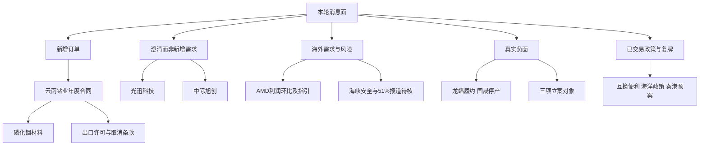

# 2026年11月4日 · 消息面事件驱动

> 本轮为实际盘前研究。生成时点与知识截止见文首。专题传递as_of=06:10不冒充后续联网取证截止。研究不授买权。

## 一句话结论

观察磷化铟合同增量与光模块澄清；情绪=主跌参考，出口许可、长单履约及监管风险并列。

## 先认市场，再认事件

上一交易日收评：上证-0.82%、创业板-2.73%、科创50-3.81%，成交17151亿元，超3300只下跌。中船系、猪肉、电池、影视游戏相对强；半导体、CPO弱。此为新闻收评口径，不是本轮重算资金流。当前尚未开盘，不能用晚间澄清证明当日资金已回流。

T-1情绪工具炸板率41.46%，情绪=主跌（参考）；但其intraday_fallback=true且_is_closed=false，不升级完整收盘核验。消息研究候选从2个新增公司事件通道减为1个：云南锗业。秦港股份保留对象级观察而不列首板。真实事件与负面不减半。

主线 = 未经本轮R2确认；持续性 = 未知；封板率 = 未知；明日预期 = 未知。未据辅助缺数发布全局停买，不继承旧研究零仓为账户限制；预算、人工确认及逐票R6否决保持独立。

## 🗺️ 消息面全景图

## 🎯 顶级事件详解

下列条目按事实可靠性与研究相关性保留，不以8条为目标。同一合同/财报的正反条目共享底层事件，不能重复算独立支持。

### 🟢 E20261104_001 · 云南锗业签订2027年度磷化铟衬底供货合同
- 极性=正面；强度=high；研究态度=观察；新旧分类=老方向新增催化
- 原始发布时间：2026-11-03；本轮可核最早公众记录：2026-11-03T17:33:15+08:00；可交易日：20261104
- 已核事实：云南鑫耀与AOI签约。2027年18万片4英寸N型磷化铟衬底对应1.944亿美元不含税。2027—2031年预计每年18万片为框架；实际出口与订单数量有条件。
- 推断：从泛算力转向具名客户和年度合同的兑现比较；只能确认材料订单，不能推导整个CPO链今天走强。
- 反面/未查：合同额不是2026年收入、利润或已获出口许可；五年90万片不是五年固定金额。
- **大资金意图**：可能研究订单确定性更高的上游材料，但本轮无大资金意图证据。
- **为什么走强**：11/3该股跌5.0831%；17:33后的新合同不能解释此前下跌或被称为已回流。
- **逻辑够不够硬**：公司原公告全文已核。年度合同数量金额硬，许可和履约未兑现。
- 已查来源与窗口：ann_2028, news_L930, rss_L44；各原文定位、抓取时点、全文/片段范围均内嵌JSON。重点2026-11-01 06:10至本轮实际取证截止；公告标题窗口11/3—11/4；各记录原始时点分别保留
- 未查范围：未做全量诉讼/处罚/质押历史核验；未查部分不等于无负面
- 衰减：raw=0.85；days=1；weighted=0.731602；decayed=false

### 🔴 E20261104_002 · 云南锗业年度合同存在出口许可及取消退款条件
- 极性=负面；强度=high；研究态度=降级；新旧分类=老方向新增催化
- 原始发布时间：2026-11-03；本轮可核最早公众记录：2026-11-03T17:33:15+08:00；可交易日：20261104
- 已核事实：年度合同以取得并维持两用物项出口许可为前提；未按期取得或维持许可时AOI有权取消合同或受影响采购订单并要求退款。
- 推断：上游材料订单的正面叙事不能跳过许可、出口额度、美元结算及供货能力风险。
- 反面/未查：这是合同已披露的条件风险，不是许可证已经被拒或合同已取消。
- **大资金意图**：暂无抛售该风险的实测资金证据。
- **为什么走强**：没有走强事实；此条对同一订单正面映射做风险叉乘。
- **逻辑够不够硬**：条款硬，未来取消是否发生未知。
- 已查来源与窗口：ann_2028；各原文定位、抓取时点、全文/片段范围均内嵌JSON。重点2026-11-01 06:10至本轮实际取证截止；公告标题窗口11/3—11/4；各记录原始时点分别保留
- 未查范围：未做全量诉讼/处罚/质押历史核验；未查部分不等于无负面
- 衰减：raw=-0.55；days=1；weighted=-0.473389；decayed=false

### 🟢 E20261104_003 · 光迅科技公告否认物料短缺与生产停工传闻
- 极性=正面；强度=high；研究态度=观察；新旧分类=老方向新增催化
- 原始发布时间：2026-11-03；本轮可核最早公众记录：2026-11-03T19:48:44+08:00；可交易日：20261104
- 已核事实：公司称物料供应稳定、生产交付正常。原公告还指向10/23既有经营情况公告。
- 推断：只纠正停工传闻这一负面；不等于新增订单和行业需求上修。
- 反面/未查：11/3跌停是已发生价格事实；公司说明不是第三方审计，不能直接认定修复成功。
- **大资金意图**：资金是否重新定价需后续成交与板块验证。
- **为什么走强**：尚未走强；11/3收92.20跌9.9961%，澄清在19:48报道。
- **逻辑够不够硬**：澄清公告原文硬；估值、股价拐点和需求增量不由本公告证明。
- 已查来源与窗口：ann_2046, news_L663, rss_L42；各原文定位、抓取时点、全文/片段范围均内嵌JSON。重点2026-11-01 06:10至本轮实际取证截止；公告标题窗口11/3—11/4；各记录原始时点分别保留
- 未查范围：未做全量诉讼/处罚/质押历史核验；未查部分不等于无负面
- 衰减：raw=0.5；days=1；weighted=0.430354；decayed=false

### 🟢 E20261104_004 · 中际旭创晚间纪要澄清砍单及评级下调传言
- 极性=正面；强度=high；研究态度=观察；新旧分类=老方向新增催化
- 原始发布时间：2026-11-03；本轮可核最早公众记录：2026-11-03T23:39:00+08:00；可交易日：20261104
- 已核事实：11/3 21:00—22:00电话会纪要称绝大部分客户未下修需求或订单；个别客户有结构调整；2027绝大部分订单已覆盖全年。公司向外资券商求证维持评级及目标价。
- 推断：需求未全面恶化与股价承压可同时成立；修复研究对象不等于新主线。
- 反面/未查：需求是公司陈述且非盈利预测。NPO新物料良率爬坡、部分物料偏紧、2028指引不完整仍在。
- **大资金意图**：没有本轮资金回流证据；机构参会名单不能当买入名单。
- **为什么走强**：11/3股价跌12.6909%；晚间纪要不能倒解释日盘。
- **逻辑够不够硬**：公司纪要全文已读；未取得客户订单和野村原始研报，目标价数字不作决策锚。
- 已查来源与窗口：ann_977, news_L1502, rss_L41；各原文定位、抓取时点、全文/片段范围均内嵌JSON。重点2026-11-01 06:10至本轮实际取证截止；公告标题窗口11/3—11/4；各记录原始时点分别保留
- 未查范围：未做全量诉讼/处罚/质押历史核验；未查部分不等于无负面
- 衰减：raw=0.65；days=1；weighted=0.55946；decayed=false

### 🟡 E20261104_005 · AMD季报显示数据中心需求增长及下季营收指引
- 极性=中性；强度=high；研究态度=观察；新旧分类=老方向新增催化
- 原始发布时间：2026-11-04T05:15:00+08:00；本轮可核最早公众记录：2026-11-04T05:15:00+08:00；可交易日：20261104
- 已核事实：发行人新闻稿经Nasdaq/GlobeNewswire索引文本：Q3营收133.77亿美元；GAAP净利24.28亿美元对Q2 22.97亿美元；Non-GAAP净利34.71对27.60亿美元。Q4营收指引170亿美元±3%。
- 推断：海外算力需求可作为A股产业侧反证；未核具名供应链不能直接造A股受益名单。
- 反面/未查：同一发行人新闻稿在多个平台仍算一份底层证据；原URL直读Nasdaq超时、Morningstar403，不冒称原站全文已读。
- **大资金意图**：海外盘后上涨报道不是A股资金已回流。
- **为什么走强**：05:18盘后约涨6%只对应海外时点；A股尚无11/4价格反馈。
- **逻辑够不够硬**：已取得发行人稿件索引中财务表，利润环比上升；不是只取同比。原站直读未成功。
- 已查来源与窗口：news-search:AMD 2026 第三季度, news_L24, news_L23；各原文定位、抓取时点、全文/片段范围均内嵌JSON。重点2026-11-01 06:10至本轮实际取证截止；公告标题窗口11/3—11/4；各记录原始时点分别保留
- 未查范围：未做全量诉讼/处罚/质押历史核验；未查部分不等于无负面
- 衰减：raw=0.7；days=0；weighted=0.7；decayed=false

### 🔴 E20261104_006 · AMD下季毛利率指引回落且自由现金流低于新闻共识
- 极性=负面；强度=medium；研究态度=降级；新旧分类=老方向新增催化
- 原始发布时间：2026-11-04T05:15:00+08:00；本轮可核最早公众记录：2026-11-04T05:21:00+08:00；可交易日：20261104
- 已核事实：发行人Q4 Non-GAAP毛利率指引55%，本季56%；新闻列Q3自由现金流5.54亿美元对预期19.7亿美元、同比减少64%。
- 推断：收入加速不等于现金回报同步；作为海外AI叙事正面部分的反证并列。
- 反面/未查：FCF一致预期来自媒体未核原始共识样本；不能外推A股公司现金流恶化。
- **大资金意图**：无证据确定资金正在卖出；仅列财报质量反证。
- **为什么走强**：这条不证明走强；需防高营收掩盖毛利率及现金回报压力。
- **逻辑够不够硬**：毛利率指引可追溯发行人索引文本；现金流共识为媒体层证据。
- 已查来源与窗口：news-search:AMD 2026 第三季度, news_L22；各原文定位、抓取时点、全文/片段范围均内嵌JSON。重点2026-11-01 06:10至本轮实际取证截止；公告标题窗口11/3—11/4；各记录原始时点分别保留
- 未查范围：未做全量诉讼/处罚/质押历史核验；未查部分不等于无负面
- 衰减：raw=-0.35；days=0；weighted=-0.35；decayed=false

### 🟢 E20261104_007 · 第三批互换便利1000亿元操作落地及券商披露中标
- 极性=正面；强度=medium；研究态度=观察；新旧分类=已交易后的延续
- 原始发布时间：2026-11-03；本轮可核最早公众记录：2026-11-03T12:34:58+08:00；可交易日：20261103
- 已核事实：11/3媒体报道央行操作1000亿元、31家投标、中标费率10bp。上证报和证券时报各自采访披露中标及使用计划；未直接读到央行结果页面。
- 推断：从昨日计划节点升级为操作结果，改善机构融资条件；实际换券、融资、买股分步骤，不能把1000亿写成11/3或11/4净流入。
- 反面/未查：11/3市场仍跌；募集额、授信额和操作额不可相加，更不能机械推出券商龙头加速。
- **大资金意图**：能证实机构声明计划使用；实际账户资金与配置进度归R7验证。
- **为什么走强**：政策落地日上证跌0.82%，未出现政策必涨事实。
- **逻辑够不够硬**：两家原始媒体采访和央行结果转述可追溯；官方原页缺口故medium。
- 已查来源与窗口：rss_L19, rss_L48, rss_L8, news-search:2026年11月3日 互换便利 1000 10bp 中国人民银行；各原文定位、抓取时点、全文/片段范围均内嵌JSON。重点2026-11-01 06:10至本轮实际取证截止；公告标题窗口11/3—11/4；各记录原始时点分别保留
- 未查范围：未做全量诉讼/处罚/质押历史核验；未查部分不等于无负面
- 衰减：raw=0.65；days=1；weighted=0.55946；decayed=false

### 🔴 E20261104_008 · 美伊谈判无新进展及海峡船只遇袭风险仍存
- 极性=负面；强度=high；研究态度=降级；新旧分类=老方向新增催化
- 原始发布时间：2026-11-03；本轮可核最早公众记录：2026-11-03T23:29:34+08:00；可交易日：20261104
- 已核事实：新华社转述伊方要求回应7项条件后才开放海峡；央视引述伊方称谈判尚无新进展。另有UKMTO油轮遇袭通报经央视转述。
- 推断：油价、运输保险和供应交付风险影响航空、化工和航运成本；上游能源可能受价格支撑但不是所有航运股都利好。
- 反面/未查：调解仍在继续；不能写成全面复战已定或所有油轮停航。未核实时原油收盘价与运费。
- **大资金意图**：未知；新闻风险升温不等于资金已买油卖科技。
- **为什么走强**：不是走强结论；成本传导正反并列。
- **逻辑够不够硬**：官方媒体署名报道和不同主体声明可追溯；战况及协议进度以其各自主语保留。
- 已查来源与窗口：news_L228, news_L235, news_L190, live_news_0500_0615, cctv_20261103_international；各原文定位、抓取时点、全文/片段范围均内嵌JSON。重点2026-11-01 06:10至本轮实际取证截止；公告标题窗口11/3—11/4；各记录原始时点分别保留
- 未查范围：未做全量诉讼/处罚/质押历史核验；未查部分不等于无负面
- 衰减：raw=-0.7；days=1；weighted=-0.602496；decayed=false

### 🔴 E20261104_009 · 龙蟠科技回复披露多项长期供货进度不及预期
- 极性=负面；强度=high；研究态度=降级；新旧分类=老方向新增催化
- 原始发布时间：2026-11-04 时间未知；本轮可核最早公众记录：unknown；可交易日：20261104
- 已核事实：公司回复称楚能、亿纬马来西亚、欣旺达泰国长单履行较时间进度暂不及预期；现有产能37.25万吨、在建43.50万吨；披露磷酸铁锂价格先升后降。
- 推断：用实际履约校验昨日电池走强叙事，不能把框架大单和同比盈利等同本期新增收入。
- 反面/未查：同回复也称LGES等部分客户进度符合预期；不把单家公司履约风险升级为整个电池行业订单崩塌。
- **大资金意图**：暂无资金流原始核验；只提供产业反证给R2/R5/R6。
- **为什么走强**：11/3电池方向相对强与龙蟠履约风险可同时成立。
- **逻辑够不够硬**：监管回复原文已取；已审阅风险及履约段，未声称全文逐表审计。
- 已查来源与窗口：ann_1622；各原文定位、抓取时点、全文/片段范围均内嵌JSON。重点2026-11-01 06:10至本轮实际取证截止；公告标题窗口11/3—11/4；各记录原始时点分别保留
- 未查范围：未做全量诉讼/处罚/质押历史核验；未查部分不等于无负面
- 衰减：raw=-0.65；days=0；weighted=-0.65；decayed=false

### 🔴 E20261104_010 · 国晟科技三家光伏子公司仍停产及条件性风险警示
- 极性=负面；强度=high；研究态度=降级；新旧分类=老方向新增催化
- 原始发布时间：2026-11-03；本轮可核最早公众记录：2026-11-03T23:26:00+08:00；可交易日：20261104
- 已核事实：三家光伏子公司9/8已停产且目前无在制订单；若12/7前未复产存在其他风险警示风险。控股股东质押占其持股99.63%，冻结等存在重叠口径。
- 推断：11/3光伏阶段走强不覆盖个股经营停摆；公司对象风险单独传递。
- 反面/未查：是临时停产和条件性ST风险，不是已实施ST；119.34%为冻结等合并重叠累计，不能写成119%独立股份。
- **大资金意图**：无本轮资金核验。
- **为什么走强**：板块涨不等于该股经营修复。
- **逻辑够不够硬**：停产、复产期限与质押原文硬；复产只是预计。
- 已查来源与窗口：ann_1630, rss_L34；各原文定位、抓取时点、全文/片段范围均内嵌JSON。重点2026-11-01 06:10至本轮实际取证截止；公告标题窗口11/3—11/4；各记录原始时点分别保留
- 未查范围：未做全量诉讼/处罚/质押历史核验；未查部分不等于无负面
- 衰减：raw=-0.8；days=1；weighted=-0.688566；decayed=false

### 🔴 E20261104_011 · 品茗科技实控人因涉嫌操纵证券市场被立案
- 极性=负面；强度=high；研究态度=降级；新旧分类=老方向新增催化
- 原始发布时间：2026-11-03；本轮可核最早公众记录：2026-11-03T16:46:00+08:00；可交易日：20261104
- 已核事实：莫绪军近日收到立案告知书，事由涉嫌操纵证券市场。公告称属个人调查、未参与公司日常经营。
- 推断：实控人治理与证券合规风险须逐票保留，不能被AI软件催化覆盖。
- 反面/未查：不是公司财务造假已认定，也不是已作退市决定；公司经营正常是公告陈述。
- **大资金意图**：无资金意图证据。
- **为什么走强**：没有走强判断；风险对象不列机会。
- **逻辑够不够硬**：公司公告直接确认立案事实；调查结论未知。
- 已查来源与窗口：ann_1570, news_L1680, rss_L40；各原文定位、抓取时点、全文/片段范围均内嵌JSON。重点2026-11-01 06:10至本轮实际取证截止；公告标题窗口11/3—11/4；各记录原始时点分别保留
- 未查范围：未做全量诉讼/处罚/质押历史核验；未查部分不等于无负面
- 衰减：raw=-0.65；days=1；weighted=-0.55946；decayed=false

### 🔴 E20261104_012 · 三星新材因涉嫌信息披露违法违规被立案
- 极性=负面；强度=high；研究态度=降级；新旧分类=老方向新增催化
- 原始发布时间：2026-11-03；本轮可核最早公众记录：2026-11-03T17:17:00+08:00；可交易日：20261104
- 已核事实：公司于11/3收到立案告知书，事由涉嫌信息披露违法违规。公告称目前生产经营正常。
- 推断：公司主体信披风险独立于光伏板块价格反弹。
- 反面/未查：未得调查结论；不把涉嫌信披违规擅自写成财务造假已实锤。
- **大资金意图**：无本轮资金核验。
- **为什么走强**：不作走强结论；对象风险交R6。
- **逻辑够不够硬**：原公告确认对象、事由与收到日期。
- 已查来源与窗口：ann_1651, news_L1659；各原文定位、抓取时点、全文/片段范围均内嵌JSON。重点2026-11-01 06:10至本轮实际取证截止；公告标题窗口11/3—11/4；各记录原始时点分别保留
- 未查范围：未做全量诉讼/处罚/质押历史核验；未查部分不等于无负面
- 衰减：raw=-0.7；days=1；weighted=-0.602496；decayed=false

### 🔴 E20261104_013 · 山鹰国际实控人董事长涉嫌内幕及短线交易被立案
- 极性=负面；强度=high；研究态度=降级；新旧分类=老方向新增催化
- 原始发布时间：2026-11-03；本轮可核最早公众记录：2026-11-03T22:54:00+08:00；可交易日：20261104
- 已核事实：吴明武11/3收到立案告知书，事由涉嫌内幕交易和短线交易。公告称属个人调查，与公司日常经营无关。
- 推断：个人证券合规和治理风险需传递，不据公司声明删除风险。
- 反面/未查：不是对上市公司财务造假的认定，亦不等于生产中断。
- **大资金意图**：无资金意图实证。
- **为什么走强**：不作走强结论。
- **逻辑够不够硬**：原公告已核；个人与公司主体分清。
- 已查来源与窗口：ann_1816, news_L1509；各原文定位、抓取时点、全文/片段范围均内嵌JSON。重点2026-11-01 06:10至本轮实际取证截止；公告标题窗口11/3—11/4；各记录原始时点分别保留
- 未查范围：未做全量诉讼/处罚/质押历史核验；未查部分不等于无负面
- 衰减：raw=-0.6；days=1；weighted=-0.516425；decayed=false

### 🔴 E20261104_014 · 英伟达51%非中国客户服务要求报道尚缺原始确认
- 极性=负面；强度=medium；研究态度=观察；新旧分类=待证实
- 原始发布时间：2026-11-03；本轮可核最早公众记录：2026-11-03T16:30:00+08:00；可交易日：20261103
- 已核事实：央视记录外交部被问及FT报道及回应“具体情况不了解”。检索转载称要求口头传达、针对未来合同；未取得FT原稿或英伟达书面规则。
- 推断：如落实将限制部分中企境外租算力渠道；国产替代是条件性传导，不能直接泛化所有国产算力股利好。
- 反面/未查：外交部回应不是对51%规则真实性的确认；大量转载同源不计多重独立验证。
- **大资金意图**：未知。
- **为什么走强**：不是已走强主线，行业潜在负面必须并列。
- **逻辑够不够硬**：已核的是报道及回应存在；规则内容未核，事件事实状态reported_unverified。
- 已查来源与窗口：news_L759, news-search:英伟达 51% 非中国 企业, rss_L85；各原文定位、抓取时点、全文/片段范围均内嵌JSON。重点2026-11-01 06:10至本轮实际取证截止；公告标题窗口11/3—11/4；各记录原始时点分别保留
- 未查范围：未做全量诉讼/处罚/质押历史核验；未查部分不等于无负面
- 衰减：raw=-0.5；days=1；weighted=-0.430354；decayed=false

### 🟢 E20261104_015 · 发改委发布海洋经济2030年13万亿元预期目标
- 极性=正面；强度=high；研究态度=观察；新旧分类=已交易后的延续
- 原始发布时间：2026-11-03；本轮可核最早公众记录：2026-11-03T10:52:00+08:00；可交易日：20261103
- 已核事实：中新网记者11/3现场报道发改委新闻发布会：2030年海洋生产总值预计突破13万亿元，聚焦新科技、新产业、新空间。
- 推断：有政策叙事，但目标值不是新增财政预算、上市公司订单或收入。已在11/3日盘公开，不包装成11/4新题材。
- 反面/未查：问财“海洋经济”查询被解析为海洋捕捞仅2只，不能冒充完整海洋装备受益池。东方海洋有独立亏损和异动风险。
- **大资金意图**：未知；不凭名字带海洋认定资金意图。
- **为什么走强**：11/3中船系走强是收评事实；政策是否是唯一驱动未证实。
- **逻辑够不够硬**：官方媒体原始记者稿已核；个股映射与资金广度不足。
- 已查来源与窗口：marine_chinanews, news-search:海洋 13万亿, rss_L1；各原文定位、抓取时点、全文/片段范围均内嵌JSON。重点2026-11-01 06:10至本轮实际取证截止；公告标题窗口11/3—11/4；各记录原始时点分别保留
- 未查范围：未做全量诉讼/处罚/质押历史核验；未查部分不等于无负面
- 衰减：raw=0.5；days=1；weighted=0.430354；decayed=false

### 🟡 E20261104_016 · 秦港股份披露资产收购预案并定于11月4日复牌
- 极性=中性；强度=high；研究态度=观察；新旧分类=老方向新增催化
- 原始发布时间：2026-11-03；本轮可核最早公众记录：2026-11-03T23:58:00+08:00；可交易日：20261104
- 已核事实：拟购曹妃甸四家公司25%、24%、28.2328%、6%股权。11/4复牌确定；审计评估未完、交易价格未定；需后续审批。
- 推断：是独立公司资产整合观察，不是海洋政策自动赋予龙头地位。
- 反面/未查：预案不是交易完成；停牌期间接口3.57元及0涨幅不能视作11/3可交易收盘反馈。
- **大资金意图**：尚无复牌成交，无法判断资金认可。
- **为什么走强**：没有11/4走强事实；复牌后才可验证。
- **逻辑够不够硬**：复牌日期和预案条款硬；价值增厚及获批概率未知。
- 已查来源与窗口：ann_1740, ann_1742；各原文定位、抓取时点、全文/片段范围均内嵌JSON。重点2026-11-01 06:10至本轮实际取证截止；公告标题窗口11/3—11/4；各记录原始时点分别保留
- 未查范围：未做全量诉讼/处罚/质押历史核验；未查部分不等于无负面
- 衰减：raw=0.35；days=1；weighted=0.301248；decayed=false

## 首板研究候选：观察，不是首推执行票

### 云南锗业 002428.SZ

- **买入理由**：仅作为计划内试错的待裁研究对象：新增年度销售合同强于单纯澄清或待估价预案。未核今日计划，in_today_plan=null。
- **风险点**：出口许可、可取消条款、真实交货与产能匹配；未核本轮R7资金。公司半年报片段与主营API可证业务相关，不能把半导体材料收入占比19.4151%当纯磷化铟收入占比。
- **止损条件**：许可或合同主要假设证伪撤销研究逻辑；无结构性价位依据，stop_loss=null、RR=null。不能为凑字段机械套5%价格。
- **可验证假设**：R2核当日主线与核心地位、R5核板型和盈亏比、R7核真实资金；未完成保持观察，不授执行资格。
- 板型=未知；龙头认定=未知/未完成纪律§2；RR=未知；禁止清单命中=未知（未完成14项逐审，不能当全部通过）。
- 东财2026Q3近500条未命中该代码，范围非完整，中报库未查，故预增标记=null而不是false。

## 为什么不选对照对象

| 对照 | 本轮裁决 | 原因 |
|---|---|---|
| 002428.SZ / 002281.SZ / 300308.SZ | 观察 | 云南锗业新增具名年度供货合同；另两票以澄清既有传闻为主而非新增需求。三者都缺今日资金与板型确认，不因价格下跌永久禁选光模块。 |
| 601326.SH / 002086.SZ / 000798.SZ / 600097.SH | 观察 | 秦港复牌预案可核但估价和市场核心地位未知；东方海洋两大主业亏损且异动风险原文已核，不能因海洋字样套政策；问财海洋池误收窄为捕捞两票，不能替代海洋装备池。保留秦港对象级观察，不加进首板候选。 |
| 002174.SZ / 002428.SZ | 观察 | 游族42.25亿元是采购GPU的现金/融资支出，不是自身销售收入；供应方A公司未公开，不能据此造供货龙头。相较年度销售合同缺可量化获利路径。正负合同条款均保留。 |
| 601179.SH / 600312.SH / 688302.SH / 000510.SZ | 观察 | 中国西电11.1464亿元和平高9.98亿元中标属常规订单且未签正式商务合同；HP570只获临床试验许可不是上市许可；新金路股权转让公开征集已终止。真实性不等于当前核心地位，均交覆盖记录不强凑首板。 |
| 603906.SH / 603778.SH / 603578.SH | 降级 | 昨日电池/光伏相对强不覆盖龙蟠部分长单进度落后、国晟停产、三星信披立案；不把三个公司风险外推为全板块禁买。 |
| 001309.SZ / 301308.SZ / 688825.SH / 688808.SH | 不进 | 东财高同比预告榜中这些存储/测试对象属于10/13—17旧消息，超7日事件窗；单季边际、现货与估值未核，不以历史同比榜生成今日新消息票池。 |

## 📊 板块 × 事件极性叉乘

不是把正负分相减生成交易分。价格事实、消息事实、传导假设分栏。

| 板块 | 正面/中性 | 负面/反证 | 裁决与待验 |
|---|---|---|---|
| 光通信上游材料/磷化铟 | E20261104_001 | E20261104_002 E20261104_014 | 观察；出口许可与可交付数量；R2核心地位和当日资金；不相减成净买分 |
| 光模块/CPO | E20261104_003 E20261104_004 E20261104_005 | E20261104_006 E20261104_014 | 观察；公司经营澄清不替代板块合力；未见11/4反馈 |
| 电池/磷酸铁锂 | 无本轮新增硬事件 | E20261104_009 | 观察；新题材前排由R2筛，龙蟠对象风险单独保留 |
| 光伏 | 无本轮新增硬事件 | E20261104_010 E20261104_012 | 降级；对象级风险交R6；不做全行业硬否决 |
| 港口/海洋装备 | E20261104_015 E20261104_016 | ann_2082 | 观察；海洋捕捞不等同海洋科技；港口资产预案不等同完成 |
| 资本市场流动性/券商 | E20261104_007 | E20261104_008 | 观察；实际换券融资及ETF配置由R7核；不把额度等同净买入 |
| 航空/航运/能源 | 无本轮新增硬事件 | E20261104_008 | 观察；实时油价、运价及航线暴露；不笼统标航运利好 |

## 🔥 中报业绩预告命中 / 本轮实际为三季报预告交叉

实际输入是2026-09-30报告期近500条指标，不是完整中报库。已按归母净利润累计同比下限筛查top15，再比对事件行业；只作历史背景，不将超过7日预告重新包装为今日硬alpha。周期票单季/现货及扣非未核时不标正面。

| 代码 | 名称 | 预告日 | 累计同比范围 | 与本文交集/裁决 |
|---|---|---|---|---|
| 001309.SZ | 德明利 | 2026-10-17 | 32046.52%—33154.49% | 存储/半导体/锂电等背景交集；旧消息不入当日事件 |
| 300821.SZ | 东岳硅材 | 2026-10-08 | 19047.97%—19748.08% | 未形成今日直接事件映射 |
| 000703.SZ | 恒逸石化 | 2026-10-16 | 3318.59%—3405.13% | 未形成今日直接事件映射 |
| 002466.SZ | 天齐锂业 | 2026-10-21 | 2734.97%—3235.26% | 存储/半导体/锂电等背景交集；旧消息不入当日事件 |
| 688825.SH | 长鑫科技 | 2026-10-17 | 2581.06%—2609.47% | 存储/半导体/锂电等背景交集；旧消息不入当日事件 |
| 002812.SZ | 恩捷股份 | 2026-10-14 | 1884%—2474.8% | 存储/半导体/锂电等背景交集；旧消息不入当日事件 |
| 688808.SH | 联讯仪器 | 2026-10-13 | 1866%—2072.95% | 存储/半导体/锂电等背景交集；旧消息不入当日事件 |
| 301308.SZ | 江波龙 | 2026-10-15 | 1864.55%—1990.84% | 存储/半导体/锂电等背景交集；旧消息不入当日事件 |
| 605189.SH | 富春染织 | 2026-10-14 | 1347.69%—1519.01% | 未形成今日直接事件映射 |
| 603991.SH | 领先股份 | 2026-10-21 | 1238.57%—1238.57% | 未形成今日直接事件映射 |
| 688388.SH | 嘉元科技 | 2026-10-15 | 1196.6%—1318.92% | 存储/半导体/锂电等背景交集；旧消息不入当日事件 |
| 603026.SH | 石大胜华 | 2026-10-15 | 968.14%—1032.45% | 存储/半导体/锂电等背景交集；旧消息不入当日事件 |
| 000626.SZ | 远大控股 | 2026-10-15 | 890%—1018% | 未形成今日直接事件映射 |
| 002493.SZ | 荣盛石化 | 2026-10-15 | 777.93%—822.95% | 未形成今日直接事件映射 |
| 301536.SZ | 星宸科技 | 2026-10-13 | 663.13%—697.75% | 存储/半导体/锂电等背景交集；旧消息不入当日事件 |

光迅科技在库内有10/16旧三季预告：归母净利累计同比65.37%—82.26%；并不构成11/4新财报催化。云南锗业、中际旭创、秦港无库内匹配，不代表无预告。AMD已按发行人单季对比表查利润环比：GAAP约+5.70%、Non-GAAP约+25.76%；现货价未核故整体业绩极性中性，局部需求正面与毛利率/现金流反证并列。

## 额外真实风险与已查覆盖

| 对象 | 态度 | 已核事实与边界 |
|---|---|---|
| 东方海洋 | 降级 | 原公告称海洋和大健康两大板块均亏损；10/21以来股价累计涨57.60%，基本面未重大变化；来源 ann_2082 |
| 游族网络 | 观察 | 采购GPU42.25亿元不是营收；分批交付、融资及对手方豁免披露形成履约风险；来源 ann_2071 |
| 新金路 | 不进 | 未征集到合格受让方，终止公开征集转让全资子公司100%股权；并表不变；来源 ann_2158 |
| 外汇存款准备金率调整 | 观察 | 11/3已公开决定11/15将外汇存款准备金率由4%上调至6%；不能写成人民币存款准备金率全面加息；来源 news_L1954 / cctv_20261103_domestic |

中国西电和平高中标、海创HP570临床许可均已获取原公告，但没有证据授当日主线核心地位，因此不凑候选；游族GPU采购是买设备而不是卖设备收入，不能机械把42.25亿元当公司业绩。

## 专题知识裁决

context_sha256：a62f14174a44af79a8ec22eff331186eb7658e3ac9348cc70fe15555adcd653b
run_id：20261104T061037-8009-23744

昨日催化剂日历hash与运输索引一致。本轮只语义审阅所给3600字符前缀及目录，不宣称全文阅读。采纳“申请额≠入市额、拟议≠生效”等解释边界；用新证据更新互换便利实际操作。Apple旧结果不包装为今日新增；百济神州、中化、后续解禁和旧监管对象未逐一重核，保留deferred，不凭旧文件存在授资格。原索引、时点、limitations、必要原文及省略范围已复制入JSON。

## 关键证据

- 云南锗业原公告2026-054：19,440万美元年度合同及取消/退款条件在同份文件，正反各列但来源只算一份。
- 光迅科技2026-068澄清公告、中际旭创2026-010电话会记录原文：正常交付与个别客户结构调整均保留，未把参会名单当买方。
- 龙蟠监管回复、国晟临2026-097及三项立案公告：对象、事由、条件风险按原文保留。
- 海洋发布会中新网记者原稿：政策目标不是预算；问财受益池实际被错解析为海洋捕捞，已经揭示而未静默顶替。

## 数据源审计

| 源 | 日期窗口 | 状态 | 条数/备注 |
|---|---|:--:|---|
| news_cls | 2026-11-01—2026-11-04 | 🟢 | 2493；新浪1465+同花顺1028；文件不含cls直接快讯；直播补采结果同源 |
| news_major | 2026-11-03—2026-11-04 | 🟡 | 800；800条均只有标题无正文；实际仅覆盖11/3 15:59后，非72h完整长文 |
| eastmoney_earnings_predict | 2026-08-25—2026-11-04 | 🟢 | 500；2026Q3近500条指标记录；并非500家公司、完整分页或中报库；top15已查 |
| wechat_official_20 | 2026-11-03—2026-11-04 | 🟢 | 88；17订阅源88篇；与rss镜像只计一次；图片型复盘文本未包含内容 |
| wechat_cli_5groups | 2026-11-03—2026-11-04 | 🟢 | 372；5匿名群；372条文本索引，至少116条带图片标记；未做图像OCR不冒称全图已读 |
| anns_window | 20261103—20261104 | 🟢 | 2168；2168条公告标题索引；选定16份PDF抽取，逐票阅读范围见evidence_registry |
| mcp_health | 未知—未知 | 🟢 | 未知；全局severity2来自辅助通道故障；不转为市场性停买 |
| news_search | 未知—未知 | 🟢 | 未知；同花顺问财新闻检索实调7次；只采用真实返回片段，非原网页完整读取 |
| announcement_search | 2026-11-03—2026-11-04 | 🟢 | 未知；主查询回传云南/光迅公告及历史报告片段，与PDF同源 |
| hithink_business_query | 未知—未知 | 🟢 | 未知；4对象主营明细；API未标报告期，不补默认时期或相关性分 |
| hithink_market_query | 20261103—20261103 | 🟢 | 未知；对象价格已核；海洋池被解析为捕捞两票，完整受益池降级 |
| hithink_event_query | 20261103—20261103 | 🔴 | 3；HTTP200但事件条件0命中；只返回基础行情，不冒充完成事件核验 |
| cctv_news | 20261103—20261103 | 🟢 | 13；实际取得13篇文字稿；精确发布时间未回传 |
| amd_original_web | 未知—未知 | 🔴 | 未知；Nasdaq40秒超时；Morningstar403。改用同花顺索引发行人新闻稿文本，阅读范围如实保留 |
| beneficiary_full_universe | 未知—未知 | 🔴 | 未知；海洋完整受益股池未取得；仅相关维度缺口，不全局禁买 |

## 不确定性 / 反证

1. 收盘后的正面消息无法反向解释此前价格下跌，更不证明11/4开盘资金确认。
2. AMD原站超时/403，已用同花顺索引发行人稿；多转载不算多独立原始来源，现货价格与共识口径仍有缺口。
3. 公众号图片复盘与群图未OCR，不能声称媒体全部内容已读；news_major没有正文且窗口窄于72h。
4. 本次事件公告为定向原文核验，不是全市场财务、诉讼、质押历史审计；没查到不能写“无负面”。
5. 所有必要风险和真实负面均嵌入JSON供R6只读；R4不行使R6唯一hard_reject权。辅助缺数只降对应维度。

## 与其他 R/D/E 的关系

- 已读T-1情绪参考，不继承其空仓建议；R1/R2/R3/R7正式产物取证阶段尚未提供，不等待也不编造交叉确认。
- 输出给R2做主线与龙头比较、R5做精确画像、R6只读JSON反证、独立D1做交易资格。
- 未改账户预算、交易权限、评分、阈值、人工确认及保护；无执行票与无买权不等于全局停买决定。

## Sub-Agent 元数据

- skill：analyze_news_impact_v1@1.7
- artifact：data/research/20261104/R4_news.json
- method：llm_v1；本会话唯一研究/决策执行，无再启动模型
- 输入与原文全部在JSON内嵌；目录/指针不冒称完整阅读
- Pydantic显式技能契约及仓库R4检查器通过；此为结构校验，不是交易门禁通过
- 实际生成：2026-11-04T06:25:55+08:00
