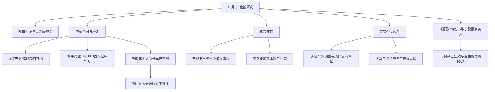

# 2026年11月5日 · 消息面事件驱动

> 数据源新鲜度：partial · 降级：true · 研究置信度：0.67。
> 本轮在06点实际运行，不是07:30后的完整盘前版本，更不是冻结输入回放。机读JSON保留每条事件的发布、最早可知线索与抓取时间；本页审计表只展示日期。

## 一句话结论
科技修复已发生；新增硬证据偏储能签约与临床准入，许可、治理及财务风险不能被反弹覆盖。

## 先认市场：奖励什么，尚未证明什么

11月4日上证指数收3686.1725点、涨2.1639%；短讯收评报创业板涨6.4%、科创50涨9.92%、成交20519亿元、超4600股上涨。实时涨跌停列表可见半导体设备、光通信相关股与贵金属共同扩散。市场不是只奖励一个小题材，也不是“消息好就买”。

主线 = 半导体/CPO修复；持续性 = 1日；封板率 = 未知（板块完整分母未核）；明日预期 = 分歧（这里是依据11月4日事实推演11月5日，不是已发生事实）。

情绪 = 震荡（修复中）。阶段假设是调整后强修复首日，不能把一根大阳线直接定义为主升。辅助emotion_cycle用11月4日数据报炸板率21.85%、118涨停、9跌停；其closed镜像仍为_is_closed=false并带fallback，不能升级成闭合统计或本轮R1。该辅助数未触及35%阈值，本轮不另造阈值或机械减半。

谁有地位：云南锗业有直接合同且昨日首板；这只证明价格与业务事件，不证明它是总龙。武汉天源与翰宇药业昨日均未涨停，分别有签约增量与临床准入，核心地位仍未知。R4不从涨幅、合同金额或新闻数量直接授予龙头身份。

今天做：交接事件、正负极性和待核对象。今天不做：不指定交易预算、不授权买入、不从旧市场建议继承零仓；R2、R5、R6与独立D1的必要风险和逐票门禁保持原样。

## 🗺️ 消息面全景图

## 交付口径：13条极性记录，11个底层事件

不凑8条，也不把13条说成13个独立催化。云南锗业合同与许可约束、节约政策与高耗能受压端，各为同一底层事项的两面；逐条保留正负极性，但不加倍计独立支持。以下5条正面、8条负面，全部有官方公告、政策原文或官方新闻支撑。另有7项已核个股负面及2项海外待核风险完整交下游。

没有首推买入票。3只为研究观察映射，其中2只形成未封板的首板试错假设。止损、RR、龙头身份和计划归属未知的地方留空，不为格式补价格。

## 🎯 核心事件：事实、反应与传导分开

### E20261105_001 · 云南锗业AOI年度合同已披露且已交易

🟢 正面 · strength=high · 已交易后的延续 · raw=+0.75 → 衰减后+0.555614。衰减是研究时效说明，不是交易评分或买权。

事实：子公司云南鑫耀与AOI签长供框架及2027年年度合同。年度18万片4英寸N型InP衬底对应1.944亿美元；公告折算约13.053182亿元，为2025收入122.46%。五年90万片仅预计采购安排。

时间边界：原文标示2026-11-04；可交易映射2026-11-04。最早已核线索为2026-11-03。来源与证据：PDF_784 / RSS_68 / HT_BUSINESS。

- **大资金意图**：未核。本轮只有签约事实与11月4日涨停，不能推断机构为未来五年收入锁仓。
- **为什么走强**：11月4日已涨停的客观事实与长单叙事相容；11月3日晚披露仅来自上证报追溯，准确首发分钟仍未知。不能把同一合同再次当11月5日新增。
- **逻辑够不够硬**：合同主体、标的与年度数量金额由公告直接确认，事实硬；五年采购和盈利兑现不硬，许可、订单、价格与收入确认均有条件。

传导判断：直接受益锚是签约子公司和上市公司；不把合同扩散为全磷化工、所有CPO公司订单。

态度：观察。反证与重评点：公告窗口日期为11月4日；11月4日09:59上证报追溯11月3日晚披露。最早时分未核，两条日期保留，不宣称11月5日新消息；11月4日收75.38元涨9.9956%已体现价格反应；不代表11月5日继续强；许可与订单是必要兑现条件；条件风险见E002

### E20261105_002 · 云南锗业同一长单受出口许可及取消条款约束

🔴 负面 · strength=high · 已交易后的延续 · raw=-0.55 → 衰减后-0.407450。衰减是研究时效说明，不是交易评分或买权。

事实：年度合同履行以取得并维持两用物项出口许可为前提；未按期取得或维持许可时AOI可取消合同或受影响订单并要求退款。实际金额取决于许可数量和采购订单。

时间边界：原文标示2026-11-04；可交易映射2026-11-04。最早已核线索为2026-11-03。来源与证据：PDF_784。

- **大资金意图**：未核。出口许可约束不是资金出逃证据，也不是已经取消合同。
- **为什么走强**：不是走强理由，而是检验前述涨停叙事能否兑现的反证。价格强不能把合同前提抹掉。
- **逻辑够不够硬**：原文明确买方有取消订单及要求退款权，条件硬。许可审批是否已获、多少数量及何时交付未知，不能写成禁运。

传导判断：这是E001同一合同的兑现约束；不能把1.944亿美元当已确认收入，更不能五倍外推利润。

态度：降级。反证与重评点：出口许可批准进度与数量未取得；不推断已被禁运或合同已经取消；与E001共用底层来源且不重复加权

### E20261105_003 · 武汉天源储能项目由中标进入正式合同阶段

🟢 正面 · strength=high · 老方向新增催化 · raw=+0.60 → 衰减后+0.516425。衰减是研究时效说明，不是交易评分或买权。

事实：公司为联合体牵头方签灵武1000MW/4000MWh设备安装合同。36.4亿元含税为联合体总额。10月23日已有中标提示且10月26日已有中标通知，本次增量为正式签约。

时间边界：原文标示2026-11-04；可交易映射2026-11-05。最早已核线索为2026-11-04T17:40:27+08:00。来源与证据：PDF_525 / RAW_news_cls_977 / HT_BUSINESS。

- **大资金意图**：未核。联合体签约不能证明资金已经从其他方向切到储能工程。
- **为什么走强**：公司11月4日上涨7.5039%，但正式合同公告记录在17:40；此前上涨不能倒因为该盘后公告。老项目中标到签约才是本次增量。
- **逻辑够不够硬**：具名项目、4GWh规模与36.4亿元固定总价有原文；上市公司实际份额和利润仍不确定，97%并网后付款使垫资与担保成为关键。

传导判断：储能工程链获得公司级可验证增量，但份额、成本、垫资及回款决定利润，不能把合同总额全归上市公司。

态度：观察。反证与重评点：97%合同款在并网设备试验调试合格后7日内支付；质押抵押需落实；公司公告称2026年度经营业绩无重大影响；已查10月29日至11月5日公告索引，11月2日有定增预案修订；融资摊薄与垫资须逐票核；不以11月4日盘中上涨解释17:40后的签约信息

### E20261105_004 · HY3003获美国FDA首次临床试验许可

🟢 正面 · strength=high · 老方向新增催化 · raw=+0.55 → 衰减后+0.473389。衰减是研究时效说明，不是交易评分或买权。

事实：FDA完成HY3003注射液IND184763安全审查并同意依方案开展首次临床试验。获许可的是每周皮下注射剂；月制剂与口服剂不是本次许可对象。

时间边界：原文标示2026-11-05；可交易映射2026-11-05。最早已核线索为2026-11-04T16:11:25+08:00。来源与证据：PDF_1462 / RAW_news_cls_1248。

- **大资金意图**：未核。临床准入不能推导大资金已押注商业化成功。
- **为什么走强**：翰宇11月4日上涨7.0721%早于16:11快讯，尚无A股消息后交易。公司有正式研发进展，不等于板块合力已确认。
- **逻辑够不够硬**：FDA首次临床试验许可由公司公告确认；仅周制剂进入首次临床路径。动物结果、月制剂和口服剂不能冒充人体优势或本次获批对象。

传导判断：临床准入是研发里程碑；不等于I期完成、人体疗效胜出、药品获批上市或商业化收入。

态度：观察。反证与重评点：公告日期11月5日而新浪快讯11月4日16:11已报道；保留时点差异；仅披露近日收到许可；实际收到日和最早公开分钟未完全查定；动物结果优于竞品是公司披露临床前试验不能当人体优势；hithink事件查询误解析为临床CRO，仅公司身份可用；核心证据为公告PDF

### E20261105_005 · 股票回购增持再贷款利率降至1%已于昨日生效

🟢 正面 · strength=high · 已交易后的延续 · raw=+0.65 → 衰减后+0.559460。衰减是研究时效说明，不是交易评分或买权。

事实：11月4日起再贷款利率下调0.25个百分点至1%；支持21家全国性银行和5家系统重要性城商行；支持比例100%期限1年。报送额度申请超过2000亿元。

时间边界：原文标示2026-11-04；可交易映射2026-11-04。最早已核线索为2026-11-04T09:05:00+08:00。来源与证据：CCTV_RELOAN / RSS_27 / RAW_news_cls_1956。

- **大资金意图**：政策意图是降低合规回购增持融资成本；实际银行放贷与证券买入量未核，这不是已确认的大资金入场额。
- **为什么走强**：11月4日盘前已知且当日科技与贵金属普涨；政策是可解释背景之一，但没有事件因果分解，不写成唯一上涨原因。
- **逻辑够不够硬**：央视文本与政策数字清楚。2000亿元是额度申请，不是当日净买入；金融工具链条不能一步跳到个股收益。

传导判断：降低符合条件的回购增持融资成本；申请不等于审批、贷款投放或证券买入，也不等于每家公司自动获贷。

态度：观察。反证与重评点：已于11月4日盘前可知；11月5日不能重复包装为新政策；与SFISF和买断式逆回购是不同工具，不混加为直接入市资金

### E20261105_006 · 三个月买断式逆回购缩量续作不能写成净投放

🔴 负面 · strength=medium · 老方向新增催化 · raw=-0.30 → 衰减后-0.258212。衰减是研究时效说明，不是交易评分或买权。

事实：央行预告11月5日开展3000亿元91天买断式逆回购，新华社称11月该期限有5000亿元到期，对应该期限缩量2000亿元。实际招标及跨工具净额尚未知。

时间边界：原文标示2026-11-04；可交易映射2026-11-05。最早已核线索为2026-11-04T17:01:00+08:00。来源与证据：XINHUA_REPO / RAW_news_cls_1707。

- **大资金意图**：这是央行流动性管理，不是股票资金撤退的直接证据。实际跨工具净额与证券配置未核。
- **为什么走强**：该事项不是走强催化；它反驳“投放3000亿等于新增3000亿入市”的叙述。缩量续作也不能被写成全面收紧。
- **逻辑够不够硬**：新华社稿与央行预告明确单期限操作及到期规模。负面仅作用于增量叙事，结果未出且其他工具不同，不能推出市场停买。

传导判断：对单一工具增量流动性叙事构成负向修正；不能直接推出全面紧缩或A股停买。财政定存、MLF、逆回购与资本市场工具须分别核算。

态度：降级。反证与重评点：负面仅指该期限续作差额而非当日全口径资金净回笼；11月5日尚未操作完成；不宣称结果已出；市场性no_trade不由此设定

### E20261105_007 · 五部门全面节约方案明确节能节水与循环利用方向

🟢 正面 · strength=high · 老方向新增催化 · raw=+0.60 → 衰减后+0.516425。衰减是研究时效说明，不是交易评分或买权。

事实：发改环资〔2026〕1424号网页11月4日发布而文件9月29日落款。2030年单位GDP能耗水耗土地使用面积较2025年降约10%、10%、15%；主要再生资源年循环利用量5.1亿吨。明确算力机房节能改造及动力电池全生命周期管理。

时间边界：原文标示2026-11-04；可交易映射2026-11-05。最早已核线索为2026-11-04T18:31:55+08:00。来源与证据：NDRC_POLICY。

- **大资金意图**：官方资源效率目标明确；机构是否已经买入节能、节水或回收企业未核。
- **为什么走强**：官网只给发布日期，最早带时分线索是18:31；不能确定它已驱动昨日盘中涨幅，也没有行业专属封板率证明新主线。
- **逻辑够不够硬**：原文九页、22条举措可核，制度方向硬；未核预算、采购和上市公司份额，2030年目标不是当期营收。

传导判断：受益路径是标准实施到改造采购再到有能力厂商收入；尚无逐项预算与企业订单，不能直接授予行业主线地位。

态度：观察。反证与重评点：最早带时分媒体线索18:31；官网只有日期不证明首发在盘后；9月29日签署不等于9月29日公众可知，URL含11月3日也不当发布日期；目标不是招标或补贴预算；未硬选相关概念股

### E20261105_008 · 全面节约方案同时加强高耗能项目约束与差别电价

🔴 负面 · strength=high · 老方向新增催化 · raw=-0.40 → 衰减后-0.344283。衰减是研究时效说明，不是交易评分或买权。

事实：方案要求高耗能高排放新改扩项目碳排放等量或减量置换；重点区域用煤项目煤炭替代；淘汰10蒸吨每小时及以下燃煤锅炉；完善差别电价并严控高耗水项目盲目上马。

时间边界：原文标示2026-11-04；可交易映射2026-11-05。最早已核线索为2026-11-04T18:31:55+08:00。来源与证据：NDRC_POLICY。

- **大资金意图**：未核。政策约束的经济后果与股市资金反应需要分开，不将节能改造等同于全行业流出。
- **为什么走强**：这是同一政策的受压端；高耗能扩产受约束与节能设备潜在订单可以同时成立。
- **逻辑够不够硬**：置换、差别化电价和低效锅炉淘汰条款硬；哪家公司成本增多少未知，不点名造受害票。

传导判断：节能改造供应商的潜在订单与低效用能主体的改造成本并存。不能把绿色转型写成钢铁化工建材全体利好，也不意味着企业已被停产。

态度：降级。反证与重评点：需逐厂核定能耗与合规状态；未点名公司不造负面股票；与E007同文双面列示不按两份独立来源计分

### E20261105_009 · 苏达个人被立案同时涉及江苏雷利和鼎智科技

🔴 负面 · strength=high · 老方向新增催化 · raw=-0.75 → 衰减后-0.645531。衰减是研究时效说明，不是交易评分或买权。

事实：两家公司公告：实控人苏达11月4日收到立案告知书，涉嫌信息披露、减持违法违规。调查对象为个人；两家公司均称经营正常。

时间边界：原文标示2026-11-04；可交易映射2026-11-05。最早已核线索为2026-11-04T18:57:45+08:00。来源与证据：PDF_584 / PDF_14 / RAW_news_cls_743 / RAW_news_cls_758。

- **大资金意图**：未核。机器人题材的资金合力不能抵销具体控制人的信披与减持调查；更不能推测已经砸盘。
- **为什么走强**：该事件是治理风险，不是走强解释。江苏雷利与鼎智均受同一苏达调查影响，不按两份公告加倍算负面。
- **逻辑够不够硬**：两份公司原文确认涉嫌事项与个人调查范围。公司经营正常的表述也保留，不能升级为公司财务造假。

传导判断：机器人概念走强不能覆盖真实治理风险；不把个人调查升级为两家公司财务造假或经营停止。

态度：降级。反证与重评点：两家公司公告对应同一苏达调查，不当两件独立利空累加；调查结论未知；逐票风险交R6裁决，R4不行使hard_reject唯一权限

### E20261105_010 · 天山股份公司被立案且披露会计核算监管问题

🔴 负面 · strength=high · 老方向新增催化 · raw=-0.85 → 衰减后-0.731602。衰减是研究时效说明，不是交易评分或买权。

事实：公司涉嫌信披违法违规被证监会立案。新疆证监局另指出2023至2025商誉减值测试不审慎及2025年少计提坏账准备2109.15万元，公司被责令改正，相关三名高管被警示。

时间边界：原文标示2026-11-05；可交易映射2026-11-05。最早已核线索为2026-11-04T21:16:00+08:00。来源与证据：PDF_1640 / PDF_1641。

- **大资金意图**：未核。不能拿水泥板块或稳市资金故事替公司会计问题开脱。
- **为什么走强**：该事项不解释上涨，需独立交风险审核；盘后调查信息尚无次日A股价格反应。
- **逻辑够不够硬**：公司立案及监管决定两条文件都在：商誉假设、少计坏账与责任主体明确。调查终局和重述影响仍未知。

传导判断：公司层面调查与已经列明的会计问题须同时交下游；不能降格为普通个人调查，也不提前宣告退市。

态度：降级。反证与重评点：PDF均11月4日落款而披露目录11月5日，快讯11月4日21:16，保留不同来源时点；后续处罚和财务重述幅度未知

### E20261105_011 · 大晟文化三连板背后有负净资产与退市风险提示

🔴 负面 · strength=high · 已交易后的延续 · raw=-0.85 → 衰减后-0.731602。衰减是研究时效说明，不是交易评分或买权。

事实：11月5日披露风险提示，原文11月4日落款。前三季度归母净利-5528.90万元且归母净资产-3125.91万元；若2026年度经审计财务数据触及规则可能被实施退市风险警示。公司称不涉及热点概念事项等。

时间边界：原文标示2026-11-05；可交易映射2026-11-05。最早已核线索为未知精确时分；不能用公告日期零点占位。来源与证据：PDF_1299。

- **大资金意图**：未核。三连板是价格事实，未证实是机构布局AI内容业务；公告还称不涉及热点概念等事项。
- **为什么走强**：涨停存在，但没有新业务兑现证据。不能把Seedance海外收入比例直接映射为大晟订单。
- **逻辑够不够硬**：前三季度亏损与负净资产原文可核，且有条件性退市风险警示提示。不是已退市，也不是最终全年审计结论。

传导判断：不能由短剧题材三连板推导新业务兑现；市场价格强度与财务、概念关联硬风险并存，送R6逐票审。

态度：降级。反证与重评点：不是已宣布退市或已确定ST；本公告引用10月31日三季报；财务风险不是本轮新形成；11月4日已三连板；不以Seedance收入给本票强行贴订单

### E20261105_012 · 浙文影业三连板后公告经营未有重大变化

🔴 负面 · strength=high · 已交易后的延续 · raw=-0.40 → 衰减后-0.400000。衰减是研究时效说明，不是交易评分或买权。

事实：公司11月5日风险提示：11月4日再次涨停，换手率9.67%高于此前两日3.84%及2.15%；经营未发生重大变化且未披露新重大合作等事项。

时间边界：原文标示2026-11-05；可交易映射2026-11-05。最早已核线索为未知精确时分；不能用公告日期零点占位。来源与证据：PDF_1256。

- **大资金意图**：未核。换手增加不能单独定义为出货、抢筹或拥挤。
- **为什么走强**：三连板已发生；公司明确经营无重大变化，题材与基本面尚未形成同等强度的印证。
- **逻辑够不够硬**：风险提示原文可核；公司自查范围不是外部全历史无负面证明。风险类型与大晟财务风险不同。

传导判断：仅研究题材价格与业务兑现之间的落差；不宣称出货或已否认所有未来AI业务。

态度：降级。反证与重评点：负面强度低于大晟的财务风险；不能把两票风险合并成全短剧财务雷；没有新公告订单不等于永远无产业机会

### E20261105_013 · 龙蟠科技回复显示部分长单履约滞后及售价回落

🔴 负面 · strength=high · 老方向新增催化 · raw=-0.60 → 衰减后-0.516425。衰减是研究时效说明，不是交易评分或买权。

事实：监管函回复：亿纬马来西亚、欣旺达泰国及楚能新能源供货进展较时间进度滞后；按所引SMM口径铁锂月均价5月6.35万元每吨到10月4.55万元每吨。公司称相关长单均已实际履行且现有订单饱满。

时间边界：原文标示2026-11-04；可交易映射2026-11-04。最早已核线索为未知精确时分；不能用公告日期零点占位。来源与证据：PDF_222。

- **大资金意图**：未核。长协吨数、供货进度与市场买卖是三件事，不拿“订单饱满”替代提货数据。
- **为什么走强**：这是对长协叙事的反证，不是要求整个电池链停买。储能工程签约不等于材料厂盈利同步加速。
- **逻辑够不够硬**：监管回复公开具体客户滞后及产品价格回落；公司称已实际履行、未触发违约也保留。对全行业只保留假设不强行定性。

传导判断：不是只看新长协总吨数；产能、提货、技术验证与成本加加工费定价决定收益。行业供需风险保留，但不把个别客户滞后升级全行业衰退。

态度：降级。反证与重评点：公司称滞后未触发违约条款且未对当前业绩产生重大不利影响，正反同时保留；2027年PFE约束和拟出售印尼二期后可能调整涉美合同并非已全部终止；原文包含更早合同与公告日期；新信息是11月4日监管回复

## 研究对象：观察不是首推，也不是买入权限

| 对象 | 板型 | 龙头认定 | RR与逻辑止损 | 禁止清单及必要风险 | 本轮态度 |
|---|---|---|---|---|---|
| 云南锗业 002428.SZ | 11月4日首板已封；不在今日首板池 | 未核；通过条数unknown | RR=null；stop_loss=null；昨收75.38仅参考 | 全清单未运行；出口许可与订单风险已核 | 观察：已交易延续 |
| 武汉天源 301127.SZ | 昨日未涨停；首板仅假设 | 未核；不授总龙/补涨龙 | RR=null；stop_loss=null；昨收13.61 | 份额、垫资、担保、定增摊薄待核 | 观察：试错研究假设 |
| 翰宇药业 300199.SZ | 昨日未涨停；首板仅假设 | 未核；不由IND授核心 | RR=null；stop_loss=null；昨收22.71 | 临床、研发投入及全清单未完成 | 观察：试错研究假设 |

三票in_today_plan均为unknown/null。D1尚未首次形成计划，不能写false再按“计划外”预先排除本批候选；也不能反向声称已经计划内。研究类别只是“主线补涨/计划内试错”的待核假设。无可验证止损及目标，就不授execution资格；不把单日低点或任意-5%伪装成有依据的价位。

### 云南锗业：直接合同优于概念代理，但不是新催化

- **买入理由**：这里只解释研究保留理由，不作买入指令。AOI签约主体、产品与云南鑫耀一一对应，比“磷化工涨幅前十”更直接；但11月4日已涨停，11月5日属于延续研究。
- **风险点**：出口许可、实际采购订单、美元汇率与收入确认；五年采购是预计安排而非五倍确定利润。昨日价格强不能清除这些条件。
- **止损条件**：逻辑撤销条件是许可无法维持、采购取消或履约假设被官方新证据推翻；具体价格止损null、目标区间null，交R5/D1核，不制造价位。
- **可验证假设**：后续正式许可、年度订单与交付能否衔接。若仅重复旧合同且没有兑现增量，不把其当今日新首板催化。

### 武汉天源：合同新阶段，现金流未核完

- **买入理由**：研究保留在于老中标推进到正式签约，而非“新增一个从未听说的项目”。主体是联合体牵头方，不是所有36.4亿元都归上市公司。
- **风险点**：97%并网后付款、项目担保及公司先行投入；11月2日定增修订公告索引已见，但未把全部再融资文件当已全文审核；2026年度业绩无重大影响。
- **止损条件**：若分工、项目资金或担保无法落实、合同取消或实质延误，研究逻辑重评；具体价位null、RR=null，不能进入execution。
- **可验证假设**：公开联合体份额、担保登记、实际开工与并网回款。其11月4日涨幅早于签约公告，不归因于尚未公布的消息。

### 翰宇药业：临床准入，不能跳到上市销售

- **买入理由**：研究保留依据是公司原始公告的HY3003首次临床许可，证据强于脑机减重或产业访谈的泛概念映射。
- **风险点**：长研发周期、投入与人体结果；动物实验不能外推。周注射剂获许可不等于月制剂、口服剂同时获批，尚无入组/读出硬日期。
- **止损条件**：许可撤回、关键临床安全性或项目推进假设被证伪则重评；价格止损null，不为检验器填数字。
- **可验证假设**：首例给药、注册信息和分期数据逐步出现；FDA原始函未直接取得，现有硬证是上市公司正式披露，不冒称已读FDA来函全文。

## 📊 板块 × 正负事件叉乘

| 板块 | 正向事实 | 反向事实/约束 | 已核价格与资金 | 态度及验证点 |
|---|---|---|---|---|
| 磷化铟/光通信材料 | E20261105_001 | E20261105_002 | 002428.SZ 11月4日涨停；11月5日尚无价格；资金未核 | 观察：出口批准及后续采购订单披露 |
| 共享储能/储能工程 | E20261105_003 | 常规兑现约束；不等于无负面 | 301127.SZ昨日+7.5039%早于正式合同公布；不能倒推消息因果；资金未核 | 观察：联合体分工及资金/担保落实 |
| 创新药/GLP-1 | E20261105_004 | 常规兑现约束；不等于无负面 | 300199.SZ昨日+7.0721%在16:11快讯前；尚无A股消息后交易；资金未核 | 观察：首例给药与正式临床进展 |
| 资本市场流动性 | E20261105_005 | E20261105_006 | 11月4日全市场修复事实已见但因果份额未知；资金未核 | 观察：各工具结果与实际回购增持披露 |
| 节能/节水/资源回收 | E20261105_007 | 常规兑现约束；不等于无负面 | 新文本精确首发时分未知；未核行业价格反应；资金未核 | 观察：执行细则、预算、采购及真实供应商 |
| 高耗能/高耗水工业 | 本轮未核新增正面 | E20261105_008 | 未核；资金未核 | 观察：地方执行与企业技改/成本披露 |
| 机器人零部件 | 本轮未核新增正面 | E20261105_009 | 盘后消息后A股未交易；资金未核 | 降级：调查进展及R6逐票审核 |
| AI短剧/游戏/影视 | 本轮未核新增正面 | E20261105_011 E20261105_012 | 11月4日三连板为事实不是新产品或业绩确认；资金未核 | 降级：实际业务公告、财务风险及核心身份独立审核 |
| 磷酸铁锂材料 | 本轮未核新增正面 | E20261105_013 | 未核；资金未核 | 降级：提货进度、加工费、产能和海外合规 |
| 水泥 | 本轮未核新增正面 | E20261105_010 | 消息后尚无A股反应；资金未核 | 降级：财务整改及调查结果 |

不做正负分数简单相加，不引入新权重。资本市场工具与银行流动性不能同单位直接抵销；储能工程合同也不能自动洗掉铁锂材料价格/履约风险。不同产业环节、兑现周期与受影响主体必须分开。

## 真实负面补充台账：不在标题位也不遗漏

| 代码/公司 | 已核事实与范围 | 来源 | 态度 |
|---|---|---|---|
| 688109.SH 品茗科技 | 实控人莫绪军涉嫌操纵证券市场被立案；个人调查不等于公司财务造假 | PDF_165 | 降级；交R6按真实事项裁决 |
| 603578.SH 三星新材 | 公司因涉嫌信息披露违法违规被立案；11月3日收到，11月4日公告 | PDF_247 | 降级；交R6按真实事项裁决 |
| 600567.SH 山鹰国际 | 实控人董事长吴明武涉嫌内幕交易和短线交易被立案；针对个人 | PDF_413 | 降级；交R6按真实事项裁决 |
| 688793.SH 倍轻松 | 实控人马学军操纵市场案行政处罚决定已出；承担罚款11841924.02元并被5年市场禁入及禁止交易；不是仅收到立案告知 | PDF_955 | 降级；交R6按真实事项裁决 |
| 600478.SH 科力远 | 公司及控股股东均涉嫌信披违法违规被立案；11月2日媒体已有披露，11月4日索赔转载不是新案 | PDF_kly | 降级；交R6按真实事项裁决 |
| 600499.SH 科达制造 | 法院受理控股子公司沈阳科达洁能破产清算；子公司2018年已停产，前期已计减值；不是上市公司被宣告破产 | PDF_1350 | 降级；交R6按真实事项裁决 |
| 000692.SZ 惠天热电 | 6681.52万元买卖合同诉讼及银行账户部分资金被冻结。裁定及被申请冻结总额度6681.515988万元；未披露可确认的实际冻结余额，不按三个账户重复相加。尚未开庭不能认定败诉。 | PDF_1651 | 降级；交R6按真实事项裁决 |

以上不把个人立案统一写成公司造假，不把子公司清算写成母公司破产，也不把裁定/被申请冻结额度重复累计为实冻余额。大晟的财务风险、天山的会计监管问题、苏达的个人调查，强度和范围各不相同。R4不替R6出hard_reject，更不筛掉真实负面。

## 海外负面：保留报道，不升级成已生效政策

- 🔴 AI硬件：新浪11月5日收盘快讯报英伟达跌3.17%，大盘上涨不等于硬件同涨。费半“跌5%”是00:06盘中值，不是本轮核到的收盘跌幅。CoreWeave债券面值79.5%、收益率超15%的报道保留，但原始债券行情未直核。
- 🔴 得州建设：媒体11月4日午间已经讨论选举后的数据中心监管担忧，不是全新隔夜催化。竞选主张、选举预测/结果、正式暂停令及实际项目停工不能互相替代；本轮未取得正式州政策文件。
- 🔴 油价：新浪报WTI12月合约88.12美元、跌8.29%，布伦特1月94.62美元、跌8.67%。本轮精确检索主要返回更旧报道，不能当独立确认。上游油气利润受压与航空/部分化工成本受益方向相反；停战并未确认，也不能直接推定航司利润。

这些单源非官方、缺必要原始确认的项列入JSON的overseas_risk_watch及negative_events，标deferred，不为凑硬事件抬入top_events，也不从风险交接中删除。反面继续有效直到原始政策/市场数据补齐，而不是因缺数宣称不存在。

## 为什么没有选这些对照对象

1. 南大光电、有研新材、正帆科技：第一次问财把“磷化铟”错解成“磷化工”，不是可靠受益池。后续精确价格查询只证明涨幅，不证明获得AOI合同。云南锗业的相对优势是签约主体，不是靠新评分压过对照股。
2. 亨通光电：4—6亿元股东增持、1—2亿元公司回购计划已取原文。它们尚非实际买入；公司回购用途是员工持股或股权激励，不是直接注销。保留正面次级事项，不据此授产业核心与首板买权。
3. 游族网络：42.25亿元GPU合同的经济实质是采购支出，不是它拿到客户的42.25亿元收入。供应商可因上游调整交期且部分数量不及预期不承担违约责任，缺下游回款证据，降级该“订单收入首推”解释，不永久否定股票。
4. Seedance与脑机减重：早知道是线索，字节收入分母、客户付费与强脑产品有效性尚未核原始证据，不把单篇主题前瞻变成A股公司订单。
5. 运输日历只提及的920035.BJ、301310.SZ、000534.SZ：只有提及，不是资格。截取中缺对应直接事件，本轮不据其选票、不声称已完整读日历。

## 🔥 中报业绩预告命中

实际文件为2026Q3业绩预告最近500条“指标记录”，不是500家公司，且缺H1完整覆盖。本节保留技能规定的标题，但不冒称查到了完整中报。净利润口径实际返回186条；已检查其中按累计同比上限排序的top15及其与本文事件板块交集。

| 代码 | 公司 | 公告日 | 累计同比下限—上限 | 与本轮事件关系 |
|---|---|---|---|---|
| 001309.SZ | 德明利 | 2026-10-17 | 32046.52%—33154.49% | 存储/算力背景；并非今日新业绩 |
| 300821.SZ | 东岳硅材 | 2026-10-08 | 19047.97%—19748.08% | 材料/周期等背景；未据此新增股票 |
| 000703.SZ | 恒逸石化 | 2026-10-16 | 3318.59%—3405.13% | 材料/周期等背景；未据此新增股票 |
| 002466.SZ | 天齐锂业 | 2026-10-21 | 2734.97%—3235.26% | 材料/周期等背景；未据此新增股票 |
| 688825.SH | 长鑫科技 | 2026-10-17 | 2581.06%—2609.47% | 存储/算力背景；并非今日新业绩 |
| 002812.SZ | 恩捷股份 | 2026-10-14 | 1884%—2474.8% | 材料/周期等背景；未据此新增股票 |
| 688808.SH | 联讯仪器 | 2026-10-13 | 1866%—2072.95% | 存储/算力背景；并非今日新业绩 |
| 301308.SZ | 江波龙 | 2026-10-15 | 1864.55%—1990.84% | 存储/算力背景；并非今日新业绩 |
| 605189.SH | 富春染织 | 2026-10-14 | 1347.69%—1519.01% | 材料/周期等背景；未据此新增股票 |
| 688388.SH | 嘉元科技 | 2026-10-15 | 1196.6%—1318.92% | 材料/周期等背景；未据此新增股票 |
| 603991.SH | 领先股份 | 2026-10-21 | 1238.57%—1238.57% | 材料/周期等背景；未据此新增股票 |
| 603026.SH | 石大胜华 | 2026-10-15 | 968.14%—1032.45% | 材料/周期等背景；未据此新增股票 |
| 000626.SZ | 远大控股 | 2026-10-15 | 890%—1018% | 材料/周期等背景；未据此新增股票 |
| 002493.SZ | 荣盛石化 | 2026-10-15 | 777.93%—822.95% | 材料/周期等背景；未据此新增股票 |
| 300497.SZ | 富祥股份 | 2026-09-18 | 658%—785% | 材料/周期等背景；未据此新增股票 |

这些预告均早于7日事件窗口，不入今日top_events；高同比不是环比加速。没有完成单季环比、扣非、产品价格与预期差核验，就不能给周期股正面业绩结论。

云南锗业、武汉天源、翰宇药业在本次净利润预告返回样本未命中：has_pre_increase=null，不是false；预增区间null，不是0。不能写“无业绩预告”或给硬业绩置信加成。本轮也没有将大晟风险提示中引用的累计亏损当作新发布业绩喜报。

## 关键证据与来源独立性

- 云南锗业2026-054号合同公告，PDF_784：许可前提、90万片预计安排及年度18万片必须一起读。该公告经问财、快讯和上证报转载仍只有一个底层来源。
- 武汉天源2026-102号，PDF_525：签约前已有中标记录；联合体总额、97%并网后付款、2026年度业绩无重大影响均保留。
- 翰宇2026-073号，PDF_1462：IND184763，周制剂首次临床，不是上市许可。
- 发改环资〔2026〕1424号，NDRC_POLICY：文件落款9月29日、网页发布11月4日；URL日期不代替发布日期。政策与行业成本是同文件两面。
- 天山2026-057及2026-056号，大晟临2026-060号：真实治理与财务风险不因市场上涨被覆盖。
- 原始URL、PDF字节hash、实际抓取时间、摘录范围与正文在JSON evidence中内嵌；未打开的外链不称全文阅读。

## 数据源审计

| 源 | 日期 | 状态 | 实际覆盖与缺口 |
|---|---|---|---|
| news_cls | 11月2—5日 | 🟡 | 2953条=新浪1459+同花顺1494；不是2953条财联社原始快讯；最新05:57详JSON |
| news_major | 11月4—5日 | 🔴 | 800条全部正文空，仅标题；实际覆盖不足声明72h正文 |
| eastmoney_earnings_predict | 11月5日抓取 | 🟡 | 500条财务指标记录，Q3；净利润186条；H1不完整 |
| 公众号RSS/兼容镜像 | 11月4—5日 | 🟡 | 17源返回85篇；只计一次；11月5日7点稿尚未到时 |
| 焦点群A—E | 11月4日 | 🟡 | 646条；筛读消息；图片/链接不当原文，多群转发不当多源 |
| anns_window | 11月4—5日 | 🟢 | 1680条标题索引；选中公司公告20份PDF实时取回，非1680份全文审核 |
| 官方政策PDF | 11月4日发布 | 🟢 | 发改委9页正文及通知页已取；正负传导分开 |
| Tushare实时 | 11月5日调用 | 🟢 | 新浪1469条、央视、日历、指数、涨跌停、3票日线及公告索引 |
| hithink_market_query | 11月5日调用 | 🟡 | 概念首问误解析为磷化工；精确个股价格正常；错误池不采纳 |
| hithink_business_query | 11月5日调用 | 🟡 | 主营已返回但缺报告期；组合查询混维度，不造业务分数 |
| hithink_event_query | 11月5日调用 | 🟡 | 合同问句未返合同；HY3003误解为临床CRO；公告原文独立兜底 |
| 问财新闻/公告检索 | 11月5日调用 | 🟡 | 8组HTTP200；有旧稿、摘要、条数不齐；非独立转载累加 |
| XTick主新闻/Datapro | 本轮未调 | 🟡 | 不在阶段获准直调工具范围；不冒称宕机或已调 |
| R3/R7交叉 | 本轮未消费 | 🟡 | 不填昨日共振或资金数据；不推断市场没有资金 |
| 昨日日历运输前缀 | 11月4日版本 | 🟡 | 仅3600字前缀及元数据，非35296字全读；全文/来源索引未重核 |

辅助渠道缺口只降低对应维度置信度，不升级市场性停买。真实用户账户停买、有效零预算、仓位上限、T+1、人工确认与逐票hard_reject仍保持；本轮未读取账户，预算未知，不填正额度也不继承旧市场研究的零仓。

## 专题知识裁决

knowledge_context完整保留本轮身份、source_id/hash、source_timing、status与limitations；本次context_sha256为1c226a1d7f2ffeeb3be558673694decadee16371895bc5342fb7349b995ec740。

对运输日历的adopted是有限采用：使用“工具口径分开”“研究锚不是合格候选”“调查对象要区分”的证据边界。AMD/澳央行数值未重核，仍是旧版背景；目录列出的章节不是已读内容。品茗、山鹰、三星事项另取官方PDF，不借日历作为第二独立来源。对应三只提及代码缺直接事件，维持unknown，不选不代表永久否定。

## 不确定性 / 反证

1. 修复仅有一天证据。隔夜硬件与大盘分化，对11月5日是否继续科技普涨构成反证；原始海外收盘和得州正式政策仍缺。
2. 公司合同是研究起点，不是收入确认：云南要许可，武汉要份额与资金，游族是采购方；大额数字不能替代盈亏比。
3. 次日开盘、板块合力、排名与RR尚未核定。研究观察不等于首推，不为数量给股票贴“龙头”。
4. 公众号和群聊均可能转述同一底层稿；有图/链接不代表本轮看到了图片正文，KOL独立共振未确认。
5. 辅助质量缺口不全局禁买；必要证据不足仅约束相关对象。真实负面完整内嵌，R6只读本轮JSON时不需另找本MD或联网补证。

## 与其他R/D/E的关系

- 依赖：本轮raw快照、实时Tushare与官方公告/政策、明确运输的日历前缀；未消费本轮R2/R3/R5/R7主产物，不借旧文件冒充。
- R2：在形成候选前比较直接经营映射与代理对象；本轮未确定龙头，不由消息代授核心。
- R5：对本轮后续R2已核代码做精确匹配；核份额、临床及必要财务，不据新闻添价位。
- R6：JSON包含完整负面台账、原文证据和缺口；硬否决由R6独立裁决，不删除或降格真实风险。
- D1：独立预算、既有授权与逐票门禁保持，观察层不是执行层。

## Sub-Agent元数据

- skill：analyze_news_impact_v1@1.7
- artifact：data/research/20261105/R4_news.json
- method：llm_v1；确定性脚本仅解析、检索、取PDF、计算衰减与校验，未重开模型会话。
- 真实生成时间：2026-11-05T06:31:25+08:00
