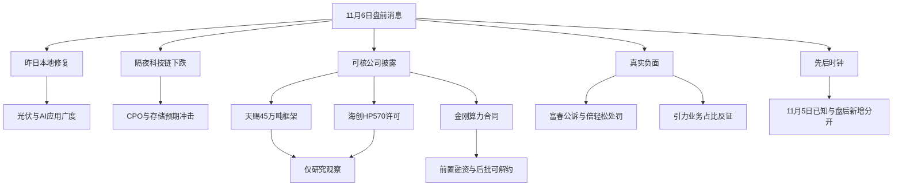

# 2026年11月6日 · 消息面事件驱动

> 数据源新鲜度：partial · 降级：true · 研究置信度：0.64
> 这是06点提前执行的真实盘前研究，不是07:30后更新，不是回放。重点窗口为11月3日至本轮取证截止；近端公告逐票回看11月3—6日。11月6日已核为交易日。

## 一句话结论
震荡修复遭隔夜科技链冲击；只保留天赐、海创研究观察，真实合规负面逐票交接。

## 先认市场，再认对象

情绪=震荡。11月5日非ST统计为84家封住涨停、48家炸板；炸板率48÷132=36.36%，封板率63.64%。这是全市场触板池口径，不能冒充任何主线封板率。最高梯队为4板。没有采用上游情绪脚本因溢价缺失而填的“-0.5%”。

问财返回11月5日中证A股成分上涨4583、下跌567；光伏概念涨停23家、AI应用17家、短剧游戏7家，说明上一交易日市场奖励的并非单一海外AI硬件方向。这些是上一交易日价格广度，不是11月6日资金流。隔夜科技链大跌已经发生，但“美国全国数据中心已停建”没有在本轮取得生效法令证据；谷歌项目报道是必须保留的相反线索。

主线=待R2确认，持续性=未知，封板率=未知（单板块），明日预期=分歧（隔夜冲击下的研究假设）。R4不为填句式编造1/3/5日持续性，也不把昨日修复当今日主升确认。

本轮从四个披露型研究决选对象减至两个，执行候选为空。18条极性记录对应17个底层事件，其中12条负面、6条正面；数量来自实际核验，不设8条配额。金刚合同正反两面单列但只算一个底层事件。公告/资金/技术与买权分层：真实风险交R6裁决，R4没有签发hard_reject；既有零预算、用户停买及任何交易保护均未改动。

## 🗺️ 消息面全景图

## 🎯 实际硬事件与负面交接

强度是来源与事件事实质量，不是涨跌概率。公司公告确认“公司披露了什么”，不替代FDA、客户或交易所的额外独立核验。每条可交易首日未知时保留unknown/null，不用研究日期覆盖原始发布时间。

### E20261106_008 · 富春股份实控人内幕交易案进入公诉阶段

**态度**：不进 · 强度=high · 极性=负面 · 原始分=-0.87 · 衰减分=-0.7488

**事件事实**：实控人缪品章涉嫌内幕交易罪被公诉。取保候审并待一审判决。

**时间与范围**：原始发布标记=20261106（公告日期;精确公开时分未知）；已核最早公众可知=2026-11-05T18:57:54+08:00；可交易首日=20261106。主要近72小时;具体公告11/3—11/6;源字段范围见证据索引。本轮raw快讯文本中已核最早对应条;不宣称全网最早。新旧分类：老事件程序/风险新增披露。

**大资金意图**：未核资金数据;不解释机构意图。

**为什么走强**：上一交易日板块广度与新闻可能对应;该事件不能独立解释板块涨幅。 传导假设：属于实际司法进展;传递R6逐票实质审查而非R4签发hard_reject。

**逻辑够不够硬**：官方原文确认事实成立;兑现程度取决于条款及风险。 关键边界：行政处罚早前已完成不等于本轮公诉解除;公司称经营正常且控制权不受影响。尚未判决不能写成定罪。

**反证 / 资金反应**：11/6 A股尚未开盘;本条新披露后的价格反应未核；资金响应未知。已查文件的正反结论不扩大成‘无其他负面’。作用范围=个股级。

**已查来源与原文定位**：[ANN_1225659793](https://static.cninfo.com.cn/finalpage/2026-11-06/1225659793.PDF)；NEWS_1027（data/raw/20261106/news_cls.jsonl:line=1028）。

### E20261106_009 · 倍轻松实控人操纵市场处罚落定

**态度**：不进 · 强度=high · 极性=负面 · 原始分=-0.86 · 衰减分=-0.8600

**事件事实**：实控人收到操纵市场处罚决定。罚款1184.19万元及五年市场禁入。

**时间与范围**：原始发布标记=20261105（公告日期;精确公开时分未知）；已核最早公众可知=未知（仅有公告/报告日期）；可交易首日=未知。主要近72小时;具体公告11/3—11/6;源字段范围见证据索引。仅已读来源中最早公众可知记录;不宣称全网最早。新旧分类：老事件程序/风险新增披露。

**大资金意图**：未核资金数据;不解释机构意图。

**为什么走强**：上一交易日板块广度与新闻可能对应;该事件不能独立解释板块涨幅。 传导假设：真实治理与合规风险只作用相关票;不扩成全消费电子停买。

**逻辑够不够硬**：官方原文确认事实成立;兑现程度取决于条款及风险。 关键边界：公司称属实控人个人事项且经营正常;不因此删除处罚事实。处罚决定接收11/3与公告11/5不同。

**反证 / 资金反应**：11/6 A股尚未开盘;本条新披露后的价格反应未核；资金响应未知。已查文件的正反结论不扩大成‘无其他负面’。作用范围=个股级。

**已查来源与原文定位**：[ANN_1225658365](https://static.cninfo.com.cn/finalpage/2026-11-05/1225658365.PDF)。

### E20261106_012 · 天山股份因涉嫌信息披露违法违规被立案

**态度**：不进 · 强度=high · 极性=负面 · 原始分=-0.82 · 衰减分=-0.8200

**事件事实**：天山材料收到证监会立案告知书。事由涉嫌信息披露违法违规。

**时间与范围**：原始发布标记=20261105（公告日期;精确公开时分未知）；已核最早公众可知=未知（仅有公告/报告日期）；可交易首日=未知。主要近72小时;具体公告11/3—11/6;源字段范围见证据索引。仅已读来源中最早公众可知记录;不宣称全网最早。新旧分类：老事件程序/风险新增披露。

**大资金意图**：未核资金数据;不解释机构意图。

**为什么走强**：上一交易日板块广度与新闻可能对应;该事件不能独立解释板块涨幅。 传导假设：传R6逐票必要合规审查;不扩展为全水泥板块硬否决。

**逻辑够不够硬**：官方原文确认事实成立;兑现程度取决于条款及风险。 关键边界：公告证券简称天山股份;法人名称天山材料。原文落款11/4而发布索引11/5;保持差异。

**反证 / 资金反应**：11/6 A股尚未开盘;本条新披露后的价格反应未核；资金响应未知。已查文件的正反结论不扩大成‘无其他负面’。作用范围=个股级。

**已查来源与原文定位**：[ANN_1225658457](https://static.cninfo.com.cn/finalpage/2026-11-05/1225658457.PDF)。

### E20261106_007 · 引力传媒AI短剧收入不足0.1%的明确风险提示

**态度**：不进 · 强度=high · 极性=负面 · 原始分=-0.78 · 衰减分=-0.6714

**事件事实**：AI短剧收入占2025年经审计营收不足0.1%。四日涨幅37.79%。

**时间与范围**：原始发布标记=20261106（公告日期;精确公开时分未知）；已核最早公众可知=2026-11-05T18:19:30+08:00；可交易首日=20261106。主要近72小时;具体公告11/3—11/6;源字段范围见证据索引。仅已读来源中最早公众可知记录;不宣称全网最早。新旧分类：老方向新增催化。

**大资金意图**：未核资金数据;不解释机构意图。

**为什么走强**：上一交易日板块广度与新闻可能对应;该事件不能独立解释板块涨幅。 传导假设：题材热度与当前经营贡献有显著落差;不能据此否定所有短剧公司。

**逻辑够不够硬**：官方原文确认事实成立;兑现程度取决于条款及风险。 关键边界：广告代理仍为主营;不将高PE这一辅助指标独立作为硬否决。

**反证 / 资金反应**：11/6 A股尚未开盘;本条新披露后的价格反应未核；资金响应未知。已查文件的正反结论不扩大成‘无其他负面’。作用范围=个股级。

**已查来源与原文定位**：[ANN_1225660060](https://static.cninfo.com.cn/finalpage/2026-11-06/1225660060.PDF)。

### E20261106_002 · 天赐材料与亿纬锂能45万吨电解液框架协议

**态度**：观察 · 强度=high · 极性=正面 · 原始分=0.72 · 衰减分=0.6197

**事件事实**：九江天赐签订2027—2029年45万吨电解液框架供货协议。

**时间与范围**：原始发布标记=2026-11-06（公告名义日期;时分未知）；已核最早公众可知=2026-11-05T18:37:00+08:00；可交易首日=20261106。主要近72小时;具体公告11/3—11/6;源字段范围见证据索引。本轮raw快讯文本中已核最早对应条;不宣称全网最早。新旧分类：老方向新增催化。

**大资金意图**：未核资金数据;不解释机构意图。

**为什么走强**：上一交易日板块广度与新闻可能对应;该事件不能独立解释板块涨幅。 传导假设：订单可见度改善的假设只映射天赐材料;不据此反推行业涨价或利润。

**逻辑够不够硬**：官方原文确认事实成立;兑现程度取决于条款及风险。 关键边界：需求预测数量可上下浮动20%;采购量及单价以订单为准;不能确认为45万吨刚性收入。无单季环比验证不额外打业绩alpha。

**反证 / 资金反应**：11/6 A股尚未开盘;本条新披露后的价格反应未核；资金响应未知。已查文件的正反结论不扩大成‘无其他负面’。

**已查来源与原文定位**：[ANN_1225659647](https://static.cninfo.com.cn/finalpage/2026-11-06/1225659647.PDF)；RSS_41（data/raw/20261106/wechat_official_20.jsonl:line=42）；[QUERY_6](https://openapi.iwencai.com/v1/query2data)；NEWS_1663（data/raw/20261106/news_cls.jsonl:line=1664）。

### E20261106_003 · 金刚光伏签署不超15.36亿元算力云服务合同

**态度**：观察 · 强度=high · 极性=正面 · 原始分=0.7 · 衰减分=0.6025

**事件事实**：酒泉金刚与客户A签署算力云服务合同。前两批含税3.84亿元。

**时间与范围**：原始发布标记=2026-11-05T18:38:10+08:00；已核最早公众可知=2026-11-05T18:38:10+08:00；可交易首日=20261106。主要近72小时;具体公告11/3—11/6;源字段范围见证据索引。Tushare anns_d rec_time 18:38:10;新浪18:40:47对应报道。新旧分类：老方向新增催化。

**大资金意图**：未核资金数据;不解释机构意图。

**为什么走强**：上一交易日板块广度与新闻可能对应;该事件不能独立解释板块涨幅。 传导假设：国内算力需求存在具体合同的证据;光伏与算力双业务可能形成叙事但非利润保证。

**逻辑够不够硬**：官方原文确认事实成立;兑现程度取决于条款及风险。 关键边界：全部批次上限15.36亿元不是当期收入。未来Token分成仅到期另协商;不得写成已落地。盘后公告不能解释11/5此前涨停。

**反证 / 资金反应**：11/6 A股尚未开盘;本条新披露后的价格反应未核；资金响应未知。已查文件的正反结论不扩大成‘无其他负面’。

**已查来源与原文定位**：[ANN_1225659990](https://static.cninfo.com.cn/finalpage/2026-11-05/1225659990.PDF)；RSS_38（data/raw/20261106/wechat_official_20.jsonl:line=39）；NEWS_1069（data/raw/20261106/news_cls.jsonl:line=1070）。

### E20261106_016 · 海创药业HP570对外许可 首付款现金与认股权证分开

**态度**：观察 · 强度=high · 极性=正面 · 原始分=0.68 · 衰减分=0.5853

**事件事实**：HP570许可协议首付款3000万美元含现金2000万美元和认股权证1000万美元。

**时间与范围**：原始发布标记=2026-11-05（公告日期;00:00为占位）；已核最早公众可知=2026-11-05T08:30:00+08:00；可交易首日=20261105。主要近72小时;具体公告11/3—11/6;源字段范围见证据索引。本轮raw快讯文本中已核最早对应条;不宣称全网最早。新旧分类：已交易后的延续（最迟11/5可知）。

**大资金意图**：未核资金数据;不解释机构意图。

**为什么走强**：上一交易日板块广度与新闻可能对应;该事件不能独立解释板块涨幅。 传导假设：相较单纯临床受理已有可辨识合同对价;能否改善现金流仍要核实际到账。

**逻辑够不够硬**：官方原文确认事实成立;兑现程度取决于条款及风险。 关键边界：潜在10.7亿美元里程碑需达条件;认股权证不是现金。项目尚早期临床。签署11/4与公告11/5不同;不可称11/6新签。

**反证 / 资金反应**：11/6 A股尚未开盘;本条新披露后的价格反应未核；资金响应未知。已查文件的正反结论不扩大成‘无其他负面’。

**已查来源与原文定位**：[ANN_1225658560](http://static.cninfo.com.cn/finalpage/2026-11-05/1225658560.PDF)；NEWS_1991（data/raw/20261106/news_cls.jsonl:line=1992）。

### E20261106_010 · 泰坦股份募集资金用途及披露违规被警示

**态度**：不进 · 强度=high · 极性=负面 · 原始分=-0.66 · 衰减分=-0.5681

**事件事实**：募集资金置换及部分用途未按规定履行程序披露。公司与三名高管被警示。

**时间与范围**：原始发布标记=20261106（公告日期;精确公开时分未知）；已核最早公众可知=2026-11-05T16:08:12+08:00；可交易首日=20261106。主要近72小时;具体公告11/3—11/6;源字段范围见证据索引。仅已读来源中最早公众可知记录;不宣称全网最早。新旧分类：老事件程序/风险新增披露。

**大资金意图**：未核资金数据;不解释机构意图。

**为什么走强**：上一交易日板块广度与新闻可能对应;该事件不能独立解释板块涨幅。 传导假设：必要合规风险待R6按实质裁决;警示函不自动等于退市。

**逻辑够不够硬**：官方原文确认事实成立;兑现程度取决于条款及风险。 关键边界：公司称经营不受影响且将整改。并非刑事判决或已确认财务造假。

**反证 / 资金反应**：11/6 A股尚未开盘;本条新披露后的价格反应未核；资金响应未知。已查文件的正反结论不扩大成‘无其他负面’。作用范围=个股级。

**已查来源与原文定位**：[ANN_1225658766](https://static.cninfo.com.cn/finalpage/2026-11-06/1225658766.PDF)。

### E20261106_013 · 天力锂能实控人股份高质押及司法冻结

**态度**：不进 · 强度=high · 极性=负面 · 原始分=-0.65 · 衰减分=-0.5595

**事件事实**：共同实控人累计质押比例60.46%。累计冻结比例46.59%。

**时间与范围**：原始发布标记=20261105（公告日期;精确公开时分未知）；已核最早公众可知=2026-11-05T17:20:01+08:00；可交易首日=20261106。主要近72小时;具体公告11/3—11/6;源字段范围见证据索引。仅已读来源中最早公众可知记录;不宣称全网最早。新旧分类：老方向新增催化。

**大资金意图**：未核资金数据;不解释机构意图。

**为什么走强**：上一交易日板块广度与新闻可能对应;该事件不能独立解释板块涨幅。 传导假设：控制人资金与司法风险可能影响治理稳定;不能外推锂电全部失效。

**逻辑够不够硬**：官方原文确认事实成立;兑现程度取决于条款及风险。 关键边界：1200万股中含司法再冻结及轮候冻结;累计冻结2142.2268万股已按公告不重复计轮候。公司称无实质经营影响。

**反证 / 资金反应**：11/6 A股尚未开盘;本条新披露后的价格反应未核；资金响应未知。已查文件的正反结论不扩大成‘无其他负面’。作用范围=个股级。

**已查来源与原文定位**：[ANN_1225659437](https://static.cninfo.com.cn/finalpage/2026-11-05/1225659437.PDF)。

### E20261106_006 · 央视转述欧佩克运输保险成本上升 下游成本压力

**态度**：不进 · 强度=high · 极性=负面 · 原始分=-0.6 · 衰减分=-0.5164

**事件事实**：央视转述欧佩克报告称原油运输与保险成本大幅攀升。

**时间与范围**：原始发布标记=2026-11-05（央视节目）；已核最早公众可知=未知（仅有公告/报告日期）；可交易首日=未知。主要近72小时;具体公告11/3—11/6;源字段范围见证据索引。报告日期11/4;准确最早公众可知时分未取得。新旧分类：已交易后的延续。

**大资金意图**：未核资金数据;不解释机构意图。

**为什么走强**：上一交易日板块广度与新闻可能对应;该事件不能独立解释板块涨幅。 传导假设：进口燃料与原料成本可能挤压下游利润;油价反弹对开采链的正向传导另列条件假设。

**逻辑够不够硬**：官方原文确认事实成立;兑现程度取决于条款及风险。 关键边界：11/4报告的延续而非11/6新政策。NEWS_58报WTI90.52及布油98.29为新浪快讯未取交易所结算原文;不能混同盘后99美元报价。

**反证 / 资金反应**：11/6 A股尚未开盘;本条新披露后的价格反应未核；资金响应未知。已查文件的正反结论不扩大成‘无其他负面’。作用范围=行业级。

**已查来源与原文定位**：CCTV_COST（mcp__tushareMcp__cctv_news(date=20261105):国际联播快讯）；NEWS_58（data/raw/20261106/news_cls.jsonl:line=59）。

### E20261106_004 · 同一算力合同的融资与可解除后续批次风险

**态度**：不进 · 强度=high · 极性=负面 · 原始分=-0.58 · 衰减分=-0.4992

**事件事实**：金刚光伏后续批次定价未达一致可解除。履约需前置大量硬件投资。

**时间与范围**：原始发布标记=2026-11-05T18:38:10+08:00；已核最早公众可知=2026-11-05T18:38:10+08:00；可交易首日=20261106。主要近72小时;具体公告11/3—11/6;源字段范围见证据索引。仅已读来源中最早公众可知记录;不宣称全网最早。新旧分类：老方向新增催化。

**大资金意图**：未核资金数据;不解释机构意图。

**为什么走强**：上一交易日板块广度与新闻可能对应;该事件不能独立解释板块涨幅。 传导假设：长期有息负债和后续批次取消可能压低项目实际回报;与正面条同一底层合同。

**逻辑够不够硬**：官方原文确认事实成立;兑现程度取决于条款及风险。 关键边界：不是新增第二次利空披露;同源不重复加权。前两批季预付是缓冲但不能消除融资与交付风险。

**反证 / 资金反应**：11/6 A股尚未开盘;本条新披露后的价格反应未核；资金响应未知。已查文件的正反结论不扩大成‘无其他负面’。作用范围=个股级。

**已查来源与原文定位**：[ANN_1225659990](https://static.cninfo.com.cn/finalpage/2026-11-05/1225659990.PDF)。

### E20261106_005 · 宏盛华源中标26个标包约7.25亿元

**态度**：观察 · 强度=high · 极性=正面 · 原始分=0.57 · 衰减分=0.4906

**事件事实**：宏盛华源子公司中标约7.25亿元。占2025年经审计营收7.57%。

**时间与范围**：原始发布标记=2026-11-06（rec_time为00:00占位;真实时分未知）；已核最早公众可知=2026-11-05T18:00:00+08:00；可交易首日=20261106。主要近72小时;具体公告11/3—11/6;源字段范围见证据索引。news_cls同花顺18:00已报道;国网平台更早公开时间未核。新旧分类：待证实（11/5已有报道;国网公示可能更早）。

**大资金意图**：未核资金数据;不解释机构意图。

**为什么走强**：上一交易日板块广度与新闻可能对应;该事件不能独立解释板块涨幅。 传导假设：电网建设需求可核至具体公司;不能把美国数据中心电力新闻外推为其海外订单。

**逻辑够不够硬**：官方原文确认事实成立;兑现程度取决于条款及风险。 关键边界：尚未签正式商务合同。招标结果原始网页日期未回核;公告内链接疑含11/3路径但不是已核公开时间。不能声称全新。

**反证 / 资金反应**：11/6 A股尚未开盘;本条新披露后的价格反应未核；资金响应未知。已查文件的正反结论不扩大成‘无其他负面’。

**已查来源与原文定位**：[ANN_1225659933](https://static.cninfo.com.cn/finalpage/2026-11-06/1225659933.PDF)；[QUERY_7](https://openapi.iwencai.com/v1/query2data)。

### E20261106_017 · 翰宇药业HY3003注射液取得美国FDA临床试验许可

**态度**：观察 · 强度=high · 极性=正面 · 原始分=0.52 · 衰减分=0.4476

**事件事实**：HY3003注射液获得美国FDA首次临床试验许可。不是上市批准。

**时间与范围**：原始发布标记=2026-11-05（公告日期;精确时分未知）；已核最早公众可知=未知（仅有公告/报告日期）；可交易首日=未知。主要近72小时;具体公告11/3—11/6;源字段范围见证据索引。本轮取得公司公告;未取FDA数据库或原始许可函独立验真。新旧分类：已交易后的延续（11/5公告已公开）。

**大资金意图**：未核资金数据;不解释机构意图。

**为什么走强**：上一交易日板块广度与新闻可能对应;该事件不能独立解释板块涨幅。 传导假设：三重受体激动剂研发进展可供医药对象比较;尚不能量化销量利润。

**逻辑够不够硬**：官方原文确认事实成立;兑现程度取决于条款及风险。 关键边界：小鼠药效优于竞品不等于人体证实;需完成I/II/III期与上市审评。口服片剂另为申请受理不能合并成批准。

**反证 / 资金反应**：11/6 A股尚未开盘;本条新披露后的价格反应未核；资金响应未知。已查文件的正反结论不扩大成‘无其他负面’。

**已查来源与原文定位**：[ANN_1225656878](http://static.cninfo.com.cn/finalpage/2026-11-05/1225656878.PDF)。

### E20261106_011 · 芒果超媒间接控股股东拟延期避免同业竞争承诺

**态度**：不进 · 强度=high · 极性=负面 · 原始分=-0.48 · 衰减分=-0.4800

**事件事实**：间接控股股东拟将避免同业竞争承诺期限延长三年。尚需股东会审议。

**时间与范围**：原始发布标记=20261105（公告日期;精确公开时分未知）；已核最早公众可知=未知（仅有公告/报告日期）；可交易首日=未知。主要近72小时;具体公告11/3—11/6;源字段范围见证据索引。仅已读来源中最早公众可知记录;不宣称全网最早。新旧分类：老方向新增催化。

**大资金意图**：未核资金数据;不解释机构意图。

**为什么走强**：上一交易日板块广度与新闻可能对应;该事件不能独立解释板块涨幅。 传导假设：流量热度与资产整合进度是不同逻辑;不能把延期当成资产注入兑现。

**逻辑够不够硬**：官方原文确认事实成立;兑现程度取决于条款及风险。 关键边界：董事会已审议但股东会未完成;公司称非撤销或豁免。节目走红不能覆盖治理进度风险。

**反证 / 资金反应**：11/6 A股尚未开盘;本条新披露后的价格反应未核；资金响应未知。已查文件的正反结论不扩大成‘无其他负面’。作用范围=个股级。

**已查来源与原文定位**：[ANN_1225657661](https://static.cninfo.com.cn/finalpage/2026-11-05/1225657661.PDF)。

### E20261106_015 · 亚玛顿控制权事项继续停牌 最终复牌日未知

**态度**：不进 · 强度=high · 极性=负面 · 原始分=-0.44 · 衰减分=-0.4400

**事件事实**：亚玛顿11/5起继续停牌。预计不超三个交易日但未明确最终复牌日。

**时间与范围**：原始发布标记=20261105（公告日期;精确公开时分未知）；已核最早公众可知=未知（仅有公告/报告日期）；可交易首日=未知。主要近72小时;具体公告11/3—11/6;源字段范围见证据索引。仅已读来源中最早公众可知记录;不宣称全网最早。新旧分类：老事件程序/风险新增披露。

**大资金意图**：未核资金数据;不解释机构意图。

**为什么走强**：上一交易日板块广度与新闻可能对应;该事件不能独立解释板块涨幅。 传导假设：撤销原11/5复牌假设;停牌研究不等于可交易对象。

**逻辑够不够硬**：官方原文确认事实成立;兑现程度取决于条款及风险。 关键边界：只核到11/5继续停牌公告;未取得11/6复牌新公告。控制权协议尚需正式签署与审批过户。

**反证 / 资金反应**：11/6 A股尚未开盘;本条新披露后的价格反应未核；资金响应未知。已查文件的正反结论不扩大成‘无其他负面’。作用范围=个股级。

**已查来源与原文定位**：[ANN_1225657574](https://static.cninfo.com.cn/finalpage/2026-11-05/1225657574.PDF)。

### E20261106_018 · 以岭药业小儿连花感冒颗粒获药品注册证书

**态度**：观察 · 强度=high · 极性=正面 · 原始分=0.43 · 衰减分=0.3701

**事件事实**：小儿连花感冒颗粒获药品注册证书。批准文号国药准字Z20260006。

**时间与范围**：原始发布标记=2026-11-06（公告日期;精确时分未知）；已核最早公众可知=2026-11-05T15:45:00+08:00；可交易首日=20261106。主要近72小时;具体公告11/3—11/6;源字段范围见证据索引。本轮raw快讯文本中已核最早对应条;不宣称全网最早。新旧分类：老方向新增催化。

**大资金意图**：未核资金数据;不解释机构意图。

**为什么走强**：上一交易日板块广度与新闻可能对应;该事件不能独立解释板块涨幅。 传导假设：相较临床申请这是上市许可节点;但销售放量尚未验证。

**逻辑够不够硬**：官方原文确认事实成立;兑现程度取决于条款及风险。 关键边界：公司明确预计不会对近期经营业绩产生重大影响;不把获证自动当利润爆发。

**反证 / 资金反应**：11/6 A股尚未开盘;本条新披露后的价格反应未核；资金响应未知。已查文件的正反结论不扩大成‘无其他负面’。

**已查来源与原文定位**：[ANN_1225658730](http://static.cninfo.com.cn/finalpage/2026-11-06/1225658730.PDF)；NEWS_1787（data/raw/20261106/news_cls.jsonl:line=1788）。

### E20261106_014 · 红四方终止14.9亿元项目投资框架约定

**态度**：不进 · 强度=high · 极性=负面 · 原始分=-0.42 · 衰减分=-0.4200

**事件事实**：因老厂资产评估分歧终止14.9亿元项目投资框架相关约定。

**时间与范围**：原始发布标记=20261106（公告日期;精确公开时分未知）；已核最早公众可知=未知（仅有公告/报告日期）；可交易首日=未知。主要近72小时;具体公告11/3—11/6;源字段范围见证据索引。仅已读来源中最早公众可知记录;不宣称全网最早。新旧分类：老方向新增催化。

**大资金意图**：未核资金数据;不解释机构意图。

**为什么走强**：上一交易日板块广度与新闻可能对应;该事件不能独立解释板块涨幅。 传导假设：原扩产预期需撤回;不把意向项目终止写成经营停产。

**逻辑够不够硬**：官方原文确认事实成立;兑现程度取决于条款及风险。 关键边界：11/4签补充协议;原投资尚未正式协议且未开工;双方无需承担违约责任。

**反证 / 资金反应**：11/6 A股尚未开盘;本条新披露后的价格反应未核；资金响应未知。已查文件的正反结论不扩大成‘无其他负面’。作用范围=个股级。

**已查来源与原文定位**：[ANN_1225659895](https://static.cninfo.com.cn/finalpage/2026-11-06/1225659895.PDF)。

### E20261106_001 · 隔夜科技链大跌已发生 不把监管呼吁写成全国禁令

**态度**：不进 · 强度=medium · 极性=负面 · 原始分=-0.85 · 衰减分=-0.8500

**事件事实**：美股科技链隔夜集中下跌。新浪与金十报纳指约跌5.5%；费半约跌12%。

**时间与范围**：原始发布标记=2026-11-06T05:01:59+08:00；已核最早公众可知=2026-11-06T00:10:51+08:00；可交易首日=20261106。主要近72小时;具体公告11/3—11/6;源字段范围见证据索引。NEWS_264已报盘中重挫;收盘报道为05:01后;盘中与收盘分开。新旧分类：已交易后的延续并出现隔夜加剧。

**大资金意图**：未核资金数据;不解释机构意图。

**为什么走强**：上一交易日板块广度与新闻可能对应;该事件不能独立解释板块涨幅。 传导假设：外盘风险偏好与海外算力需求预期可能冲击A股相关链;国产替代不等同完全免疫。

**逻辑够不够硬**：两个新闻编辑来源支持价格冲击方向;精确终值/因果仍有差异。 关键边界：不同快讯纳指跌幅5.49%/5.52%等不一致;不平均拼接终值。美国政治呼吁不是已生效全国停建法令;谷歌新项目作为反例并列保留。

**反证 / 资金反应**：11/6 A股尚未开盘;本条新披露后的价格反应未核；资金响应未知。已查文件的正反结论不扩大成‘无其他负面’。作用范围=行业级。

**已查来源与原文定位**：NEWS_44（data/raw/20261106/news_cls.jsonl:line=45）；NEWS_46（data/raw/20261106/news_cls.jsonl:line=47）；NEWS_1479（data/raw/20261106/news_cls.jsonl:line=1480）；[SEARCH_8_0](https://finance.sina.com.cn/stock/usstock/c/2026-11-06/doc-inixttcn5687149.shtml?finpagefr=p_108)；[SEARCH_8_3](https://flash.jin10.com/detail/20261106050159874800)；NEWS_264（data/raw/20261106/news_cls.jsonl:line=265）。

## 研究观察对象：两只，不是首推买入

四个披露型决选对象为天赐材料、海创药业、金刚光伏、宏盛华源。炸板率≥35%后减半保留前两只；更广的药品、合同及对照对象仍在下表，不因缩池删除证据。两只均未确认板型、龙头条款通过数、RR或禁止清单通过；RR未知不能升执行。没有具体结构止损与目标依据，因此价格保留null，不能为旧验收器造价。

### 天赐材料 002709.SZ · 观察

板型：待核。龙头认定：未完成，纪律条款通过数未知。盈亏比：未知，降级watch。禁止清单：未完成逐条核验，不写‘无命中’。身份：主线补涨（研究假设;尚未确认可交易主线），in_today_plan=unknown。

- **买入理由**：仅研究理由:主营合同直接映射且有明确数量/对价;不授买权
- **风险点**：框架履约价格与兑现不明
- **止损条件**：暂无可核价格止损;逻辑证伪=合同解除/关键履约条件失败;执行前由R5/D1推导真实价位
- **可验证假设**：取得实际采购订单/执行价格
- **业绩交叉**：已查东财2026Q3第一页500行，当前未命中；不等于不存在预告，也不等于全年无负面。未查全H1与单季环比，不授业绩加分。

### 海创药业 688302.SH · 观察

板型：待核。龙头认定：未完成，纪律条款通过数未知。盈亏比：未知，降级watch。禁止清单：未完成逐条核验，不写‘无命中’。身份：主线补涨（研究假设;尚未确认可交易主线），in_today_plan=unknown。

- **买入理由**：仅研究理由:主营合同直接映射且有明确数量/对价;不授买权
- **风险点**：2000万美元现金到账未核;1000万美元权证非现金;10.7亿里程碑不确定
- **止损条件**：暂无可核价格止损;逻辑证伪=合同解除/关键履约条件失败;执行前由R5/D1推导真实价位
- **可验证假设**：核到首付款实际到账及授权项目推进
- **业绩交叉**：已查东财2026Q3第一页500行，当前未命中；不等于不存在预告，也不等于全年无负面。未查全H1与单季环比，不授业绩加分。

## 对照裁决：为什么不选其他对象

| 对象 | 态度 | 本轮裁决与理由 |
|---|---|---|
| 天赐材料 002709.SZ | 观察 | 45万吨供货需求直接映射主营;比纯概念新题材可核。框架不是刚性订单且未核RR/地位。 |
| 海创药业 688302.SH | 观察 | 许可有2000万美元现金首付款条款;优于单纯临床受理的现金流锚。但11/5已公开且到账未核。 |
| 金刚光伏 300093.SZ | 降级 | 合同真且前两批季预付有利;相对两名保留对象融资负担/后批可解约更重。昨日已首板;不能套首板新事件。 |
| 宏盛华源 601096.SH | 观察 | 中标金额可核但尚未商务合同;国网可能更早公示。比天赐更缺增量新鲜度;并非因低涨幅或静态防守标签淘汰。 |
| 翰宇药业 300199.SZ | 观察 | FDA临床许可、国内片剂临床申请受理分开。相较海创首付款缺少明确近端现金对价;不把三靶点小鼠试验当人体疗效。 |
| 以岭药业 002603.SZ | 观察 | 上市批准的监管节点比受理更硬;但公司预计近期业绩无重大影响。没有市场核心证据不替代龙头。 |
| 恒瑞医药 600276.SH | 观察 | BLA重新受理不是批准。4/9/2027审评仍未来条件;相对本轮近端合同缺兑现节点。 |
| 大禹节水 300021.SZ | 观察 | 联合体21.44亿不能全额归公司;分工9.77%且40年合作。11/4已公示不称隔夜新单。 |
| 芒果超媒 300413.SZ | 降级 | 节目热度已11/5盘中交易;治理承诺延期真实负面并列。缺新增盈利公告不把流量当现金。 |
| 引力传媒 603598.SH | 不进 | 公告已证AI短剧收入不足0.1%;这是业务映射反证而非凭估值单指标排除。 |
| 亚玛顿 002623.SZ | 不进 | 专题截取所指11/5复牌假设已被原公告撤回;未核到新复牌日。 |
| 原文仅提代码 001280.SZ | 观察 | 专题仅mentioned_codes命中且所给截取没有该票正文。未核名称/业务/事件对应;不能凭代码出现造资格。 |

## 📊 板块极性叉乘

这里是事实×传导×反证，不新增权重、打分或门禁。个股治理风险不外推为行业风险；正负记录不机械抵销。

| 板块 | 正面事件 | 反面事件 | 叉乘裁决 | 态度 |
|---|---|---|---|---|
| 锂电材料 | E20261106_002 | E20261106_013 | 合同可见度正面与天力实控人风险叉乘;后者仅天力个股不外推全板块 | 观察 |
| 绿色算力 | E20261106_003 | E20261106_001, E20261106_004 | 国内具体合同为正;境外定价冲击和本票融资为反面。合同不证明全球CAPEX加速 | 降级 |
| 电网/特高压 | E20261106_005 | 暂无已核新增负面，不等于无风险 | 中标为真但合同未签;不因海外燃料电池项目给宏盛追加订单 | 观察 |
| 创新药 | E20261106_016, E20261106_017 | 暂无已核新增负面，不等于无风险 | 许可现金条款与临床许可层级不同;早期研发失败/里程碑条件不因双消息消失 | 观察 |
| 中药 | E20261106_018 | 暂无已核新增负面，不等于无风险 | 批准上市为正;公司近端业绩影响有限为限制而非另一订单 | 观察 |
| AI硬件/CPO/存储 | 无本轮硬事件 | E20261106_001 | 谷歌新增项目、腾讯产品上线与外盘抛售并存;全球全面停建推断不成立 | 观察 |
| 影视/AI短剧 | 无本轮硬事件 | E20261106_007, E20261106_011 | 题材强势记录与真实业务占比/治理延期叉乘。不能把引力反证扩成全行业零收入 | 降级 |
| 燃料成本链 | 无本轮硬事件 | E20261106_006 | 运输保险与油价反弹可能压航空/炼化;上游收入受益仅条件假设。油运运费不等于船东净利 | 观察 |

## 已交易延续、待证实与未升为硬催化的线索

- 翰宇HY3003片临床申请受理：口服剂型CXHL2601364—1367申请受理;不是注射液FDA许可同一节点也不是获准上市。裁决=观察。不进top原因：程序受理不提高为许可;与注射液分开保留但不再加一份主线支持。证据：[ANN_1225658816](http://static.cninfo.com.cn/finalpage/2026-11-06/1225658816.PDF)；NEWS_1761（data/raw/20261106/news_cls.jsonl:line=1762）；NEWS_1404（data/raw/20261106/news_cls.jsonl:line=1405）。

- 恒瑞卡瑞利珠单抗BLA重新提交获FDA受理：目标审评日期2027-04-09;现场核查与最终获批不确定。裁决=观察。不进top原因：11/5已可知;受理不是批准且日期仅公司公告声明未本轮回核FDA日历。证据：[ANN_1225657217](http://static.cninfo.com.cn/finalpage/2026-11-05/1225657217.PDF)。

- 大禹节水联合体21.44亿元EPCO中标：11/4平台公示;自身采购施工和运维任务各为9.77%;合作40年;未签正式合同。裁决=观察。不进top原因：不能把联合体全额算公司收入;旧公开且年度兑现与投入不明。证据：[ANN_1225658873](https://static.cninfo.com.cn/finalpage/2026-11-06/1225658873.PDF)。

- 腾讯Hy4正式版发布：11/4已上线并支持视觉/Computer Use;权重后续开源。裁决=观察。不进top原因：11/5晚主题前瞻重复旧催化;不把上线改写为已经开放权重;没有已核A股增量订单。证据：RSS_0（data/raw/20261106/wechat_official_20.jsonl:line=1）；[SEARCH_2_1](http://finance.sina.com.cn/stock/t/2026-11-04/doc-inixqnsv8037001.shtml)；[SEARCH_2_3](https://stock.10jqka.com.cn/20261104/c681446964.shtml)。

- 高通6G原型机进博展出：11/4探营报道已提及;原型验证非商业网络批量建设。裁决=观察。不进top原因：不是隔夜全新方向;受益股供应关系未独立核验。不因新奇标题造票。证据：RSS_0（data/raw/20261106/wechat_official_20.jsonl:line=1）；[SEARCH_11_3](https://yuanchuang.10jqka.com.cn/20261104/c681476737.shtml)；[SEARCH_11_8](https://www.c114.com.cn/news/1761/a1320457.html)。

- 谷歌怀俄明170亿美元项目：财联社转载报道170亿美元投入与702MW燃料电池项目;官方原稿尚未取得。裁决=观察。不进top原因：同一公告转载不算多源独立;保留为反驳全球算力项目全停的反证;不能变成A股厂商订单。证据：NEWS_78（data/raw/20261106/news_cls.jsonl:line=79）；[SEARCH_0_2](https://stock.10jqka.com.cn/20261106/c681524523.shtml)；[SEARCH_10_7](https://www.163.com/dy/article/LB10BG3N05198CJN.html)。

- GPT-6 Cyber：媒体报道面向少部分经审核客户;非面向全公众开放。裁决=观察。不进top原因：未取得官方原文;不同媒介可能同源;不作为已核硬催化及A股买入理由。证据：NEWS_201（data/raw/20261106/news_cls.jsonl:line=202）；[SEARCH_1_0](http://news.10jqka.com.cn/19700122/c681524740.shtml)；[SEARCH_1_4](https://flash.jin10.com/detail/20261106015854922800)。

- 松下湖口覆铜板厂火灾供给影响：报道11/4火灾;行业供给4%估算与大陆影响有限的采访并列。裁决=观察。不进top原因：工厂原文/消防原始通告未读;4%为行业测算;不把火灾直接推导为生益科技新订单。证据：RSS_46（data/raw/20261106/wechat_official_20.jsonl:line=47）。

- 富临精工在建项目火情：报道11/4公告说明导热油管廊火情;损失评估未定;无人员伤亡。裁决=不进。不进top原因：本轮未直读该11/4公告;保持真实负面待核而非无风险。证据：RSS_59（data/raw/20261106/wechat_official_20.jsonl:line=60）。

- 稳市机制及回购增持再贷款：11/4实施再贷款利率1%;银行可加点;11/5发布金融工作报告转载。裁决=观察。不进top原因：政策/授信/提款/实际股票成交分层;旧日历与报道同源部分不重复加权;未本轮重核央行官网。证据：RSS_13（data/raw/20261106/wechat_official_20.jsonl:line=14）；RSS_23（data/raw/20261106/wechat_official_20.jsonl:line=24）。

- 芒果节目流量与盘中上涨：11/5节目走红与登录故障及午后拉升为报道;不是新增财务收入公告。裁决=观察。不进top原因：已交易催化;原文治理延期风险优先完整并列。证据：RSS_60（data/raw/20261106/wechat_official_20.jsonl:line=61）。

- 富春股份拟1000万—2000万元注销式回购：价格上限8.87元/股;尚需股东会审议;期限定于审议通过后12个月。裁决=观察。不进top原因：尚未实施且规模有限;保留正面但不抵销同票实控人公诉必要风险。证据：NEWS_1660（data/raw/20261106/news_cls.jsonl:line=1661）；NEWS_1081（data/raw/20261106/news_cls.jsonl:line=1082）。

## 🔥 中报业绩预告命中 / 本轮实际Q3样本交叉

文件名不能替代报告期。本轮实际是2026-09-30报告期、第一页500行，并非中报全量。以下按归母累计同比下限排列20条，逐项与本轮板块交叉；绝大多数公告已超过7日，全部不作今日新增硬alpha。供应商给出的环比字段未独立拆单季，不能称已核环比，更不能因累计同比大增给周期股正面评级。本轮没有输出earnings类型的正面事件。

| 代码 | 名称 | 公告日期 | 类型 | 累计同比下限—上限 | 事件板块交集 | 结论 |
|---|---|---|---|---|---|---|
| 001309.SZ | 德明利 | 2026-10-17 | 扭亏 | 32046.52%—33154.49% | 存储 | 旧样本；单季与预期差未核，不做新增催化 |
| 300821.SZ | 东岳硅材 | 2026-10-08 | 预增 | 19047.97%—19748.08% | 有机硅 | 旧样本；单季与预期差未核，不做新增催化 |
| 000703.SZ | 恒逸石化 | 2026-10-16 | 预增 | 3318.59%—3405.13% | 炼化 | 旧样本；单季与预期差未核，不做新增催化 |
| 002466.SZ | 天齐锂业 | 2026-10-21 | 预增 | 2734.97%—3235.26% | 锂电 | 旧样本；单季与预期差未核，不做新增催化 |
| 688825.SH | 长鑫科技 | 2026-10-17 | 扭亏 | 2581.06%—2609.47% | 存储 | 旧样本；单季与预期差未核，不做新增催化 |
| 002812.SZ | 恩捷股份 | 2026-10-14 | 扭亏 | 1884%—2474.8% | 锂电 | 旧样本；单季与预期差未核，不做新增催化 |
| 688808.SH | 联讯仪器 | 2026-10-13 | 预增 | 1866%—2072.95% | 电子仪器 | 旧样本；单季与预期差未核，不做新增催化 |
| 301308.SZ | 江波龙 | 2026-10-15 | 预增 | 1864.55%—1990.84% | 存储 | 旧样本；单季与预期差未核，不做新增催化 |
| 605189.SH | 富春染织 | 2026-10-14 | 预增 | 1347.69%—1519.01% | 纺织 | 旧样本；单季与预期差未核，不做新增催化 |
| 603991.SH | 领先股份 | 2026-10-21 | 扭亏 | 1238.57%—1238.57% | 未知 | 旧样本；单季与预期差未核，不做新增催化 |
| 688388.SH | 嘉元科技 | 2026-10-15 | 预增 | 1196.6%—1318.92% | 锂电 | 旧样本；单季与预期差未核，不做新增催化 |
| 603026.SH | 石大胜华 | 2026-10-15 | 扭亏 | 968.14%—1032.45% | 电解液 | 旧样本；单季与预期差未核，不做新增催化 |
| 000626.SZ | 远大控股 | 2026-10-15 | 预增 | 890%—1018% | 未核 | 旧样本；单季与预期差未核，不做新增催化 |
| 002493.SZ | 荣盛石化 | 2026-10-15 | 预增 | 777.93%—822.95% | 炼化 | 旧样本；单季与预期差未核，不做新增催化 |
| 301536.SZ | 星宸科技 | 2026-10-13 | 预增 | 663.13%—697.75% | 端侧芯片 | 旧样本；单季与预期差未核，不做新增催化 |
| 300497.SZ | 富祥股份 | 2026-09-18 | 扭亏 | 658%—785% | 医药 | 旧样本；单季与预期差未核，不做新增催化 |
| 301292.SZ | 海科新源 | 2026-10-16 | 扭亏 | 592%—601% | 电解液 | 旧样本；单季与预期差未核，不做新增催化 |
| 301511.SZ | 德福科技 | 2026-10-14 | 预增 | 560.72%—620.78% | 锂电 | 旧样本；单季与预期差未核，不做新增催化 |
| 002552.SZ | 宝鼎科技 | 2026-10-14 | 预增 | 536.88%—614.07% | 未核 | 旧样本；单季与预期差未核，不做新增催化 |
| 300199.SZ | 翰宇药业 | 2026-10-13 | 预增 | 502.65%—530.68% | 创新药 | 旧样本；单季与预期差未核，不做新增催化 |

## 关键证据

- 金刚合同：15.36亿元是全部批次预估上限，前两批3.84亿元；后续定价不能一致可解约，硬件投资需融资。公告18:38公开，不能用来解释同日盘中涨停。
- 天赐协议：45万吨是2027—2029需求预测，可上下浮动20%，不是锁价刚性收入；同花顺18:37已报道，不能按11/6公告日期声称凌晨新发。
- 海创许可：现金2000万美元与认股权证1000万美元分开，最高10.7亿美元里程碑附条件；最迟11/5 08:30已有公开报道，不是今日全新题材。
- 引力公告：短剧收入占2025经审计营收不足0.1%；富春回购方案与实控人公诉并列，回购不抹掉司法进展。
- 翰宇注射液FDA临床许可≠片剂国内申请受理≠上市批准；以岭则取得上市注册证，但公司说近期经营影响有限。

## 专题证据裁决

运输context身份：20261106T061043-60342-20509 / R4 / 2026-11-06T06:10:44.316608+08:00。context_sha256=7e662217d6d70f55bba08d2dd8202a16887c6ecfe2ad2476d913ce959d084d8a。

来源：catalyst_calendar:9d8fae6eb7f18bf0f629b3614c0671e4f381343bbdaf5f96c60d078ebf722aa1。status=available只说明运输可用；实际读取范围为所运输的frontmatter、标记3600字的overview截取和目录，不是42730字MD全文。原source_timing、limitations与原文索引原样内嵌JSON。

裁决=adopted（限定用途）：使用亚玛顿复牌假设应撤回、贷款申请不等于买入与研究不授买权的区分。亚玛顿已另查本轮公司原公告。其余海外产品、会期和宏观时点只作待核线索；001280.SZ仅代码出现，原文截取无对应主体论证，处置unknown，不列候选。没有把同一央行文件经日历/公众号转载重复计支持。上游嵌套知识源为空，不虚构额外采纳。

## 数据源审计

| 源 | 日期 | 状态 | 已读范围与真实缺口 |
|---|---|:--:|---|
| manifest | 2026-11-06 | 🟢 | 本轮已读取;健康/覆盖元信息不是行情或交易权限 |
| wechat_official_20 | 2026-11-06 | 🟡 | 90篇/15个有更新号;与rss镜像只计一次。盘前纪要仍11/5版;本轮早于11/6 7点更新。 |
| wechat_cli_5groups | 2026-11-06 | 🟡 | 482条/5匿名群;图片/文件/链接未展开;不能计口播为独立原始确认。 |
| news_cls | 2026-11-06 | 🟡 | 新浪1475+同花顺1500;非CLS专源。近72小时但各源单次上限使完整性未知。 |
| news_major | 2026-11-06 | 🔴 | 800条全部正文空;仅标题索引;未声称长篇全文读取。 |
| eastmoney_earnings_predict | 2026-11-06 | 🟡 | 2026Q3第一页500行;非H1且非全量;未命中不代表无预告。 |
| anns_window | 2026-11-06 | 🟢 | 1793条索引/994公司;全量标题机器扫描;选中公告直读文本;非全部公告语义审阅。 |
| mcp_health | 2026-11-06 | 🟢 | 本轮已读取;健康/覆盖元信息不是行情或交易权限 |
| Tushare_MCP_live | 2026-11-06 | 🟢 | 本轮实际调用。日历确认11/6开市;逐票公告回看11/3—11/6。实时news回看04:50—06:15。 |
| hithink_business_query | 2026-11-06 | 🟡 | 天赐/宏盛/海创实际调用;主营报告期缺失。海创分类收入不一致故不采比例。 |
| news_search_announcement_search | 2026-11-06 | 🟡 | 12项检索HTTP200;旧闻、未来生成时间聚合结果已拒作事前证据;搜索总条数不是独立源数。 |
| R3_R7 | 2026-11-06 | 🔴 | 形成判断时尚未落盘;kol_confirm与逐票资金保持未知。 |

审计表只列日期；精确抓取、原始发布标记和窗口保留在JSON。news_cls并非财联社专源；news_major虽800行但正文全部为空，正文维度标红。RSS兼容镜像不重复计数；公众号池本轮15号有文章，盘前纪要仍上一版，不按文件mtime冒认更新到当前。选中原文经实时补证，未因辅助渠道缺失升级全市场no_trade。

原始输入6640行只是机器解析覆盖，不能声称全文语义阅读。逐条阅读与采用的原文在JSON evidence_registry索引中；公告PDF只核了文本提取内容，未作签章或所有附件核验。稀疏性以17/6640定义，sparse_event_day=true；不是必须补足事件数量的理由。

## 不确定性 / 反证

- 最后补调index_global仅返回10个亚太等指数，未含美国指数；美股精确收盘终值差异未解决，不用其他市场代替。
- news_major仅标题无正文。
- 东财仅Q3第一页500行且主要已超7日;非完整H1/Q3预告核查。
- 公众号盘前纪要仅11/5版;本轮早于11/6 07:00更新;群图片未解读。
- R3/R7本轮未落盘;逐票资金/情绪共振未知。
- 可交易主线/持续性/板块封板率待R2/R1;不由R4新闻授予。
- 当前核心地位/完整禁止清单/流通市值/结构止损/目标空间/RR未完成。
- 部分公告rec_time=00:00为占位;首次公众可知不明时date=null。
- 海创许可现金实际到账与认股权证价值实现未知。
- 国网项目更早公示日未本轮读原网页;宏盛新鲜度未知。
- 谷歌/OpenAI原厂页面未核;转载不能作双源。
- 专题原MD未全文读取且未来日程未重核。
- 未读取账户/本轮预算或执行授权;不改变有效零预算和任何hard_reject。

## 与其他 R/D/E 的关系

- R2：消费直接事件、真实受益主体、对照排除原因和新旧分类；独立确认主线、核心地位与一套主模板。
- R5：仅对本轮R2实际形成的对象补画像、结构止损、目标空间和必要财务/合规证据。不要从R4观察自动获得买权。
- R6：仅读本轮研究JSON内嵌证据；个股公诉、处罚、立案及业务映射反证完整保留，不临时联网或读MD补抓。
- D1：独立评估当日市场与必要门禁，不无限继承旧市场性零仓意见；保留真实账户硬限制。R4 trade_authorized=false不等于下达全市场停买。
- E1：区分事件事实是否兑现、消息后价格反应及策略是否合规，不以本报告事件评分替代盈亏比。

## Sub-Agent 元数据

- skill：analyze_news_impact_v1@1.7
- artifact：data/research/20261106/R4_news.json
- method：llm_v1；单会话直接取证与裁决；无模型再委派
- 状态：partial；研究交付不代表逐票交易门禁通过
- 真实生成时点：2026-11-06T06:29:45+08:00
