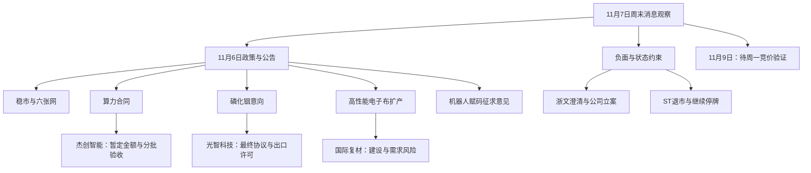

# 2026年11月7日 · 周末轻量消息观察

> **一句话结论：算力合同、磷化铟意向、电子布扩产分层观察；短剧治理、澄清、立案与停牌风险并列。**
>
> 今天是周六；下一个观察时点为 **2026年11月9日周一**。本文仅作消息研究，不含交易指令或参数。**已授予首板候选资格：0只；待核备选：5只。** 待核不是否决，也不是推荐。
>
> 基准清单生成于周六18:00，但**非公众号快讯/要闻的周六09:00—18:00没有全量覆盖**。公众号已更新到17:23，不能替代该时段的全新闻补抓。下文联网是定点核原文，不宣称补齐全天；未覆盖周日新增消息。

## 🗺️ 事件传导图

图中箭头仅表示业务或核验关系，不表示资金已经认可。

## 🎯 已核事实与周末传播主轴

**“high”仅表示事件事实得到官方文件确认，不表示股价、盈利或首板资格的确定性。** 新旧分类以底层事件及可追溯公开记录为准，不以周六转载时间制造“新催化”。公告发布日期只有日期时，`published_at`的精确时分及全网首次公众可知时刻均记未知；下列“最早留存”只是本次资料中核到的记录，不冒称全网最早。

### E01 · 国常会稳市与“六张网”部署｜老方向新增部署｜正面（政策层）｜high｜待周一竞价验证

**事实与映射：** 11月6日国常会提出完善资本市场稳市机制、加快重大项目和“六张网”建设实施进度。映射的是稳市制度及基础设施研究方向，**不是新增预算、具体项目订单或已确认收入**。本地最早留存包括11月6日19:22的“六张网”报道、19:23的稳市报道；新华社原文已亲读；教育部候选转载页实读403，未用作亲读证据。[W01；本地`news_cls` L813、L815、L610；公众号L19、L67]。

- **大资金意图**: 未核。本轮没有独立资金流或账户行为数据，不能把“稳市机制”解释成某类资金已入场。
- **为什么走强**: 未核板块行情；11月6日盘后文本不能倒推解释此前盘中表现。
- **逻辑够不够硬**: 政策部署属实，政策到项目、采购、收入仍有多级传导，不能直接指定个股受益额度。

### E02 · 杰创智能算力服务合同｜老方向新增合同｜正面（附履约条件）｜high｜待周一竞价验证

**事实与映射：** 杰创智能`301248.SZ`与匿名H1公司签署算力技术服务合同，暂定含税总金额约49.15亿元、期限60个月；每批次服务量及价格仍以实际订单为准，按月结算。公告明确采用浮动定价，合同金额不构成业绩承诺或预测。**合同已签≠全部设备已交付，也不等于当期确认49.15亿元收入。** 本轮本地最早留存11月6日19:58；公告精确发布时间未知。[A01；`news_cls` L1636、L724；公众号L17、L56]。

- **大资金意图**: 未核。合同事实不能替代资金确认。
- **为什么走强**: 未核11月6日个股及算力板块的完整行情，不能认定其已经因该合同走强。
- **逻辑够不够硬**: 已签合同和上市公司公告是硬证据；**负面分支**是前期采购与融资规模、设备到货、验收、浮动价格及分期收入的不确定性，见公告风险段。国内合同与海外AI资本开支争议不是同一件事，不机械相互抵销。

**同方向的旧公开信息：** 中国移动2027年算力投资计划超1000亿元，已在11月6日上午公开，周六的“370亿→1000亿”报道属于再传播；计划不能直接等同于任何一家供应商的订单。不据此追加受益股名单。该条为老方向延续、正面（需求计划）、待周一竞价验证。[W03；公众号L83；`news_major` L9、L288]。

### E03 · 光智科技磷化铟供货意向｜老方向新增意向｜中性偏正（有条件）｜high｜待周一竞价验证

**事实与映射：** 光智科技`300489.SZ`控股子公司先锐科技与Coherent签署长期供货**意向**协议，预计2027—2029年供应6英寸磷化铟衬底，预计交易金额不低于6.01亿美元。最终协议和后续订单尚待落实，出口许可证是关键前提。映射是磷化铟材料与海外光通信供应链，不能简化成已锁定收入的确定性大单。[A02；W04]。

**时间校核：** 本地最早留存为11月6日16:36；联网第一财经为16:52、财联社原稿为19:59，均早于周六转载。公告仅能核到日期；全网最早公众可知的精确时刻仍未查定，不因媒体使用“今晚”便认定为当晚首次公开。[`news_cls` L1289；W04]。

- **大资金意图**: 未核；不能由海外客户名称推导机构配置意图。
- **为什么走强**: 无完整行情与成交证据，未核该消息与价格的因果关系。
- **逻辑够不够硬**: “签署意向”得到官方确认，**不是最终供应协议已经签署**；负面分支为出口许可、最终条款差异和交付节奏。云南锗业周六被复述的供货新闻，其底层公告为11月3日，11月6日新增的是股东不减持承诺，不把两者合并为一笔新订单。[公众号L5；公告清单L2019，后者本轮仅核标题]

### E04 · 国际复材电子布扩产｜老方向新增资本开支｜正面（产业扩产，非短期业绩结论）｜high｜待周一竞价验证

**事实与映射：** 国际复材`301526.SZ`董事会通过约11.58亿元高性能电子纤维布项目，建设期为2026年11月至2027年9月，规划年产约1.11亿米，资金来自自有资金及银行贷款。项目指向高端电子布供给扩张；**项目审议通过≠已经投产、认证通过或接到等额订单**。本地最早留存11月6日19:11，周六15:50公众号为转载延续。[A03；W05；`news_cls` L1673、L838；公众号L4]。

- **大资金意图**: 未核，不以扩产宣布推导资金抢筹。
- **为什么走强**: 未核完整价格数据，不承接媒体“昔日牛股”的交易叙事。
- **逻辑够不够硬**: 董事会决议及项目规模已核；需求、产品价格、建设进度和融资成本仍会影响回报。缺单季环比与产品现货序列，不能拿累计同比增幅另授正面业绩结论。

### E05 · 机器人“一机一码”征求意见｜老方向新增监管文本｜中性（规范化）｜high｜待周一竞价验证

**事实与映射：** 工信部11月6日公开征求《机器人产品标识码管理暂行办法》意见，正文公示期为2026年11月6日至12月5日。文本涉及机器人产品赋码和信息管理，**是征求意见而非正式生效规则，更不是采购订单**。北京11月4日动员工作及周六转载不能算另一份独立新政策。原文只支持规范化、追溯管理方向，本轮不硬映射A股个股。[W02；`news_cls` L1494、L733；`news_major` L15]。

- **大资金意图**: 未核，没有资金数据支持机器人已形成周末共识。
- **为什么走强**: 未核相关板块行情；治理文本与生产销量变化不能混同。
- **逻辑够不够硬**: 官方原文可读、征求意见阶段明确；收费模式、实施细则和具体企业收益尚无证据。

### E06 · 浙文影业澄清AI短剧业务｜已交易叙事的新增反证｜负面（个股级）｜high｜待周一竞价验证

**事实与映射：** 浙文影业`601599.SH`公告明确其主营业务为影视与毛纺织，**无AI短剧相关业务**；公司公告同时披露自11月2日以来连续涨停。该条否定的是该公司的AI短剧映射，不能扩大为整个AI内容产业的否定。本地11月6日风险提示与11月7日异常波动公告是同一风险脉络，不当两份独立利空叠加。[A25；公告清单L372、L1573；公众号L61]。

- **大资金意图**: 未核；不从新闻中转述的龙虎榜反推真实资金目的。
- **为什么走强**: 公告能确认此前连续涨停，却不能证明涨停是由真实AI业务驱动；业务澄清恰是关键反证。
- **逻辑够不够硬**: 上市公司直接澄清，证据硬。它不是11月9日首板消息观察对象；不以名称或概念标签替代业务事实。

### E07 · 微短剧专项治理｜老方向新增监管行动｜负面（行业级合规约束）｜high｜待周一竞价验证

**事实与映射：** 广电总局11月6日公开新一轮微短剧低俗化同质化治理，针对AI微短剧内容质量、未按要求备案、侵权及平台推荐等问题；行动自11月1日起至12月底。**是专项治理，不是全面禁止AI微短剧**；会影响违规内容、依赖低质供给及流量分发的主体，精品内容扶持是同时存在的另一面。新华社转载广电总局公众号的页面在11月6日19:51已公开，不能把周六复述写成新增监管决定。[W09]。

- **大资金意图**: 未核；监管事实不证明相关资金已经离开或转向。
- **为什么走强**: 未核完整板块行情，不能用AI短剧热度抹去行业合规约束，也不能据治理推定所有公司走弱。
- **逻辑够不够硬**: 官方原文确认行动和范围；真实影响取决于内容、备案、版权及平台执行。与E06的个股业务澄清分别保留，不互相替代，不硬映射未核公司。

## 🔎 下周一首板消息观察：5只待核备选，0只取得候选资格

**统一缺口：五只均未核2026年11月6日的流通市值、首板身份及完整涨停历史；未核并不等于不是首板。** 本轮只亲核下列消息及同一公告窗口的标题冲突，不把这一范围外的风险写成“没有风险”。不使用热榜代理股，不为补足数量拓票。每只的消息锚、业务传导、风险与待验证项如下：

| 待核备选 | 新旧 / 正负与消息链 | 风险与具体待核范围 | 当前身份 |
|---|---|---|---|
| 杰创智能 `301248.SZ` | 老方向新增合同 / 正面；A01→算力服务→分批交付与结算 | H1身份豁免、融资与验收不确定；流通市值、11/6首板身份、后续合同变化未核 | 待核，未授候选资格；待周一竞价验证 |
| 光智科技 `300489.SZ` | 老方向新增意向 / 中性偏正；A02→6英寸磷化铟→最终协议与许可 | 意向非正式订单，出口许可及交付未落实；流通市值、11/6首板身份未核 | 待核，未授候选资格；待周一竞价验证 |
| 国际复材 `301526.SZ` | 老方向新增扩产 / 正面（产业层）；A03→电子布供给→建设与客户需求 | 建设期跨年、需求及融资周期；流通市值、11/6首板身份未核 | 待核，未授候选资格；待周一竞价验证 |
| 富奥股份 `000030.SZ` | 国资划转新披露 / 中性（控制权拟变）；A11→一汽体系→治理关系变化 | 尚需审批、协议及过户；不是已完成整合或资产注入；流通市值、11/6首板身份未核 | 待核，未授候选资格；待周一竞价验证 |
| 富维股份 `600742.SH` | 国资划转新披露 / 中性（控制权拟变）；A12→直接划转及一致行动→拟变更控制权 | 同上；与富奥属关联的同一底层划转链，不能计两次产业共振；流通市值、11/6首板身份未核 | 待核，未授候选资格；待周一竞价验证 |

富奥、富维本轮最早本地留存分别在11月6日16:42、16:50；公告均称**拟**由中国一汽取得控制关系、实控人拟变更为国务院国资委，尚未完成。不能把该过程写成周六首次公开，更不能把二者当两条独立宏观催化。[A11、A12；`news_cls` L1768、L1762]

## 📋 公告硬事件台账：新计划、旧进展、负面分开

以下是2259条公告标题全量程序筛选后的重点原文复核，**不是全部公告逐页尽调**。金额均为公司行动规模，不含证券价格。`ann_date`不是盘后时钟；精确公告发布时间缺失的仍为未知。公告PDF亲读证据见A01—A25，按实体与底层事项归并，不按附件数累加事件。

| 类别 / 对象 | 阶段、最早本地公开记录与新旧 | 正负、事实与限制 | 验证状态 |
|---|---|---|---|
| 回购：洛阳钼业 `603993.SH` | 新方案；11/6 17:30已留存 | 正面（资本行动）；10亿—20亿元，董事会已审议；并非已完成，且不是全部必须注销。[A04] | 待周一竞价验证 |
| 回购：沪电股份 `002463.SZ` | 新提议；11/6 18:35已留存 | 正面（资本行动）；董事长提议5亿—10亿元；尚待方案审议，不写成已执行。[A05] | 待周一竞价验证 |
| 回购：韵达股份 `002120.SZ` | 新方案；11/6 20:16已留存 | 正面（资本行动）；5000万—1亿元，拟用于激励/员工持股；不等于注销或已经支出。[A07] | 待周一竞价验证 |
| 增持：韵达股份 `002120.SZ` | 新计划；精确首次公开时分未知 | 正面（资本行动）；控股股东拟增持5000万—1亿元，公告披露起6个月；与上轮已完成计划区分。[A06] | 待周一竞价验证 |
| 增持：杰瑞股份 `002353.SZ` | 新计划；11/6 18:04已留存 | 正面（资本行动）；董事长等拟自11/9起6个月增持1000万—1200万元；尚非实施结果。[A08] | 待周一竞价验证 |
| 增持结果：杰瑞股份、五粮液 | 旧计划完成；11/6 18:03、19:50已留存 | 中性（存量行动完成）；杰瑞旧轮930.93万元、五粮液约30.14亿元已完成，不能再次当新增资金计划。[A09、A10] | 待周一竞价验证 |
| 控制权：富奥、富维 | 新披露，仍为拟划转 | 中性；控制权变化的审批与过户尚未完成；不推定有未来资产注入。[A11、A12] | 待周一竞价验证 |
| 重组：拓荆科技 `688072.SH` | 老事项新增受理节点；11/6 19:30已留存 | 中性偏正（程序推进）；申请受理不等于交易获批，仍需审核注册等。[A13] | 待周一竞价验证 |
| 重组：联泰环保 `603797.SH` | 老事项进入草案阶段；11/6 20:04已留存 | 中性；重大资产出售草案与“暂不召开股东会”并列，仍未完成审批交割；不因多份附件重复计数。[A14、A15] | 待周一竞价验证 |
| 要约：艾艾精工 `603580.SH` | 旧要约第二次提示；原报告10/19披露，期限10/21—11/20 | 中性；非周末新发起。收购方明确暂无借壳/资产注入计划，不补“重组想象”。[A16] | 待周一竞价验证 |
| 要约：宇邦新材 `301266.SZ` | 9/7原提示的60日进展说明；11/6文件 | 中性（不确定性）；原文称收购要约尚未生效，待协议转让确认与过户，不写成要约已启动。[A17] | 待周一竞价验证 |
| 立案：凤凰航运 `000520.SZ` | 新立案披露；11/6 18:30已留存 | **负面，个股级**；因涉嫌信息披露违法违规，公司被立案；不是已经作出最终处罚。[A18] | 待周一竞价验证 |
| 立案：ST龙大 `002726.SZ` | 新披露；11/6 17:44已留存 | **负面，个股级**；被立案者为实控人戴学斌，涉嫌操纵证券市场，不能改写为上市公司本身已被定罪；ST身份不可混作正向首板。[A19] | 待周一竞价验证 |
| 退市：萃华退 `002731.SZ` | 旧退市进程第四次提示；11/6文件 | **负面，个股级**；已处退市整理期，公告预计最后交易日11/12，须保留“预计”及潜在停牌影响；不可混作正向首板。[A20] | 待周一竞价验证（仅状态复核） |
| ST：ST南都 `300068.SZ` | 旧风险警示月度进展；11/6文件 | **负面，个股级**；内控否定意见、账户冻结等风险仍在披露，整改进展不等于已撤销ST；不可混作正向首板。[A21] | 待周一竞价验证（仅状态复核） |
| 停牌：TCL中环 `002129.SZ`、中国稀土 `000831.SZ` | 11/2开始停牌的旧事项进展；11/6 20:06、16:19已留存 | **中性（筹划）/负面（交易状态限制）**；官方均写继续停牌。本轮未见复牌公告，不预设周一会有竞价；不可混作正向首板。[A22、A23] | 待周一竞价验证（先核停复牌状态） |
| ST重组：*ST禾信 `688622.SH` | 老事项新增同意注册节点；11/5收到批复，11/6公告 | 正面（审批节点）与ST风险并存；同意注册不等于资产交割完成或ST已解除；不可混作正向首板。[A24] | 待周一竞价验证（仅事项与状态核验） |
| 减持：欧康医药、七丰精工、登康口腔 | 旧计划实施结果，11/6或11/7标题 | 中性、供给影响待核；只读到结果/实施完毕标题，未亲读这3份正文，不当新减持计划或已核无风险。公告L30、L40、L2134。 | 待周一竞价验证；正文待核 |
| 业绩预告/快报窗口 | 本地公告标题精确检索未命中新增预告/快报 | 中性；“0条标题命中”只限本集合，不等于全市场没有新业绩信息；旧三季报预告见下一节。 | 待周一竞价验证；范围外待补 |

**全量筛选口径提醒：** 标题字面含“回购”149条、115个主体，含“增持”25条、20个主体；含“减持”5条中有2条其实是“不减持承诺”，另3条是实施结果。回购还混有注销、激励及进展，不能当149个新方案。上述关键词统计与manifest类别标签不是同一口径，标签可重叠，**均不可求和充作唯一事件总数**。[本地全文件程序审计]

## 🟡 外部风险与传播级观察：不升级成生效事实

| 观察项 | 新旧 / 正负 / 证据边界 | 当前处理 |
|---|---|---|
| 美国AI暂停研发提案及周末“全面禁AI”叙事 | **老提案再传播 / 负面（AI行业预期风险）**。官方H.R.10538文本是2026/9/24提出并转委员会的版本，本轮未取得已经生效的证据；外媒正文标注11/5发表并嵌入11/4的暂停呼吁（网页元数据为11/5 13:30 UTC，原帖日期为11/4，未把它们改写为11/7新增），公众号把日期、法案与暴跌归因为一条链，原帖时区与因果未核。不得写成11/7突然生效的全面禁令。[W06；公众号L98]。 | 背景与待证实传播，不进入最高新增事件；待周一竞价验证 |
| 海外AI算力租赁收缩争议 | **旧硬件租约再评估报道 / 负面（算力租赁及AI链预期）**。本地报道称微软退出部分甲骨文旧芯片租约，同时转述甲骨文回应需求仍强；多平台转载可能只有同一底层采访，本轮未核到双方官方合同，不计多源独立证实，也不据此宣布AI需求全面转向。[`news_cls` L276、L1550；`news_major` L110、L189] | 单一底层消息待核，保留反方；待周一竞价验证 |
| 美制裁与中美经贸沟通 | **老摩擦新增措施 / 负面（贸易限制）与中性偏正（沟通）分列**。商务部11/7原文问答指美东时间11/5，美国务院以涉古巴为由制裁两家中国企业，中方反对；另一则11/6晚经贸通话报道只说明沟通，不能写成已撤销制裁。公司清单及A股敞口未核，不点名映射。[W07；公众号L8、L10、L59]（商务部原文已用真实浏览器读回，见W07。） | 对应企业及出口环节待核，不能相互抵销；待周一竞价验证 |
| 美伊冲突及谈判 | **旧冲突的新动态 / 负面（地缘不确定性）**。11/7报道同时出现“小型打击”和间接谈判，谈判不等于停火已达成；本轮未取得完整官方战况，不写确定受益个股或商品方向。[W08；`news_cls` L7、L17、L19]。 | 独立战况及谈判进展待核；待周一竞价验证 |

## 🧾 业绩交叉验证：实际为2026Q3，不是周末新预告

`eastmoney_earnings_predict.json`实际`report_date=2026-09-30`，周六18:06抓取；**500条是指标记录，只有195个证券主体**，不能写500家公司。全部记录报告期为2026Q3，公告日期在2026/8/25—11/4，没有本集合中的11/6—11/7新预告。[EARN]

| 对象 / 已核范围 | 实际命中与新旧 | 本轮极性 |
|---|---|---|
| 杰创智能 | 10/13旧预告：归母累计同比61.16%—116.93%，扣非70.90%—155.36%；不是49.15亿元合同的新盈利预测 | 中性，`earnings_qoq_unverified`；缺Q2/Q3单季拆分及一致预期，不用累计同比加分；待周一竞价验证 |
| 光智科技、国际复材、富奥股份、富维股份 | 500条辅助集合内未命中；该集合并非全市场完整财报库，不能据此写“无预告/无业绩” | 中性，`earnings_qoq_unverified`；待周一竞价验证 |
| 沪电股份（回购台账交叉） | 10/15旧预告：归母累计同比100.54%—109.74%；与董事长回购提议不是同一事件 | 中性，`earnings_qoq_unverified`；待周一竞价验证 |
| 归母净利润增幅下限前15个主体复核 | 按归母指标取前15，避免把扣非与归母重复算公司；其中存储交集有德明利、长鑫科技、江波龙，但没有直接命中上表5只待核备选 | 都是旧预告；不另造周末存储催化，不扩为首板名单；中性，待周一竞价验证 |

前15复核实体原样记录：德明利、东岳硅材、恒逸石化、天齐锂业、长鑫科技、恩捷股份、联讯仪器、江波龙、富春染织、领先股份、嘉元科技、石大胜华、远大控股、荣盛石化、星宸科技。此处仅记录本地数据标识及已查范围，不把累计增速榜当业绩边际结论。周期品产品现货趋势、单季环比及扣非结构均未补齐。

## 🔗 证据索引与短原文

**本地行号均为原始JSONL的1起始物理行号。** `RAW`表示`data/raw/20261107/`。以下A项全部实际请求返回HTTP 200，PDF可解析，并已抽取重点条款；URL仍指向原文件，未另存附件。媒体转载同一公告只算一个底层来源。官方PDF可确认事件，不自动确认其精确首发时分。

| 证据 | 本地定位 / 官方原文件（可复制） | 短原文或核验点 |
|---|---|---|
| A01 | `RAW/anns_window.jsonl:L585` · `https://static.cninfo.com.cn/finalpage/2026-11-06/1225662476.PDF` | “采用市场化浮动定价机制”；6页 |
| A02 | `RAW/anns_window.jsonl:L724` · `https://static.cninfo.com.cn/finalpage/2026-11-06/1225660893.PDF` | “最终协议签署时间尚存在不确定性”；4页 |
| A03 | `RAW/anns_window.jsonl:L534` · `https://static.cninfo.com.cn/finalpage/2026-11-06/1225662261.PDF` | 项目董事会审批、资金来源、建设期；2页 |
| A04 | `RAW/anns_window.jsonl:L1361` · `https://static.cninfo.com.cn/finalpage/2026-11-07/1225661591.PDF` | 新方案、首次披露日11/6，不是已完成；9页 |
| A05 | `RAW/anns_window.jsonl:L2014` · `https://static.cninfo.com.cn/finalpage/2026-11-07/1225661967.PDF` | 董事长提议，待履行程序；2页 |
| A06 | `RAW/anns_window.jsonl:L2087` · `https://static.cninfo.com.cn/finalpage/2026-11-07/1225662526.PDF` | 韵达新一轮控股股东增持计划；3页 |
| A07 | `RAW/anns_window.jsonl:L2090` · `https://static.cninfo.com.cn/finalpage/2026-11-07/1225662523.PDF` | 韵达回购方案，用途为激励/员工持股；6页 |
| A08 | `RAW/anns_window.jsonl:L2040` · `https://static.cninfo.com.cn/finalpage/2026-11-07/1225661699.PDF` | 杰瑞新轮自11/9起6个月；3页 |
| A09 | `RAW/anns_window.jsonl:L2041` · `https://static.cninfo.com.cn/finalpage/2026-11-07/1225661700.PDF` | 杰瑞旧轮实施完毕；3页 |
| A10 | `RAW/anns_window.jsonl:L2194` · `https://static.cninfo.com.cn/finalpage/2026-11-07/1225662323.PDF` | 五粮液“本次增持计划已实施完成”；4页 |
| A11 | `RAW/anns_window.jsonl:L2256` · `https://static.cninfo.com.cn/finalpage/2026-11-07/1225660879.PDF` | 富奥划转尚需协议、审批及过户；4页 |
| A12 | `RAW/anns_window.jsonl:L1647` · `https://static.cninfo.com.cn/finalpage/2026-11-07/1225661200.PDF` | 富维拟控制关系变化，尚未完成；5页 |
| A13 | `RAW/anns_window.jsonl:L1325` · `https://static.cninfo.com.cn/finalpage/2026-11-07/1225662441.PDF` | 拓荆“受理”，仍需审核及注册；1页 |
| A14 | `RAW/anns_window.jsonl:L1387` · `https://static.cninfo.com.cn/finalpage/2026-11-07/1225662557.PDF` | 联泰重大资产出售草案摘要；46页，仅重点条款核读 |
| A15 | `RAW/anns_window.jsonl:L1395` · `https://static.cninfo.com.cn/finalpage/2026-11-07/1225662555.PDF` | “暂不召开股东会”；1页 |
| A16 | `RAW/anns_window.jsonl:L1447` · `https://static.cninfo.com.cn/finalpage/2026-11-07/1225661571.PDF` | 旧要约第二次提示；6页 |
| A17 | `RAW/anns_window.jsonl:L580` · `https://static.cninfo.com.cn/finalpage/2026-11-06/1225661434.PDF` | “本次收购要约尚未生效”；2页 |
| A18 | `RAW/anns_window.jsonl:L2242` · `https://static.cninfo.com.cn/finalpage/2026-11-07/1225661288.PDF` | 凤凰航运涉嫌信披违法违规被立案；1页 |
| A19 | `RAW/anns_window.jsonl:L1927` · `https://static.cninfo.com.cn/finalpage/2026-11-07/1225661582.PDF` | 被立案者为实控人戴学斌；1页 |
| A20 | `RAW/anns_window.jsonl:L888` · `https://static.cninfo.com.cn/finalpage/2026-11-06/1225658976.PDF` | 萃华退退市整理期，预计11/12最后交易；3页 |
| A21 | `RAW/anns_window.jsonl:L805` · `https://static.cninfo.com.cn/finalpage/2026-11-06/1225661817.PDF` | ST南都内控、冻结等风险进展；3页 |
| A22 | `RAW/anns_window.jsonl:L2084` · `https://static.cninfo.com.cn/finalpage/2026-11-07/1225662503.PDF` | TCL中环“将继续停牌”；1页 |
| A23 | `RAW/anns_window.jsonl:L2197` · `https://static.cninfo.com.cn/finalpage/2026-11-07/1225660844.PDF` | 中国稀土“将继续停牌”；1页 |
| A24 | `RAW/anns_window.jsonl:L109` · `https://static.cninfo.com.cn/finalpage/2026-11-06/1225660465.PDF` | *ST禾信同意注册批复，非交割完成；1页 |
| A25 | `RAW/anns_window.jsonl:L1573` · `https://static.cninfo.com.cn/finalpage/2026-11-07/1225662145.PDF` | “无AI短剧相关业务”；3页 |

| 联网证据 | 已核原文及来源独立性 |
|---|---|
| W01 | 新华社11/6会议原文：`https://www.xinhuanet.com/politics/leaders/20261106/03f4c6201fe1470a836227f576772137/c.html`。同一会议转载不再计独立事件。教育部候选转载页实读403，未用作亲读证据。 |
| W02 | 工信部11/6机器人标识码征求意见原文：`https://www.miit.gov.cn/gzcy/yjzj/art/2026/art_ef16149bd27e4d7f95e5537e7dc68fdc.html`；正文公示期11/6—12/5，落款11/5与网站发布日期11/6分开保留。 |
| W03 | 中国移动11/6上午公开计划的媒体交叉：`https://www.nbd.com.cn/articles/2026-11-06/4640415.html`（11/6 10:35现场报道），并对照财联社`https://www.cls.cn/detail/2527866`及本地上证报公众号L83；同一演讲不当多次资本开支事件。 |
| W04 | 财联社11/6 19:59原稿：`https://m.cls.cn/detail/2527745`；第一财经11/6 16:52快讯：`https://www.yicai.com/brief/103429677.html`。与A02同一公告底层事实，不累计独立公告数。 |
| W05 | 国际复材公告在新浪公司公告栏目全文镜像：`https://vip.stock.finance.sina.com.cn/corp/view/vCB_AllBulletinDetail.php?id=12695930&stockid=301526`；与A03同一原文件，不计第二个独立原始来源。 |
| W06 | 美国官方提出版本：`https://www.govinfo.gov/content/pkg/BILLS-119hr10538ih/html/BILLS-119hr10538ih.htm`（2026/9/24）；外媒正文11/5、嵌入原帖11/4：`https://www.tomshardware.com/tech-industry/artificial-intelligence/congresswoman-calls-for-artificial-superintelligence-ban-after-democrats-seismic-midterm-sweep-demands-regulation-of-out-of-control-industry-and-pause-on-advanced-ai`。法案文本不证明已经生效；外媒与本地公众号的原帖日期及市场因果不可互相替代。 |
| W07 | 商务部11/7 09:00官方答问：`https://www.mofcom.gov.cn/xwfb/xwfyrth/art/2026/art_0a686e2464da49a58a076d9eab42187f.html`；明确美东时间11/5、涉古巴、两家中国企业；对照公众号L8，不混同其他日期的涉伊制裁。 |
| W08 | 新华社11/7“小型打击”报道：`https://www3.xinhuanet.com/20261107/bc0f50ca9a6342d9aa283115aa8c3f8b/c.html`；确认特朗普公开表态，但当地战况细节及谈判协议未取得完整官方独立核证，不升级为确定停火或确定产业受益。 |
| W09 | 新华网11/6 19:51转载广电总局公众号原文：`https://www3.xinhuanet.com/politics/20261106/3feab811a7164a159dfac232dc607ef7/c.html`；新华社记者稿：`https://www3.xinhuanet.com/politics/20261106/a29cc25abd7b44c4bff22da7815a764a/c.html`。同一治理行动计一次，不把平台转载算新增政策。 |

`EARN`：`data/raw/20261107/eastmoney_earnings_predict.json`；按`REPORT_DATE`、`NOTICE_DATE`、`SECUCODE`、`PREDICT_FINANCE`逐条解析，并区分归母、扣非、每股收益。公众号本地定位统一为`data/raw/20261107/wechat_official_20.jsonl`；新闻定位分别为`data/raw/20261107/news_cls.jsonl`、`data/raw/20261107/news_major.jsonl`。

## 数据源审计

| 源 | 日期 | 状态 | 实际覆盖、数量与缺口 |
|---|---|:--:|---|
| manifest | 2026-11-07 | 🟡 | `lookback_hours=36`，生成18:00；`global_severity=0`只代表上游清单，不替代本轮审计。 |
| wechat_cli_5groups | 2026-11-06—2026-11-07 | 🔴 | 5/5超45秒，文件0字节、0条；不是“群内无人讨论”，群聊发酵共识无法判断，群名已匿名。 |
| wechat_official_20 / RSS兼容镜像 | 2026-11-06—2026-11-07 | 🟡 | 全量解析100条，发布时间06:43至次日17:23；RSS与兼容文件只计一次。实际17个feed、9个有文，不能写“21号全覆盖”；上证报46、证券时报46，余8条来自其他账号，部分短文只含标题级信息。 |
| news_cls | 2026-11-05—2026-11-07 | 🟡 | 2150条；新浪1486、同花顺664，**财联社0**。最早11/5 21:02、最新11/7 08:55；按精确正文去空白仅能消除少量重复，改写/截短转载仍需事件归并。 |
| news_major | 2026-11-06—2026-11-07 | 🟡 | 800条且800条正文均空；最早11/6 18:03、最新11/7 09:00。新浪356、同花顺345、财联社54、华尔街见闻29、新华网7、中新经纬5、财新4；触顶与窗口不齐风险保留。 |
| anns_window | 2026-11-06—2026-11-07 | 🟡 | 2259条、1070主体；11/6有1162条、11/7有1097条；URL去重仍2259。原始仅日期、代码、名称、标题、URL，无正文/精确时分；本轮25份PDF定点亲核，非全量正文覆盖。 |
| eastmoney_earnings_predict | 2026-11-07 | 🟡 | 18:06抓取，2026Q3的500条指标记录/195主体，最新公告11/4；辅助腿可用，但不能视作周末新预告或完整单季业绩库。 |
| events_20261106 / anns_classified | 2026-11-07 | 🟡 | `data/raw/20261107/events_20261106.json`与`anns_classified.json`不存在；仅声明这两个实际检查路径，不外推其他目录。 |
| mcp_health | 2026-11-07 | 🔴 | `data/raw/20261107/mcp_health.json`缺失，无法据此声称MCP健康；本轮未调用MCP，不能把缺报告写成所有MCP已宕机。 |
| 周六新榜 | 2026-11-07 | 🟡 | `not_available`；本任务不以无新榜降级，实际降级来自群聊与新闻覆盖缺口。 |
| 定点联网原文 | 2026-11-07 | 🟢 | 25份官方PDF实际HTTP 200并可解析；另核工信部原文、官方新闻/法案文本及媒体原稿。通用提取工具为search-only报错后改用直接请求与PDF解析，不把接口报错伪装成正文已核。 |

**扫描规模与边界：** 核心4类非空JSONL合计5309条记录，外加500条业绩指标；群文件另行检查为空，manifest已全读。这是记录数，**不是5809个独立事件或新闻**。所有集合已程序遍历筛选并批量复核重点条款，不声称对数千条记录逐条完成外部核验，也不从压缩后的刊载条数反推真实事件密度。未读取或生成本轮R4研究JSON。

## ⚠️ 不确定性、反证与周一交接

1. **缺群不等于没有周末发酵。** 本文只确认公开传播与文件事实，不能判断5群的共识强度；单公众号评论不提升为最高事件。
2. **新合同、意向、扩产、拟划转是四种状态。** H1合同金额浮动、光智最终协议与出口许可、国际复材建设期、国资划转审批是各自独立的不确定性，不用题材热度替代。
3. **“首板”资格仍未核。** 流通市值、11/6身份及完整历史缺口交给有权限的后续行情研究；停牌/ST/退市对象保持风险台账身份，不混入正向首板观察。
4. **旧预告不能充当新催化。** 缺单季环比时统一中性；没有资金与完整行情就不补资金意图、强弱结论或事件—价格因果。
5. **时序不可倒置。** 公告日期、媒体转载时间、抓取时间与公众首次可知时间不同。周六转载不是新公告；定点网页的搜索摘要时钟也不能覆盖正文或当地原始时区。
6. **降级只限制本轮研究覆盖。** 不从缺群、缺业绩拆分或无周六新榜推导任何全局交易政策。下游可消费消息证据与风险，不得把本MD当生产授权。

## ✅ 验收与Sub-Agent元数据

- 唯一交付：`chzl_kg/投研交易/消息面/20261107.md`；仅周末轻量MD，不写`data/research` JSON，不改原始源、健康、源码、技能、调度或其他profile。
- 契约：用户本轮“轻量、仅消息观察”的边界优先于生产模板；保留三问、因果边界、证据、数据审计和图表，不生成生产交易字段。`confidence: null`因为无本轮机读研究artifact，不用主观数字冒充校准概率。
- 图表：14节点、至少三层；已用部署同版Mermaid 11.4.0实际解析并渲染为SVG，回执`ok=true`、`svg_bytes=21344`，不是只检查围栏。
- 交付前实际校验：frontmatter及日期、五只待核身份、七个重点事件三问、事件行“待周一竞价验证”、原始路径与25份公告URL/行号映射、无交易参数、输入摘要保持不变。最终执行回执由主控汇总；本节不把数据覆盖缺口写成已修复。
- 技能：`analyze_news_impact_v1@1.7`、`render_kg_md_v1`及共享写作契约；模型`gpt-6.1-sol`；研究只读，无订单或消息推送。
