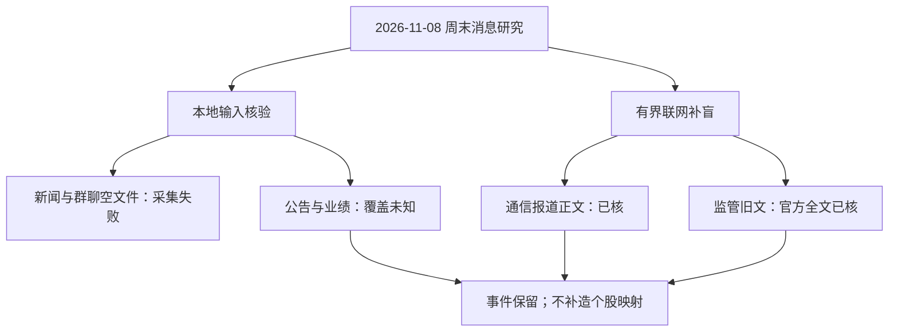

# 2026年11月8日 · 周末轻量消息面

> **状态：partial｜降级：true｜整体置信度：未定。** 本文使用自然日期，不把周日写成交易日，不生成研究JSON，也不包含交易安排。
> **一句话结论：通信建设报道可核；微短剧监管旧风险并列保留，公告与个股映射仍有缺口。**

## 🧭 覆盖边界与先读警示

- **主核窗口：2026-11-07—2026-11-08；背景回看至2026-11-05。** 本地manifest的25小时只是抓取参数，不等于成功覆盖了25小时。本轮联网搜到的旧文单独标旧，不以搜索日期改写发布日期。
- **五个必读JSONL均为0字节。** RSS全失败、匿名5群全超时、新闻扩展抓取超时、公告窗口明确报错，故不能将空输入解读成“周末平静”“没有负面”或“没有机会”。
- **健康总值矛盾：** manifest写`global_severity=0`，但主新闻、公众号、群聊、公告分项均失败。本文按分项事实降级，未改manifest或健康状态文件。
- `fetch_window_state.json`的`last_fetch_at`只说明一次抓取记录被更新，不能证明抓到了有效消息。其日期为2026-11-08；不将其当成功覆盖终点。

## 🗺️ 证据覆盖链

**图表验收范围：**已做代码块、节点与ASCII标识结构检查；本机未发现`mmdc`及所查常见位置的Mermaid依赖，未验证实际阅读端解析与SVG渲染，未安装依赖。

## 🎯 事件清单：正面与负面并列

| 事件 | 极性与作用域 | 证据强度 | 新旧分类 | 本轮结论 |
|---|---|---|---|---|
| E01 新一代通信网建设报道 | 🟢 产业建设进展；通信网络 | medium；财联社正文可读，底层央视原文未另取 | 老方向新增报道；底层建设并非全在周末新增 | 可作为产业观察，不能推导具体公司新增订单 |
| E02 微短剧低俗化、同质化专项治理 | 🔴 合规风险；行业级，AI微短剧制作与分发 | high（仅政策事实）；官方原文直接确认 | **2026-11-06已公开的背景风险，不是本周末新政策**；治理自11月1日起至12月底 | 必须与正面产业新闻并列；股价与公司传导未知，不授予交易资格 |

未赋事件分数：`raw_score=null`、`weighted_score=null`；没有可校准评分依据，不把来源质量主观换算成收益概率。不以搜索工具数量累计“独立来源”。

### E01 · 新一代通信网建设加快

**已核事实：**财联社2026-11-07报道转述当日《新闻联播》，涉及5G、5G-A、6G、万兆光网、卫星互联网及工业应用。正文中的工业专网与工厂数据是既有建设成果，不是当晚新招标或新合同。首轮浏览器已读正文；主控2026-11-08 23:57（中国时间）随后通过HTTPS直取并解析页面再次取得全文，内容与原报告相符。

**传导假设：**网络覆盖与融合应用可能形成持续设备、网络运维和应用需求；但报道没有核定某家A股公司的新增订单、收入份额或受益顺序，因而只映射“通信网络建设”产业层，不生成股票名单。

- **大资金意图**: 未核。本文没有资金或账户证据，不能由官媒报道反推机构已配置通信。
- **为什么走强**: 未核价格与板块反应；本轮只能解释产业新闻内容，不能声称通信板块已经因该报道走强。
- **逻辑够不够硬**: 报道存在与内容可核，但只有一条底层报道链。财联社转述央视不是两条独立原始源；订单兑现及公司映射仍缺证，强度不升为high。

**验证条件与反面：**如后续出现运营商采购、官方试点验收或公司披露，可进一步核定订单阶段；若只是存量成果集中报道，新增财务催化可能有限。6G测试不能改写成规模商用，不能把产业规划当已落实收入。

### E02 · 微短剧专项治理：已公开风险背景

**已核事实与时序：**国家广电总局官方原文显示，2026-11-06 19:47发布新一轮微短剧专项治理工作信息，来源为网络视听节目管理司。原文明示治理自11月1日起至12月底，针对AI微短剧质量及AI助长低俗不良内容，涉及低俗化同质化、“盗脸偷声”、未按要求备案审核以及推荐同质化等问题。**首轮浏览器超时；主控随后通过HTTPS直取并解析页面取得官方全文**，获取时点为2026-11-08 23:57（中国时间；分钟精度）。这是11月6日已公开、11月1日起开展的治理背景，不是11月7—8日新增政策。

**负面作用域：**行业级；潜在影响对象是依赖不合规内容、同质化流量或未经授权合成素材的制作与分发业务。**这是传导假设，不是已确认某上市公司违规或利润受损。**不扩散为整个AI算力产业链的负面。

- **大资金意图**: 未核，不把监管文件推演成机构撤离传媒。
- **为什么走强**: 无行情因果证据；不能解释板块强弱，也不能用较晚传播解释此前表现。
- **逻辑够不够硬**: 官方原文直接确认政策内容、公开时间与治理期间，政策事实证据可列high；但股价反应、具体公司适用范围与财务传导仍未知，不能据此授予交易资格，亦不代表公司公告核验已完成。

**反向解释：**治理不等于禁止AI微短剧；合规原创与版权保护可能获益，但本轮没有可靠公司映射，不据此生成正面候选。

## 🕒 三时钟与新旧归属

以下均使用来源页面或本轮实际获取证据；精确时刻缺失时保留未知。`first_known_at`只是**本轮核到的最早公开证据**，不声称穷尽全网最早时间。表中时间按页面显示保留，不在时区未明时强制转换。

**主控新增核验回执：**2026-11-08 23:57（中国时间；仅分钟精度）通过HTTPS直取并解析页面取得财联社与广电总局上述精确URL的完整正文。下表保留首轮获取历史并同步最新状态；本次仅接收回执，不重跑研究或搜索。

| 对象 | published_at：原文显示 | first_known_at：本轮最早可核公开锚 | captured_at：实际获取 | 分类与限制 |
|---|---|---|---|---|
| E01 财联社通信报道 | 2026-11-07 20:11；页面未明示时区 | 同一页面时间；央视更早播出时刻未独立取得 | 首轮2026-11-08 23:40；主控23:57再次取得全文；中国时间，分钟精度 | 周末新增报道，不等于全部产业事实新增 |
| E02 广电总局治理信息 | 官方原文2026-11-06 19:47；页面时区未明示 | 同一官方原文时间；更早公开未知；治理始于11月1日不等于该文公开日 | 首轮浏览器超时；主控2026-11-08 23:57通过HTTPS直取并解析页面取得官方全文；中国时间，分钟精度 | 11月6日已公开背景；治理自11月1日起至12月底；不充当11月7—8日新增政策 |
| 21世纪经济报道回购报道 | 腾讯索引2026-11-08 23:23；网易索引同日23:29 | 本轮最早核到腾讯索引23:23；底层公告首次披露待查 | 2026-11-08；豆包搜索返回索引与摘要，浏览器直连失败 | 周末新增媒体报道线索，底层回购事项新旧未定 |
| 上交所公告列表 | 搜索返回表格中公告日2026-11-07；无分秒 | 仅有列表日期，底层公告首次公开未知 | 2026-11-08；豆包搜索返回列表摘要 | 索引线索；未逐份取原公告，不认定完整覆盖 |

## 🔎 公司线索、首板候选与硬公告

### 首板候选

**本轮未能形成，`first_board_candidates=[]`。** 原因是已核正面报道没有可靠的上市公司业务、合同及冲突公告交叉映射；不是“市场没有机会”。不以热榜代理、旧报告股票或名称联想补齐名单。

若后续形成候选，每条需标“**待周一竞价验证**”。2026-11-09是日历周一，本轮未核交易日历，不据此断言市场必然正常交易。本文没有实际候选，亦无每票交易条目。

### 回购媒体线索：仅待核，不当已验证硬公告

豆包搜索取得21世纪经济报道在腾讯、网易发布的同一篇报道索引，提及奕瑞科技、和元生物、长光华芯、世运电路、永泰能源的回购方案、提议或进展。**两平台转载计一条底层稿件，不算双源确认。**正文直连失败，且未逐份取得交易所或公司原公告，故不复述金额、不列候选，也不把“提议”“拟实施”“实施进展”混为已完成回购。

### 公告逐类覆盖回执

| 必核类别 | 已做范围 | 状态 | 可以与不可以得出的结论 |
|---|---|---|---|
| 回购 | 媒体当日索引及交易所列表片段；未逐份公告原文 | unknown | 有回购线索；不能认定已核方案细节或全市场覆盖 |
| 增持 | 联网综合检索；命中较早媒体材料，未核周末原公告 | unknown | 未验证，不是“无增持” |
| 重组 | 上交所索引列出2026-11-07重组进展类标题；未取原件 | unknown | 标题线索不能等同重组获批或落地 |
| 要约 | 综合检索未取得当前有效原公告；另见未来日期路径的PDF线索，排除 | unknown | 不把未来日期材料倒灌成本周末事实 |
| 业绩预告 | 本地预告文件空；未得有效当期公告与单季拆分 | unknown | 不认定无预告，不依据累计同比给正面结论 |
| ST／退市 | 上交所索引有相关简称；当前风险公告正文未核 | unknown | 不能由列表简称推断本周末新增风险，也不能出具无风险结论 |
| 停复牌 | 综合搜索主要召回更早材料；未取得当期原公告 | unknown | 不把11月初停复牌消息写成周末新增事项 |

**已验证硬公告清单：未能形成。** 当日公告窗口md虽写零条，但manifest的对应源报错、底层JSONL为空，该零值不能认证“零公告”。`events_*.json`与`anns_classified.json`在当日raw目录未见，不补造前晚分类结果。

## 🔥 中报业绩预告命中（本轮按实际报告期核验）

该标题沿用共享展示契约，**本轮实际文件的`report_date=2026-09-30`，不是中报数据**；其`captured_at`为2026-11-08，`count=0`且`records=[]`。报告期、抓取日与公告首次披露日是不同时间维度。

本轮没有有效预告样本、没有首推股票，也无法完成“前15条预告交集”。不能将空表解释为不存在业绩预告。任何之后补入但无法拆分单季环比的业绩事件，只能中性并标`earnings_qoq_unverified`，不能凭累计同比升级为正面。

## 🔗 关键证据与原始定位

1. **通信报道正文**：财联社《新闻联播：新一代通信网加快建设 筑牢高质量发展数字底座》，页面显示2026-11-07 20:11；首轮浏览器正文核验成功，主控于2026-11-08 23:57（中国时间；分钟精度）再次通过HTTPS直取并解析页面取得全文。https://m.cls.cn/detail/2528128
2. **监管背景官方全文**：广电总局《国家广播电视总局部署开展新一轮微短剧专项治理工作》，原文显示2026-11-06 19:47，来源为网络视听节目管理司；首轮浏览器超时，主控于2026-11-08 23:57（中国时间；分钟精度）通过HTTPS直取并解析页面取得官方全文，明确治理自11月1日起至12月底。https://www.nrta.gov.cn/art/2026/11/6/art_114_74410.html
3. **回购媒体稿索引**：21世纪经济报道，腾讯显示2026-11-08；仅索引及摘要，不是公司原公告。https://news.qq.com/rain/a/20261108A0CKQ800
4. **同稿转载**：网易显示2026-11-08；与上一条同底层稿件去重。http://m.163.com/dy/article/LB8GRGAS05199NPP.html
5. **交易所列表索引**：上交所列表检索摘要含2026-11-07公告行；未取得各PDF。动态列表可能变化，不作为完整历史快照。https://www.sse.com.cn/disclosure/listedinfo/announcement/?page=1

**新旧及未来污染排除：**检索还召回2017年的量子新闻、2025-11-08的新闻联播汇总、2026-11-01／03的公司报道，以及路径含2026-11-09的收购PDF。均未冒充本周末新增事件；没有从旧研究报告补事件或股票。

## 数据源审计

| 源 | 日期 | 状态 | 备注 |
|---|---|:--:|---|
| manifest | 2026-11-08 | 🔴 | 分项失败但global_severity=0；矛盾显式保留，不修写 |
| wechat_official_20／RSS | 2026-11-08 | 🔴 | 必读兼容文件0字节；17个RSS全部DNS失败 |
| wechat_cli_5groups | 2026-11-08 | 🔴 | 必读文件0字节；匿名5群全部超时 |
| news_cls | 2026-11-08 | 🔴 | 必读文件0字节；news_extras超时 |
| news_major | 2026-11-08 | 🔴 | 必读文件0字节；不能据文件名宣称有有效要闻 |
| anns_window | 2026-11-08 | 🔴 | 必读文件0字节；来源error，不解释成无负面 |
| 当日公告窗口md | 2026-11-08 | 🟡 | 已读；零值与上游失败并存，不据零值认证覆盖 |
| eastmoney_earnings_predict | 2026-11-08 | 🟡 | 已读空records；报告期2026-09-30，覆盖与有效性未知 |
| events_*.json／anns_classified.json | 2026-11-08 | 🟡 | 当日raw目录未见；不据此作市场结论 |
| mcp_health | 2026-11-08 | 🔴 | 文件缺失；并非全体MCP宕机的证明 |
| fetch_window_state | 2026-11-08 | 🟡 | 只读；last_fetch_at不代表有效记录覆盖 |
| byted-web-search | 2026-11-08 | 🟢 | 有界调用成功返回3个结果；媒体双平台同稿去重 |
| 原生网页搜索路径／检索救援 | 2026-11-08 | 🟡 | 原生后端报告无法客户端运行；实际由救援后端返回检索结果，未改配置 |
| 浏览器正文核验（首轮） | 2026-11-08 | 🟡 | 财联社正文成功；广电总局与腾讯直连超时，保留初次失败历史 |
| 主控HTTPS正文核验（新增回执） | 2026-11-08 | 🟢 | 财联社与广电总局精确URL完整正文均已取得；广电总局政策事实已核，不等于公司公告已核；腾讯回购原文仍未核 |
| web_extract | 2026-11-08 | 🔴 | 后端明确为search-only，不能提取URL；已用浏览器替代 |
| 新榜 | 2026-11-08 | 🟡 | not_available；不因此单独判全局降级 |

## ⚠️ 不确定性／反证

1. **新闻覆盖不等于已恢复。** 通信报道与广电总局两篇全文及若干索引不足以填补主新闻源、公告及匿名群聊缺口，整体置信度保留null，不靠默认因子算出虚假精度。
2. **政策原文不等于公司公告。** 广电总局官方全文已核；回购媒体仍仅索引与摘要、未核原文。政策事实核验不补齐公司公告覆盖，也没有把搜索命中当交易所公告核验成功。
3. **正面事实不等于股票受益。** 通信报道没有逐公司订单和收入映射，故候选留空；没有核资金、行情或市场共识。
4. **负面未查不是没有负面。** 七类公告均保留unknown，尤其没有对具体公司作“无冲突公告”背书。
5. **政策范围不可外推。** 微短剧治理是已公开背景，不能当新政，也不能扩大成全AI产业链风险；回购提议不能当完成实施。

## 🤝 与其他R／D／E的关系

- 依赖：本轮实际读取的当日raw、manifest、健康状态及公告窗口md；没有依赖旧报告形成事件。
- 可供R2／R5／R6后续补证：通信产业进展、微短剧合规背景、回购媒体线索及逐类公告缺口。
- 本文仅周末消息研究，不授予D1或任何执行端交易权限，不触达QMT，不推送。

## 🧾 Sub-Agent元数据与交付边界

- skill：`analyze_news_impact_v1@1.7`；model：`gpt-6.1-sol`。
- 日期语义：自然日2026-11-08；`mode=weekend`，`weekend_light=true`。
- 产物：仅`chzl_kg/投研交易/消息面/20261108.md`；不产`data/research` JSON。
- top事件：两项，含一项明确标旧的监管风险背景；首板候选空，已验证公司硬公告空，均因证据缺口，不代表市场不存在。
- 方法：本地输入审计＋有界联网替代＋正文核验；本次仅同步主控新增官方全文核验回执，未重跑研究或搜索；无事件评分、资金意图或业务占比猜测。
- 结构校验与原子写入由本轮工具执行回执确认；Mermaid实际SVG渲染未验证。
