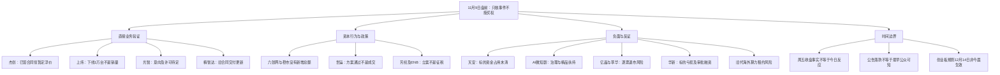

# 2026年11月9日 · 消息面事件驱动

> 数据源新鲜度：partial · 降级：true · 研究置信度：0.50。官方事实层与选票验证层分开，事实层置信度0.85不构成买权。
> 知识运输截止：2026-11-09 06:10（仅专题上下文）；本轮取证截止见JSON research_evidence_cutoff，生成时间见frontmatter。实时盘前研究，不是冻结输入回放。

## 一句话结论
观察直接合同与产能验证；资金尚未确认，治理、资金占用及退市风险不被利好抵消。

## 先认市场，再认个股

11月6日上证指数收3649.1774点、跌1.1039%，来自本轮Tushare直采。非ST涨跌停表中32家封板、14家炸板、15家跌停；触板封板率69.57%、炸板率30.43%，不是某条主线的封板率。炸板率未达35%，不机械砍半候选，也不把现有不完整情绪脚本中的默认溢价当真实数据。

情绪=震荡。阶段是震荡修复待确认，不由R4代替R1定段。11月6日光伏、电力及部分传媒有涨停与梯队，同时东山精密、剑桥科技、澳弘电子等跌停。说明局部有价格奖励，但还不能认定科技全链、某个名字题材或新消息已经获得持续资金认可。今日主线=未确认；持续性=未知；主线封板率=未知；明日预期=分歧（假设，须由今日市场验证）。尚未独立核完整上涨/下跌广度及个股事件后资金。

谁有地位：闽发铝业与浙文影业在该表最高5板，但前者有加工费/毛利风险，后者有股价波动监管函；高度不免风险审查。当前直接业务研究对象不等于龙头，板型、龙头认定、RR、禁止清单均未完成。

本阶段做：比较新合同、下线、意向与政策，交出反证。不得做：把回购上限当买入价、把新闻热度当资金、把意向当交割、把下线当收入、在D1第一次形成计划前将in_today_plan误设false。旧市场停买意见不是永久账户限制；真实预算和人工确认状态本轮未知，不抬成正额度。

## 🗺️ 消息面全景图

## 🎯 顶级事件详解：正反分面，不凑独立事件数量

本轮为22个底层文件/报道事件、28个正反分析分面：11个正面、17个负面。对同一公告拆正反是为了保留风险，不是把来源或事件加倍。强度表示文书事实硬度，不能理解成股价方向/资金/盈利强度。按自然日日期差执行λ=0.15；11月6日材料按3日衰减为约原值的63.76%，仅作背景。两个负面细项最早公开日未查定，weighted_score保留null而不是0日龄。

### E20261109_020 · 萃华退整理期预计最后交易日11月12日且不得筹划重大重组

极性=负面 · 文书强度=high · 加权分=-0.817673 · 分类=已交易后的延续

事件事实：公司已收到终止上市决定并处退市整理期；公告预计末日11/12，特殊停牌可影响日程。

最早已核线索：2026-11-08T15:33:07+08:00。原文发布时间/日期：2026-11-09（公告日期；时分未知）。可交易日映射：20261109；缺时分不冒充盘前已知。

**大资金意图**：未核。当前没有该事件对应的11月9日资金与竞价证据，不从公告金额或台数倒推机构意图。

**为什么走强**：尚不能认定该板块已走强。传导假设为：不是困境反转候选；预计日期仍按实际停牌与公告更新。

**逻辑够不够硬**：已取得官方正文，足以确认本条文书事实；不得把预计日期当无条件保证；不输出交易建议。因此事实层与兑现层分开，不能直接授予开仓资格。

已查来源与窗口：[ANN:1225661063](https://static.cninfo.com.cn/finalpage/2026-11-09/1225661063.PDF)；SNAP:news_cls:267。2026-11-06—2026-11-09盘前；未列历史处罚、关联文件与全市场负面仍未全查，不写“无负面”。

### E20261109_019 · 亿晶预重整不等于正式受理且存在退市风险

极性=负面 · 文书强度=high · 加权分=-0.774637 · 分类=已交易后的延续

事件事实：公告确认预重整备案不代表正式受理；2026Q3净资产为负3.2739亿元，保留破产与退市风险。

最早已核线索：2026-11-08T15:32:00+08:00。原文发布时间/日期：2026-11-09（公告日期；时分未知）。可交易日映射：20261109；缺时分不冒充盘前已知。

**大资金意图**：未核。当前没有该事件对应的11月9日资金与竞价证据，不从公告金额或台数倒推机构意图。

**为什么走强**：尚不能认定该板块已走强。传导假设为：光伏局部赚钱效应不能冲销此票必要风险；不外推整个光伏行业退市。

**逻辑够不够硬**：已取得官方正文，足以确认本条文书事实；风险重复提示不等于本周已宣告破产；交R6逐票裁决。因此事实层与兑现层分开，不能直接授予开仓资格。

已查来源与窗口：[ANN:1225662730](https://static.cninfo.com.cn/finalpage/2026-11-09/1225662730.PDF)；SNAP:news_cls:271。2026-11-06—2026-11-09盘前；未列历史处罚、关联文件与全市场负面仍未全查，不写“无负面”。

### E20261109_006 · 杰创智能签署暂定49.152亿元算力服务合同

极性=正面 · 文书强度=high · 加权分=0.49735 · 分类=老方向新增催化

事件事实：已签算力服务合同暂定含税49.152亿元；每批服务期限60个月，分批交付、月度结算、浮动定价。

最早已核线索：2026-11-06T19:58:00+08:00。原文发布时间/日期：2026-11-06（公告落款；时分未知）。可交易日映射：20261109；缺时分不冒充盘前已知。

**大资金意图**：未核。当前没有该事件对应的11月9日资金与竞价证据，不从公告金额或台数倒推机构意图。

**为什么走强**：尚不能认定该板块已走强。传导假设为：相对纯口头规划，这是已签服务协议；但不能把总额一次性确认为当年收入。

**逻辑够不够硬**：已取得官方正文，足以确认本条文书事实；H1主体因商业秘密豁免披露；律师核查不等于独立对手方财务审计或付款保证。因此事实层与兑现层分开，不能直接授予开仓资格。

已查来源与窗口：[OFF:jczn](https://static.cninfo.com.cn/finalpage/2026-11-06/1225662476.PDF)；SNAP:news_cls:1856。2026-11-06—2026-11-09盘前；未列历史处罚、关联文件与全市场负面仍未全查，不写“无负面”。

### E20261109_011 · 天安拟收购标的关联方资金占用尚在清理且财务未经审计

极性=负面 · 文书强度=high · 加权分=未知 · 分类=老方向新增催化

事件事实：嘉万光存在原股东/关联方非经营性资金占用，尚在梳理清收；跨行业整合、商誉及交易失败风险明确披露。

最早已核线索：未知：本轮已核正文，但最早公众可知时点未查定。原文发布时间/日期：2026-11-09（公告日期；时分未知）。可交易日映射：20261109；缺时分不冒充盘前已知。

**大资金意图**：未核。当前没有该事件对应的11月9日资金与竞价证据，不从公告金额或台数倒推机构意图。

**为什么走强**：尚不能认定该板块已走强。传导假设为：这是真实必要风险证据，不因光通信热门抹去；清理协议和审计待核，交R6独立审查。

**逻辑够不够硬**：已取得官方正文，足以确认本条文书事实；不能夸大为上市公司已违规占用或已经被立案，也不能当作已清理。因此事实层与兑现层分开，不能直接授予开仓资格。

已查来源与窗口：[ANN:1225662733](https://static.cninfo.com.cn/finalpage/2026-11-09/1225662733.PDF)。2026-11-06—2026-11-09盘前；未列历史处罚、关联文件与全市场负面仍未全查，不写“无负面”。

### E20261109_001 · 国常会部署稳市机制并加快重大项目与六张网建设

极性=正面 · 文书强度=high · 加权分=0.478221 · 分类=老方向新增催化

事件事实：会议要求完善稳市机制、加快重大项目和六张网、用足政策性资金并及时拨款；未公布本次新增统一总额。

最早已核线索：2026-11-06T19:21:23+08:00。原文发布时间/日期：2026-11-06T19:21:23+08:00。可交易日映射：20261109；缺时分不冒充盘前已知。

**大资金意图**：未核。当前没有该事件对应的11月9日资金与竞价证据，不从公告金额或台数倒推机构意图。

**为什么走强**：尚不能认定该板块已走强。传导假设为：政策支持投资执行与风险偏好；需后续项目批复、采购、交付逐级映射，不能直接视作上市公司收入。

**逻辑够不够硬**：已核财联社具体报道及其归属，但未取得底层企业/监管原件，强度不升high；11/6收盘先于消息；不能用盘后政策解释当日板块涨幅或保证11/9普涨。因此事实层与兑现层分开，不能直接授予开仓资格。

已查来源与窗口：CLS:policy；CLS:nets；CCTV:20261106。2026-11-06—2026-11-09盘前；未列历史处罚、关联文件与全市场负面仍未全查，不写“无负面”。

### E20261109_004 · 上纬新材启元Q1与T1下线累计达到1万台

极性=正面 · 文书强度=high · 加权分=0.61971 · 分类=老方向新增催化

事件事实：公告确认9/20发布的启元Q1、T1下线1万台。

最早已核线索：2026-11-08T14:19:36+08:00。原文发布时间/日期：2026-11-09（公告日期；时分未知）。可交易日映射：20261109；缺时分不冒充盘前已知。

**大资金意图**：未核。当前没有该事件对应的11月9日资金与竞价证据，不从公告金额或台数倒推机构意图。

**为什么走强**：尚不能认定该板块已走强。传导假设为：产能爬坡有阶段验证；订单、交付、退货、收入和毛利需后续核验。

**逻辑够不够硬**：已取得官方正文，足以确认本条文书事实；下线不是销量；月活与互动次数为公司高管口径，不能替代独立付费需求核验。因此事实层与兑现层分开，不能直接授予开仓资格。

已查来源与窗口：[ANN:1225662738](https://static.cninfo.com.cn/finalpage/2026-11-09/1225662738.PDF)；SNAP:news_cls:302。2026-11-06—2026-11-09盘前；未列历史处罚、关联文件与全市场负面仍未全查，不写“无负面”。

### E20261109_002 · 广电总局启动微短剧治理并约束AI盗脸偷声与同质化推荐

极性=负面 · 文书强度=high · 加权分=-0.44634 · 分类=老方向新增催化

事件事实：11/1至12月底开展治理；涉及未备案特殊题材、AI盗脸偷声、低俗内容、引流素材和首页同质化推荐。

最早已核线索：2026-11-06T19:47:00+08:00。原文发布时间/日期：2026-11-06T19:47:00+08:00。可交易日映射：20261109；缺时分不冒充盘前已知。

**大资金意图**：未核。当前没有该事件对应的11月9日资金与竞价证据，不从公告金额或台数倒推机构意图。

**为什么走强**：尚不能认定该板块已走强。传导假设为：无授权内容和低质投流业务可能增加审核、下架和获客成本；实际个股暴露待核。

**逻辑够不够硬**：已取得官方正文，足以确认本条文书事实；不是全面禁止AI创作；7.5万部下架为今年以来累计，不是本轮新增。因此事实层与兑现层分开，不能直接授予开仓资格。

已查来源与窗口：[OFF:nrta](https://www.nrta.gov.cn/art/2026/11/6/art_114_74410.html)。2026-11-06—2026-11-09盘前；未列历史处罚、关联文件与全市场负面仍未全查，不写“无负面”。

### E20261109_007 · 杰创算力合同前期采购与融资及交付验收仍有重大不确定性

极性=负面 · 文书强度=high · 加权分=-0.414458 · 分类=老方向新增催化

事件事实：公告明确资金、供应链、债务、交付验收与需求风险；批次数量和价格以订单为准。

最早已核线索：2026-11-06T19:58:00+08:00。原文发布时间/日期：2026-11-06（公告落款；时分未知）。可交易日映射：20261109；缺时分不冒充盘前已知。

**大资金意图**：未核。当前没有该事件对应的11月9日资金与竞价证据，不从公告金额或台数倒推机构意图。

**为什么走强**：尚不能认定该板块已走强。传导假设为：收入确认和现金回笼存在时滞，融资受阻可能影响履约。

**逻辑够不够硬**：已取得官方正文，足以确认本条文书事实；不能因合同额大直接判盈利或回款；未核银行授信落实。因此事实层与兑现层分开，不能直接授予开仓资格。

已查来源与窗口：[OFF:jczn](https://static.cninfo.com.cn/finalpage/2026-11-06/1225662476.PDF)。2026-11-06—2026-11-09盘前；未列历史处罚、关联文件与全市场负面仍未全查，不写“无负面”。

### E20261109_009 · 光智供货仍待最终协议与出口许可且存在取消风险

极性=负面 · 文书强度=high · 加权分=-0.414458 · 分类=老方向新增催化

事件事实：公司明确最终协议签署时间和条款未知；需取得出口许可证，否则可延迟甚至取消。

最早已核线索：2026-11-06（日期已核；时分未知）。原文发布时间/日期：2026-11-06（公告落款；时分未知）。可交易日映射：20261109；缺时分不冒充盘前已知。

**大资金意图**：未核。当前没有该事件对应的11月9日资金与竞价证据，不从公告金额或台数倒推机构意图。

**为什么走强**：尚不能认定该板块已走强。传导假设为：许可与正式订单是收入转化必要环节；不是已经被禁止出口。

**逻辑够不够硬**：已取得官方正文，足以确认本条文书事实；本轮未取得许可证和最终供货协议；保留个股必要补证。因此事实层与兑现层分开，不能直接授予开仓资格。

已查来源与窗口：[OFF:gzkj](https://static.cninfo.com.cn/finalpage/2026-11-06/1225660893.PDF)。2026-11-06—2026-11-09盘前；未列历史处罚、关联文件与全市场负面仍未全查，不写“无负面”。

### E20261109_021 · 登云股份因担保被诉涉及本金3389万元及利息

极性=负面 · 文书强度=high · 加权分=-0.55946 · 分类=老方向新增催化

事件事实：法院已受理公司作为被告的借款纠纷；11/18拟开庭，尚未判决。

最早已核线索：2026-11-08T16:15:43+08:00。原文发布时间/日期：2026-11-09（公告日期；时分未知）。可交易日映射：20261109；缺时分不冒充盘前已知。

**大资金意图**：未核。当前没有该事件对应的11月9日资金与竞价证据，不从公告金额或台数倒推机构意图。

**为什么走强**：尚不能认定该板块已走强。传导假设为：若被判承担担保或赔偿责任可能影响财务；现阶段金额不是已确认损失。

**逻辑够不够硬**：已取得官方正文，足以确认本条文书事实；损益影响未知，不能称已赔3389万元；其他案件仅限本公告覆盖。因此事实层与兑现层分开，不能直接授予开仓资格。

已查来源与窗口：[ANN:1225662759](https://static.cninfo.com.cn/finalpage/2026-11-09/1225662759.PDF)；SNAP:news_cls:246。2026-11-06—2026-11-09盘前；未列历史处罚、关联文件与全市场负面仍未全查，不写“无负面”。

### E20261109_023 · 巨星农牧10月商品肥猪销量与均价及收入较9月均下降

极性=负面 · 文书强度=high · 加权分=-0.55946 · 分类=老方向新增催化

事件事实：10月销量27.77万头、均价10.11元/公斤、收入3.92亿元；相对9月环比分别-17.1%、-8.51%、-21.76%。

最早已核线索：2026-11-08T15:31:00+08:00。原文发布时间/日期：2026-11-09（公告日期；时分未知）。可交易日映射：20261109；缺时分不冒充盘前已知。

**大资金意图**：未核。当前没有该事件对应的11月9日资金与竞价证据，不从公告金额或台数倒推机构意图。

**为什么走强**：尚不能认定该板块已走强。传导假设为：公司月度量价均弱；成本与行业全量样本未核，不直接推导全行业利润。

**逻辑够不够硬**：已取得官方正文，足以确认本条文书事实；内部未审统计，非单季净利润；不能与净利预告混作同比硬alpha。因此事实层与兑现层分开，不能直接授予开仓资格。

已查来源与窗口：[ANN:1225662741](https://static.cninfo.com.cn/finalpage/2026-11-09/1225662741.PDF)；SNAP:news_cls:279；SNAP:news_cls:1561。2026-11-06—2026-11-09盘前；未列历史处罚、关联文件与全市场负面仍未全查，不写“无负面”。

### E20261109_008 · 光智子公司拟在2027至2029年向Coherent供应磷化铟衬底

极性=正面 · 文书强度=high · 加权分=0.382577 · 分类=老方向新增催化

事件事实：先锐科技与Coherent签长期供货意向，6英寸磷化铟衬底预计不低于6.01亿美元，供应期2027—2029年。

最早已核线索：2026-11-06（日期已核；时分未知）。原文发布时间/日期：2026-11-06（公告落款；时分未知）。可交易日映射：20261109；缺时分不冒充盘前已知。

**大资金意图**：未核。当前没有该事件对应的11月9日资金与竞价证据，不从公告金额或台数倒推机构意图。

**为什么走强**：尚不能认定该板块已走强。传导假设为：客户意向为能力验证线索，仍待最终协议与后续订单，不是2026年新增确认收入。

**逻辑够不够硬**：已取得官方正文，足以确认本条文书事实；时间不明，不用它解释11/6盘中涨幅。因此事实层与兑现层分开，不能直接授予开仓资格。

已查来源与窗口：[OFF:gzkj](https://static.cninfo.com.cn/finalpage/2026-11-06/1225660893.PDF)。2026-11-06—2026-11-09盘前；未列历史处罚、关联文件与全市场负面仍未全查，不写“无负面”。

### E20261109_013 · 华新收购标的上半年净亏损且融资汇率及审批风险待解

极性=负面 · 文书强度=high · 加权分=未知 · 分类=老方向新增催化

事件事实：标的2026H1净亏损1181万美元（未经审计），交易需相关审批及外汇登记，资金含外部融资。

最早已核线索：未知：本轮已核正文，但最早公众可知时点未查定。原文发布时间/日期：2026-11-09（公告日期；时分未知）。可交易日映射：20261109；缺时分不冒充盘前已知。

**大资金意图**：未核。当前没有该事件对应的11月9日资金与竞价证据，不从公告金额或台数倒推机构意图。

**为什么走强**：尚不能认定该板块已走强。传导假设为：拟置换高息贷款的协同仍待执行；EBITDA不能当净利润。

**逻辑够不够硬**：已取得官方正文，足以确认本条文书事实；未核融资最终条款与交割日；不编确定并表日期或利润增厚额。因此事实层与兑现层分开，不能直接授予开仓资格。

已查来源与窗口：[ANN:1225662767](https://static.cninfo.com.cn/finalpage/2026-11-09/1225662767.PDF)。2026-11-06—2026-11-09盘前；未列历史处罚、关联文件与全市场负面仍未全查，不写“无负面”。

### E20261109_005 · 上纬机器人收入占比仍低且年度业绩影响尚不能预测

极性=负面 · 文书强度=high · 加权分=-0.473389 · 分类=老方向新增催化

事件事实：公告称收入主要来自新材料；机器人仍处量产爬坡和商业化验证，年度营收与盈利影响尚不能预测。

最早已核线索：2026-11-08T15:32:53+08:00。原文发布时间/日期：2026-11-09（公告日期；时分未知）。可交易日映射：20261109；缺时分不冒充盘前已知。

**大资金意图**：未核。当前没有该事件对应的11月9日资金与竞价证据，不从公告金额或台数倒推机构意图。

**为什么走强**：尚不能认定该板块已走强。传导假设为：若估值预期提前按大规模收入计入，存在预期兑现落差；不是认定已经滞销。

**逻辑够不够硬**：已取得官方正文，足以确认本条文书事实；保留良率、体验、订单转化、竞争和供应链风险；不能因正面下线数字删除。因此事实层与兑现层分开，不能直接授予开仓资格。

已查来源与窗口：[ANN:1225662738](https://static.cninfo.com.cn/finalpage/2026-11-09/1225662738.PDF)；CLS:robot。2026-11-06—2026-11-09盘前；未列历史处罚、关联文件与全市场负面仍未全查，不写“无负面”。

### E20261109_012 · 华新建材拟约16.42亿美元收购巴西水泥资产99.99%股权

极性=正面 · 文书强度=high · 加权分=0.473389 · 分类=老方向新增催化

事件事实：11/7签股权收购协议；预估股权对价90.337亿雷亚尔约16.42亿美元，企业价值127亿雷亚尔；尚待中巴审批。

最早已核线索：2026-11-08T16:47:11+08:00。原文发布时间/日期：2026-11-09（公告日期；时分未知）。可交易日映射：20261109；缺时分不冒充盘前已知。

**大资金意图**：未核。当前没有该事件对应的11月9日资金与竞价证据，不从公告金额或台数倒推机构意图。

**为什么走强**：尚不能认定该板块已走强。传导假设为：若交割并整合成功可拓展巴西市场；不是现金并表已完成。

**逻辑够不够硬**：已取得官方正文，足以确认本条文书事实；纠正转载小标题61.42亿美元；企业价值不等于股权购买价。因此事实层与兑现层分开，不能直接授予开仓资格。

已查来源与窗口：[ANN:1225662767](https://static.cninfo.com.cn/finalpage/2026-11-09/1225662767.PDF)；CLS:huaxin。2026-11-06—2026-11-09盘前；未列历史处罚、关联文件与全市场负面仍未全查，不写“无负面”。

### E20261109_015 · 精智达确认存储测试设备延续量产交付并推出SoC测试机

极性=正面 · 文书强度=high · 加权分=0.350695 · 分类=已交易后的延续

事件事实：公告重申1月和9月两笔已披露合同按节奏交付；自研SoC ATE已推出，后续商业化待核。

最早已核线索：2026-11-06T19:31:03+08:00。原文发布时间/日期：2026-11-07（公告日期；时分未知）。可交易日映射：20261109；缺时分不冒充盘前已知。

**大资金意图**：未核。当前没有该事件对应的11月9日资金与竞价证据，不从公告金额或台数倒推机构意图。

**为什么走强**：尚不能认定该板块已走强。传导假设为：国产设备业务可作为对照海外算力租赁风险的研究样本，不等于风险免疫。

**逻辑够不够硬**：已取得官方正文，足以确认本条文书事实；13.108亿元与15.7635亿元为旧合同，不加成11月新增订单；未审财务不作新利润催化。因此事实层与兑现层分开，不能直接授予开仓资格。

已查来源与窗口：[OFF:jzd](https://static.cninfo.com.cn/finalpage/2026-11-07/1225662437.PDF)。2026-11-06—2026-11-09盘前；未列历史处罚、关联文件与全市场负面仍未全查，不写“无负面”。

### E20261109_014 · 世运电路董事会通过2亿至3亿元回购方案

极性=正面 · 文书强度=high · 加权分=0.430354 · 分类=老方向新增催化

事件事实：11/8董事会通过方案：回购上限55元、期限不超6个月，用于员工持股或股权激励。

最早已核线索：2026-11-08T16:47:57+08:00。原文发布时间/日期：2026-11-09（公告日期；时分未知）。可交易日映射：20261109；缺时分不冒充盘前已知。

**大资金意图**：未核。当前没有该事件对应的11月9日资金与竞价证据，不从公告金额或台数倒推机构意图。

**为什么走强**：尚不能认定该板块已走强。传导假设为：比仅提议更进一步；不等于当日2至3亿元成交或持续买盘保证。

**逻辑够不够硬**：已取得官方正文，足以确认本条文书事实；股价超限、经营条件变化或方案变更可能影响执行；55元不是本轮目标价或止损。因此事实层与兑现层分开，不能直接授予开仓资格。

已查来源与窗口：[ANN:1225662768](https://static.cninfo.com.cn/finalpage/2026-11-09/1225662768.PDF)；CLS:shiyun。2026-11-06—2026-11-09盘前；未列历史处罚、关联文件与全市场负面仍未全查，不写“无负面”。

### E20261109_022 · 金陵药业决定不参加竞价并终止常州四药投资意向

极性=负面 · 文书强度=high · 加权分=-0.430354 · 分类=老方向新增催化

事件事实：公司决定不参加竞价并终止投资意向；此前没有签订有法律约束力的协议。

最早已核线索：2026-11-08T15:35:00+08:00。原文发布时间/日期：2026-11-06（公告文内落款；公开传播11/8；索引11/9）。可交易日映射：20261109；缺时分不冒充盘前已知。

**大资金意图**：未核。当前没有该事件对应的11月9日资金与竞价证据，不从公告金额或台数倒推机构意图。

**为什么走强**：尚不能认定该板块已走强。传导假设为：拟收购叙事失效，不是已有合并业务被剥离。

**逻辑够不够硬**：已取得官方正文，足以确认本条文书事实；公告称对经营财务无重大影响；不能将终止意向扩大成主营恶化。因此事实层与兑现层分开，不能直接授予开仓资格。

已查来源与窗口：[ANN:1225662504](https://static.cninfo.com.cn/finalpage/2026-11-09/1225662504.PDF)；SNAP:news_cls:264；SNAP:news_cls:1549。2026-11-06—2026-11-09盘前；未列历史处罚、关联文件与全市场负面仍未全查，不写“无负面”。

### E20261109_010 · 天安新材拟2.5亿元取得嘉万光62.5%股权

极性=正面 · 文书强度=high · 加权分=0.387319 · 分类=老方向新增催化

事件事实：11/6签股权收购意向：7000万元增资及暂定1.8亿元转让；目标为无源光器件、光缆等。

最早已核线索：2026-11-08T15:31:00+08:00。原文发布时间/日期：2026-11-09（公告日期；时分未知）。可交易日映射：20261109；缺时分不冒充盘前已知。

**大资金意图**：未核。当前没有该事件对应的11月9日资金与竞价证据，不从公告金额或台数倒推机构意图。

**为什么走强**：尚不能认定该板块已走强。传导假设为：提供跨界光通信研究映射，但不是已经成为CPO或高速光模块核心。

**逻辑够不够硬**：已取得官方正文，足以确认本条文书事实；未完成审计评估及正式协议，不能按并表利润确定定价。因此事实层与兑现层分开，不能直接授予开仓资格。

已查来源与窗口：[ANN:1225662733](https://static.cninfo.com.cn/finalpage/2026-11-09/1225662733.PDF)；SNAP:news_cls:277；SNAP:news_cls:1560。2026-11-06—2026-11-09盘前；未列历史处罚、关联文件与全市场负面仍未全查，不写“无负面”。

### E20261109_016 · 商务部对欧盟进口对位芳纶长丝启动反倾销调查

极性=正面 · 文书强度=high · 加权分=0.286933 · 分类=老方向新增催化

事件事实：第57号公告11/6立案，泰和为申请人之一；对象仅欧盟对位芳纶长丝。

最早已核线索：2026-11-06（原文日期已核；最早公开时分未查定）。原文发布时间/日期：2026-11-06（时分未知）。可交易日映射：20261109；缺时分不冒充盘前已知。

**大资金意图**：未核。当前没有该事件对应的11月9日资金与竞价证据，不从公告金额或台数倒推机构意图。

**为什么走强**：尚不能认定该板块已走强。传导假设为：给国产同类产品公平竞争提供程序线索；尚非征税、调价或销量兑现。

**逻辑够不够硬**：已取得官方正文，足以确认本条文书事实；不能推广至所有芳纶或所有化工；价格与产品收入占比未核，受益强度未知。因此事实层与兑现层分开，不能直接授予开仓资格。

已查来源与窗口：[OFF:aramid](https://www.mofcom.gov.cn/zfxxgk/fdzdgknr/ztfl/blgg/art/2026/art_8861a6695e0e4d81895cf9625a71af58.html)。2026-11-06—2026-11-09盘前；未列历史处罚、关联文件与全市场负面仍未全查，不写“无负面”。

### E20261109_017 · 商务部对欧盟及日本进口ENB启动反倾销调查

极性=正面 · 文书强度=high · 加权分=0.191288 · 分类=老方向新增催化

事件事实：第56号公告11/6立案；申请人为恒河材料；原文规定登记与评论程序。

最早已核线索：2026-11-06T15:00:00+08:00。原文发布时间/日期：2026-11-06T15:00:00+08:00。可交易日映射：20261109；缺时分不冒充盘前已知。

**大资金意图**：未核。当前没有该事件对应的11月9日资金与竞价证据，不从公告金额或台数倒推机构意图。

**为什么走强**：尚不能认定该板块已走强。传导假设为：国内同类产品竞争条件可能改善；未核上市主体关联，不造替代受益票。

**逻辑够不够硬**：已取得官方正文，足以确认本条文书事实；同类单体潜在涨价可能增加下游成本，但征税与价格均未发生，不将假设写成当前负面事实。因此事实层与兑现层分开，不能直接授予开仓资格。

已查来源与窗口：[OFF:enb](https://www.mofcom.gov.cn/zcfb/blgg/art/2026/art_9619691fd5a64c05940b6f99fda1003e.html)。2026-11-06—2026-11-09盘前；未列历史处罚、关联文件与全市场负面仍未全查，不写“无负面”。

### E20261109_018 · 微软据悉逐步停用甲骨文旧代AI租赁算力

极性=负面 · 文书强度=medium · 加权分=-0.444491 · 分类=老方向新增催化

事件事实：财联社引知情人士报道称不续租部分旧代硬件；同期快讯称甲骨文转跌4%。

最早已核线索：2026-11-07T01:37:33+08:00。原文发布时间/日期：2026-11-07T01:37:33+08:00。可交易日映射：20261109；缺时分不冒充盘前已知。

**大资金意图**：未核。仅有财联社记录的甲骨文当时跌4%，不是资金流入证据，也不能证明唯一因果。

**为什么走强**：尚不能认定该板块已走强。传导假设为：旧代资产残值与租约期限是验证点；不能外推为全部AI需求崩塌或国产订单已缩减。

**逻辑够不够硬**：已核财联社具体报道及其归属，但未取得底层企业/监管原件，强度不升high；企业官方原文和合同未取得；OpenAI CFO继续投资数据中心的同期表态为反向信息，不构成整体需求担保。因此事实层与兑现层分开，不能直接授予开仓资格。

已查来源与窗口：CLS:oracle；CLS:oracle_price；CLS:openai。2026-11-06—2026-11-09盘前；未列历史处罚、关联文件与全市场负面仍未全查，不写“无负面”。

### E20261109_024 · 润建股份提示AI与算力及词元业务营收占比仍低

极性=负面 · 文书强度=medium · 加权分=-0.350695 · 分类=老方向新增催化

事件事实：目前，AI、算力、词元等业务占公司总营收比重仍然较低，新业务市场竞争激烈，未来发展受技术迭代、市场环境变化、客户订单获取等多重因素影响，公司能否持续获取订单、实现技术突破及大规模商业化落地，均存在不确定性

最早已核线索：2026-11-06T19:48:02+08:00。原文发布时间/日期：2026-11-06T19:48:02+08:00。可交易日映射：20261109；缺时分不冒充盘前已知。

**大资金意图**：未核。当前没有该事件对应的11月9日资金与竞价证据，不从公告金额或台数倒推机构意图。

**为什么走强**：尚不能认定该板块已走强。传导假设为：提示核心地位与必要风险须独立核验；涨停或高标不能覆盖基本面与监管约束。

**逻辑够不够硬**：已核财联社具体报道及其归属，但未取得底层企业/监管原件，强度不升high；本轮财联社公告报道已查，原始公告正文未另外取到；工作函不等于行政处罚；累计财务只为已披露背景，不作新业绩极性判断。因此事实层与兑现层分开，不能直接授予开仓资格。

已查来源与窗口：CLS:runjian。2026-11-06—2026-11-09盘前；未列历史处罚、关联文件与全市场负面仍未全查，不写“无负面”。

### E20261109_025 · 闽发铝业提示加工费竞争及毛利率下降风险

极性=负面 · 文书强度=medium · 加权分=-0.350695 · 分类=老方向新增催化

事件事实：当前铝型材行业市场竞争加剧，加工费逐年降低。若未来下游行业需求持续低迷，行业竞争进一步加剧导致产品价格及加工费继续下行，可能导致公司毛利率水平下降，甚至无利可图，从而对经营业绩产生不利影响。

最早已核线索：2026-11-06T19:08:19+08:00。原文发布时间/日期：2026-11-06T19:08:19+08:00。可交易日映射：20261109；缺时分不冒充盘前已知。

**大资金意图**：未核。当前没有该事件对应的11月9日资金与竞价证据，不从公告金额或台数倒推机构意图。

**为什么走强**：尚不能认定该板块已走强。传导假设为：提示核心地位与必要风险须独立核验；涨停或高标不能覆盖基本面与监管约束。

**逻辑够不够硬**：已核财联社具体报道及其归属，但未取得底层企业/监管原件，强度不升high；本轮财联社公告报道已查，原始公告正文未另外取到；工作函不等于行政处罚；累计财务只为已披露背景，不作新业绩极性判断。因此事实层与兑现层分开，不能直接授予开仓资格。

已查来源与窗口：CLS:minfa。2026-11-06—2026-11-09盘前；未列历史处罚、关联文件与全市场负面仍未全查，不写“无负面”。

### E20261109_026 · 东方海洋异动公告提示经营仍亏损与短期涨幅偏离

极性=负面 · 文书强度=medium · 加权分=-0.350695 · 分类=老方向新增催化

事件事实：截至三季度，公司营收2.47亿元，同比上涨0.37%；净利润-6793.11万元，同比增加35.55%，基本面未变，仍处亏损状态。自10月21日起股价累计上涨82.95%，短期涨幅偏离深证指数，存在市场情绪过热风险。

最早已核线索：2026-11-06T19:55:06+08:00。原文发布时间/日期：2026-11-06T19:55:06+08:00。可交易日映射：20261109；缺时分不冒充盘前已知。

**大资金意图**：未核。当前没有该事件对应的11月9日资金与竞价证据，不从公告金额或台数倒推机构意图。

**为什么走强**：尚不能认定该板块已走强。传导假设为：提示核心地位与必要风险须独立核验；涨停或高标不能覆盖基本面与监管约束。

**逻辑够不够硬**：已核财联社具体报道及其归属，但未取得底层企业/监管原件，强度不升high；本轮财联社公告报道已查，原始公告正文未另外取到；工作函不等于行政处罚；累计财务只为已披露背景，不作新业绩极性判断。因此事实层与兑现层分开，不能直接授予开仓资格。

已查来源与窗口：CLS:dongfang。2026-11-06—2026-11-09盘前；未列历史处罚、关联文件与全市场负面仍未全查，不写“无负面”。

### E20261109_027 · 上交所向浙文影业下发股价波动监管工作函

极性=负面 · 文书强度=medium · 加权分=-0.350695 · 分类=老方向新增催化

事件事实：上交所发布关于浙文影业集团股份有限公司有关股价波动事项的监管工作函。浙文影业因股价波动事项被监管关注。监管工作函涉及对象为上市公司。

最早已核线索：2026-11-06T19:02:34+08:00。原文发布时间/日期：2026-11-06T19:02:34+08:00。可交易日映射：20261109；缺时分不冒充盘前已知。

**大资金意图**：未核。当前没有该事件对应的11月9日资金与竞价证据，不从公告金额或台数倒推机构意图。

**为什么走强**：尚不能认定该板块已走强。传导假设为：提示核心地位与必要风险须独立核验；涨停或高标不能覆盖基本面与监管约束。

**逻辑够不够硬**：已核财联社具体报道及其归属，但未取得底层企业/监管原件，强度不升high；本轮财联社公告报道已查，原始公告正文未另外取到；工作函不等于行政处罚；累计财务只为已披露背景，不作新业绩极性判断。因此事实层与兑现层分开，不能直接授予开仓资格。

已查来源与窗口：CLS:zhewen。2026-11-06—2026-11-09盘前；未列历史处罚、关联文件与全市场负面仍未全查，不写“无负面”。

### E20261109_028 · 商务部回应美国以涉第三方为由制裁两家中国企业

极性=负面 · 文书强度=medium · 加权分=-0.40745 · 分类=老方向新增催化

事件事实：财联社刊载商务部答记者问，问题涉及美东11/5两家中国企业制裁，中方明确反对并保留措施权利。

最早已核线索：2026-11-07T09:21:04+08:00。原文发布时间/日期：2026-11-07T09:21:04+08:00。可交易日映射：20261109；缺时分不冒充盘前已知。

**大资金意图**：未核。当前没有该事件对应的11月9日资金与竞价证据，不从公告金额或台数倒推机构意图。

**为什么走强**：尚不能认定该板块已走强。传导假设为：涉及第三方交易的海外业务存在合规尾部风险；企业名单、名单原文和A股直接敞口未查。

**逻辑够不够硬**：已核财联社具体报道及其归属，但未取得底层企业/监管原件，强度不升high；不将两家企业制裁夸大为所有科技股禁运，也不编受影响A股票池；行业风险保留给下游。因此事实层与兑现层分开，不能直接授予开仓资格。

已查来源与窗口：CLS:sanctions；SNAP:news_cls:824。2026-11-06—2026-11-09盘前；未列历史处罚、关联文件与全市场负面仍未全查，不写“无负面”。

### E20261109_003 · 广电总局同步实施微短剧精品创作传播计划

极性=正面 · 文书强度=medium · 加权分=0.191288 · 分类=老方向新增催化

事件事实：治理原文同时列资金扶持、创作引导、评论与组织传播等机制。

最早已核线索：2026-11-06T19:47:00+08:00。原文发布时间/日期：2026-11-06T19:47:00+08:00。可交易日映射：20261109；缺时分不冒充盘前已知。

**大资金意图**：未核。当前没有该事件对应的11月9日资金与竞价证据，不从公告金额或台数倒推机构意图。

**为什么走强**：尚不能认定该板块已走强。传导假设为：合规精品供给的相对竞争条件可能改善；未核具体企业名单与拨款额。

**逻辑够不够硬**：已取得官方正文，足以确认本条文书事实；与治理负面为同一政策正反面，不能当两个独立利好来源或预填收入。因此事实层与兑现层分开，不能直接授予开仓资格。

已查来源与窗口：[OFF:nrta](https://www.nrta.gov.cn/art/2026/11/6/art_114_74410.html)。2026-11-06—2026-11-09盘前；未列历史处罚、关联文件与全市场负面仍未全查，不写“无负面”。

## 首推票思维链：本轮不设交易首推，保留研究比较

以下8个对象只是研究观察，不是execution_pool。自动名长匹配产生5只直接映射的首板研究线索，并未判断它们已处首板或低位；精智达为3字名，经人工公告核验保留，避免自动名字过滤漏掉。天安与华新保留降级对照，不因风险就把事实丢掉。每只均为：板型=未知；龙头认定=未知（本轮通过条数未知）；RR=未知；禁止清单命中=未全核。缺价格时止损和目标为null，不填0，不把回购上限代为价位。

### 杰创智能 301248.SZ · 研究观察

**买入理由**：目前不授权买入。研究理由是已签服务合同，证据比仅设平台和意向协议更直接；但浮价、融资及验收未完成 今日核心/主线补涨/计划内试错归类均待独立D1首次形成计划。

**风险点**：H1主体因商业秘密豁免披露；律师核查不等于独立对手方财务审计或付款保证。 对照002792.SZ 通宇通讯不选作本条等价替代的原因：财联社称仅设算力平台未开展实质性业务，不能把注册资本等同订单

**止损条件**：数值未知；未核当前参考价格、结构止损及RR，不臆造价位。若拟买，须下游独立核止损距离与RR≥2等原有门禁；若核心事件被正式否定，研究假设失效，不维持旧理由。

**可验证假设**：逐批订单、融资落实、验收与月度回款若无法形成证据，合同总额不能兑现为盈利。

业绩预告交叉：旧Q3预告命中：61.16%—116.93%；超7日，不追加当日催化分。单季净利尚未独立拆核。 已查范围为东财500条Q3记录，不是历史中报全覆盖。

### 光智科技 300489.SZ · 研究观察

**买入理由**：目前不授权买入。研究理由是有产品、客户、金额和供应期，但仅意向并待许可；交研究画像 今日核心/主线补涨/计划内试错归类均待独立D1首次形成计划。

**风险点**：时间不明，不用它解释11/6盘中涨幅。 对照688048.SH 长光华芯不选作本条等价替代的原因：本轮仅3000至6000万元回购提议；未取得同级别新客户供货协议，不能用光芯片标签替代受益映射

**止损条件**：数值未知；未核当前参考价格、结构止损及RR，不臆造价位。若拟买，须下游独立核止损距离与RR≥2等原有门禁；若核心事件被正式否定，研究假设失效，不维持旧理由。

**可验证假设**：须取得最终供货协议、出口许可及交付安排；否则仍是意向。

业绩预告交叉：本轮Q3截面内未命中；不是无预告，亦非财务通过。 已查范围为东财500条Q3记录，不是历史中报全覆盖。

### 上纬新材 688585.SH · 研究观察

**买入理由**：目前不授权买入。研究理由是本轮具名的1万台下线公告可验证，生产与财务影响分栏 今日核心/主线补涨/计划内试错归类均待独立D1首次形成计划。

**风险点**：下线不是销量；月活与互动次数为公司高管口径，不能替代独立付费需求核验。 对照机器人概念泛成分股不选作本条等价替代的原因：未核供应或订单关系，不从大会或概念名单批量复制

**止损条件**：数值未知；未核当前参考价格、结构止损及RR，不臆造价位。若拟买，须下游独立核止损距离与RR≥2等原有门禁；若核心事件被正式否定，研究假设失效，不维持旧理由。

**可验证假设**：须有付费订单、实际交付、退货及收入贡献数据，才能把下线转为商业化验证。

业绩预告交叉：本轮Q3截面内未命中；不是无预告，亦非财务通过。 已查范围为东财500条Q3记录，不是历史中报全覆盖。

### 世运电路 603920.SH · 研究观察

**买入理由**：目前不授权买入。研究理由是董事会已审议回购，比仅提议可执行程度更高；仍不是成交资金 今日核心/主线补涨/计划内试错归类均待独立D1首次形成计划。

**风险点**：股价超限、经营条件变化或方案变更可能影响执行；55元不是本轮目标价或止损。 对照002463.SZ 沪电股份与002916.SZ 深南电路不选作本条等价替代的原因：前者在专题仅回购提议；后者原文为分红提议且未决，不混为已实施回购；均不因此被认定公司较差

**止损条件**：数值未知；未核当前参考价格、结构止损及RR，不臆造价位。若拟买，须下游独立核止损距离与RR≥2等原有门禁；若核心事件被正式否定，研究假设失效，不维持旧理由。

**可验证假设**：须披露真实回购成交与进度；未成交不能按全额度计算买盘。

业绩预告交叉：本轮Q3截面内未命中；不是无预告，亦非财务通过。 已查范围为东财500条Q3记录，不是历史中报全覆盖。

### 精智达 688627.SH · 研究观察

**买入理由**：目前不授权买入。研究理由是有交付进展和已推出测试机，保留国产设备对照对象 今日核心/主线补涨/计划内试错归类均待独立D1首次形成计划。

**风险点**：13.108亿元与15.7635亿元为旧合同，不加成11月新增订单；未审财务不作新利润催化。 对照存储同比高增榜不选作本条等价替代的原因：旧累计预告多在7日前且环比未独立拆核，不靠高同比造本周新催化

**止损条件**：数值未知；未核当前参考价格、结构止损及RR，不臆造价位。若拟买，须下游独立核止损距离与RR≥2等原有门禁；若核心事件被正式否定，研究假设失效，不维持旧理由。

**可验证假设**：旧订单须按期交付验收，新SoC测试机须有商业化订单，而非只重述旧合同。

业绩预告交叉：本轮Q3截面内未命中；不是无预告，亦非财务通过。 已查范围为东财500条Q3记录，不是历史中报全覆盖。

### 泰和新材 002254.SZ · 研究观察

**买入理由**：目前不授权买入。研究理由是官方明确申请人，相关性胜于泛化工映射；利润传导未定 今日核心/主线补涨/计划内试错归类均待独立D1首次形成计划。

**风险点**：不能推广至所有芳纶或所有化工；价格与产品收入占比未核，受益强度未知。 对照ENB泛化工替代名单不选作本条等价替代的原因：仅核恒河材料申请人，未核上市股权关系，不造上市受益股

**止损条件**：数值未知；未核当前参考价格、结构止损及RR，不臆造价位。若拟买，须下游独立核止损距离与RR≥2等原有门禁；若核心事件被正式否定，研究假设失效，不维持旧理由。

**可验证假设**：调查推进、同类产品价格和销量变化须实证，立案本身不证明利润改善。

业绩预告交叉：本轮Q3截面内未命中；不是无预告，亦非财务通过。 已查范围为东财500条Q3记录，不是历史中报全覆盖。

### 天安新材 603725.SH · 降级观察

**买入理由**：目前不授权买入。研究理由是研究观察保留直接并购事实；因资金占用与未审财务降级，不进入R4交易首推 今日核心/主线补涨/计划内试错归类均待独立D1首次形成计划。

**风险点**：未完成审计评估及正式协议，不能按并表利润确定定价。 对照688627.SH 精智达不选作本条等价替代的原因：对照对象有自身设备经营与交付，天安跨界未完成审计，不能只凭光通信标题替代

**止损条件**：数值未知；未核当前参考价格、结构止损及RR，不臆造价位。若拟买，须下游独立核止损距离与RR≥2等原有门禁；若核心事件被正式否定，研究假设失效，不维持旧理由。

**可验证假设**：关联方占用须清理并形成审计及正式协议；未完成不把未审利润承诺当确定收益。

业绩预告交叉：本轮Q3截面内未命中；不是无预告，亦非财务通过。 已查范围为东财500条Q3记录，不是历史中报全覆盖。

### 华新建材 600801.SH · 降级观察

**买入理由**：目前不授权买入。研究理由是签约事实与行业相关性明确；标的亏损、融资和审批风险使其仅为并购研究样本 今日核心/主线补涨/计划内试错归类均待独立D1首次形成计划。

**风险点**：纠正转载小标题61.42亿美元；企业价值不等于股权购买价。 对照水泥板块其他股票不选作本条等价替代的原因：未核本次交易直接权益或订单，不把个股出海交易扩成全行业利好

**止损条件**：数值未知；未核当前参考价格、结构止损及RR，不臆造价位。若拟买，须下游独立核止损距离与RR≥2等原有门禁；若核心事件被正式否定，研究假设失效，不维持旧理由。

**可验证假设**：须有中巴审批、融资及交割结果，再验证高息债置换与经营改善。

业绩预告交叉：本轮Q3截面内未命中；不是无预告，亦非财务通过。 已查范围为东财500条Q3记录，不是历史中报全覆盖。

## 📊 板块 × 事件极性叉乘

同主体正反并列，不做分数机械相加/相抵；下游仍逐票核验。

| 板块/传导链 | 正面分面 | 负面分面 | 裁决 |
|---|---|---|---|
| 算力服务 | E20261109_006 | E20261109_007,E20261109_018,E20261109_024 | 正负交织；国内已签合同、旧代海外租约及小占比概念分开，不泛化全链 |
| 消费级机器人 | E20261109_004 | E20261109_005 | 下线已核，付费交付与业绩未知；产能不是收入 |
| 光通信材料及并购 | E20261109_008,E20261109_010 | E20261109_009,E20261109_011 | 意向、许可、资金占用逐票分开；不能互相冲销 |
| 传媒微短剧 | E20261109_003 | E20261109_002,E20261109_027 | 合规扶持与治理同时存在；监管函属特定票，不等于全行业处罚 |
| PCB | E20261109_014 | 本次覆盖未列，非无负面 | 回购方案为股东行为，不是新增产品订单；同板块11/6部分跌停为事实，不据此永久禁选 |
| 水泥出海 | E20261109_012 | E20261109_013 | 签约与整合融资风险并列；先核16.42亿美元股权价 |
| 光伏 | 未核当期硬事件 | E20261109_019 | 11/6局部价格奖励属市场观察；亿晶个股退市风险不代表所有光伏 |
| 芳纶及ENB | E20261109_016,E20261109_017 | 本次覆盖未列，非无负面 | 立案不等于征税，潜在下游成本压力仅是假设，不伪造已涨价负面 |
| 半导体测试设备 | E20261109_015 | 本次覆盖未列，非无负面 | 旧合同按期交付及新产品推出；本轮未查全历史负面，不能写无负面 |
| 贸易合规 | 未核当期硬事件 | E20261109_028 | 特定制裁与名单敞口待核；不把宏观尾部风险变成全市场停买 |

## 🔥 中报业绩预告命中（本轮实际为Q3截面，不伪装中报）

已解析500条记录，其中归母净利项目186条。下表取累计增速上限排序的前15项，逐项检查原始变动原因及与本轮方向的交集。公告日为8月25日至11月4日；下表15项均已超7日，不进入本轮新催化，也不按高同比认定利好。供应商的PREDICT_HBMEAN只保留作未独立核验线索，未执行“累计净利减上期累计”的独立重建；因此不作新业绩极性判断。尤其周期股不能用累计同比覆盖环比走弱、非经常损益或基数失真。

| 代码 | 名称 | 累计同比下限—上限 | 记录日期 | 与本轮交集 | 裁决 |
|---|---|---|---|---|---|
| 001309.SZ | 德明利 | 32046.52%—33154.49% | 2026-10-17 | 半导体/存储/光通信测试研究背景 | 旧背景；环比未重建，不进新催化 |
| 300821.SZ | 东岳硅材 | 19047.97%—19748.08% | 2026-10-08 | 无已核直接个股/产品事件交集 | 旧背景；环比未重建，不进新催化 |
| 000703.SZ | 恒逸石化 | 3318.59%—3405.13% | 2026-10-16 | 无已核直接个股/产品事件交集 | 旧背景；环比未重建，不进新催化 |
| 002466.SZ | 天齐锂业 | 2734.97%—3235.26% | 2026-10-21 | 无已核直接个股/产品事件交集 | 旧背景；环比未重建，不进新催化 |
| 688825.SH | 长鑫科技 | 2581.06%—2609.47% | 2026-10-17 | 半导体/存储/光通信测试研究背景 | 旧背景；环比未重建，不进新催化 |
| 002812.SZ | 恩捷股份 | 1884%—2474.8% | 2026-10-14 | 无已核直接个股/产品事件交集 | 旧背景；环比未重建，不进新催化 |
| 688808.SH | 联讯仪器 | 1866%—2072.95% | 2026-10-13 | 半导体/存储/光通信测试研究背景 | 旧背景；环比未重建，不进新催化 |
| 301308.SZ | 江波龙 | 1864.55%—1990.84% | 2026-10-15 | 半导体/存储/光通信测试研究背景 | 旧背景；环比未重建，不进新催化 |
| 605189.SH | 富春染织 | 1347.69%—1519.01% | 2026-10-14 | 无已核直接个股/产品事件交集 | 旧背景；环比未重建，不进新催化 |
| 688388.SH | 嘉元科技 | 1196.6%—1318.92% | 2026-10-15 | 无已核直接个股/产品事件交集 | 旧背景；环比未重建，不进新催化 |
| 603991.SH | 领先股份 | 1238.57%—1238.57% | 2026-10-21 | 半导体/存储/光通信测试研究背景 | 旧背景；环比未重建，不进新催化 |
| 603026.SH | 石大胜华 | 968.14%—1032.45% | 2026-10-15 | 无已核直接个股/产品事件交集 | 旧背景；环比未重建，不进新催化 |
| 000626.SZ | 远大控股 | 890%—1018% | 2026-10-15 | 无已核直接个股/产品事件交集 | 旧背景；环比未重建，不进新催化 |
| 002493.SZ | 荣盛石化 | 777.93%—822.95% | 2026-10-15 | 无已核直接个股/产品事件交集 | 旧背景；环比未重建，不进新催化 |
| 300497.SZ | 富祥股份 | 658%—785% | 2026-09-18 | 无已核直接个股/产品事件交集 | 旧背景；环比未重建，不进新催化 |

## 比较专题资料中的对象，而不是只给已有候选贴标签

专题源仅运输11月7日报告的3600/38867字前缀、元数据、目录和提及代码，不等于全文阅读。另检索了相关段落与379—388行来源索引，随后本轮直取商务部和广电总局原文。该来源仅作为事件状态及取证线索被部分采纳，不能用报告文件存在替代今日核实。

- 泰和新材：官方第57号文件直接列申请人，纳入研究观察；ENB只有恒河材料申请人，未核上市主体，不编泛化工受益池。
- 沪电股份、洛阳钼业等：专题中的提议、方案、贷款、首次成交、完成不能叠成同一个未来买盘池；本轮不能仅凭提及取得候选资格。世运的董事会方案与长光的提议阶段单独比较。
- 派能“达到2%”纠错保留为口径警示：不能当作本轮新增2%买盘；不据旧稿数字给今日金额或资格。
- 其余解限、问答、停牌、远期节点等提及对象逐码索引保留在JSON topic_object_comparison：没有本轮直接同级证据就不进入R4直推池，但不是认定其为杂毛、没有负面或永久不进。
- 创业板指数调整为12月14日节点，不能写成11月9日生效；公司经营问答不等于新财报披露。

knowledge_context完整保留context身份、context_sha256及每个source的source_id/kind/path/sha256/status/source_timing/limitations与已运输原文。knowledge_adjudications只声明实际采用范围。无上游内嵌专题来源待补裁；R7仅元数据查看，未将其资金/知识正文消费或冒称采纳。

## 延后或不采纳的线索

1. 空芯光纤千公里验证：有上证报转央视财经/参考消息正文线索，但本轮未另取试验原始稿与上市主体合同；同稿转载不是两个独立来源，观察，不推泛光纤名单。
2. SMEE展品：原稿明确是SSC800/SSB800模型，不能包装成EUV技术跨越或新量产节点；单一非官方稿与上市供应链关系未核，观察。
3. 英伟达公司治理快讯：只有新浪单源线索，未取得官方原文与独立原始报道，保持unknown，不作为已发生的high硬事件。
4. 英伟达所谓“暗盘”：财联社本轮明确报道的是Hyperliquid挂钩永续合约跌2.9%，不是周末美股现货报价；拒绝价格口径混用，不以此认定A股资金。
5. 长光回购提议、深南分红提议、华阳探转采权属办理均已读相关官方正文，但分别仍待审议/实施/多项建设审批，不为扩大top_events数量硬推为新增收入。

## 关键证据

- 上纬公告2026-055：下线10,000台，同时明确收入占比较低及年度影响不能预测。
- 杰创公告2026-079：491,520万元为暂定含税价，浮价、分批订单和月度结算，资金/验收/需求风险完整披露。
- 光智公告2026-069：2027—2029年6英寸衬底长期意向，最终协议与出口许可为关键前提。
- 天安公告2026-058：标的关联方非经营性资金占用尚在清理，财务未经审计，不能只保留光通信标题。
- 华新公告2026-050：股权价约16.42亿美元而非61.42亿美元；2026H1标的净亏损1181万美元。
- 商务部第56/57号与广电总局原文：分别确认立案范围和AI微短剧专项治理的正反面，附件未逐页审计。

## 数据源审计

表内仅列日期，不披露群名。🟢表示该维度可用，非全覆盖或可交易；群超时0记录不等于群内0消息。

| 源 | 日期 | 状态 | 已查范围与缺口 |
|---|---|---|---|
| news_cls | 2026-11-09 | 🟢 ok | 来源实际为sina1483与10jqka717；无cls记录；时间11/6 09:10—11/9 05:59:51。解析全量并关键词筛检，模型细读命中条目，不称全文读2200条。 |
| news_major | 2026-11-09 | 🟢 ok | 11/7 18:36—11/9 03:21；多数content为空且无URL，仅标题线索，不能称800篇全文。 |
| eastmoney_earnings_predict | 2026-11-09 | 🟢 ok | 实际为2026Q3，公告日期8/25—11/4；186条归母净利项，top15逐项交叉。不是中报全市场全集。 |
| wechat_official_20 | 2026-11-09 | 🟢 ok | RSS兼容镜像只计一次；10个有文账号，17feed中16成功；11/8 06:51—22:40。38标题与选定正文读取，部分为纯图片无正文。 |
| wechat_cli_5groups | 2026-11-09 | 🔴 timeout | 5群均超时；0为抓到条数，不代表没有消息；不据此宣称无KOL共振。 |
| anns_window | 2026-11-09 | 🟢 ok | 仅11/8—09自然日，44家公司；没有覆盖全部周五盘后，已用直采补11/6—07重点公司。 |
| mcp_health | 2026-11-09 | 🟡 stale | 旧健康快照报MCP down，但HTTP数据源通过；本轮Tushare新闻、公告、日历、指数与涨停调用成功，不能沿用全死。 |
| tushare_live_cls | 2026-11-09 | 🟢 ok | 本轮直采4段精确窗口：11/6 19—20点、11/7 00—02点及09:15—09:30、11/8 15点—11/9 06:15；不声称连续72h完整cls扫描 |
| official_originals | 2026-11-09 | 🟢 ok | 15份公司PDF及3份政策原文HTTP200；正文提取与相关段落阅读，非关联附件全审 |
| hithink_business_query | 2026-11-09 | 🔴 error | 本执行Python环境未继承IWENCAI_API_KEY；source ~/.zshrc探针30s超时，CLI事件技能实测get_api_key报未设置；未发HTTP，不标401/403或凭据失效；业务百分比及全市场受益股池缺口 |
| news-search/announcement-search | 2026-11-09 | 🔴 error | 同环境变量缺口；不是网关403，原文核验改用本轮Tushare公告URL直取 |
| R3_optional | 2026-11-09 | 🔴 error | 读取时未落盘；KOL交叉=unknown，不反向等待 |
| R7_optional | 2026-11-09 | 🟢 ok | 仅见当期partial元数据；未消费资金字段和内嵌知识，不填流入数字，也不构成资金确认 |

旧mcp_health/manifest为severity3，不能被改写或删除；本轮直采成功是新的、可复核的反证，R4按实际覆盖标partial/severity2，并不表示任何交易门禁被解除。OpenAPI路径未实际发HTTP，不能把环境变量未继承错记为401、403或平台凭据失效。source ~/.zshrc探针超时及terminal预执行守卫失败已披露，后续采用同会话确定性HTTP/PDF提取，不重开模型会话。

## 不确定性 / 反证

- 11/9当日主线、资金承接、竞价与板块封板率未知；11/6市场事实不可替代今日确认。
- 所有研究对象板型、龙头认定、RR、止损距离及禁止清单未完成，交R2/R5/R6/D1各自独立处理。
- hithink官方OpenAPI所需变量未进入本会话；业务重叠百分比、全市场受益股池检索缺口，不等于密钥失效。
- 五群超时、财联社早知道feed本轮失败及盘前纪要空；未取得独立KOL共振，不把缺失当无催化。
- news_major多为空正文且无URL，news_cls无cls；实时cls只覆盖所列分段，不称完整72小时。
- 公告日期与落款及公众可知时分不同；天安资金占用与华新标的亏损细项最早公开未查定，衰减留null。
- 光智最终协议与出口许可、杰创逐批订单/资金/验收、上纬付费交付均未核，不能按总额或台数推净利。
- 东财Q3截面500条且公告最新仅11/4；无匹配不是无预告，top15均超事件窗口且单季利润未重建。
- 未核真实用户/账户预算、人工确认状态和交易许可；预算保持未知，不继承旧市场停买建议。
- 英伟达公司治理单源快讯与所谓暗盘缺原始证据；链上永续不是美股现货，不能混作报价或已证实公司事件。

另外，本次事件密度按22个底层已核事件/3114条本地消息与公告记录约0.0071，低于0.05，sparse_event_day=true；这是记录密度的诚实口径，不代表全市场没有事件，也不为凑8条或固定票数补造。

## 与其他 R/D/E 的关系

- R2：先比较已签业务、量产、意向与政策方向，再核板块合力和核心；不是仅给既有候选补故事。
- R5：补本轮真实研究对象的单季财务、必要风险与可核价格；未知留null，研究画像不授买权。
- R6：只读本轮JSON内嵌证据；天安资金占用、ST、诉讼与合同必要前提完整交付，由R6独立判断hard_reject，R4不替代。
- D1：保留有效用户/账户预算、上限、T+1、人工确认和逐票门禁。R4无权修改，旧市场停买意见须按新证据与有效时段独立重评。

## Sub-Agent 元数据

- skill：analyze_news_impact_v1@1.7
- artifact：data/research/20261109/R4_news.json
- 本阶段唯一模型执行者：本会话；没有再次启动Hermes、委派或另开模型执行同阶段。
- 方法：LLM裁决 + 本轮Tushare实时新闻/公告/交易日历/指数/涨跌停 + 官方正文直取；本地RSS与预告为补充维度。
- 质量说明：28个正反分面不是28个独立催化；5只首板研究线索不是5只交易首推，8个研究比较对象不是执行池。
- schema：本轮Pydantic严格字段/语义校验及仓库纯契约检查；旧首推价位验收不替代交易许可。
