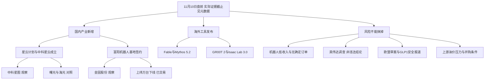

# 2026年11月10日 · 消息面事件驱动

> 置信度0.64 · partial/degraded · 17个底层事件 / 21个正反分面。不是固定八条，也不是开仓授权。

## 一句话结论
观察太空云与机器人直接主体；拦截把采购、下线当收入的叙事，保留芯片调查与医药监管风险。

## 先认市场：情绪=震荡
昨日沪指小涨而深创回落，超3100股下跌，资金奖励的是寒潮能源、卫星、机器人与部分PCB/国产算力的局部轮动，不足以判定唯一持续主线。全市场成交14946亿元与财联社沪深1.48万亿元口径分开记录。

主线=未确认；主线持续性=未知；主线封板率=未知；下一交易时段预期=分歧（假设）。本轮R1/R7后来同口径核到全市场54涨停、44未封板，炸板率44.90%、总体触板封板率55.10%；总体口径不等于任何未确认主线的封板率。R1已将上游-0.5%保守填值纠正为32只样本真实开盘溢价+4.0611%。按纪律将四个比较对象压缩为两个研究观察对象，不把它变成全市场停买。

本次先问四件事：市场在奖励什么——局部轮动；处在哪段——暂定高位震荡；谁有地位——R2未核，不授龙头；今天做什么——交两只研究观察和全部真实反证，不编价、不交易。

## 消息面全景图

## 顶级事件：事实、反应与传导逐项分开

### 🔴 E20261110_007 · 东方新能无确定客户订单且GPU履约与融资风险较高
强度=high · 极性=负面 · 衰减后=-0.731602 · 老方向新增风险披露

事实：公司明示尚无相关收入和确定客户订单。受海外技术管制、供货和融资制约，合同存在无法完全履行的现实可能；负债率64.96%，运营团队、客户、机房和电力配套处于起步阶段。
时间边界：风险已载同一份21:25:59报道所引公告；21:26:45异动快讯补充，不能加为第二份独立合同。
已查来源：D_ann_1273 / D_ann_df_risk / N522。源正文、原始时点与抓取时间内嵌JSON evidence_registry；窗口为本轮实际取得范围，不表示全市场公告穷尽。

- **大资金意图**：未核资金意图；采购金额较大不能替代终端客户及融资确认。
- **为什么走强**：持股36%储能项目并网但未商业运营也是公司披露，不能作既有运营现金流支撑。
- **逻辑够不够硬**：合同公告及异动公告原文交叉读取；负面为实质履约、融资和客户缺口，不是因为辅助provider不可用。
- 反证/验证点：交R5核公司可用现金及融资条件、交R6独立裁决；R4不自行赋hard_reject。

### 🟢 E20261110_009 · Anthropic发布Fable与Mythos 5.2并降价
强度=high · 极性=正面 · 衰减后=+0.720000 · 老方向新增催化

事实：官网11月9日英文日期原文确认两种版本共享底层模型，标准价每百万输入8美元、输出40美元；Fable面向全部用户，Mythos需通过生物或网络验证计划申请，不是无条件开放权重。
时间边界：官网只有英文11月9日日期无精确时分或显式时区；本轮最早北京时间11月10日03:00:31快讯。保留双日期不强制合并。
已查来源：D_anthropic_official / N125 / N135 / Q3_0。源正文、原始时点与抓取时间内嵌JSON evidence_registry；窗口为本轮实际取得范围，不表示全市场公告穷尽。

- **大资金意图**：成本下降可改善使用经济性，但没有A股客户订单或资金反应证明，不把工具升级直接封为主线。
- **为什么走强**：发布在A股11月9日收盘后；今日A股资金反应尚不存在。
- **逻辑够不够硬**：已直读官网发布及价格段；性能榜单为厂商测试，不写成独立第三方结论。
- 反证/验证点：本次不把IPO传闻日期或高性能测试直接转成某家A股收入；降价对同质化服务商的另一面并列。

### 🔴 E20261110_005 · 上纬再次提示需求验证不足及经营亏损风险
强度=high · 极性=负面 · 衰减后=-0.705781 · 老方向新增风险披露

事实：2026-056原公告提示终端需求持续性、订单转化、产能和良率风险；机器人收入占比低。前三季归母亏损42197.92万元，扣非亏损42541.46万元，不能把此前下线规模写成盈利兑现。
时间边界：新闻11月9日19:48:11已报道；PDF落款11月10日不覆盖更早公众可知时刻。
已查来源：D_ann_447 / N705 / A39。源正文、原始时点与抓取时间内嵌JSON evidence_registry；窗口为本轮实际取得范围，不表示全市场公告穷尽。

- **大资金意图**：不以高涨幅推断机构出货，但高热叙事与已披露利润缺口形成可核反证。
- **为什么走强**：昨日约20%涨幅为价格事实；是否今日弱转强、资金承接未知。
- **逻辑够不够硬**：原公告两页已读；引述其中市盈率数字只代表公告口径，不作R4估值判断。
- 反证/验证点：业绩累计值仅为背景，不以累计同比判周期；Q3单季可由H1累计倒推，但Q2单季及预期差未核，不能另造业绩利好。

### 🟢 E20261110_001 · 星云星座计划发布及中科星云成立运营
强度=high · 极性=正面 · 衰减后=+0.688566 · 老方向新增催化

事实：11月9日合肥大会发布全栈国产化星云星座计划。中科星云注册资本15亿元并成立运营；中科星图、中科曙光、海光信息等为产业发起主体。注册资本不是实缴到账或上市公司新增销售订单。
时间边界：本轮取得最早带时分记录为同花顺11月9日16:14快讯；此前日历仅证实大会预告。发布与成立的更早公众时刻未穷尽核定。
已查来源：A37 / N1796 / Q0_0 / Q0_2 / D_web_0_2。源正文、原始时点与抓取时间内嵌JSON evidence_registry；窗口为本轮实际取得范围，不表示全市场公告穷尽。

- **大资金意图**：未核资金流；直接股东与各自业务环节比群聊泛化钛板更有可检验的事件关系。
- **为什么走强**：昨日卫星ETF领涨及信维通信上涨是已发生价格事实；16:14披露不能解释此前盘中全部涨幅。
- **逻辑够不够硬**：产业计划及成立有央视稿传播链与上证报现场报道可追溯；各上市公司的出资比例、订单及回款未核，盈利传导仍是假设。
- 反证/验证点：采购、在轨验证、订单与实际收入均需后续公告；不能把15亿元注册资本认作三家各得15亿元订单。

### 🔴 E20261110_020 · 润农节水董事及常务副总经理被立案和留置
强度=high · 极性=负面 · 衰减后=-0.662745 · 新增风险披露

事实：公司称11月7日收到监察机关立案和留置通知，针对董事、常务副总经理张国峰。公告称其他管理人员正常履职、生产经营正常，结论与进展未知；不是已认定上市公司违法。
时间边界：原件落款11月9日无分钟，本轮未证明盘前或盘后最早公开；date保守映射11月10日，披露分钟未知。
已查来源：D_ann_1。源正文、原始时点与抓取时间内嵌JSON evidence_registry；窗口为本轮实际取得范围，不表示全市场公告穷尽。

- **大资金意图**：没有资金依据；仅保留治理风险事实，不推断强制平仓或资金撤离。
- **为什么走强**：未核公告后交易反应。
- **逻辑够不够硬**：公司原公告一页已读，人员范围明确；不得推广为全行业合规事件。
- 反证/验证点：公司对经营正常的说明与仍未知的调查结论并列交R6，不能单留负面标题或反过来宣布无风险。

### 🔴 E20261110_011 · 英伟达董事会启动独立调查并仍表达对管理层信心
强度=high · 极性=负面 · 衰减后=-0.636924 · 已交易后的延续及风险观察

事实：公司11月8日英文声明确认由独立董事及外部律师监督调查；同段明确目前没有理由认为国家安全或公司机密被泄露，并对黄仁勋及团队仍有信心。调查不等于违法、泄密成立或已新增出口禁令。
时间边界：公司只标英文11月8日，无精确时分/时区；中国媒体11月9日早盘前已报道。本轮不把今日凌晨政治表态当新调查立案。
已查来源：D_nvidia_board / A6 / N51 / N52。源正文、原始时点与抓取时间内嵌JSON evidence_registry；窗口为本轮实际取得范围，不表示全市场公告穷尽。

- **大资金意图**：未核资金净流入；高管治理不确定性可影响风险溢价，但不能由传闻推断所有海外算力订单取消。
- **为什么走强**：最新快讯报英伟达收跌约4.2%至4.3%，盘中最大跌幅8.8%；同期美股三大指数收涨，不能写全美科技普跌。
- **逻辑够不够硬**：已直接读取公司董事会原声明，泄密指控仍未证实；收盘跌幅快讯有4.22%与4.3%口径差异，保留冲突。
- 反证/验证点：国产替代受益只是方向假设，进口政策、客户迁移和新增订单未核。正面CoRL发布另列独立底层事件。

### 🟢 E20261110_012 · 英伟达CoRL发布GR00T 2及Isaac Lab 3.0
强度=high · 极性=正面 · 衰减后=+0.611103 · 老方向新增催化

事实：官网原文确认CoRL发布GR00T 2开放世界动作模型、Isaac Lab 3.0及开放基准。特定仿真测试和合作应用属于厂商发布，不等于A股数据公司已取得采购合同。
时间边界：英文官网11月9日无时分，最早取得北京时间22:03:14快讯；不把英文日期当北京时间00:00。
已查来源：D_nvidia_corl / N472。源正文、原始时点与抓取时间内嵌JSON evidence_registry；窗口为本轮实际取得范围，不表示全市场公告穷尽。

- **大资金意图**：未核资金，观察机器人从硬件规模向训练工具与数据闭环的产业传导，而非宣布所有数据概念成为龙头。
- **为什么走强**：A股机器人11月9日盘中已活跃；晚间新品发布只能增加次日假设，不能解释此前上涨。
- **逻辑够不够硬**：官网发布与版本号已直核；成功率为特定任务的自测，不推广成通用商业化成功率。
- 反证/验证点：凡拓与开普云是否参与该发布或获得NVIDIA订单未查定；不据主业接近虚构合作。

### 🔴 E20261110_003 · 金固提示机器人收入利润占比极低且增持未实施
强度=high · 极性=负面 · 衰减后=-0.585281 · 老方向新增风险披露

事实：2026-044原公告确认结构件业务规模化生产、交付和商业化不确定，现阶段收入及利润占比极低。1000万至2000万元增持计划截至公告披露日尚未实施。
时间边界：公告正文落款11月9日，接口索引11月10日00:00不是公众发布时间；最早取得新闻摘要17:10:53。
已查来源：D_ann_kingold / Q1_4。源正文、原始时点与抓取时间内嵌JSON evidence_registry；窗口为本轮实际取得范围，不表示全市场公告穷尽。

- **大资金意图**：没有增持成交证据，不能把计划金额称为管理层已买入，也不能以涨停覆盖风险。
- **为什么走强**：异动公告说明11月5日、6日、9日累计偏离超过20%；不据此认定三连板。
- **逻辑够不够硬**：公司原公告已读；商业化占比极低为直接披露，不是本模型猜测。
- 反证/验证点：后续实际交付、收入占比及已实施增持可改变研究判断；风险不自动等于R6 hard_reject。

### 🔴 E20261110_019 · 北化子公司收到涉及出资及转增资本的诉讼传票
强度=high · 极性=负面 · 衰减后=-0.568067 · 新增诉讼披露

事实：案件已受理尚未开庭，诉请包括23000万元出资及8862.60万元利息、15017.16万元资本公积和工程款转增及1039.51万元利息。11月26日开庭；请求金额不是已确定赔偿损失。
时间边界：新闻11月9日19:37:29已披露；PDF落款11月10日。
已查来源：D_ann_1281 / N721 / N722。源正文、原始时点与抓取时间内嵌JSON evidence_registry；窗口为本轮实际取得范围，不表示全市场公告穷尽。

- **大资金意图**：未核机构买卖，军工主题热度不能抹掉子公司诉讼风险。
- **为什么走强**：未核该股公告后价格反应。
- **逻辑够不够硬**：三页公告已读；另一解散案相关子公司占比低于5%不能用来否定本案全部潜在影响。
- 反证/验证点：本期/期后损益影响尚未确定；不得把全部诉请直接计成当期费用。

### 🟢 E20261110_004 · 上纬启元Q1与T1合计下线一万台
强度=high · 极性=正面 · 衰减后=+0.559460 · 已交易后的延续

事实：2026-055公告称9月20日对外发布Q1/T1，截至该公告披露日合计下线10000台。生产里程碑不是已售出、已交付或已回款10000台。
时间边界：公司原件只有11月9日日期无时分；运输日历11月9日08:01:45截止的截取已含此项，为已知上界而非原始公众时刻。
已查来源：D_ann_sw_progress_cninfo / K_CAL_C01。源正文、原始时点与抓取时间内嵌JSON evidence_registry；窗口为本轮实际取得范围，不表示全市场公告穷尽。

- **大资金意图**：未核资金流；产业验证从产品发布推进到生产规模，但不能推断大资金已经押注盈利兑现。
- **为什么走强**：上纬11月9日收盘涨幅约20%，属于已交易事件，11月10日不是新首发。
- **逻辑够不够硬**：巨潮原公告已读取一页全文；商业化数据缺口由公告自身明确披露。
- 反证/验证点：公司机器人收入占比低及需求不确定必须与生产里程碑并列，不能净成单一利好。

### 🟢 E20261110_006 · 东方新能签署约9.12亿元GPU板卡采购合同
强度=high · 极性=正面 · 衰减后=+0.542246 · 老方向新增催化

事实：公司作为采购方拟由企管中心购买GPU产品，含税91245.6万元，最终按采购及结算；最迟签署后12个月交货。原文明确区别于大模型训练GPU，主要供推理、微调、渲染等。
时间边界：公司公告11月9日落款；本轮取得最早快讯21:25:59。
已查来源：D_ann_1273 / N525。源正文、原始时点与抓取时间内嵌JSON evidence_registry；窗口为本轮实际取得范围，不表示全市场公告穷尽。

- **大资金意图**：这是资产投入，不是客户向东方新能采购的销售订单，不能按合同总额推收入。
- **为什么走强**：11月6日与9日股价累计偏离超过20%在采购新闻公开之前，不能声称采购快讯解释此前全部上涨。
- **逻辑够不够硬**：五页合同公告正文已读，金额、付款、交货、解除条款有据；供应方名称豁免披露。
- 反证/验证点：正面仅是业务建设投入落地，财务兑现与供货确定性由下一条独立负面分面完整披露。

### 🟢 E20261110_017 · 亚玛顿签署20%股权转让正式协议并今日复牌
强度=high · 极性=正面 · 衰减后=+0.525032 · 老方向新增催化

事实：控股股东拟以6.8亿元转让38612502股即总股本20%给骑形网络，11月9日从意向推进到正式股份转让协议；11月10日复牌。不是已完成过户或上市公司获得6.8亿元现金。
时间边界：11月9日22:55:24新闻已报道；两份PDF索引11月10日并不表示消息到今日才公开。
已查来源：D_ann_1211 / D_ann_1210 / N387。源正文、原始时点与抓取时间内嵌JSON evidence_registry；窗口为本轮实际取得范围，不表示全市场公告穷尽。

- **大资金意图**：未核资金，不把买方股东背景自动等同于游戏资产注入预案。
- **为什么走强**：昨日处于停牌，无昨日该股涨跌可用于判强弱；今日复牌承接未知。
- **逻辑够不够硬**：转让及复牌原公告已读，金额与股数有据；既有光伏主业尚未因此改变。
- 反证/验证点：承诺豁免、合规确认与股份过户尚待完成，单列反向分面，不以复牌当成功交割。

### 🟢 E20261110_008 · 中医药传统知识保护条例公布并明确明年施行
强度=high · 极性=正面 · 衰减后=+0.516425 · 老方向新增催化

事实：条例共32条，自2027年1月1日起施行。建立保护数据库与保护名录，支持传承、应用和研究；并非直接给全部中药公司增加订单或独家准入。
时间边界：本轮最早同花顺17:00记录是截断稿；新华社全文17:04:46已直读。具体更早发布未穷尽。
已查来源：D_web_2_3 / N1054 / A45。源正文、原始时点与抓取时间内嵌JSON evidence_registry；窗口为本轮实际取得范围，不表示全市场公告穷尽。

- **大资金意图**：未核中药板块资金，不把行政法规发布当作资金已完成风格切换。
- **为什么走强**：政策在昨日收盘后披露；不能解释此前午盘医药涨幅。
- **逻辑够不够硬**：新华社受权发布全文可核；纳入名录的具体企业、产品、收入贡献未知，故不造中药首推票。
- 反证/验证点：第8条投资与技术出口仍按相关法规执行；数据库、持有人权益和利用限制可能增加合规要求，不是无约束放开。

### 🔴 E20261110_021 · 金陵药业终止常州四药投资意向
强度=high · 极性=负面 · 衰减后=-0.490604 · 已交易后的延续

事实：公司披露终止此前常州四药投资意向事项，原交易预期撤下；不是仅延期，也不是终止后自动获得新收购标的。
时间边界：运输日历11月9日上午已包含终止事实；当前PDF落款/实际公开分钟须以原件与传播索引分别保留，未证实最早分钟。
已查来源：D_ann_390 / K_CAL_C05。源正文、原始时点与抓取时间内嵌JSON evidence_registry；窗口为本轮实际取得范围，不表示全市场公告穷尽。

- **大资金意图**：未核资金。条例催化中药行业不能恢复已终止公司的原并购逻辑。
- **为什么走强**：未核该股11月9日市场反应，不能推断利空已出尽。
- **逻辑够不够硬**：已读取两页终止原公告，并与运输摘录互证，日历和公告属于同一底层事实。
- 反证/验证点：是否有其他新交易须新证据；本次不能拿中药政策给终止并购补故事。 原件落款11月6日，索引11月9日；落款不等于首发。本轮日历已知上界为11月9日上午。

### 🔴 E20261110_018 · 亚玛顿控制权变更尚待豁免限售承诺与过户
强度=high · 极性=负面 · 衰减后=-0.473389 · 同一交易条件披露

事实：公司股东会需审议豁免原实控人自愿性限售承诺，还需交易所合规确认及中登过户；最终实施不确定。
时间边界：条件随转让消息同日公开；不另外虚增独立事件数。
已查来源：D_ann_1211 / D_ann_1210。源正文、原始时点与抓取时间内嵌JSON evidence_registry；窗口为本轮实际取得范围，不表示全市场公告穷尽。

- **大资金意图**：未核资金；正式协议比意向更进一步，但仍不能交易已交割成功的确定性。
- **为什么走强**：复牌后的价格、封单及次日接力尚未知。
- **逻辑够不够硬**：条件为公告原文，不是对收购失败概率的主观打分。
- 反证/验证点：后续审议通过、过户完成可改变状态；不永久按未完成写成完成不了。

### 🔴 E20261110_013 · 国际油价收跌压制上游油气和高油价溢价
强度=medium · 极性=负面 · 衰减后=-0.670000 · 老方向新增价格与谈判催化

事实：快讯报美油86.85美元收跌4.38%，布油92.57美元收跌5.85%。谈判重启及核方案为媒体/匿名消息，卡塔尔官员否认部分方案细节，不能写成停战协议已签。
时间边界：油价盘中下行11月9日已发生；本条使用11月10日04:27:39收盘报道，谈判传闻分别保留传播时点。
已查来源：N65 / N94 / N504 / Q45_1。源正文、原始时点与抓取时间内嵌JSON evidence_registry；窗口为本轮实际取得范围，不表示全市场公告穷尽。

- **大资金意图**：价格已反映风险溢价回吐，但未取得持仓/净流数据，不能断言某机构撤出能源。
- **为什么走强**：布油盘中跌近7%和收盘跌5.85%为不同时点，不能取最大跌幅作收盘。
- **逻辑够不够硬**：价格为新闻记录，未取得交易所行情直核，因此medium；伊朗/美方一致确认的最终协议仍缺。
- 反证/验证点：若谈判破裂或军事冲突升级，油价方向可迅速逆转；不能静态将煤炭、燃气与原油全部同跌。

### 🟢 E20261110_002 · 上纬启元与金固等富阳基地项目签约
强度=medium · 极性=正面 · 衰减后=+0.620000 · 老方向新增催化

事实：科创板日报报道11月9日举行基地签约与总部中心揭牌。上纬启元、金固股份、富阳产投三方设立项目运营主体；报道未给出投资额、销售合同额或新增利润。
时间边界：本轮最早取得科创板日报11月10日04:24记录；活动实际发生于11月9日，是否当时已有公开报道未知。
已查来源：Q30_0 / D_cls_fuyang / D_web_1_0。源正文、原始时点与抓取时间内嵌JSON evidence_registry；窗口为本轮实际取得范围，不表示全市场公告穷尽。

- **大资金意图**：未核资金意图。相较仅有题材名称的结构件公司，金固被签约报道直接点名，适合作为产业关系观察对象。
- **为什么走强**：金固11月9日涨停已被收评记录；不能用次日凌晨报道倒推昨日日内资金早已知情。
- **逻辑够不够硬**：已读取科创板日报原页，其他平台为同稿转载只算一源；未取得项目合同原件，不升high。
- 反证/验证点：金固同期原公告称机器人收入和利润占比极低；基地签约不等于建成投产或已接大单。

### 🔴 E20261110_015 · 欧盟数字公平草案拟约束成瘾设计和AI陪伴功能
强度=medium · 极性=负面 · 衰减后=-0.580000 · 老方向新增监管风险

事实：财联社据媒体所见草案报道，拟允许关闭过度使用功能、规范订阅并约束面向未成年人的付费机制。11月11日公布为报道预期；仍待议会及成员国审议，不是今日已经实施或已开罚。
时间边界：财联社原页00:53与索引00:53:50略异，后者为精细索引时点；未取得欧盟最终文本。
已查来源：D_cls_eu / M80 / Q41_0。源正文、原始时点与抓取时间内嵌JSON evidence_registry；窗口为本轮实际取得范围，不表示全市场公告穷尽。

- **大资金意图**：未核资金和地区收入敞口，不把出海短剧、游戏全部写成受罚。
- **为什么走强**：当前无11月10日A股反应；隔夜美股上涨不否定未来合规成本。
- **逻辑够不够硬**：原新闻页已读；底层为媒体所见草案而非生效法，故medium。
- 反证/验证点：草案可能修改，B端AI与不依赖成瘾留存的产品不等同于AI陪伴；需逐票核欧洲收入与功能。

### 🔴 E20261110_016 · FDA要求GLP-1药物增加罕见眼病警告的报道
强度=medium · 极性=负面 · 衰减后=-0.559460 · 老方向新增监管风险

事实：财联社原稿转载全文称美国要求GLP-1类药物更新NAION罕见眼病警告。原稿同时说明绝对发生率较低、证据并非一致及药企回应；标签警告不是禁售，也不是中国监管已采取同一措施。
时间边界：最早取得新浪22:29:29快讯；财联社长稿北京时间次日02:26，FDA安全页本轮401未能直核。
已查来源：N442 / N294 / M66 / D_fda_report / Q40_0 / FDA_ACCESS。源正文、原始时点与抓取时间内嵌JSON evidence_registry；窗口为本轮实际取得范围，不表示全市场公告穷尽。

- **大资金意图**：未核A股药企资金和美国销售敞口，只交药物类别风险，不泛化为全部创新药订单坍塌。
- **为什么走强**：尚未核礼来、诺和诺德收盘表现；不能由标签风险反推股价已经下跌。
- **逻辑够不够硬**：已取得完整财联社署名转载与快讯，仍同一监管事件；FDA原页401是本维度缺口，不升high也不删除负面。
- 反证/验证点：获益风险仍需临床评价，绝对罕见性和不同研究结果均保留；不得引导患者自行停药。

### 🟢 E20261110_014 · 油价回落为航空及耗油制造提供潜在成本缓解
强度=medium · 极性=正面 · 衰减后=+0.460000 · 老方向新增催化的反向分面

事实：同一原油价格下降可降低部分下游成本，行业利润改善仍取决于燃油采购滞后、套保、汇率及终端运价；不是已核业绩预增。
时间边界：与原油下跌同一底层事实，不另加来源权重。
已查来源：N65 / N504 / Q45_1。源正文、原始时点与抓取时间内嵌JSON evidence_registry；窗口为本轮实际取得范围，不表示全市场公告穷尽。

- **大资金意图**：未核下游股票资金，不以成本逻辑授予低波动或无催化股票执行资格。
- **为什么走强**：本交易日尚未开盘，航空是否形成板块合力未知。
- **逻辑够不够硬**：成本方向有经济逻辑，具体盈利弹性未建模；只作板块研究交接。
- 反证/验证点：若下游需求同步下降或套保损失抵消，低油价不必然增利。

### 🔴 E20261110_010 · 旗舰模型降价增加同质化AI应用和外包替代压力
强度=medium · 极性=负面 · 衰减后=-0.420000 · 老方向新增催化的反向分面

事实：模型标准定价下降为已核事实；对同质化套壳、按人天计费外包的利润挤压是传导假设，并非已公布的A股业绩下降。
时间边界：与同一发布原文同源，不能另算独立支持。
已查来源：D_anthropic_official / N125。源正文、原始时点与抓取时间内嵌JSON evidence_registry；窗口为本轮实际取得范围，不表示全市场公告穷尽。

- **大资金意图**：未核机构减仓，不把替代风险写成资金已经出逃。
- **为什么走强**：尚无本交易日价格确认；仅记录商业模式反向压力。
- **逻辑够不够硬**：降价原文硬，利润挤压方向中等证据；可以提高应用需求也可以压低服务单价，两者不互相抵消。
- 反证/验证点：真正掌握数据、场景、渠道或已有付费订单者可能受益，不能一刀切否定AI应用行业。

## 两只研究观察对象：不是首推或执行池
原四对象为中科星图、金固股份、上纬新材、凡拓数创。暂报炸板率触发减半，仅保留前两者的消息侧观察；两者均未通过交易门禁，in_today_plan未知。

### 中科星图 688568.SH · 观察
机会归类：计划内试错（研究假设；D1是否纳入未知）。板型：昨日未涨停；今日板型未知；龙头认定：unknown / 纪律通过条数未知；RR=null；禁止清单：尚未完整核验，不以空命中冒称通过。
- **买入理由**：只作观察：中科星云直接产业发起主体，空天信息业务映射有报道和问财支持；不是因为名称带中科。
- **风险点**：计划非订单；出资比例、太空云收入及回款未知，R7资金与R2地位未确认。
- **止损条件**：研究假设失效条件：公司澄清不参与、项目实质停止或核心技术/订单无法验证。价格止损需R5/D1结构依据，当前null。
- **可验证假设**：先核公司公告与项目出资/在轨及客户节点，再由R2/R7确认板块合力与核心地位；不能把盘后发布解释盘中拉升。
- 业绩交叉：当日抓取500行Q3旧样本未命中本票，不能写无预告；H1、单季环比与完整公告覆盖未核。止损、目标区、RR均null，不给默认仓位。

### 金固股份 002488.SZ · 观察
机会归类：计划内试错（研究假设；D1是否纳入未知）。板型：昨日涨停；连板梯队/今日板型未知；龙头认定：unknown / 纪律通过条数未知；RR=null；禁止清单：尚未完整核验，不以空命中冒称通过。
- **买入理由**：只作观察：富阳基地三方签约报道直接点名金固，比泛化结构件映射更精确；不据此授予龙头资格。
- **风险点**：公告明示机器人收入利润极低、交付及商业化不确定；增持尚未实施；新签约报道不能解释此前涨停。
- **止损条件**：研究假设失效条件：签约关系被澄清、项目主体未能设立或交付商业化不达预期。无结构价位不编止损。
- **可验证假设**：核项目原合同/股权和订单、实际投产与收入；资金承接及次日接力交R2/R7/D1，不由消息利好推定。
- 业绩交叉：当日抓取500行Q3旧样本未命中本票，不能写无预告；H1、单季环比与完整公告覆盖未核。止损、目标区、RR均null，不给默认仓位。

## 对照对象：为什么这轮不选
| 对象 | 态度 | 比较及裁决 |
|---|---|---|
| 上纬新材 688585.SH | 降级 | 万台下线是已交易生产事实；自身原公告又提示需求/订单转化及低收入占比。保留双面研究，不把万台销量/利润当新硬alpha；相较金固新增富阳直接签约线索，不再增加同链观察名额。非硬否决。 |
| 凡拓数创 301313.SZ | 不进 | 群聊称物理AI总龙头不是资格；CoRL原文没有核到该公司直接订单或合作。本轮公告搜索主要返回5月旧减持及8月期限届满未减持，不能写今日新减持或已排除全部负面。保留研究线索，不进入本批精简观察名单。 |
| 开普云 688228.SH | 观察 | 财联社旧调研叙事及昨日涨9.48%已交易；未独立核数采订单金额、客户及公告冲突，不能仅以媒体回顾升为本轮直接消息首推。 |
| 中科曙光 603019.SH | 观察 | 同为直接产业发起主体并有服务器角色，保留供R2比较；未查出资比例、边际收入及核心地位，不因同一项目把全部股东同时选入，也不按大盘风格静态排除。 |
| 海光信息 688041.SH | 观察 | 直接国产芯片环节真实；10月累计预告是旧背景，不是11月10日新增业绩冲击，单季环比/预期差未核。保留R2比较，不用旧同比增速争抢本轮新消息名额。 |
| 东方新能 002310.SZ | 降级 | 采购方支出不是客户订单；公司原公告明确无确定客户和收入、供货及融资风险高，不选作本轮直接消息观察核心。不是因为缺provider而排除。 |
| 亚玛顿 002623.SZ | 观察 | 正式协议与复牌为实事件，但未过户，未见游戏资产注入公告；不能把买方行业背景推成上市公司收入。作为独立事件交接，不挤入本轮主线观察对象。 |
| 剑桥科技 603083.SH | 观察 | 19:14:50报道在手订单与备料为公司说明会表述；搜索原件显示部分准备交付措辞在中期报告已存在，不能把同段旧话计成全新订单。英伟达调查也不能推成全部砍单，完整客户与新订单未核。 |
| 药明康德 603259.SH | 不进 | 群聊原 token 为“260H”，没有将其修成“1260H”后冒称验证；多次新闻检索未取得该token移除的本期官方文件，且遇到旧文错标日期。传闻保留待核，不用相邻名单/旧起诉证明已移除。 |

## 板块 × 极性叉乘
不是将新闻正负分数相抵。每一条正向传导都与影响同一或相邻商业链的风险并排，资金确认列保留未知。
| 板块 | 正向与反向同时成立的条件 | 下一验证 |
|---|---|---|
| 太空算力/国产算力 | 国内自主产业部署与海外GPU供给/治理不确定性同时存在；星云是计划、东方是采购，不能拼成确定收入。 | 资金交R7，地位交R2；查真实客户、出资比例及验收回款 |
| 人形机器人/物理AI | 产能、基地与仿真工具同时推进，但终端需求、商业化、收入占比仍是硬风险，不能按消息条数抵消。 | 查订单与交付、核心股带动及下游板块合力 |
| AI应用/出海游戏 | 降价扩大可用性也压低同质服务价格；欧盟仅草案，影响取决于欧洲收入和成瘾留存功能，不外推为所有AI禁令。 | 公司付费客户/收入结构与监管正式文本 |
| 医药 | 中医药知识保护、GLP-1安全和个股投资终止是不同因果链，不用中药政策冲淡减肥药风险，也不把GLP-1风险扩成全部创新药。 | 具体名录及产品映射，FDA原文及实际地区销售敞口 |
| 能源/航空 | 原油回落对上游和耗油下游反向传导；煤炭燃气昨日受寒潮影响不能直接等同油价交易，谈判传闻非已签停战。 | 燃料成本传导、需求和谈判官方结果 |
| 并购/控制权 | 意向、正式协议、过户、终止各为不同状态；交易额非上市公司收入，不能把所有复牌视为交割成功。 | 限售承诺豁免、合规确认与过户公告 |

## 已知旧事件与真实交易状态
| 对象 | 已核事实 | 风险与不选理由 |
|---|---|---|
| 天安新材 603725.SH | 11月6日签嘉万光62.5%股权意向，增资7000万元加股权转让暂定18000万元合计2.5亿元；并非已交割。 | 原股东/关联方非经营性资金占用仍在梳理清收；财务数据未经审计、正式协议未签、跨行业整合与商誉风险。 相较星图直接产业主体，仍是跨界意向且存在实质资金占用待清理；不将光通信热度当完成并购。 |
| 华新建材 600801.SH | 11月7日签正式股权收购协议，约16.42亿美元股权对价与23.085亿美元企业价值不同；拟购99.99%，交割价格按净债务和营运资金调整。 | 中巴备案/审批、汇率、融资和境外经营风险仍存，未交割。 真实产业并购保留，但缺本轮新增完成节点及市场合力证据；不是因传统建材标签排除。 |
| 艾为电子 688798.SH | 拟以股份和现金购买钰泰控股权；仅意向，11月10日起股票与可转债停牌、转股暂停，预计不超过10个交易日。 | 交易未最终确定、待董事会/股东会和监管批准；今日停牌不能成为可成交标的。 已核交易状态，不是辅助数据缺失，今日不能交易。 |
| ST思科瑞 688053.SH | 11月10日停牌一天，11月11日复牌撤销其他风险警示，20%日涨跌幅不变。 | 历史虚假陈述、投资者索赔及预计负债仍在原文；撤ST不是经营基本面自动改善。 今天停牌，未来撤标不能当作今天开仓资格。 |

## 🔥 中报业绩预告命中
本轮实际源是2026Q3旧样本，不把章节标题里的“中报”当H1已经查全。以下按归母净利润累计预告增速上限排序并证券去重，只代表500行样本的前15项；行数不是公司数。均不作为本轮新增业绩事件。
| 代码 | 公司 | 原预告日 | 累计增速区间 | 与本轮事件交集及判断 |
|---|---|---|---|---|
| 001309.SZ | 德明利 | 2026-10-17 | 32046.52～33154.49% | 无已核新增直接事件；存储/原油相关只属板块背景，不精确映射本轮候选；单季环比未核，极性中性 |
| 300821.SZ | 东岳硅材 | 2026-10-08 | 19047.97～19748.08% | 无已核新增直接事件；存储/原油相关只属板块背景，不精确映射本轮候选；单季环比未核，极性中性 |
| 000703.SZ | 恒逸石化 | 2026-10-16 | 3318.59～3405.13% | 无已核新增直接事件；存储/原油相关只属板块背景，不精确映射本轮候选；单季环比未核，极性中性 |
| 002466.SZ | 天齐锂业 | 2026-10-21 | 2734.97～3235.26% | 无已核新增直接事件；存储/原油相关只属板块背景，不精确映射本轮候选；单季环比未核，极性中性 |
| 688825.SH | 长鑫科技 | 2026-10-17 | 2581.06～2609.47% | 无已核新增直接事件；存储/原油相关只属板块背景，不精确映射本轮候选；单季环比未核，极性中性 |
| 002812.SZ | 恩捷股份 | 2026-10-14 | 1884～2474.8% | 无已核新增直接事件；存储/原油相关只属板块背景，不精确映射本轮候选；单季环比未核，极性中性 |
| 688808.SH | 联讯仪器 | 2026-10-13 | 1866～2072.95% | 无已核新增直接事件；存储/原油相关只属板块背景，不精确映射本轮候选；单季环比未核，极性中性 |
| 301308.SZ | 江波龙 | 2026-10-15 | 1864.55～1990.84% | 无已核新增直接事件；存储/原油相关只属板块背景，不精确映射本轮候选；单季环比未核，极性中性 |
| 605189.SH | 富春染织 | 2026-10-14 | 1347.69～1519.01% | 无已核新增直接事件；存储/原油相关只属板块背景，不精确映射本轮候选；单季环比未核，极性中性 |
| 688388.SH | 嘉元科技 | 2026-10-15 | 1196.6～1318.92% | 无已核新增直接事件；存储/原油相关只属板块背景，不精确映射本轮候选；单季环比未核，极性中性 |
| 603991.SH | 领先股份 | 2026-10-21 | 1238.57～1238.57% | 无已核新增直接事件；存储/原油相关只属板块背景，不精确映射本轮候选；单季环比未核，极性中性 |
| 603026.SH | 石大胜华 | 2026-10-15 | 968.14～1032.45% | 无已核新增直接事件；存储/原油相关只属板块背景，不精确映射本轮候选；单季环比未核，极性中性 |
| 000626.SZ | 远大控股 | 2026-10-15 | 890～1018% | 无已核新增直接事件；存储/原油相关只属板块背景，不精确映射本轮候选；单季环比未核，极性中性 |
| 002493.SZ | 荣盛石化 | 2026-10-15 | 777.93～822.95% | 无已核新增直接事件；存储/原油相关只属板块背景，不精确映射本轮候选；单季环比未核，极性中性 |
| 300497.SZ | 富祥股份 | 2026-09-18 | 658～785% | 无已核新增直接事件；存储/原油相关只属板块背景，不精确映射本轮候选；单季环比未核，极性中性 |

海光信息在样本有10月16日累计预告（归母+38.16%～51.93%），但不是本次新增消息，单季/预期差未核，不给正面硬alpha加成。上纬当前风险原公告已披露前三季亏损，不用旧样本未命中覆盖这一事实。

## 关键证据
- 星云计划是产业部署，15亿元注册资本不是各上市公司的收入或合同。直接主体来自上证报现场稿，转载与日历不再计独立支持。
- 金固2026-044：机器人收入利润占比极低，增持计划未实施。
- 东方2026-074：采购91245.6万元，未形成客户订单及相关收入，董事会承认履约风险较高。
- NVIDIA董事会原文既确认调查，也明示暂无理由认为机密泄露且仍信任管理层；两面不裁掉。
- FDA原页401，保留完整财联社署名转载中的风险及绝对罕见性，不能宣称直核监管原文。

## 专题知识裁决
context_sha256: 9fc84baffacc14083a3ef3a3ccc67407da3eab3b68eed0a34b0eb2e88efa787f
来源：catalyst_calendar:f50d2d1bfc84ffa9077e57ce64b266c71f747d7a3b13abf9dce065226122b09e
态度：adopted，仅采状态区分和比较线索，原稿未全文读取；保留运输前缀、完整源索引、源哈希、时点及limitations。未采用全部提及代码，不把未来排期当今日落地；嵌入upstream_knowledge为空，不虚构上游来源。

## 数据源审计
| 源 | 日期 | 状态 | 记录与真实覆盖 |
|---|---|---|---|
| news_cls | 2026-11-10 | 🟢 | 2219；实际sina+10jqka；不是财联社直采；跨平台转载重复；部分10jqka正文截断 |
| news_major | 2026-11-10 | 🟡 | 800；800条上限，只覆盖11月9日16:37:42至11月10日04:44:13且content空，不是72小时全文 |
| wechat_official_20 | 2026-11-10 | 🟢 | 83；与RSS镜像只计一次；17 feed而非宣称21号全覆盖；当日7点盘前纪要尚未到发布时间 |
| wechat_cli_5groups | 2026-11-10 | 🟢 | 407；5群407条文本快照；图片和失效链接未OCR，不宣称读过图像；同稿跨群只算一次 |
| anns_window | 2026-11-10 | 🟢 | 1447；1447条743家公司；自然日索引，不保证分钟首发与抓取后新增公告覆盖 |
| eastmoney_earnings_predict | 2026-11-10 | 🟡 | 500；Q3旧样本500行，不是500家公司，不是本期新预告全量；最新公告11月4日。H1未穷尽，未命中保留unknown |
| hithink_news_announcement_business_event | 2026-11-10 | 🟢 | 33；33次真实HTTP200；可达不等于相关命中。事件查询空值重试仍未返回协议关系；业务数据报告期缺失。 |
| hithink_business_query | 2026-11-10 | 🟢 | 2；星图与金固主营构成已查；数值不用于填造业务重叠分 |
| primary_documents | 2026-11-10 | 🔴 | 27；原件与页面实际请求；FDA401、SSE业务进展返回200空内容（用巨潮镜像补核）；非全部原始监管文件可达 |
| tushare_live | 2026-11-10 | 🟢 | 5；本轮直调5次：交易日历、18点至06:11新浪快讯、3票公告；快讯工具结果归档后读取筛选，非全部全文阅读 |
| events_previous_evening | 2026-11-09 | 🟢 | 未知；已读原快照；股东交易表将百合终止计划仍列DE预案，公告优先，不能把旧计划当当前卖压；anns_classified缺失不全局降级 |
| R1_current | 2026-11-10 | 🟡 | 未知；本轮生成06:18；整体degraded，但同口径市场广度和炸板证据可核；不采仓位建议为账户权限 |
| R7_current | 2026-11-10 | 🟢 | 10；本轮06:20生成、partial；市场及行业数据已读，本报告两观察票不在覆盖中，不冒称逐票资金确认 |
| R3_current | 2026-11-10 | 🔴 | 未知；未取得当前摘要；不确认KOL独立共振 |

## 不确定性 / 反证
- FDA安全目录401，原监管文件未取得；保留财联社署名稿中等证据风险
- 长篇800条仅标题，真实窗口不足72h；短讯不含文件名暗示的财联社直源
- 公众号当日7点纪要在06点运行尚未发布，17 feed并非21号全覆盖
- 群图像未取得/OCR；同一文案跨群传播不独立
- hithink事件问句两次放宽只返回股票快照，未返回协议关系；用公告和原新闻补核
- 主营构成报告期未知；精确业务重叠分/板块联动分/资金净额/RR/结构止损均null
- 未对全市场743家公司每份公告全文阅读；标题风险清单交下游，不视为全面合规排查
- R3/R7本轮正式JSON尚未取得；KOL只承认传播，不认证独立产业事实
- 未来排期只保留运输日历原状态，SpaceX监管批准与腾讯电话会时区等未在本轮重核
- 搜索出现2022旧药明减持错标2026以及英文关键词误匹配，已拒用这些命中
- 公告标题风险清单另嵌入JSON，共18条，仅代表标题命中，未读原件不能升级为风险成立或无风险。
- 海外新闻模型发布与指数反弹不等于A股主线已确认；传统行业也不能因静态标签被排除。
- 研究质量与交易资格分离：有效零预算/真实停买/上限/T+1/人工确认/逐票hard_reject全部保持，来源不明预算未知。

## 与其他 R/D/E 的关系
- 依赖：当轮fetch文本、公告窗口、前晚事件快照、运输专题前缀。R3未取得；R7晚到产物已读，但不覆盖本批两票，不冒充逐票交叉确认。
- 交R2：形成候选前比较直接主体与对照；R5仅画像本轮R2最终已核代码。
- 交R6：原文和负面已经内嵌，只读本轮JSON，不要求联网或读MD；否决裁决仍由R6独立负责。
- 交D1：两只仅研究观察，首板字段仅消息侧标签；板型、地位、资金、RR与必要门禁未核，不授交易权。

## Sub-Agent 元数据
- skill: analyze_news_impact_v1@1.7
- artifact: data/research/20261110/R4_news.json
- method: llm_v1；不是规则选股或旧日结论换日期
- 真实生成时刻: 2026-11-10T06:30:57+08:00
- 重点窗口: 近72小时，实际各源覆盖不同；这是实时盘前研究而非事后回放
- 使用量: usage_unknown，未计量不填0，不保证低于努力目标

## 晚到上游交叉：资金不是由利好反推
R1于06:18、R7于06:20生成，本轮已读其相关JSON而非MD。R7昨日市场净流入128.57亿元，但五日累计净流出382.15亿元；航天装备昨日+6.64亿元、五日+1.98亿元，机器人昨日+4.61亿元、五日-1.42亿元。行业口径不移植成中科星图或金固个股净流，行业Ⅱ/Ⅲ重叠不相加；两票均不在R7十票覆盖中，逐票资金仍未知。上游研究建议不是账户预算，不改变权限。
