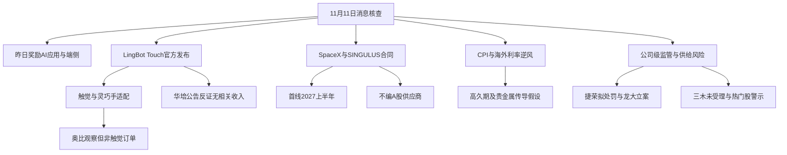

# 2026年11月11日 · 消息面事件驱动

> 数据源新鲜度：partial；降级状态：true；置信度：0.48。
> 正常交易日盘前实跑，实际生成时间见文首；不是冻结输入回放。主要快讯截至今晨05:58。06:00—06:22增量查询为空，不证明此后没有新闻。

## 一句话结论
观察触觉模型与太空HJT真实进展；CPI逆风及热门股公告风险并列，消息不等于买权。

## 先认市场，再认对象

昨日市场奖励的是AI影视、端侧AI与机器人，而不是所有“AI”标签。财联社收评列95只涨停、超4200股上涨，沪指+0.08%、深成指+0.86%、创业板+1.46%。这些是11月10日的价格表现，不是11月11日的资金流或主线确认。成交额的1.49万亿元（沪深两市）与15167亿元（全市场）分列，不能不辨口径硬拼。

情绪=震荡（R4观察假设，非R1正式裁决）。主线=未知，持续性=未知，封板率=未知，明日预期=未知；本轮没有足够证据填成1/3/5日或某个封板率。昨日炸板率未知，不按0处理，也不凭空触发≥35%的减半条件。R4不越权替R2认龙头、替R7认资金、替R5定技术止损。

今日做：核合同、产品版本及公告反证；给两只事件侧研究观察对象，并保留不选对照组的理由。今日不做：拿截图、日历排期或巨额远期目标换取开仓资格。不继承旧市场停买为永久政策，也不改变未知的真实账户预算。

## 🗺️ 消息面全景图

## 🎯 硬事件核验与正反分面

本轮为15个底层事件、16个分析分面，其中11个负面分面。三木同一公告的引资进展与履约/退市风险分开列出，但底层事件及独立来源仍只计一次。不是凑8条，也不把49张可读截图变成49个新闻源。负面排序不是R6硬否决。

### E20261111_008 · ST龙大因涉嫌信披违法违规被立案

态度：降级；极性：负面；强度：high；新旧：老方向新增催化。原分=-0.87，经过0日衰减后=-0.8700。评分只是研究说明。

事实：公司11月10日收到证监会立案告知书；涉嫌信息披露违法违规；公司自述生产经营正常。

传导推断：公司级重大合规待核交R6；生产正常不能消除立案事实。

反证与边界：立案不等于最终处罚或退市；不对食品行业施加全局停买。

时点：最早已见记录=未知；可交易日=20261111。原发布日期信息={"ann_index_date": "20261111", "exact_public_time": null}。实际取证=2026-11-11T06:12:30.119226+08:00。未知时分未用公告文件名或mtime填补。

已查来源：pdf:1989。窗口：新闻重点近72小时，公告20261110—11自然日索引及所列PDF。未穷尽全部历史公告，不声称“无负面”。

- **大资金意图**：未取得本轮R7资金证据，不能从消息反推资金在配置或出货。
- **为什么走强**：昨日价格表现见市场观察，与本事件的因果尚未证实。
- **逻辑够不够硬**：原文事实硬；立案不等于最终处罚或退市；不对食品行业施加全局停买。

### E20261111_007 · 捷荣技术收到行政处罚事先告知书

态度：降级；极性：负面；强度：high；新旧：老方向新增催化。原分=-0.86，经过0日衰减后=-0.8600。评分只是研究说明。

事实：11月10日收到事先告知；公司拟罚200万元；涉及未及时披露控股股东豁免第三笔4.4743亿元价款及控股股东误导陈述。

传导推断：合规风险影响该公司；不外推全体消费电子公司被处罚。

反证与边界：是拟处罚而非最终决定；原文称不触及重大违法强制退市及其他风险警示情形，不夸大为已退市。

时点：最早已见记录=未知；可交易日=20261111。原发布日期信息={"ann_index_date": "20261111", "exact_public_time": null}。实际取证=2026-11-11T06:12:30.293794+08:00。未知时分未用公告文件名或mtime填补。

已查来源：pdf:1974。窗口：新闻重点近72小时，公告20261110—11自然日索引及所列PDF。未穷尽全部历史公告，不声称“无负面”。

- **大资金意图**：未取得本轮R7资金证据，不能从消息反推资金在配置或出货。
- **为什么走强**：昨日价格表现见市场观察，与本事件的因果尚未证实。
- **逻辑够不够硬**：原文事实硬；是拟处罚而非最终决定；原文称不触及重大违法强制退市及其他风险警示情形，不夸大为已退市。

### E20261111_006 · 华培动力澄清机器人相关产品尚未形成收入

态度：降级；极性：负面；强度：high；新旧：老方向新增催化。原分=-0.77，经过0日衰减后=-0.7700。评分只是研究说明。

事实：公司披露六维力传感器等产品尚无收入且短期不预计重大业绩影响；前三季归母-2775.14万元、扣非-3006.77万元。

传导推断：灵波触觉新模型不能给本公司无收入项目自动补上订单；与OCR概念截图相冲突。

反证与边界：六维力传感器系原汽车传感器延伸，不涉及核心技术重大变更；不将概念归属作新增供货。

时点：最早已见记录=未知；可交易日=20261111。原发布日期信息={"ann_index_date": "20261111", "exact_public_time": null}。实际取证=2026-11-11T06:12:30.285584+08:00。未知时分未用公告文件名或mtime填补。

已查来源：pdf:1556。窗口：新闻重点近72小时，公告20261110—11自然日索引及所列PDF。未穷尽全部历史公告，不声称“无负面”。

- **大资金意图**：未取得本轮R7资金证据，不能从消息反推资金在配置或出货。
- **为什么走强**：昨日价格表现见市场观察，与本事件的因果尚未证实。
- **逻辑够不够硬**：原文事实硬；六维力传感器系原汽车传感器延伸，不涉及核心技术重大变更；不将概念归属作新增供货。

### E20261111_002 · SINGULUS与SpaceX签署HJT交钥匙产线合同

态度：观察；极性：正面；强度：high；新旧：老方向新增催化。原分=+0.76，经过0日衰减后=+0.7600。评分只是研究说明。

事实：德国公司原文确认签约；首线计划2027上半年交付；后续设备扩张支持超过100GW；3月已有战略合作及融资。

传导推断：卫星供电工业化链条出现真实设备合同；对A股只能作产业映射，不是国内厂商订单。

反证与边界：100GW不是首条线产能、已交付产能或本季度收入；原文未点名任何A股供应商。

时点：最早已见记录=2026-11-11T03:05:07+08:00；可交易日=20261111。原发布日期信息={"german_official_date": "2026-11-10", "german_timezone": "Europe/Berlin", "official_time": null, "china_first_observed": "2026-11-11T03:05:07+08:00"}。实际取证=2026-11-11T06:14:18.610805+08:00。未知时分未用公告文件名或mtime填补。

已查来源：primary:singulus；news:SpaceX Singulus；news_cls:122。窗口：新闻重点近72小时，公告20261110—11自然日索引及所列PDF。未穷尽全部历史公告，不声称“无负面”。

- **大资金意图**：未取得本轮R7资金证据，不能从消息反推资金在配置或出货。
- **为什么走强**：昨日价格表现见市场观察，与本事件的因果尚未证实。
- **逻辑够不够硬**：原文事实硬；100GW不是首条线产能、已交付产能或本季度收入；原文未点名任何A股供应商。

### E20261111_015 · ST三木重整协议解除与破产退市风险仍在

态度：降级；极性：负面；强度：high；新旧：老方向新增催化。原分=-0.75，经过0日衰减后=-0.7500。评分只是研究说明。

事实：同份公告明确未取得正式受理法律文书；协议存在解除终止及投资人未履约风险。

传导推断：正面引资与负面条件分别披露；此负面不新增底层事件和独立源计数。

反证与边界：不能将预重整等同法院已受理或3.115亿元已到账。

时点：最早已见记录=未知；可交易日=20261111。原发布日期信息={"ann_index_date": "20261111", "exact_public_time": null}。实际取证=2026-11-11T06:12:30.307135+08:00。未知时分未用公告文件名或mtime填补。

已查来源：pdf:2163。窗口：新闻重点近72小时，公告20261110—11自然日索引及所列PDF。未穷尽全部历史公告，不声称“无负面”。

- **大资金意图**：未取得本轮R7资金证据，不能从消息反推资金在配置或出货。
- **为什么走强**：昨日价格表现见市场观察，与本事件的因果尚未证实。
- **逻辑够不够硬**：原文事实硬；不能将预重整等同法院已受理或3.115亿元已到账。

### E20261111_012 · 上纬机器人收入占比较低且商业转化待验证

态度：降级；极性：负面；强度：high；新旧：已交易后的延续。原分=-0.73，经过1日衰减后=-0.6283。评分只是研究说明。

事实：公司原文称机器人业务处于量产爬坡与商业验证阶段；实现收入占比较低；不能预测2026营收及盈利影响。

传导推断：此前万台下线不能等同销量、回款或全年利润；日历中的未来问答仅是验证窗口。

反证与边界：前三季归母亏损4.219792亿元；累计涨幅超100%由公司风险提示引用，不自行推导估值或技术结论。

时点：最早已见记录=未知；可交易日=20261110。原发布日期信息={"ann_index_date": "20261110", "exact_public_time": null}。实际取证=2026-11-11T06:16:02.677762+08:00。未知时分未用公告文件名或mtime填补。

已查来源：pdf:76。窗口：新闻重点近72小时，公告20261110—11自然日索引及所列PDF。未穷尽全部历史公告，不声称“无负面”。

- **大资金意图**：未取得本轮R7资金证据，不能从消息反推资金在配置或出货。
- **为什么走强**：昨日价格表现见市场观察，与本事件的因果尚未证实。
- **逻辑够不够硬**：原文事实硬；前三季归母亏损4.219792亿元；累计涨幅超100%由公司风险提示引用，不自行推导估值或技术结论。

### E20261111_005 · 上海电影新发交易风险提示并重申业绩下滑

态度：降级；极性：负面；强度：high；新旧：老方向新增催化。原分=-0.65，经过0日衰减后=-0.6500。评分只是研究说明。

事实：11月10日再涨停；前三季营收4.98879亿元同比-30.96%；归母1851.40万元同比-86.72%；近4日日均换手率5.67%。

传导推断：AI影视题材有市场奖励但现有经营数据未证明已兑现；高换手只能作交易风险事实。

反证与边界：不能由题材热度推断盈利拐点；该业绩10月31日已公开，今日新增是风险重申而非新财报。

时点：最早已见记录=未知；可交易日=20261111。原发布日期信息={"ann_index_date": "20261111", "exact_public_time": null}。实际取证=2026-11-11T06:12:30.256916+08:00。未知时分未用公告文件名或mtime填补。

已查来源：pdf:1609。窗口：新闻重点近72小时，公告20261110—11自然日索引及所列PDF。未穷尽全部历史公告，不声称“无负面”。

- **大资金意图**：未取得本轮R7资金证据，不能从消息反推资金在配置或出货。
- **为什么走强**：昨日价格表现见市场观察，与本事件的因果尚未证实。
- **逻辑够不够硬**：原文事实硬；不能由题材热度推断盈利拐点；该业绩10月31日已公开，今日新增是风险重申而非新财报。

### E20261111_001 · 蚂蚁灵波发布触觉基础模型LingBot-Touch

态度：观察；极性：正面；强度：high；新旧：老方向新增催化。原分=+0.62，经过1日衰减后=+0.5336。评分只是研究说明。

事实：官网确认4983小时触觉数据、三类传感模态与跨硬件迁移；README提供代码和权重链接。

传导推断：触觉数据采集和硬件适配可能受益；统一模型也可能降低专有适配软件溢价。

反证与边界：不是整机量产订单；奥比EGORGB-D为视觉数据采集，不自动等于Touch触觉收入；官网与GitHub同源。

时点：最早已见记录=2026-11-10T09:41:46+08:00；可交易日=20261110。原发布日期信息={"earliest_observed_media": "2026-11-10T09:41:46+08:00", "official_release_time": null}。实际取证=2026-11-11T06:14:15.990009+08:00。未知时分未用公告文件名或mtime填补。

已查来源：primary:lingbot；primary:lingbot_github；news:LingBot-Touch；rss:0。窗口：新闻重点近72小时，公告20261110—11自然日索引及所列PDF。未穷尽全部历史公告，不声称“无负面”。

- **大资金意图**：未取得本轮R7资金证据，不能从消息反推资金在配置或出货。
- **为什么走强**：昨日价格表现见市场观察，与本事件的因果尚未证实。
- **逻辑够不够硬**：原文事实硬；不是整机量产订单；奥比EGORGB-D为视觉数据采集，不自动等于Touch触觉收入；官网与GitHub同源。

### E20261111_011 · 大千生态披露亏损扩大及不涉及近期热点

态度：降级；极性：负面；强度：high；新旧：老方向新增催化。原分=-0.62，经过0日衰减后=-0.6200。评分只是研究说明。

事实：前三季营收2.735亿元；归母亏损6951.16万元；上半年宠物业务收入占比63.16%；公司称不涉及近期市场热点概念。

传导推断：营收增长与亏损扩大并存；不能因涨停改写为AI等热点基本面受益。

反证与边界：经营与涨价因果未核；不进行R5估值判断。

时点：最早已见记录=未知；可交易日=20261111。原发布日期信息={"ann_index_date": "20261111", "exact_public_time": null}。实际取证=2026-11-11T06:12:30.265672+08:00。未知时分未用公告文件名或mtime填补。

已查来源：pdf:1474。窗口：新闻重点近72小时，公告20261110—11自然日索引及所列PDF。未穷尽全部历史公告，不声称“无负面”。

- **大资金意图**：未取得本轮R7资金证据，不能从消息反推资金在配置或出货。
- **为什么走强**：昨日价格表现见市场观察，与本事件的因果尚未证实。
- **逻辑够不够硬**：原文事实硬；经营与涨价因果未核；不进行R5估值判断。

### E20261111_013 · 日出东方新增风险提示并披露减持仍在实施期

态度：降级；极性：负面；强度：high；新旧：老方向新增催化。原分=-0.57，经过0日衰减后=-0.5700。评分只是研究说明。

事实：11月6—10日收盘累计涨33.17%；部分董高仍处减持计划期；生产经营未重大变化。

传导推断：短线强势与股东潜在供给并存；不由名字或光储叙事授予首推。

反证与边界：减持计划数量及价格不确定，不能说已全部卖出；不自行承接公告PE为R5估值结论。

时点：最早已见记录=未知；可交易日=20261111。原发布日期信息={"ann_index_date": "20261111", "exact_public_time": null}。实际取证=2026-11-11T06:16:02.675541+08:00。未知时分未用公告文件名或mtime填补。

已查来源：pdf:1529。窗口：新闻重点近72小时，公告20261110—11自然日索引及所列PDF。未穷尽全部历史公告，不声称“无负面”。

- **大资金意图**：未取得本轮R7资金证据，不能从消息反推资金在配置或出货。
- **为什么走强**：昨日价格表现见市场观察，与本事件的因果尚未证实。
- **逻辑够不够硬**：原文事实硬；减持计划数量及价格不确定，不能说已全部卖出；不自行承接公告PE为R5估值结论。

### E20261111_010 · 大东方风险提示主营不变且净利同比降84.89%

态度：降级；极性：负面；强度：high；新旧：老方向新增催化。原分=-0.56，经过0日衰减后=-0.5600。评分只是研究说明。

事实：近三日换手47.64%；前三季归母840.92万元同比-84.89%；主营仍为零售、餐饮食品与医疗服务。

传导推断：名称或涨停联想不足以建立新业务；不作为新催化首推。

反证与边界：不将公司自查无未披露事项写成研究者穷尽无负面。

时点：最早已见记录=未知；可交易日=20261111。原发布日期信息={"ann_index_date": "20261111", "exact_public_time": null}。实际取证=2026-11-11T06:12:30.223780+08:00。未知时分未用公告文件名或mtime填补。

已查来源：pdf:1751。窗口：新闻重点近72小时，公告20261110—11自然日索引及所列PDF。未穷尽全部历史公告，不声称“无负面”。

- **大资金意图**：未取得本轮R7资金证据，不能从消息反推资金在配置或出货。
- **为什么走强**：昨日价格表现见市场观察，与本事件的因果尚未证实。
- **逻辑够不够硬**：原文事实硬；不将公司自查无未披露事项写成研究者穷尽无负面。

### E20261111_009 · 顺灏控股股东两日大宗减持398万股

态度：降级；极性：负面；强度：high；新旧：老方向新增催化。原分=-0.54，经过0日衰减后=-0.5400。评分只是研究说明。

事实：11月9—10日大宗减持398万股占0.38%；合计持股21.28%降至20.91%；计划仍在实施。

传导推断：题材叙事与股东供给同时存在；减持不是资金流出全行业的证明。

反证与边界：市场炒作太空算力不能抹去真实减持；具体实际控股业务关系本轮未重新完整核验。

时点：最早已见记录=未知；可交易日=20261111。原发布日期信息={"ann_index_date": "20261111", "exact_public_time": null}。实际取证=2026-11-11T06:12:30.272829+08:00。未知时分未用公告文件名或mtime填补。

已查来源：pdf:2020。窗口：新闻重点近72小时，公告20261110—11自然日索引及所列PDF。未穷尽全部历史公告，不声称“无负面”。

- **大资金意图**：未取得本轮R7资金证据，不能从消息反推资金在配置或出货。
- **为什么走强**：昨日价格表现见市场观察，与本事件的因果尚未证实。
- **逻辑够不够硬**：原文事实硬；市场炒作太空算力不能抹去真实减持；具体实际控股业务关系本轮未重新完整核验。

### E20261111_004 · 永贵交通子公司签署5690.43万元生效合同

态度：观察；极性：正面；强度：high；新旧：老方向新增催化。原分=+0.48，经过0日衰减后=+0.4800。评分只是研究说明。

事实：两份合同含税合计56904285.75元；沈阳地铁6号线车门48570564元及台州市域铁路S2贯通道8333721.75元；签章生效。

传导推断：是真实主营合同；不按机器人或AI概念映射，受益是轨交业务。

反证与边界：后一份对应中标通知已于3月11日披露；签约是阶段升级，不是全部新增需求；履行与回款仍有风险。

时点：最早已见记录=2026-11-10 17:29（报道分钟）；可交易日=20261111。原发布日期信息={"ann_index_date": "20261111", "document_date": "20261111", "earlier_news": "2026-11-10 17:29", "precise_first_public_time": null}。实际取证=2026-11-11T06:12:30.249222+08:00。未知时分未用公告文件名或mtime填补。

已查来源：pdf:1925。窗口：新闻重点近72小时，公告20261110—11自然日索引及所列PDF。未穷尽全部历史公告，不声称“无负面”。

- **大资金意图**：未取得本轮R7资金证据，不能从消息反推资金在配置或出货。
- **为什么走强**：昨日价格表现见市场观察，与本事件的因果尚未证实。
- **逻辑够不够硬**：原文事实硬；后一份对应中标通知已于3月11日披露；签约是阶段升级，不是全部新增需求；履行与回款仍有风险。

### E20261111_014 · ST三木签重整投资协议但法院尚未受理重整

态度：降级；极性：正面；强度：high；新旧：老方向新增催化。原分=+0.40，经过0日衰减后=+0.4000。评分只是研究说明。

事实：芯峰光泓认购1.75亿股；1.78元/股、投资3.115亿元；协议已签但公司仍在预重整。

传导推断：对公司引资是阶段进展；光通信投资人不等于资产注入完成、上市主营已变或并表收入。

反证与边界：认购及资本公积创设有前提；法院未正式受理；重整失败可能破产退市。

时点：最早已见记录=未知；可交易日=20261111。原发布日期信息={"ann_index_date": "20261111", "exact_public_time": null}。实际取证=2026-11-11T06:12:30.307135+08:00。未知时分未用公告文件名或mtime填补。

已查来源：pdf:2163。窗口：新闻重点近72小时，公告20261110—11自然日索引及所列PDF。未穷尽全部历史公告，不声称“无负面”。

- **大资金意图**：未取得本轮R7资金证据，不能从消息反推资金在配置或出货。
- **为什么走强**：昨日价格表现见市场观察，与本事件的因果尚未证实。
- **逻辑够不够硬**：原文事实硬；认购及资本公积创设有前提；法院未正式受理；重整失败可能破产退市。

### E20261111_016 · 合富中国累计营收同比下降但降幅收窄

态度：观察；极性：中性；强度：high；新旧：老方向新增催化。原分=+0.24，经过0日衰减后=+0.2400。评分只是研究说明。

事实：2026年1—10月初步合并营收54794.28万元；同比-6.60%；上年同期比较降幅23.91%。

传导推断：规模仍同比下降但边际降幅改善；不把累计营收变化当利润超预期。

反证与边界：未审计；无单月绝对收入或利润分拆；不列正面业绩硬alpha。

时点：最早已见记录=未知；可交易日=20261111。原发布日期信息={"ann_index_date": "20261111", "exact_public_time": null}。实际取证=2026-11-11T06:16:02.677891+08:00。未知时分未用公告文件名或mtime填补。

已查来源：pdf:1555。窗口：新闻重点近72小时，公告20261110—11自然日索引及所列PDF。未穷尽全部历史公告，不声称“无负面”。

- **大资金意图**：未取得本轮R7资金证据，不能从消息反推资金在配置或出货。
- **为什么走强**：昨日价格表现见市场观察，与本事件的因果尚未证实。
- **逻辑够不够硬**：原文事实硬；未审计；无单月绝对收入或利润分拆；不列正面业绩硬alpha。

### E20261111_003 · 美国10月CPI环比0.4%与核心0.3%高于报道预期

态度：观察；极性：负面；强度：medium；新旧：老方向新增催化。原分=-0.74，经过0日衰减后=-0.7400。评分只是研究说明。

事实：快讯报整体环比0.4%对预期0.3%；核心0.3%对预期0.2%；新华社转引核心环比与前月持平。

传导推断：美元及利率上行可能压制高久期估值及金价；不能据此断言A股今日必跌。

反证与边界：BLS现页与归档均403；一条21:37快讯把加息/降息混写已剔除该方向用语；CME概率仅21:55快照非当前概率。

时点：最早已见记录=2026-11-10T21:33:00+08:00；可交易日=20261111。原发布日期信息="2026-11-10T21:33:00+08:00"。实际取证=2026-11-11T06:03:36+08:00。未知时分未用公告文件名或mtime填补。

已查来源：news_cls:538；news_cls:361；news_cls:495；news_cls:540；news_cls:541；news_cls:544。窗口：新闻重点近72小时，公告20261110—11自然日索引及所列PDF。未穷尽全部历史公告，不声称“无负面”。

- **大资金意图**：未取得本轮R7资金证据，不能从消息反推资金在配置或出货。
- **为什么走强**：快讯报美元指数+0.3%、美债收益率跳升、标普期货至盘前低点；仅为所列时段海外价格反应。
- **逻辑够不够硬**：目前为可追溯新闻转引；BLS现页与归档均403；一条21:37快讯把加息/降息混写已剔除该方向用语；CME概率仅21:55快照非当前概率。

## 研究观察对象：不是首推买单

以下对象只进入消息侧观察层。板型、龙头认定、盈亏比、禁止清单四项均显式保留未知，不因没有价位而停止研究，也不填0或伪造止损。D1首次形成计划前，in_today_plan=null。

### 奥比中光 688322.SH · 观察

**买入理由**：尚不成立为执行买因。研究理由是媒体点名与灵波共建EGORGB-D；比泛材料联想更接近数据采集。但它是RGB-D视觉链条，不能偷换为Touch触觉新增订单。主营接口返回AIOT及传感器，报告期未返回且分类混合，收入占比不能当Touch暴露度。

**风险点**：既有合作与新模型不同；只有媒体映射及有限主营返回，尚未完成公司原公告核验。东财500条三季预告截面未命中该代码，不等于无预告、无负面。

**止损条件**：研究假设在合作主体不符、产品版本不符或不能确认新业务关系时证伪；技术止损价=null、目标=null、RR=null，由R5/D1独立核价。板型=unknown；龙头条款通过数=unknown；禁止清单=unknown。

**可验证假设**：补取公司原件，核EGORGB-D与本次Touch的数据/硬件接口关联、收入与订单；再由R2核核心地位。机会类型“今日核心/主线补涨/计划内试错”未定，不授开仓。

### 永贵电器 300351.SZ · 观察

**买入理由**：尚不成立为执行买因。研究理由是5690.43万元含税合同确已签章生效，卖方为控股子/孙公司，主营业务映射比会议或招聘截图更硬；业务是轨交车门和贯通道，不是机器人订单。

**风险点**：833.37万元部分对应3月已披露的中标；其余合同也未列回款兑现。规模相对财务体量、毛利与项目交付尚未完整核实。不能因硬合同就跳过板块合力。

**止损条件**：合同延期、无法履行或回款条件证伪时研究逻辑失效；技术止损=null、目标=null、RR=null。板型=unknown；龙头条款通过数=unknown；禁止清单=unknown。

**可验证假设**：核交付、验收及应收回款，区分旧中标转合同与全新订单；R2若不能确认可交易板块合力，则仅观察。in_today_plan和机会类型均未知。

## 📊 板块 × 极性叉乘

下表分列支持与压制，绝不将同一底层文件反复累加为更高分。详细逐事件记录已内嵌JSON。

| 板块 | 正面/阶段进展 | 负面或反证 | 裁决与验证点 |
|---|---|---|---|
| 机器人/灵巧手 | Touch官方开源与跨硬件触觉表征 | 华培相关产品无收入；上纬收入低且商业验证中 | 观察产品相关性；不把所有传感器票视为真供应商 |
| 太空光伏/HJT | 海外真实产线合同、2027上半年首线 | 100GW非首线交付；未指明A股供应商 | 观察产业链，不造影子票 |
| AI影视/端侧AI | 昨日市场存在涨停与扩散 | 上海电影经营下滑风险；海外利率逆风 | 价格事实与现金兑现分开；不全行业停买 |
| 光通信重整 | 三木签投资协议 | 法院未受理、资本公积创设与退市风险 | 正负并列；不把投资人主营当上市公司收入 |
| 轨交零部件 | 永贵生效合同 | 部分为旧中标转签、回款和履约不确定 | 对象观察，板块合力未知 |
| 消费电子 | 昨日板块价格活跃 | 捷荣处罚事先告知 | 公司级风险交R6，不外推全板块 |
| 食品加工 | 无本轮新增正面事件确认 | 龙大立案 | 保留重大合规事实，不称最终处罚 |
| 贵金属/高久期 | 无本轮确定对冲催化 | CPI与美元、美债报道反应 | 官方原表访问失败，只按已知时段报道处理 |

## 待核线索不偷升硬事件

- P01 平头哥拟分拆赴港上市：阿里公告转引称9月11日曾保密递A1，11月10日晚对公众披露；仍待上市委批准、证监会备案及最终决定。 多篇同一阿里公告转载；未取得交易所原PDF，原始发布日期与阶段仅转引。不把2027上市预期作硬日期，不补A股影子票。
- P02 上海海洋经济十五五方案：媒体转引上海市海洋局实施方案，含2030海洋产业增加值不低于3500亿元及海洋通信、传感器、机器人。 OCR、电报、证券时报均指同一政策文件；未取得政务原文，且3500亿元是产业增加值目标不是财政预算或上市公司订单。
- P03 Anthropic算力协议与履约风险并存：转引SEC材料称SpaceXAI算力协议支出上限1205亿美元至2029，另Lambda未按期取得设施租赁且协议可终止。 未读SEC底层文件；巨额支出上限不是已确认收入或已到账现金；循环融资、设施租赁及取消条款必须与扩张叙事同时交接。
- P04 超聚变11月12日上会截图： 可读截图仍需交易所本年原文验证；群聊重复不构成独立确认，未核股东穿透，不选宏利达或东方明珠。
- P05 Seedream5.5、Muse Ember及谷歌TPU： 本轮未取厂商发布原文；Seedream与Muse已有11月9—10日价格交易，不能当今晨全新方向；效率提升既可能扩需求也可能压缩同质化内容软件溢价。

## 匿名图片传播：可读不等于可信

指定侧文件108行：99行状态ok、9行error；实际消费49条非空OCR，59行无正文。96行标partial、3行recognized，其余质量未知。图片族统计与行级口径分开：原manifest称152族、131族只有缩略图，不能把“族已处理”升级为“图片内容已完整理解”。

captured_at=2026-11-11T06:02:06+08:00；缓存窗口为前24小时mtime，全部published_at/message_time保留null。没有打开或遍历缓存目录，没有猜发送人，也没有将截图上的聊天昵称当背书。49条原OCR正文、行级置信度、图片hash和来源缓存时间均内嵌JSON；乱码照录，不补字。

- 超聚变11月12日审议会议截图：待核官方本年会议通知；不把上会写成发行获准；不采用群聊股东穿透百分比。证据：ocr:516e5601c706。
- 隆盛科技半年度报告片段出现LingBot-VLA：原图文字有错字且标8月29日；VLA不是今日Touch；不改为Touch新增供货。证据：ocr:88294c85e7b1。
- 鹏翎投资他山科技5000万元及1.5389%截图：同公司同半年度报告片段合并一条，8月28日旧资料；不以11月10日缓存当新增投资公告。证据：ocr:9de304b7ba28、ocr:ad168318766f。
- 上海海洋经济方案财联社截图：与news_cls:1165同一电报，同源不加权；文本内容已与本轮快讯比对。证据：ocr:cfb28f600fb7。
- 华培动力概念页截图：概念表不证明收入；pdf:1556原公告反证机器人相关产品尚无收入。证据：ocr:223467f16e15。
- 法本信息AI漫剧岗位招聘截图：招聘不等于新业务已形成营收或订单；公司关系与岗位真实性未核。证据：ocr:505b67b018ae。
- 互动影游与PICO传播：保留上海电影、芒果超媒、德才、欢瑞、中青宝及丝路视觉说法；原帖日期未知，未经业务公告验证不授首板候选。证据：ocr:eb4273f34c26、ocr:aebc73d83a1d、ocr:d18e8a0ec9af。
- iPSC治疗首例患者商业移植与治愈说法：出院不等于治愈；未核医院或监管原文，不作医药硬事件。证据：ocr:a788f23b202e。
- 昌红转债下修提议截图标11月3日：保留旧传播而非本日催化；超过重点72小时且股东会审议未核。证据：ocr:67f42f3400ad。

同图和同稿、鹏翎两种报告片段、跨群隆盛VLA文案与海洋政策电报均不增加独立支持。原文引用只说明传播，尚未核实的IPO、医药“治愈”、PICO与招聘映射仍待官方文件。

## 🔥 中报业绩预告命中（硬alpha交叉验证）

本日文件实际是2026-09-30报告期的500条有限记录，不是完整中报。按“归母净利润累计同比下限”取去重前15只做交叉：没有与两只研究观察对象精确代码相交；均是窗口前旧预告。未完成单季环比、扣非与一致预期核验，不选正面新业绩事件。

| 代码 | 名称 | 原通知日 | 累计同比下限—上限 | 与本轮硬事件交叉 | 裁决 |
|---|---|---|---|---|---|
| 001309.SZ | 德明利 | 2026-10-17 | 32046.52%—33154.49% | 宽口径半导体与CPI逆风有关；不构成新正面业绩催化 | 观察，不作新业绩alpha |
| 300821.SZ | 东岳硅材 | 2026-10-08 | 19047.97%—19748.08% | 无本轮直接硬事件公司交集 | 观察，不作新业绩alpha |
| 000703.SZ | 恒逸石化 | 2026-10-16 | 3318.59%—3405.13% | 无本轮直接硬事件公司交集 | 观察，不作新业绩alpha |
| 002466.SZ | 天齐锂业 | 2026-10-21 | 2734.97%—3235.26% | 无本轮直接硬事件公司交集 | 观察，不作新业绩alpha |
| 688825.SH | 长鑫科技 | 2026-10-17 | 2581.06%—2609.47% | 宽口径半导体与CPI逆风有关；不构成新正面业绩催化 | 观察，不作新业绩alpha |
| 002812.SZ | 恩捷股份 | 2026-10-14 | 1884%—2474.8% | 无本轮直接硬事件公司交集 | 观察，不作新业绩alpha |
| 688808.SH | 联讯仪器 | 2026-10-13 | 1866%—2072.95% | 宽口径半导体与CPI逆风有关；不构成新正面业绩催化 | 观察，不作新业绩alpha |
| 301308.SZ | 江波龙 | 2026-10-15 | 1864.55%—1990.84% | 宽口径半导体与CPI逆风有关；不构成新正面业绩催化 | 观察，不作新业绩alpha |
| 605189.SH | 富春染织 | 2026-10-14 | 1347.69%—1519.01% | 无本轮直接硬事件公司交集 | 观察，不作新业绩alpha |
| 603991.SH | 领先股份 | 2026-10-21 | 1238.57%—1238.57% | 无本轮直接硬事件公司交集 | 观察，不作新业绩alpha |
| 688388.SH | 嘉元科技 | 2026-10-15 | 1196.6%—1318.92% | 无本轮直接硬事件公司交集 | 观察，不作新业绩alpha |
| 603026.SH | 石大胜华 | 2026-10-15 | 968.14%—1032.45% | 无本轮直接硬事件公司交集 | 观察，不作新业绩alpha |
| 000626.SZ | 远大控股 | 2026-10-15 | 890%—1018% | 无本轮直接硬事件公司交集 | 观察，不作新业绩alpha |
| 002493.SZ | 荣盛石化 | 2026-10-15 | 777.93%—822.95% | 无本轮直接硬事件公司交集 | 观察，不作新业绩alpha |
| 301536.SZ | 星宸科技 | 2026-10-13 | 663.13%—697.75% | 宽口径半导体与CPI逆风有关；不构成新正面业绩催化 | 观察，不作新业绩alpha |

奥比、永贵、隆盛及上海电影在该有限截面均未命中；has_pre_increase=null，不写false。江波龙等周期公司即使累计同比极高，也不在缺环比/产品价格时标正面。风险公告引用的已披露三季数据仅作背景反证，未冒充今日新财报。

## 对照对象：为什么不选

| 对象 | 态度 | 与事件侧观察对象相比缺什么 |
|---|---|---|
| 奥比中光 688322.SH | 观察 | 视觉采集与灵波合作有媒体业务锚，较泛材料映射更直接；但Touch是触觉模型，合作未证明新订单。 隆盛仅旧VLA片段且主体细节待核；华培原公告直接说机器人产品无收入。 |
| 永贵电器 300351.SZ | 观察 | 生效主营合同较会议、招聘与概念截图更硬，保留事件侧对象。 三木重整尚未法院受理且资本公积创设有前提；不能把光通信投资人当现金订单。永贵也不能据此绕开板块合力门禁。 |
| 上海电影 601595.SH | 降级 | 昨日AI影视确有价格表现，但新风险公告与经营下滑必须交接；不以负面自动全行业禁买。 华培尚无机器人收入；上纬机器人占比较低且商业验证初期。三者均不由热度直接授首推。 |
| HJT太空光伏国内影子股 | 不进 | SINGULUS原文未点名A股供应商；不按概念代填迈为、捷佳或钧达。 RSS称钧达太空相关电池尚实验室阶段，不能证明海外合同受益；不以概念相似度选票。 |
| 灵巧手涨幅池其余对象 | 观察 | 保留官方OpenAPI返回10票比较覆盖；伟创、松霖、鼎智、江苏雷利、强瑞、兆威、领益、隆盛、祥鑫、鸣志，排名不证明与Touch合同关系。 本轮仅有概念归属和昨日行情；不是新事件实体、没有逐票主营/订单/合规完整核验，不升级为执行池。 |
| 688568.SH | 观察 | 仅在昨日有限日历截取中出现；本轮未取对应最新原文及经营/核心地位，不把问答、回购、分红或解禁排期当新订单/交易资格。 与两只研究观察对象相比缺本轮直接新业务合同或精确产品映射；只留日历验证锚，不强制选择。 |
| 002463.SZ | 观察 | 回购批准不是首次成交；日历为昨日版本且未取本轮成交公告，不为HJT或国产算力叙事强贴标签。 与两只研究观察对象相比缺本轮直接新业务合同或精确产品映射；只留日历验证锚，不强制选择。 |
| 688798.SH | 观察 | 日历提示筹划停牌，公告索引同见停牌；未重核是否复牌，不以重组意向作今日可交易机会。 与两只研究观察对象相比缺本轮直接新业务合同或精确产品映射；只留日历验证锚，不强制选择。 |
| 688331.SH | 观察 | 仅在昨日有限日历截取中出现；本轮未取对应最新原文及经营/核心地位，不把问答、回购、分红或解禁排期当新订单/交易资格。 与两只研究观察对象相比缺本轮直接新业务合同或精确产品映射；只留日历验证锚，不强制选择。 |
| 688717.SH | 观察 | 仅在昨日有限日历截取中出现；本轮未取对应最新原文及经营/核心地位，不把问答、回购、分红或解禁排期当新订单/交易资格。 与两只研究观察对象相比缺本轮直接新业务合同或精确产品映射；只留日历验证锚，不强制选择。 |
| 002623.SZ | 观察 | 仅在昨日有限日历截取中出现；本轮未取对应最新原文及经营/核心地位，不把问答、回购、分红或解禁排期当新订单/交易资格。 与两只研究观察对象相比缺本轮直接新业务合同或精确产品映射；只留日历验证锚，不强制选择。 |
| 688012.SH | 观察 | 仅在昨日有限日历截取中出现；本轮未取对应最新原文及经营/核心地位，不把问答、回购、分红或解禁排期当新订单/交易资格。 与两只研究观察对象相比缺本轮直接新业务合同或精确产品映射；只留日历验证锚，不强制选择。 |
| 688807.SH | 观察 | 仅在昨日有限日历截取中出现；本轮未取对应最新原文及经营/核心地位，不把问答、回购、分红或解禁排期当新订单/交易资格。 与两只研究观察对象相比缺本轮直接新业务合同或精确产品映射；只留日历验证锚，不强制选择。 |
| 601858.SH | 观察 | 仅在昨日有限日历截取中出现；本轮未取对应最新原文及经营/核心地位，不把问答、回购、分红或解禁排期当新订单/交易资格。 与两只研究观察对象相比缺本轮直接新业务合同或精确产品映射；只留日历验证锚，不强制选择。 |
| 688629.SH | 观察 | 仅在昨日有限日历截取中出现；本轮未取对应最新原文及经营/核心地位，不把问答、回购、分红或解禁排期当新订单/交易资格。 与两只研究观察对象相比缺本轮直接新业务合同或精确产品映射；只留日历验证锚，不强制选择。 |
| 603341.SH | 观察 | 仅在昨日有限日历截取中出现；本轮未取对应最新原文及经营/核心地位，不把问答、回购、分红或解禁排期当新订单/交易资格。 与两只研究观察对象相比缺本轮直接新业务合同或精确产品映射；只留日历验证锚，不强制选择。 |
| 688700.SH | 观察 | 仅在昨日有限日历截取中出现；本轮未取对应最新原文及经营/核心地位，不把问答、回购、分红或解禁排期当新订单/交易资格。 与两只研究观察对象相比缺本轮直接新业务合同或精确产品映射；只留日历验证锚，不强制选择。 |
| 688387.SH | 观察 | 仅在昨日有限日历截取中出现；本轮未取对应最新原文及经营/核心地位，不把问答、回购、分红或解禁排期当新订单/交易资格。 与两只研究观察对象相比缺本轮直接新业务合同或精确产品映射；只留日历验证锚，不强制选择。 |
| 600268.SH | 观察 | 仅在昨日有限日历截取中出现；本轮未取对应最新原文及经营/核心地位，不把问答、回购、分红或解禁排期当新订单/交易资格。 与两只研究观察对象相比缺本轮直接新业务合同或精确产品映射；只留日历验证锚，不强制选择。 |
| 688781.SH | 观察 | 仅在昨日有限日历截取中出现；本轮未取对应最新原文及经营/核心地位，不把问答、回购、分红或解禁排期当新订单/交易资格。 与两只研究观察对象相比缺本轮直接新业务合同或精确产品映射；只留日历验证锚，不强制选择。 |
| 688585.SH | 降级 | 已用本轮公司风险提示对照：机器人收入低、商业验证未完成；日历未来问答不是新增财报。 与两只研究观察对象相比缺本轮直接新业务合同或精确产品映射；只留日历验证锚，不强制选择。 |
| 688787.SH | 观察 | 仅在昨日有限日历截取中出现；本轮未取对应最新原文及经营/核心地位，不把问答、回购、分红或解禁排期当新订单/交易资格。 与两只研究观察对象相比缺本轮直接新业务合同或精确产品映射；只留日历验证锚，不强制选择。 |
| 002922.SZ | 观察 | 仅在昨日有限日历截取中出现；本轮未取对应最新原文及经营/核心地位，不把问答、回购、分红或解禁排期当新订单/交易资格。 与两只研究观察对象相比缺本轮直接新业务合同或精确产品映射；只留日历验证锚，不强制选择。 |
| 688235.SH | 观察 | 仅在昨日有限日历截取中出现；本轮未取对应最新原文及经营/核心地位，不把问答、回购、分红或解禁排期当新订单/交易资格。 与两只研究观察对象相比缺本轮直接新业务合同或精确产品映射；只留日历验证锚，不强制选择。 |

## 补充真实风险原样交接

- 【长园集团：涉及多起诉讼事项获判决进展】长园集团公告称，公司涉及多起诉讼事项取得进展：格力金投、金诺信诉公司证券虚假陈述责任纠纷一案，深圳中院作出一审判决，驳回原告全部诉讼请求，涉案金额约4.13亿元。子公司长园天弓涉新增资本认购纠纷二审改判，无需承担支付责任，由张昌云、张昌新共同支付1435.61万元及利息，该判决已生效。子公司长园能源涉建设工程施工合同纠纷一审被判支付工程款1848.76万元及对应利息，长园能源已提起上诉。本次诉讼对公司净利润最终影响以审计结果为准。（2026-11-10 20:21:39；news_cls:707）。本轮只核快讯，未读对应原公告；不能据此宣称全案已审完。
- 【索通发展：实控人涉离婚后财产纠纷案 前妻诉请分得2371.87万股】索通发展(603612.SH)公告称，公司收到控股股东、实际控制人郎光辉通知，其前妻王萍诉郎光辉离婚后财产纠纷案已由北京市朝阳区人民法院立案。王萍诉请终止《一致行动及表决权委托协议》，并要求追加分得公司股份2371.87万股，其余诉讼请求金额合计约3.93亿元。该案件尚未开庭，仅涉及控股股东个人股东权益，与公司生产经营无关，不会对公司经营产生重大影响。（2026-11-10 18:16:17；news_cls:1014）。本轮只核快讯，未读对应原公告；不能据此宣称全案已审完。
- 【*ST三房：新增6起诉讼仲裁 涉额3085.83万元】*ST三房公告称，公司及合并报表范围内子公司自前次披露至今新增诉讼、仲裁6起，公司及子公司均为被告/被申请人，标的金额合计3085.83万元，占公司最近一期经审计净资产的0.64%。上述诉讼、仲裁尚未开庭，最终判决结果尚不确定，对公司本期利润或期后利润的影响尚无法准确计量。此外，前期披露的一起融资租赁合同纠纷一审已判决，涉及租金5117.26万元及违约金、相关费用。（2026-11-10 18:06:08；news_cls:1032）。本轮只核快讯，未读对应原公告；不能据此宣称全案已审完。
- 【海航科技：与Seaco签署诉讼调解协议 和解金额179.56万美元】海航科技公告称，公司与海洋环球有限公司（Seaco）的集装箱租赁合同纠纷在二审阶段达成调解，签署《调解协议》，和解金额为1,795,570.32美元，为一审判决金额的80%，公司一次性支付后双方基于本案的债权债务彻底结清。本次事项构成关联交易，已经公司董事会审议通过，关联董事朱勇、于杰辉、姜浩回避表决。预计将增加公司收益约300.31万元，最终金额以审计结果为准。《调解协议》尚需海南省高级人民法院出具调解书，存在不确定性。（2026-11-10 17:36:27；news_cls:1095）。本轮只核快讯，未读对应原公告；不能据此宣称全案已审完。
- 【ST东时：涉及案外人执行异议之诉 尚未开庭审理】ST东时公告称，公司收到北京市大兴区人民法院送达的民事起诉状，闫文辉、马媛因对法院查封并拟执行的大兴区高米店南里30号楼-1至3层6单元101不动产提出的案外人异议被驳回，提起案外人执行异议之诉，请求停止对该不动产的强制执行并解除查封，公司为第三人。该不动产原值2101.24万元，截至2026年10月31日账面净值1443.28万元。案件已立案，尚未开庭审理，审理结果存在不确定性。截至公告披露日，公司及控股子公司连续十二个月内累计新增诉讼2件，涉及本金1452.88万元，占最近一期经审计净资产的18.97%。公司预重整尚不确定是否进入正式重整程序，若法院受理重整申请，股票将被实施退市风险警示。（2026-11-10 17:18:20；news_cls:1133）。本轮只核快讯，未读对应原公告；不能据此宣称全案已审完。
- 【航天宏图：前三季度营收同比降80.90% 净亏损4.61亿元】航天宏图公告称，2026年前三季度实现营业收入0.77亿元，同比下滑80.90%；归母净亏损4.61亿元，亏损幅度扩大。2026年10月29日，公司收到鹤壁中院通知，债权人国泽基金以公司不能清偿到期债务且资产不足以清偿全部债务但具备重整价值为由，申请对公司重整；因公司及实控人王宇翔涉嫌信披违法违规被证监会立案调查，法院裁定暂不予受理重整申请，但公司可启动预重整。中诚信国际认为公司经营及财务持续恶化，基本不能偿还债务，“宏图转债”转股及兑付风险很高。（2026-11-10 17:17:45；news_cls:1134）。本轮只核快讯，未读对应原公告；不能据此宣称全案已审完。

## 专题知识裁决与来源独立性

context_sha256：3ff319e019b1bde26f5ab1b71e0e835550466b9849bff29491230779a2fdef4b

run_id：20261111T061041-44945-637；stage=R4；as_of=2026-11-11T06:10:41.694221+08:00。

昨日催化日历只运输了frontmatter、3600字元overview前缀、目录与19个代码索引；原文40422字元，未读全文。限采用“生效/审核/意向/回购批准不等于现金兑现”的边界及对象对照，不把目录中的未运输章节当已读事实。日历与公司原公告同源，不计两份独立确认。19个代码均有比较裁决，既不因提及自动纳入，也不因partial全局禁买。

机读文件保留原context身份、源source_id/kind/path/sha256/status/source_timing/limitations与已运输原文；knowledge_adjudications共105项，逐项标采用、待核或未知，含全部内嵌来源与49条非空OCR；上游knowledge列表本轮为空，不冒造上游采纳。

## 关键证据

- primary:lingbot：primary:lingbot；原文 https://technology.robbyant.com/lingbot-touch。
- primary:singulus：primary:singulus；原文 https://www.singulus.com/2026/11/10/spacex-heterojunction-solar-cells-singulus/。
- pdf:1925：关于公司控股子公司近期签订货物买卖合同的公告；原文 https://static.cninfo.com.cn/finalpage/2026-11-11/1225665280.PDF。
- pdf:1556：华培动力：股票交易异常波动公告；原文 https://static.cninfo.com.cn/finalpage/2026-11-11/1225665819.PDF。
- pdf:1609：关于股票交易风险提示性公告；原文 https://static.cninfo.com.cn/finalpage/2026-11-11/1225666034.PDF。
- pdf:1974：关于收到《行政处罚事先告知书》的公告；原文 https://static.cninfo.com.cn/finalpage/2026-11-11/1225666180.PDF。
- pdf:1989：关于公司收到中国证券监督管理委员会《立案告知书》的公告；原文 https://static.cninfo.com.cn/finalpage/2026-11-11/1225665393.PDF。
- pdf:2163：关于与产业投资人签署重整投资协议的公告；原文 https://static.cninfo.com.cn/finalpage/2026-11-11/1225665118.PDF。
- pdf:76：股票交易风险提示公告；原文 https://static.cninfo.com.cn/finalpage/2026-11-10/1225664506.PDF。

## 数据源审计

日期仅列日期，不用抓取时分秒假装新闻发布时间。

| 源 | 日期 | 状态 | 记录/实际范围与缺口 |
|---|---|:--:|---|
| manifest.json | 2026-11-11 | 🟢 | 完整程序读取；模型按索引及相关正文核查，不声称逐字全文人工阅读 |
| mcp_health.json | 2026-11-11 | 🟢 | 完整程序读取；模型按索引及相关正文核查，不声称逐字全文人工阅读 |
| news_cls.jsonl | 2026-11-11 | 🟢 | 2688条；底层sina1472+10jqka1216，文件名不代表CLS直接源；重点正文及索引核查 |
| news_major.jsonl | 2026-11-11 | 🟡 | 800条；只有11月10日下午至11日凌晨，且多数content为空；不得声称72小时全文覆盖 |
| wechat_official_20.jsonl | 2026-11-11 | 🟢 | 完整程序读取；模型按索引及相关正文核查，不声称逐字全文人工阅读 |
| wechat_official_rss.jsonl | 2026-11-11 | 🟢 | 84条；与official_20兼容镜像仅计一次 |
| wechat_cli_5groups.jsonl | 2026-11-11 | 🟢 | 494条匿名五群；重复转发不加独立源；原文涉及股票的真实/旧新均待核 |
| wechat_image_ocr_20261111.jsonl | 2026-11-11 | 🟡 | 108行中49条非空已读；低清保留，9失败，缓存时间非发布时间 |
| eastmoney_earnings_predict.json | 2026-11-11 | 🟡 | 500条有限三季预告截面；已交叉前15归母同比，未命中不等于无预告 |
| anns_window.jsonl | 2026-11-11 | 🟢 | 完整程序读取；模型按索引及相关正文核查，不声称逐字全文人工阅读 |
| hithink_business_query | 2026-11-11 | 🟡 | 已查奥比/隆盛，但主营报告期/第二票未覆盖，百分比不当Touch相关度 |
| BLS | 2026-11-11 | 🔴 | 403；归档重试仍403 |
| R3 | 2026-11-11 | 🔴 | 本轮文件未出现，不编造kol_confirm |
| prior_event_tracker | 2026-11-11 | 🔴 | 未发现events_20261110.json或本期anns_classified.json；补充腿缺失不置全市场停买 |
| cross_mcp_vibe_datapro_xtick | 2026-11-11 | 🟡 | R4顶层工具白名单为file/wechat/tushare；未直调资金/其他研究MCP，新闻通过获准横切OpenAPI和原网页核实，不冒充执行必调旧路径 |
| tushare_news_live | 2026-11-11 | 🟢 | 查询06:00—06:22返回空；此前05:55—06:13返回2条；接口按小时更新，空不证明期间没有事件，最新已返回新闻05:58:30 |
| tushare_trade_cal_live | 2026-11-11 | 🟢 | 20261111 is_open=1；pretrade_date=20261110 |
| official_primary_web | 2026-11-11 | 🟢 | 本轮原文直读；GitHub同底层项目不加独立源 |
| company_pdf_live | 2026-11-11 | 🟢 | 公司原件PDF文字层完整提取；按文档去重 |

## 不确定性 / 反证

- R1/R2/R3/R7本轮最终产物未读取；市场主线、阶段、持续性、封板率和资金意图未知
- 本日尚未开盘；昨日炸板率未取得；不把无法计算当0，不机械触发候选减半
- BLS官方当前/归档页面均403；CPI采用带时点快讯与新华社转引，官方原表未直读
- 平头哥港交所原PDF、上海海洋政务原文、Anthropic SEC材料未读取
- 东财500条为9月30日报告期截面且非全市场；中报覆盖不足；相关对象未命中不能写无预告
- 图片108条中9条失败、59条空文；已读49条非空，其中多数低清；消息/发布时间未知
- 灵波Touch与VLA不同版本；奥比视觉合作不证明触觉收入；隆盛/鹏翎/法本等图文待公司原件
- A股HJT/太空光伏供应商及对SINGULUS供货关系未核，不造票
- 逐票完整公告风险覆盖未完成；监管风险保留给R5/R6；R6是唯一hard_reject来源
- 预算、账户停买与持仓约束未读取且未知；不改正额度，不继承旧市场停买
- 未取得可核入场价/风险结构；止损、目标区间及RR保留null

## 与其他R/D/E的关系

R2可比较事件形成前的对象，不是只给旧候选补故事；R5按真实R2候选做画像；R6只读本轮JSON内嵌证据，不需另开MD或联网。公司级监管事实与真实负面不因市场强势被删除，是否hard_reject仅由有权限的R6裁定。

D1首次计划之前in_today_plan未知。这里没有开仓权限，也没有新的预算、仓位建议或自动卖出指令；真实用户/账户停买、有效硬预算含0、仓位上限、T+1、人工确认和既有执行保护全部保持。

## Sub-Agent 元数据

- skill：analyze_news_impact_v1@1.7
- artifact：data/research/20261111/R4_news.json
- method：llm_v1，当前会话唯一研究裁决者；未重开Hermes、未调用模型包装。
- Pydantic及语义校验：写盘前通过；历史首推检查仅覆盖首推角色，不代表本轮价位、RR或执行门禁已核。
- 状态：partial/degraded，交付完成但缺口保留；不报告全市场停买，不自称交易授权。
