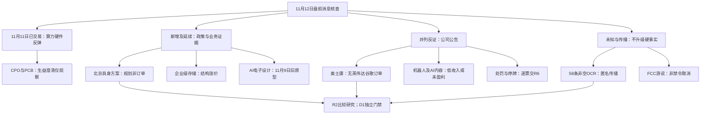

# 2026年11月12日 · 消息面事件驱动

> 数据源新鲜度：partial · 降级状态：true · 研究置信度：0.50。
> 实际盘前核查，最新已完成交易日为11月11日；不是回放。机读产物保留原始时区与精确采集时点。

## 一句话结论

观察算力硬件修复与具身政策延续；公司澄清、合规及停牌风险逐票保留，不授买权。

## 🧭 先认市场：价格在奖励什么，消息又能解释到哪一步

昨日财联社收评记录：沪指涨0.46%、深成指涨1.32%、创业板指涨3.11%，超过3500股上涨，成交1.68万亿元、较前日多1715亿元。被奖励的是CPO、PCB等算力硬件容量反弹，机器人、AI漫剧也有延续；并非仅因公众号提得多就成为资金主线。收评作者有关“拥挤度出清”“资金已完成换仓”的评论没有本轮独立测量，不作为市场事实。

当前只是修复延续的研究假设，不能凭一天反弹确认全面主升。R1本轮中间统计所列昨日85只涨停、19只未封与18.27%炸板率仅作旁证，不替代最终R1；不把11月9日44.90%沿用为今天情绪。主线比较对象=算力硬件、机器人、AI内容；持续性=未知，封板率=未知，明日加速/分歧/退潮=待R1/R2核定。未知不填0。今日尚未开盘，没有本日资金净流入、竞价或板型确认。

今天做：把已有价格奖励与新增公开事实交叉比较，对反弹核心、消息直接对象和传播对照对象分别留证。今天不做：按消息分数认龙头、把旧财报累计同比当新alpha、把题材收入小等同全行业禁买，或从历史研究停买推导账户预算为0。R4没有新增交易授权，也不撤销既有账户保护。

## 🗺️ 消息面全景图

## ⚖️ 板块极性叉乘：同一方向可以有政策利好和个股反证

| 方向 | 正面事实腿 | 反面与范围 | 本轮裁决 |
|---|---|---|---|
| 机器人/具身数据 | 北京三年方案部署数据、算力与零部件 | 锋龙机器人收入为零；智微不足1%；飞亚达不足5%；光洋未盈利；中坚待培育；福莱收入极低 | 🟡 观察政策传导；每个公司边界独立，不用政策净掉反证 |
| PCB/覆铜板 | 昨日反弹；生益回应未收终端撤单通知 | 奥士康明确未与英伟达、谷歌开展订单合作 | 🟡 生益观察；奥士康的特定客户订单叙事降级，两家公司不得混同 |
| 企业级存储/消费电子 | 部分企业级原厂价格微涨 | 消费级不同步；部分模组现货补料成本与终端提价失配 | 🟡 只保留结构性价格，不推出全链利润普涨 |
| AI电子设计 | 官方三款原型及基准改进 | 未过电气、热、认证测试；低附加值设计环节可能被替代 | 🟡 旧技术证据为背景；替代是推断，不当已实现收入损失 |
| AI视频/智能体/液冷 | 行业有催化与价格奖励 | 上海电影AI视频不足0.5%；新炬内容亏损且非数据中心运营；冰山液冷零星收入 | 🔴 拦截“行业故事=该票已兑现”推断，不形成全市场硬否决 |
| 国内宽松/券商 | 央行延续适度宽松与资本市场支持 | 湘财、国盛正式暂停新开证券账户3个月 | 🟡 政策与合规分层；存量客户不受新开户限制 |
| 化工新材料 | 卫星207亿元投资计划 | 股东会及后续审批待完成，建设期、资金占用与未来产能风险 | 🟡 长期项目观察；不是今日新增利润 |
| 光通信/海外逆风 | 昨日反弹及游说报道 | FCC限制仍为拟议；美元与油价逆风、加息预测并非决议 | 🟡 保留待核双向剧本；不写“禁令取消”或“联储已加息” |

机器产物保留全部板块的正×负事件定位；没有额外净评分、阈值或预算。24个负面分面来自针对性的公司风险核查，不代表24项全行业灾变。

## 🎯 顶级事件详解：事实、反应与推断分开

本轮保留31个正反分析分面，对应26个底层事项；不是为补满8条。相同原件的正反面、同一采访的转载不会重复加权。以下按事实核实强度和衰减绝对值排序，负面与正面同场列示。

### E20261112_009 · 锋龙股份机器人收入为零且36个月无注资计划

**负面 · high · 加权分 -0.732 · 衰减 1日**。老方向新增催化。

事实：前三季未产生机器人零部件收入；优必选承诺收购完成后36个月不注入所持资产。

时间与覆盖：原始文件/页面标注 `2026-11-11`；本轮最早核到公开报道 2026-11-11 19:08，不是穷尽后的首发保证。date为本轮可交易观察日；盘后报道映射11月12日。若源只标日期则该日具体首个可交易时段未知，未以date覆盖published_at。

已查：pdf:1773、raw:news_cls:1679、raw:news_cls:1679。对象：锋龙股份 002931.SZ。完整定位和必要原文在同名JSON的 evidence_registry；未列出的历史公告/潜在冲突未穷尽，不能说无负面。

- **大资金意图**: 未核资金流水、持有人或机构下单意图。昨日价格强弱与本条催化分开，不由官方文件反推资金已经认可。
- **为什么走强**: 集团订单与上市公司收入不可混同。 这是传导解释/待证假设，不是本日资金反应。盘后公开不能解释此前盘中涨幅。
- **逻辑够不够硬**: 已核公司原件；只是澄清业务边界并非自动判整个机器人主线退潮。 官方原件支持事件事实，但不直接授核心地位与开仓资格。

### E20261112_023 · 林州重机因定期报告虚假记载被正式处罚

**负面 · high · 加权分 -0.732 · 衰减 1日**。老方向新增催化。

事实：正式决定载2025H1虚增营业收入32270.31万元，占当期35.64%；公司被警告罚400万元；存在五年内再次定期报告虚假记载情形。

时间与覆盖：原始文件/页面标注 `2026-11-12`；本轮最早核到公开报道 2026-11-11 19:26，不是穷尽后的首发保证。date为本轮可交易观察日；盘后报道映射11月12日。若源只标日期则该日具体首个可交易时段未知，未以date覆盖published_at。

已查：pdf:1892、raw:news_cls:1665、raw:news_cls:1665。对象：林州重机 002535.SZ。完整定位和必要原文在同名JSON的 evidence_registry；未列出的历史公告/潜在冲突未穷尽，不能说无负面。

- **大资金意图**: 未核资金流水、持有人或机构下单意图。昨日价格强弱与本条催化分开，不由官方文件反推资金已经认可。
- **为什么走强**: 财报可信度需实质反证；不能因行业催化绕过逐票合规。 这是传导解释/待证假设，不是本日资金反应。盘后公开不能解释此前盘中涨幅。
- **逻辑够不够硬**: 10月已有事先告知；当前由告知转决定。公司称不触及强退不能当监管豁免或无风险。 官方原件支持事件事实，但不直接授核心地位与开仓资格。

### E20261112_028 · 箭牌家居实控人股份新增冻结与轮候冻结

**负面 · high · 加权分 -0.720 · 衰减 0日**。老方向新增催化。

事实：累计司法冻结208000000股占总股本21.54%，另轮候52225957股；冻结与轮候不能直接相加为不同实股；源于实控人个人担保纠纷。

时间与覆盖：原始文件/页面标注 `2026-11-12`；本轮最早核到公开报道 2026-11-12（原始时分未知），不是穷尽后的首发保证。date为本轮可交易观察日；盘后报道映射11月12日。若源只标日期则该日具体首个可交易时段未知，未以date覆盖published_at。

已查：pdf:1978。对象：箭牌家居 001322.SZ。完整定位和必要原文在同名JSON的 evidence_registry；未列出的历史公告/潜在冲突未穷尽，不能说无负面。

- **大资金意图**: 未核资金流水、持有人或机构下单意图。昨日价格强弱与本条催化分开，不由官方文件反推资金已经认可。
- **为什么走强**: 关注可能司法处置与治理尾部风险；不得写成公司账户冻结或生产停顿。 这是传导解释/待证假设，不是本日资金反应。盘后公开不能解释此前盘中涨幅。
- **逻辑够不够硬**: 公司称当前控制权未变且经营正常；这是其披露判断并保留后续处置风险。 官方原件支持事件事实，但不直接授核心地位与开仓资格。

### E20261112_014 · 福莱新材柔性传感收入极低并提示交易风险

**负面 · high · 加权分 -0.706 · 衰减 1日**。老方向新增催化。

事实：柔性传感项目收入占比极低且研发订单不确定；11月11日福新转债收948.111元、转股溢价67.12%、换手1088.81%见同日转债公告。

时间与覆盖：原始文件/页面标注 `2026-11-12`；本轮最早核到公开报道 2026-11-11 17:38，不是穷尽后的首发保证。date为本轮可交易观察日；盘后报道映射11月12日。若源只标日期则该日具体首个可交易时段未知，未以date覆盖published_at。

已查：pdf:1324、pdf:1323、raw:news_cls:879、raw:news_cls:879。对象：福莱新材 605488.SH。完整定位和必要原文在同名JSON的 evidence_registry；未列出的历史公告/潜在冲突未穷尽，不能说无负面。

- **大资金意图**: 未核资金流水、持有人或机构下单意图。昨日价格强弱与本条催化分开，不由官方文件反推资金已经认可。
- **为什么走强**: 高辨识度不等于已量产；股债风险分别交R6，不能混用转债与正股价格。 这是传导解释/待证假设，不是本日资金反应。盘后公开不能解释此前盘中涨幅。
- **逻辑够不够硬**: 1323与1324同一主体风险组，不因两份文件累加事件分数；不套用转债T+0给正股。 官方原件支持事件事实，但不直接授核心地位与开仓资格。

### E20261112_015 · 奥士康否认英伟达谷歌订单合作

**负面 · high · 加权分 -0.706 · 衰减 1日**。老方向新增催化。

事实：截至公告未与英伟达、谷歌开展订单合作；2025全年及2026上半年AI服务器收入占比不足1%。

时间与覆盖：原始文件/页面标注 `2026-11-12`；本轮最早核到公开报道 2026-11-11 19:03，不是穷尽后的首发保证。date为本轮可交易观察日；盘后报道映射11月12日。若源只标日期则该日具体首个可交易时段未知，未以date覆盖published_at。

已查：pdf:1779、raw:news_cls:729、raw:news_cls:729。对象：奥士康 002913.SZ。完整定位和必要原文在同名JSON的 evidence_registry；未列出的历史公告/潜在冲突未穷尽，不能说无负面。

- **大资金意图**: 未核资金流水、持有人或机构下单意图。昨日价格强弱与本条催化分开，不由官方文件反推资金已经认可。
- **为什么走强**: 昨日PCB涨停不证明这只就是海外大客户核心；直接订单叙事被公司反证。 这是传导解释/待证假设，不是本日资金反应。盘后公开不能解释此前盘中涨幅。
- **逻辑够不够硬**: 不否认其其他PCB业务；不把行业景气度等同此股已获单。 官方原件支持事件事实，但不直接授核心地位与开仓资格。

### E20261112_020 · 捷荣技术处罚告知补充并涉及德龙现任董事长旧任事项

**负面 · high · 加权分 -0.689 · 衰减 1日**。老方向新增催化。

事实：捷荣两份事先告知原件与补充列明信息披露问题；对捷荣公司拟罚200万元；对相关控股股东等另案拟罚；德龙董事长王新杰旧任捷荣事项拟罚70万元。

时间与覆盖：原始文件/页面标注 `2026-11-11`；本轮最早核到公开报道 2026-11-11 19:23，不是穷尽后的首发保证。date为本轮可交易观察日；盘后报道映射11月12日。若源只标日期则该日具体首个可交易时段未知，未以date覆盖published_at。

已查：pdf:920、pdf:1821、pdf:2067、raw:news_cls:647、raw:news_cls:647。对象：捷荣技术 002855.SZ；德龙汇能 000593.SZ。完整定位和必要原文在同名JSON的 evidence_registry；未列出的历史公告/潜在冲突未穷尽，不能说无负面。

- **大资金意图**: 未核资金流水、持有人或机构下单意图。昨日价格强弱与本条催化分开，不由官方文件反推资金已经认可。
- **为什么走强**: 逐票合规核查必须独立于主线强弱；对德龙不得误写成其上市公司被罚或本公司财报造假。 这是传导解释/待证假设，不是本日资金反应。盘后公开不能解释此前盘中涨幅。
- **逻辑够不够硬**: 不是最终处罚书；捷荣称不触及重大违法强退/其他风险警示是公司判断而非研究保证；三原件有共同底层案件，不增加独立支持票。 官方原件支持事件事实，但不直接授核心地位与开仓资格。

### E20261112_017 · 新炬网络智能内容未盈利且不持有数据中心

**负面 · high · 加权分 -0.646 · 衰减 1日**。老方向新增催化。

事实：短剧及智能内容仍亏损；IT运维智能体2026H1收入不足1%且未规模商业化；不持有数据中心也不运营。

时间与覆盖：原始文件/页面标注 `2026-11-12`；本轮最早核到公开报道 2026-11-11 18:16，不是穷尽后的首发保证。date为本轮可交易观察日；盘后报道映射11月12日。若源只标日期则该日具体首个可交易时段未知，未以date覆盖published_at。

已查：pdf:1326、raw:news_cls:1712、raw:news_cls:1712。对象：新炬网络 605398.SH。完整定位和必要原文在同名JSON的 evidence_registry；未列出的历史公告/潜在冲突未穷尽，不能说无负面。

- **大资金意图**: 未核资金流水、持有人或机构下单意图。昨日价格强弱与本条催化分开，不由官方文件反推资金已经认可。
- **为什么走强**: IT运维与算力资产运营不可混同；通用Agent叙事不等于其产品形态。 这是传导解释/待证假设，不是本日资金反应。盘后公开不能解释此前盘中涨幅。
- **逻辑够不够硬**: 原文Q3净亏1013.36万元仅旧背景；不直接推出下一季度亏损额。 官方原件支持事件事实，但不直接授核心地位与开仓资格。

### E20261112_021 · 湘财证券处罚决定并暂停新开户3个月

**负面 · high · 加权分 -0.646 · 衰减 1日**。老方向新增催化。

事实：湘财证券11月11日收到正式处罚与监管措施：警告罚29万元，自收到决定之日起暂停新开证券账户3个月；存量客户服务不受此限制。

时间与覆盖：原始文件/页面标注 `2026-11-12`；本轮最早核到公开报道 2026-11-11 22:01，不是穷尽后的首发保证。date为本轮可交易观察日；盘后报道映射11月12日。若源只标日期则该日具体首个可交易时段未知，未以date覆盖published_at。

已查：pdf:1619、raw:news_cls:353、raw:news_cls:353。对象：湘财股份 600095.SH。完整定位和必要原文在同名JSON的 evidence_registry；未列出的历史公告/潜在冲突未穷尽，不能说无负面。

- **大资金意图**: 未核资金流水、持有人或机构下单意图。昨日价格强弱与本条催化分开，不由官方文件反推资金已经认可。
- **为什么走强**: 获客受限与行业资本市场政策利好并存，不能用总量政策抹去逐票约束。 这是传导解释/待证假设，不是本日资金反应。盘后公开不能解释此前盘中涨幅。
- **逻辑够不够硬**: 9月已有事先告知，当前是正式决定而非首次曝光；不扩张为全券商停止开户。 官方原件支持事件事实，但不直接授核心地位与开仓资格。

### E20261112_022 · 国盛证券处罚决定并暂停新开户3个月

**负面 · high · 加权分 -0.646 · 衰减 1日**。老方向新增催化。

事实：11月11日收到正式处罚及措施；公司罚29万元，自收到决定书之日起暂停新开户3个月，暂停期间不新增经纪客户。

时间与覆盖：原始文件/页面标注 `2026-11-12`；本轮最早核到公开报道 2026-11-11 22:03，不是穷尽后的首发保证。date为本轮可交易观察日；盘后报道映射11月12日。若源只标日期则该日具体首个可交易时段未知，未以date覆盖published_at。

已查：pdf:1867、raw:news_cls:349、raw:news_cls:349。对象：国盛证券 002670.SZ。完整定位和必要原文在同名JSON的 evidence_registry；未列出的历史公告/潜在冲突未穷尽，不能说无负面。

- **大资金意图**: 未核资金流水、持有人或机构下单意图。昨日价格强弱与本条催化分开，不由官方文件反推资金已经认可。
- **为什么走强**: 行业支持政策不能覆盖个体合规获客约束。 这是传导解释/待证假设，不是本日资金反应。盘后公开不能解释此前盘中涨幅。
- **逻辑够不够硬**: 9月已有告知；不是股票停牌也不等于存量客户不能交易。 官方原件支持事件事实，但不直接授核心地位与开仓资格。

### E20261112_019 · 德龙汇能澄清无半导体资产注入计划

**负面 · high · 加权分 -0.637 · 衰减 1日**。老方向新增催化。

事实：近5年天然气及相关收入超90%；控股股东实控人无注入其所持半导体资产计划；8月已核实。

时间与覆盖：原始文件/页面标注 `2026-11-12`；本轮最早核到公开报道 2026-11-11 19:28，不是穷尽后的首发保证。date为本轮可交易观察日；盘后报道映射11月12日。若源只标日期则该日具体首个可交易时段未知，未以date覆盖published_at。

已查：pdf:2068、raw:news_cls:1663、raw:news_cls:1663。对象：德龙汇能 000593.SZ。完整定位和必要原文在同名JSON的 evidence_registry；未列出的历史公告/潜在冲突未穷尽，不能说无负面。

- **大资金意图**: 未核资金流水、持有人或机构下单意图。昨日价格强弱与本条催化分开，不由官方文件反推资金已经认可。
- **为什么走强**: 归入半导体重组线的关键故事被证伪。 这是传导解释/待证假设，不是本日资金反应。盘后公开不能解释此前盘中涨幅。
- **逻辑够不够硬**: 旧8月澄清在当前异动公告中重申；不是刚取消一个曾正式签署的交易。 官方原件支持事件事实，但不直接授核心地位与开仓资格。

### E20261112_010 · 智微智能具身业务不足1%且非芯片设计合作

**负面 · high · 加权分 -0.620 · 衰减 1日**。老方向新增催化。

事实：2026前三季具身控制器含智元相关收入不及1%；NPN相关产品销售约4800万元且不足1%；不涉及芯片设计核心领域合作。

时间与覆盖：原始文件/页面标注 `2026-11-12`；本轮最早核到公开报道 2026-11-11 18:14，不是穷尽后的首发保证。date为本轮可交易观察日；盘后报道映射11月12日。若源只标日期则该日具体首个可交易时段未知，未以date覆盖published_at。

已查：pdf:1976、raw:news_cls:1714、raw:news_cls:1714。对象：智微智能 001339.SZ。完整定位和必要原文在同名JSON的 evidence_registry；未列出的历史公告/潜在冲突未穷尽，不能说无负面。

- **大资金意图**: 未核资金流水、持有人或机构下单意图。昨日价格强弱与本条催化分开，不由官方文件反推资金已经认可。
- **为什么走强**: 不能把NPN采购模组及组装销售包装成芯片联合研发或大额业绩。 这是传导解释/待证假设，不是本日资金反应。盘后公开不能解释此前盘中涨幅。
- **逻辑够不够硬**: 真实有产品销售；不因占比较小抹掉业务，但当前不能称业绩核心。 官方原件支持事件事实，但不直接授核心地位与开仓资格。

### E20261112_016 · 上海电影AI视频收入不足0.5%

**负面 · high · 加权分 -0.620 · 衰减 1日**。老方向新增催化。

事实：截至10月末AI视频相关收入不足0.5%且处前期投入；不会对业绩构成重大影响。

时间与覆盖：原始文件/页面标注 `2026-11-12`；本轮最早核到公开报道 2026-11-11 18:21，不是穷尽后的首发保证。date为本轮可交易观察日；盘后报道映射11月12日。若源只标日期则该日具体首个可交易时段未知，未以date覆盖published_at。

已查：pdf:1476、raw:news_cls:1706、raw:news_cls:1706。对象：上海电影 601595.SH。完整定位和必要原文在同名JSON的 evidence_registry；未列出的历史公告/潜在冲突未穷尽，不能说无负面。

- **大资金意图**: 未核资金流水、持有人或机构下单意图。昨日价格强弱与本条催化分开，不由官方文件反推资金已经认可。
- **为什么走强**: 行业扩容不等于这只票当期已盈利；8天4板等价格状态不构成收入证明。 这是传导解释/待证假设，不是本日资金反应。盘后公开不能解释此前盘中涨幅。
- **逻辑够不够硬**: 业务不是不存在；只是规模小。原件业务边界不等于自动hard_reject。 官方原件支持事件事实，但不直接授核心地位与开仓资格。

### E20261112_018 · 冰山冷热液冷仅零星收入

**负面 · high · 加权分 -0.585 · 衰减 1日**。老方向新增催化。

事实：2026年液冷产品仅零星收入，部分产品可商用时间尚不确定；冰雪场馆截至目前未确认收入。

时间与覆盖：原始文件/页面标注 `2026-11-12`；本轮最早核到公开报道 2026-11-11 20:32，不是穷尽后的首发保证。date为本轮可交易观察日；盘后报道映射11月12日。若源只标日期则该日具体首个可交易时段未知，未以date覆盖published_at。

已查：pdf:2085、raw:news_cls:1631、raw:news_cls:1631。对象：冰山冷热 000530.SZ。完整定位和必要原文在同名JSON的 evidence_registry；未列出的历史公告/潜在冲突未穷尽，不能说无负面。

- **大资金意图**: 未核资金流水、持有人或机构下单意图。昨日价格强弱与本条催化分开，不由官方文件反推资金已经认可。
- **为什么走强**: 不能因AI散热市场扩张预填该公司量产利润。 这是传导解释/待证假设，不是本日资金反应。盘后公开不能解释此前盘中涨幅。
- **逻辑够不够硬**: 不否认零星产品已收入；研发试制与全面商用分开。 官方原件支持事件事实，但不直接授核心地位与开仓资格。

### E20261112_024 · 珠免集团拟增购免税股权且11月12日起停牌

**负面 · high · 加权分 -0.568 · 衰减 1日**。老方向新增催化。

事实：筹划发行股份及现金购买免税公司剩余49%股权并配募；自11月12日开市停牌，预计不超过10交易日。

时间与覆盖：原始文件/页面标注 `2026-11-12`；本轮最早核到公开报道 2026-11-11 18:41，不是穷尽后的首发保证。date为本轮可交易观察日；盘后报道映射11月12日。若源只标日期则该日具体首个可交易时段未知，未以date覆盖published_at。

已查：pdf:1606、raw:wechat_official_20:13、raw:news_cls:1695、raw:news_cls:1695。对象：珠免集团 600185.SH。完整定位和必要原文在同名JSON的 evidence_registry；未列出的历史公告/潜在冲突未穷尽，不能说无负面。

- **大资金意图**: 未核资金流水、持有人或机构下单意图。昨日价格强弱与本条催化分开，不由官方文件反推资金已经认可。
- **为什么走强**: 资本运作研究可保留；今日不可作为正常可成交标的；停牌预计时长不是已确定复牌日。 这是传导解释/待证假设，不是本日资金反应。盘后公开不能解释此前盘中涨幅。
- **逻辑够不够硬**: 尚在筹划，不能当收购完成、收入新增或已交割；此处负面为流动性/实施不确定性。 官方原件支持事件事实，但不直接授核心地位与开仓资格。

### E20261112_013 · 光洋股份机器人业务尚未盈利

**负面 · high · 加权分 -0.559 · 衰减 1日**。老方向新增催化。

事实：机器人业务处市场拓展阶段且收入占比较低、尚未盈利；前三季扣非为-3159.30万元属已披露背景。

时间与覆盖：原始文件/页面标注 `2026-11-12`；本轮最早核到公开报道 2026-11-11 17:52，不是穷尽后的首发保证。date为本轮可交易观察日；盘后报道映射11月12日。若源只标日期则该日具体首个可交易时段未知，未以date覆盖published_at。

已查：pdf:1858、raw:news_cls:854、raw:news_cls:854。对象：光洋股份 002708.SZ。完整定位和必要原文在同名JSON的 evidence_registry；未列出的历史公告/潜在冲突未穷尽，不能说无负面。

- **大资金意图**: 未核资金流水、持有人或机构下单意图。昨日价格强弱与本条催化分开，不由官方文件反推资金已经认可。
- **为什么走强**: 研发及推广费用对当期利润构成压力，不能以股价连板推盈利爆发。 这是传导解释/待证假设，不是本日资金反应。盘后公开不能解释此前盘中涨幅。
- **逻辑够不够硬**: 亏损数字是旧Q3背景；未做新增业绩超预期评分。 官方原件支持事件事实，但不直接授核心地位与开仓资格。

### E20261112_027 · 金杯电工获华润置地电缆中标通知

**正面 · high · 加权分 0.559 · 衰减 1日**。老方向新增催化。

事实：中标2026-2027低压电缆集中采购，含税66073.17万元；不含税58471.84万元占2025经审计营收2.88%；尚未正式签合同。

时间与覆盖：原始文件/页面标注 `2026-11-12`；本轮最早核到公开报道 2026-11-11 15:49，不是穷尽后的首发保证。date为本轮可交易观察日；盘后报道映射11月12日。若源只标日期则该日具体首个可交易时段未知，未以date覆盖published_at。

已查：pdf:1893、raw:news_cls:1130、raw:news_cls:1130。对象：金杯电工 002533.SZ。完整定位和必要原文在同名JSON的 evidence_registry；未列出的历史公告/潜在冲突未穷尽，不能说无负面。

- **大资金意图**: 未核资金流水、持有人或机构下单意图。昨日价格强弱与本条催化分开，不由官方文件反推资金已经认可。
- **为什么走强**: 真实订单线索比截图题材更可追溯；并非AI数据中心或机器人新订单。 这是传导解释/待证假设，不是本日资金反应。盘后公开不能解释此前盘中涨幅。
- **逻辑够不够硬**: 实际供货金额可能偏离预计；不是已回款或已确认收入；与昨日科技核心关联较弱。 官方原件支持事件事实，但不直接授核心地位与开仓资格。

### E20261112_025 · 卫星化学拟投资207亿元新材料项目

**正面 · high · 加权分 0.534 · 衰减 1日**。老方向新增催化。

事实：11月11日签投资合作协议并经董事会审议；计划总投约207亿元，一期120亿元；一期建设不超3年，尚需股东会审议。

时间与覆盖：原始文件/页面标注 `2026-11-11`；本轮最早核到公开报道 2026-11-11 20:49，不是穷尽后的首发保证。date为本轮可交易观察日；盘后报道映射11月12日。若源只标日期则该日具体首个可交易时段未知，未以date覆盖published_at。

已查：pdf:1871、raw:news_cls:467、raw:news_cls:1627、raw:news_cls:1627。对象：卫星化学 002648.SZ。完整定位和必要原文在同名JSON的 evidence_registry；未列出的历史公告/潜在冲突未穷尽，不能说无负面。

- **大资金意图**: 未核资金流水、持有人或机构下单意图。昨日价格强弱与本条催化分开，不由官方文件反推资金已经认可。
- **为什么走强**: 长期产能路径有协议事实；不是三日内订单收入。 这是传导解释/待证假设，不是本日资金反应。盘后公开不能解释此前盘中涨幅。
- **逻辑够不够硬**: 规模和投建节奏以实际为准；非本轮市场已确认主线，仅研究观察。 官方原件支持事件事实，但不直接授核心地位与开仓资格。

### E20261112_006 · Anthropic电子设计实验证据已公开

**正面 · high · 加权分 0.510 · 衰减 3日**。已交易后的延续。

事实：Anthropic原文标Nov 9 2026；与Diode合作用Fable 5.2完成三款原型；PCB Gym 69%对25%；工程师实际制作测试。

时间与覆盖：原始文件/页面标注 `2026-11-09`；本轮最早核到公开报道 2026-11-09（原始时分未知），不是穷尽后的首发保证。11月9日官方原文时分/时区未列。保留11月12日本轮可交易观察日；不能声称其首次可交易日就是12日；衰减按原文日期3日。

已查：web:anthropic_eda、raw:wechat_cli_5groups:483。对象：无可靠逐股映射，行业/宏观事件不造票。完整定位和必要原文在同名JSON的 evidence_registry；未列出的历史公告/潜在冲突未穷尽，不能说无负面。

- **大资金意图**: 未核资金流水、持有人或机构下单意图。昨日价格强弱与本条催化分开，不由官方文件反推资金已经认可。
- **为什么走强**: AI辅助研发有生产力方向证据；不映射未经核实的A股合作或订单。 这是传导解释/待证假设，不是本日资金反应。盘后公开不能解释此前盘中涨幅。
- **逻辑够不够硬**: 已是11月9日旧公开技术证据；精确时区时分未知；日期衰减3日仅作背景。 官方原件支持事件事实，但不直接授核心地位与开仓资格。

### E20261112_011 · 飞亚达机器人业务占比不足5%

**负面 · high · 加权分 -0.499 · 衰减 1日**。老方向新增催化。

事实：前三季机器人业务收入占整体不足5%；主要为精密减速器与结构件。

时间与覆盖：原始文件/页面标注 `2026-11-12`；本轮最早核到公开报道 2026-11-11 21:07，不是穷尽后的首发保证。date为本轮可交易观察日；盘后报道映射11月12日。若源只标日期则该日具体首个可交易时段未知，未以date覆盖published_at。

已查：pdf:2097、raw:news_cls:1619、raw:news_cls:1619。对象：飞亚达 000026.SZ。完整定位和必要原文在同名JSON的 evidence_registry；未列出的历史公告/潜在冲突未穷尽，不能说无负面。

- **大资金意图**: 未核资金流水、持有人或机构下单意图。昨日价格强弱与本条催化分开，不由官方文件反推资金已经认可。
- **为什么走强**: 主题热度强于短期财务贡献；关联性成立但利润弹性不能臆测。 这是传导解释/待证假设，不是本日资金反应。盘后公开不能解释此前盘中涨幅。
- **逻辑够不够硬**: 原文经营正常；无新增停牌或立案结论。 官方原件支持事件事实，但不直接授核心地位与开仓资格。

### E20261112_012 · 中坚科技前沿品类未形成规模营收

**负面 · high · 加权分 -0.473 · 衰减 1日**。老方向新增催化。

事实：具身技术路线未收敛；在研前沿品类尚未形成规模营收，持续研发人才投入；10月24日终止H股发行属旧事项。

时间与覆盖：原始文件/页面标注 `2026-11-12`；本轮最早核到公开报道 2026-11-11 17:43，不是穷尽后的首发保证。date为本轮可交易观察日；盘后报道映射11月12日。若源只标日期则该日具体首个可交易时段未知，未以date覆盖published_at。

已查：pdf:1844、raw:news_cls:870、raw:news_cls:870。对象：中坚科技 002779.SZ。完整定位和必要原文在同名JSON的 evidence_registry；未列出的历史公告/潜在冲突未穷尽，不能说无负面。

- **大资金意图**: 未核资金流水、持有人或机构下单意图。昨日价格强弱与本条催化分开，不由官方文件反推资金已经认可。
- **为什么走强**: 商业化进展落后于叙事；撤掉以临近大规模放量作为确定理由。 这是传导解释/待证假设，不是本日资金反应。盘后公开不能解释此前盘中涨幅。
- **逻辑够不够硬**: 旧H股终止不重复当今日新增；并非公司经营停摆。 官方原件支持事件事实，但不直接授核心地位与开仓资格。

### E20261112_029 · *ST中岩工程款纠纷发回重审

**负面 · high · 加权分 -0.448 · 衰减 1日**。老方向新增催化。

事实：公司作为原告追索56415518.84元等，处发回重审一审；本次未开庭，利润影响未知。

时间与覆盖：原始文件/页面标注 `2026-11-11`；本轮最早核到公开报道 2026-11-11 17:09，不是穷尽后的首发保证。date为本轮可交易观察日；盘后报道映射11月12日。若源只标日期则该日具体首个可交易时段未知，未以date覆盖published_at。

已查：pdf:1888、raw:news_cls:935、raw:news_cls:935。对象：*ST中岩 002542.SZ。完整定位和必要原文在同名JSON的 evidence_registry；未列出的历史公告/潜在冲突未穷尽，不能说无负面。

- **大资金意图**: 未核资金流水、持有人或机构下单意图。昨日价格强弱与本条催化分开，不由官方文件反推资金已经认可。
- **为什么走强**: 回款时间与回收率风险仍在；不能把涉诉额直接当新增赔款损失。 这是传导解释/待证假设，不是本日资金反应。盘后公开不能解释此前盘中涨幅。
- **逻辑够不够硬**: 这是原告追款而非被告败诉；不推定结局与现金到账。 官方原件支持事件事实，但不直接授核心地位与开仓资格。

### E20261112_026 · 同项207亿元投资的审批资金与产能风险

**负面 · high · 加权分 -0.430 · 衰减 1日**。老方向新增催化。

事实：项目尚需股东会审议；一期建设约3年及项目后续审批建设均存在不确定性。

时间与覆盖：原始文件/页面标注 `2026-11-11`；本轮最早核到公开报道 2026-11-11 20:49，不是穷尽后的首发保证。date为本轮可交易观察日；盘后报道映射11月12日。若源只标日期则该日具体首个可交易时段未知，未以date覆盖published_at。

已查：pdf:1871、raw:news_cls:1627、raw:news_cls:1627。对象：卫星化学 002648.SZ。完整定位和必要原文在同名JSON的 evidence_registry；未列出的历史公告/潜在冲突未穷尽，不能说无负面。

- **大资金意图**: 未核资金流水、持有人或机构下单意图。昨日价格强弱与本条催化分开，不由官方文件反推资金已经认可。
- **为什么走强**: 投资规模不等于股东即刻获利；行业产能供给与现金流占用须对照需求验证。 这是传导解释/待证假设，不是本日资金反应。盘后公开不能解释此前盘中涨幅。
- **逻辑够不够硬**: 不因投资金额大预判财务危机；没有核到融资全部落实或未来产品报价。 官方原件支持事件事实，但不直接授核心地位与开仓资格。

### E20261112_030 · 兆新股份终止瓦斯利用合作并转让股权

**负面 · high · 加权分 -0.430 · 衰减 1日**。老方向新增催化。

事实：11月10日签股权转让及终止合作，拟以560万元转让兆亿碳合55%；瓦斯量低于测算且配套管道审批未获批。

时间与覆盖：原始文件/页面标注 `2026-11-12`；本轮最早核到公开报道 2026-11-11 16:50，不是穷尽后的首发保证。date为本轮可交易观察日；盘后报道映射11月12日。若源只标日期则该日具体首个可交易时段未知，未以date覆盖published_at。

已查：pdf:1939、raw:news_cls:1818、raw:news_cls:1818。对象：兆新股份 002256.SZ。完整定位和必要原文在同名JSON的 evidence_registry；未列出的历史公告/潜在冲突未穷尽，不能说无负面。

- **大资金意图**: 未核资金流水、持有人或机构下单意图。昨日价格强弱与本条催化分开，不由官方文件反推资金已经认可。
- **为什么走强**: 撤掉原项目持续推进与未来产能想象；有退出止损作用而非整体业务终止。 这是传导解释/待证假设，不是本日资金反应。盘后公开不能解释此前盘中涨幅。
- **逻辑够不够硬**: 股权交割及转让款到账未确认；终止合作条件与具体阶段按原协议，不能当所有退出手续完成。 官方原件支持事件事实，但不直接授核心地位与开仓资格。

### E20261112_007 · 同项电子实验尚未认证并对软件生态有替代风险

**负面 · high · 加权分 -0.319 · 衰减 3日**。已交易后的延续。

事实：官方限制章节明确未过电气验证、天线调谐、热测试或认证；人类工程师负责物理制作测试；Anthropic与Diode有商业关系。

时间与覆盖：原始文件/页面标注 `2026-11-09`；本轮最早核到公开报道 2026-11-09（原始时分未知），不是穷尽后的首发保证。11月9日官方原文时分/时区未列。保留11月12日本轮可交易观察日；不能声称其首次可交易日就是12日；衰减按原文日期3日。

已查：web:anthropic_eda。对象：无可靠逐股映射，行业/宏观事件不造票。完整定位和必要原文在同名JSON的 evidence_registry；未列出的历史公告/潜在冲突未穷尽，不能说无负面。

- **大资金意图**: 未核资金流水、持有人或机构下单意图。昨日价格强弱与本条催化分开，不由官方文件反推资金已经认可。
- **为什么走强**: AI能力提升对低附加值设计服务的价格与壁垒可能形成压力；不是已经发生的收入损失。 这是传导解释/待证假设，不是本日资金反应。盘后公开不能解释此前盘中涨幅。
- **逻辑够不够硬**: 替代路径仅假设；不能把开源KiCad使用等同于国内商业软件订单增长或下降。 官方原件支持事件事实，但不直接授核心地位与开仓资格。

### E20261112_001 · 北京具身智能三年行动方案正式印发

**正面 · medium · 加权分 0.620 · 衰减 1日**。老方向新增催化。

事实：京经信发〔2026〕54号；目标2028年京津冀整机产能占全国25%和零部件配套率超60%；新建超50000PFlops专用算力为规划。

时间与覆盖：原始文件/页面标注 `2026-11-11`；本轮最早核到公开报道 2026-11-11 12:05，不是穷尽后的首发保证。date为本轮可交易观察日；盘后报道映射11月12日。若源只标日期则该日具体首个可交易时段未知，未以date覆盖published_at。

已查：search:5、raw:news_cls:1413、raw:news_cls:1414。对象：无可靠逐股映射，行业/宏观事件不造票。完整定位和必要原文在同名JSON的 evidence_registry；未列出的历史公告/潜在冲突未穷尽，不能说无负面。

- **大资金意图**: 未核资金流水、持有人或机构下单意图。昨日价格强弱与本条催化分开，不由官方文件反推资金已经认可。
- **为什么走强**: 政策支持数据采集/控制器/关键零部件；不是采购合同、预算已拨或A股企业订单。 这是传导解释/待证假设，不是本日资金反应。盘后公开不能解释此前盘中涨幅。
- **逻辑够不够硬**: 政府原文URL实取403；读到官网索引原文节选及同一方案媒体转述；不能把转载当第二底层来源。 只维持medium；不把索引、转载平台数量当独立原始来源。

### E20261112_004 · 存储涨价仅企业级结构性推进

**正面 · medium · 加权分 0.534 · 衰减 1日**。老方向新增催化。

事实：上证报独立采访反馈四季度原厂官方价格微涨集中企业级；蓝鲸采访披露口头涨价意向而正式函未下发。

时间与覆盖：原始文件/页面标注 `2026-11-11`；本轮最早核到公开报道 2026-11-11 13:40，不是穷尽后的首发保证。date为本轮可交易观察日；盘后报道映射11月12日。若源只标日期则该日具体首个可交易时段未知，未以date覆盖published_at。

已查：search:2、raw:wechat_official_20:48、raw:news_cls:483。对象：无可靠逐股映射，行业/宏观事件不造票。完整定位和必要原文在同名JSON的 evidence_registry；未列出的历史公告/潜在冲突未穷尽，不能说无负面。

- **大资金意图**: 未核资金流水、持有人或机构下单意图。昨日价格强弱与本条催化分开，不由官方文件反推资金已经认可。
- **为什么走强**: AI服务器存储链需求可形成结构性催化；只观察正式报价与交付。 这是传导解释/待证假设，不是本日资金反应。盘后公开不能解释此前盘中涨幅。
- **逻辑够不够硬**: 消费级不同步；不能以模组价格上涨推出厂商利润环比上升。 只维持medium；不把索引、转载平台数量当独立原始来源。

### E20261112_002 · 央行Q3货政报告维持适度宽松

**正面 · medium · 加权分 0.516 · 衰减 1日**。老方向新增催化。

事实：央行署名11月11日18:00转载正文维持适度宽松与资本市场支持工具；报告包含此前结构性政策执行情况。

时间与覆盖：原始文件/页面标注 `2026-11-11`；本轮最早核到公开报道 2026-11-11 18:00，不是穷尽后的首发保证。date为本轮可交易观察日；盘后报道映射11月12日。若源只标日期则该日具体首个可交易时段未知，未以date覆盖published_at。

已查：web:pboc_reprint、raw:news_cls:836。对象：无可靠逐股映射，行业/宏观事件不造票。完整定位和必要原文在同名JSON的 evidence_registry；未列出的历史公告/潜在冲突未穷尽，不能说无负面。

- **大资金意图**: 未核资金流水、持有人或机构下单意图。昨日价格强弱与本条催化分开，不由官方文件反推资金已经认可。
- **为什么走强**: 缓和国内融资约束；不能把回顾性的再贷款额度与PSL调降改写成今晨新降息或资金已进股市。 这是传导解释/待证假设，不是本日资金反应。盘后公开不能解释此前盘中涨幅。
- **逻辑够不够硬**: 只核到央行署名转载和快讯；官网报告原件未取得。 只维持medium；不把索引、转载平台数量当独立原始来源。

### E20261112_005 · 存储同稿反面是模组成本挤压与消费分化

**负面 · medium · 加权分 -0.499 · 衰减 1日**。老方向新增催化。

事实：上证报采访显示部分晶圆未涨甚至下挫；中小模组被迫高价现货补料且成品端提价跟不上；部分企业级内存较年初高点回落。

时间与覆盖：原始文件/页面标注 `2026-11-11`；本轮最早核到公开报道 2026-11-11 20:34，不是穷尽后的首发保证。date为本轮可交易观察日；盘后报道映射11月12日。若源只标日期则该日具体首个可交易时段未知，未以date覆盖published_at。

已查：search:2、raw:wechat_official_20:48、raw:news_cls:483。对象：无可靠逐股映射，行业/宏观事件不造票。完整定位和必要原文在同名JSON的 evidence_registry；未列出的历史公告/潜在冲突未穷尽，不能说无负面。

- **大资金意图**: 未核资金流水、持有人或机构下单意图。昨日价格强弱与本条催化分开，不由官方文件反推资金已经认可。
- **为什么走强**: 产品与渠道差异意味着不能一张涨价表推全部存储股；消费整机也可能承压。 这是传导解释/待证假设，不是本日资金反应。盘后公开不能解释此前盘中涨幅。
- **逻辑够不够硬**: 这是采访观察而非全行业统一报价；不推出任何具体公司的亏损或止损。 只维持medium；不把索引、转载平台数量当独立原始来源。

### E20261112_008 · 生益科技回应未收到终端撤单通知

**正面 · medium · 加权分 0.482 · 衰减 1日**。老方向新增催化。

事实：11月11日互动回复经同花顺iNews17:40:06索引：公司未接到任何终端取消订单的通知；经营正常且订单饱满。

时间与覆盖：原始文件/页面标注 `2026-11-11`；本轮最早核到公开报道 2026-11-11 17:40，不是穷尽后的首发保证。date为本轮可交易观察日；盘后报道映射11月12日。若源只标日期则该日具体首个可交易时段未知，未以date覆盖published_at。

已查：search:7、raw:wechat_official_20:11。对象：生益科技 600183.SH。完整定位和必要原文在同名JSON的 evidence_registry；未列出的历史公告/潜在冲突未穷尽，不能说无负面。

- **大资金意图**: 未核资金流水、持有人或机构下单意图。昨日价格强弱与本条催化分开，不由官方文件反推资金已经认可。
- **为什么走强**: 反驳M9因质量被英伟达撤单的未证实叙事；与昨日PCB反弹方向相符。 这是传导解释/待证假设，不是本日资金反应。盘后公开不能解释此前盘中涨幅。
- **逻辑够不够硬**: 互动平台原页未取得；公告搜索返回旧回购/分红而非撤单公告；不能说新增英伟达订单，也不以未命中证明无负面。 只维持medium；不把索引、转载平台数量当独立原始来源。

### E20261112_003 · 同份货政报告提示回款难与传导阻滞

**负面 · medium · 加权分 -0.396 · 衰减 1日**。老方向新增催化。

事实：报告快讯明确大企业账款拖欠对上下游流动性与货币传导造成负面影响。

时间与覆盖：原始文件/页面标注 `2026-11-11`；本轮最早核到公开报道 2026-11-11 18:09，不是穷尽后的首发保证。date为本轮可交易观察日；盘后报道映射11月12日。若源只标日期则该日具体首个可交易时段未知，未以date覆盖published_at。

已查：raw:news_cls:834、web:pboc_reprint。对象：无可靠逐股映射，行业/宏观事件不造票。完整定位和必要原文在同名JSON的 evidence_registry；未列出的历史公告/潜在冲突未穷尽，不能说无负面。

- **大资金意图**: 未核资金流水、持有人或机构下单意图。昨日价格强弱与本条催化分开，不由官方文件反推资金已经认可。
- **为什么走强**: 宽松不自动变成上市公司收到现金；依赖大客户回款的供应商仍有经营现金流风险。 这是传导解释/待证假设，不是本日资金反应。盘后公开不能解释此前盘中涨幅。
- **逻辑够不够硬**: 非新增全国性停买；具体公司是否受影响须查账龄与现金流。 只维持medium；不把索引、转载平台数量当独立原始来源。

### E20261112_031 · 金杯中标尚未签正式合同且供货额可变

**负面 · high · 同一中标文件的反面，不新增底层事件票数。**

事实：`pdf:1893`明确尚未签正式合同，实际供货金额可能与预计中标额不同。11月11日盘后已核到中标报道，公告标注11月12日，两条时间分别保留。

- **大资金意图**: 未核，不以中标金额推断主力或机构已经建仓。
- **为什么走强**: 真实中标可带来业务预期，但通知不等于收入确认；这是实施风险推断而不是已经撤单。
- **逻辑够不够硬**: 风险条款来自同一官方原件。中标事实与未签合同并存，前者不抵销履约/供货/回款不确定性；公司其他风险未穷尽。

## 🔎 个股比较：保留真实研究对象，不把核风险当选股

| 对象 | 研究归类 | 为什么保留/不选为首推 |
|---|---|---|
| 生益科技 600183.SH | 主线补涨研究假设，观察 | 经营澄清直接对应昨日PCB反弹；不是新增英伟达订单。独立核心认定与价位尚缺 |
| 金杯电工 002533.SZ | 中标对象，观察；计划内试错资格未知 | 原件有真实中标金额和2.88%营收比例，但非AI数据中心订单，科技主线相关性弱 |
| 卫星化学 002648.SZ | 长期项目观察 | 协议真实但一期约3年，不能把207亿元总投资当近端利润 |
| 龙利得 300883.SZ | OCR/文本对照对象，降级待核 | 旧IR说明初创探索；本轮未核新工商持股比例、商业收入与开业成果，不能因“低位”口播认核心 |
| 锋龙/智微/飞亚达/中坚/光洋/福莱 | 价格/题材对照对象，逐票降级 | 官方业务边界限制确定盈利叙事，不等于否认价格表现或强制换票 |
| 奥士康/上海电影/新炬/冰山 | 订单或商业化叙事降级 | 公司原文与市场流传的强收入/大客户/规模量产表述冲突 |
| 捷荣/林州/湘财/国盛/德龙关联事项 | 合规对象，交R6 | 保留决定/告知的实际阶段与主体，不替R6投hard_reject票 |
| 珠免集团 600185.SH | 停牌对象，不进当日可成交池 | 官方自今日停牌；不臆造复牌日，不把筹划当完成 |
| 截图游戏表与HJT映射 | 不进硬事件首推 | 原文、日期或代码市场未核；外国合同不能移植成A股订单 |

### 生益科技 · 观察，不授买权

- **买入理由**: 只说明研究保留理由，不是下单理由。其一，公司互动回应直接反驳终端撤单传闻；其二，覆铜板业务映射与昨日PCB反弹吻合。能否成为今日核心/补涨需R2与D1独立确认。
- **风险点**: 一，互动原页未取到，现为新闻索引与署名转载；二，未穷尽同日冲突公告，撤单澄清不等于新增订单；三，昨日反弹后的风险收益尚未核。
- **止损条件**: 无可靠买点与价位依据，stop_loss、目标价与RR均null，不能进执行；若后续公司/客户原件确认撤单，则研究假设立即失效，交D1按原进出理由一致原则处理。
- **可验证假设**: 未来24—72小时核公司互动原页/后续公告是否仍确认无终端撤单。只验证事件真假与状态，不自设资金阈值；板型、纪律过关条数及禁止清单未核，in_today_plan未知。

### 金杯电工 · 观察，不授买权

- **买入理由**: 仅研究保留。其一，原件中标通知可追溯；其二，含税6.607317亿元、不含税占上年营收2.88%，规模有真实量纲。与科技主线的核心关系尚未建立，不因合同数字大直接纳入今日计划。
- **风险点**: 一，尚未签正式合同，实际供货额可能变化；二，客户为地产供应链而非截图中的机器人/AI新订单；三，回款与市场地位未核。
- **止损条件**: 无可核技术价位，止损/目标/RR保持null，不写默认5%或象征性仓位。若公司撤销中标或明确无法签约，事件假设失效；既有持仓处置仍归D1，R4不发交易指令。
- **可验证假设**: 未来24—72小时仅核有无合同签署、撤销或供应金额变更披露。没有新公告只表示本窗口未见，不升级为“肯定落地”；板型、龙头与禁止清单独立待核。

## 🖼️ 图片文字：58条非空正文保留，不猜发送人

本日唯一图片侧文件为 `data/raw/20261112/wechat_image_ocr_20261112.jsonl`，未打开任何图片缓存目录。107个图像记录中，99个识别状态ok；58条正文非空，其中55条是partial、3条是recognized；41个ok记录正文为空，8个识别失败。低清片段没有整图丢弃。每条非空原字形、质量、置信行、匿名图hash、缓存时点及覆盖缺口都在JSON内；107个图像身份分别有裁决。

manifest记录232个候选文件、166个资产家族、107个去重图像、59次重复图像出现；117个家族仅有缩略图，96幅图为部分OCR。上述属于抓取器审计口径，本轮未重新枚举缓存。缓存窗口11月11日至12日不证明消息发生在这个窗口。所有 published_at/message_time 都保留未知；截图“明天09:00”不换算为今天大会时刻。

| 有用传播内容 | 本轮理解与不确定性 | 裁决 |
|---|---|---|
| AI手搓游戏、页游公司整理表 | 原文逐字保留；“1.4MB完整3A”及收入传导未核；表内部分代码/市场不一致，未擅自修复 | 🟡 观察传播，不进硬事件 |
| 龙利得/火基钾股权与开业 | 补核到9月17日旧公司IR，只确认初创探索；35%持股与新成果未获最新原件 | 🟡 降级待核；不加一票 |
| 意华订单份额、浙江自然磷化铟、神通面罩 | 截图不是订单/利润原件，不能按表内目标推业绩 | 🟡 观察待核 |
| 第58号暂停出口管制 | 与日历投影是同一底层政策，不重复计源；不能扩写成所有许可已取消 | 🟡 原文待核 |
| 深海旧稿与振华网页 | 截图保留2025、2021及2019历史锚，缓存新不等于事件新 | 🔴 不进新事件 |
| 百度大会相对时间 | 原消息时间未知，不能定位“明天”是哪天 | 🟡 不硬排日程 |
| AI电子设计研究截图 | 已回核Anthropic原文，正负两面单列，截图只保留传播路径 | 🟢 原文事实可核；OCR不增加独立源 |

## 🔥 中报业绩预告命中

这是技能沿用的段名，不意味着本轮取得中报全量。实际文件是2026Q3预测样本500条，公告日期覆盖8月25日至11月4日，最新已落后于今日；H1覆盖未知。按归母净利增速下限筛出并按代码去重的top15如下，已与本轮事件板块比较。累计同比不是边际业绩、不是新消息，也不因数字巨大默认正面。没有单季、扣非、产品报价及预期差复核，本轮不生成新的earnings硬事件。

| 代码 | 名称 | 预告披露日 | 累计同比下限—上限 | 本轮板块交集/结论 |
|---|---|---|---|---|
| 001309.SZ | 德明利 | 2026-10-17 | 32046.52%—33154.49% | 存储结构性价格；旧样本，不作新alpha |
| 300821.SZ | 东岳硅材 | 2026-10-08 | 19047.97%—19748.08% | 无明确交集；旧样本，不作新alpha |
| 000703.SZ | 恒逸石化 | 2026-10-16 | 3318.59%—3405.13% | 无明确交集；旧样本，不作新alpha |
| 002466.SZ | 天齐锂业 | 2026-10-21 | 2734.97%—3235.26% | 无明确交集；旧样本，不作新alpha |
| 688825.SH | 长鑫科技 | 2026-10-17 | 2581.06%—2609.47% | 存储结构性价格；旧样本，不作新alpha |
| 002812.SZ | 恩捷股份 | 2026-10-14 | 1884%—2474.8% | 无明确交集；旧样本，不作新alpha |
| 688808.SH | 联讯仪器 | 2026-10-13 | 1866%—2072.95% | 无明确交集；旧样本，不作新alpha |
| 301308.SZ | 江波龙 | 2026-10-15 | 1864.55%—1990.84% | 存储结构性价格；旧样本，不作新alpha |
| 605189.SH | 富春染织 | 2026-10-14 | 1347.69%—1519.01% | 无明确交集；旧样本，不作新alpha |
| 603991.SH | 领先股份 | 2026-10-21 | 1238.57%—1238.57% | 无明确交集；旧样本，不作新alpha |
| 688388.SH | 嘉元科技 | 2026-10-15 | 1196.6%—1318.92% | 无明确交集；旧样本，不作新alpha |
| 603026.SH | 石大胜华 | 2026-10-15 | 968.14%—1032.45% | 无明确交集；旧样本，不作新alpha |
| 000626.SZ | 远大控股 | 2026-10-15 | 890%—1018% | 无明确交集；旧样本，不作新alpha |
| 002493.SZ | 荣盛石化 | 2026-10-15 | 777.93%—822.95% | 无明确交集；旧样本，不作新alpha |
| 301536.SZ | 星宸科技 | 2026-10-13 | 663.13%—697.75% | AI端侧/传感线索；旧样本，不作新alpha |

两只研究观察对象逐码核了这500条预测样本，相关原记录保存在各自top_pick_logic内；命中不等于新业绩，未命中也不能说“没有中报预告”或“没有负面”。存储股有历史预告只作背景，缺单季拆分不能沿用累计同比判正面。

## 🧪 待核与反向剧本，不挤掉真实负面

1. FCC：核到路透底层报道的多平台转载与IT之家正文，未取原路透/FCC/微软官方文件。游说不等于撤回禁令，拟议范围也非生效条文。它可解释研究假设，不能作为两家独立媒体同时确认政策取消。
2. 海外：快讯称美元指数涨0.66%、沪油夜盘涨2.26%，并报野村加息预期；价格和预测不等于联储决议。即使隔夜科技回暖，航空/下游成本与高久期资产的反向压力仍需保留。
3. Anthropic：IPO估值、十年攻克疾病、闭门会ARR/降价/取消权等缺底层文件，不能把匿名纪要包装为正式招股书。研究论文原文已核，不代表整套IPO故事同时已核。
4. GR00T与HJT：日历投影提供美国当地11月9日、12月代码月份以及外国合同的阶段边界，只采为新旧与不混订单的护栏。未在本轮重新核这两份原件，不把100GW写成首线合同或A股获单。
5. 关键人/私人传闻：不把黄仁勋私人生活猜测当已确认离职，更不能用传闻直接解释英伟达所有涨跌。

## 📚 专题证据如何实际使用

本轮context为 `topic_knowledge_context_v1`，run_id为 `20261112T061041-92227-14115`，context_sha256为 `c96ff0909d5730ea2f91aa440d49b6a1b1f06970e9ed9c27cde6a476e76b5bbf`。

只比较11月11日日历运输的前3600字符，不宣称全文42641字符已读；真实文件hash与运输hash一致。采纳用途是限制旧事件新包装与状态夸大，不是把其中股票代码视为本轮候选。GR00T旧公开、平头哥拟分拆与HJT外国订单三条，实际改变了本轮“新硬事件”的筛法：不拿它们充数量，也不为既有持仓补未经核实的订单故事。日历中的CPI、台积电营收、未来会议/解禁等其余结论没有本轮原文复核，不升级为当前已核事实。

JSON保留context身份、来源source_id/kind/path/hash/status/source_timing/limitations、有限原文与省略范围；该来源及107个OCR身份均有逐源disposition。传递不等于全文阅读、采纳或交易授权。上游内嵌专题源为空，不凭文件存在补造采纳。

## 关键证据

- 昨日市场事实：`raw:wechat_official_20:3`，只采收盘与板块表现，不采作者的拥挤度/机构意图推断。
- 核实原件：`pdf:1779`奥士康、`pdf:1773`锋龙、`pdf:1976`智微、`pdf:1476`上海电影、`pdf:1326`新炬、`pdf:1606`珠免，均有实际HTTP与内容hash。
- 正反同源：`web:anthropic_eda`含三款原型、未认证限制与Diode商业关系；E006/E007共用一个底层事项。
- 金杯/卫星：`pdf:1893`是中标通知但未签合同，`pdf:1871`是投资协议且尚待股东会，两类确定性不得混同。

## 数据源审计

| 源 | 日期 | 状态 | 备注 |
|---|---|:--:|---|
| manifest | 未知 | 🟢 | 未知；本轮实际读取；不是缓存mtime证明新闻时点 |
| mcp_health | 未知 | 🟢 | 未知；本轮实际读取；不是缓存mtime证明新闻时点 |
| wechat_official_20 | 未知 | 🟢 | 88；取阅RSS兼容文件88篇；wechat_official_rss镜像不重复计数；尚未包含本日7点盘前纪要 |
| wechat_cli_5groups | 未知 | 🟢 | 496；本轮实际读取；不是缓存mtime证明新闻时点 |
| news_cls | 2026-11-12 | 🟡 | 2986；2986条由新浪1486+同花顺1500构成；文件名并不保证含财联社；最早11/9 15:26，72h窗口前段缺约9小时，同花顺单源1500条可能截断 |
| news_major | 2026-11-12 | 🟢 | 800；800条仅覆盖11/11 16:53:27至11/12 04:46:05；非72h完整长文 |
| eastmoney_earnings_predict | 2026-11-12 | 🟡 | 500；500条2026Q3预测样本；最晚披露11/4，最早8/25；不是今日新预告，也非2026H1全覆盖 |
| wechat_image_ocr_20261112 | 2026-11-12 | 🟡 | 107；107图；58非空其中55部分片段+3recognized；41空文本、8失败；仅传播，mtime不当发布时间 |
| anns_window | 未知 | 🟢 | 2099；本轮实际读取；不是缓存mtime证明新闻时点 |
| hithink_news_search | 2026-11-12 | 🟢 | 70；7个新闻查询每次返回10条、total15；本轮仅处理返回页，未声称穷尽 |
| hithink_announcement_search | 2026-11-12 | 🟡 | 20；两次查询：生益仅旧回购分红；龙利得取得旧IR原件。并非无负面证明 |
| hithink_market_query | 2026-11-12 | 🟢 | 28；明确11/11机器人涨停；28条全部返回；非全市场候选资格；最新价不能偷换到今日盘中 |
| hithink_business_query | 未知 | 🟡 | 未知；未做主营比例独立查询；不编business_relevance，不授首推 |
| official_pdf | 2026-11-12 | 🟢 | 26；26份真实HTTP下载并提取文本；含9月17日旧IR，不全当本日新事件 |
| beijing_official_page | 2026-11-12 | 🔴 | 未知；官网索引原文节选可读，全文403；事件强度medium |
| anthropic_official_research | 2026-11-12 | 🟢 | 1；Nov9原文完整核读含限制与商业关系；3日衰减背景 |
| tushare_live_news | 2026-11-12 | 🟢 | 2；查询11/12 05:50至06:20；实际取证在06:16前，返回仅05:50:48和05:57:32；未来query end不代表观察未来 |
| tushare_anns_d | 2026-11-12 | 🟡 | 0；600183.SH 11/10—12及300883.SZ 11/4—12两次为空；公告已另用全市场窗口与直接PDF核；空不等于无负面 |
| trade_calendar | 2026-11-12 | 🟢 | 3；SSE 11/11—13均开市；11/12前交易日11/11 |
| R3_R7_final | 未知 | 🟡 | 未知；源审计时正式文件未出现；不代做KOL独立验证或资金判断；不使用其它阶段中间文件替代正式结论 |
| R1_metrics_corroboration | 2026-11-11 | 🟡 | 1；只核中间市场广度与炸板率事实时点11/11；不替代最终R1 |

审计是本轮读取/核验范围，不因HTTP200或源健康ok就宣布该渠道事实全覆盖。news_cls实际由新浪和同花顺组成，未伪装成财联社主源；公众号的RSS兼容镜像只计一次。退场的三刀源不当核心源故障。事件密度26/7027，按技能阈值标sparse_event_day=true，既不凑数量也不据此全局停买。

## 不确定性 / 反证

- 官网页面403只降低政策原文可见性；不能顺带剥夺所有对象研究资格。央行仅有署名转载，不能自称读了官网整本报告。
- 26份PDF是本轮实际下载与文字提取，不意味着2099个公告标题都逐份全文阅读；检索外未查不能写“无负面”。
- 第一交易日与文件标注日不同：多份标11月12日的公告已在11月11日盘后有新闻；保留两条时间，不改成零点首发。
- 收入占比低、未盈利、处罚与停牌是不同风险层级。R4完整交事实和反证，R6独占hard_reject裁决；本报告不把所有风险对象一票硬拒。
- 本轮没有首推股票，没有编造止损、目标价、RR、主线持续日或账户额度；两个观察对象不是开仓名单。无首推使旧检查器可能通过，不代表交易门禁通过。

## 与其他 R/D/E 的关系

- 依赖：本日raw与实际直采；R1中间统计仅旁证。未取得R3/R7正式结论，不伪造KOL共振或资金验证。
- R2：用新增催化与逐票反证在候选形成前做比较；不是只能给旧票贴标签。
- R5：只对真实研究候选补主营、单季、位置与RR。
- R6：读本JSON内嵌事实、原文与缺口，不要求其联网补证或读本MD。
- D1：独立保持账户预算、仓位、T+1、人工确认及逐票保护；今日计划尚未知，不能预填false先排除研究池。

## Sub-Agent 元数据

- skill：analyze_news_impact_v1@1.7
- artifact：data/research/20261112/R4_news.json
- status：partial/degraded，研究置信度0.50；不是市场性停买。
- 验证：Pydantic及语义约束已在写盘前检查；Mermaid 11.4.0已实际渲染SVG，回执保留于机读validation；不是只检查围栏或解析。
