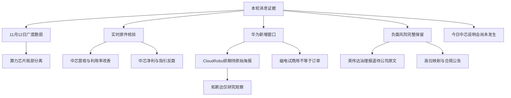

# 2026年11月13日 · 消息面事件驱动

> 数据源新鲜度：partial · 降级：true · 研究置信度：0.50。真实生成于本日盘前，不是冻结输入回放。
> 重点窗口为近72小时，但快讯实际只有11/10傍晚至11/13清晨的截面；本轮使用实时原文补核，不能声称新闻完整覆盖至生成时点。

## 一句话结论
观察国产算力分离与华为新增窗口；净利指引、海外治理及高位映射风险并列交下游。

## 先认市场，再看消息

情绪=震荡/主跌。11/12收盘，财联社记录沪指-0.67%、深成指-1.68%、创业板指-2.44%，超4600股下跌；国产算力芯片局部逆势，消费、天然气轮动，不是全市场普涨。连板公开数据给出封板率51.4%、炸板率48.6%，仅为partial公开口径，不冒充交易所全市场逐股核算，更不是某个板块封板率。

主线确认=未知，由R2/R7比较资金、扩散与核心地位；R4观察方向=国产算力芯片、具身发布窗口。持续性=未知；板块封板率=未知；下一交易时段预期=分歧情景。这里不以未知字段硬填“持续3日、资金已认可”。连板主线页机器人涨停由26→22→5收缩，与财联社所述机器人/物理AI亏钱效应一致；主线页8度和情绪页31.6度又不相同，因此不把页面标签压成精确阶段分数。

四个实际研究对照对象为中芯国际、拓斯达、中国船舶、悦康药业。按炸板率纪律收窄为两个研究观察：中芯国际、拓斯达。不是开仓资格，也不是新增预算。中国船舶已有11/11晚快讯且11/12可交易，悦康仍为IND阶段；两者事实保留，但不挤进本轮最优先的两个观察对象。事件与真实负面不因观察票减半而删减。

今天做：比较中芯的经营改善与利润/指引反面；区分华为发布会、试商用、实际订单三个阶段；把高位票合规与映射反证交R6。今天不做：把群聊供应链表当订单、把股东资产当上市公司资产、把未知RR写成达标，或继承旧研究停买为永久政策。账户真实预算与执行保护未读改，保持未知与原有有效约束。

## 🗺️ 消息面全景图

## 核心裁决：硬在哪里，软在哪里

1. 中芯：原件确认Q3美元营收环比+6.1%、利用率97.3%、毛利率29.9%；同时人民币归母净利由倒推Q2的31.06222亿元降至Q3的28.46764亿元，环比-8.352848%，Q4毛利率指引26%-28%。公告还显示Q3资本开支74.23亿元低于Q2的125.74亿元。周期股不能只看同比+91.6%。但投资收益等下滑影响净利，不能直接宣布主业周期见顶；美元IFRS集团利润不能混用人民币归母。今日08:30—09:30答疑为本轮新核到的官方时间锚，未预写答复。
2. 华为：磁电存储由预告进入客户联合试商用，是可靠媒体报道的新增步骤；不是所有“磁光电”概念股都进入MED供应链。CloudRobo目前确认到的是媒体据海报转述的11/16排期，不是模型已发布或A股伙伴新订单。由于底层同源、原官微/供应合同未直取，这两条保留在待核池，不为填数量升高强度。
3. 英伟达：财联社署名转述、上证报与证券时报均报道领导层变化，本轮官方新闻室及IR请求均SSL失败。因此保留行业负面但只标medium，未声称直接读过公司声明。同一公告的多家转载不算多份原始事件；国产替代、AMD/TPU受益只是传导假设，尚无转单证明。盘前跌幅也不能冒充收盘表现。
4. 不选伪映射：天普原件否认资产注入/借壳与AI业务储备。远东传动的间接权益、昇腾订单和满产说法尚缺原件；磁电存储截图名单与代码错配的脑机名单同样不授核心地位。R4拦截这些过度解释，但不冒充R6签发hard_reject。

## 🎯 确认池：逐事件三问

以下“确认”限于原件/可追溯报道所支持的事实；研究强度不是涨跌概率。正负分面同属一个底层事项时不重复加权。

### E20261113_01_N · 中芯国际归母净利环比下降且Q4毛利率指引回落

态度：不进（对应风险叙事/对象） · 极性：负面 · 强度：high · 新旧：老方向新增催化

事实：Q3人民币归母28.46764亿元，Q2倒推31.06222亿元；Q4毛利率指引26%-28%低于Q3的29.9%。 同表Q3资本开支74.23亿元，Q2为125.74亿元，设备材料链不能只看产能利用率。

时间与来源：最早已核可知=2026-11-12T17:35:00+08:00；研究可交易归档=20261113；原始发布时间=未知，不用归档日替代。已查：PDF19 / PDF20 / NEWS1189 / TS_INCOME_SMIC。统一快讯窗11/10傍晚—11/13清晨，公告索引为11/12—13；各原文实际抓取时点见JSON证据索引。

- **大资金意图**：未核。本阶段没有本事件后的逐票R7资金确认，不以利好、股价或转载数量推断机构意图。
- **为什么走强**：本事件后A股新交易时段尚未核到，不能把昨日日内上涨归因盘后披露。可检验的传导假设是：环比及前瞻指引构成真实反面；其他收益下降会压低净利，不能简单宣判主业周期见顶。
- **逻辑够不够硬**：原始公司/发行人文本支持事实，但不直接支持收入兑现或交易资格。核今日08:30-09:30电话会的价格、折旧、产品组合解释；一致预期和现货价格未查。

反面与查核边界：杀伤范围=个股级；所列事实与反证已交付；未穷尽公告历史、监管及司法源，不写无负面原文页数及实际阅读范围在JSON；未核的地方不是“无负面”。

### E20261113_01_P · 中芯国际Q3收入及产能利用率改善

态度：观察（非交易授权） · 极性：正面 · 强度：high · 新旧：老方向新增催化

事实：Q3美元收入环比+6.1%，产能利用率97.3%对比93.7%，毛利率29.9%对比25.3%；四季度收入指引环比+4%-6%。

时间与来源：最早已核可知=2026-11-12T17:35:00+08:00；研究可交易归档=20261113；原始发布时间=未知，不用归档日替代。已查：PDF19 / PDF20。统一快讯窗11/10傍晚—11/13清晨，公告索引为11/12—13；各原文实际抓取时点见JSON证据索引。

- **大资金意图**：未核。本阶段没有本事件后的逐票R7资金确认，不以利好、股价或转载数量推断机构意图。
- **为什么走强**：本事件后A股新交易时段尚未核到，不能把昨日日内上涨归因盘后披露。可检验的传导假设是：这是运营分面的正面事实，不是整份业绩极性改判正面；设备材料获益仍需资本开支及采购合同。
- **逻辑够不够硬**：原始公司/发行人文本支持事实，但不直接支持收入兑现或交易资格。与同源负面分面01_N并看；不把业绩说明会视为第二份新财报。

反面与查核边界：所列事实与反证已交付；未穷尽公告历史、监管及司法源，不写无负面原文页数及实际阅读范围在JSON；未核的地方不是“无负面”。

### E20261113_10 · 天普股份否认资产注入及借壳路径

态度：不进（对应风险叙事/对象） · 极性：负面 · 强度：high · 新旧：老方向新增催化

事实：原件称中昊芯英无资产注入计划、未来36个月无通过公司借壳安排；公司及天普欣才无AI技术或研发人员储备、无AI业务计划，并披露既有立案风险。

时间与来源：最早已核可知=2026-11-12T17:37:23+08:00；研究可交易归档=20261113；原始发布时间=未知，不用归档日替代。已查：PDF09 / NEWS1193。统一快讯窗11/10傍晚—11/13清晨，公告索引为11/12—13；各原文实际抓取时点见JSON证据索引。

- **大资金意图**：未核。本阶段没有本事件后的逐票R7资金确认，不以利好、股价或转载数量推断机构意图。
- **为什么走强**：本事件后A股新交易时段尚未核到，不能把昨日日内上涨归因盘后披露。可检验的传导假设是：芯片题材涨停不证明上市公司取得芯片资产；这是核心业务映射的实质反证。
- **逻辑够不够硬**：原始公司/发行人文本支持事实，但不直接支持收入兑现或交易资格。不要把股东资产等同上市资产；立案后续与新经营事实仍需核。

反面与查核边界：杀伤范围=个股级；所列事实与反证已交付；未穷尽公告历史、监管及司法源，不写无负面原文页数及实际阅读范围在JSON；未核的地方不是“无负面”。

### E20261113_11 · 日出东方五连板风险公告并存董高减持实施期

态度：不进（对应风险叙事/对象） · 极性：负面 · 强度：high · 新旧：老方向新增催化

事实：五连板累计涨61.20%；主营未变，公司披露股价偏离基本面并有部分董事及高管减持计划在实施期。

时间与来源：最早已核可知=2026-11-12T17:19:16+08:00；研究可交易归档=20261113；原始发布时间=未知，不用归档日替代。已查：PDF07 / NEWS1231。统一快讯窗11/10傍晚—11/13清晨，公告索引为11/12—13；各原文实际抓取时点见JSON证据索引。

- **大资金意图**：未核。本阶段没有本事件后的逐票R7资金确认，不以利好、股价或转载数量推断机构意图。
- **为什么走强**：本事件后A股新交易时段尚未核到，不能把昨日日内上涨归因盘后披露。可检验的传导假设是：地位辨识度是市场事实之一，不能代替业绩变化或减持风险核验。
- **逻辑够不够硬**：原始公司/发行人文本支持事实，但不直接支持收入兑现或交易资格。本条不自动产生R6 hard_reject；核实际减持及承接，R4不提供追高价。

反面与查核边界：杀伤范围=个股级；所列事实与反证已交付；未穷尽公告历史、监管及司法源，不写无负面原文页数及实际阅读范围在JSON；未核的地方不是“无负面”。

### E20261113_12 · 大东方风险公告提示微利及股价严重偏离

态度：不进（对应风险叙事/对象） · 极性：负面 · 强度：high · 新旧：老方向新增催化

事实：公司披露8交易日6次涨停、累计81.77%；前三季归母840.92万元同比下降84.89%，该财务数据为10/28已披露旧背景。

时间与来源：最早已核可知=精确时分未知；研究可交易归档=20261113；原始发布时间=未知，不用归档日替代。已查：PDF08。统一快讯窗11/10傍晚—11/13清晨，公告索引为11/12—13；各原文实际抓取时点见JSON证据索引。

- **大资金意图**：未核。本阶段没有本事件后的逐票R7资金确认，不以利好、股价或转载数量推断机构意图。
- **为什么走强**：本事件后A股新交易时段尚未核到，不能把昨日日内上涨归因盘后披露。可检验的传导假设是：消费题材合力不能被一只抱团票的上涨替代；旧财务背景不冒称新业绩预告。
- **逻辑够不够硬**：原始公司/发行人文本支持事实，但不直接支持收入兑现或交易资格。核零售与医疗服务各自业务贡献、后续经营和承接；不能因异动公告等同立即停牌。

反面与查核边界：杀伤范围=个股级；所列事实与反证已交付；未穷尽公告历史、监管及司法源，不写无负面原文页数及实际阅读范围在JSON；未核的地方不是“无负面”。

### E20261113_13 · 惠发食品三连板风险公告并存亏损及减持

态度：不进（对应风险叙事/对象） · 极性：负面 · 强度：high · 新旧：老方向新增催化

事实：公司披露三连板；旧三季报净亏488.62万元；控股股东持股质押51.79%，股东不超3%减持计划仍在期。

时间与来源：最早已核可知=精确时分未知；研究可交易归档=20261113；原始发布时间=未知，不用归档日替代。已查：PDF24。统一快讯窗11/10傍晚—11/13清晨，公告索引为11/12—13；各原文实际抓取时点见JSON证据索引。

- **大资金意图**：未核。本阶段没有本事件后的逐票R7资金确认，不以利好、股价或转载数量推断机构意图。
- **为什么走强**：本事件后A股新交易时段尚未核到，不能把昨日日内上涨归因盘后披露。可检验的传导假设是：防御消费轮动不消除个体杠杆、业绩及供给风险。
- **逻辑够不够硬**：原始公司/发行人文本支持事实，但不直接支持收入兑现或交易资格。核质押变化与已减持数量；不以主题防御属性直接放行。

反面与查核边界：杀伤范围=个股级；所列事实与反证已交付；未穷尽公告历史、监管及司法源，不写无负面原文页数及实际阅读范围在JSON；未核的地方不是“无负面”。

### E20261113_14 · 新华传媒重组未完成且公告提示偏离基本面

态度：不进（对应风险叙事/对象） · 极性：负面 · 强度：high · 新旧：老方向新增催化

事实：复牌后累计涨174.39%；收购界面财联社仍在审计评估，需内部与监管审批；原文提示旧扣非亏损与重组不确定性。

时间与来源：最早已核可知=2026-11-12T17:21:28+08:00；研究可交易归档=20261113；原始发布时间=未知，不用归档日替代。已查：PDF23 / NEWS1225。统一快讯窗11/10傍晚—11/13清晨，公告索引为11/12—13；各原文实际抓取时点见JSON证据索引。

- **大资金意图**：未核。本阶段没有本事件后的逐票R7资金确认，不以利好、股价或转载数量推断机构意图。
- **为什么走强**：本事件后A股新交易时段尚未核到，不能把昨日日内上涨归因盘后披露。可检验的传导假设是：新闻平台品牌与上市公司已取得资产不是一回事。
- **逻辑够不够硬**：原始公司/发行人文本支持事实，但不直接支持收入兑现或交易资格。核正式报告书、估值与审批，不把预案写成交割。

反面与查核边界：杀伤范围=个股级；所列事实与反证已交付；未穷尽公告历史、监管及司法源，不写无负面原文页数及实际阅读范围在JSON；未核的地方不是“无负面”。

### E20261113_15 · 钧达终止阿曼5GW项目且募资用途变更待表决

态度：不进（对应风险叙事/对象） · 极性：负面 · 强度：high · 新旧：老方向新增催化

事实：董事会决定终止阿曼5GW项目；H股剩余9.63亿港元拟改用途仍需股东会。原件称项目未实质建设、前期投入较少。

时间与来源：最早已核可知=2026-11-12T16:45:55+08:00；研究可交易归档=20261113；原始发布时间=未知，不用归档日替代。已查：PDF11 / NEWS1343。统一快讯窗11/10傍晚—11/13清晨，公告索引为11/12—13；各原文实际抓取时点见JSON证据索引。

- **大资金意图**：未核。本阶段没有本事件后的逐票R7资金确认，不以利好、股价或转载数量推断机构意图。
- **为什么走强**：本事件后A股新交易时段尚未核到，不能把昨日日内上涨归因盘后披露。可检验的传导假设是：海外产能预期撤销为负面；减少新增资本消耗是反面正向假设，不是立即利润增加。
- **逻辑够不够硬**：原始公司/发行人文本支持事实，但不直接支持收入兑现或交易资格。核资金用途批准与现有业务，不能把计划终止写成现有工厂停产。

反面与查核边界：杀伤范围=个股级；所列事实与反证已交付；未穷尽公告历史、监管及司法源，不写无负面原文页数及实际阅读范围在JSON；未核的地方不是“无负面”。

### E20261113_16 · 海南矿业收购事项被暂缓审议

态度：不进（对应风险叙事/对象） · 极性：负面 · 强度：high · 新旧：老方向新增催化

事实：上交所重组委对收购洛阳丰瑞69.90%事项暂缓审议，问及采矿权评估参数、采矿量运输匹配及关联销售真实性。

时间与来源：最早已核可知=2026-11-12T21:47:51+08:00；研究可交易归档=20261113；原始发布时间=未知，不用归档日替代。已查：PDF21 / NEWS0552。统一快讯窗11/10傍晚—11/13清晨，公告索引为11/12—13；各原文实际抓取时点见JSON证据索引。

- **大资金意图**：未核。本阶段没有本事件后的逐票R7资金确认，不以利好、股价或转载数量推断机构意图。
- **为什么走强**：本事件后A股新交易时段尚未核到，不能把昨日日内上涨归因盘后披露。可检验的传导假设是：这是真实审批阻滞与核查风险，不是已否决，也不是已证实财务造假。
- **逻辑够不够硬**：原始公司/发行人文本支持事实，但不直接支持收入兑现或交易资格。等待补充论证及再次审议，不能提前确认收购收入。

反面与查核边界：杀伤范围=个股级；所列事实与反证已交付；未穷尽公告历史、监管及司法源，不写无负面原文页数及实际阅读范围在JSON；未核的地方不是“无负面”。

### E20261113_04_P · 礼来口服GLP1减重药在中国获批上市

态度：观察（非交易授权） · 极性：正面 · 强度：high · 新旧：老方向新增催化

事实：已回读礼来署名美通社原始发布稿，批准适应症为成人体重管理；2型糖尿病适应症仍在审批。

时间与来源：最早已核可知=2026-11-12T15:07:00+08:00；研究可交易归档=20261113；原始发布时间=2026-11-12T15:45:00+08:00。已查：WEB06 / API11 / NEWS1896 / RSS057。统一快讯窗11/10傍晚—11/13清晨，公告索引为11/12—13；各原文实际抓取时点见JSON证据索引。

- **大资金意图**：未核。本阶段没有本事件后的逐票R7资金确认，不以利好、股价或转载数量推断机构意图。
- **为什么走强**：本事件后A股新交易时段尚未核到，不能把昨日日内上涨归因盘后披露。可检验的传导假设是：为口服路线提供注册验证与患者选择；不把海外公司的获批自动映射为所有A股GLP1收入增长。
- **逻辑够不够硬**：原始公司/发行人文本支持事实，但不直接支持收入兑现或交易资格。核商业化定价与处方渗透；未认证A股供应商；不得把糖尿病也写成获批。

反面与查核边界：所列事实与反证已交付；未穷尽公告历史、监管及司法源，不写无负面原文页数及实际阅读范围在JSON；未核的地方不是“无负面”。

### E20261113_05 · 中国船舶20艘VLCC合同已签但尚待审批生效

态度：观察（非交易授权） · 极性：正面 · 强度：high · 新旧：已交易后的延续

事实：大连造船联合中船贸易签20艘30.7万吨VLCC；海南海能4艘37.93亿元含税，东方富利16艘134.2512亿元不含税；2029-2030交付，待审批生效。

时间与来源：最早已核可知=2026-11-11T18:16:00+08:00；研究可交易归档=20261112；原始发布时间=未知，不用归档日替代。已查：PDF01 / NEWS2322 / KC01。统一快讯窗11/10傍晚—11/13清晨，公告索引为11/12—13；各原文实际抓取时点见JSON证据索引。

- **大资金意图**：未核。本阶段没有本事件后的逐票R7资金确认，不以利好、股价或转载数量推断机构意图。
- **为什么走强**：本事件后A股新交易时段尚未核到，不能把昨日日内上涨归因盘后披露。可检验的传导假设是：订单增强远期生产可见度；混合税口径不简单相加成同比合同总额。买方与卖方披露是同一需求，不计双源。
- **逻辑够不够硬**：原始公司/发行人文本支持事实，但不直接支持收入兑现或交易资格。核审批、预付款及排产；原件明确对当期利润不构成重大影响。11/11晚已有快讯，11/12已可交易。

反面与查核边界：所列事实与反证已交付；未穷尽公告历史、监管及司法源，不写无负面原文页数及实际阅读范围在JSON；未核的地方不是“无负面”。

### E20261113_06 · 湘财证券被罚且暂停新增证券账户三个月

态度：不进（对应风险叙事/对象） · 极性：负面 · 强度：high · 新旧：老方向新增催化

事实：11/11收到决定书；罚29万元并自收到之日起暂停新开户3个月；原文称不影响存量客户服务且不触及相关退市/其他风险警示。

时间与来源：最早已核可知=2026-11-11T22:03:00+08:00；研究可交易归档=20261112；原始发布时间=未知，不用归档日替代。已查：PDF02 / NEWS2218。统一快讯窗11/10傍晚—11/13清晨，公告索引为11/12—13；各原文实际抓取时点见JSON证据索引。

- **大资金意图**：未核。本阶段没有本事件后的逐票R7资金确认，不以利好、股价或转载数量推断机构意图。
- **为什么走强**：本事件后A股新交易时段尚未核到，不能把昨日日内上涨归因盘后披露。可检验的传导假设是：不把小额罚款当作全部风险，客户拓展受限是真实业务约束。
- **逻辑够不够硬**：原始公司/发行人文本支持事实，但不直接支持收入兑现或交易资格。核整改及恢复开户，限定该子公司而非整个券商板块。

反面与查核边界：杀伤范围=个股级；所列事实与反证已交付；未穷尽公告历史、监管及司法源，不写无负面原文页数及实际阅读范围在JSON；未核的地方不是“无负面”。

### E20261113_07 · 国盛证券被罚且暂停新增证券账户三个月

态度：不进（对应风险叙事/对象） · 极性：负面 · 强度：high · 新旧：老方向新增催化

事实：11/11收到行政处罚与监管措施，罚29万元并暂停新开户3个月；公告称不触及重大违法强退及其他风险警示。

时间与来源：最早已核可知=2026-11-11T22:03:00+08:00；研究可交易归档=20261112；原始发布时间=未知，不用归档日替代。已查：PDF03 / NEWS2216。统一快讯窗11/10傍晚—11/13清晨，公告索引为11/12—13；各原文实际抓取时点见JSON证据索引。

- **大资金意图**：未核。本阶段没有本事件后的逐票R7资金确认，不以利好、股价或转载数量推断机构意图。
- **为什么走强**：本事件后A股新交易时段尚未核到，不能把昨日日内上涨归因盘后披露。可检验的传导假设是：与湘财是不同被监管主体但同类风险，不能当成券商全行业停业。
- **逻辑够不够硬**：原始公司/发行人文本支持事实，但不直接支持收入兑现或交易资格。核业务限制期限与整改；不要把游资席位知名度当合规豁免。

反面与查核边界：杀伤范围=个股级；所列事实与反证已交付；未穷尽公告历史、监管及司法源，不写无负面原文页数及实际阅读范围在JSON；未核的地方不是“无负面”。

### E20261113_08 · 林州重机信披违法行政处罚落地

态度：不进（对应风险叙事/对象） · 极性：负面 · 强度：high · 新旧：老方向新增催化

事实：2025半年报虚增收入32270.31万元占35.64%；公司被罚400万元，董事长与相关高管另罚；公告称不触及强退/其他风险警示。

时间与来源：最早已核可知=2026-11-11T19:26:00+08:00；研究可交易归档=20261112；原始发布时间=未知，不用归档日替代。已查：PDF04 / NEWS2276。统一快讯窗11/10傍晚—11/13清晨，公告索引为11/12—13；各原文实际抓取时点见JSON证据索引。

- **大资金意图**：未核。本阶段没有本事件后的逐票R7资金确认，不以利好、股价或转载数量推断机构意图。
- **为什么走强**：本事件后A股新交易时段尚未核到，不能把昨日日内上涨归因盘后披露。可检验的传导假设是：已更正不消除历史会计与治理反证，不能用机器人热度覆盖。
- **逻辑够不够硬**：原始公司/发行人文本支持事实，但不直接支持收入兑现或交易资格。新质押快讯1164亦需查原件；它不是本轮已核处罚原件的一部分。

反面与查核边界：杀伤范围=个股级；所列事实与反证已交付；未穷尽公告历史、监管及司法源，不写无负面原文页数及实际阅读范围在JSON；未核的地方不是“无负面”。

### E20261113_09 · 捷荣技术权益转让信披拟处罚及德龙董事长涉旧案

态度：不进（对应风险叙事/对象） · 极性：负面 · 强度：high · 新旧：老方向新增催化

事实：捷荣集团及川发基金等拟处罚；德龙董事长王新杰因捷荣任职期间事项获事先告知，拟罚70万元。德龙公告明确与本公司业务、内控和财务无关联。

时间与来源：最早已核可知=2026-11-11T19:25:00+08:00；研究可交易归档=20261112；原始发布时间=未知，不用归档日替代。已查：PDF05 / PDF06 / NEWS2277。统一快讯窗11/10傍晚—11/13清晨，公告索引为11/12—13；各原文实际抓取时点见JSON证据索引。

- **大资金意图**：未核。本阶段没有本事件后的逐票R7资金确认，不以利好、股价或转载数量推断机构意图。
- **为什么走强**：本事件后A股新交易时段尚未核到，不能把昨日日内上涨归因盘后披露。可检验的传导假设是：事先告知不是最终处罚；德龙的关联为个人治理风险，不将其写成德龙自身财务造假。
- **逻辑够不够硬**：原始公司/发行人文本支持事实，但不直接支持收入兑现或交易资格。区分广东16号与17号文及当事人，等待陈述申辩、听证与正式决定。

反面与查核边界：杀伤范围=个股级；所列事实与反证已交付；未穷尽公告历史、监管及司法源，不写无负面原文页数及实际阅读范围在JSON；未核的地方不是“无负面”。

### E20261113_17 · 英力特11月13日起停牌筹划重组

态度：不进（对应风险叙事/对象） · 极性：负面 · 强度：high · 新旧：老方向新增催化

事实：自11/13开市停牌；拟购买宝丰光伏100%股权，控股权转让协议仍在磋商；正式方案未定。

时间与来源：最早已核可知=2026-11-12T22:47:49+08:00；研究可交易归档=20261113；原始发布时间=未知，不用归档日替代。已查：PDF12 / NEWS0410。统一快讯窗11/10傍晚—11/13清晨，公告索引为11/12—13；各原文实际抓取时点见JSON证据索引。

- **大资金意图**：未核。本阶段没有本事件后的逐票R7资金确认，不以利好、股价或转载数量推断机构意图。
- **为什么走强**：本事件后A股新交易时段尚未核到，不能把昨日日内上涨归因盘后披露。可检验的传导假设是：交易时段不可买卖是客观限制；资产、价格、稀释和审批仍不确定。
- **逻辑够不够硬**：原始公司/发行人文本支持事实，但不直接支持收入兑现或交易资格。公告预计安排不等于无条件确定复牌日；核正式协议。

反面与查核边界：杀伤范围=个股级；所列事实与反证已交付；未穷尽公告历史、监管及司法源，不写无负面原文页数及实际阅读范围在JSON；未核的地方不是“无负面”。

### E20261113_25 · 昇辉公告明确1.2亿元框架规模不是已获订单

态度：不进（对应风险叙事/对象） · 极性：负面 · 强度：high · 新旧：老方向新增催化

事实：公告明确框架协议不构成施工合同或订单，第一批约1.2亿元不代表公司已得订单；智能换电业务初期且对本年度无重大影响。

时间与来源：最早已核可知=2026-11-12T16:32:35+08:00；研究可交易归档=20261113；原始发布时间=未知，不用归档日替代。已查：PDF25 / NEWS1383。统一快讯窗11/10傍晚—11/13清晨，公告索引为11/12—13；各原文实际抓取时点见JSON证据索引。

- **大资金意图**：未核。本阶段没有本事件后的逐票R7资金确认，不以利好、股价或转载数量推断机构意图。
- **为什么走强**：本事件后A股新交易时段尚未核到，不能把昨日日内上涨归因盘后披露。可检验的传导假设是：拦截的是已获订单与本期利润的过度映射，不是否定框架合作存在。
- **逻辑够不够硬**：原始公司/发行人文本支持事实，但不直接支持收入兑现或交易资格。核逐站子合同、备案、场地、付款条款和实际开工。

反面与查核边界：杀伤范围=个股级；所列事实与反证已交付；未穷尽公告历史、监管及司法源，不写无负面原文页数及实际阅读范围在JSON；未核的地方不是“无负面”。

### E20261113_18 · 珠免集团停牌收购已控股免税公司余下49%

态度：不进（对应风险叙事/对象） · 极性：负面 · 强度：high · 新旧：已交易后的延续

事实：11/12已停牌；拟收购免税公司余下49%，当前已持51%；仅意向阶段，作价与完整方案未定。

时间与来源：最早已核可知=精确时分未知；研究可交易归档=20261112；原始发布时间=未知，不用归档日替代。已查：PDF18 / KC01。统一快讯窗11/10傍晚—11/13清晨，公告索引为11/12—13；各原文实际抓取时点见JSON证据索引。

- **大资金意图**：未核。本阶段没有本事件后的逐票R7资金确认，不以利好、股价或转载数量推断机构意图。
- **为什么走强**：本事件后A股新交易时段尚未核到，不能把昨日日内上涨归因盘后披露。可检验的传导假设是：风险是停牌与重组不确定，不是否定免税经营；并非从零获得整个业务。
- **逻辑够不够硬**：原始公司/发行人文本支持事实，但不直接支持收入兑现或交易资格。核后续协议及复牌公告，不把预计十个交易日当确定日期。

反面与查核边界：杀伤范围=个股级；所列事实与反证已交付；未穷尽公告历史、监管及司法源，不写无负面原文页数及实际阅读范围在JSON；未核的地方不是“无负面”。

### E20261113_19 · 恒瑞芮弗西拜单抗获批上市

态度：观察（非交易授权） · 极性：正面 · 强度：high · 新旧：老方向新增催化

事实：子公司1类新药获批用于成人及12岁以上青少年HoFH降LDL-C；累计研发约3.029亿元。

时间与来源：最早已核可知=2026-11-12T16:45:50+08:00；研究可交易归档=20261113；原始发布时间=未知，不用归档日替代。已查：PDF22 / NEWS1344。统一快讯窗11/10傍晚—11/13清晨，公告索引为11/12—13；各原文实际抓取时点见JSON证据索引。

- **大资金意图**：未核。本阶段没有本事件后的逐票R7资金确认，不以利好、股价或转载数量推断机构意图。
- **为什么走强**：本事件后A股新交易时段尚未核到，不能把昨日日内上涨归因盘后披露。可检验的传导假设是：注册完成程度高于IND；适应症为罕见病，不按同靶点全球销售额直接推A股收入。
- **逻辑够不够硬**：原始公司/发行人文本支持事实，但不直接支持收入兑现或交易资格。核商业化准入、价格、销售节奏。

反面与查核边界：所列事实与反证已交付；未穷尽公告历史、监管及司法源，不写无负面原文页数及实际阅读范围在JSON；未核的地方不是“无负面”。

### E20261113_02_N · 英伟达领导层变动获财联社转述报道

态度：不进（对应风险叙事/对象） · 极性：负面 · 强度：medium · 新旧：老方向新增催化

事实：财联社署名转述及证券时报、上证报称黄仁勋辞去总裁、CEO及董事，CFO临时接任。英伟达新闻室与IR本轮SSL失败，未直接读到公司原文。

时间与来源：最早已核可知=2026-11-12T21:57:43+08:00；研究可交易归档=20261113；原始发布时间=未知，不用归档日替代。已查：API09 / RSS010 / RSS045 / NEWS0521。统一快讯窗11/10傍晚—11/13清晨，公告索引为11/12—13；各原文实际抓取时点见JSON证据索引。

- **大资金意图**：未核。本阶段没有本事件后的逐票R7资金确认，不以利好、股价或转载数量推断机构意图。
- **为什么走强**：本事件后A股新交易时段尚未核到，不能把昨日日内上涨归因盘后披露。可检验的传导假设是：治理连续性及客户融资信心可能受扰；国产GPU/其他架构的相对受益只是传导假设，不等于客户订单转移。
- **逻辑够不够硬**：现有报道支持事件线索，原文或独立性/商业化维度仍有缺口，不升级为高强度。回核英伟达原文、SEC与客户采购；不采用私生活猜测解释资金意图；早前Jay Puri接任说法已被新闻核查否定。

反面与查核边界：杀伤范围=行业级；所列事实与反证已交付；未穷尽公告历史、监管及司法源，不写无负面原文页数及实际阅读范围在JSON；未核的地方不是“无负面”。

### E20261113_04_N · 口服GLP1获批增加同赛道注射及在研产品竞争

态度：不进（对应风险叙事/对象） · 极性：负面 · 强度：medium · 新旧：老方向新增催化

事实：礼来已有获批口服体重管理方案，其他注射及在研路线面对新增临床选择。

时间与来源：最早已核可知=2026-11-12T15:07:00+08:00；研究可交易归档=20261113；原始发布时间=未知，不用归档日替代。已查：WEB06 / API11。统一快讯窗11/10傍晚—11/13清晨，公告索引为11/12—13；各原文实际抓取时点见JSON证据索引。

- **大资金意图**：未核。本阶段没有本事件后的逐票R7资金确认，不以利好、股价或转载数量推断机构意图。
- **为什么走强**：本事件后A股新交易时段尚未核到，不能把昨日日内上涨归因盘后披露。可检验的传导假设是：对国产在研项目的价格、依从性与商业化窗口形成竞争假设；不是确认任何A股企业订单下降。
- **逻辑够不够硬**：现有报道支持事件线索，原文或独立性/商业化维度仍有缺口，不升级为高强度。须逐一比较剂型、适应症、疗效与价格；不可跨试验直接得出国产药落后。

反面与查核边界：杀伤范围=行业级；所列事实与反证已交付；未穷尽公告历史、监管及司法源，不写无负面原文页数及实际阅读范围在JSON；未核的地方不是“无负面”。

### E20261113_26_P · 国内汽柴油降价生效降低部分终端燃油成本

态度：观察（非交易授权） · 极性：正面 · 强度：medium · 新旧：老方向新增催化

事实：财联社收评援引发改委：11/12 24时汽油每吨降645元、柴油降625元。

时间与来源：最早已核可知=2026-11-12T15:01:00+08:00；研究可交易归档=20261113；原始发布时间=未知，不用归档日替代。已查：RSS004 / API12 / NEWS1901。统一快讯窗11/10傍晚—11/13清晨，公告索引为11/12—13；各原文实际抓取时点见JSON证据索引。

- **大资金意图**：未核。本阶段没有本事件后的逐票R7资金确认，不以利好、股价或转载数量推断机构意图。
- **为什么走强**：本事件后A股新交易时段尚未核到，不能把昨日日内上涨归因盘后披露。可检验的传导假设是：对道路运输燃油支出边际有利；航空煤油未在本次汽柴油公告中，不硬外推航空燃油精确降幅。
- **逻辑够不够硬**：现有报道支持事件线索，原文或独立性/商业化维度仍有缺口，不升级为高强度。核价格传导、运价、需求及各公司对冲；消费成本下降不保证运输利润增加。

反面与查核边界：所列事实与反证已交付；未穷尽公告历史、监管及司法源，不写无负面原文页数及实际阅读范围在JSON；未核的地方不是“无负面”。

### E20261113_03 · 9项脑机接口行业标准获批立项而非实施

态度：观察（非交易授权） · 极性：正面 · 强度：medium · 新旧：已交易后的延续

事实：财联社公开电报与每经正文确认第五批标准制修订计划中9项脑机接口标准立项。未取得工信部原始附件。

时间与来源：最早已核可知=2026-11-12T11:13:00+08:00；研究可交易归档=20261112；原始发布时间=未知，不用归档日替代。已查：WEB08 / WEB09 / NEWS1979 / API10。统一快讯窗11/10傍晚—11/13清晨，公告索引为11/12—13；各原文实际抓取时点见JSON证据索引。

- **大资金意图**：未核。本阶段没有本事件后的逐票R7资金确认，不以利好、股价或转载数量推断机构意图。
- **为什么走强**：本事件后A股新交易时段尚未核到，不能把昨日日内上涨归因盘后披露。可检验的传导假设是：规范化有利行业开发；风险管理、数据合规同时增加验证义务，不是器械注册获批或订单。
- **逻辑够不够硬**：现有报道支持事件线索，原文或独立性/商业化维度仍有缺口，不升级为高强度。核标准文件编号和制定进度、器械许可及真实订单；OCR内错配代码不能进映射。

反面与查核边界：所列事实与反证已交付；未穷尽公告历史、监管及司法源，不写无负面原文页数及实际阅读范围在JSON；未核的地方不是“无负面”。

### E20261113_20 · 悦康YKYY018新增HPIV适应症FDA临床许可

态度：观察（非交易授权） · 极性：正面 · 强度：medium · 新旧：老方向新增催化

事实：FDA同意治疗和预防人副流感病毒感染IND183460开展临床试验。

时间与来源：最早已核可知=2026-11-12T17:22:29+08:00；研究可交易归档=20261113；原始发布时间=未知，不用归档日替代。已查：PDF15 / NEWS1222。统一快讯窗11/10傍晚—11/13清晨，公告索引为11/12—13；各原文实际抓取时点见JSON证据索引。

- **大资金意图**：未核。本阶段没有本事件后的逐票R7资金确认，不以利好、股价或转载数量推断机构意图。
- **为什么走强**：本事件后A股新交易时段尚未核到，不能把昨日日内上涨归因盘后披露。可检验的传导假设是：是研发阶段推进，不是美国上市许可或销售收入；既有RSV/hMPV试验与新适应症不能混称多次新获批。
- **逻辑够不够硬**：现有报道支持事件线索，原文或独立性/商业化维度仍有缺口，不升级为高强度。核试验启动、受试者与安全有效性；FDA原数据库本轮未查。

反面与查核边界：所列事实与反证已交付；未穷尽公告历史、监管及司法源，不写无负面原文页数及实际阅读范围在JSON；未核的地方不是“无负面”。

### E20261113_21 · 广生堂乙肝三联方案II期完成176例入组

态度：观察（非交易授权） · 极性：正面 · 强度：medium · 新旧：老方向新增催化

事实：GST-Peak-Triple随机双盲对照II期已完成176例入组。

时间与来源：最早已核可知=2026-11-12T16:06:06+08:00；研究可交易归档=20261113；原始发布时间=未知，不用归档日替代。已查：PDF16 / NEWS1470。统一快讯窗11/10傍晚—11/13清晨，公告索引为11/12—13；各原文实际抓取时点见JSON证据索引。

- **大资金意图**：未核。本阶段没有本事件后的逐票R7资金确认，不以利好、股价或转载数量推断机构意图。
- **为什么走强**：本事件后A股新交易时段尚未核到，不能把昨日日内上涨归因盘后披露。可检验的传导假设是：入组完成不是读出、更不是治愈获批；有限疗程疗效待结果。
- **逻辑够不够硬**：现有报道支持事件线索，原文或独立性/商业化维度仍有缺口，不升级为高强度。核主要终点、统计结果与后续注册路径。

反面与查核边界：所列事实与反证已交付；未穷尽公告历史、监管及司法源，不写无负面原文页数及实际阅读范围在JSON；未核的地方不是“无负面”。

### E20261113_23 · 金杯电工中标低压电缆采购但未签正式合同

态度：观察（非交易授权） · 极性：正面 · 强度：medium · 新旧：老方向新增催化

事实：华润置地2026-2027集采中标含税6.607317亿元；不含税额占2025收入2.88%；金额以正式合同为准。

时间与来源：最早已核可知=精确时分未知；研究可交易归档=20261113；原始发布时间=未知，不用归档日替代。已查：PDF13。统一快讯窗11/10傍晚—11/13清晨，公告索引为11/12—13；各原文实际抓取时点见JSON证据索引。

- **大资金意图**：未核。本阶段没有本事件后的逐票R7资金确认，不以利好、股价或转载数量推断机构意图。
- **为什么走强**：本事件后A股新交易时段尚未核到，不能把昨日日内上涨归因盘后披露。可检验的传导假设是：中标为实际推进，但对象是普通低压电缆，不借GPU热点改写为算力服务器订单。
- **逻辑够不够硬**：现有报道支持事件线索，原文或独立性/商业化维度仍有缺口，不升级为高强度。核合同、实际供货金额与回款；11/12公告日内精确公开时刻未知。

反面与查核边界：所列事实与反证已交付；未穷尽公告历史、监管及司法源，不写无负面原文页数及实际阅读范围在JSON；未核的地方不是“无负面”。

### E20261113_24 · 永贵子公司中标2145万元换电动力电池柜

态度：观察（非交易授权） · 极性：正面 · 强度：medium · 新旧：老方向新增催化

事实：江苏永贵中标中车大同电力机车动力电池项目2145万元含税；尚未签正式合同。

时间与来源：最早已核可知=2026-11-12T16:14:31+08:00；研究可交易归档=20261113；原始发布时间=未知，不用归档日替代。已查：PDF14 / NEWS1439。统一快讯窗11/10傍晚—11/13清晨，公告索引为11/12—13；各原文实际抓取时点见JSON证据索引。

- **大资金意图**：未核。本阶段没有本事件后的逐票R7资金确认，不以利好、股价或转载数量推断机构意图。
- **为什么走强**：本事件后A股新交易时段尚未核到，不能把昨日日内上涨归因盘后披露。可检验的传导假设是：本事项属于轨交场景，不自动外推至全部新能源汽车订单。
- **逻辑够不够硬**：现有报道支持事件线索，原文或独立性/商业化维度仍有缺口，不升级为高强度。核正式合同与交付，不将中标金额当已确认收入。

反面与查核边界：所列事实与反证已交付；未穷尽公告历史、监管及司法源，不写无负面原文页数及实际阅读范围在JSON；未核的地方不是“无负面”。

### E20261113_26_N · 汽柴油降价及原油波动需并看上游与炼化风险

态度：不进（对应风险叙事/对象） · 极性：负面 · 强度：medium · 新旧：老方向新增催化

事实：同一成品油调价文件下调汽柴油最高零售价，原油快讯同时波动；这里不将二者当两次需求冲击。

时间与来源：最早已核可知=2026-11-12T15:01:00+08:00；研究可交易归档=20261113；原始发布时间=未知，不用归档日替代。已查：RSS004 / API12 / NEWS1901。统一快讯窗11/10傍晚—11/13清晨，公告索引为11/12—13；各原文实际抓取时点见JSON证据索引。

- **大资金意图**：未核。本阶段没有本事件后的逐票R7资金确认，不以利好、股价或转载数量推断机构意图。
- **为什么走强**：本事件后A股新交易时段尚未核到，不能把昨日日内上涨归因盘后披露。可检验的传导假设是：炼化利润取决原油成本、库存和裂解价差，负面为库存/价差风险假设；上游风险需独立原油持续性确认。
- **逻辑够不够硬**：现有报道支持事件线索，原文或独立性/商业化维度仍有缺口，不升级为高强度。核原油实际成交与裂解价差；不能把零售价降幅直接等同上游利润降幅。

反面与查核边界：杀伤范围=行业级；所列事实与反证已交付；未穷尽公告历史、监管及司法源，不写无负面原文页数及实际阅读范围在JSON；未核的地方不是“无负面”。

### E20261113_22 · 博瑞BGM0504降糖III期顶线积极但已可交易

态度：观察（非交易授权） · 极性：正面 · 强度：medium · 新旧：已交易后的延续

事实：两项降糖III期均达预期目标；试验剂量、对照与估计目标需区分，尚非降糖获批。11/11晚已有公开快讯。

时间与来源：最早已核可知=2026-11-11T18:05:00+08:00；研究可交易归档=20261112；原始发布时间=未知，不用归档日替代。已查：PDF17 / NEWS2335 / KC01。统一快讯窗11/10傍晚—11/13清晨，公告索引为11/12—13；各原文实际抓取时点见JSON证据索引。

- **大资金意图**：未核。本阶段没有本事件后的逐票R7资金确认，不以利好、股价或转载数量推断机构意图。
- **为什么走强**：本事件后A股新交易时段尚未核到，不能把昨日日内上涨归因盘后披露。可检验的传导假设是：11/12日历延续核验有价值，但不是11/13盘前全新发现；还面对口服方案新增竞争。
- **逻辑够不够硬**：现有报道支持事件线索，原文或独立性/商业化维度仍有缺口，不升级为高强度。核申报进展与商业化；不跨试验直接宣布优于所有竞品。

反面与查核边界：所列事实与反证已交付；未穷尽公告历史、监管及司法源，不写无负面原文页数及实际阅读范围在JSON；未核的地方不是“无负面”。

## 🟡 媒体可定位但原始支持未补齐的事件池

这些线索继续交R2/R5，不能因未入确认池而消失，也不满足“两平台=两个独立原始支持”。

### E20261113_L01 · 华为磁电存储客户联合试商用已启动的媒体报道

观察。赛迪网和上证报报道11/12试商用启动及30余客户参与；11/11已预告，新增是由预告到场景验证。

事实层与推断层：同源会议信息不按两个平台算两个原始支持；试商用容量预定不等于A股公司收入或全行业磁介质替代。核验点：核华为原始技术资料与直接供应合同；同有/中电/斯迪克等群聊映射不能因名称相关自动认证。

已查=WEB05 / RSS043 / NEWS0360 / API03 / WEB03；最早已核=2026-11-12T19:19:59+08:00；新旧=老方向新增催化。同源会议通稿/海报/原稿仅算一份支持，缺口不升级成全市场停买。

### E20261113_L02 · 华为CloudRobo世界模型发布会定档报道

观察。上证报、IT之家等据华为海报报道11/16 14:00-15:30发布CloudRobo WM1.2，并有生态签约环节；原华为官微未直取。

事实层与推断层：这是未来发布会排期而非模型已发布；拓斯达等属已被报道的既有生态伙伴，不认定为11/16新增签约或收入。核验点：回核官方活动页、可用模型/能力、真实新增伙伴及付费订单；原文不可达和同源传播缺口保留。

已查=RSS047 / API14 / API16 / API20 / API21 / NEWS0879；最早已核=2026-11-12T17:37:33+08:00；新旧=老方向新增催化。同源会议通稿/海报/原稿仅算一份支持，缺口不升级成全市场停买。

### E20261113_L03 · 中国移动1.6T长距传输试验是旧方向技术验证

观察。新华社11/11晚已报道230GBaud及G.652.D光纤960km单波1.6T试验，11/12已可交易。

事实层与推断层：骨干长距传输试验不等于数通光模块批量订单，不能从千公里纪录泛化全部CPO受益。核验点：核运营商原始试验和参与方；研究接续而非新题材。

已查=RSS001 / NEWS2266；最早已核=2026-11-11T19:39:00+08:00；新旧=已交易后的延续。同源会议通稿/海报/原稿仅算一份支持，缺口不升级成全市场停买。

## 两只研究观察对象：四段思维链与逐票门禁缺口

首推票=0，执行票=0。下面是研究观察，不是凭消息生成买点。板型、龙头认定、RR、禁止清单四项明确披露未知；D1尚未首次形成计划前，in_today_plan=null，不写false来预先排除。

### 中芯国际 688981.SH · 观察

板型：未知；龙头认定：未知（纪律§2通过条数未知，不伪称已过）；盈亏比：null；禁止清单：未完成逐项检查，已确认命中列表为空不等于清白。机会类别：今日核心/主线补涨/计划内试错均待独立D1界定，因此当前不称交易机会。

- **买入理由**：当前没有买入授权。研究命题为：直接核到的新季度原件与电话会窗口，比较运营改善和净利/指引回落，不用高同比单边推多。
- **风险点**：与天普的股东芯片资产联想相比，直接主营/原件更清晰；不是授予其交易龙头地位。尚缺R7逐票资金、核心地位、完整公告历史及结构价位；已读源不证明没有其他负面。
- **止损条件**：stop_loss=null。没有可核结构止损和入场方案，不把最新价打固定折扣来造止损；若事件事实、业务关系或下游必要风险被证伪，撤销研究假设，具体处置归独立计划。
- **可验证假设**：中芯需验证说明会对指引/折旧/产品组合解释是否支持运营延续；拓斯达需核官方发布内容、是否真实新增合作及具体付费/交付关系。未满足时继续观察或降级，不接临时故事。
- 业绩预告交叉：已查本轮2026Q3前500行截面，无该代码记录；has_pre_increase=null，不是false。H1全样本未提供。中芯另有本轮原始三季报，拓斯达不因表内缺席伪称没有预告。

### 拓斯达 300607.SZ · 观察

板型：未知；龙头认定：未知（纪律§2通过条数未知，不伪称已过）；盈亏比：null；禁止清单：未完成逐项检查，已确认命中列表为空不等于清白。机会类别：今日核心/主线补涨/计划内试错均待独立D1界定，因此当前不称交易机会。

- **买入理由**：当前没有买入授权。研究命题为：上证报明确描述与CloudRobo平台的搬运部署，可作为新发布窗口的业务映射观察；不推定本轮签约或订单。
- **风险点**：与仅有截图的磁电名单相比业务关系可定位；但官方新排期未直取、订单未见且板块亏钱效应存在，因此仅观察。尚缺R7逐票资金、核心地位、完整公告历史及结构价位；已读源不证明没有其他负面。
- **止损条件**：stop_loss=null。没有可核结构止损和入场方案，不把最新价打固定折扣来造止损；若事件事实、业务关系或下游必要风险被证伪，撤销研究假设，具体处置归独立计划。
- **可验证假设**：中芯需验证说明会对指引/折旧/产品组合解释是否支持运营延续；拓斯达需核官方发布内容、是否真实新增合作及具体付费/交付关系。未满足时继续观察或降级，不接临时故事。
- 业绩预告交叉：已查本轮2026Q3前500行截面，无该代码记录；has_pre_increase=null，不是false。H1全样本未提供。中芯另有本轮原始三季报，拓斯达不因表内缺席伪称没有预告。

首板消息侧池只保留拓斯达direct_name_match、quality=medium，底层原稿1份。这里的“首板候选”是供下游核位置的消息候选，first_board_status=unknown，不表示它今天已是首板、低位或市场龙头；不是用首板名义绕过独立门禁。

## 📊 板块 × 事件极性叉乘

同一事件可以对不同产业角色产生相反传导。表内条件项不是已经发生的订单、资金流或亏损；不新增板块打分权重。

| 板块 | 正面事实 | 负面/反面 | 条件推断与裁决 |
|---|---|---|---|
| 晶圆代工 | 中芯营收、利用率、毛利改善 | 净利环比、下季毛利率指引回落 | 国产替代相对讨论不等于客户转单；观察 |
| 半导体设备材料 | 生产扩张的潜在需求 | 中芯单季资本开支下降 | 单厂支出不代表全行业需求，保留正负交织 |
| 海外AI链/光模块/PCB | 本轮未核新增普遍利好 | 英伟达治理与外盘风险 | 财报/原文/客户预算待核；不进盲目追涨叙事 |
| 磁电存储 | 媒体报道客户联合试商用启动 | 大量“磁光电”名单未证直接供货 | 观察厂商技术与合同，不认证股票池 |
| 具身智能/机器人 | CloudRobo新发布排期报道 | 上日板块涨停收缩及亏钱效应 | 新消息能否改变承接待核；不是预设不能修复 |
| GLP1 | 口服减重注册完成、博瑞旧顶线验证 | 注射/在研路线新增竞争 | 剂型、适应症、价格分别比较，不一概利好 |
| 公路运输/物流 | 汽柴油零售成本下降 | 运价/需求/对冲未知 | 不外推未在公告内的航空煤油精确降幅 |
| 上游油气/炼化 | 减库存成本等反向可能 | 库存/价差与油价波动风险 | 利润非单变量，不能把零售价同比例套利润 |
| 造船/油运 | 20艘VLCC远期合同 | 未生效、交付远、本期利润无重大影响 | 11/12已可交易；卖买双方同一项目不增需求 |
| 创新药 | 恒瑞注册、悦康IND、广生堂入组 | 审批/读出/商业化阶段不同 | 不按新闻数量拼成统一药品大主升 |
| 零售/食品/传媒高位对象 | 局部价格抱团不是新经营事实 | 大东方/惠发/新华/日出公告反证 | 地位与必要风险分开，不由R4授买权 |
| 券商 | 存量服务不受新增开户限制影响 | 湘财/国盛暂停新增客户 | 限具体主体；不扩大成券商全行业停业 |
| 贵金属/有色 | 本轮未核新增反向硬催化 | 快讯报告金银铜下跌 | 原报价终端未交叉，作为XR01而非已验证订单风险 |

完整39个板块行、正负分面与条件传导均在JSON的sector_polarity_cross_product；表中合并展示并非宣称只有13个板块。

## 🔥 中报业绩预告命中

本轮实际是2026Q3源，不是完整中报源。已交叉查净利润预增下限排序前15个记录；全部是旧公告背景，最新全表样本为11/04，不能当作11/13新硬alpha。没有对这15只逐一重拆单季、价格和一致预期，因此不把累计高同比升级为正面earnings事件。中芯的新财报已独立执行单季协议。

| 代码 | 名称 | 原公告日期 | 累计同比区间 | 与本文事件交集 | 裁决 |
|---|---|---|---|---|---|
| 001309.SZ | 德明利 | 2026-10-17 | 32046.52%—33154.49% | 存储 | 旧背景；不生成新买权 |
| 300821.SZ | 东岳硅材 | 2026-10-08 | 19047.97%—19748.08% | 未确认直接交集 | 旧背景；不生成新买权 |
| 000703.SZ | 恒逸石化 | 2026-10-16 | 3318.59%—3405.13% | 炼化 | 旧背景；不生成新买权 |
| 002466.SZ | 天齐锂业 | 2026-10-21 | 2734.97%—3235.26% | 未确认直接交集 | 旧背景；不生成新买权 |
| 688825.SH | 长鑫科技 | 2026-10-17 | 2581.06%—2609.47% | 存储 | 旧背景；不生成新买权 |
| 002812.SZ | 恩捷股份 | 2026-10-14 | 1884%—2474.8% | 未确认直接交集 | 旧背景；不生成新买权 |
| 688808.SH | 联讯仪器 | 2026-10-13 | 1866%—2072.95% | 光通信测试 | 旧背景；不生成新买权 |
| 301308.SZ | 江波龙 | 2026-10-15 | 1864.55%—1990.84% | 存储 | 旧背景；不生成新买权 |
| 605189.SH | 富春染织 | 2026-10-14 | 1347.69%—1519.01% | 未确认直接交集 | 旧背景；不生成新买权 |
| 603991.SH | 领先股份 | 2026-10-21 | 1238.57%—1238.57% | 芯片/封装 | 旧背景；不生成新买权 |
| 688388.SH | 嘉元科技 | 2026-10-15 | 1196.6%—1318.92% | 未确认直接交集 | 旧背景；不生成新买权 |
| 603026.SH | 石大胜华 | 2026-10-15 | 968.14%—1032.45% | 未确认直接交集 | 旧背景；不生成新买权 |
| 000626.SZ | 远大控股 | 2026-10-15 | 890%—1018% | 未确认直接交集 | 旧背景；不生成新买权 |
| 002493.SZ | 荣盛石化 | 2026-10-15 | 777.93%—822.95% | 炼化 | 旧背景；不生成新买权 |
| 301536.SZ | 星宸科技 | 2026-10-13 | 663.13%—697.75% | 芯片/封装 | 旧背景；不生成新买权 |

江波龙记录的文字本身就提示存储价格涨幅收窄、边际贡献趋缓；东岳硅材有低基数与非经常损益，嘉元/远大有公允价值或期现分类因素。这正说明不能按同比榜直接选股。表内无中芯、拓斯达，只能说该截面未命中，不能写“无预告”“无负面”。

## 图片与匿名传播：42条非空正文实际消费

71条图像记录中68条OCR状态ok，真正非空42条，24条非空仍为低清；另26条ok但空正文、3条错误。135个候选文件归98个资产族，71张去重图，74个资产族只有缩略图，不能把“资产族已处理”说成完整大图覆盖。低清片段、原始逐行置信度与质量、匿名资产身份、缓存/采集时点保存在主JSON证据索引，未开放或遍历缓存目录。

- 国产算力/昇腾950、磁电存储两类供应链图作为传播线索保留，不把“核心一供”“满产满销”当实证；同图多群、群文复制和RSS转载不加独立源数。
- 脑机接口截图中“标准落地”与原文“获批立项”不同，代码和名称也有不一致；文字可读不代表映射正确，不猜补、不自动修码。立项事实以WEB08公开电报为准。
- 鼓浪屿海缆图可读总投资1291万元、民生通信与2027—2028建设窗，不外推成跨海统一大工程或股票中标。
- 规划产能/市值表不证明低估；“龙字辈”“统一”“福建消费”的历史连板、名称联想不授核心地位。日本核原则相关片段保留，未核原文，不视为现行法律或采购。
- 英伟达截图与快讯同一传播，截图署时不写成群帖发布时间。全部published_at/message_time原未知保留null；source_cached_at仅缓存mtime，captured_at仅采集时间，不用其证明新闻何时公开，更不归因给发送人或KOL。

DeepSeek V5/两万亿参数昇腾训练、SpaceX/Singulus百吉瓦订单、远程算力访问管制等群聊文本也已保留为GROUP01—05。未取得正式原件的地方是待核，不能反写“已证伪”；但不能当已生效禁令、上市公司权益或订单。

## 关键证据

- PDF19/20：中芯A股三季报与H股季度业绩原件；同一底层财报，不算两个独立事件。
- PDF01 + NEWS2322：中国船舶卖方合同原件与11/11晚已知证据；远期合同、审批与税口径完整保留。
- PDF09：天普自身AI/注入/借壳边界；原文风险不因算力方向强而删掉。
- PDF02/03/04/05/06：监管决定与事先告知分别保留；德龙董事长旧任职事项不扩成德龙财务造假。
- WEB06：礼来署名原始发布稿确认成人体重管理获批，糖尿病仍待批；不同适应症不混用。
- WEB08：财联社公开电报正文11/12发布。搜索API有11/05错误索引日期，本轮以回读正文纠正，不把错索引当首次公开。
- RSS047 + API15/16：CloudRobo媒体排期与拓斯达主营、既有合作关系的观察依据；未经取得的新订单依然未知。

## 专题证据裁决

运输context_sha256：92c2cafacbe253a6c701a103f5548fbe4235030892bd96ed8e931394416745ab。

催化剂日历仅有限截取，非全文阅读；来源索引、原hash、完整source_timing、limitations与必要原文短摘已按收到身份嵌入knowledge_context。采取的是船舶/临床阶段提醒与说明会核验线索，并以本轮原件回核；未把日历全体提及代码视作候选。PPI排期保留为继承待核，不宣称本轮直接读了BLS原报告。连板today/mainline/qingxu逐源有裁决：使用公开收缩/广度参照，未使用其会员数据或历史概率作为今日胜率，也没有强制换票或增加评分权重。

## 数据源审计

| 源 | 日期 | 状态 | 真实覆盖与缺口 |
|---|---|:--:|---|
| manifest | 2026-11-13 | 🟢 | 已读manifest；global_severity=2不转换为交易停买政策 |
| mcp_health | 2026-11-13 | 🟡 | 健康探针是06:03观测，不保证每个后续请求成功；WeFlow不可用只降辅助腿 |
| wechat_official_20 | 2026-11-13 | 🟢 | 18订阅中14有文；95篇兼容镜像与RSS逐字相同只计一次；今晨盘前纪要尚无新文并非全天故障 |
| wechat_cli_5groups | 2026-11-13 | 🟢 | 350条含链接/文件占位；五群匿名化，未下载附件；重复文本不增源 |
| wechat_image_ocr | 2026-11-13 | 🟡 | 71图中68 OCR状态ok但仅42非空；26个ok空文本、3错误；42非空中24低清全部保留；74个资产族仅缩略图，不能宣称大图完整覆盖 |
| news_cls | 2026-11-13 | 🟡 | 实为sina1473+10jqka1500，不能声称有2973条财联社原始电报；最早11/10 17:23未覆盖完整72h且端点可能截顶 |
| news_major | 2026-11-13 | 🟡 | 800条content全部空，只能标题扫描；没有读到800篇长文 |
| eastmoney_earnings_predict | 2026-11-13 | 🔴 | 2026Q3前500行多财务指标重复；最新公告11/04。top15只作旧背景交叉，未命中不等于没有预告；未提供H1全样本 |
| anns_window | 2026-11-13 | 🟢 | 2358条索引覆盖11/12及11/13。26份PDF实时取得并解析事件及风险段；不是全文逐财务项目审计 |
| events_previous_and_anns_classified | 本轮/精确抓取时点未知 | 🔴 | 已搜索未发现；补充腿缺失不全局禁买 |
| hithink_business_query | 本轮/精确抓取时点未知 | 🟢 | 中芯国际、中国船舶、拓斯达主营已返回；事件归属不能量化为业务收入概率；未把自动输出的最新价当入场依据 |
| hithink_market_query | 2026-11-13 | 🟡 | 算力芯片前5查询语义实际落到光芯片组合；已拒绝拿这个结果当全市场国产GPU排名 |
| hithink_event_query | 2026-11-13 | 🟢 | 中芯当前累计利润与收入交叉；与原财报同源不是第二原始验证 |
| news_search_and_announcement_search | 本轮/精确抓取时点未知 | 🟡 | 多次实时检索；原文与摘要分层。若site过滤无效或19700122路径不匹配，未沿路径倒推发布日期 |
| nvidia_official_original | 本轮/精确抓取时点未知 | 🔴 | 两个官方站SSL EOF；定向检索仍未取得原文。保留负面报道、降至medium，不宣称公司原文已核 |
| R3_KOL_summary | 本轮/精确抓取时点未知 | 🔴 | 本轮未取得正式R3摘要；群聊出现不等于R3独立确认 |
| R7_formal | 本轮/精确抓取时点未知 | 🔴 | 本轮未取得正式R7；旁路staging/evidence不冒充最终结论 |

## 不确定性 / 反证

另有48条风险标题待原文核查，已在JSON单列negative_announcement_title_queue。包括退市/摘牌、监管、减持、限售等线索；标题不等于违法或已实际减持，不凭未查下硬否决。

1. 29个确认池正反分面对应26个底层事项，不是29次独立催化；另3条媒体待核线索单列。非官方同源转述没有冒充两份原始支持，强度与传播次数分开。
2. 原件可核不等于市场会买单；R7正式产物与逐票资金未取得，R2地位未定，R4不替其他阶段填入“资金认可”“已是龙头”。
3. 券商开户约束、天普映射否认、既有立案/处罚、高位风险、钧达项目终止、海南矿业暂缓审议及停牌均完整交下游，不被主线正面叙事盖掉。财务旧数据只作公告背景，不伪称新财报。
4. 外盘金银铜下跌、科技股表现与墨西哥关税条件威胁保留在XR01—03；未核交易终端/行政生效文本，不把盘前极端价格当收盘、威胁当法令。
5. 窗口、旧业绩样本、图片低清、官方原文或单provider失败，只降相应维度，不生成全市场no_trade/零仓建议；真实账户预算、已有保护与R6硬否决保持独立有效。

## 与其他 R/D/E 的关系

- 已实际依赖：当日manifest、源健康、RSS/五群/OCR、短讯、标题要闻、业绩截面、公告窗口；本轮Tushare交易日历/中芯公告/利润表；问财官方OpenAPI主营/新闻/公告；所列PDF与网页；运输日历有限截取及连板公开正文。
- 未取得：正式R3摘要、正式R7资金结论；不拿staging/evidence文件冒充已完成交付，也不等待或重启其他模型。
- 下游：R2比较主线与核心，R5对真实候选补画像和必要风险，R6只读本JSON内嵌证据，D1独立形成计划。R4未授予任何交易权限、预算或R6硬否决。

## Sub-Agent 元数据

- skill：analyze_news_impact_v1@1.7；method：llm_v1。
- artifact：data/research/20261113/R4_news.json。
- 状态：partial/degraded；研究交付完成不等于缺口已补齐或通过交易门禁。
- Pydantic与语义校验已在写盘前实际运行；落盘后旧首推检查器实际通过（首推0），研究消费者契约返回空错误。最初“非首推”被子串误识别的标签已消歧为“事件事实映射”，未为过检造止损；通过不代表逐票执行门禁。本机PATH未发现mmdc，图表已检查结构，未宣称渲染验收。
- 使用量：usage_unknown，既不填0也不保证低于努力目标；交付目标仅观察，不清池、不撤单。
