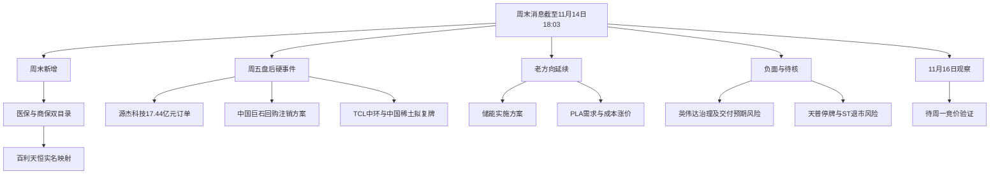

# 2026年11月14日 · 周末轻量消息面

> **新增看医保目录，硬催化看订单与回购；国产替代不能抹掉海外算力风险。**
> 截止北京时间 **11月14日18:03**；周一指 **2026年11月16日**。本文只列研究观察，不构成交易建议。所有事件、映射及条件候选均**待周一竞价验证**，不宣称已经形成合格首板。

## 🧭 时间边界与事件摘要

manifest回看36小时，自11月13日约06:02起；公告实际按11月13—14日自然日取数，不是逐分钟窗口。联网复核发生在本次生成过程中，但只采用截止前已公开内容，网页侧栏不参与证据。表中“最早”仅为本轮核到的证据，不冒充全网首次；**落款、索引日期和采集时刻均不能代替公开时间**。

| 事件 | 已核事实与新旧归属 | 最早已知证据／原文发布时间 | 采集时间口径 |
|---|---|---|---|
| E1 医保双目录 🟢 | 周六新增结果：新增107种、其中51个一类创新药；2027年1月1日实施 | 财联社专题11月14日10:43已报；医保局原文仅标11月14日[1] | RSS批次11月14日18:02；官方页面本轮联网复核，原始抓取时分未载 |
| E2 源杰订单 🟢 | 周五盘后新增订单，不是周六才签约 | 同花顺11月13日18:10已报；PDF落款11月14日[2] | 公告批次11月14日18:02 |
| E3 储能方案 🟢 | 老方向新增政策；周五15:00已有快讯，不是纯周末增量 | `news_cls.jsonl:L1908`；官方答问11月13日；文件成文10月29日[3] | 新闻单条采集未载；不能用manifest生成时间代填 |
| E4 两家重组复牌 🟡 | 老事项新增预案与明确复牌安排 | 中国稀土11月13日19:24、中环收购消息19:50；复牌PDF落款均11月13日，索引11月14日[4] | 公告批次11月14日18:02 |
| E5 巨石回购 🟢 | 周五盘后新方案，周六报道延续 | `news_cls.jsonl:L1772/L1060`11月13日18:06；PDF表内首次披露日11月14日，与新闻可知时间分列[5] | 公告批次11月14日18:02 |
| E6 海外AI治理风险 🔴 | 辞任本身已是周五前可知；周六继任报道不能推出资本开支已削减 | NVIDIA原文11月12日，时分与时区未标；本地五群11月13日06:49已转述[6] | 群消息原始采集时分未载；官方页面本轮复核 |

## 🗺️ 消息传导图

## 🎯 Top事件：事实、假设与反证分开

### E1 · 医保结果新增，不能把CAR-T受益直接套给A股

医保局确认双目录调整与实施日期。CAR-T的直接主体药明巨诺不是A股；A股实名线索采用中证报记者对**百利天恒688506**宜泽康纳保的报道，而非泛创新药成分股。临床可及性改善是事实，放量能否抵消价格让利仍是假设。[1][7]
- **大资金意图**: 未知；没有周末机构配置数据。
- **为什么走强**: 尚不能解释；周六新结果不能倒因解释周五价格。
- **逻辑够不够硬**: 目录事实硬、公司实名映射可追溯，净利润传导未核；若支付范围、入院或实际净价不利，盈利假设不成立。**待周一竞价验证**。

### E2 · 源杰科技17.44亿元订单：真订单，不猜B客户

公司PDF确认向B客户销售大功率激光器芯片，金额不含税；对方名称豁免披露。订单没有给出确定交付完成日期，产能爬坡会影响交付和收入确认，不能将金额全算入本年业绩，更不能将B客户指认为英伟达。[2]
- **大资金意图**: 未知；订单不是资金流入记录。
- **为什么走强**: 未核；周五盘后公告不能解释此前表现。
- **逻辑够不够硬**: 合同事实硬，兑现节奏与利润率未核。光芯片订单和海外产业治理风险须并列，不能互相抵销。**待周一竞价验证**。

### E3 · 储能：政策落地，不等于预算或订单落地

官方明确2030年装机3亿千瓦、平均时长约3小时，并完善容量价值机制，覆盖多技术路线。政策可支持长时储能与电力系统服务研究，但没有点名订单受益公司，因此**只保留板块事件，不拼概念大池**。[3]
- **大资金意图**: 未知；政策不证明机构调仓。
- **为什么走强**: 未核；本轮未建立政策与板块价格的因果证据。
- **逻辑够不够硬**: 文件硬，收益机制落地和项目经济性仍待地方规则、清单及招标验证；盲目扩产是反面。**待周一竞价验证**。

### E4 · TCL中环、中国稀土：明确复牌，不等于重组完成

中环拟购买中环领先65.80%股份；中国稀土拟购买中稀凉山51%股权。两份公司原文均确认11月16日开市复牌，也均提示审计评估及审批尚未完成。它们属于**复牌事件观察**，不混入普通首板候选。[4]
- **大资金意图**: 未知；不能把关联方交易意愿推成二级市场意图。
- **为什么走强**: 未核；复牌尚未发生。
- **逻辑够不够硬**: 复牌安排硬，最终作价、摊薄和审批结果不确定；预案不是交割。**待周一竞价验证**。

### E5 · 中国巨石：回购注销方案与电子布景气分开读

拟回购1.5亿—2.5亿元，后续全部注销，尚需股东会批准；实施期为批准后3个月，注销办理另有期限。公司经营涉及玻纤和电子布，但回购不等于新增销售订单，也不等于已经完成资金支出。[5]
- **大资金意图**: 二级市场未知；仅能确认公司披露的维护价值目的。
- **为什么走强**: 未核；没有回购驱动价格的已核因果。
- **逻辑够不够硬**: 方案硬、执行有条件；审批失败、终止回购或行业价格回落均可证伪强化预期。**待周一竞价验证**。

### E6 · 海外治理冲击：负面保留，但不把推测当停单

NVIDIA确认黄仁勋辞任及Colette Kress临时接任，同时表示客户承诺和产品路线图预计不中断。**治理不确定性对AI算力、光通信融资及订单预期构成行业级风险假设**；“资本开支必降”并非公告事实。[6]
- **大资金意图**: 未知；不从新闻反推机构撤离。
- **为什么走强**: 本项是风险观察，国产替代的价格反应与因果仍未核。
- **逻辑够不够硬**: 人事事实硬，业务冲击幅度未知；客户承诺继续执行是重要反证。公众号所谓CPO量产延至2027年底或2028年，仅单篇非官方转述，另列待核，不升格为已证实延期。**待周一竞价验证**。

## 🔎 周末发酵与条件候选：仅待核线索

PLA/3D打印有实名采访与业务证据：金丹科技为乳酸生产商，海正生材生产聚乳酸；但本周六报道引用的涨价发生在10月，9月调研已谈需求和成本，不能称全新题材。上涨可能来自硫酸等成本传导，**售价上涨不等于利润扩大**。[8]

下表流通市值来自本轮只读Tushare `daily_basic(trade_date=20261113)`，`circ_mv`单位万元、除以10000换算亿元。五只均不低于20亿元；周五`limit_status`分别为4、4、4、1、4，并与返回的非ST涨停清单交叉，均非周五涨停。**周一是否临时停牌、是否形成首板及价格资金反应仍未知，因此全部只是“待核候选线索”。**

| 待核候选线索 | 流通市值／原始circ_mv | 可验证假设 | 反证与缺口 |
|---|---|---|---|
| 百利天恒 688506.SH | 1032.39亿／10323909.369万 | 纳保范围与公司产品相符，后续供应、入院披露支持可及性提升；待周一竞价验证 | 降价、适应症限制及商业化成本可能抵销放量；缺全面冲突公告核验 |
| 源杰科技 688498.SH | 827.19亿／8271867.251万 | 后续披露仍确认订单有效及产能交付；待周一竞价验证 | B客户身份、交付期与毛利未知；同窗另有股权激励归属公告，不能忽略新增股份影响 |
| 中国巨石 600176.SH | 1087.02亿／10870233.619万 | 股东会及后续实施披露推进回购注销；待周一竞价验证 | 尚非已执行；玻纤周期与库存需另核，不由累计同比证明拐点 |
| 金丹科技 300829.SZ | 48.12亿／481193.2116万 | 核清10月调价后实际成交价、销量与原料成本；待周一竞价验证 | 调价是旧消息，产线试车不等于全部达产；缺完整公司原文和冲突公告 |
| 海正生材 688203.SH | 29.29亿／292869.8545万 | 后续调研能确认3D耗材需求及量价变化；待周一竞价验证 | 乳酸外购存在成本挤压，需求叙事9月已公开；缺最新利润拆分与冲突公告 |

AI影视是周五已传播方向，不按周末截图重新算催化。文投控股快讯披露AI漫剧收入占比较小；海联金汇亦称尝试投入产出很少。OCR中嘉环、盈建科、深圳华强等说法不能独立验证订单、资产注入或独家代理，不从这些图片新增候选（`news_cls.jsonl:L1046/L701`；OCR `L25/L26/L28`）。

## 📑 硬公告分类与负面检查

以下为全量标题筛查后的重点核验，不代表所有公司风险已查完；同一重组预案、摘要及附件只作一个底层事件。

| 类别 | 已核／待核重点 | 状态与边界 |
|---|---|---|
| 回购 | 巨石1.5亿—2.5亿元；煜邦电力变更用途注销另见索引L1522 | 巨石已读原文；后者仅标题，细节未核，不能同称新回购；待周一竞价验证 |
| 增持 | 黔源电力：国新产业资本增至6%，后续不少于600万股**含首次增持** | 原文已读，11月13日公告，属周五已知；不能写成另增600万股[9]；待周一竞价验证 |
| 增持时间冲突 | 星湖科技拟增持7500万—1.5亿元 | 快讯11月13日19:05已见，但PDF落款11月16日；保留冲突，不能把未来落款当周末首次公开[10]；待周一竞价验证 |
| 重组／收购 | 两家复牌预案；同仁堂拟24.438亿元收购天津同仁堂60% | 同仁堂原文称重大关联交易、**不构成重大资产重组**，尚需股东会；不因标题含收购就等同重组[11]；待周一竞价验证 |
| 要约 | 艾艾精工第三次提示，原要约报告10月19日已披露 | 老事项；原文否认未来36个月借壳及相关资产注入计划，不能炒成新注入事实[12]；待周一竞价验证 |
| 业绩预告 | 窗口标题未命中“业绩预告／业绩快报” | 不是全市场没有预告；规则“业绩预告/财报96条”混有大量说明会，不可当96个新盈利事件；待周一竞价验证 |
| ST／退市 🔴 | *ST瑞茂面值退市风险；萃华退终止上市摘牌；ST创意申请撤销警示 | 瑞茂原文已读，首日低于1元同时写11月2日和11月12日，**不推算连续天数**；其余仅索引，撤销申请非已获准[13]；待周一竞价验证（仅核交易状态，停牌或已退市对象不参与竞价） |
| 停复牌 🔴 | 天普11月16日开市停牌核查，复牌时间未定；英力特11月13日起停牌筹划 | 公司原文已核，均非普通周一首板观察对象；不把预期时限当已复牌[14]；待周一竞价验证（仅核交易状态，停牌或已退市对象不参与竞价） |
| 诉讼 🔴 | 经纬子公司为被告之一，涉案10308.43万元 | 已立案、未开庭，金额是请求并非判赔；与储能政策正面分列[15]；待周一竞价验证 |
| 监管／其他负面 | 晶盛机电警示函L2203；天山股份立案关注L1383；维业账户冻结L963 | 已发现标题，未精读原文，主体细节、处罚幅度及后续影响局部未核，**不是无风险**；待周一竞价验证 |

## 🧾 业绩交叉检查：不把旧同比当本周末alpha

东财文件已完整解析：报告期为2026年三季度，500条指标记录对应193家公司，并非500家公司或完整市场。公告日期最新11月4日；按归母预告同比上限排序检查前15项，本表五候选均未进入该前15交集。

- **中国巨石**命中10月10日旧预告：前三季归母同比100%—110%，扣非100%—110%；不是本周末新业绩。
- **源杰、百利天恒、金丹、海正**在这份500条中未命中，含义为“本文件未收录”，不是“没有业绩”或“没有风险”。
- 重组观察的**中国稀土**命中10月17日旧预告，归母同比88.96%—140.99%、扣非98.63%—152.94%，也不能因高增直接判利好。
- 本轮未完成各票单季利润、扣非主业、产品价格和一致预期的同口径比较；文件虽带环比派生值，缺底层上季证据，不直接采用。所有业绩判断保持**中性 `earnings_qoq_unverified`**。不沿用中报旧数据加分。

## 数据源审计

| 源 | 日期 | 状态 | 实际覆盖与缺口 |
|---|---|:--:|---|
| manifest | 2026-11-14 | 🟡 | 全局severity=0不等于各维度齐全；本报告独立标partial |
| wechat_cli_5groups | 2026-11-13—2026-11-14 | 🟢 | 五个匿名群251条，按完整message精确去重226条；周六14条，内部时间止于14:15；转发不是独立来源 |
| wechat_official_20 | 2026-11-13—2026-11-14 | 🟡 | 105篇，周六30篇；11个账号实际有文，18个订阅均抓取成功；兼容RSS副本不重复计数；头部时间至17:10 |
| news_cls | 2026-11-12—2026-11-14 | 🟡 | 2325条＝新浪1489＋同花顺836，**不是2325条财联社**；内部时间至08:57，未覆盖当日下午 |
| news_major | 2026-11-13—2026-11-14 | 🟡 | 800条全部正文为空；同花顺361、 新浪335、财联社57、华尔街见闻27、中新经纬11、财新7、新华2；只作标题索引，止于09:00 |
| anns_window | 2026-11-13—2026-11-14 | 🟡 | 2759份／1167公司，按公司＋标题2738键，**不是2738事件**；已完整读取筛题并直读12份重点PDF。规则6条ST混入股权公开摘牌及债券摘牌，不能照搬类别计数 |
| wechat_image_ocr | 2026-11-14 | 🟡 | 47张记录：42成功、5失败；23非空文本；39张partial。匿名、仅传播线索；缓存mtime不是原帖时间；旧截图、同图不增加独立源 |
| eastmoney_earnings_predict | 2026-11-14 | 🟡 | 文件存在且已全读；500指标条／193公司；最新公告11月4日，非周末新增预告库 |
| mcp_health | 2026-11-14 | 🔴 | 同日文件缺失；不能继承昨日健康状态。仅本轮daily_basic与limit_list_d实际返回成功，非全MCP认证 |
| 联网／只读MCP | 2026-11-14 | 🟡 | 已核医保、储能、NVIDIA及订单、回购、复牌等；网页提取器报search-only，改浏览器与内存PDF读取；多代码daily_basic空返后逐代码成功 |

六个JSONL共**6287行记录**均完整程序解析，新闻及公告全量筛题后精读相关正文；没有将800条无正文索引冒称精读。可选`events_20261113.json`、`anns_classified.json`缺失，已读当日规则公告汇总。来源数量不是独立验证数：同一公告的媒体转述、公众号与匿名群均合并为同一底层证据。

## 🔗 证据索引与可复核定位

本地引用均相对项目根；JSONL `L`为物理行号。所有下列网页与PDF所用事实在截止前已有公开证据，不用本轮抓取时间倒填首次公开。

[1]: https://www.nhsa.gov.cn/art/2026/11/14/art_14_23385.html "医保局原文；另财联社专题http://www.cls.cn/subject/1207中11月14日10:43条；RSS L13/L54"
[2]: https://static.cninfo.com.cn/finalpage/2026-11-14/1225671575.PDF "源杰科技原文3页；anns_window L1553；最早本轮可追溯https://stock.10jqka.com.cn/20261113/c681812363.shtml（11月13日18:10）"
[3]: https://www.nea.gov.cn/20261113/6a2b2141529448ddb8650df1784abe73/c.html "能源局答问；成文日期另见https://www.gov.cn/zhengce/zhengceku/202611/content_7085997.htm；news_cls L1908"
[4]: https://static.cninfo.com.cn/finalpage/2026-11-14/1225672061.PDF "TCL中环复牌原文；中国稀土原文https://static.cninfo.com.cn/finalpage/2026-11-14/1225671894.PDF；anns_window L2518/L2651；news_cls L1704/L893"
[5]: https://static.cninfo.com.cn/finalpage/2026-11-14/1225671525.PDF "巨石原文6页；anns_window L2073；news_cls L1772/L1060"
[6]: https://nvidianews.nvidia.com/news/nvidia-announces-ceo-transition "NVIDIA官方11月12日；wechat_cli L1；CPO单源说法见wechat_official_20 L99，不按官方事实引用"
[7]: https://stock.10jqka.com.cn/20261114/c681825802.shtml "中国证券报记者实名报道，11月14日17:20；药明巨诺另见https://www.21jingji.com/article/20261114/herald/6218259d5b326641377660a612dcfdc9.html，13:22"
[8]: https://mp.weixin.qq.com/s?__biz=MjM5MDIwNDEyMg==&mid=2651278542&idx=2&sn=26df0f9725bbcb5bbf5cb4819c3e242d "上证报采访，wechat_official_20 L58，11月14日09:31；旧业务证据为公司9月24日调研https://dataclouds.cninfo.com.cn/shgonggao/investor/2026/20260924/a7d57ecc856fe1b025e5686f620f6187.pdf"
[9]: https://static.cninfo.com.cn/finalpage/2026-11-13/1225668260.PDF "黔源电力原文5页；anns_window L1298"
[10]: https://static.cninfo.com.cn/finalpage/2026-11-14/1225671972.PDF "星湖原文3页末页未来落款11月16日；news_cls L1729/L929已于11月13日报道，时钟冲突保留"
[11]: https://static.cninfo.com.cn/finalpage/2026-11-14/1225670492.PDF "同仁堂原文11页；anns_window L2114"
[12]: https://static.cninfo.com.cn/finalpage/2026-11-14/1225671368.PDF "艾艾精工原文7页；anns_window L1773"
[13]: https://static.cninfo.com.cn/finalpage/2026-11-13/1225668568.PDF "瑞茂原文第1、2页时间矛盾；anns_window L593；萃华L1173／创意L1019仅索引"
[14]: https://static.cninfo.com.cn/finalpage/2026-11-14/1225671956.PDF "天普原文1页；英力特原文https://static.cninfo.com.cn/finalpage/2026-11-13/1225670041.PDF；anns_window L1705/L1426"
[15]: https://static.cninfo.com.cn/finalpage/2026-11-14/1225670986.PDF "经纬原文4页；anns_window L2141；news_cls L1801，周五17:33已报"

## ✅ 交付边界与验收

- 仅生成周末人读消息面；不写生产R4 JSON、不改研究数据、配置或调度；不发消息、不下单。
- 已用Mermaid **11.4.0**实际解析并渲染本图：**16节点、SVG 23523字节、可见布局、XML有效**；未仅凭围栏存在自报通过。
- 源缺口只降低对应维度；候选的周一停复牌、全面负面核查和盈利预期差仍待有权限研究者补证。本文供R2/R5/R6比较线索，不授予任何执行资格。
- `confidence: null`：本次未生成机读置信度，不伪造评分；事件事实强弱与传导不确定性已逐项说明。
