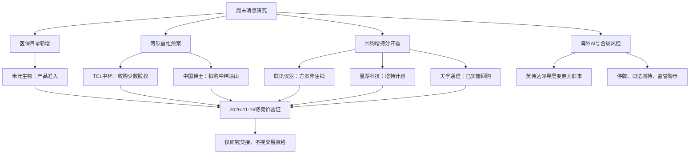

# 2026年11月15日 · 周末轻量消息面

> **仅消息观察，不是买入资格。** 本文不生成正式研究JSON，不判断板型，不提供交易指令、价格条件或仓位。所有事件及观察对象均**待周一竞价验证（2026-11-16）**；本文没有周一的行情。
> **时间口径**：周日采集轮次为18:00—18:02；重点联网原文核验完成于18:11，主营辅助核对完成于18:12。不同源的实际覆盖范围见末尾审计，不能概称“周五至今全覆盖”。

## 🧭 一句话结论

**医保准入有周末实质新增；两项复牌重组和回购增持各有原文，国产算力与机器人多为旧事延续，海外AI风险仍需并列。**

## 🗺️ 消息传导图

**渲染状态：未做SVG验收。** 本机未发现`mmdc`；本次未安装依赖、未生成额外文件。图为15个ASCII节点ID，中文置于引号标签内；结构检查不等于阅读端渲染通过。

## 🎯 八项重点事件：事实、新旧、反面同时保留

证据编号链接见“关键证据”；本地引用`文件:L行`均指原始文件，不以事件追踪模板代替原记录。`high`只表示事件事实已获官方或发行人原文确认，不表示股价反应、盈利兑现或交易资格。

### E01 · 吴清谈市场稳定、量化与减持制度研究 · high／政策预期正面

**待周一竞价验证（2026-11-16）**。11月14日致辞原文[P1]确认加强市场稳定机制及微观结构研究；这是**研究与监管优化表态，不是已公布实施的新量化禁令、资金入市额度或减持新规**。本地`news_cls.jsonl:L433、L422、L425`及`wechat_official_20.jsonl:L3`对应同一场致辞，只计一个底层来源。匿名OCR第2图关于周小川的演讲是同场会议的另一位发言者，不给吴清致辞增加独立背书。

- **大资金意图**: 未核；政策原文不证明机构已增配或资金已流入。
- **为什么走强**: 未核价格与资金反应，不能把周末讲话回溯解释周五走势。
- **逻辑够不够硬**: 讲话事实硬，短期制度效果仍待正式文件；不据此强行映射证券或金融IT个股。

### E02 · 新版医保目录落地，禾元生物奥福民明确纳入 · high／准入正面

**待周一竞价验证（2026-11-16）**。医保局原文[P2、P3]确认新增107种药品、其中51个一类创新药；**2027年1月1日执行，不是本周一开始报销**。禾元生物发行人公告[P4]进一步确认奥福民重组人白蛋白注射液（水稻）为乙类独家品种，适应症为肝硬化低白蛋白血症，协议期至2028年底。直接映射产品持有人，不泛化为所有白蛋白公司的利好。

**新旧分类**：老创新药方向的新增准入催化；药品2025年获批不是周末首次获批。群消息`wechat_cli_5groups.jsonl:L29`有直接点名，`L30`出现替代能力质疑。公司公告证明其特定适应症及准入，**不证明可以无条件替代全部血浆白蛋白应用**。宏观目录对应`news_cls.jsonl:L456、L452`；`news_major.jsonl:L66、L314、L334`仅标题，不算已读正文。

- **大资金意图**: 未核；可及性改善可能引发商业化重估只是传导假设。
- **为什么走强**: 未核；周五价格不能由周六公布的准入倒推解释。
- **逻辑够不够硬**: 政策和公司产品映射有原文；放量还受支付标准、降价幅度、进院及推广影响，不能直接推出利润上修。

### E03 · TCL中环拟收购中环领先65.80%股份并复牌 · high／交易进展正面、估值效果未定

**待周一竞价验证（2026-11-16）**。发行人复牌公告[P5]核实拟发行股份购买中环领先65.80%股份，11月16日开市起复牌；审计评估未完成，尚待多项审批。当地公告日为11月14日，已有11月13日晚平台披露证据，不能包装成周日首次出现。证据：`anns_window.jsonl:L1029、L1032、L1041`；同日套件`L1025—L1041`属于同一底层交易。

- **大资金意图**: 未核；这是上市公司资本运作，不等于二级市场资金已认可。
- **为什么走强**: 停牌期间没有可用交易反应，本次不下走势结论。
- **逻辑够不够硬**: 预案与复牌日已核，但“已收购完成”“确定增厚盈利”均未成立；少数股权收购属性据公开报道辅助核对，未把半导体资产描述成新进入的全新业务。

### E04 · 中国稀土拟购中稀凉山51%股权并复牌 · high／资产注入预期正面、兑现待定

**待周一竞价验证（2026-11-16）**。发行人公告[P6]确认11月16日复牌、发行股份拟购中稀凉山51%股权并募集配套资金。原有重组方向的新增预案，非全新题材，亦非资产已交割。`anns_window.jsonl:L1161、L1164、L1179`；套件`L1161—L1181`不能算21个独立利好。

- **大资金意图**: 未核；集团资产整合意图可见，市场资金意图未知。
- **为什么走强**: 未核；停牌前市值只能作历史身份与规模参照。
- **逻辑够不够硬**: 标的和比例、复牌安排已核；审计评估和审批未完成，不用标的历史利润机械推导上市公司未来利润。旧业绩预告另见下文，环比未核不作正面业绩依据。

### E05 · 联讯仪器回购方案获董事会审议 · high／资本行动正面但非注销

**待周一竞价验证（2026-11-16）**。发行人8页原文[P7]核实拟回购1亿—1.5亿元、期限12个月，**用途为员工持股或股权激励，不是承诺全部注销，也不是已经完成回购**。11月5日已提议、11月6日已披露提议，本次新增的是11月13日董事会审议通过。`anns_window.jsonl:L1—L2`。

- **大资金意图**: 原文载明公司激励及长期发展目的；无法据此推断机构抄底。
- **为什么走强**: 未核价格反应；回购公告不构成股价支撑保证。
- **逻辑够不够硬**: 方案事实硬；原文同时披露未来3个月、6个月相关主体暂无减持计划。回购实施、用途转让及市场变化风险仍在，旧累计业绩高增不重复计为本周末新增催化。

### E06 · 星湖科技控股股东拟增持 · high／计划正面、实施未核

**待周一竞价验证（2026-11-16）**。发行人3页原文[P8]核实广新集团计划12个月内增持7500万元—1.5亿元、比例不超过总股本2%，资金来自自有资金与专项贷款；**计划不是已经成交**。`anns_window.jsonl:L435`。该PDF落款为11月16日，本地公告日为11月14日，平台展示时间却为11月13日晚；三个时钟分别保留，不能把落款日当首次公众可知时间。

- **大资金意图**: 可确认控股股东的增持计划与信心表述，不能外推其他主力意图。
- **为什么走强**: 未核；不存在消息—涨幅的已证因果链。
- **逻辑够不够硬**: 金额和主体有原文；增持期间及法定期限内不减持承诺已核，但计划延迟或无法实施的风险也由原文明确提示。不把该公司仅凭名称映射为本轮创新药准入受益股。

### E07 · 天孚通信披露已实施回购，拟用于注销 · high／旧方案新增执行进度

**待周一竞价验证（2026-11-16）**。发行人2页公告[P9]确认11月13日回购40万股，累计50万股、使用资金6550.08万元，既定用途为注销并减少注册资本，**回购完成不等于注销手续完成**。原方案10月已提出、11月9日股东会通过，周日新增的是执行进度。`wechat_official_20.jsonl:L2`对应同稿传播。

**身份纠错**：`300394.SZ`是**天孚通信**，不是中际旭创；后者为`300308.SZ`。最初多公司公告搜索偏召回中际旭创旧公告，未拿来验证天孚或其他对象。

- **大资金意图**: 能确认公司实际回购，不能把它等同全板块资金回流。
- **为什么走强**: 未核；回购发生在周五，周日披露不能证明周一市场反应。
- **逻辑够不够硬**: 执行金额与用途有发行人原文；占总股本规模有限，不能据此覆盖海外AI需求、客户集中度或行业估值风险。

### E08 · 英伟达领导层变更继续发酵，事实与阴谋叙事拆开 · high／行业级风险延续

**待周一竞价验证（2026-11-16）**。英伟达官网[P10]日期为美国11月12日，确认黄仁勋已辞去CEO及董事职务，Colette Kress任临时CEO；这是**周末前已公开的旧风险**，不是11月15日新辞职。官网同时表示运营、客户承诺、路线图预计继续，故不能把“所有订单将流失”当作既成事实。风险观察范围为海外AI链及其国内映射；国产替代受益只是待证假设，不作净利好结论。

本地`news_cls.jsonl:L539、L348、L25`分别涉及竞争格局、继任传闻和联署；`wechat_cli_5groups.jsonl:L7—L8`、`wechat_official_20.jsonl:L33、L37`包含更强的动机归因，**未取得独立实证，不作为事实或新增出口禁令**。联署网站自报身份不等于签署者身份已认证。

- **大资金意图**: 未核；不把政治动机、短期交易或企业资本支出意图混为一谈。
- **为什么走强**: 未核国内受益板块相对表现；不能由海外不确定性推导国产链必涨。
- **逻辑够不够硬**: 人事事实有官方原文；资本支出削减、具体订单流失和新增出口管制没有被同一原文证实。利空传导及国产替代假说应分开交接。

**已核日历而非周一催化**：官网同时明确财报发布为美国太平洋时间11月17日13:20、电话会14:00，经`zoneinfo`换算分别为北京时间**11月18日05:20、06:00**。群中“11月17日财报”若省略时区容易误读；“11月18日国会听证”本次未核官方排期，仍为待核。

## 🌱 周末传播主题与未升级线索

| 主题／线索 | 原记录与最早性检查 | 处理边界 |
|---|---|---|
| 国产算力／超节点交换网络 | `wechat_cli_5groups.jsonl:L4、L21、L25`；百度天池1024卡发布已被11月12日报道[P14]，不是周末新发布，2027年上市不等于现时订单交付 | 老方向延续；券商名单不是供应商订单证明，未据此扩正式个股名单。**待周一竞价验证（2026-11-16）** |
| 灵巧手／端侧与物理AI | `wechat_official_20.jsonl:L1`为专家访谈；HALO论文[P13]强调仿真生成训练数据，并不证明所有真实数采硬件需求同步增加；群`L20、L22`的苹果会议邀请同文重复 | 老研究的周末再讨论；产业观点不当合同。原论文首发日尚未逐版本回核，不称周末首发。**待周一竞价验证（2026-11-16）** |
| 天安新材机器人＋光互联会议 | 群`L14`邀请11月16日15:00会议；本地公告`anns_window.jsonl:L267`只是召开三季业绩说明会。搜索回溯嘉万光收购意向早在11月8日已披露[P15] | 会议邀约不等于新增收购落地；流通市值未核，**不入正式候选**。两场会议是否同一场亦未核。**待周一竞价验证（2026-11-16）** |
| 蓝海华腾宣传 | 群`L1—L2`同文／同链接，属于同一转发；“26亿”未说明流通或总市值，也无新直接事件 | 不据口播通过市值门槛，不入正式候选。**待周一竞价验证（2026-11-16）** |
| 外汇存款准备金率调整 | `wechat_official_20.jsonl:L11、L26`分别转新华社、央视；本地正文明确11月3日已宣布、11月15日生效；本次搜索未定位可读央行原文 | 已知安排的生效，不当周末新政策；不是人民币存款降准。**待周一竞价验证（2026-11-16）** |

**匿名OCR纳入但不抬高证据等级**：`wechat_image_ocr_20261115.jsonl:L2`可读标题涉及周小川与“低通滤波器”，与公众号`L20`、快讯`L252`同一演讲主题；`OCR:L3`为苹果AI会议海报片段，与群中同文邀约不构成第二底层来源。3图均为缩略图、`ocr_quality=partial`；2图非空、1图空白，不猜补模糊字、日期或公司名，不关联发送人。`published_at`与`message_time`均为null，缓存mtime只说明文件缓存时间。

## 👀 消息侧观察名单：4个直接对象＋2个复牌专项

**本次没有“已确认首板”名单。** 下列4个为可交下游检查板型的消息侧对象，不代表已经符合首板或其他交易条件。流通市值取Tushare `daily_basic.circ_mv`，原单位万元，以程序除以10000换算亿元；**小于20亿元硬剔除，缺值只能列待核线索**。本表4个值均已核且超过20亿元，不以群中总市值代替。业务字段由同花顺问财辅助核对，最终事件映射以发行人原文为准。

| 对象／代码 | 直接事件与业务映射 | 已核流通市值／事实日 | 风险点与可验证假设 | 状态 |
|---|---|---|---|---|
| 禾元生物 `688765.SH` | E02：公司自主研发产品获医保准入[P4]；不是泛血制品映射 | 100.5263亿元／11月13日 | 准入不等于无适应症限制的替代；支付与销售兑现未核。后续核具体支付范围、进院与公司公告有无变更 | **待周一竞价验证（2026-11-16）**；仅消息观察 |
| 联讯仪器 `688808.SH` | E05：公司自身回购；主营辅助字段为通信／电性能及光电子测试，不据此虚构新增订单 | 218.2104亿元／11月13日 | 激励用途非承诺注销；实施进度尚待后续公告，旧业绩环比未核 | **待周一竞价验证（2026-11-16）**；仅消息观察 |
| 星湖科技 `600866.SH` | E06：自身控股股东增持，与“生物”名称无关，不映射医保目录 | 69.6157亿元／11月13日 | 增持可延迟或无法实施；后续核首次实际增持与资金落实，不把计划当成交 | **待周一竞价验证（2026-11-16）**；仅消息观察 |
| 天孚通信 `300394.SZ` | E07：实际回购及注销用途；光器件主营经辅助核对，非中际旭创 | 1360.3762亿元／11月13日 | 大体量及既有行业风险不能被小比例回购覆盖；后续核注销手续而非只看回购累计 | **待周一竞价验证（2026-11-16）**；仅消息观察 |

**复牌专项，不与普通首板观察混排**：

| 对象／代码 | 原文确认 | 历史流通市值与缺口 | 状态 |
|---|---|---|---|
| TCL中环 `002129.SZ` | E03及[P5]确认11月16日复牌 | 378.9294亿元／10月30日停牌前；11月13日接口为空，回溯所得，**不是周五实时市值** | **待周一竞价验证（2026-11-16）**；仅重组复牌观察 |
| 中国稀土 `000831.SZ` | E04及[P6]确认11月16日复牌 | 505.0350亿元／10月30日停牌前；11月13日接口为空，回溯所得 | **待周一竞价验证（2026-11-16）**；仅重组复牌观察 |

### 同日冲突公告检查

逐一对以上6个代码核对本地公告标题，并在线查询各代码最近100条公告索引，均覆盖到11月14日之前；在本次已返回的11月14—16日法定公告日期范围中，**未见这6个主体新增减持或澄清标题**，不是全历史“无负面”证明。重点结果：

- 禾元、天孚的周日新披露在平台记作**11月16日公告**，本地`anns_window`只覆盖14—15日，故本地无记录；已补读2份发行人PDF。不能把本地空命中当成无公告。
- 联讯本地2份、星湖1份；联讯回购PDF另核了相关主体暂无减持计划，星湖PDF另核增持期间不减持承诺。
- TCL中环本地17份、中国稀土21份套件均有审批／评估风险，不能把同日全是交易配套材料写成风险消失；并非38份全部逐页审阅。
- 同花顺问财事件查询将“减持”解析为**计划起始日期**在14—15日，监管函为公告日期在14—15日；返回的空条件不是减持披露历史全查。多公司公告搜索还偏召回中际旭创旧文，本次不作这6票的无冲突背书。

## 🔴 负面、约束与公告硬事件补充

| 项目 | 已核事实／不足与杀伤范围 | 证据／状态 |
|---|---|---|
| 天普股份停牌 | 发行人原文确认11月16日开市起停牌核查，复牌时间未定；这不是可正常参加竞价的观察对象 | `anns_window.jsonl:L218—L219`，[N1]已读全文；**待周一竞价验证（2026-11-16）**仅为统一复核标签，不覆盖停牌约束 |
| 卓郎智能司法被动减持 | 控股股东1780万股、约0.9956%拟被司法执行；截至公告尚未处置，不能写成已减持完成；个股供给与股东信用风险 | `anns_window.jsonl:L505`，[N2]已读全文；**待周一竞价验证（2026-11-16）** |
| 晶盛机电警示函 | 收入单据管理及内控评价披露不准确，公司及相关人员收到警示函；不能直接升级成已确认财务造假或全面停产 | `anns_window.jsonl:L715`，[N3]已读全文；也是中环重组相关方的独立风险，不能因主题正面漏掉；**待周一竞价验证（2026-11-16）** |
| 要约与注入想象冲突：艾艾精工 | 第三次提示为旧要约进程；原文明确未来36个月无借壳／所述资产注入计划，不能用控制权变更编资产注入。要约至11月20日，18—20日有不可撤回约束 | `anns_window.jsonl:L286`，[N4]已读全文；未取得其流通市值，不列正式候选；**待周一竞价验证（2026-11-16）** |
| ST／退市风险 | 标题全量筛查本次公告窗口未见新增实施／撤销退市风险或终止上市公告；但媒体回溯*ST航图（文中代码688066）财务总监辞职、签报完整性和持续经营风险，不等于无风险 | `wechat_official_20.jsonl:L15`、`news_major.jsonl:L61`；媒体风险延续，未核对应旧公告原文，简称另核；**待周一竞价验证（2026-11-16）** |
| 地缘风险双面 | 伊朗声称袭击巴林美军雷达；他方称拦截，战果未独立证实。油运／化肥运输扰动及下游成本为风险传导，不确定的成本冲击不能直接包装成某资源股利好 | `wechat_official_20.jsonl:L4—L5、L21`，在线报道[P16]交叉保留冲突说法；无官方双方原文，暂为medium；**待周一竞价验证（2026-11-16）** |
| 硫磺与面板“涨价”反面 | 硫磺回落对副产硫酸销售方与外购酸方影响相反且存在区域差；TCL华星称面板上涨偏成本推动，不等于需求新周期。均非同名TCL中环的直接利好 | `wechat_official_20.jsonl:L29、L24`重点本地全文已读，未核企业在线原始采访；仅待核产业线索；**待周一竞价验证（2026-11-16）** |
| 问询／澄清覆盖 | 本地18份含监管／问询字样，多为再融资、重组回复，**不是18次新增处罚**；本地标题未见“澄清”类新增，不代表传闻均获证实。天安新材旧收购意向及整合风险不能被周末会议覆盖 | `anns_window.jsonl:L180—L182、L226、L256—L258、L389、L715、L728、L735—L738、L822—L830`；除N3外未逐份全文核验；天安[P15]为在线索引回溯；**待周一竞价验证（2026-11-16）** |

## 📚 业绩交叉验证：不把旧预告重新包装成周末硬增量

`eastmoney_earnings_predict.json`完整解析为**500条指标记录、193个证券代码**，不是500家公司；报告期统一为2026年9月30日，公告日期实际从8月26日至11月4日。采集在周日18:02，**不代表预告于周末发布**。同一公司归母、扣非、收入、每股收益多行去重后再看。

- 对4个直接观察对象及2个复牌对象均查表：仅联讯仪器、中国稀土有旧记录。其余未命中只表示**这500条快照里未命中**，不能断言没有财报或预告。
- 联讯：`records[347]`归母净利累计预告19亿—21亿元、同比1866%—2072.95%，日期10月13日；`records[325]`为扣非指标，不能另算一次公司利好。中国稀土：`records[76]`为10月17日累计归母预告，`records[62]`为扣非，`records[91]`为每股收益，亦非三个事件。数组索引从0开始，JSON不是JSONL，故不用伪行号定位。
- **单季环比未取得完整且口径一致的上半年、上季及本季数据，统一中性，标记`earnings_qoq_unverified`**；不凭累计同比给正面业绩评价。快照自带环比衍生字段本次未重建验证，不作为已核单季环比。
- 已对归母口径同比上限排序的前15条做去重交集检查，涉及德明利、东岳硅材、恒逸石化、天齐锂业、长鑫科技、恩捷股份、联讯仪器、江波龙、富春染织、嘉元科技、领先股份、石大胜华、远大控股、荣盛石化、富祥股份；与本文6个对象交集仅联讯。排序靠前不表示环比加速，也不新增业绩观察对象。
- 公告粗分类“业绩／财报48条”大多是业绩说明会。本次全量标题筛查未见新增业绩预告或快报；三季报关键词唯一命中`anns_window.jsonl:L1254`为TCL科技英文版，不能当新经营事实。这里是**标题核查结果，不是对1274份原文的完整否定结论**。

## 🔗 关键证据

### 政策与发行人原文

- [P1 吴清致辞全文，证监会，11月14日](https://www.csrc.gov.cn/csrc/c106311/c7670983/content.shtml)：官网HTTP 200，正文已读。
- [P2 医保局目录调整发布说明，11月14日](https://www.nhsa.gov.cn/art/2026/11/14/art_14_23385.html)：官网HTTP 200，正文已读。
- [P3 医保发〔2026〕29号通知，网页发布11月14日、文件落款11月13日](https://www.nhsa.gov.cn/art/2026/11/14/art_104_23384.html)：官网HTTP 200，正文已读；未逐一核验全部目录附件品种。
- [P4 禾元生物2026-033号公告，3页](https://pdf.dfcfw.com/pdf/H2_AN202611151831730241_1.pdf)：发行人PDF镜像HTTP 200，逐页文本已读；与平台公告正文核对。
- [P5 TCL中环2026-069号复牌风险公告，2页](https://static.cninfo.com.cn/finalpage/2026-11-14/1225672061.PDF)：HTTP 200，逐页文本已读。
- [P6 中国稀土2026-043号复牌风险公告，2页](https://static.cninfo.com.cn/finalpage/2026-11-14/1225671894.PDF)：HTTP 200，逐页文本已读。
- [P7 联讯仪器2026-054号回购方案，8页](https://static.cninfo.com.cn/finalpage/2026-11-14/1225671187.PDF)：HTTP 200，逐页文本已读。
- [P8 星湖科技临2026-048号增持计划，3页](https://static.cninfo.com.cn/finalpage/2026-11-14/1225671972.PDF)：HTTP 200，逐页文本已读，落款11月16日。
- [P9 天孚通信2026-072号回购进度，2页](https://pdf.dfcfw.com/pdf/H2_AN202611151831730286_1.pdf)：发行人PDF镜像HTTP 200，逐页文本已读，落款11月13日。
- [P10 NVIDIA CEO Transition，官网日期11月12日](https://nvidianews.nvidia.com/news/nvidia-announces-ceo-transition)：HTTP 200，正文已读；官网日期的具体时区、小时未提供，不擅自换算其首发时刻。
- [N1 天普股份停牌核查，1页](https://static.cninfo.com.cn/finalpage/2026-11-14/1225671956.PDF)、[N2 卓郎智能司法减持，3页](https://static.cninfo.com.cn/finalpage/2026-11-14/1225670547.PDF)、[N3 晶盛机电警示函，2页](https://static.cninfo.com.cn/finalpage/2026-11-14/1225672135.PDF)、[N4 艾艾精工要约提示，7页](https://static.cninfo.com.cn/finalpage/2026-11-14/1225671368.PDF)：均HTTP 200，全文文本已读。

### 传播路径及辅助交叉，不与原文件重复计数

- [P11 禾元官微原链接](https://mp.weixin.qq.com/s?__biz=MjM5MDA5NzQxMQ==&chksm=bc599461d27071878ec2f04bf0255a084f8e6d376c53f0def1874135b7d06c3c71c66bacdb9b&idx=1&mid=2654591075&sn=7cd0343ee2bfac69e7eca15b103d0437)：同花顺问财新闻索引显示11月14日17:15发布；本次未直接核微信页精确发布时间，产品事实以P4确认。
- [P12 两家公司11月13日晚披露复牌重组的报道](https://21jingji.com/article/20261113/herald/fb5fbf50c39e22a19170d9d5b359d65c.html)：搜索索引用于回溯新旧，不替代P5、P6。
- [P13 HALO论文原文](https://arxiv.org/html/2611.06908)、[研究团队项目页](https://apple-aiml-research.github.io/ml-halo/)：搜索返回原论文内容；同一论文／项目只计一个研究来源，本次未单独HTTP全文抓取。
- [P14 百度天池1024卡超节点11月12日现场报道](https://www.ithome.com/1/026/026.htm)：搜索索引核对发布时间与2027年上市安排，未据此确认任何A股供应商订单。
- [P15 天安新材旧收购意向报道](https://finance.sina.com.cn/roll/2026-11-09/doc-iniyaqqe6524984.shtml)、[异常波动公告转载索引](https://cfi.net.cn/p20261112001366.html)：用于提示11月8日已披露意向、跨界及整合风险；并非本次已读发行人PDF。
- [P16 巴林事件交叉报道](https://www.zaobao.com.sg/news/world/story20261115-10001433)：搜索索引保留伊朗宣称与巴林拦截说法，不把战果当独立证实。
- [A1 在线公告索引示例：禾元](https://np-anotice-stock.eastmoney.com/api/security/ann?ann_type=A&page_index=1&page_size=100&sr=-1&stock_list=688765)。本次按6个代码分别查询，返回各100条；取14—16日范围检查同日冲突，未声称读完600份PDF。P4、P9分别由`AN202611151831730241`、`AN202611151831730286`定位到附件。

## ⏱️ 事件时钟元数据

以下ISO为来源可支持的时间，时分未知不以00:00占位。`first_known_at`只表示**本次能定位的最早证据**，不是保证全网首发。平台`display_time`按其中文公告服务时间作CST格式转换，仅作平台最早可见证据，不冒称交易所原站首发；原始字符串保留供复核。联网抓取逐请求完成秒未由工具输出，故`captured_at=null`，共同记录`online_verified_by_at=2026-11-15T18:11:34+08:00`，不伪造单条抓取秒。

| 事件 | 公告／原文日期；published_at | first_known_at与证据 | captured_at |
|---|---|---|---|
| E01 | 官网日期2026-11-14；published_at=null | `2026-11-14T11:53:53+08:00`，本地新浪快讯L433；不是财联社原稿时点 | null |
| E02 | 医保网页2026-11-14、文件落款2026-11-13；禾元公告落款2026-11-16；published_at=null | `null`；官微索引较早证据为`2026-11-14T17:15:46+08:00`，原页时分未复核；公司公告平台显示原值`2026-11-15 15:30:32:789`，不将16日误作首次披露 | null |
| E03 | 本地ann_date=20261114、PDF落款2026-11-13；published_at=null | `2026-11-13T20:02:10.912+08:00`，平台原值`2026-11-13 20:02:10:912`，对应复牌公告 | null |
| E04 | 本地ann_date=20261114、PDF落款2026-11-13；published_at=null | `2026-11-13T19:24:13.399+08:00`，平台原值`2026-11-13 19:24:13:399`，对应复牌公告 | null |
| E05 | 本地及PDF2026-11-14；published_at=null | `2026-11-13T17:36:11.291+08:00`，平台原值`2026-11-13 17:36:11:291`，仅指本次方案；更早提议11月6日已披露 | null |
| E06 | 本地ann_date=20261114、PDF落款2026-11-16；published_at=null | `2026-11-13T19:04:52.254+08:00`，平台原值`2026-11-13 19:04:52:254` | null |
| E07 | 平台法定公告日2026-11-16、PDF落款2026-11-13；published_at=null | `2026-11-15T15:32:21.349+08:00`，平台原值`2026-11-15 15:32:21:349`；本地文章L2为11月15日17:38 | null |
| E08 | 美国官网日期2026-11-12；具体时区与published_at=null | null；官网日期足以证实非周日新事件，精确全球首发时点未查定；本地最早相关风险转载L539为`2026-11-14T09:06:15+08:00` | null |

补充负面：N1—N4本地公告日均为2026-11-14，PDF落款亦均为该日，`published_at=null`、`first_known_at=null`、`captured_at=null`；核验完成上界同上。`N1`存在11月13日晚媒体报道，但本次未重建其最早原站时分。其余产业转述与OCR只保留原记录时间，不能用缓存mtime补全首次公众可知时间。

## 数据源审计

| 源 | 日期 | 状态 | 实际读取／覆盖与缺口 |
|---|---|:--:|---|
| manifest | 2026-11-15 | 🟢 | 已完整读取；`lookback_hours=24`、模式`intel_only`，不是周五以来全窗；`global_severity=0`不替代逐源新鲜度审核 |
| wechat_cli_5groups | 2026-11-14—2026-11-15 | 🟢 | 30条原记录、5群，消息实际最早11月14日18:16、最晚11月15日17:55；since为11月14日18:01。含系统、图片占位和同文重复，不是30个事件；群名与人员匿名化 |
| wechat_official_20 | 2026-11-14—2026-11-15 | 🟢 | 39篇，实际18:05—次日17:38；10个有文账号，证券时报16、上证报14，其余9。与RSS文件逐对象完全镜像，只计一次；18订阅均返回，但盘前纪要等8源本窗无文章，不能写成全部核心账号都有当日更新 |
| news_cls | 2026-11-14—2026-11-15 | 🟡 | 654条、正文非空654；最早11月14日09:02、最新11月15日08:59。来源sina542、10jqka112，**没有src=cls**；文件首条为新浪11月15日08:59的迪士尼系统事件。虽采集程序通常回看72h，本次内容实际只有约24h且漏周日下午 |
| news_major | 2026-11-14—2026-11-15 | 🟡 | 635条，09:00—次日09:00；新浪302、同花顺277、财联社31、华尔街见闻19、中新经纬6。**635条content均空**，全量标题筛查，不能声称已读635篇全文或以标题数作独立来源数 |
| anns_window | 2026-11-14—2026-11-15 | 🟡 | 1274条／545代码；11月14日1272、15日2。已全量标题筛查，重点原文在线核验，非全部全文核实。法定日期切窗遗漏P4、P9等落款16日但15日已披露的记录；事件追踪MD仅辅助导航，不作独立来源 |
| eastmoney_earnings_predict | 2026-08-26—2026-11-04 | 🟡 | 500条／193代码、报告期2026-09-30；500条指标去重和6对象逐一查表，旧公告非周末新增，单季环比未核 |
| wechat_image_ocr | 2026-11-15 | 🟡 | 3图／2非空／全部partial，已读取可用文本；低清缩略图覆盖受限，1图空白；匿名传播不归因，缓存时间不是发表时间 |
| mcp_health | 2026-11-15 | 🔴 | 文件缺失，**未检测**；本次Tushare daily_basic个别读调用成功不代表完成全源健康检查 |
| 联网原文 | 2026-11-15 | 🟢 | 实际读到10份发行人PDF：P4—P9及N1—N4；另读证监会、医保局2网页及英伟达官网，共4份重点HTML。重组预案全部长文、全部医保附件、其他公告未全文核验 |
| 同花顺问财横切API | 2026-11-15 | 🟡 | news-search、announcement-search、hithink-event-query、hithink-business-query均已实际调用且网关响应成功；新闻查询total=15但data实际10条，未声称补齐其余；公告多公司查询偏题，事件日期解析有局限；主营返回6代码，字段混有历史与概念词，不能代替收入占比或当前客户验证 |
| Tushare daily_basic | 2026-11-13及2026-10-30 | 🟢 | 4个直接观察对象使用13日circ_mv；2个停牌对象13日为空，改查历史区间后使用10月30日，不以缺行填0。接口未写本地缓存 |
| 搜索／提取工具 | 2026-11-15 | 🟡 | 原生openai-native搜索路径报后端不支持client-side；web_search自动回退检索成功并找到本年原文。web_extract因search-only后端失败；改用无落盘HTTP GET＋内存PDF解析，重点原文HTTP 200，未改工具配置 |

### 抓取时钟补注

RSS抓取状态文件`rss_fetch_status.json`记录批次`2026-11-15T18:01:59+08:00`；OCR与东财采集时刻分别为`2026-11-15T18:02:13+08:00`、`2026-11-15T18:02:40+08:00`。公告导航文件生成／参考截止为`2026-11-15T18:02:41+08:00`，不是每份公告的披露时刻。其余记录未给逐条采集时刻，`captured_at=null`，不拿文件写入mtime冒充抓取或发表时间。

## ⚖️ 不确定性与下游研究交接

1. **新鲜度缺口已证实，不是抽象降级**：本地快讯和要闻止于周日早间；公告日期错窗漏了禾元与天孚的周日下午披露。已补核本文重点，不宣称周日下午全市场补抓完成。
2. **底层去重**：每份公告、每场致辞、同一论文和同一会议邀约分别归并。平台、API、转载媒体或群数不构成新增独立原始来源；没有把本地2632条文字／标题记录折算成2632个事件。
3. **三问中的资金、走势仍未核**：R4只交事件事实与受益／受损假设；未读取R3产物，不替R3打情绪分，不替R2／R7认定资金意图，不替R5判断技术位置。
4. **资格边界**：4个直接观察对象、2个复牌专项都要由下游重新核当日公告、可交易状态、业务兑现和板型。市值过门槛、官方原文或消息热度均不授予交易资格；停牌、监管及真实冲突不得被主题叙事覆盖。
5. **交接**：供R2比较事件、R5核业务和业绩边际、R6保留反证与未核传闻；后续有权限的决策端独立判断。本文不触发QMT、不发送消息、不产生执行参数。

## 🧾 Sub-Agent元数据与验收范围

- 生产角色：R4；方法：周末轻量、原记录筛查＋重点原文交叉；`confidence=null`，未把主观质量分当实证。
- 本次用户限定优先于正式全量契约：仅此MD；不写`data/research` JSON，不要求交易四段或价格字段。未创建临时脚本、未改源码、技能、配置、健康文件或其他角色产物。
- 验收：原子写入后读回精确目标，检查frontmatter、8项重点事件的三问、6个对象的市值口径、源审计、原记录定位及消息观察声明；**SVG仍未验收，不报全项通过**。
