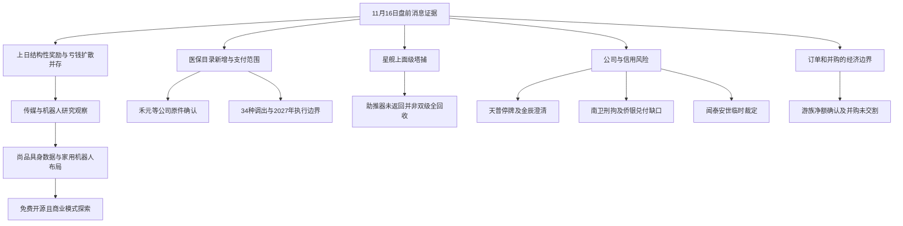

# 2026年11月16日 · 消息面事件驱动

> 数据源新鲜度：partial · 降级：true · 消息证据置信度：0.62（不是交易胜率）
> 实际盘前执行，不是历史回放。重点窗为11月13日至16日；原件、MCP补证与快照各保留真实时点。24个正反分面来自17个底层硬事项，不凑8条、不按转载数加权。

## 一句话结论

观察具身数据与医保目录新增；停牌、信用及大单收入误读风险不被利好抵消。

## 先认市场：消息不能替代合力

情绪=震荡/主跌。上一个已完成交易日是11月13日：上证收3634.353点、跌0.5875%；公开复盘给出涨停37、跌停33、炸板21，炸板率为36.2069%。本轮实时取到Tushare指数及涨跌停名单作对照；涨跌广度765/4748仍是连板网partial统计，未独立重建全市场。不是11月16日盘中读数。

主线 = 传媒/机器人（上日结构性研究观察而非本日已确认），持续性 = 1日（本轮前瞻观察窗），封板率 = 未知%（板块口径未核），明日预期 = 分歧（推断）。全市场封板率63.7931%不能冒充某个板块的封板率。机器人公开涨停矩阵已从10—11日的26/22降至13日4家，传媒则存在逆势涨停；这意味着发布会预热不等于尚未交易的新方向，也不等于本日资金已回流。

最高4板天普、3板金辰只是上日地位事实。天普停牌、金辰澄清均须原样进入研究，不能靠“总龙”标签绕开业务与可交易性证据。连板网today/qingxu约19度与mainline的5度存在口径冲突，保留冲突，不强行统一；历史二冰样本频率不是本日必修复的概率。

首板研究观察初筛为尚品宅配、禾元生物、利扬芯片、游族网络4只。依炸板率≥35%的纪律压缩为2只：尚品宅配、禾元生物。利扬保留并购正反研究；游族不进该观察名单，因为净额确认与资金占用使“大订单=大收入”不成立。事件当事方29家不是29只候选，风险事件不随候选数减半而删掉。

今天只交消息与业务证据。没有本日资金、核心地位及RR确认，不授执行资格；研究质量降级不构成市场性停买。反向剧本是硬件继续走弱、跌停扩散、会议与目录利好只带来高开：届时由本轮市场证据和独立D1重评，而不是无限继承旧零仓。真实账户预算本轮未知，不能由R4抬成正额度。

## 🗺️ 消息面全景图

## 🎯 顶级事件详解：事实、资金反应、传导假设分栏

下列评分仅为R4既有事件衰减描述，λ=0.15，按最早可定位公开日期的自然日差计算。分面不累加成总分、不用来替代执行门禁。13日无精确时分事项可能已在13日交易；机读date=16日仅表示本轮盘前处置日，不反写原始时间。

### E20261116_001 · 🟢 医保目录扩容确认并非即时收入

极性：正面 · 强度：high · 原分：0.82 → 衰减分：0.6075 · 自然日龄：2 · 窗口内

事件事实：新版基本医保新增107种药品其中51种1类创新药；2027年1月1日执行。

传导假设：支付可及性改善可能促成医院准入和销售放量；新增、续约、支付适应症变化分别判断。

已查来源与窗口：W04; P02; P03; P04; P05; P06; P07; P11; P13; P14; P15; P17; P18; P19; P21; P22; P23; P24。重点72h＋7日事件回看；每份来源的真实发布时间/抓取时点与缺口在JSON evidence_ledger保留。精确首次公开未知者不补时分。 对象：禾元生物 688765.SH、艾力斯 688578.SH、百利天恒 688506.SH、诺诚健华 688428.SH、首药控股 688197.SH、君实生物 688180.SH、华北制药 600812.SH、康缘药业 600557.SH、恒瑞医药 600276.SH、复星医药 600196.SH、润都股份 002923.SZ、康弘药业 002773.SZ、信立泰 002294.SZ、京新药业 002020.SZ、华东医药 000963.SZ、通化金马 000766.SZ、长春高新 000661.SZ。

- **大资金意图**：尚不能确认。未取得事件对应机构订单或逐股资金证据。
- **为什么走强**：13日通化金马涨停是此前行情；14日公开目录不能反向解释此前涨停。本日是否形成医药扩散尚未核。
- **逻辑够不够硬**：新版基本医保新增107种药品其中51种1类创新药；2027年1月1日执行。 边界：逐品种挂网、医院准入或销售不兑现；不能把名单当利润预测。

处置：观察；消息事实不授买权。本日事件对应价格/资金反应未核；尚未取得冲突公告不等于无负面。

### E20261116_002 · 🔴 医保目录调出34种药品

极性：负面 · 强度：high · 原分：-0.48 → 衰减分：-0.3556 · 自然日龄：2 · 窗口内

事件事实：官方通稿明确调出34种临床价值有限或有替代等品种；本轮未逐项取调出附件。

传导假设：对相关品种的医保支付与存量销售可能不利；未核主体名单，不映射全体药企。

已查来源与窗口：W04。重点72h＋7日事件回看；每份来源的真实发布时间/抓取时点与缺口在JSON evidence_ledger保留。精确首次公开未知者不补时分。

- **大资金意图**：尚不能确认。未取得事件对应机构订单或逐股资金证据。
- **为什么走强**：13日通化金马涨停是此前行情；14日公开目录不能反向解释此前涨停。本日是否形成医药扩散尚未核。
- **逻辑够不够硬**：官方通稿明确调出34种临床价值有限或有替代等品种；本轮未逐项取调出附件。 边界：取得调出附件后逐主体核相关收入和替代品，不由医药利好覆盖该负面。

处置：拦截相关错误叙事并交R6独立审查，不扩成行业/市场停买。本日事件对应价格/资金反应未核；尚未取得冲突公告不等于无负面。

### E20261116_003 · 🟢 华为具身世界模型发布会待兑现

极性：正面 · 强度：medium · 原分：0.58 → 衰减分：0.3183 · 自然日龄：4 · 背景衰减

事件事实：媒体已披露11月16日14:00发布CloudRoboWM1.2；本次官方持续页HTTP返回无正文。

传导假设：老方向已有发布预期；今日演示、可用版本、生态签约才可能提供新增差异。

已查来源与窗口：wechat_official_20:1; W06; lianban:today。重点72h＋7日事件回看；每份来源的真实发布时间/抓取时点与缺口在JSON evidence_ledger保留。精确首次公开未知者不补时分。

- **大资金意图**：尚不能确认。未取得事件对应机构订单或逐股资金证据。
- **为什么走强**：12日已预告发布会，可与13日机器人结构性交易作时序比较；16日未发生的结果不能拿来解释13日股价。
- **逻辑够不够硬**：媒体已披露11月16日14:00发布CloudRoboWM1.2；本次官方持续页HTTP返回无正文。 边界：会后仍无可调用能力或实质签约；结束时间15:20/15:30来源冲突未消除。

处置：观察；消息事实不授买权。本日事件对应价格/资金反应未核；尚未取得冲突公告不等于无负面。

### E20261116_004 · 🟢 尚品披露具身数据与家用机器人布局

极性：正面 · 强度：high · 原分：0.63 → 衰减分：0.5422 · 自然日龄：1 · 窗口内

事件事实：9月数据集开源、10月底门店试运营；11月13日调研记录于15日晚进入公告接口。

传导假设：家居场景数据与渠道是业务映射证据；属于旧项目新披露而非周末新签大订单。

已查来源与窗口：P01; LIVE-ANN-SHANG; LIVE-CLS-SHANG。重点72h＋7日事件回看；每份来源的真实发布时间/抓取时点与缺口在JSON evidence_ledger保留。精确首次公开未知者不补时分。 对象：尚品宅配 300616.SZ。

- **大资金意图**：尚不能确认。未取得事件对应机构订单或逐股资金证据。
- **为什么走强**：13日15:30调研发生在收盘后；15日晚公开的记录不能解释13日盘中涨幅。具身数据与主线仅为业务对照。
- **逻辑够不够硬**：9月数据集开源、10月底门店试运营；11月13日调研记录于15日晚进入公告接口。 边界：付费客户、合同或经常性收入未兑现；不得用下载榜单替代付费需求。

处置：观察；消息事实不授买权。本日事件对应价格/资金反应未核；尚未取得冲突公告不等于无负面。

### E20261116_005 · 🔴 尚品新业务仍在探索且以科研使用为主

极性：负面 · 强度：high · 原分：-0.43 → 衰减分：-0.3701 · 自然日龄：1 · 窗口内

事件事实：数据集免费开源；89.3%应用为研究教育；公司明确商业模式技术路线探索。

传导假设：技术资产有效并不自动变现；同一底层公告的负面分面不与正面机械相减。

已查来源与窗口：P01。重点72h＋7日事件回看；每份来源的真实发布时间/抓取时点与缺口在JSON evidence_ledger保留。精确首次公开未知者不补时分。 对象：尚品宅配 300616.SZ。

- **大资金意图**：尚不能确认。未取得事件对应机构订单或逐股资金证据。
- **为什么走强**：13日15:30调研发生在收盘后；15日晚公开的记录不能解释13日盘中涨幅。具身数据与主线仅为业务对照。
- **逻辑够不够硬**：数据集免费开源；89.3%应用为研究教育；公司明确商业模式技术路线探索。 边界：如披露可归因付费收入/合同再重评；不是公司不存在研发能力。

处置：拦截相关错误叙事并交R6独立审查，不扩成行业/市场停买。本日事件对应价格/资金反应未核；尚未取得冲突公告不等于无负面。

### E20261116_007 · 🟢 星舰上面级首次塔捕已兑现

极性：正面 · 强度：high · 原分：0.67 → 衰减分：0.5767 · 自然日龄：1 · 窗口内

事件事实：新华社原稿确认上面级当地14日返场塔捕；任务约22.5小时。

传导假设：技术验证改善复用预期；A股收入及太空光伏订单属于第二层未证实传导。

已查来源与窗口：W05。重点72h＋7日事件回看；每份来源的真实发布时间/抓取时点与缺口在JSON evidence_ledger保留。精确首次公开未知者不补时分。

- **大资金意图**：尚不能确认。未取得事件对应机构订单或逐股资金证据。
- **为什么走强**：15日终局晚于13日行情，不能用上面级成功解释13日金辰等涨停；二级交易与A股收入传导均未核。
- **逻辑够不够硬**：新华社原稿确认上面级当地14日返场塔捕；任务约22.5小时。 边界：维护成本、重复复飞、频率及真实收费部署未验证；不配造A股供应商。

处置：观察；消息事实不授买权。本日事件对应价格/资金反应未核；尚未取得冲突公告不等于无负面。

### E20261116_008 · 🔴 本次助推器未返回且非双级全回收

极性：负面 · 强度：high · 原分：-0.42 → 衰减分：-0.3615 · 自然日龄：1 · 窗口内

事件事实：同一新华社原稿：助推器未按计划返回发射场而在墨西哥湾受控溅落。

传导假设：以双级全回收或运费已经降至某价格为基础的外推不成立；不等于上面级失败。

已查来源与窗口：W05。重点72h＋7日事件回看；每份来源的真实发布时间/抓取时点与缺口在JSON evidence_ledger保留。精确首次公开未知者不补时分。

- **大资金意图**：尚不能确认。未取得事件对应机构订单或逐股资金证据。
- **为什么走强**：15日终局晚于13日行情，不能用上面级成功解释13日金辰等涨停；二级交易与A股收入传导均未核。
- **逻辑够不够硬**：同一新华社原稿：助推器未按计划返回发射场而在墨西哥湾受控溅落。 边界：待后续任务证明完整复用能力；不能被上面级利好删去。

处置：拦截相关错误叙事并交R6独立审查，不扩成行业/市场停买。本日事件对应价格/资金反应未核；尚未取得冲突公告不等于无负面。

### E20261116_009 · 🔴 天普16日起停牌核查并否认AI注入

极性：负面 · 强度：high · 原分：-0.95 → 衰减分：-0.7038 · 自然日龄：2 · 窗口内

事件事实：16日开市停牌、披露核查公告后复牌；无AI业务计划及中昊芯英注入/借壳计划。

传导假设：最高4板缺席可能影响高位接力；对其他芯片股的影响是假设而非全部行业证伪。

已查来源与窗口：P26; P27。重点72h＋7日事件回看；每份来源的真实发布时间/抓取时点与缺口在JSON evidence_ledger保留。精确首次公开未知者不补时分。 对象：天普股份 605255.SH。

- **大资金意图**：尚不能确认。未取得事件对应机构订单或逐股资金证据。
- **为什么走强**：本条不是板块走强证据。真实风险/政策日程与股价资金反应分开，本轮未核本日事件对应的资金或因果。
- **逻辑够不够硬**：16日开市停牌、披露核查公告后复牌；无AI业务计划及中昊芯英注入/借壳计划。 边界：停牌风险在正式复牌公告后重评；AI基本面映射须新公告，不能靠市场称总龙恢复。

处置：拦截相关错误叙事并交R6独立审查，不扩成行业/市场停买。本日事件对应价格/资金反应未核；尚未取得冲突公告不等于无负面。

### E20261116_010 · 🔴 南卫实控人因涉嫌内幕交易被刑拘

极性：负面 · 强度：high · 原分：-0.86 → 衰减分：-0.7402 · 自然日龄：1 · 窗口内

事件事实：公司15日收到家属通知；实控人因2023年减持涉嫌内幕交易被刑拘，案件调查中。

传导假设：个股治理/信任风险；公司称控制权未变且生产经营正常，不能演绎成已定罪或医药行业危机。

已查来源与窗口：P09; news_cls:194。重点72h＋7日事件回看；每份来源的真实发布时间/抓取时点与缺口在JSON evidence_ledger保留。精确首次公开未知者不补时分。 对象：南卫股份 603880.SH。

- **大资金意图**：尚不能确认。未取得事件对应机构订单或逐股资金证据。
- **为什么走强**：本条不是板块走强证据。真实风险/政策日程与股价资金反应分开，本轮未核本日事件对应的资金或因果。
- **逻辑够不够硬**：公司15日收到家属通知；实控人因2023年减持涉嫌内幕交易被刑拘，案件调查中。 边界：法律程序、控制权和经营后续公告；仅相关对象必要风险交R6裁决。

处置：拦截相关错误叙事并交R6独立审查，不扩成行业/市场停买。本日事件对应价格/资金反应未核；尚未取得冲突公告不等于无负面。

### E20261116_011 · 🔴 金辰澄清SINGULUS事项无关

极性：负面 · 强度：high · 原分：-0.77 → 衰减分：-0.6627 · 自然日龄：1 · 窗口内

事件事实：持股49%的SINGULUS SOLAR 1—10月无收入；相关报道与公司及该主体无关且暂无实质业务往来。

传导假设：强势股标签与该项业务归因分开；不能因星舰利好抹去公司针对性澄清。

已查来源与窗口：P10。重点72h＋7日事件回看；每份来源的真实发布时间/抓取时点与缺口在JSON evidence_ledger保留。精确首次公开未知者不补时分。 对象：金辰股份 603396.SH。

- **大资金意图**：尚不能确认。未取得事件对应机构订单或逐股资金证据。
- **为什么走强**：本条不是板块走强证据。真实风险/政策日程与股价资金反应分开，本轮未核本日事件对应的资金或因果。
- **逻辑够不够硬**：持股49%的SINGULUS SOLAR 1—10月无收入；相关报道与公司及该主体无关且暂无实质业务往来。 边界：需新合同或正式澄清改变现有事实；价格强弱不是重新确认收入的依据。

处置：拦截相关错误叙事并交R6独立审查，不扩成行业/市场停买。本日事件对应价格/资金反应未核；尚未取得冲突公告不等于无负面。

### E20261116_012 · 🔴 侨银转债到期前资金未全部落实

极性：负面 · 强度：high · 原分：-0.90 → 衰减分：-0.7746 · 自然日龄：1 · 窗口内

事件事实：16日到期及最后转股；17日拟发放兑付款；未转股4196454张且兑付资金尚未全部到位。

传导假设：流动性风险直接落在公司及转债；不是全体环卫公司信用违约。

已查来源与窗口：P16。重点72h＋7日事件回看；每份来源的真实发布时间/抓取时点与缺口在JSON evidence_ledger保留。精确首次公开未知者不补时分。 对象：侨银股份 002973.SZ。

- **大资金意图**：尚不能确认。未取得事件对应机构订单或逐股资金证据。
- **为什么走强**：本条不是板块走强证据。真实风险/政策日程与股价资金反应分开，本轮未核本日事件对应的资金或因果。
- **逻辑够不够硬**：16日到期及最后转股；17日拟发放兑付款；未转股4196454张且兑付资金尚未全部到位。 边界：只在实际到账与后续偿付披露后重评；16日前不能写已兑付或已违约。

处置：拦截相关错误叙事并交R6独立审查，不扩成行业/市场停买。本日事件对应价格/资金反应未核；尚未取得冲突公告不等于无负面。

### E20261116_013 · 🔴 闻泰安世跨境临时裁定立即生效

极性：负面 · 强度：high · 原分：-0.80 → 衰减分：-0.6886 · 自然日龄：1 · 窗口内

事件事实：荷兰法庭11日追加临时裁定立即可执行；违反多项禁令罚金累计上限3亿欧元；公司将上诉。

传导假设：境外控制权及业务处置不确定性延续；金额是违规上限非已损失，不是终审结论。

已查来源与窗口：P12; news_cls:179。重点72h＋7日事件回看；每份来源的真实发布时间/抓取时点与缺口在JSON evidence_ledger保留。精确首次公开未知者不补时分。 对象：*ST闻泰 600745.SH。

- **大资金意图**：尚不能确认。未取得事件对应机构订单或逐股资金证据。
- **为什么走强**：本条不是板块走强证据。真实风险/政策日程与股价资金反应分开，本轮未核本日事件对应的资金或因果。
- **逻辑够不够硬**：荷兰法庭11日追加临时裁定立即可执行；违反多项禁令罚金累计上限3亿欧元；公司将上诉。 边界：司法后续及经营控制权实质变化；公司中方法律立场不等于争议已解决。

处置：拦截相关错误叙事并交R6独立审查，不扩成行业/市场停买。本日事件对应价格/资金反应未核；尚未取得冲突公告不等于无负面。

### E20261116_014 · 🟢 游族子公司闪存销售订单已生效

极性：正面 · 强度：high · 原分：0.58 → 衰减分：0.4992 · 自然日龄：1 · 窗口内

事件事实：11月12日B公司订单14.28亿元含税、计划20日交付；子公司51%已于9月并表。

传导假设：真实订单存在；本轮是订单披露而非新签游戏授权或按总额计收入。

已查来源与窗口：P20; news_cls:209。重点72h＋7日事件回看；每份来源的真实发布时间/抓取时点与缺口在JSON evidence_ledger保留。精确首次公开未知者不补时分。 对象：游族网络 002174.SZ。

- **大资金意图**：尚不能确认。未取得事件对应机构订单或逐股资金证据。
- **为什么走强**：订单日期12日是合同发生日，不证明公众当日已知；15日披露不能倒灌12日交易。净额收入限制是关键反证。
- **逻辑够不够硬**：11月12日B公司订单14.28亿元含税、计划20日交付；子公司51%已于9月并表。 边界：交付、验收、结算及净额确认待执行；不能把合同额套入营业收入同比。

处置：观察；消息事实不授买权。本日事件对应价格/资金反应未核；尚未取得冲突公告不等于无负面。

### E20261116_015 · 🔴 游族订单净额确认且需大量采购资金

极性：负面 · 强度：high · 原分：-0.72 → 衰减分：-0.6197 · 自然日龄：1 · 窗口内

事件事实：公司称预计实际确认收入对当期营收影响非常小；前期采购需大量资金且有库存缺口及财务成本。

传导假设：14.28亿元不能当主营增收；对游戏板块是个股跨界事实而非板块硬业绩。

已查来源与窗口：P20。重点72h＋7日事件回看；每份来源的真实发布时间/抓取时点与缺口在JSON evidence_ledger保留。精确首次公开未知者不补时分。 对象：游族网络 002174.SZ。

- **大资金意图**：尚不能确认。未取得事件对应机构订单或逐股资金证据。
- **为什么走强**：订单日期12日是合同发生日，不证明公众当日已知；15日披露不能倒灌12日交易。净额收入限制是关键反证。
- **逻辑够不够硬**：公司称预计实际确认收入对当期营收影响非常小；前期采购需大量资金且有库存缺口及财务成本。 边界：取得交付回款和审计后重评；融资/存货风险不因订单生效消失。

处置：拦截相关错误叙事并交R6独立审查，不扩成行业/市场停买。本日事件对应价格/资金反应未核；尚未取得冲突公告不等于无负面。

### E20261116_016 · 🟢 利扬签署收购众望达51%股权协议

极性：正面 · 强度：high · 原分：0.65 → 衰减分：0.4815 · 自然日龄：2 · 窗口内

事件事实：13日签股权协议、作价3.06亿元；众望达面向光模块硅光CPO等提供仪器和测试方案。

传导假设：明确主业能力补齐；比群聊所谓独家物理采数映射更可核。

已查来源与窗口：P28。重点72h＋7日事件回看；每份来源的真实发布时间/抓取时点与缺口在JSON evidence_ledger保留。精确首次公开未知者不补时分。 对象：利扬芯片 688135.SH。

- **大资金意图**：尚不能确认。未取得事件对应机构订单或逐股资金证据。
- **为什么走强**：13日签约、14日公告；未证明市场在13日盘中已知全部信息，且未核收购后的资金反应。
- **逻辑够不够硬**：13日签股权协议、作价3.06亿元；众望达面向光模块硅光CPO等提供仪器和测试方案。 边界：尚需股东会/交割；不以协议签署当新增合并利润到账。

处置：观察；消息事实不授买权。本日事件对应价格/资金反应未核；尚未取得冲突公告不等于无负面。

### E20261116_017 · 🔴 利扬并购审计评估融资交割仍待完成

极性：负面 · 强度：high · 原分：-0.52 → 衰减分：-0.3852 · 自然日龄：2 · 窗口内

事件事实：审计评估未出正式报告；专项融资存在不确定性；将形成商誉且审批交割未完成。

传导假设：目标2026H1净利润4973.10万元未经审计，不能简单年化或将承诺当已实现业绩。

已查来源与窗口：P28。重点72h＋7日事件回看；每份来源的真实发布时间/抓取时点与缺口在JSON evidence_ledger保留。精确首次公开未知者不补时分。 对象：利扬芯片 688135.SH。

- **大资金意图**：尚不能确认。未取得事件对应机构订单或逐股资金证据。
- **为什么走强**：13日签约、14日公告；未证明市场在13日盘中已知全部信息，且未核收购后的资金反应。
- **逻辑够不够硬**：审计评估未出正式报告；专项融资存在不确定性；将形成商誉且审批交割未完成。 边界：审计评估、贷款、股东会和交割公告；未经审计财务边界不改变。

处置：拦截相关错误叙事并交R6独立审查，不扩成行业/市场停买。本日事件对应价格/资金反应未核；尚未取得冲突公告不等于无负面。

### E20261116_018 · 🟢 新宙邦披露电解液预计60万吨长协

极性：正面 · 强度：high · 原分：0.62 → 衰减分：0.3953 · 自然日龄：3 · 背景衰减

事件事实：2026—2030预计供货需求60万吨；实单可上下浮动10%；生效后30工作日一定金额预付款。

传导假设：长期供需协同有依据；披露在13日且分钟未知，可能当日已交易，不称周一全新。

已查来源与窗口：W01。重点72h＋7日事件回看；每份来源的真实发布时间/抓取时点与缺口在JSON evidence_ledger保留。精确首次公开未知者不补时分。 对象：新宙邦 300037.SZ、亿纬锂能 300014.SZ。

- **大资金意图**：尚不能确认。未取得事件对应机构订单或逐股资金证据。
- **为什么走强**：13日公告无精确首次公开时分，可能已经交易；本轮不把周末复述当新增资金催化。
- **逻辑够不够硬**：2026—2030预计供货需求60万吨；实单可上下浮动10%；生效后30工作日一定金额预付款。 边界：单价、年度拆分、实际盖章日期与预付款金额缺失，不估固定总收入。

处置：观察；消息事实不授买权。本日事件对应价格/资金反应未核；尚未取得冲突公告不等于无负面。

### E20261116_019 · 🔴 新宙邦长协远期量属意向非强制

极性：负面 · 强度：high · 原分：-0.46 → 衰减分：-0.2933 · 自然日龄：3 · 背景衰减

事件事实：2029及2030年预测采购量不构成交易对手强制承诺；需求技术路线变化可能影响履行。

传导假设：供应稳定不是锁死五年利润；不可用60万吨乘随意价格构造业绩。

已查来源与窗口：W01。重点72h＋7日事件回看；每份来源的真实发布时间/抓取时点与缺口在JSON evidence_ledger保留。精确首次公开未知者不补时分。 对象：新宙邦 300037.SZ、亿纬锂能 300014.SZ。

- **大资金意图**：尚不能确认。未取得事件对应机构订单或逐股资金证据。
- **为什么走强**：13日公告无精确首次公开时分，可能已经交易；本轮不把周末复述当新增资金催化。
- **逻辑够不够硬**：2029及2030年预测采购量不构成交易对手强制承诺；需求技术路线变化可能影响履行。 边界：实际年度订单和价格验证；13日旧消息不因周末复述重置衰减。

处置：拦截相关错误叙事并交R6独立审查，不扩成行业/市场停买。本日事件对应价格/资金反应未核；尚未取得冲突公告不等于无负面。

### E20261116_020 · 🟢 德明利董事会批准拟投宏祺芯约4亿元

极性：正面 · 强度：high · 原分：0.57 → 衰减分：0.4223 · 自然日龄：2 · 窗口内

事件事实：13日董事会批准拟投资399999985.15元；完成后预计直接持股7.055918%。

传导假设：主控与新存储资源协同为研究假设；未签协议不等于已取得生产订单。

已查来源与窗口：W02。重点72h＋7日事件回看；每份来源的真实发布时间/抓取时点与缺口在JSON evidence_ledger保留。精确首次公开未知者不补时分。 对象：德明利 001309.SZ。

- **大资金意图**：尚不能确认。未取得事件对应机构订单或逐股资金证据。
- **为什么走强**：13日董事会与14日披露不同；旧Q3同比与新投资并非同一个催化，未查本日价格确认。
- **逻辑够不够硬**：13日董事会批准拟投资399999985.15元；完成后预计直接持股7.055918%。 边界：正式签约、支付、交割与技术产业化节点待核；不套用被投公司全额收入。

处置：观察；消息事实不授买权。本日事件对应价格/资金反应未核；尚未取得冲突公告不等于无负面。

### E20261116_021 · 🔴 德明利参股不并表且标的仍亏损

极性：负面 · 强度：high · 原分：-0.49 → 衰减分：-0.3630 · 自然日龄：2 · 窗口内

事件事实：投资及配套协议尚未签署；标的不并表且研发/验证阶段持续亏损、未规模量产。

传导假设：长期协同伴随现金投入与产业化风险；旧累计同比不能用来覆盖新投资风险。

已查来源与窗口：W02。重点72h＋7日事件回看；每份来源的真实发布时间/抓取时点与缺口在JSON evidence_ledger保留。精确首次公开未知者不补时分。 对象：德明利 001309.SZ。

- **大资金意图**：尚不能确认。未取得事件对应机构订单或逐股资金证据。
- **为什么走强**：13日董事会与14日披露不同；旧Q3同比与新投资并非同一个催化，未查本日价格确认。
- **逻辑够不够硬**：投资及配套协议尚未签署；标的不并表且研发/验证阶段持续亏损、未规模量产。 边界：正式协议和资金安排/量产验证改变后再重评。

处置：拦截相关错误叙事并交R6独立审查，不扩成行业/市场停买。本日事件对应价格/资金反应未核；尚未取得冲突公告不等于无负面。

### E20261116_022 · 🔴 霍尔木兹触雷及化肥运输受阻风险延续

极性：负面 · 强度：medium · 原分：-0.78 → 衰减分：-0.6714 · 自然日龄：1 · 窗口内

事件事实：央视转述伊朗15日油轮触雷起火说法；新闻联播称联合国呼吁恢复化肥运输。

传导假设：运输/保险和原料成本存在压力；不同报告可能同一事故，不相加船数或认定实时油价必涨。

已查来源与窗口：news_cls:8; news_cls:146。重点72h＋7日事件回看；每份来源的真实发布时间/抓取时点与缺口在JSON evidence_ledger保留。精确首次公开未知者不补时分。

- **大资金意图**：尚不能确认。未取得事件对应机构订单或逐股资金证据。
- **为什么走强**：本条不是板块走强证据。真实风险/政策日程与股价资金反应分开，本轮未核本日事件对应的资金或因果。
- **逻辑够不够硬**：央视转述伊朗15日油轮触雷起火说法；新闻联播称联合国呼吁恢复化肥运输。 边界：船舶身份、独立海事确认、实际运量和保险报价待核；航道协议不等于通航恢复。

处置：拦截相关错误叙事并交R6独立审查，不扩成行业/市场停买。本日事件对应价格/资金反应未核；尚未取得冲突公告不等于无负面。

### E20261116_023 · 🟢 伊朗称与两沿岸国就航道达成协议

极性：正面 · 强度：medium · 原分：0.40 → 衰减分：0.3443 · 自然日龄：1 · 窗口内

事件事实：新华社引述伊朗发言人称委员会完成审议并与两国达协议；仍待全体议程表决。

传导假设：若执行可缓和运输风险；当前只是谈判进展，不能写全面恢复通航。

已查来源与窗口：news_cls:160。重点72h＋7日事件回看；每份来源的真实发布时间/抓取时点与缺口在JSON evidence_ledger保留。精确首次公开未知者不补时分。

- **大资金意图**：尚不能确认。未取得事件对应机构订单或逐股资金证据。
- **为什么走强**：本条不是板块走强证据。真实风险/政策日程与股价资金反应分开，本轮未核本日事件对应的资金或因果。
- **逻辑够不够硬**：新华社引述伊朗发言人称委员会完成审议并与两国达协议；仍待全体议程表决。 边界：正式表决与真实船舶通过量；和触雷报道并存，不净额抵消。

处置：观察；消息事实不授买权。本日事件对应价格/资金反应未核；尚未取得冲突公告不等于无负面。

### E20261116_024 · 🟢 APEC峰会官方筹备状态和日期确认

极性：正面 · 强度：high · 原分：0.38 → 衰减分：0.3271 · 自然日龄：1 · 窗口内

事件事实：新闻联播15日确认工商领导人峰会17—18日深圳；领导人非正式会议18—19日。

传导假设：政策和会展传导为老方向日历延续；参会名单不是上市公司新增订单。

已查来源与窗口：LIVE-CCTV-APEC。重点72h＋7日事件回看；每份来源的真实发布时间/抓取时点与缺口在JSON evidence_ledger保留。精确首次公开未知者不补时分。

- **大资金意图**：尚不能确认。未取得事件对应机构订单或逐股资金证据。
- **为什么走强**：本条不是板块走强证据。真实风险/政策日程与股价资金反应分开，本轮未核本日事件对应的资金或因果。
- **逻辑够不够硬**：新闻联播15日确认工商领导人峰会17—18日深圳；领导人非正式会议18—19日。 边界：正式协议与项目签约待出，不用会议新闻造A股受益名单。

处置：观察；消息事实不授买权。本日事件对应价格/资金反应未核；尚未取得冲突公告不等于无负面。

### E20261116_025 · 🟢 天孚注销用途回购已实施

极性：正面 · 强度：high · 原分：0.46 → 衰减分：0.3959 · 自然日龄：1 · 窗口内

事件事实：13日回购40万股、累计50万股6550.08万元；已批1—1.5亿元方案用途为注销。

传导假设：公司真实资本行为提供边际证据；剩余计划未买、不能推出行业资金净流入。

已查来源与窗口：P25。重点72h＋7日事件回看；每份来源的真实发布时间/抓取时点与缺口在JSON evidence_ledger保留。精确首次公开未知者不补时分。 对象：天孚通信 300394.SZ。

- **大资金意图**：原件只能证明公司执行注销用途回购；其他机构意图、行业合力未知。
- **为什么走强**：公司13日回购是已实现的公司资金行为；它不等于市场机构共同净买入，更不能证明周一板块走强。
- **逻辑够不够硬**：13日回购40万股、累计50万股6550.08万元；已批1—1.5亿元方案用途为注销。 边界：后续回购进度与注销完成；不能将13日行为当周一新入市资金。

处置：观察；消息事实不授买权。本日事件对应价格/资金反应未核；尚未取得冲突公告不等于无负面。

## 两只研究观察对象：不是“首推买入”

两只均为“拟交D1讨论的计划内试错研究类别”，不是声称已经进入今日计划。in_today_plan=null。没有真实可核交易失效位、核心地位和RR，因此具体止损、目标价、仓位额度均为null。角色是研究观察，今日核心/主线补涨/计划接纳须下游独立裁定。

### 尚品宅配 300616.SZ · 观察

- **买入理由**：观察：原件确认场景数据与合资实体，为机器人主线的业务对照对象；不是买入指令。
- **风险点**：免费开源且科研教育占89.3%；家居主业及需求风险仍在，非已兑现机器人利润。
- **止损条件**：研究逻辑失效=公司否认相关布局或后续无法形成可归因商业业务；具体交易止损价缺证为null。
- **可验证假设**：后续披露真实付费客户/合同/经常性数据收入，并在本日板块与核心地位确认后才交D1逐票审查。

板型：20261113未列涨停表；本日首板仅假设，非已核板型。龙头认定：未知，纪律通过条数未知，不填0。盈亏比：未知，不能进execution。禁止清单：未完成全项审查，不写未命中；既有风险见相关负面分面。

主营核验边界：公司自己披露仿真数据集、合资实体及门店场景；不是华为供应商证明。 hithink返回定制家具收入占68.8996%、家具行业82.8133%，报告期未返回，不可当机器人业务收入比例。

业绩交叉：本轮500条Q3样本未命中，不是‘无中报预告’或‘无负面’；单季环比、扣非、预期差仍缺。单票公告已查11月9—16日接口和本日窗口，不宣称全历史穷尽。

### 禾元生物 688765.SH · 观察

- **买入理由**：观察：官方目录和公司原件确认奥福民首次纳入，传导比泛医药标签直接；不是今日核心认定。
- **风险点**：执行2027年起、适应症限定；医保支付细则及渠道销售存在不确定性，群聊质疑替代性的意见保留待临床原文核查。
- **止损条件**：研究逻辑失效=医保支付/准入与产品实际适应症不符或公司后续澄清改变事实；未核交易失效价，stop_loss=null。
- **可验证假设**：挂网、医院准入、订单及销售披露验证支付可及性是否转成收入；不能从目录反推周一资金已认可。

板型：20261113未列涨停表；本日首板仅假设，非已核板型。龙头认定：未知，纪律通过条数未知，不填0。盈亏比：未知，不能进execution。禁止清单：未完成全项审查，不写未命中；既有风险见相关负面分面。

主营核验边界：奥福民首次纳入；限肝硬化低白蛋白血症。 hithink医药制造收入占98.6414%，报告期缺失且不是奥福民产品占比；只佐证行业，不估产品利润。

业绩交叉：本轮500条Q3样本未命中，不是‘无中报预告’或‘无负面’；单季环比、扣非、预期差仍缺。单票公告已查11月9—16日接口和本日窗口，不宣称全历史穷尽。

### 对照对象为何未进入这两只

| 对象 | 态度 | 具体原因 |
|---|---|---|
| 利扬芯片 688135.SH | 降级 | 有真实并购主业映射；审计评估、股东会、融资交割未完成，保持事件研究，不挤入压缩后的两只首板观察。不是因无R7而全局剔除。 |
| 游族网络 002174.SZ | 不进 | 大额订单为净额分销且收入影响小、资金占用大；不把订单金额当游戏主营硬alpha，保留正反事件给下游。 |
| 天普股份 605255.SH | 拦截 | 16日起已公告停牌且无AI业务/注入；R4披露可交易性事实，不替R6投hard_reject。 |
| 金辰股份 603396.SH | 不进 | 最高梯队不替代业务证据；SINGULUS事项被针对性澄清，与星舰航天传导不能混同。 |
| 福龙马 603686.SH | 观察 | 周末转发华为合作未证明新签；实时搜索指向9月旧开发合同和旧合作，非本轮新增订单。保留机器人对照，不靠字面同名重置新鲜度。 |
| 亿嘉和 603666.SH | 观察 | 财联社点名+F10摘要为已有华为合作映射；本轮未取得公司最新冲突公告原件和当日签约结果，不比直接取得公司新披露的对象更高确定。 |
| 通化金马 000766.SZ | 观察 | 医保新增适应症映射已确认且13日已涨停；不是本日未启动首板，对照保留不授核心/买权。 |
| 恒瑞医药 600276.SH | 观察 | 目录新增与续约分层清楚；存量药品销售额不是本轮增量收入，尚无本日板块核心/资金确认，不为大市值静态属性排除。 |
| 新宙邦 300037.SZ | 降级 | 13日旧长协已衰减且远期量为意向；非因为群聊要求全部规避涨价链。 |
| 德明利 001309.SZ | 降级 | 拟参股不并表且未签；旧Q3累计同比不能转成本日环比硬alpha。 |
| 南卫股份 603880.SH | 拦截 | 真实实控人刑拘治理风险交R6独立审查；不扩成医药全行业停买。 |
| 侨银股份 002973.SZ | 拦截 | 真实兑付资金缺口只限本对象；不外推全部环卫公司无偿付能力。 |
| *ST闻泰 600745.SH | 不进 | ST身份及跨境控制权诉讼均需必要风险审核；本轮不作押注终局的研究首板候选。 |

## 📊 板块 × 极性叉乘

正反分面按底层事件归并后分栏保留。下表中“—”表示该已核/报道层本轮没有映射项，不等于市场没有利空/利好。未核报道单列，不升级硬事件；不按条数相减，也不添加交易评分权重。

| 板块 | 已核正面分面 | 已核负面分面 | 报道层负面 | 处置 |
|---|---|---|---|---|
| 创新药 | E001 | — | — | 观察；不等同已确认资金方向 |
| 医药商业化 | E001 | — | — | 观察；不等同已确认资金方向 |
| 被调出目录药品 | — | E002 | — | 观察；不等同已确认资金方向 |
| 存量仿制药 | — | E002 | — | 观察；不等同已确认资金方向 |
| 具身智能 | E003 / E004 | E005 | R001 / R002 | 正负并存，逐条件验证 |
| 机器人 | E003 / E004 | E005 | — | 正负并存，逐条件验证 |
| 国产算力 | E003 | — | R001 | 观察；不等同已确认资金方向 |
| 家居数字化 | E004 | E005 | — | 正负并存，逐条件验证 |
| 商业航天 | E007 | E008 | — | 正负并存，逐条件验证 |
| 可重复使用火箭 | E007 | E008 | — | 正负并存，逐条件验证 |
| 太空光伏 | — | E008 / E011 | — | 观察；不等同已确认资金方向 |
| 高位接力 | — | E009 | — | 观察；不等同已确认资金方向 |
| 国产芯片映射 | — | E009 | — | 观察；不等同已确认资金方向 |
| 医疗器械 | — | E010 | — | 观察；不等同已确认资金方向 |
| 个股治理风险 | — | E010 / E013 | — | 观察；不等同已确认资金方向 |
| 光伏设备 | — | E011 | — | 观察；不等同已确认资金方向 |
| 环境治理 | — | E012 | — | 观察；不等同已确认资金方向 |
| 可转债信用风险 | — | E012 | — | 观察；不等同已确认资金方向 |
| 半导体供应链 | — | E013 | — | 观察；不等同已确认资金方向 |
| 存储分销 | E014 | E015 | — | 正负并存，逐条件验证 |
| 游戏跨界 | E014 | E015 | — | 正负并存，逐条件验证 |
| 光通信测试 | E016 | E017 | — | 正负并存，逐条件验证 |
| 国产芯片测试 | E016 | E017 | — | 正负并存，逐条件验证 |
| 电解液 | E018 | E019 | — | 正负并存，逐条件验证 |
| 锂电材料 | E018 | E019 | — | 正负并存，逐条件验证 |
| 新型存储 | E020 | E021 | — | 正负并存，逐条件验证 |
| 国产芯片 | E020 | E021 | — | 正负并存，逐条件验证 |
| 航空运输 | E023 | E022 | — | 正负并存，逐条件验证 |
| 化工下游 | E023 | E022 | — | 正负并存，逐条件验证 |
| 农业成本 | E023 | E022 | — | 正负并存，逐条件验证 |
| 油运安全 | E023 | E022 | — | 正负并存，逐条件验证 |
| 跨境贸易 | E024 | — | — | 观察；不等同已确认资金方向 |
| 出海工程 | E024 | — | — | 观察；不等同已确认资金方向 |
| 会展服务 | E024 | — | — | 观察；不等同已确认资金方向 |
| 光通信 | E025 | — | R001 | 观察；不等同已确认资金方向 |
| AI应用 | — | — | R001 / R004 | 观察；不等同已确认资金方向 |
| 专用机器人大脑 | — | — | R002 | 观察；不等同已确认资金方向 |
| 半导体设备 | — | — | R003 | 观察；不等同已确认资金方向 |
| 国产存储 | — | — | R003 | 观察；不等同已确认资金方向 |
| 海外GPU获取 | — | — | R003 | 观察；不等同已确认资金方向 |
| 国产大模型 | — | — | R004 | 观察；不等同已确认资金方向 |
| 涨价链 | — | — | R005 | 观察；不等同已确认资金方向 |

盘古上线报道另留reported_events，不因多个平台转述同一官微就算两个独立原始来源。AI诉讼诉请、拟议芯片限制法案和OpenAI组织调整在reported_risks保留，既不删除真实风险线索，也不将“请求停训/尚待通过”写成“已全面禁止”。

## 报道层与待核风险：不消失，也不越级

- R20261116_001 · 前沿AI诉讼要求暂停研发：有21财经报道及金吾/证券之星较早稿线索；报道对11/12或11/13、联邦法院/州高等法院口径不一。 原始诉状/案号/法院裁定未取；诉请不是已生效停训令，不宣称监管已全面冻结。
- R20261116_002 · OpenAI机器人团队调整及长期投入的两面：多稿援引财富称独立团队撤并，亦称非退出机器人；原始财富采访本轮未取。 组织调整事实待原文核；通用模型可能挤压专用模型价值与本体受益均是推断，不计为两条独立硬催化。
- R20261116_003 · 半导体三项拟议法案：公众号讨论AI OVERWATCH/Chip Security/MATCH的限制情景；正文使用尚待通过和假设。 本轮未核国会原文/投票/生效日期；不能把拟议法规写成已执行禁令；供给约束与国产替代正反并存。
- R20261116_004 · AI调用量不等于原厂收入：上证记者采访稿区分开源Token用量份额与支出份额；援引Menlo等调查数据。 保留商业化反证，但未直取调查报告及模型厂商账本，不把估算当已审计收入。
- R20261116_005 · 群聊要求规避所有涨价链：匿名文本消息仅链接标题“机构会谈：所有的涨价链全部都要规避”。 未取正文或机构底稿，不能升级成本轮全板块/全市场停买；保留为传播放大的风险线索。
- R20261116_006 · 昔日收购案余波未平富春股份实控人涉内幕交易罪被公诉：仅取得标题，尚未核原文/公告/主体代码。 未核公告/原文/主体代码；未纳入硬事件，必须交后续有权限生产者补证，不得写该对象无负面。
- R20261116_007 · 捷荣技术信披违规被处罚，三年内三任董秘辞职 | 董秘沙龙：仅取得标题，尚未核原文/公告/主体代码。 未核公告/原文/主体代码；未纳入硬事件，必须交后续有权限生产者补证，不得写该对象无负面。
- R20261116_008 · 天力锂能多重忧：实控人王瑞庆质押率近六成，被立案后辞任总经理，Q3净利环比转亏：仅取得标题，尚未核原文/公告/主体代码。 未核公告/原文/主体代码；未纳入硬事件，必须交后续有权限生产者补证，不得写该对象无负面。
- R20261116_009 · 财务总监上任第二天就提交辞呈！*ST航图退市风险待解：仅取得标题，尚未核原文/公告/主体代码。 未核公告/原文/主体代码；未纳入硬事件，必须交后续有权限生产者补证，不得写该对象无负面。
- R20261116_010 · 光通信热潮退去，可川科技股价“膝斩”七成，实控人左手减持右手接盘新公司：仅取得标题，尚未核原文/公告/主体代码。 未核公告/原文/主体代码；未纳入硬事件，必须交后续有权限生产者补证，不得写该对象无负面。
- R20261116_011 · 力诺药包靠玻璃基板炒热股价又回撤七成，赴港融资背后股东忙减持：仅取得标题，尚未核原文/公告/主体代码。 未核公告/原文/主体代码；未纳入硬事件，必须交后续有权限生产者补证，不得写该对象无负面。

王力安防的会计师部分回复也已取文字层（P08）：本轮不是新财报发布；核查结论限定于相关问询问题，不等于全部问题了结或监管免风险。苏豪时尚、拉卡拉等进展公告标题已纳入67条扫描，未取得的交易完成证据不升成交割。未来会议、英伟达财报等未逐一重核排期，不将媒体日历直接当本轮官方排期认证。

## 匿名图片传播：6条非空片段照收，1条空识别照报

本次仅消费唯一指定JSONL，不读取缓存目录，不猜发送人。7张去重图均低清且quality=partial；9个缓存家族出现2次同图重复。缓存窗11月15日至16日不是消息发布窗，所有published_at/message_time仍为null。OCR文本与群文字同主题仅说明有此内容在传播；可读不等于已核真，也不增加独立来源权重。

### 图片片段 1 · ff1c8e5c24a5 · partial

原始识别正文：

> （空）

空识别，仅记录覆盖失败。 缓存日期：2026-11-15；原帖/消息时间未知。原置信度、各行文字和匿名资产hash已保留JSON。

### 图片片段 2 · 72cd0cb80f40 · partial

原始识别正文：

> BANNMEOUD：
> NM95C0RMMCANN生动开期

字符片段不可定实体；不猜补模型、公司或日期。 缓存日期：2026-11-15；原帖/消息时间未知。原置信度、各行文字和匿名资产hash已保留JSON。

### 图片片段 3 · fb636f97f050 · partial

原始识别正文：

> 周小川：AI深刻改变资本市场人机分工
> 格局 算力与通信技术推高交易频率 建
> 议为市场设置“低通滤波器”
> 202311 2052川散六
> 每十一届堂国政协图主席、火行郡行公商小111月14日
> 在2026中国創么市场学术年会上表示。刘头注发展，颖
> 刻改变资本市场人机分工福品，朱来AI晚把实观涵推式
> 向我改沮（RS！！，核心是设定好目标图效，带定优化
> 阅源配置，管按风验，为投因者光其景近者完慧供含旺
> 您报三大后标，旗着货羽取市、金业、活民蒂多为识
> 欢，引骨A服务蛋体经统、
> 信认物。科凑上市公司巾佩占比持缓提开，晚躬新两生
> 产万发限，
> 但传统信信身法肥要彻螯，消量。Toker茶
> 新供售指标尚存争奖；A没资委中于效力大摄型、场景
> 应用、成晨品路三大考向，资金呈现尚头部集中的特
> 征。闹小川还提到，預希型养老金的规嘆越大，就己报
> 你还兴相性、前必性、抗风验的物性，苏纯支情科技到
> 彼业经济发足。
> 在他看来，算力与通信陵术推高交易频字，过高频交易
> 贸易脱基本面、放大正反馈和市场波动，可借紧控制
> 理论思路，通波询节盈则空间、信惠披昆节樂、湿合机
> 制等方式为市场设量“低通鸿波器”。-新技术在带束和
> 退构同时培欢风险，滑本市场別实与技术西用邮要立定
> 汤.王必服务欢件经济高质量发展、“固小川半.

可读标题指向周小川AI与交易频率评论；正文多处误识，不把建议当监管生效。 缓存日期：2026-11-15；原帖/消息时间未知。原置信度、各行文字和匿名资产hash已保留JSON。

### 图片片段 4 · 7c638092f9be · partial

原始识别正文：

> 颖响力（17）
> 光。超节点。没冷’三靈奏

原字为“光。超节点。没冷”片段；另有群文字会议预告可对照，但不修补截图也不增加独立源。 缓存日期：2026-11-15；原帖/消息时间未知。原置信度、各行文字和匿名资产hash已保留JSON。

### 图片片段 5 · ccbc13f5a0c5 · partial

原始识别正文：

> ISCOM
> S7600-32C
> 数据中心交換

ISCOM/S7600-32C/数据中心交換片段；不猜上市公司、订单或型号商业含义。 缓存日期：2026-11-15；原帖/消息时间未知。原置信度、各行文字和匿名资产hash已保留JSON。

### 图片片段 6 · 7fbac90f5953 · partial

原始识别正文：

> 99,938,567

孤立数字99,938,567无单位实体，不用于财务/资金统计。 缓存日期：2026-11-16；原帖/消息时间未知。原置信度、各行文字和匿名资产hash已保留JSON。

### 图片片段 7 · fac8dd2ba96d · partial

原始识别正文：

> © †kn
> Ai濒旗=
> 专家解读 苹果AI瑞侧”
> 付段 6日（期日）談 20:00）

苹果AI专家解读会片段；可与群文字同主题合并为传播，不能据模糊日期确定会期。 缓存日期：2026-11-15；原帖/消息时间未知。原置信度、各行文字和匿名资产hash已保留JSON。

## 🔥 中报业绩预告命中（本轮实际为旧Q3样本）

东财源实际report_date=2026-09-30，并非中报。500条覆盖193家公司及多个财务指标；以归母净利润指标、同比上限排序、按代码去重核对top15，结果如下。大同比不是当日业绩alpha，未拆单季环比、扣非和产品价格不得标成新的正面财报事件。

| 代码 | 名称 | 原预告日期 | 累计同比下限—上限 | 与本文事件交叉 | 处置 |
|---|---|---|---|---|---|
| 001309.SZ | 德明利 | 2026-10-17 | 32046.52%—33154.49% | 德明利拟参股事项精确代码命中；不是新财报 | 中性；earnings_qoq_unverified |
| 300821.SZ | 东岳硅材 | 2026-10-08 | 19047.97%—19748.08% | 未取得本轮逐票业务映射，不凭名称凑板块交集 | 中性；earnings_qoq_unverified |
| 000703.SZ | 恒逸石化 | 2026-10-16 | 3318.59%—3405.13% | 未取得本轮逐票业务映射，不凭名称凑板块交集 | 中性；earnings_qoq_unverified |
| 002466.SZ | 天齐锂业 | 2026-10-21 | 2734.97%—3235.26% | 未取得本轮逐票业务映射，不凭名称凑板块交集 | 中性；earnings_qoq_unverified |
| 688825.SH | 长鑫科技 | 2026-10-17 | 2581.06%—2609.47% | 未取得本轮逐票业务映射，不凭名称凑板块交集 | 中性；earnings_qoq_unverified |
| 002812.SZ | 恩捷股份 | 2026-10-14 | 1884%—2474.8% | 未取得本轮逐票业务映射，不凭名称凑板块交集 | 中性；earnings_qoq_unverified |
| 688808.SH | 联讯仪器 | 2026-10-13 | 1866%—2072.95% | 未取得本轮逐票业务映射，不凭名称凑板块交集 | 中性；earnings_qoq_unverified |
| 301308.SZ | 江波龙 | 2026-10-15 | 1864.55%—1990.84% | 未取得本轮逐票业务映射，不凭名称凑板块交集 | 中性；earnings_qoq_unverified |
| 605189.SH | 富春染织 | 2026-10-14 | 1347.69%—1519.01% | 未取得本轮逐票业务映射，不凭名称凑板块交集 | 中性；earnings_qoq_unverified |
| 688388.SH | 嘉元科技 | 2026-10-15 | 1196.6%—1318.92% | 未取得本轮逐票业务映射，不凭名称凑板块交集 | 中性；earnings_qoq_unverified |
| 603991.SH | 领先股份 | 2026-10-21 | 1238.57%—1238.57% | 未取得本轮逐票业务映射，不凭名称凑板块交集 | 中性；earnings_qoq_unverified |
| 603026.SH | 石大胜华 | 2026-10-15 | 968.14%—1032.45% | 未取得本轮逐票业务映射，不凭名称凑板块交集 | 中性；earnings_qoq_unverified |
| 000626.SZ | 远大控股 | 2026-10-15 | 890%—1018% | 未取得本轮逐票业务映射，不凭名称凑板块交集 | 中性；earnings_qoq_unverified |
| 002493.SZ | 荣盛石化 | 2026-10-15 | 777.93%—822.95% | 未取得本轮逐票业务映射，不凭名称凑板块交集 | 中性；earnings_qoq_unverified |
| 300497.SZ | 富祥股份 | 2026-09-18 | 658%—785% | 未取得本轮逐票业务映射，不凭名称凑板块交集 | 中性；earnings_qoq_unverified |

尚品宅配、禾元生物在该样本未命中。不能从一个有限、旧期、按指标拼接的样本推导“无预告”，也不能把德明利旧累计同比用来证明宏祺芯已经并表或本季环比加速。

## 关键证据

- P01 · 尚品：业务探索、免费开源与科研应用比例 · https://static.cninfo.com.cn/finalpage/2026-11-15/1225672418.PDF
- P02 · 禾元：适应症和2027年实施 · https://static.cninfo.com.cn/finalpage/2026-11-16/1225672365.PDF
- P26 · 天普：16日起停牌无确定复牌日 · https://static.cninfo.com.cn/finalpage/2026-11-14/1225671956.PDF
- P27 · 天普：无AI业务计划与资产注入 · https://static.cninfo.com.cn/finalpage/2026-11-14/1225671955.PDF
- P10 · 金辰：事项无关及子公司无收入 · https://static.cninfo.com.cn/finalpage/2026-11-16/1225672373.PDF
- P09 · 南卫：实控人刑拘并保留公司经营正常声明 · https://static.cninfo.com.cn/finalpage/2026-11-16/1225672399.PDF
- P16 · 侨银：兑付缺口与到期、转股、支付日不同 · https://static.cninfo.com.cn/finalpage/2026-11-16/1225672417.pdf
- P12 · 闻泰：临时措施而非终审 · https://static.cninfo.com.cn/finalpage/2026-11-16/1225672404.PDF
- P20 · 游族：净额法与资金占用 · https://static.cninfo.com.cn/finalpage/2026-11-16/1225672391.PDF
- P28 · 利扬：待股东会、审计评估和交割 · https://static.cninfo.com.cn/finalpage/2026-11-14/1225671802.PDF
- W01 · 新宙邦：60万吨及远期意向 · https://static.cninfo.com.cn/finalpage/2026-11-13/1225670670.PDF
- W02 · 德明利：未签、不并表和亏损 · https://static.cninfo.com.cn/finalpage/2026-11-14/1225672002.PDF
- W04 · 官方医保通稿：新增与调出同时存在 · https://ybj.shaanxi.gov.cn/sy/ybyw/gjybdt/202611/t20261114_3724925.html
- W05 · 新华社：上面级回收与助推器溅落 · https://www.xinhuanet.com/world/20261115/c69708cac7b0478eadca86b3c4e2b35b/c.html
- P25 · 天孚：已回购与注销用途分开 · https://static.cninfo.com.cn/finalpage/2026-11-16/1225671546.PDF

## 数据源审计

日期仅列自然日；详细时分与每源覆盖缺口在JSON，不以mtime或请求上界冒充公开时间。群名全部匿名。RSS兼容文件与原RSS只计一次。

| 源 | 日期 | 状态 | 实际覆盖与缺口 |
|---|---|---|---|
| news_cls | 2026-11-16 | 🟡 | 文件无cls源；实际为新浪及同花顺。分钟/秒精度混用。72h起点未完全覆盖。 |
| news_major | 2026-11-16 | 🟡 | 800条仅标题且content为空；不能声称读过长篇全文或完整72h。 |
| eastmoney_earnings_predict | 2026-11-16 | 🔴 | 500条为193家公司多指标Q3旧预告；不是当日新业绩、不是500只票、不是中报样本。 |
| wechat_official_20 | 2026-11-16 | 🟢 | 18订阅源13有窗内文章；RSS兼容镜像只计一次；盘前纪要本窗0条且非07点发布后快照。 |
| wechat_cli_5groups | 2026-11-16 | 🟢 | 匿名五群；含链接/视频XML/系统消息，81不是81条独立新闻；现有24h窗口。 |
| wechat_image_ocr | 2026-11-16 | 🟡 | 6非空1空，全部低清partial；9图片家族7去重图；仅缓存mtime窗口，不是发布窗口。 |
| anns_window | 2026-11-16 | 🟡 | 48主体，仅15—16自然日；未覆盖前一已完成交易日13日全窗，已针对天普/利扬/新宙邦/德明利补盲但非全市场穷尽。 |
| mcp_live_cls | 2026-11-16 | 🟢 | 最新一次请求15日06点—16日06:20上界，实际最新记录16日04:53:51；前次18点起请求与之重叠不重复计。 返回条数未以机器解析复核，故null，不报推测总数。 |
| mcp_live_cctv | 2026-11-16 | 🟢 | 读取央视文字稿，非直播/视频直取；保留报道对象为事实声明的边界。 |
| official_documents | 2026-11-16 | 🟢 | 28份主PDF加新宙邦/德明利2份均有文字层；利扬SSE首路径无文字后cninfo成功；未核验所有签章图像。 |
| hithink_news_announcement | 2026-11-16 | 🟢 | 9次真实检索；底层稿件及PDF去重；搜索日期不等于首发日期。 |
| hithink_business_query | 2026-11-16 | 🟡 | 福龙马复合查询只返回股价。尚品/禾元各5行构成但报告期缺失且混合分类，不能当机器人占比/奥福民收入占比；不采用无时点最新价。 |
| R3_R7 | 2026-11-16 | 🟡 | R3未取得；R7后续已读取元数据及代码覆盖，状态partial、生成06:18；两候选无精确五日资金匹配，不借其他票资金代理。 |
| events_20261113_anns_classified | 2026-11-16 | 🔴 | 本轮该路径不存在，补充腿缺失不全局禁买。 |
| calendar_context | 2026-11-15 | 🟡 | 读取所运3600字符前缀及来源目录定向匹配行；未完整阅读60203字符，也未重核全部四周日程。 |
| mcp_health | 2026-11-16 | 🟢 | 快照severity2含已停用三刀及其他源失败，不等于本轮新闻全死，不转全市场停买。 |

原件补证成功不等于全市场公告全审。anns_window仅15—16日而非13日收盘以来完整窗口；本轮对天普、利扬、新宙邦、德明利等作定向补盲。新闻快讯文件实际只有sina与10jqka，直采cls后才补上一条不同源；不能按文件名声称原文件就是财联社。

## 专题知识裁决与投影边界

context_sha256：1aa43366efe1e8821ec20f41cc0758297fb7775fea1cdb11f95b83c9bd34a2d6

run_id：20261116T061042-92701-937。只采用所运输3600字符前缀、元数据与定向找URL的来源目录行，不是60203字符全文阅读。status=available只表示运输可用，不等于质量完整；原limitations和source_timing均原样嵌入JSON。

- catalyst_calendar:00301d2316a39adfa61e2fef1c258dbc48ffa81ae28cd4793aaaadee43047618 · adopted：仅采用所运输3600字符前缀中的事件状态与限制来生成核验清单；天普停牌、新宙邦远期非强制、德明利未签不并表、星舰非双级全回收已以本轮原件复核。盘古旧排期仅升级到媒体报道层。未读全文及未重核的6G/bauma/医学会议等不变成当期已核；非新增独立来源。
- lianban:today · adopted：采用13日传媒/机器人结构性涨停与36.2%炸板的背景，和本轮Tushare收盘/涨跌停列表交叉；不采纳网页“总龙”即AI受益资格，天普停牌/无AI已被原件纠正。页面partial保持，不把13日当16日盘中。
- lianban:mainline · adopted：采用机器人涨停扩散从10—11日26/22到13日4的公开矩阵作为预期已交易的反向对照，不按热度机械扣分。传媒/机器人仍列研究方向，但本日资金共振未确认；未把页面5度当官方温度，隐藏会员明细未读。
- lianban:qingxu · adopted：采用其历史频率“不代表未来”与前日冰点的限定，不采纳二冰必修复；18.975度与mainline5度冲突不强行统一，未重新计算其样本；情绪定温依据13日实际炸板/跌停而非网页概率。

## 不确定性 / 反证

1. 本日盘中尚未发生；业务正面不等于机构已买、板块合力、核心地位或盈亏比合格。D1首次计划前不以in_today_plan=false剔除本批研究对象。
2. 24分面属于17底层事项；同一政策、公告、新华社稿和群聊转载不重复加权。正反两面不靠总分抵消。金额、计划、交割和收入要逐层区分。
3. 所运旧日历对盘古仍记排期，本轮媒体已有上线报道，但原官微、许可和API可调用未核；只升级报道层，不升级官方核验或买权。
4. 新闻、公告与业绩窗口各有不同缺口；“未查/样本不命中”不写成“无负面”。图片辅助失败只降图片维度，不据此全市场停买。
5. R3正式产物未取；交付前R7已读取元数据及两候选精确代码覆盖，R7为partial且未覆盖两票的五日资金，因此KOL独立确认、两票主力资金、逐票止损与RR仍未知；R6只消费本JSON已内嵌证据并独立保留硬否决权。本轮R4没有生成任何hard_reject票。

## 与其他 R/D/E 的关系

- 依赖：本日raw快照、所运专题前缀、本轮Tushare和官方原件补证；不依赖旧预案的市场性停买作为永久政策。
- 被消费：R2比较主线和候选；R5核个股真实业务/必要风险；R6仅消费JSON内嵌证据独立反证；D1独立形成计划并执行原有门禁。公司信用、法律、停牌与业务澄清不可过滤。
- 现有真实用户/账户停买、有效硬预算（含0）、仓位上限、T+1、人工确认与逐票hard_reject均未改变。R4不修改交易授权、评分权重或阈值。

## Sub-Agent 元数据

- skill：analyze_news_impact_v1@1.7
- artifact：data/research/20261116/R4_news.json
- method：llm_v1 · 本会话唯一研究裁决 · 未重启其他模型或同阶段会话
- 产物状态：partial/degraded。缺口已落盘，研究交付不等于执行门禁通过。
- 实际生成时刻：2026-11-16T06:32:27.001092+08:00

交付前补充覆盖核对：R7 2026-11-16T06:18:48+08:00 的partial产物已取元数据、五日追踪代码及两候选精确匹配；尚品/禾元均无精确行，不代填0或使用行业资金代替。此投影和来源hash已内嵌JSON，并逐源裁决；没有完整采纳R7或更改候选/授权。
