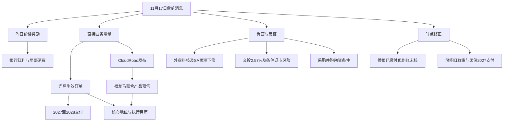

# 2026年11月17日 · 消息面事件驱动

> 数据源新鲜度：partial · 降级状态：true · 综合研究置信度：0.50（不是交易胜率）
> 当前是真实盘前研究，不是回放；11月17日A股尚未开盘。专题上下文截止不等于本轮联网截止，真实生成时刻见frontmatter。

## 一句话结论
观察光启订单与福龙马产品；算力负反馈延续，文投风险不被传媒活口抵销。

## 先认市场，再看消息

昨日市场的价格奖励偏向银行/红利及局部小家电，传媒、固态/储能只有局部活跃。财联社收评记录沪指-0.87%、深成指-2.53%、创业板指-4.37%，成交1.48万亿元、超过4300股下跌，连板分析称近60股跌停。情绪=主跌，是对亏钱扩散的盘前观察，不是继承旧账户停买。不能因银行属于传统行业就否认它当时的强势，也不能把ETF成交放量解释成已核国家队买入。

主线=未核定；持续性=未知；板块封板率=未知；明日预期=分歧（仅当前假设）。全市场32股涨停、16股封板未遂，封板率报道为67%，炸板率按同口径计算33.3333%，未触发≥35%候选减半条款；午间77%封板率不能混用。本轮研究线索自然收敛到2只，不为数量造票。

市场的反向剧本是：外盘科技负反馈不再扩散、A股出现新题材低位合力，或银行消费继续承接。只有新价格、扩散与核心证据出现后，R2/D1才可重评；消息研究既不永久停买，也不授买权。本次市场意见只适用于本日盘前至竞价/新公告重评，不自动跨日续期。真实用户停买、零预算、仓位硬上限、T+1、人工确认与R6逐票否决保持不变；预算来源未核，保留未知而非填0或正额度。

## 🗺️ 消息面全景图

## 关键变化：同一事实的新旧阶段不能混账

1. 侨银：昨日晨间日历“资金尚未全到位”有当时依据，但本轮公司新公告称已足额筹措并完成缴付，评级文件随之移出观察。当前不能继续传播“未筹足”或“已违约”。17日中登实际划付到持有人账户仍未核；评级引用同一公告不算第二份独立付款证明。
2. 光启：17.904亿元合同已签并生效，强于泛航展日程；收入主要影响2027年及2028年上半年，不是2026年即期利润。
3. CloudRobo：从昨日预告进入新闻确认发布/预售阶段；本轮没有下载权重、验证许可或运行机器人，不称“开源全部验证成功”，也不把伙伴名单当订单。
4. 储能：13日已有公开报道；16日政府答记者问是解释延续。按本轮最早已核公开日计算4日衰减，不能把转发刷新为新政策。2030规模目标不是企业预算，固态是前沿技术储备而非所有公司立即量产。
5. 医保：公司纳入/续约/商保/调出必须分开，2027年1月1日起支付执行不是11月收入。亿帆商保准入与两产品调出分别列正负分面。
6. 游族：14.28亿元是含税贸易订单，原公告明确净额确认且收入影响很小；11月20日是履约验证锚，不是等额利润。

## 🎯 顶级事件详解：事实、价格反应与推断分开

以下为22个底层事项的27个正反分析分面，不是27份独立催化。正负分面共享底层ID，来源不相加；另有旧冻结风险、待核宏观和FDA负面线索单列。high描述事实证据层级，不表示交易胜率或开仓许可。

### E20261117_001 · 美股收盘科技与光通信再下挫

态度：降级 · 极性：负面 · 强度：high · 底层事项：US_20261116_close

事实：纳指跌2.49%；费半跌逾5%；英伟达跌超4%；Lumentum及Ciena跌超8%。

原文发布日期/时点：2026-11-17T05:00:48+08:00；本轮最早公开锚：2026-11-17T05:00:48+08:00。原件落款、接口公告日和合同签署日不等于首次公众可知；未能核定的精确时分保留未知。仅日期/接口时点的事项不倒推16日盘中买权，可交易日保守落17日。新旧分类：已交易后的延续。

- **大资金意图**：未核。消息不能识别买方身份或大资金意图。
- **为什么走强**：已核美股收盘；11月17日A股尚未开盘；逐票资金未核。未核到走强就不编走强原因。
- **逻辑够不够硬**：原文核实事实成立；对次日价格和收入的传导仍待验证。

传导与反证：海外收盘负反馈可能压制A股映射；不能把相关性写成确定因果，也不能机械全市场停买。

直接对象：无可靠个股映射；不造票。已查来源：CLS_5（Tushare MCP news(src=cls)）；CLS_4（Tushare MCP news(src=cls)）。来源窗口与精度详见JSON逐事件verification_scope及evidence_ledger；本地公告索引为16—17日，非完整历史。未查公告、资金、核心或价格结构，不写“无负面”。

时间衰减：raw=-0.90，days_since=0，weighted=-0.900000，decayed=false。分数是消息研究标签，不替代逐票门禁。

### E20261117_009 · 文投AI漫剧收入约2.57%并提示条件性退市风险

态度：降级 · 极性：负面 · 强度：high · 底层事项：WT_risk

事实：原公告载AI漫剧收入占比2.57%且未经审计；前三季营收1.80亿元、净亏3754.58万元；年度满足双条件可能*ST。

原文发布日期/时点：2026-11-17；本轮最早公开锚：2026-11-16T19:25:31+08:00。原件落款、接口公告日和合同签署日不等于首次公众可知；未能核定的精确时分保留未知。仅日期/接口时点的事项不倒推16日盘中买权，可交易日保守落17日。新旧分类：老方向新增催化。

- **大资金意图**：未核。消息不能识别买方身份或大资金意图。
- **为什么走强**：11月16日收盘涨停；盘后风险披露；不能用盘后公告解释盘中涨停。龙虎榜卖方报道不等于已核净流出。。未核到走强就不编走强原因。
- **逻辑够不够硬**：原文核实事实成立；对次日价格和收入的传导仍待验证。

传导与反证：是条件性风险不是已实施*ST。财联社19天11板与部分媒体15天10板口径不同；公告又写第三次涨停，与市场统计不一致，不能以单一梯队描述授核心。

直接对象：文投控股 600715.SH。已查来源：PDF_wentou（巨潮公告原PDF）；CLS_95（Tushare MCP news(src=cls)）；RSS_8（证券时报）。来源窗口与精度详见JSON逐事件verification_scope及evidence_ledger；本地公告索引为16—17日，非完整历史。未查公告、资金、核心或价格结构，不写“无负面”。

时间衰减：raw=-0.90，days_since=1，weighted=-0.774637，decayed=false。分数是消息研究标签，不替代逐票门禁。

### E20261117_004 · 光启签订17.904亿元超材料航空结构产品合同

态度：观察 · 极性：正面 · 强度：high · 底层事项：GQ_179040

事实：11月13日签署并生效；含税179040万元；最晚2028年6月履行；占2025主营收入87.52%。

原文发布日期/时点：2026-11-17；本轮最早公开锚：2026-11-16T17:46:00+08:00。原件落款、接口公告日和合同签署日不等于首次公众可知；未能核定的精确时分保留未知。仅日期/接口时点的事项不倒推16日盘中买权，可交易日保守落17日。新旧分类：老方向新增催化。

- **大资金意图**：未核。消息不能识别买方身份或大资金意图。
- **为什么走强**：本事件公布后的A股价格与资金反应未核。未核到走强就不编走强原因。
- **逻辑够不够硬**：订单原件已核；比泛航展预期硬，但资金认可及龙头地位尚待R2/R7。

传导与反证：不是2026年即期利润；按客户交付计划执行且跨年交付可能不均。公告未披露型号与客户身份，不推断到某架战机。

直接对象：光启技术 002625.SZ。已查来源：PDF_guangqi（巨潮公告原PDF）；CLS_133（Tushare MCP news(src=cls)）。来源窗口与精度详见JSON逐事件verification_scope及evidence_ledger；本地公告索引为16—17日，非完整历史。未查公告、资金、核心或价格结构，不写“无负面”。

时间衰减：raw=+0.85，days_since=1，weighted=+0.731602，decayed=false。分数是消息研究标签，不替代逐票门禁。

### E20261117_018 · 南卫实控人涉嫌内幕交易被刑拘

态度：降级 · 极性：负面 · 强度：high · 底层事项：NW_custody

事实：11月15日收到家属通知；实控人因2023年减持涉嫌内幕交易近日被刑拘；案件调查中。

原文发布日期/时点：2026-11-16；本轮最早公开锚：2026-11-16。原件落款、接口公告日和合同签署日不等于首次公众可知；未能核定的精确时分保留未知。仅日期/接口时点的事项不倒推16日盘中买权，可交易日保守落17日。新旧分类：已披露风险延续。

- **大资金意图**：未核。消息不能识别买方身份或大资金意图。
- **为什么走强**：本事件公布后的A股价格与资金反应未核。未核到走强就不编走强原因。
- **逻辑够不够硬**：原文核实事实成立；对次日价格和收入的传导仍待验证。

传导与反证：拘留具体日未知；不是有罪判决；公司生产正常是公司自述，不由R4独立背书。

直接对象：南卫股份 603880.SH。已查来源：PDF_nanwei（巨潮公告原PDF）。来源窗口与精度详见JSON逐事件verification_scope及evidence_ledger；本地公告索引为16—17日，非完整历史。未查公告、资金、核心或价格结构，不写“无负面”。

时间衰减：raw=-0.85，days_since=1，weighted=-0.731602，decayed=false。分数是消息研究标签，不替代逐票门禁。

### E20261117_022 · 山鹰收盘首次低于1元并提示面值退市风险

态度：不进 · 极性：负面 · 强度：high · 底层事项：SY_par_risk

事实：11月16日收盘0.94元；若连续20个交易日低于1元可能触发终止上市；实控人此前立案仍披露。

原文发布日期/时点：2026-11-17；本轮最早公开锚：2026-11-16T18:24:44+08:00。原件落款、接口公告日和合同签署日不等于首次公众可知；未能核定的精确时分保留未知。仅日期/接口时点的事项不倒推16日盘中买权，可交易日保守落17日。新旧分类：老方向新增催化。

- **大资金意图**：未核。消息不能识别买方身份或大资金意图。
- **为什么走强**：本事件公布后的A股价格与资金反应未核。未核到走强就不编走强原因。
- **逻辑够不够硬**：原文核实事实成立；对次日价格和收入的传导仍待验证。

传导与反证：不是已经触发20日或已退市；未完回购不解除法定风险。

直接对象：山鹰国际 600567.SH。已查来源：PDF_shanying（巨潮公告原PDF）；CLS_115（Tushare MCP news(src=cls)）。来源窗口与精度详见JSON逐事件verification_scope及evidence_ledger；本地公告索引为16—17日，非完整历史。未查公告、资金、核心或价格结构，不写“无负面”。

时间衰减：raw=-0.85，days_since=1，weighted=-0.731602，decayed=false。分数是消息研究标签，不替代逐票门禁。

### E20261117_008 · 骏成GPU采购存在大额预付与供方免责风险

态度：降级 · 极性：负面 · 强度：high · 底层事项：JC_GPU

事实：交易暂定金额达到最近一期经审计净资产50%；分批预付；因原厂商等原因无法交货时供方不担责；外汇、关税及融资风险由公司承担。

原文发布日期/时点：2026-11-17；本轮最早公开锚：2026-11-16T18:46:30+08:00。原件落款、接口公告日和合同签署日不等于首次公众可知；未能核定的精确时分保留未知。仅日期/接口时点的事项不倒推16日盘中买权，可交易日保守落17日。新旧分类：老方向新增催化。

- **大资金意图**：未核。消息不能识别买方身份或大资金意图。
- **为什么走强**：本事件公布后的A股价格与资金反应未核。未核到走强就不编走强原因。
- **逻辑够不够硬**：原文核实事实成立；对次日价格和收入的传导仍待验证。

传导与反证：原件明确的不对称合同条件降低兑现确定性；不能把融资和采购额当盈利保障。

直接对象：骏成科技 301106.SZ。已查来源：PDF_juncheng（巨潮公告原PDF）。来源窗口与精度详见JSON逐事件verification_scope及evidence_ledger；本地公告索引为16—17日，非完整历史。未查公告、资金、核心或价格结构，不写“无负面”。

时间衰减：raw=-0.80，days_since=1，weighted=-0.688566，decayed=false。分数是消息研究标签，不替代逐票门禁。

### E20261117_019 · 金辰澄清海外SINGULUS报道无实质业务关联

态度：不进 · 极性：负面 · 强度：high · 底层事项：JC_clarification

事实：持股49%对象为SINGULUS SOLAR GmbH；其1—10月无营收；公司称相关报道与双方无关且暂无实质往来。

原文发布日期/时点：2026-11-16；本轮最早公开锚：2026-11-16。原件落款、接口公告日和合同签署日不等于首次公众可知；未能核定的精确时分保留未知。仅日期/接口时点的事项不倒推16日盘中买权，可交易日保守落17日。新旧分类：已披露风险延续。

- **大资金意图**：未核。消息不能识别买方身份或大资金意图。
- **为什么走强**：财联社11月16日收评称金辰跌停；原件风险已先存在，不能证明唯一跌停原因。未核到走强就不编走强原因。
- **逻辑够不够硬**：原文核实事实成立；对次日价格和收入的传导仍待验证。

传导与反证：不是SINGULUS TECHNOLOGIES AG直接49%权益；原报道经济映射被公司原件否定。

直接对象：金辰股份 603396.SH。已查来源：PDF_jincen（巨潮公告原PDF）。来源窗口与精度详见JSON逐事件verification_scope及evidence_ledger；本地公告索引为16—17日，非完整历史。未查公告、资金、核心或价格结构，不写“无负面”。

时间衰减：raw=-0.80，days_since=1，weighted=-0.688566，decayed=false。分数是消息研究标签，不替代逐票门禁。

### E20261117_025 · 闻泰披露荷兰法院追加临时措施及拟上诉

态度：降级 · 极性：负面 · 强度：high · 底层事项：WT_Nexperia

事实：公司公告载11月11日临时措施；跨境治理、诉求撤回及条件罚金争议继续。

原文发布日期/时点：2026-11-16；本轮最早公开锚：2026-11-16。原件落款、接口公告日和合同签署日不等于首次公众可知；未能核定的精确时分保留未知。仅日期/接口时点的事项不倒推16日盘中买权，可交易日保守落17日。新旧分类：已披露风险延续。

- **大资金意图**：未核。消息不能识别买方身份或大资金意图。
- **为什么走强**：本事件公布后的A股价格与资金反应未核。未核到走强就不编走强原因。
- **逻辑够不够硬**：原文核实事实成立；对次日价格和收入的传导仍待验证。

传导与反证：只取得公司披露，未独立取荷兰裁决；不是终审、既成损失或出售完成；11月18日不能认证为诉讼截止。

直接对象：*ST闻泰 600745.SH。已查来源：PDF_wentai（巨潮公告原PDF）。来源窗口与精度详见JSON逐事件verification_scope及evidence_ledger；本地公告索引为16—17日，非完整历史。未查公告、资金、核心或价格结构，不写“无负面”。

时间衰减：raw=-0.75，days_since=1，weighted=-0.645531，decayed=false。分数是消息研究标签，不替代逐票门禁。

### E20261117_014 · 海思科与舒泰神新药纳入医保但2027年实施

态度：观察 · 极性：正面 · 强度：high · 底层事项：NHSA_2026_companies

事实：海思科两款1类新药、舒泰神子公司注射用波米泰酶α有公告确认；新版2027年1月1日起执行。

原文发布日期/时点：2026-11-17；本轮最早公开锚：2026-11-16T15:55:21+08:00。原件落款、接口公告日和合同签署日不等于首次公众可知；未能核定的精确时分保留未知。仅日期/接口时点的事项不倒推16日盘中买权，可交易日保守落17日。新旧分类：老方向新增催化。

- **大资金意图**：未核。消息不能识别买方身份或大资金意图。
- **为什么走强**：本事件公布后的A股价格与资金反应未核。未核到走强就不编走强原因。
- **逻辑够不够硬**：两份公司文件分别验证自身资格，非多源给同一药物累加分。

传导与反证：14日政策已经公布；此为公司落地披露增量，未取得支付标准、院端配备、利润弹性；药物获批/纳入不代表所有同类CAR-T临床票都受益。

直接对象：海思科 002653.SZ、舒泰神 300204.SZ。已查来源：PDF_haisike（巨潮公告原PDF）；PDF_shutaishen（巨潮公告原PDF）；CLS_202（Tushare MCP news(src=cls)）；CLS_112（Tushare MCP news(src=cls)）。来源窗口与精度详见JSON逐事件verification_scope及evidence_ledger；本地公告索引为16—17日，非完整历史。未查公告、资金、核心或价格结构，不写“无负面”。

时间衰减：raw=+0.65，days_since=1，weighted=+0.559460，decayed=false。分数是消息研究标签，不替代逐票门禁。

### E20261117_021 · 游族净额法收入影响很小且仍需垫资补库存

态度：降级 · 极性：负面 · 强度：high · 底层事项：YZ_flash_order

事实：公司明确按净额法确认收入，预计当期营收影响非常小；现存货与订单仍有缺口且可能融资采购。

原文发布日期/时点：2026-11-15；本轮最早公开锚：2026-11-16。原件落款、接口公告日和合同签署日不等于首次公众可知；未能核定的精确时分保留未知。仅日期/接口时点的事项不倒推16日盘中买权，可交易日保守落17日。新旧分类：已披露风险延续。

- **大资金意图**：未核。消息不能识别买方身份或大资金意图。
- **为什么走强**：本事件公布后的A股价格与资金反应未核。未核到走强就不编走强原因。
- **逻辑够不够硬**：原文核实事实成立；对次日价格和收入的传导仍待验证。

传导与反证：14.28亿元不是新增营收/利润；回款、融资费用与供货风险实存；不拿采购额和销售额差直接推利润。

直接对象：游族网络 002174.SZ。已查来源：PDF_youzu（巨潮公告原PDF）。来源窗口与精度详见JSON逐事件verification_scope及evidence_ledger；本地公告索引为16—17日，非完整历史。未查公告、资金、核心或价格结构，不写“无负面”。

时间衰减：raw=-0.65，days_since=1，weighted=-0.559460，decayed=false。分数是消息研究标签，不替代逐票门禁。

### E20261117_005 · 朗特拟6.63亿元收购成都奥捷51%股权

态度：观察 · 极性：正面 · 强度：high · 底层事项：LT_AOJIE

事实：11月16日签附条件生效协议；股东会批准后生效；拟并表；交易构成关联交易而非重大资产重组。

原文发布日期/时点：2026-11-17；本轮最早公开锚：2026-11-16T21:11:16+08:00。原件落款、接口公告日和合同签署日不等于首次公众可知；未能核定的精确时分保留未知。仅日期/接口时点的事项不倒推16日盘中买权，可交易日保守落17日。新旧分类：老方向新增催化。

- **大资金意图**：未核。消息不能识别买方身份或大资金意图。
- **为什么走强**：本事件公布后的A股价格与资金反应未核。未核到走强就不编走强原因。
- **逻辑够不够硬**：原文核实事实成立；对次日价格和收入的传导仍待验证。

传导与反证：由智能控制向光互联延伸的假设成立于交割和整合成功；未完成并购，不是现有业务立刻贡献利润。

直接对象：朗特智能 300916.SZ。已查来源：PDF_langte（巨潮公告原PDF）；CLS_50（Tushare MCP news(src=cls)）。来源窗口与精度详见JSON逐事件verification_scope及evidence_ledger；本地公告索引为16—17日，非完整历史。未查公告、资金、核心或价格结构，不写“无负面”。

时间衰减：raw=+0.62，days_since=1，weighted=+0.533639，decayed=false。分数是消息研究标签，不替代逐票门禁。

### E20261117_006 · 朗特收购评估增值413.33%且审批整合风险未消除

态度：降级 · 极性：负面 · 强度：high · 底层事项：LT_AOJIE

事实：标的全部权益评估增值率413.33%；现金交易；业绩承诺三年累计考核；另有控股股东及一致行动人拟协议转让12%。

原文发布日期/时点：2026-11-17；本轮最早公开锚：2026-11-16T21:11:16+08:00。原件落款、接口公告日和合同签署日不等于首次公众可知；未能核定的精确时分保留未知。仅日期/接口时点的事项不倒推16日盘中买权，可交易日保守落17日。新旧分类：老方向新增催化。

- **大资金意图**：未核。消息不能识别买方身份或大资金意图。
- **为什么走强**：本事件公布后的A股价格与资金反应未核。未核到走强就不编走强原因。
- **逻辑够不够硬**：原文核实事实成立；对次日价格和收入的传导仍待验证。

传导与反证：高评估增值、关联交易及商誉/整合风险是反证；12%为协议转让，不等于二级市场已抛售；公司收到并购资金与股东转让所得不可混同。

直接对象：朗特智能 300916.SZ。已查来源：PDF_langte（巨潮公告原PDF）；CLS_48（Tushare MCP news(src=cls)）。来源窗口与精度详见JSON逐事件verification_scope及evidence_ledger；本地公告索引为16—17日，非完整历史。未查公告、资金、核心或价格结构，不写“无负面”。

时间衰减：raw=-0.62，days_since=1，weighted=-0.533639，decayed=false。分数是消息研究标签，不替代逐票门禁。

### E20261117_017 · 侨银称兑付资金已足额缴付：旧资金缺口状态更新

态度：观察 · 极性：正面 · 强度：high · 底层事项：QY_payment

事实：公司11月16日新公告称资金已足额到位并完成缴付；17日中登转付/摘牌；评级维持A+且移出观察。

原文发布日期/时点：2026-11-16；本轮最早公开锚：2026-11-16T12:40:04+08:00。原件落款、接口公告日和合同签署日不等于首次公众可知；未能核定的精确时分保留未知。仅日期/接口时点的事项不倒推16日盘中买权，可交易日保守落17日。新旧分类：老方向新增催化。

- **大资金意图**：未核。消息不能识别买方身份或大资金意图。
- **为什么走强**：本事件公布后的A股价格与资金反应未核。未核到走强就不编走强原因。
- **逻辑够不够硬**：原公司公告及评级均回读；12:40:04为接口rec_time，不保证官网首发；公众最早精确时点仍有接口时间属性限制。

传导与反证：旧日历资金未全到位已被新进展取代；实际持有人到账仍未核，且不代表经营回款、流动性全部修复。评级文件引用同一公司公告，不算第二份独立兑付证明。

直接对象：侨银股份 002973.SZ。已查来源：PDF_qiaoyin_paid（巨潮公告原PDF）；PDF_qiaoyin_rating（巨潮公告原PDF）。来源窗口与精度详见JSON逐事件verification_scope及evidence_ledger；本地公告索引为16—17日，非完整历史。未查公告、资金、核心或价格结构，不写“无负面”。

时间衰减：raw=+0.60，days_since=1，weighted=+0.516425，decayed=false。分数是消息研究标签，不替代逐票门禁。

### E20261117_010 · 顺钠拟1.2至2.4亿元回购用于持股激励

态度：观察 · 极性：正面 · 强度：high · 底层事项：SN_buyback

事实：董事会11月16日通过；12个月内实施；用途员工持股或股权激励；价格上限12.36元。

原文发布日期/时点：2026-11-17；本轮最早公开锚：2026-11-16T20:21:36+08:00。原件落款、接口公告日和合同签署日不等于首次公众可知；未能核定的精确时分保留未知。仅日期/接口时点的事项不倒推16日盘中买权，可交易日保守落17日。新旧分类：老方向新增催化。

- **大资金意图**：未核。消息不能识别买方身份或大资金意图。
- **为什么走强**：问财明确11月16日首板；回购盘后披露，不能倒解释该首板。未核到走强就不编走强原因。
- **逻辑够不够硬**：原文核实事实成立；对次日价格和收入的传导仍待验证。

传导与反证：回购方案不是当日已成交；价格上限不是目标价或止损依据；主营储能关联已由问财概念原因交叉，不把概念成员数算政策受益数。

直接对象：顺钠股份 000533.SZ。已查来源：PDF_shunna（巨潮公告原PDF）；CLS_61（Tushare MCP news(src=cls)）。来源窗口与精度详见JSON逐事件verification_scope及evidence_ledger；本地公告索引为16—17日，非完整历史。未查公告、资金、核心或价格结构，不写“无负面”。

时间衰减：raw=+0.55，days_since=1，weighted=+0.473389，decayed=false。分数是消息研究标签，不替代逐票门禁。

### E20261117_012 · 胜宏拟回购1.5至3亿元并披露海外增资

态度：观察 · 极性：正面 · 强度：high · 底层事项：SH_buyback

事实：回购用途股权激励/持股；另拟向马来西亚子公司增资不超1.7亿美元；707亿元为申请综合授信额度。

原文发布日期/时点：2026-11-16；本轮最早公开锚：2026-11-16T19:30:22+08:00。原件落款、接口公告日和合同签署日不等于首次公众可知；未能核定的精确时分保留未知。仅日期/接口时点的事项不倒推16日盘中买权，可交易日保守落17日。新旧分类：老方向新增催化。

- **大资金意图**：未核。消息不能识别买方身份或大资金意图。
- **为什么走强**：财联社收评称11月16日跌超10%；回购盘后公布，未核后续承接。未核到走强就不编走强原因。
- **逻辑够不够硬**：原文核实事实成立；对次日价格和收入的传导仍待验证。

传导与反证：回购拟议与10月16日提议是不同阶段，最早提议为旧事；授信不是融资到账，不与增资/回购叠成新增收入。

直接对象：胜宏科技 300476.SZ。已查来源：PDF_shenghong（巨潮公告原PDF）；CLS_92（Tushare MCP news(src=cls)）；CLS_91（Tushare MCP news(src=cls)）；CLS_90（Tushare MCP news(src=cls)）。来源窗口与精度详见JSON逐事件verification_scope及evidence_ledger；本地公告索引为16—17日，非完整历史。未查公告、资金、核心或价格结构，不写“无负面”。

时间衰减：raw=+0.52，days_since=1，weighted=+0.447568，decayed=false。分数是消息研究标签，不替代逐票门禁。

### E20261117_013 · 储能实施方案延续：3亿千瓦目标与市场机制分账

态度：观察 · 极性：正面 · 强度：high · 底层事项：storage_plan

事实：11月13日已有公开报道；16日政府网页答记者问；2030年装机目标3亿千瓦、平均时长3小时；固态为前沿储备。

原文发布日期/时点：2026-11-13T16:42:18+08:00；本轮最早公开锚：2026-11-13T16:42:18+08:00。原件落款、接口公告日和合同签署日不等于首次公众可知；未能核定的精确时分保留未知。仅日期/接口时点的事项不倒推16日盘中买权，可交易日保守落17日。新旧分类：已交易后的延续。

- **大资金意图**：未核。消息不能识别买方身份或大资金意图。
- **为什么走强**：问财储能概念11月16日五股涨停，但天虹主因AI零售、高新主因成都国资/功率半导体，不机械并成纯储能五股合力。未核到走强就不编走强原因。
- **逻辑够不够硬**：官方转发答记者问已核；政策落地与逐公司订单不同；已衰减为背景。

传导与反证：是已交易后的政策延续，不是今日新方向。规模目标不是预算/企业合同；安全、清单管理、利用率和收益机制约束同时保留。

直接对象：无可靠个股映射；不造票。已查来源：GOV_storage（内蒙古能源局转国家能源局答记者问）；WEB_storage_early（央视新闻经闪电新闻原文转发）；CLS_89（Tushare MCP news(src=cls)）。来源窗口与精度详见JSON逐事件verification_scope及evidence_ledger；本地公告索引为16—17日，非完整历史。未查公告、资金、核心或价格结构，不写“无负面”。

时间衰减：raw=+0.65，days_since=4，weighted=+0.356728，decayed=true。分数是消息研究标签，不替代逐票门禁。

### E20261117_015 · 亿帆二氮嗪纳入商保目录

态度：观察 · 极性：正面 · 强度：high · 底层事项：YF_NHSA

事实：二氮嗪口服混悬液纳入商保创新药目录；协议2027年1月1日至2028年12月31日。

原文发布日期/时点：2026-11-17；本轮最早公开锚：2026-11-16T17:20:25+08:00。原件落款、接口公告日和合同签署日不等于首次公众可知；未能核定的精确时分保留未知。仅日期/接口时点的事项不倒推16日盘中买权，可交易日保守落17日。新旧分类：老方向新增催化。

- **大资金意图**：未核。消息不能识别买方身份或大资金意图。
- **为什么走强**：本事件公布后的A股价格与资金反应未核。未核到走强就不编走强原因。
- **逻辑够不够硬**：原文核实事实成立；对次日价格和收入的传导仍待验证。

传导与反证：商保不是基本医保；原件称近期业绩无重大影响；支付和放量未核。

直接对象：亿帆医药 002019.SZ。已查来源：PDF_yifan（巨潮公告原PDF）；CLS_148（Tushare MCP news(src=cls)）。来源窗口与精度详见JSON逐事件verification_scope及evidence_ledger；本地公告索引为16—17日，非完整历史。未查公告、资金、核心或价格结构，不写“无负面”。

时间衰减：raw=+0.40，days_since=1，weighted=+0.344283，decayed=false。分数是消息研究标签，不替代逐票门禁。

### E20261117_002 · SemiAnalysis下修远期AI资本开支预测

态度：降级 · 极性：负面 · 强度：medium · 底层事项：SA_model_update

事实：财联社报道2028年AI加速器资本开支预测较旧模型下调28%；2026—2030逻辑硅面积累计预测下调17%。

原文发布日期/时点：2026-11-16T19:49:14+08:00；本轮最早公开锚：2026-11-16T16:57:00+08:00。原件落款、接口公告日和合同签署日不等于首次公众可知；未能核定的精确时分保留未知。仅日期/接口时点的事项不倒推16日盘中买权，可交易日保守落17日。新旧分类：老方向新增催化。

- **大资金意图**：未核。消息不能识别买方身份或大资金意图。
- **为什么走强**：本事件公布后的A股价格与资金反应未核。未核到走强就不编走强原因。
- **逻辑够不够硬**：确有模型下修的公开报道；原始付费模型、数据和更早公开时间未核。

传导与反证：这是研究模型下修不是已实现资本开支下降；公众号称前两天发布，精确原始发布时间/付费报告全文未取得。AMD、ASIC相对抗压不能外推A股供应商必获新增订单。

直接对象：无可靠个股映射；不造票。已查来源：CLS_74（Tushare MCP news(src=cls)）；RSS_76（傅里叶的猫）。来源窗口与精度详见JSON逐事件verification_scope及evidence_ledger；本地公告索引为16—17日，非完整历史。未查公告、资金、核心或价格结构，不写“无负面”。

时间衰减：raw=-0.80，days_since=1，weighted=-0.688566，decayed=false。分数是消息研究标签，不替代逐票门禁。

### E20261117_023 · 金科收盘低于1元提示可能终止上市

态度：不进 · 极性：负面 · 强度：medium · 底层事项：JK_par_risk

事实：11月16日收盘0.97元；首次终止上市风险提示。

原文发布日期/时点：2026-11-16T19:47:14+08:00；本轮最早公开锚：2026-11-16T19:47:14+08:00。原件落款、接口公告日和合同签署日不等于首次公众可知；未能核定的精确时分保留未知。仅日期/接口时点的事项不倒推16日盘中买权，可交易日保守落17日。新旧分类：老方向新增催化。

- **大资金意图**：未核。消息不能识别买方身份或大资金意图。
- **为什么走强**：本事件公布后的A股价格与资金反应未核。未核到走强就不编走强原因。
- **逻辑够不够硬**：原文核实事实成立；对次日价格和收入的传导仍待验证。

传导与反证：财联社公告快讯已核；本轮未回取该PDF正文，不声称完整风险审计；不是已退市。

直接对象：金科股份 000656.SZ。已查来源：CLS_77（Tushare MCP news(src=cls)）。来源窗口与精度详见JSON逐事件verification_scope及evidence_ledger；本地公告索引为16—17日，非完整历史。未查公告、资金、核心或价格结构，不写“无负面”。

时间衰减：raw=-0.80，days_since=1，weighted=-0.688566，decayed=false。分数是消息研究标签，不替代逐票门禁。

### E20261117_024 · *ST美丽收盘0.95元提示面值退市风险

态度：不进 · 极性：负面 · 强度：medium · 底层事项：ML_par_risk

事实：11月16日收盘0.95元；官方新闻引公司公告提示面值退市风险。

原文发布日期/时点：2026-11-16T21:41:24+08:00；本轮最早公开锚：2026-11-16T21:41:24+08:00。原件落款、接口公告日和合同签署日不等于首次公众可知；未能核定的精确时分保留未知。仅日期/接口时点的事项不倒推16日盘中买权，可交易日保守落17日。新旧分类：老方向新增催化。

- **大资金意图**：未核。消息不能识别买方身份或大资金意图。
- **为什么走强**：本事件公布后的A股价格与资金反应未核。未核到走强就不编走强原因。
- **逻辑够不够硬**：原文核实事实成立；对次日价格和收入的传导仍待验证。

传导与反证：已ST与本次面值风险是两层事项；本轮未回取该PDF正文，不外推其他合规状态。

直接对象：*ST美丽 000010.SZ。已查来源：CLS_44（Tushare MCP news(src=cls)）。来源窗口与精度详见JSON逐事件verification_scope及evidence_ledger；本地公告索引为16—17日，非完整历史。未查公告、资金、核心或价格结构，不写“无负面”。

时间衰减：raw=-0.80，days_since=1，weighted=-0.688566，decayed=false。分数是消息研究标签，不替代逐票门禁。

### E20261117_003 · CloudRobo模型发布并披露福龙马清扫机器人预售

态度：观察 · 极性：正面 · 强度：medium · 底层事项：CloudRobo_WM12

事实：发布会已举行；原文称将开源权重/推理/代码；与福龙马合作新品启动预售；12月上海发布具体日未取。

原文发布日期/时点：2026-11-16T15:46:00+08:00；本轮最早公开锚：2026-11-16T15:46:00+08:00。原件落款、接口公告日和合同签署日不等于首次公众可知；未能核定的精确时分保留未知。仅日期/接口时点的事项不倒推16日盘中买权，可交易日保守落17日。新旧分类：老方向新增催化。

- **大资金意图**：未核。消息不能识别买方身份或大资金意图。
- **为什么走强**：本事件公布后的A股价格与资金反应未核。未核到走强就不编走强原因。
- **逻辑够不够硬**：新闻原文和点名合作关系可核；复现性、真实销量、利润及伙伴获单未核。

传导与反证：从预告转为已发布，但未下载验证完整权重/代码；预售不是订单收入。不能给所有华为概念票贴直接受益标签。

直接对象：福龙马 603686.SH。已查来源：WEB_cloud1（科创板日报原文）；WEB_cloud2（科创板日报原文）；RSS_49（上海证券报）。来源窗口与精度详见JSON逐事件verification_scope及evidence_ledger；本地公告索引为16—17日，非完整历史。未查公告、资金、核心或价格结构，不写“无负面”。

时间衰减：raw=+0.75，days_since=1，weighted=+0.645531，decayed=false。分数是消息研究标签，不替代逐票门禁。

### E20261117_007 · 骏成拟采购9000张GPU卡建设基础设施

态度：观察 · 极性：正面 · 强度：medium · 底层事项：JC_GPU

事实：合同暂定76544.10万元；用于研发中心、智算中心；董事会通过，尚需股东会审议。

原文发布日期/时点：2026-11-17；本轮最早公开锚：2026-11-16T18:46:30+08:00。原件落款、接口公告日和合同签署日不等于首次公众可知；未能核定的精确时分保留未知。仅日期/接口时点的事项不倒推16日盘中买权，可交易日保守落17日。新旧分类：老方向新增催化。

- **大资金意图**：未核。消息不能识别买方身份或大资金意图。
- **为什么走强**：本事件公布后的A股价格与资金反应未核。未核到走强就不编走强原因。
- **逻辑够不够硬**：原文核实事实成立；对次日价格和收入的传导仍待验证。

传导与反证：这是买方资本开支，不是7.65亿元销售订单；供货与利用率未确定；供应商Z不得猜成某公司。

直接对象：骏成科技 301106.SZ。已查来源：PDF_juncheng（巨潮公告原PDF）；CLS_106（Tushare MCP news(src=cls)）。来源窗口与精度详见JSON逐事件verification_scope及evidence_ledger；本地公告索引为16—17日，非完整历史。未查公告、资金、核心或价格结构，不写“无负面”。

时间衰减：raw=+0.45，days_since=1，weighted=+0.387319，decayed=false。分数是消息研究标签，不替代逐票门禁。

### E20261117_027 · 17家车企账期年度评估提高供应商付款保障

态度：观察 · 极性：正面 · 强度：medium · 底层事项：auto_payments

事实：中汽协发布账期评估通知；车企报送与至少15家供应商抽查；工信部对故意拉长账期等将约谈督改。

原文发布日期/时点：2026-11-16T17:02:04+08:00；本轮最早公开锚：2026-11-16T17:02:04+08:00。原件落款、接口公告日和合同签署日不等于首次公众可知；未能核定的精确时分保留未知。仅日期/接口时点的事项不倒推16日盘中买权，可交易日保守落17日。新旧分类：老方向新增催化。

- **大资金意图**：未核。消息不能识别买方身份或大资金意图。
- **为什么走强**：本事件公布后的A股价格与资金反应未核。未核到走强就不编走强原因。
- **逻辑够不够硬**：原文核实事实成立；对次日价格和收入的传导仍待验证。

传导与反证：对零部件现金流改善是传导假设，不代表已缩短所有应收天数；不是新罚款已执行。

直接对象：无可靠个股映射；不造票。已查来源：CLS_174（Tushare MCP news(src=cls)）；CLS_153（Tushare MCP news(src=cls)）。来源窗口与精度详见JSON逐事件verification_scope及evidence_ledger；本地公告索引为16—17日，非完整历史。未查公告、资金、核心或价格结构，不写“无负面”。

时间衰减：raw=+0.45，days_since=1，weighted=+0.387319，decayed=false。分数是消息研究标签，不替代逐票门禁。

### E20261117_020 · 游族14.28亿元闪存颗粒订单11月20日交付

态度：观察 · 极性：正面 · 强度：medium · 底层事项：YZ_flash_order

事实：合同11月2日；订单11月12日已生效；交付11月20日；通过控股子公司智存合盈履行。

原文发布日期/时点：2026-11-15；本轮最早公开锚：2026-11-16。原件落款、接口公告日和合同签署日不等于首次公众可知；未能核定的精确时分保留未知。仅日期/接口时点的事项不倒推16日盘中买权，可交易日保守落17日。新旧分类：已交易后的延续。

- **大资金意图**：未核。消息不能识别买方身份或大资金意图。
- **为什么走强**：本事件公布后的A股价格与资金反应未核。未核到走强就不编走强原因。
- **逻辑够不够硬**：原文核实事实成立；对次日价格和收入的传导仍待验证。

传导与反证：是存储贸易订单不等于自制芯片或扩产；属于已有公告延续。

直接对象：游族网络 002174.SZ。已查来源：PDF_youzu（巨潮公告原PDF）。来源窗口与精度详见JSON逐事件verification_scope及evidence_ledger；本地公告索引为16—17日，非完整历史。未查公告、资金、核心或价格结构，不写“无负面”。

时间衰减：raw=+0.40，days_since=1，weighted=+0.344283，decayed=false。分数是消息研究标签，不替代逐票门禁。

### E20261117_028 · 账期约束可能增加整车企业资金与合规压力

态度：观察 · 极性：负面 · 强度：medium · 底层事项：auto_payments

事实：监管将核账期与付款方式，对拖欠严重企业约谈督改。

原文发布日期/时点：2026-11-16T17:02:04+08:00；本轮最早公开锚：2026-11-16T17:02:04+08:00。原件落款、接口公告日和合同签署日不等于首次公众可知；未能核定的精确时分保留未知。仅日期/接口时点的事项不倒推16日盘中买权，可交易日保守落17日。新旧分类：老方向新增催化。

- **大资金意图**：未核。消息不能识别买方身份或大资金意图。
- **为什么走强**：本事件公布后的A股价格与资金反应未核。未核到走强就不编走强原因。
- **逻辑够不够硬**：原文核实事实成立；对次日价格和收入的传导仍待验证。

传导与反证：这是政策约束的反向传导假设，不是全行业已经受罚或某点名车企已违规；不捏造个股风险名单。

直接对象：无可靠个股映射；不造票。已查来源：CLS_174（Tushare MCP news(src=cls)）；CLS_153（Tushare MCP news(src=cls)）。来源窗口与精度详见JSON逐事件verification_scope及evidence_ledger；本地公告索引为16—17日，非完整历史。未查公告、资金、核心或价格结构，不写“无负面”。

时间衰减：raw=-0.35，days_since=1，weighted=-0.301248，decayed=false。分数是消息研究标签，不替代逐票门禁。

### E20261117_029 · 引力传媒作为原告追讨应收：回收结果未定

态度：观察 · 极性：负面 · 强度：medium · 底层事项：YL_litigation

事实：11月16日收到传票；作为原告主张超限应收2248.04万元、违约金及费用；11月23日开庭。

原文发布日期/时点：2026-11-16；本轮最早公开锚：2026-11-16。原件落款、接口公告日和合同签署日不等于首次公众可知；未能核定的精确时分保留未知。仅日期/接口时点的事项不倒推16日盘中买权，可交易日保守落17日。新旧分类：老方向新增催化。

- **大资金意图**：未核。消息不能识别买方身份或大资金意图。
- **为什么走强**：本事件公布后的A股价格与资金反应未核。未核到走强就不编走强原因。
- **逻辑够不够硬**：原文核实事实成立；对次日价格和收入的传导仍待验证。

传导与反证：不是公司被罚或已损失3690.58万元；判决及回款未定，利润影响无法准确评估。

直接对象：引力传媒 603598.SH。已查来源：PDF_yinli（巨潮公告原PDF）。来源窗口与精度详见JSON逐事件verification_scope及evidence_ledger；本地公告索引为16—17日，非完整历史。未查公告、资金、核心或价格结构，不写“无负面”。

时间衰减：raw=-0.35，days_since=1，weighted=-0.301248，decayed=false。分数是消息研究标签，不替代逐票门禁。

### E20261117_016 · 亿帆两产品调出医保常规目录

态度：观察 · 极性：负面 · 强度：medium · 底层事项：YF_NHSA

事实：麻芩消咳颗粒、鬼臼毒素软膏调出医保常规目录；公司称销售额较小或暂未销售。

原文发布日期/时点：2026-11-17；本轮最早公开锚：2026-11-16T17:20:25+08:00。原件落款、接口公告日和合同签署日不等于首次公众可知；未能核定的精确时分保留未知。仅日期/接口时点的事项不倒推16日盘中买权，可交易日保守落17日。新旧分类：老方向新增催化。

- **大资金意图**：未核。消息不能识别买方身份或大资金意图。
- **为什么走强**：本事件公布后的A股价格与资金反应未核。未核到走强就不编走强原因。
- **逻辑够不够硬**：原文核实事实成立；对次日价格和收入的传导仍待验证。

传导与反证：保留支付端收缩而不夸大杀伤；公司无重大影响为公司陈述，未独立审计。

直接对象：亿帆医药 002019.SZ。已查来源：PDF_yifan（巨潮公告原PDF）；CLS_148（Tushare MCP news(src=cls)）。来源窗口与精度详见JSON逐事件verification_scope及evidence_ledger；本地公告索引为16—17日，非完整历史。未查公告、资金、核心或价格结构，不写“无负面”。

时间衰减：raw=-0.30，days_since=1，weighted=-0.258212，decayed=false。分数是消息研究标签，不替代逐票门禁。

## 两只直接线索的思维链（研究观察，不是首推/执行）

两只均为正文直接点名，不是东财/热榜代理。板型、龙头地位、RR、当日计划资格未核，不能因消息硬就获得执行资格。R2主模板尚未确定；本报告不把五种打法焊成策略。今日核心/主线补涨/计划内试错身份保留未知，D1首次形成计划前不写in_today_plan=false。

| 对象 | 板型 | 龙头认定/纪律通过 | 盈亏比 | 禁止清单 |
|---|---|---|---|---|
| 光启技术002625.SZ | 未核，不认定低位首板 | 消息直接受益；地位未知、通过条款未认证 | RR/止损距未知，观察 | 全项未审，不能写未命中 |
| 福龙马603686.SH | 未核，不认定低位首板 | 产品直接合作；地位未知、通过条款未认证 | RR/止损距未知，观察 | 全项未审，不能写未命中 |

### 光启技术002625.SZ · 观察

- **买入理由**：只形成待R2/D1裁决的研究理由：已生效的航空结构订单与主营业务直接重合。问财返回超材料行业占比99.5413%、产品98.9104%，但没有标具体报告期，不能把比例当未来新增利润；订单原件比泛行业大会更直接。
- **风险点**：2027—2028交付分布、客户计划与不可抗力；业务金额不是净利润。原件及10—17日实时公告索引已查，未完成全历史合规、资金与核心地位核查。
- **止损条件**：交易止损价=null；没有结构/入场依据，不造5日线或机械百分比。研究失效条件是合同取消、交付预期实质下修或原有业务映射被新原件否定；并非自动下单/卖出指令。
- **可验证假设**：R2若能确认其处于可交易主线核心、次日接力与必要风险条件齐备，才进入独立D1比较；资金承接或核心证据未出现则保持观察。Q3预告500行样本精确代码无命中，H1未覆盖；不能写“无预增”。

### 福龙马603686.SH · 观察

- **买入理由**：科创板日报发布会正文点名联合研发及新清扫机器人预售，业务映射比泛华为概念更具体。问财智能装备占比23.2800%、环卫服务74.4082%，报告期未标；并不把平台伙伴数、开发者数当公司订单。
- **风险点**：预售转实际交付、真实可靠性、客户付费与产品毛利尚未核。9月18日旧合作公告搜索命中存在，但PDF没有可读文本层，本轮未做图像识读，不冒充完整复核；10—17日实时公告索引仅取到业绩说明会公告。
- **止损条件**：交易止损价=null；无入场/结构证据不编价。研究失效条件是合作或产品预售被更正、实质落地被否定；只是研究假设，不授权交易。
- **可验证假设**：未来公开正式产品参数、付费订单与交付兑现才增强商业化证据；当日主线/核心/资金另审。Q3有限样本无精确命中不代表无预告；中报数据未全覆盖。

## 📊 板块 × 事件极性叉乘

| 事项/板块 | 正向对象或事实 | 负向对象/边界 | 裁决 |
|---|---|---|---|
| AI基础设施 | 国产训练路径、个别项目仍推进 | 外盘收盘负反馈、SA远期预测下修 | 不以“国产替代”自动对冲行业负面；ASIC份额只是预测 |
| 具身智能 | CloudRobo发布、福龙马预售 | 复现、可靠性、销量利润未核 | 观察直接业务对象，不扩散买权 |
| 超材料航空 | 光启已生效合同 | 跨年交付和客户进度 | 订单事实硬，价格/核心证据另审 |
| 光互联并购 | 朗特拟并表奥捷 | 高评估增值、关联交易及商誉风险 | 正负拆列，不能把交割写完成 |
| 智算采购 | 骏成基础设施投入意图 | 预付/免责/融资、利用率 | 采购不是营收，降级 |
| 电网/储能 | 政策与顺钠拟回购 | 旧政策衰减、顺钠旧冻结风险 | 回购不抵销治理风险；概念成员不等于同一驱动 |
| 医药支付 | 海思科/舒泰神具体药品入目录、亿帆商保 | 2027才执行、亿帆两品调出 | 逐药映射，不把临床项目当目录资格 |
| 传媒 | 昨日少数活口 | 文投2.57%AI占比及条件*ST、引力应收诉讼 | 市场表现与逐票经营/法律风险分账 |
| 汽车账期 | 供应商回款改善预期 | 整车合规/现金约束假设 | 是政策传导，不认定谁已经违规 |
| 侨银信用 | 公司称资金足额缴付 | 到账及持续经营流动性未核 | 更新旧风险，不因解除单项风险授进攻核心 |

没有把正负分数相减后清除风险；个股硬风险也不无证据升级为整个行业禁买。

## 对照对象：为什么不进入本轮两只重点线索

| 对象 | 态度 | 证据裁决 |
|---|---|---|
| 顺钠股份 000533.SZ | 降级 | 已有11月16日首板，17日不能再称新首板；回购盘后新增但17.37%冻结与拍卖边界需核；保留研究对象不授执行 |
| 朗特智能 300916.SZ | 观察 | 并购增量真实，但未生效交割、413.33%评估增值及关联交易风险；光互联行业负反馈仍在，非消息直接授核心 |
| 骏成科技 301106.SZ | 降级 | 采购不是收入；预付、供货免责和融资风险比标题更关键；不列本轮两只重点线索 |
| 文投控股 600715.SH | 降级 | 市场活口事实保留；2.57%AI占比与条件退市风险未解，不用传媒热度遮盖逐票风险 |
| 海思科 002653.SZ | 观察 | 医保资格原文真实，但2027年支付，未核当日板块扩散/新催化预期差；不因Q3累计预增造即期业绩alpha |
| 游族网络 002174.SZ | 降级 | 订单已披露且净额收入影响很小；交付日只是兑现核查锚，不作大幅新增盈利假设 |
| 金辰股份 603396.SH | 不进 | 所持德国子公司与相关海外报道无经济关联已被公司原件否定 |
| 侨银股份 002973.SZ | 观察 | 旧兑付资金缺口已更新，不继承违约叙事；实际到账及持续经营现金流尚未核，不因风险解除直接选为进攻核心 |
| 天虹股份 002419.SZ | 不进 | 储能概念筛选命中，但主要涨停原因是AI零售/超市调改；仅凭储能标签不算本轮政策直接受益线索 |
| 高新发展 000628.SZ | 观察 | 问财为成都国资/功率半导体/虚拟电厂；消息与因果尚未精确核，不把所有储能成员涨停视为同一主线 |
| 新能股份 000595.SZ | 观察 | 11月16日2连板及11月5日已披露并网，属于已交易延续，不是17日全新首板线索 |
| 领湃科技 300530.SZ | 观察 | 11月16日20cm首板，政策延续已衰减，且没有本轮新签企业订单，不以行业政策代替当日核心 |
| 东北制药 000597.SZ | 观察 | 匿名群聊把临床CAR-T项目映射成医保放量受益，具体获批/目录产品及权益未核，未采用其10万人放量数字 |
| 双鹭药业 002038.SZ | 观察 | 砒霜治疗及唯一口服标签来自群转；剂型/研发阶段未回公告核定，非本轮硬催化，不能按同稿多群升级 |
| 弘景光电 301479.SZ | 观察 | 影石发布会预告在群传播；本次未取得新品原发及当前供应比例，不把历史客户占比当新订单 |
| 北京利尔 代码未核 | 观察 | 国产GPU量产宣传来自匿名群；未核相关权益主体及公告，不以北字辈同名对标授核心；未调用证券主数据核定代码，保留代码未知 |

## 🔥 中报业绩预告命中（实际数据为旧Q3，不冒充中报）

本日东财抓取时间是新鲜的，但报告期为2026-09-30，500行公告日期范围8月26日至11月4日，归母净利润187个主体。下面按归母累计同比下限取最新通知后排15名，并通过实时问财行业查询完成15/15逐代码交集核对。首次裸代码查询只返回9股，补查原始.SH代码才取得另外6股；不能据首次返回9当作全覆盖。所有预告均超过7日，只留背景；缺单季环比、扣非和产品价/一致预期，极性只中性，不以累计高增选股。

| 代码 | 名称 | 公告日期 | 累计同比下限—上限 | 已核行业/事件交集 | 当日硬alpha |
|---|---|---|---|---|---|

| 001309.SZ | 德明利 | 2026-10-17 | 32046.52%—33154.49% | 电子 / 半导体 / 数字芯片设计；半导体负反馈背景 | 不进；旧事件背景 |

| 300821.SZ | 东岳硅材 | 2026-10-08 | 19047.97%—19748.08% | 基础化工 / 化学制品 / 有机硅；本轮具体消息无直接匹配 | 不进；旧事件背景 |

| 000703.SZ | 恒逸石化 | 2026-10-16 | 3318.59%—3405.13% | 基础化工 / 化学纤维 / 涤纶；本轮具体消息无直接匹配 | 不进；旧事件背景 |

| 002466.SZ | 天齐锂业 | 2026-10-21 | 2734.97%—3235.26% | 有色金属 / 能源金属 / 锂；本轮具体消息无直接匹配 | 不进；旧事件背景 |

| 688825.SH | 长鑫科技 | 2026-10-17 | 2581.06%—2609.47% | 电子 / 半导体 / 数字芯片设计；半导体负反馈背景 | 不进；旧事件背景 |

| 002812.SZ | 恩捷股份 | 2026-10-14 | 1884%—2474.8% | 电力设备 / 电池 / 电池化学品；储能相关电池链背景 | 不进；旧事件背景 |

| 688808.SH | 联讯仪器 | 2026-10-13 | 1866%—2072.95% | 机械设备 / 通用设备 / 仪器仪表；本轮具体消息无直接匹配 | 不进；旧事件背景 |

| 301308.SZ | 江波龙 | 2026-10-15 | 1864.55%—1990.84% | 电子 / 半导体 / 数字芯片设计；半导体负反馈背景 | 不进；旧事件背景 |

| 605189.SH | 富春染织 | 2026-10-14 | 1347.69%—1519.01% | 纺织服饰 / 纺织制造 / 印染；本轮具体消息无直接匹配 | 不进；旧事件背景 |

| 603991.SH | 领先股份 | 2026-10-21 | 1238.57%—1238.57% | 电子 / 半导体 / 半导体材料；半导体负反馈背景 | 不进；旧事件背景 |

| 688388.SH | 嘉元科技 | 2026-10-15 | 1196.6%—1318.92% | 电力设备 / 电池 / 锂电池；储能相关电池链背景 | 不进；旧事件背景 |

| 603026.SH | 石大胜华 | 2026-10-15 | 968.14%—1032.45% | 电力设备 / 电池 / 电池化学品；储能相关电池链背景 | 不进；旧事件背景 |

| 000626.SZ | 远大控股 | 2026-10-15 | 890%—1018% | 商贸零售 / 贸易 / 贸易Ⅲ；本轮具体消息无直接匹配 | 不进；旧事件背景 |

| 002493.SZ | 荣盛石化 | 2026-10-15 | 777.93%—822.95% | 石油石化 / 石油加工贸易 / 石油加工；本轮具体消息无直接匹配 | 不进；旧事件背景 |

| 301536.SZ | 星宸科技 | 2026-10-13 | 663.13%—697.75% | 电子 / 半导体 / 数字芯片设计；半导体负反馈背景 | 不进；旧事件背景 |

两只重点线索均未命中该有限Q3表，has_pre_increase=null而非false。海思科累计预增在样本中存在，但不是本周新业绩；医保事件也不因此改为earnings正面。没有本轮新earnings事件被跳过单季拆分协议。

## 图片文字侧：55族失败，不等于没有传播内容

已逐记录读取本日唯一侧文件wechat_image_ocr_20261117.jsonl。65个候选缓存文件归为55族，55族均为decrypt/error、uin_filenames_empty，没有进入OCR成功阶段，没有任何非空OCR正文可消费。不存在因低清/部分片段而被本轮丢弃的成功正文；也不能从空文本猜补股票、订单和数字。

缓存修改时间范围为11月16日08:57:52—19:03:46，采集时刻为17日06:01:56；这不是原帖时间。published_at/message_time均保留null。46族只有缩略图相关形态，但本轮没有可解密图像供判断质量。manifest的families_uncovered=0只是全部族被程序处理，不是正文覆盖；正文缺口仍为55族。只保留匿名资产指纹及失败状态，不猜发送人，不打开其他图片缓存目录，不增加独立来源数。图片腿失败不全局停买。

群聊文字中有CAR-T、砒霜治疗、影石新品、国产GPU与DeepSeek收费等传播线索。多群同稿已视同传播而非独立确认；缺官方原文的具体量产、唯一性、放量数字不进入已核高强度事件。

## 旧风险与未核负面不能被丢掉

- 顺钠：控股股东17.37%股份刑事冻结、6月流拍属于超过7日的既有风险，在本轮回购文件再次披露；放入background_risks，不借新文件日期重置衰减。后续拍卖时间未知，回购利好不能抵销。
- 宏观：统计局10月社零0.4%、地产投资-21.6%等只有本轮新闻转述，CCTV回读仅标题壳、ccdi回读超时，原表仍未取得。因此在pending_events保留需求反证，不伪称已核官方原表，也不把弱社零机械变成全部消费不进。
- 创新药：财联社有Summit肺癌药遭FDA拒批的负面快讯，未取FDA信函、具体药名及A股权益链；在additional_negative_leads留存，不认定中国某公司药品审批失败。
- 其余公告：关键词索引保留36条减持/诉讼/问询/风险/停牌等记录。它们不是36个已核重大负面，也不能因未读正文写无负面；甘肃能化的并购问询回复并不自动等于处罚，ST东尼申请摘帽也不等于获批。

## 专题证据裁决

运输的催化剂资料是11月16日晨间版本，只读了用户提供的有限截取，不是全文阅读。保留完整source_id、hash、source_timing与limitations索引，正文证据按必要原文精简，完整上下文身份和context_sha256写在JSON。

裁决adopted仅指采用净额收入、主体错配、支付起点与法律程序边界作为核验线索/反证。侨银旧资金状态被本轮新原件取代；CloudRobo的预告被已发布新闻更新。其余未来日程及长代码提及表没有完整复核，不据提及给候选资格。上游内嵌source_id列表为空，没有把同一来源再算独立支持。

## 关键证据

- 光启合同：巨潮1225673643.PDF；11月13日签署，最晚2028年6月履行；不是当期利润。
- 文投风险：巨潮1225674565.PDF；AI漫剧2.57%未经审计及条件性*ST；盘后披露不能解释此前涨停。
- 侨银状态：巨潮1225672485.PDF、评级1225674227.PDF；公司称已缴付，后者引用前者，不加独立兑付权重。
- CloudRobo：科创板日报2535409与2535460两篇正文；同一发布会不增底层事件数；福龙马为点名联合产品主体。
- 储能答记者问：内蒙古能源局转国家能源局原文；13日央视转稿证明并非17日新政策。
- 实时财联社：Tushare news(src=cls)本轮232条；保留标题、原文、发布时间及归档采集时间，原API无URL就不编链接。

## 数据源审计

| 来源 | 日期 | 状态 | 已读层级与缺口 |
|---|---|:---:|---|

| wechat_official_20 | 2026-11-17 | 🟢 | 82条/行；RSS兼容镜像只计一次；18源15有文，9/10核心有文；盘前纪要最新仍为11月16日，17日06点未到常规07点发布；本轮读元数据/标题和相关正文，不称82篇全文联网复读 |

| wechat_cli_5groups | 2026-11-17 | 🟢 | 199条/行；五群匿名合并；文字/链接/图片占位均在计数中；正文线索与同稿不加独立权重；不识别背书人 |

| wechat_image_ocr | 2026-11-17 | 🔴 | 55条/行；缓存mtime窗口不是原帖窗口；65候选文件/55族均解密失败uin_filenames_empty；无非空OCR；枚举完不等于正文覆盖 |

| news_cls | 2026-11-17 | 🟢 | 2250条/行；文件名不代表财联社；实际1478新浪+772同花顺；部分正文截断，近72h前缘缺口；程序建索引/关键词筛查与相关摘录审阅，不冒充2250条全文核验 |

| news_major | 2026-11-17 | 🟡 | 800条/行；800条为15点后窄窗，正文全部为空；只能提供标题线索，不能按72h长篇全文覆盖；重复时间标题已归并 |

| eastmoney_earnings_predict | 2026-11-17 | 🟡 | 500条/行；报告期2026Q3，最近公告11月4日；当日抓取不等于新业绩；归母净利润187主体样本；top15已计算，H1与当前完整名单未覆盖 |

| anns_window | 2026-11-17 | 🟢 | 1883条/行；851公司，自然日含首尾，不是逐分钟全市场风险认证；实际回读17份非空公司/评级PDF；其余多为索引核查 |

| mcp_health | 2026-11-17 | 🟢 | 未知条/行；fetch全局severity2保留；历史sanji/mptext退场及WeFlow/QMT不可达不是R4全市场停买依据 |

| tushare_news_cls_live | 2026-11-17 | 🟢 | 232条/行；本轮独立直采财联社232条；全部返回快讯文字已审阅；请求到06:12但响应已于06:11:44归档，实际所含最新新闻05:47:23；不宣称覆盖未来分钟 |

| news_search | 2026-11-17 | 🟢 | 40条/行；同花顺问财新闻检索4问、各10条返回；每问total15但只取得10，未穷尽；SemiAnalysis查询混入百科，保留低相关失败并回退CLS原始快讯；命中日期混杂需逐条过滤 |

| announcement_search | 2026-11-17 | 🟢 | 20条/行；光启/福龙马各10条语义命中，混有多年旧公告；不能称完整窗口无负面。福龙马9月18日合作PDF无文本层，未冒充全文已核 |

| hithink_business_query | 2026-11-17 | 🟢 | 12条/行；先联合查询返回5行仅福龙马且混合分类；后单查光启7行。报告期未标，因此百分比只作业务映射参考，不数值化打业务相关度分 |

| hithink_market_query | 2026-11-17 | 🟢 | 5条/行；五个储能概念涨停并非五家政策同向受益；只引用明确日期的历史涨停字段，未用无时点最新价构造止损 |

| R3_sentiment | 2026-11-17 | 🔴 | 未知条/行；本轮交叉时文件尚未生成；kol_confirm保留unknown，不反向依赖等待 |

| R7_capital_flow | 2026-11-17 | 🔴 | 未知条/行；本轮交叉时正式产物尚未生成；5日净额未知，不由消息反推资金认可 |

| events_previous/anns_classified | 2026-11-17 | 🔴 | 未知条/行；已搜索data目录未发现；补充腿缺失不单独增加市场性禁买 |

| primary_web_readback | 2026-11-17 | 🟢 | 4条/行；正文回读成功；宏观ccdi超时，cctv只有标题壳；不会把壳页面算完整官方数字验证 |

| hithink_earnings_industry_cross | 2026-11-17 | 🟢 | 15条/行；top15逐代码行业交集已核：首问9/15，明确.SH补6/6，累计15/15；行业交集不授公司事件资格 |

说明：本地新闻记录与公告索引是程序筛查，不是模型逐篇全文复核。news_cls名字不保证财联社，news_major全部正文为空，旧Q3抓取日期不刷新事件年龄。18个审计项是渠道/产物索引，不是18个相互独立的底层来源。数据来源包括同花顺问财、Tushare及新闻/公告原文；质量缺口仅降对应维度。

## 不确定性 / 反证

1. 盘前未核到当日资金、竞价、核心地位及价位结构，两个直接线索不构成可执行票；止损、目标、仓位均留null，不编数填表。
2. 海外科技急跌与国内新产品并存，不证明国产链资金已经认可。SA报告是研究预测下修，不是已发生收入同比暴跌。
3. 新闻72h前缘、长篇正文、OCR及正式R3/R7各有缺口；不升级市场性永久停买，真实负面和待核范围仍完整交下游。
4. 同一公司公告/发布会的正负分面、新闻转载与群转都共享底层源；多渠道不是多份独立验证，分数不相加。
5. 股价涨停统计在媒体间有口径冲突；不由19天11板、15天10板或“第三次涨停”等单一描述授总龙资格。未审禁止清单不等于无命中。

## 与其他 R/D/E 的关系

- 已读：本日fetch源及emotion_cycle（只识别其溢价是填补值而拒作实测）；运输的催化剂有限截取；本轮实时新闻与公司原件。
- R3：交叉时正式文件缺席，kol_confirm=unknown；不让缺席变成否决。
- R7：交叉时正式产物缺席，逐票5日净额=null；R4不越权推资金意图。
- R2：在候选形成前比较直接业务催化、既有市场奖励及反向风险；保留两只研究对象与对照剔除，不强制换票。
- R5：逐票补核心必要风险与结构/RR，不把R4观察当授权。
- R6：事实与反证已内嵌JSON；无需读本MD或联网；唯一硬否决权归R6，本报告没有生成hard_reject。
- D1：独立决定核心/补涨/试错与预算、逐票门禁；旧市场零仓意见不无限继承，真实用户/账户约束不变。

## Sub-Agent 元数据

- skill: analyze_news_impact_v1@1.7
- artifact: data/research/20261117/R4_news.json
- supporting_evidence: data/research/20261117/R4_primary_evidence.json（13份先取PDF全文文字；另4份有效原件摘述内嵌主JSON）
- method: llm_v1；本会话唯一R4研究执行者，未启动第二模型、CLI包装或delegation。
- status: partial/degraded；已交付真实已核事件与缺口，不冒充全源完整。
- generated_at: 2026-11-17T06:34:03+08:00
- usage: usage_unknown；未计量不当0，不保证低于努力目标。

