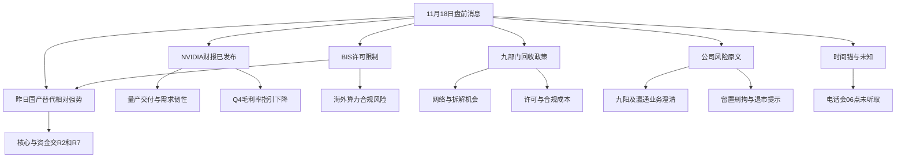

# 2026年11月18日 · 消息面事件驱动

> 实际生成：2026-11-18T06:33:30+08:00；状态 partial/degraded；重点72小时，但各源覆盖不等长。
> 本轮不是历史回放。已取实时官方资料；快照与实时证据分别留时点。研究不授予交易许可。

## 一句话结论
观察国产替代与全球AI需求韧性；毛利率、出口限制和逐票风险并存，消息不等于买权。

## 先认市场，再认个股
情绪=震荡/主跌。17日财联社收评显示超4100股下跌、成交1.46万亿元；沪指-0.5%、深成指-0.49%、创业板-1.2%。昨日市场在奖励半导体设备材料/国产算力的相对强势，并不代表普遍赚钱。科华/金盾两只直接公司正面观察对象保守缩至科华1只；连板网炸板35.1%仅partial参考，不升级为全局禁买。

主线观察 = 半导体设备材料/国产算力，持续性 = 未独立核定，封板率 = 板块口径未知，明日预期 = 条件性分歧或修复待证。64.9%是连板网所报全市场数，不能偷换成板块封板率。该页广百4天4板与最高3板矛盾、跌停口径与财联社不同均保留；不由R4替R1/R2定核心。

今天做：核事件真假与正反传导，交接研究观察。今天不做：把新闻当资金、把历史问答当新订单、把预算未知改成正数、以辅助缺数全市场停买。

## 🗺️ 消息面全景图

## 🎯 已核事件与正反分面
本轮19个官方原文底层硬事项；26个分析分面共享底层ID，绝不当作同等数量独立催化。媒体负面另保留验证等级，不凑8条。

### E20261118_019 · *ST华幸首次低于1元且重整未被正式受理

态度：观察事实/风险；极性=负面，强度=high，验证=official_primary。

事实：17日收盘0.92元；未收到法院正式受理重整申请文件；预重整不等于重整受理。

时间：原始发布时间 2026-11-17 18:23:38；本轮最早可定位 2026-11-17 18:23:38；研究可交易日 20261118。

分类：老方向新增催化。原始分-0.9，衰减后-0.834111，距离0.506855日；正反共根=huaxing。

已查来源：doc:huaxing；窗口=近72小时重点/公告17—18日。未穷尽历史监管诉讼和后续公告，不能写无负面。

- **大资金意图**：未核资金身份与流向；不能从新闻代替回答
- **为什么走强**：本轮未取得能确认事件因果的价格/资金证据
- **逻辑够不够硬**：原文确认事件事实；板块及股价传导仍需验证

反着看：尚未连续20交易日低于1元；不冒称已经退市或重整成功。

股票映射：*ST华幸 600340.SH（风险对象）

### E20261118_018 · *ST东珠市值首次低于5亿元并提示交易类退市

态度：观察事实/风险；极性=负面，强度=high，验证=official_primary。

事实：17日收盘1.09元且市值4.86亿元；连续20交易日低于5亿元才触发相应条款。

时间：原始发布时间 2026-11-17 16:37:43；本轮最早可定位 2026-11-17 16:37:43；研究可交易日 20261118。

分类：老方向新增催化。原始分-0.9，衰减后-0.824959，距离0.580408日；正反共根=dongzhu。

已查来源：doc:dongzhu；窗口=近72小时重点/公告17—18日。未穷尽历史监管诉讼和后续公告，不能写无负面。

- **大资金意图**：未核资金身份与流向；不能从新闻代替回答
- **为什么走强**：本轮未取得能确认事件因果的价格/资金证据
- **逻辑够不够硬**：原文确认事件事实；板块及股价传导仍需验证

反着看：第一次提示不是已终止上市；交易类退市不进入退市整理期。

股票映射：*ST东珠 603359.SH（风险对象）

### E20261118_020 · 荣盛发展首次低于1元触发退市风险提示

态度：观察事实/风险；极性=负面，强度=high，验证=official_primary。

事实：17日收盘0.90元首次低于1元；连续20交易日低于1元存在交易类退市风险。

时间：原始发布时间 2026-11-17 19:43:49；本轮最早可定位 2026-11-17 19:43:49；研究可交易日 20261118。

分类：老方向新增催化。原始分-0.85，衰减后-0.794379，距离0.451172日；正反共根=rongsheng。

已查来源：doc:rongsheng；窗口=近72小时重点/公告17—18日。未穷尽历史监管诉讼和后续公告，不能写无负面。

- **大资金意图**：未核资金身份与流向；不能从新闻代替回答
- **为什么走强**：本轮未取得能确认事件因果的价格/资金证据
- **逻辑够不够硬**：原文确认事件事实；板块及股价传导仍需验证

反着看：同窗董高增持计划不能抵消交易规则；第一次提示不是既成退市。

股票映射：荣盛发展 002146.SZ（风险对象）

### E20261118_004 · BIS远程先进算力限制：原文已核但生效日仍待查定

态度：观察事实/风险；极性=负面，强度=high，验证=official_primary。

事实：原文新增远程算力及五国许可要求并收紧代工封装；日期栏仍待联邦公报填入。

时间：原始发布时间 2026-11-16（美国发布日据商务部原文；精确时分未知）；本轮最早可定位 2026-11-17 15:21:00；研究可交易日 20261118。原发布16日、17日盘中已有传播与本轮公众精确定位15:21分栏；不以盘后答问解释此前涨幅，也不把私群转述当公众原文。生效日未核。

分类：已交易后的延续。原始分-0.85，衰减后-0.772926，距离0.633684日；正反共根=BIS_RIN_0694_AK50。

已查来源：doc:bis、doc:mofcom_official、article:81、news_cls:1797；窗口=近72小时重点/公告17—18日。未穷尽历史监管诉讼和后续公告，不能写无负面。

- **大资金意图**：未核资金身份与流向；不能从新闻代替回答
- **为什么走强**：海外获取成本/许可不确定性上升是风险事实，不能因此断言国内企业马上获得同额替代订单。
- **逻辑够不够硬**：原文确认事件事实；板块及股价传导仍需验证

反着看：商业推荐系统豁免；许可制不等于一概禁用；1200万aggregate TPP与关联机房条件须逐案核，不能称全部远程算力被关。

股票映射：无可靠A股直接个股映射；不造票。

### E20261118_011 · 金利华电终止收购中科西光82.50%股权

态度：观察事实/风险；极性=负面，强度=high，验证=official_primary。

事实：交易价格等关键事项未达一致；终止无需股东会并承诺至少一个月不再筹划重大重组。

时间：原始发布时间 2026-11-17 18:57:35；本轮最早可定位 2026-11-17 18:57:35；研究可交易日 20261118。

分类：老方向新增催化。原始分-0.8，衰减后-0.744059，距离0.483279日；正反共根=jinhua。

已查来源：doc:jinhua；窗口=近72小时重点/公告17—18日。未穷尽历史监管诉讼和后续公告，不能写无负面。

- **大资金意图**：未核资金身份与流向；不能从新闻代替回答
- **为什么走强**：本轮未取得能确认事件因果的价格/资金证据
- **逻辑够不够硬**：原文确认事件事实；板块及股价传导仍需验证

反着看：终止无需承担违约责任且公司称正常经营；不能将终止理解为本业停止。

股票映射：金利华电 300069.SZ（风险对象）

### E20261118_012 · 九阳否认华为战略合作并界定机器人参股边界

态度：观察事实/风险；极性=负面，强度=high，验证=official_primary。

事实：深思考持股7.92%且未并表未盈利；无传闻所称华为战略合作；哈基米主体无股权关系。

时间：原始发布时间 2026-11-18（公司公告日期；17日已有公众报道，不以公告日期覆盖已知公开时间）；本轮最早可定位 2026-11-17 17:09:00；研究可交易日 20261118。

分类：老方向新增催化。原始分-0.8，衰减后-0.73569，距离0.558684日；正反共根=jiuyang。

已查来源：doc:jiuyang、news_cls:1738；窗口=近72小时重点/公告17—18日。未穷尽历史监管诉讼和后续公告，不能写无负面。

- **大资金意图**：未核资金身份与流向；不能从新闻代替回答
- **为什么走强**：本轮未取得能确认事件因果的价格/资金证据
- **逻辑够不够硬**：原文确认事件事实；板块及股价传导仍需验证

反着看：太空厨房技术确有应用但未形成独立收入板块；不把澄清写成所有技术不存在。

股票映射：九阳股份 002242.SZ（风险对象）

### E20261118_015 · 三丰董事被立案调查并留置

态度：观察事实/风险；极性=负面，强度=high，验证=official_primary。

事实：公司16日收到监察通知；董事吴建军被立案调查并留置；调查进展与结论未知。

时间：原始发布时间 2026-11-17 17:04:49；本轮最早可定位 2026-11-17 17:04:49；研究可交易日 20261118。

分类：老方向新增催化。原始分-0.8，衰减后-0.73537，距离0.561589日；正反共根=sanfeng。

已查来源：doc:sanfeng；窗口=近72小时重点/公告17—18日。未穷尽历史监管诉讼和后续公告，不能写无负面。

- **大资金意图**：未核资金身份与流向；不能从新闻代替回答
- **为什么走强**：本轮未取得能确认事件因果的价格/资金证据
- **逻辑够不够硬**：原文确认事件事实；板块及股价传导仍需验证

反着看：公告称其他董高正常履职、生产经营未受影响；不升级为公司被立案。

股票映射：三丰智能 300276.SZ（风险对象）

### E20261118_013 · 瀛通智能眼镜仅少量代工且收入占比不足1%

态度：观察事实/风险；极性=负面，强度=high，验证=official_primary。

事实：官方称智能眼镜未量产且收入占比不足1%；近六交易日四次涨停有波动风险。

时间：原始发布时间 2026-11-18（公司公告日期；17日已有公众报道，不以公告日期覆盖已知公开时间）；本轮最早可定位 2026-11-17 18:41:38；研究可交易日 20261118。

分类：老方向新增催化。原始分-0.75，衰减后-0.696397，距离0.494355日；正反共根=yingtong。

已查来源：doc:yingtong、news_cls:1073；窗口=近72小时重点/公告17—18日。未穷尽历史监管诉讼和后续公告，不能写无负面。

- **大资金意图**：未核资金身份与流向；不能从新闻代替回答
- **为什么走强**：本轮未取得能确认事件因果的价格/资金证据
- **逻辑够不够硬**：原文确认事件事实；板块及股价传导仍需验证

反着看：13:46上证采访已称未量产但不足1%精确比例为后续公告；不把全部新细节倒灌上午。

股票映射：瀛通通讯 002861.SZ（风险对象）

### E20261118_002 · 英伟达Q4毛利率指引下移且中国收入仍不计入

态度：观察事实/风险；极性=负面，强度=high，验证=official_primary。

事实：Q4毛利率指引71%—72%低于Q3非GAAP74.9%；Q4不假设中国数据中心计算收入。

时间：原始发布时间 2026-11-18 05:20:24；本轮最早可定位 2026-11-18 05:20:24；研究可交易日 20261118。

分类：老方向新增催化。原始分-0.7，衰减后-0.69469，距离0.050767日；正反共根=NVIDIA_FY2027Q3。

已查来源：doc:nvda_official；窗口=近72小时重点/公告17—18日。未穷尽历史监管诉讼和后续公告，不能写无负面。

- **大资金意图**：未核资金身份与流向；不能从新闻代替回答
- **为什么走强**：同一财报两面并列，不把营收利好抵消利润率压力。
- **逻辑够不够硬**：原文确认事件事实；板块及股价传导仍需验证

反着看：同期Q4营收指引仍增长；毛利率下移不等于需求崩塌或所有供应链订单取消。

股票映射：无可靠A股直接个股映射；不造票。

### E20261118_003 · Vera Rubin量产交付已获官方确认

态度：观察事实/风险；极性=正面，强度=high，验证=official_primary。

事实：官网确认Vera Rubin NVL72已量产并交付部分云伙伴；平台发布不等于A股已获新增订单。

时间：原始发布时间 2026-11-18 05:22:42；本轮最早可定位 2026-11-18 05:22:42；研究可交易日 20261118。

分类：老方向新增催化。原始分0.65，衰减后0.645224，距离0.04917日；正反共根=NVIDIA_FY2027Q3。

已查来源：doc:nvda_official；窗口=近72小时重点/公告17—18日。未穷尽历史监管诉讼和后续公告，不能写无负面。

- **大资金意图**：未核资金身份与流向；不能从新闻代替回答
- **为什么走强**：技术平台出货可支撑部署需求假设；A股供应商身份与单体订单需另核。
- **逻辑够不够硬**：原文确认事件事实；板块及股价传导仍需验证

反着看：新闻称供应链含长电科技；官网该段实际列King Yuan Electronics等，未点名长电科技，不据译文授予受益。

股票映射：无可靠A股直接个股映射；不造票。

### E20261118_001 · 英伟达Q3财报已发布：需求增长事实与周期定性分开

态度：观察事实/风险；极性=中性，强度=high，验证=official_primary。

事实：FY2027Q3营收1158.44亿美元；GAAP净利652.87亿美元；Q4营收指引1300亿美元±3%。

时间：原始发布时间 2026-11-17（美国官网仅日期；时分时区未知）；本轮最早可定位 2026-11-18 05:20:24；研究可交易日 20261118。最早已核05:20:24为EPS快讯；完整营收快讯05:21。官网未给精确发布时间。电话会北京时间06:00已到，未听会不预填纪要。

分类：老方向新增催化。原始分0.65，衰减后0.645069，距离0.050767日；正反共根=NVIDIA_FY2027Q3。

已查来源：doc:nvda_official、doc:nvda、mcp:sina_053106、news_cls:1501；窗口=近72小时重点/公告17—18日。未穷尽历史监管诉讼和后续公告，不能写无负面。

- **大资金意图**：未核资金身份与流向；不能从新闻代替回答
- **为什么走强**：A股尚未开盘；财报可提供全球AI需求韧性线索，不能证明A股光模块资金已经回流。
- **逻辑够不够硬**：原文确认事件事实；板块及股价传导仍需验证

反着看：Q4毛利率指引下滑；Q4多一周；不含中国数据中心计算收入；不能简单按同比翻倍定义周期加速。

股票映射：无可靠A股直接个股映射；不造票。

### E20261118_016 · 惠城实控人留置延续且未知未披露事项

态度：观察事实/风险；极性=负面，强度=high，验证=official_primary。

事实：17日异动公告重申16日已披露张新功留置；公司不知悉其是否存在应披露未披露事项。

时间：原始发布时间 2026-11-16；本轮最早可定位 2026-11-16；研究可交易日 20261118。

分类：已交易后的延续。原始分-0.85，衰减后-0.629695，距离2日；正反共根=huicheng。

已查来源：doc:huicheng；窗口=近72小时重点/公告17—18日。未穷尽历史监管诉讼和后续公告，不能写无负面。

- **大资金意图**：未核资金身份与流向；不能从新闻代替回答
- **为什么走强**：本轮未取得能确认事件因果的价格/资金证据
- **逻辑够不够硬**：原文确认事件事实；板块及股价传导仍需验证

反着看：公告称公司经营正常；不能用经营正常覆盖实控人风险，也不将延续公告当全新留置。

股票映射：惠城环保 300779.SZ（风险对象）

### E20261118_017 · 南卫实控人因涉嫌内幕交易被刑拘仍无法回函

态度：观察事实/风险；极性=负面，强度=high，验证=official_primary。

事实：实控人因涉嫌内幕交易罪被刑拘；17日后续异动公告确认无法回函。

时间：原始发布时间 2026-11-16；本轮最早可定位 2026-11-16；研究可交易日 20261118。

分类：已交易后的延续。原始分-0.85，衰减后-0.629695，距离2日；正反共根=nanwei。

已查来源：doc:nanwei；窗口=近72小时重点/公告17—18日。未穷尽历史监管诉讼和后续公告，不能写无负面。

- **大资金意图**：未核资金身份与流向；不能从新闻代替回答
- **为什么走强**：本轮未取得能确认事件因果的价格/资金证据
- **逻辑够不够硬**：原文确认事件事实；板块及股价传导仍需验证

反着看：案件调查中不是已判有罪；董事会自查经营正常不能消除实控人事项不确定性。

股票映射：南卫股份 603880.SH（风险对象）

### E20261118_006 · 九部门回收体系意见已公开：2030年目标不是新增补贴额

态度：观察事实/风险；极性=正面，强度=high，验证=official_primary。

事实：政策公开支持回收网络与新三样拆解并强化生产者责任；没有给每家公司确定新增收入。

时间：原始发布时间 2026-11-17 11:57:00；本轮最早可定位 2026-11-17 11:57:00；研究可交易日 20261117。

分类：老方向新增催化。原始分0.7，衰减后0.623144，距离0.775351日；正反共根=RECYCLE_206。

已查来源：doc:recycle_official、doc:recycle、ocr:18；窗口=近72小时重点/公告17—18日。未穷尽历史监管诉讼和后续公告，不能写无负面。

- **大资金意图**：未核资金身份与流向；不能从新闻代替回答
- **为什么走强**：政策确实覆盖规范回收业务，但公司处理资质、项目预算、经营现金流仍待逐票核。
- **逻辑够不够硬**：原文确认事件事实；板块及股价传导仍需验证

反着看：网页发文日期11月12日与落款11月11日并存；公开时间17日11:57，不拿落款作市场首知。政策网页自注本文有删减。

股票映射：无可靠A股直接个股映射；不造票。

### E20261118_014 · 清研异动公告重申股东减持计划仍实施

态度：观察事实/风险；极性=负面，强度=high，验证=official_primary。

事实：持股5%以上股东及一致行动人的既有减持计划仍在实施；无新增经营重大变化。

时间：原始发布时间 2026-11-17 17:57:17；本轮最早可定位 2026-11-17 17:57:17；研究可交易日 20261118。

分类：老方向新增催化。原始分-0.6，衰减后-0.55455，距离0.525154日；正反共根=qingyan。

已查来源：doc:qingyan；窗口=近72小时重点/公告17—18日。未穷尽历史监管诉讼和后续公告，不能写无负面。

- **大资金意图**：未核资金身份与流向；不能从新闻代替回答
- **为什么走强**：本轮未取得能确认事件因果的价格/资金证据
- **逻辑够不够硬**：原文确认事件事实；板块及股价传导仍需验证

反着看：减持计划不是17日实际净卖出额；回收政策不能抹去该票股东供给风险。

股票映射：清研环境 301288.SZ（风险对象）

### E20261118_008 · 科华数据披露不低于4000万元增持计划

态度：观察事实/风险；极性=正面，强度=high，验证=official_primary。

事实：控股股东及两名高管拟六个月内合计增持不低于4000万元；尚非已完成买入。

时间：原始发布时间 2026-11-18（公司公告日期；17日已有公众报道，不以公告日期覆盖已知公开时间）；本轮最早可定位 2026-11-17 17:23:00；研究可交易日 20261118。

分类：老方向新增催化。原始分0.55，衰减后0.506525，距离0.548962日；正反共根=kehua_plan。

已查来源：doc:kehua、news_cls:419、news_cls:1718；窗口=近72小时重点/公告17—18日。未穷尽历史监管诉讼和后续公告，不能写无负面。

- **大资金意图**：未核资金身份与流向；不能从新闻代替回答
- **为什么走强**：本次支持是公司治理/股东信心层面的公开计划，不是AI采购新订单。
- **逻辑够不够硬**：原文确认事件事实；板块及股价传导仍需验证

反着看：未设价格区间；市场变化可能导致不能全部实施；不把股东计划写成R7主力净流入。

股票映射：科华数据 002335.SZ（研究观察）

### E20261118_023 · 长虹美菱异动重申成本、汇率和需求风险

态度：观察事实/风险；极性=负面，强度=high，验证=official_primary。

事实：新异动公告重申原材料、运费、贸易摩擦和需求风险；不是今日新发布三季报。

时间：原始发布时间 2026-11-17 19:49:31；本轮最早可定位 2026-11-17 19:49:31；研究可交易日 20261118。

分类：老方向新增催化。原始分-0.5，衰减后-0.467559，距离0.447214日；正反共根=meiling。

已查来源：doc:meiling；窗口=近72小时重点/公告17—18日。未穷尽历史监管诉讼和后续公告，不能写无负面。

- **大资金意图**：未核资金身份与流向；不能从新闻代替回答
- **为什么走强**：本轮未取得能确认事件因果的价格/资金证据
- **逻辑够不够硬**：原文确认事件事实；板块及股价传导仍需验证

反着看：Q3累计净利同比下降98.27%属10月27日旧披露；不能仅凭累计同比判单季环比或周期顶部。

股票映射：长虹美菱 000521.SZ（风险对象）

### E20261118_022 · 绝味未收首款而终止出售塞飞亚股权

态度：观察事实/风险；极性=负面，强度=high，验证=official_primary。

事实：8458.14万元股权交易未收253.74万元首款；未交割而解除协议。

时间：原始发布时间 2026-11-17 18:07:00；本轮最早可定位 2026-11-17 18:07:00；研究可交易日 20261118。

分类：老方向新增催化。原始分-0.5，衰减后-0.462593，距离0.518406日；正反共根=juewei。

已查来源：doc:juewei；窗口=近72小时重点/公告17—18日。未穷尽历史监管诉讼和后续公告，不能写无负面。

- **大资金意图**：未核资金身份与流向；不能从新闻代替回答
- **为什么走强**：本轮未取得能确认事件因果的价格/资金证据
- **逻辑够不够硬**：原文确认事件事实；板块及股价传导仍需验证

反着看：仍持24.1661%股权；不是已确认8458.14万元坏账或营业收入。

股票映射：绝味食品 603517.SH（风险对象）

### E20261118_021 · 通光与长飞终止6亿元认缴合资安排

态度：观察事实/风险；极性=负面，强度=high，验证=official_primary。

事实：16日董事会同意终止通飞合资协议并解散；60,000万元为原认缴规模不是损失额。

时间：原始发布时间 2026-11-17 16:41:07；本轮最早可定位 2026-11-17 16:41:07；研究可交易日 20261118。

分类：老方向新增催化。原始分-0.5，衰减后-0.458473，距离0.578047日；正反共根=tongguang。

已查来源：doc:tongguang；窗口=近72小时重点/公告17—18日。未穷尽历史监管诉讼和后续公告，不能写无负面。

- **大资金意图**：未核资金身份与流向；不能从新闻代替回答
- **为什么走强**：本轮未取得能确认事件因果的价格/资金证据
- **逻辑够不够硬**：原文确认事件事实；板块及股价传导仍需验证

反着看：通光实缴40万元，长飞后续按协议缴30.7965万元；公司称本业财务无重大影响。

股票映射：通光线缆 300265.SZ（风险对象）

### E20261118_007 · 回收政策同时强化许可、环保和生产者责任

态度：观察事实/风险；极性=负面，强度=high，验证=official_primary。

事实：原文禁止无处理资格主体擅自处理废电器并强化执法与生产者责任；不全行业无差别利好。

时间：原始发布时间 2026-11-17 11:57:00；本轮最早可定位 2026-11-17 11:57:00；研究可交易日 20261117。

分类：老方向新增催化。原始分-0.4，衰减后-0.356082，距离0.775351日；正反共根=RECYCLE_206。

已查来源：doc:recycle_official；窗口=近72小时重点/公告17—18日。未穷尽历史监管诉讼和后续公告，不能写无负面。

- **大资金意图**：未核资金身份与流向；不能从新闻代替回答
- **为什么走强**：本轮未取得能确认事件因果的价格/资金证据
- **逻辑够不够硬**：原文确认事件事实；板块及股价传导仍需验证

反着看：对已有资质且成本可控者可能形成份额机会；不能把行业合规成本当全部龙头利空。

股票映射：无可靠A股直接个股映射；不造票。

### E20261118_024 · 北鼎异动公告提示高波动与行业估值差异

态度：观察事实/风险；极性=负面，强度=high，验证=official_primary。

事实：两日涨幅偏离超30%；公告提示交易波动和行业估值差异。

时间：原始发布时间 2026-11-17 20:11:18；本轮最早可定位 2026-11-17 20:11:18；研究可交易日 20261118。

分类：老方向新增催化。原始分-0.35，衰减后-0.328035，距离0.432087日；正反共根=beiding。

已查来源：doc:beiding；窗口=近72小时重点/公告17—18日。未穷尽历史监管诉讼和后续公告，不能写无负面。

- **大资金意图**：未核资金身份与流向；不能从新闻代替回答
- **为什么走强**：本轮未取得能确认事件因果的价格/资金证据
- **逻辑够不够硬**：原文确认事件事实；板块及股价传导仍需验证

反着看：只是重述公司风险提示，不由R4做估值合理性测算；没有新的业绩增量可证明上涨因果。

股票映射：北鼎股份 300824.SZ（风险对象）

### E20261118_026 · 通用NAND现货走弱报道与DRAM景气并存

态度：观察事实/风险；极性=负面，强度=medium，验证=media_report_price_dataset_unverified。

事实：媒体报道NAND现货回落及模组库存出货压力；不能把DRAM、HBM景气外推所有存储。

时间：原始发布时间 2026-11-17 16:58:00；本轮最早可定位 2026-11-17 16:58:00；研究可交易日 20261118。

分类：老方向新增催化。原始分-0.5，衰减后-0.45928，距离0.566323日；正反共根=nand_divergence。

已查来源：article:54、news_cls:1106；窗口=近72小时重点/公告17—18日。未穷尽历史监管诉讼和后续公告，不能写无负面。

- **大资金意图**：未核资金身份与流向；不能从新闻代替回答
- **为什么走强**：行业分化已被可靠媒体报道；具体降幅与个股库存敞口只作为待核而非已核硬alpha。
- **逻辑够不够硬**：可靠采编线索；官方底层原文尚未直接核到

反着看：美银与TrendForce原始价格表未取得；报道称2027Q1涨跌预期分歧，服务器DRAM需求仍有支持。

股票映射：无可靠A股直接个股映射；不造票。

### E20261118_025 · 红果肖像侵权专项治理已被公开报道

态度：观察事实/风险；极性=负面，强度=medium，验证=official_statement_reported_primary_not_retrieved。

事实：媒体引述红果17日公告开展肖像侵权治理；截至10月累计处置43992部不等于11月新增下架数。

时间：原始发布时间 2026-11-17 15:43:03；本轮最早可定位 2026-11-17 15:43:03；研究可交易日 20261118。

分类：老方向新增催化。原始分-0.5，衰减后-0.455708，距离0.618371日；正反共根=hongguo。

已查来源：doc:hongguo、article:51、news_cls:1785；窗口=近72小时重点/公告17—18日。未穷尽历史监管诉讼和后续公告，不能写无负面。

- **大资金意图**：未核资金身份与流向；不能从新闻代替回答
- **为什么走强**：版权授权与成本压力的传导为假设，不能归因于此前所有短剧股下跌。
- **逻辑够不够硬**：可靠采编线索；官方底层原文尚未直接核到

反着看：规则也可能利于有授权内容和合规供应商；未找到原公告URL，不按多个转述平台计独立源。

股票映射：无可靠A股直接个股映射；不造票。

### E20261118_005 · BIS限制对应国产替代机会仅为传导假设

态度：观察事实/风险；极性=正面，强度=medium，验证=official_primary。

事实：限制事实可提高本土供给研究优先级；替代订单与盈利兑现尚未被此政策原文确认。

时间：原始发布时间 2026-11-16（美国发布日据商务部原文；精确时分未知）；本轮最早可定位 2026-11-17 15:21:00；研究可交易日 20261118。原发布16日、17日盘中已有传播与本轮公众精确定位15:21分栏；不以盘后答问解释此前涨幅，也不把私群转述当公众原文。生效日未核。

分类：已交易后的延续。原始分0.45，衰减后0.409196，距离0.633684日；正反共根=BIS_RIN_0694_AK50。

已查来源：doc:bis、article:4、mapping:retry、news_cls:1797；窗口=近72小时重点/公告17—18日。未穷尽历史监管诉讼和后续公告，不能写无负面。

- **大资金意图**：未核资金身份与流向；不能从新闻代替回答
- **为什么走强**：昨日芯片设备材料与华为算力逆势是已报道价格反应；将其归因为政策仅属有证据线索的解释，不认定唯一因果。
- **逻辑够不够硬**：原文确认事件事实；板块及股价传导仍需验证

反着看：本土供给同受工艺/封装/软件生态约束；历史主营/概念标签不是本轮新订单。

股票映射：无可靠A股直接个股映射；不造票。

### E20261118_009 · 金盾对智算子公司新增认缴9000万元

态度：观察事实/风险；极性=正面，强度=medium，验证=official_primary。

事实：增资后金盾持和电星盾60%；出资专用于投资曦和创芯；不是GPU销售收入。

时间：原始发布时间 2026-11-17；本轮最早可定位 2026-11-17；研究可交易日 20261118。仅公告日期可定位；精确公开时点未知，保守纳入18日研究，不用于解释17日盘中涨跌。

分类：老方向新增催化。原始分0.45，衰减后0.387319，距离1日；正反共根=JINDUN_CAPITAL_INCREASE。

已查来源：doc:jindun、mapping:0；窗口=近72小时重点/公告17—18日。未穷尽历史监管诉讼和后续公告，不能写无负面。

- **大资金意图**：未核资金身份与流向；不能从新闻代替回答
- **为什么走强**：加强研究线索但当前主营仍为通风设备；不能靠相近叙事替代核心地位核验。
- **逻辑够不够硬**：原文确认事件事实；板块及股价传导仍需验证

反着看：新增认缴五年内缴足；工商变更未完成；公告未证明GPU订单、收入或直接持有沐曦股份。

股票映射：金盾股份 300411.SZ（研究观察）

### E20261118_010 · 金盾增资同时形成现金出资与兑现风险

态度：观察事实/风险；极性=负面，强度=medium，验证=official_primary。

事实：新增认缴是资金投入义务而非回款；实施与工商变更尚存不确定性。

时间：原始发布时间 2026-11-17；本轮最早可定位 2026-11-17；研究可交易日 20261118。

分类：老方向新增催化。原始分-0.35，衰减后-0.301248，距离1日；正反共根=JINDUN_CAPITAL_INCREASE。

已查来源：doc:jindun；窗口=近72小时重点/公告17—18日。未穷尽历史监管诉讼和后续公告，不能写无负面。

- **大资金意图**：未核资金身份与流向；不能从新闻代替回答
- **为什么走强**：本轮未取得能确认事件因果的价格/资金证据
- **逻辑够不够硬**：原文确认事件事实；板块及股价传导仍需验证

反着看：允许五年内缴足不等于当日立即流出9000万元，也不能推断现金链断裂。

股票映射：金盾股份 300411.SZ（风险对象）

## 研究观察对象与对照取舍

### 科华数据 002335.SZ · 观察，不授买权
- **买入理由**：这里只给研究理由：原公告确认不低于4000万元增持计划，主营接口数据中心行业占40.9565%。它不是首板/核心确认；今日核心、主线补涨、计划内试错尚未定，in_today_plan未知。
- **风险点**：六个月增持尚未实施完成；主营接口未附报告期；既有AI价格及合规风险存在，不能按股东增持倒推出主力流入。
- **止损条件**：价格止损=null，缺独立价位依据；逻辑层面若增持取消/期限失效则本理由失效，交D1/R5核必要价格与RR，R4不编造。
- **可验证假设**：核首笔增持、实际资金来源与履约；R2核核心/板型，R7核资金；缺一项只限制此对象，不扩大为市场性停买。

板型=未知；龙头认定=未核（纪律通过条数未知）；RR=未知；禁止清单命中=未完成逐票核验。预告500条样本见下表：未命中不等于无预告。首推0只、首板候选0只，不是交易禁令。

| 对照对象 | 裁决 | 为什么不选/不提升 |
|---|---|---|
| 金盾股份 300411.SZ | 降级 | 新增投资事实明确但既有主营偏通风设备；五年内认缴/投资不等于GPU销售，不能比科华已有数据中心业务更直接 |
| 双环科技 000707.SZ | 观察 | 价格线索与主业相关且17日已涨停；不是未交易新首板，报价和单季利润缺口，不用晚间复述作为开盘追单理由 |
| 华胜天成 600410.SH | 观察 | 昨日3天2板且国产算力有相对价格响应；是R2核心对照对象，但本轮无新客户订单/公司原文增量，不凭市场强势另造首板身份 |
| 华东重机 002685.SZ | 观察 | 问财核到17日3天3板；核心地位交R2，不用BIS文件补成新增公司合同或把高位延续当新首板 |
| 东华软件 002065.SZ | 降级 | 多个群/海报复述同一CUDA到CANN稿；图片问答时间2026-03-01，未核新订单；名字对标无业务证据力 |
| 九阳股份 002242.SZ | 拦截 | 仅拦截华为战略合作/机器人收入等失真催化理由；原文澄清，不把涨停撤销为不存在 |
| 瀛通通讯 002861.SZ | 降级 | 涨停与代工业务低占比并存；不能因6天4板把未量产讲成产业爆单 |
| 清研环境 301288.SZ | 降级 | 回收政策并非公司新订单；股东减持正在实施，不用政策覆盖对象风险 |

## 📊 板块 × 事件极性叉乘
| 板块 | 正面 | 负面 | 裁决 |
|---|---|---|---|
| 房地产 | — | E20261118_019 / E20261118_020 | 负面；不净额抵消，不从新闻推买权 |
| ST风险 | — | E20261118_019 / E20261118_018 | 负面；不净额抵消，不从新闻推买权 |
| 环保 | — | E20261118_018 / E20261118_016 / E20261118_014 | 负面；不净额抵消，不从新闻推买权 |
| 海外算力租赁 | — | E20261118_004 | 负面；不净额抵消，不从新闻推买权 |
| 先进芯片 | — | E20261118_004 | 负面；不净额抵消，不从新闻推买权 |
| 晶圆代工 | — | E20261118_004 | 负面；不净额抵消，不从新闻推买权 |
| 先进封装 | — | E20261118_004 | 负面；不净额抵消，不从新闻推买权 |
| AI应用 | — | E20261118_004 | 负面；不净额抵消，不从新闻推买权 |
| 商业航天 | — | E20261118_011 | 负面；不净额抵消，不从新闻推买权 |
| 并购重组 | — | E20261118_011 | 负面；不净额抵消，不从新闻推买权 |
| 小家电 | — | E20261118_012 / E20261118_024 | 负面；不净额抵消，不从新闻推买权 |
| 机器人 | — | E20261118_012 / E20261118_015 | 负面；不净额抵消，不从新闻推买权 |
| 华为概念 | — | E20261118_012 | 负面；不净额抵消，不从新闻推买权 |
| 智能装备 | — | E20261118_015 | 负面；不净额抵消，不从新闻推买权 |
| AI眼镜 | — | E20261118_013 | 负面；不净额抵消，不从新闻推买权 |
| AI算力 | — | E20261118_002 | 负面；不净额抵消，不从新闻推买权 |
| 光模块 | — | E20261118_002 | 负面；不净额抵消，不从新闻推买权 |
| 液冷 | E20261118_003 | E20261118_002 | 正负并存；不净额抵消，不从新闻推买权 |
| 半导体 | — | E20261118_002 | 负面；不净额抵消，不从新闻推买权 |
| 海外AI算力 | E20261118_003 | — | 正面；不净额抵消，不从新闻推买权 |
| 高速互连 | E20261118_003 | — | 正面；不净额抵消，不从新闻推买权 |
| 再生资源 | E20261118_006 | E20261118_016 / E20261118_014 | 正负并存；不净额抵消，不从新闻推买权 |
| 医疗耗材 | — | E20261118_017 | 负面；不净额抵消，不从新闻推买权 |
| 废旧家电拆解 | E20261118_006 | — | 正面；不净额抵消，不从新闻推买权 |
| 电池回收 | E20261118_006 | E20261118_007 | 正负并存；不净额抵消，不从新闻推买权 |
| 光伏回收 | E20261118_006 | E20261118_007 | 正负并存；不净额抵消，不从新闻推买权 |
| 数据中心 | E20261118_008 | — | 正面；不净额抵消，不从新闻推买权 |
| 电源设备 | E20261118_008 | — | 正面；不净额抵消，不从新闻推买权 |
| 家电 | — | E20261118_023 | 负面；不净额抵消，不从新闻推买权 |
| 食品消费 | — | E20261118_022 | 负面；不净额抵消，不从新闻推买权 |
| 光纤光缆 | — | E20261118_021 | 负面；不净额抵消，不从新闻推买权 |
| 无资质废电器拆解 | — | E20261118_007 | 负面；不净额抵消，不从新闻推买权 |
| 非规范回收 | — | E20261118_007 | 负面；不净额抵消，不从新闻推买权 |
| 消费级NAND | — | E20261118_026 | 负面；不净额抵消，不从新闻推买权 |
| 存储模组 | — | E20261118_026 | 负面；不净额抵消，不从新闻推买权 |
| AI漫剧 | — | E20261118_025 | 负面；不净额抵消，不从新闻推买权 |
| 短剧制作 | — | E20261118_025 | 负面；不净额抵消，不从新闻推买权 |
| AI内容 | — | E20261118_025 | 负面；不净额抵消，不从新闻推买权 |
| 国产算力 | E20261118_005 | — | 正面；不净额抵消，不从新闻推买权 |
| 半导体设备 | E20261118_005 | — | 正面；不净额抵消，不从新闻推买权 |
| 半导体材料 | E20261118_005 | — | 正面；不净额抵消，不从新闻推买权 |
| 国产软件 | E20261118_005 | — | 正面；不净额抵消，不从新闻推买权 |
| 国产算力投资 | E20261118_009 | E20261118_010 | 正负并存；不净额抵消，不从新闻推买权 |

跨标签经济传导也比较：海外Vera Rubin交付与BIS许可约束同时作用于AI链；回收政策不能抵消清研减持及惠城实控人留置；国产替代叙事不能消除金盾出资与非主营兑现风险。JSON保留逐对叉乘及证据，不新增权重或门槛。

## 次级线索与真实负面待核

### 6G八省市部省协同试点 · 观察
媒体引述工信部复函；有许可前置要求，不能写已全面商用

已查：['search:0', 'doc:6g', 'news_cls:1800', 'article:18']；窗口：2026-11-17至本轮抓取。缺口：MIIT首页403；未取得原复函URL。

### 氯化铵报价上涨 · 观察
财联社主题前瞻为产业价格线索；晚间文章不能解释当日上午已涨停的全部因果

已查：['article:1', 'search:4', 'mapping:2']；窗口：2026-11-17报道与本轮抓取。缺口：['Mysteel底层报价与地区/品级未逐项核', '双环新增销售合同与业绩单季环比未核', '本窗口无双环公告索引命中不等于全历史无负面']。

### 美国拟限制中国新型光模块进口 · 观察
公众号引用路透及搜索命中，状态是拟议/游说而不是已生效全面禁运

已查：['article:76', 'article:38']；窗口：2026-11-17媒体与评论；本轮搜索补查。缺口：['路透原稿未直接取回', 'FCC正式文件和最新法律状态未核']。

### 光模块做空说法与中际订单反驳 · 观察
作者评论与匿名截图观点并存；未读取所争议研报原件或中际正式本期业绩会全文，不站队为已核订单

已查：['article:38', 'ocr:47']；窗口：2026-11-17传播；原报告时点未知。缺口：['券商原报告/公司披露原文', '2027/2028订单覆盖与产能口径']。

### 长鑫DRAM/LPDDR6说明会 · 观察
本轮源记录有Q4毛利率稳定与LPDDR6应用潜力表述；未取回公司说明会原件，不把潜在应用变成已签订单

已查：['news_cls:1139']；窗口：2026-11-17晚间。缺口：['正式说明会记录与单季环比', '原始DRAM价格/产品结构']。

## 匿名群聊图片：消费内容，不替图片背书

唯一文字侧文件共61条；成功59条、失败2条；实际非空正文41条全部保留进JSON，含低清碎片。源端统计空OCR18幅、partial56幅、recognized3幅；成功与有用非空不是同一计数。123个候选缓存文件/88个家族/61幅去重图是采集方覆盖计数，不是本轮新读取缓存。63个家族仅缩略图、27次重复图出现；不能把无未处理家族当高质量全覆盖。

源采集06:01:59；窗口06:01:59至次日06:01:59是缓存mtime窗口，不是帖子/消息时间。published_at/message_time未知一律保留null；“2个月前”等不转换为精确日期。无发送人或KOL归因。同图/同稿/文字转载0个新增独立来源权重。

- CUDA转CANN/东华软件：同稿营销复述合并；截图中2026-03-01为旧业务问答，不是11月新合同。证据：ocr:3, ocr:49, ocr:58。
- AI音乐/物产金轮：同稿；参股比例与业务未核，不进入硬事件。证据：ocr:9, ocr:57。
- 太力展厅：同内容不同截图合并；不外推新订单。证据：ocr:33, ocr:54。
- 脆皮捏捏：同题不同传播材料；消费热度/原料广告不外推A股供货。证据：ocr:1, ocr:16, ocr:22, ocr:29。
- 历史光刻/封装：可读原截图分别为2025-10-31和2023-11-02，非本周新催化。证据：ocr:25, ocr:51。
- 再生资源发布会预告：预告已由本轮商务部政策原文更新；不是新增独立源。证据：ocr:18。
- 好上好海思延伸昇腾：原图已写市场联想；不把代理海思升级为昇腾授权。证据：ocr:28。
- 光伏反倾销税率：保留2019—2020复审范围；联邦公报未取回，不能称所有光伏对美税率归零。证据：ocr:32。
- 中俄美元首会面：严重OCR混淆且官方未核；不猜补国名和行程。证据：ocr:15。
- 光模块下跌说法：匿名未核观点不当券商正式报告或目标跌幅。证据：ocr:47。

其余低清残片保留实际OCR与逐行置信度，不补全“北京转尔”等不清主体。它们只表示匿名传播，未升级硬事件，也未抹掉对应不确定性。

## 🔥 中报业绩预告命中
本日实际上取得2026Q3预告500条样本，不是中报全量；最新预告日期11月4日，已超七日窗口。已对按归母净利预增上限排序的20家做交叉，不把营业收入/扣非与归母重复当多票，不据累计同比授予正面。下表是历史预告背景，不是本周新增alpha。

| 代码 | 名称 | 预告类型 | 下限—上限同比 | 公告日期 | 本轮处理 |
|---|---|---|---|---|---|
| 001309.SZ | 德明利 | 扭亏 | 32046.52—33154.49% | 2026-10-17 | 超7日；不入新事件；单季未核 |
| 300821.SZ | 东岳硅材 | 预增 | 19047.97—19748.08% | 2026-10-08 | 超7日；不入新事件；单季未核 |
| 000703.SZ | 恒逸石化 | 预增 | 3318.59—3405.13% | 2026-10-16 | 超7日；不入新事件；单季未核 |
| 002466.SZ | 天齐锂业 | 预增 | 2734.97—3235.26% | 2026-10-21 | 超7日；不入新事件；单季未核 |
| 688825.SH | 长鑫科技 | 扭亏 | 2581.06—2609.47% | 2026-10-17 | 超7日；不入新事件；单季未核 |
| 002812.SZ | 恩捷股份 | 扭亏 | 1884—2474.8% | 2026-10-14 | 超7日；不入新事件；单季未核 |
| 688808.SH | 联讯仪器 | 预增 | 1866—2072.95% | 2026-10-13 | 超7日；不入新事件；单季未核 |
| 301308.SZ | 江波龙 | 预增 | 1864.55—1990.84% | 2026-10-15 | 超7日；不入新事件；单季未核 |
| 605189.SH | 富春染织 | 预增 | 1347.69—1519.01% | 2026-10-14 | 超7日；不入新事件；单季未核 |
| 688388.SH | 嘉元科技 | 预增 | 1196.6—1318.92% | 2026-10-15 | 超7日；不入新事件；单季未核 |
| 603991.SH | 领先股份 | 扭亏 | 1238.57—1238.57% | 2026-10-21 | 超7日；不入新事件；单季未核 |
| 603026.SH | 石大胜华 | 扭亏 | 968.14—1032.45% | 2026-10-15 | 超7日；不入新事件；单季未核 |
| 000626.SZ | 远大控股 | 预增 | 890—1018% | 2026-10-15 | 超7日；不入新事件；单季未核 |
| 002493.SZ | 荣盛石化 | 预增 | 777.93—822.95% | 2026-10-15 | 超7日；不入新事件；单季未核 |
| 300497.SZ | 富祥股份 | 扭亏 | 658—785% | 2026-09-18 | 超7日；不入新事件；单季未核 |
| 301536.SZ | 星宸科技 | 预增 | 663.13—697.75% | 2026-10-13 | 超7日；不入新事件；单季未核 |
| 301511.SZ | 德福科技 | 预增 | 560.72—620.78% | 2026-10-14 | 超7日；不入新事件；单季未核 |
| 002552.SZ | 宝鼎科技 | 预增 | 536.88—614.07% | 2026-10-14 | 超7日；不入新事件；单季未核 |
| 301292.SZ | 海科新源 | 扭亏 | 592—601% | 2026-10-16 | 超7日；不入新事件；单季未核 |
| 688378.SH | 奥来德 | 预增 | 442.16—537.83% | 2026-10-13 | 超7日；不入新事件；单季未核 |

| 对象 | 样本命中条数 | 结论 |
|---|---|---|
| 002335.SZ | 0 | 有限样本未命中；是否预增未知 |
| 300411.SZ | 0 | 有限样本未命中；是否预增未知 |
| 000707.SZ | 0 | 有限样本未命中；是否预增未知 |
| 600410.SH | 0 | 有限样本未命中；是否预增未知 |
| 002685.SZ | 0 | 有限样本未命中；是否预增未知 |
| 002242.SZ | 0 | 有限样本未命中；是否预增未知 |
| 002861.SZ | 0 | 有限样本未命中；是否预增未知 |
| 000521.SZ | 0 | 有限样本未命中；是否预增未知 |

NVIDIA已拆官方单季：Q3 GAAP净利652.87亿美元对比Q2约597亿美元，环比9.36%；非GAAP约+20.19%。仍缺产品现货价与完整经常损益拆分，故财报事件保守中性；Q4毛利率风险另列，不能只拿同比+105%下结论。Q4多一周，与常规季度非同长度。

## 专题证据裁决
transported context_sha256=b519250984182d9ec68181060ac7bb162db83792399b18e38c51e70013ee90ad；source_id=catalyst_calendar:626594f38363dfb9d29361a862a648ed2c7ad7efbf3d752737cb6893a3f86d83。

仅采纳此前日历有限3600字概览的状态分层与现金流方向。未读71475字全文；其旧版、截取、403及未核项保真。回收预告已由本轮官方政策更新，NVIDIA待发财报已变已披露，侨银旧缺口不能复活；上海亚虹等仅提及代码不产生资格。JSON原样嵌入身份、索引、时点、限制与截取原文，逐源adopted仅指上述用途，不代表全文或全部事件已核。

## 关键证据

- doc:nvda_official：https://nvidianews.nvidia.com/news/nvidia-announces-financial-results-for-third-quarter-fiscal-2027
- doc:bis：https://www.bis.gov/media/documents/rin-0694-ak50.pdf
- doc:mofcom_official：https://www.mofcom.gov.cn/xwfb/xwfyrth/art/2026/art_c9c0beb01b8640d3ba9160b73d315716.html
- doc:recycle_official：https://www.mofcom.gov.cn/zwgk/zcfb/art/2026/art_72d1146585b84058a5b609ed0af70da9.html
- doc:jiuyang：https://static.cninfo.com.cn/finalpage/2026-11-18/1225675386.PDF
- doc:yingtong：https://static.cninfo.com.cn/finalpage/2026-11-18/1225676325.PDF
- doc:qingyan：https://static.cninfo.com.cn/finalpage/2026-11-17/1225675912.PDF
- doc:kehua：https://static.cninfo.com.cn/finalpage/2026-11-18/1225675708.PDF
- doc:jindun：https://static.cninfo.com.cn/finalpage/2026-11-17/1225675921.PDF
- doc:sanfeng：https://static.cninfo.com.cn/finalpage/2026-11-17/1225675352.PDF
- doc:huicheng：https://static.cninfo.com.cn/finalpage/2026-11-17/1225676767.PDF
- doc:nanwei：https://static.cninfo.com.cn/finalpage/2026-11-18/1225676189.PDF
- doc:dongzhu：https://static.cninfo.com.cn/finalpage/2026-11-18/1225675211.PDF
- doc:huaxing：https://static.cninfo.com.cn/finalpage/2026-11-18/1225676310.PDF
- doc:rongsheng：https://static.cninfo.com.cn/finalpage/2026-11-18/1225676731.PDF
- doc:jinhua：https://static.cninfo.com.cn/finalpage/2026-11-18/1225676449.PDF
- doc:tongguang：https://static.cninfo.com.cn/finalpage/2026-11-17/1225675134.PDF
- doc:juewei：https://static.cninfo.com.cn/finalpage/2026-11-18/1225676244.PDF
- doc:meiling：https://static.cninfo.com.cn/finalpage/2026-11-18/1225676756.PDF
- doc:beiding：https://static.cninfo.com.cn/finalpage/2026-11-17/1225676784.PDF

## 数据源审计
| 来源 | 日期 | 状态 | 数量与边界 |
|---|---|---|---|
| manifest | 2026-11-17—18 | 🟢 | None；源记录已机械解析；全文语义审阅仅限嵌入证据与明确引用，非全量人工阅读全文 |
| mcp_health | 2026-11-17—18 | 🟢 | None；源记录已机械解析；全文语义审阅仅限嵌入证据与明确引用，非全量人工阅读全文 |
| wechat_official_20 | 2026-11-17—18 | 🟢 | 86；源记录已机械解析；全文语义审阅仅限嵌入证据与明确引用，非全量人工阅读全文 |
| wechat_cli_5groups | 2026-11-17—18 | 🟢 | 300；源记录已机械解析；全文语义审阅仅限嵌入证据与明确引用，非全量人工阅读全文 |
| wechat_image_ocr_20261118 | 2026-11-17—18 | 🔴 | 61；源记录已机械解析；全文语义审阅仅限嵌入证据与明确引用，非全量人工阅读全文 |
| news_cls | 2026-11-17—18 | 🟢 | 2660；源记录已机械解析；全文语义审阅仅限嵌入证据与明确引用，非全量人工阅读全文 |
| news_major | 2026-11-17—18 | 🟢 | 800；源记录已机械解析；全文语义审阅仅限嵌入证据与明确引用，非全量人工阅读全文 |
| eastmoney_earnings_predict | 2026-11-04及以前 | 🟡 | 500；源记录已机械解析；全文语义审阅仅限嵌入证据与明确引用，非全量人工阅读全文 |
| anns_window | 2026-11-17—18 | 🟢 | 2791；源记录已机械解析；全文语义审阅仅限嵌入证据与明确引用，非全量人工阅读全文 |
| hithink_business_query | 2026-11-17—18 | 🟢 | 3；3公司主营查询；报告期未附，未做主营相似度伪评分 |
| hithink_market_query | 2026-11-17—18 | 🟢 | 11；首个国产芯片精确概念词空；简化芯片后有返回，不把首次空集当全市场无票 |
| hithink_event_query | 2026-11-17—18 | 🔴 | 0；金盾近10日事件条件未命中；API返回股票壳行，不冒充查到公告事件 |
| official_documents | 2026-11-17—18 | 🟢 | 25；16份公司PDF+BIS PDF与政策/财报等；失败路径独立披露 |
| wechat_rss_mirror | 2026-11-17—18 | 🟢 | 86；与official_20兼容镜像不重复计数 |
| R3_R7 | 2026-11-17—18 | 🔴 | None；分析输入时点尚无正式R3/R7；不等待或擅自生产其结论 |

审计补充：news_cls实际为新浪1490条、同花顺1170条，无财联社直采；部分正文引财联社仍是转载。news_major为462同花顺/224新浪/72财联社/31华尔街见闻/7财新/4中新经纬，实际仅17日15:07:52至18日04:37。RSS18号池86篇与兼容镜像只计一次，非固定21号全覆盖。5焦点群仅匿名传播，未把全部300条称独立新闻。昨日events/anns_classified缺失为补充腿缺口，不全局降买权。

真实失败：NVIDIA investor页403但newsroom原文成功；MIIT首页403未取6G原文；国新办会场页521（首页证书失败）；氯化铵CNFOL页证书错误；hithink公告检索三丰/科华命中旧料，未当最新风险结论，已用CNINFO补核。带site:搜索被误解为股票SITE，弃用。以上失败都不等价市场性停买。

## 不确定性 / 反证

- BIS联邦公报实际刊登与生效时间未核；原PDF占位符不能补成11月19日已定
- NVIDIA电话会未听取；官方财报与Sina个别供应链翻译存在差异已按官方修正
- 6G官方复函与红果原平台公告未直取
- 光模块拟议限制路透/FCC原件与NAND底层价格表待核
- 预告为500条旧Q3样本；未命中不代表无业绩或无负面
- R3/R7正式交叉、各票核心地位/必要风险/价位/RR未完成
- 全市场公告全文与全历史司法/监管未穷尽

其他已见负面不隐藏：光大/交行温州分行各罚105万元为媒体转述待核监管原件；苑东子公司补税滞纳金968.38万元已缴且事项终结，不能写“新增行政处罚”；*ST英飞5亿元重整服务信托亦不能写已消除退市风险。JSON保留原报道对象和窗口。

预算未知保持未知；真实账户/用户停买、有效零预算、仓位上限、T+1及既有逐票保护不改。R4不声明hard_reject，必要风险交R6；R6只需消费本JSON内嵌原文，不要求临时联网补抓。

## 与其他 R/D/E 的关系
依赖：本轮抓取、实际直采及已运输专题有限截取；未等待或假称消费正式R3/R7。输出供R2、R5、R6及独立D1；R2先比较消息与真实市场核心，R5按其已核对象补必要风险/价位，D1独立决定执行。

## Sub-Agent 元数据
- skill: analyze_news_impact_v1@1.7
- method: llm_v1（单阶段唯一执行者；无再次委派/模型包装）
- artifact: data/research/20261118/R4_news.json
- 状态: partial/degraded（研究完成交接但证据缺口未伪装成功）
- 校验: Pydantic事件/衰减/引用及专题索引通过；旧首推检查通过仅因本轮无首推，不代表交易门禁通过。
- 生成时刻: 2026-11-18T06:33:30+08:00
