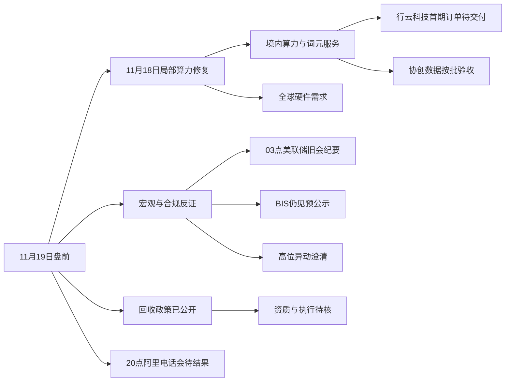

# 2026年11月19日 · 消息面事件驱动

> 数据源新鲜度：partial；降级：是；研究置信度：0.72。证据来自本轮实际读取，非回放。新闻按近72小时取证，但原始快讯及要闻均未覆盖完整目标窗。

## 一句话结论

算力修复是昨日局部奖励，不等于全面转强；词元首单先核交付，海外管制、利率和高位澄清保留反证。

## 详细分析

**先看奖励。** 11月18日沪指 +0.09%、深成指 +0.20%、创业板 +0.85%、科创50 +2.19%；沪深约1.37万亿元、缩量约880亿元。Tushare样本1318涨、4133跌、122平；情绪旁证41涨停、39跌停，炸板率36.92%，相同统计口径下封板率63.08%。情绪=震荡/主跌，溢价缺失的代值不采。11月19日未竞价，今日封板率未知。

**再看合力。** 国产算力、算力租赁和部分硬件修复为已证1日奖励，3/5日延续未证，今日预期=分歧。11月18日东财资金口径全市场净流出85.04亿元，电子净流入99.84亿元、元件46.38亿元、通信服务11.10亿元；分类可能嵌套，不相加，也不是机构净买入证明。华胜4天3板、华东重机4板和卡莱特20厘米2板只作昨日角色，不是今日首板。板块若仅有高开但广度及梯队不跟随，优先按修复后的兑现解释；竞价和盘中新增能改变本判断。

**按事实状态区分新旧。** 腾讯实际资本开支、行云首单是已有方向新增；协创是旧合同推进，不是再签374.90亿元。英伟达增长与毛利下行、不含中国收入指引并存，不能从纳指上行外推个股；回收政策传导取决于正规资质、渠道和实际处置经济性。美联储公布旧会纪要而非本日议息决定。

## 消息面全景图

## 硬事件与反证

共 58 个底层事项、64 个分面，其中 35 个负面分面。正负分面分别记录，不算两条原始来源。下方证据编号、原文及公告校验值可在 JSON 精确查回。

### E20261119_002 · 英伟达指引毛利下行且不含中国数据中心计算收入

🔴 负面 · high · 已交易后的延续。**事实**：Q4指引1300亿美元±3%，含额外一周；非GAAP毛利71%—72%低于Q3的74.9%，指引不计中国数据中心计算收入。

- **大资金意图**：未核事件级订单流，不能归因于机构意图。
- **为什么走强**：英伟达跌近3%、CoreWeave跌超4%；AMD及博通上涨；同期观测不等于因果。
- **逻辑够不够硬**：事实以原件为限；指引不是新禁令；H200停运的记者提问不等同外交部确认或全芯片停供。。
- **已查来源及范围**：NV, MFA, US；FY27 Q3及Q4指引；正文摘读，未查完整电话会/一致预期；11/18记者会，问题只作报道线索；答复是原则立场；美股11/18收盘；个股二级媒体，非盘中资金。**适用窗口**：11/19盘前至下一项可验证信息；新公告或竞价结构变化重评。

### E20261119_004 · 腾讯核心盈利承压与资本支出扩张同现

🔴 负面 · high · 老方向新增催化。**事实**：Q3非IFRS经营利润680.73亿元同比约-6%；非IFRS归母665.19亿元，低于上季684.15亿元。

- **大资金意图**：未核事件级订单流，不能归因于机构意图。
- **为什么走强**：未核本事件独立价格反应；新增AI投入回收期和现金占用制约全链估值外推。。
- **逻辑够不够硬**：事实以原件为限；IFRS归母同比微增；投入与每一家供应商的利润无直接等式。。
- **已查来源及范围**：TC；FY26 Q3、Q2对照；原件正文和附表。**适用窗口**：11/19盘前至下一项可验证信息；新公告或竞价结构变化重评。

### E20261119_005 · BIS远程访问规则已预公示但正式刊发待核

🔴 负面 · high · 已交易后的延续。**事实**：BIS公布涉及先进芯片和服务器远程访问的IFR；联邦登记页仍标未刊，计划美国当地11/19刊发。

- **大资金意图**：未核事件级订单流，不能归因于机构意图。
- **为什么走强**：未核本事件独立价格反应；先按地理、客户归属和设备敞口区分风险，不能把所有国内业务归入海外。。
- **逻辑够不够硬**：事实以原件为限；BIS页面日期11/15与检索索引11/16冲突，不判精确首知；最终刊版、具体生效日、条款豁免及逐票敞口待核。。
- **已查来源及范围**：BIS, FR；BIS原页美国日期11/15；搜索索引11/16，首知时刻冲突不定；本轮仍见预公示；11/19为拟刊期不是已刊/全面生效。**适用窗口**：11/19盘前至下一项可验证信息；新公告或竞价结构变化重评。

### E20261119_007 · 美联储公布10月纪要提示通胀与AI融资尾部风险

🔴 负面 · high · 老方向新增催化。**事实**：北京时间11/19 03:00公开旧会议纪要；10月投票10:2维持3.75%—4%；讨论AI债务、表外租赁和循环融资回报风险。

- **大资金意图**：未核事件级订单流，不能归因于机构意图。
- **为什么走强**：纳指+0.42%、标普-0.23%、道指-1.11%；同期观测不等于因果。
- **逻辑够不够硬**：事实以原件为限；不是11月新决定，不能写12月加息已落地；美股收盘分化，不等于风格一致反转。。
- **已查来源及范围**：FED, FEDMIN, US；10/27—28会议纪要；11/18美东发布；同一会议纪要正文摘读；非12月决议；美股11/18收盘；个股二级媒体，非盘中资金。**适用窗口**：11/19盘前至下一项可验证信息；新公告或竞价结构变化重评。

### E20261119_001 · 英伟达数据中心收入增长与Rubin交付

🟡 中性 · high · 已交易后的延续。**事实**：FY27 Q3收入1158亿美元、数据中心1076亿美元；非GAAP净利649亿美元对上季540亿；Rubin NVL72已出货。

- **大资金意图**：未核事件级订单流，不能归因于机构意图。
- **为什么走强**：美股11/18英伟达跌近3%且芯片股分化；同期观测不等于因果。
- **逻辑够不够硬**：事实以原件为限；该分面是需求事实，不声称超预期或A股新增订单；周期产品价未查，盈利周期结论不提升。。
- **已查来源及范围**：NV, US；FY27 Q3及Q4指引；正文摘读，未查完整电话会/一致预期；美股11/18收盘；个股二级媒体，非盘中资金。**适用窗口**：11/19盘前至下一项可验证信息；新公告或竞价结构变化重评。

### E20261119_003 · 腾讯资本开支和云服务增长

🟢 正面 · high · 老方向新增催化。**事实**：Q3资本开支814.33亿元、上季527.84亿元；现金支付651亿元同比+225%，云服务收入同比+35%。

- **大资金意图**：未核事件级订单流，不能归因于机构意图。
- **为什么走强**：未核本事件独立价格反应；订单和设备需求是后续验证方向，不映射单个供应商。。
- **逻辑够不够硬**：事实以原件为限；开支不是全额购卡，不证供货品牌；11/18收盘算力修复不由盘后结果倒证。。
- **已查来源及范围**：TC；FY26 Q3、Q2对照；原件正文和附表。**适用窗口**：11/19盘前至下一项可验证信息；新公告或竞价结构变化重评。

### E20261119_008 · 九部门回收体系意见已公开

🟢 正面 · high · 已交易后的延续。**事实**：商流通发〔2026〕206号11/17公开，含生产者责任、回收网点、车电一体拆解及风光退役设备。

- **大资金意图**：11/18东财环保行业净流出约3.17亿元（宽行业口径）；不识别机构或因果。
- **为什么走强**：东财环保行业-0.79%，不可替代回收子板块；同期观测不等于因果。
- **逻辑够不够硬**：事实以原件为限；官网元数据11/12而署名11/11；政策不是统一补贴，不是今日新增或利润兑现。。
- **已查来源及范围**：MOF, XH, MKT；页面发文元数据11/12，同页署名日期11/11，公开时间11/17 11:57；11/17发布会，不重复加权同一政策；20261118收盘。**适用窗口**：11/19盘前至下一项可验证信息；新公告或竞价结构变化重评。

### E20261119_010 · 行云科技签AI词元跨境合同及2亿元首期订单

🟢 正面 · high · 老方向新增催化。**事实**：新丝路合同60个月，首期含税2亿元；累计20亿元仅意向性上限，按确认订单与实调结算。

- **大资金意图**：未核事件级订单流，不能归因于机构意图。
- **为什么走强**：问财11/18 +17.32%；晚间报道不能解释日内上涨。；同期观测不等于因果。
- **逻辑够不够硬**：事实以原件为限；合同非到账、非全额订单；公告索引11/19、精确时刻未知，不解释11/18上涨。。
- **已查来源及范围**：A1953, IW_market, IW_business, IW_events, YNEWS, YNEWS, YNEWS, BROKER；公告索引自然日 11/18—19，抓取参考 11/19 06:03:21；本轮再取发行人PDF并核正文，精确发布时分通常未知；2026年11月18日算力租赁概念涨幅前10及几天几板；问财主营样本报告期未明；问财业绩预告11/18—19。；个股新闻定向；研报近30日。。**适用窗口**：11/19盘前至下一项可验证信息；新公告或竞价结构变化重评。

### E20261119_011 · 行云20亿元上限不是新增收入亦不保后续采购

🔴 负面 · high · 老方向新增催化。**事实**：除首期外追加订单须另签；实际调用结算。

- **大资金意图**：未核事件级订单流，不能归因于机构意图。
- **为什么走强**：未核本事件独立价格反应；上限炒作易在高反馈后兑现。。
- **逻辑够不够硬**：事实以原件为限；首期签订不被否定；回款、验收、客户方需求、设备合规仍需逐项核。。
- **已查来源及范围**：A1953, IW_market, IW_business, IW_events, YNEWS, YNEWS, YNEWS, BROKER；公告索引自然日 11/18—19，抓取参考 11/19 06:03:21；本轮再取发行人PDF并核正文，精确发布时分通常未知；2026年11月18日算力租赁概念涨幅前10及几天几板；问财主营样本报告期未明；问财业绩预告11/18—19。；个股新闻定向；研报近30日。。**适用窗口**：11/19盘前至下一项可验证信息；新公告或竞价结构变化重评。

### E20261119_012 · 协创数据旧算力云协议生效并下达设备采购

🟢 正面 · high · 已交易后的延续。**事实**：10/19披露原合同，上限374.90亿元；11/18午间已见进展、投入设备为境内合规服务器，已下采购订单并获排产书面确认。

- **大资金意图**：未核事件级订单流，不能归因于机构意图。
- **为什么走强**：11/18 +18.02%，前两日相继约-12.58%、-5.64%；同期观测不等于因果。
- **逻辑够不够硬**：事实以原件为限；需区分公司其他项目曾验收与本协议分批验收；不把涨幅归因于单一公告。。
- **已查来源及范围**：A811, CN, IW_market, IW_business, IW_events, BROKER；公告索引自然日 11/18—19，抓取参考 11/19 06:03:21；本轮再取发行人PDF并核正文，精确发布时分通常未知；A股11/18收盘；财联社同稿不重复；2026年11月18日算力租赁概念涨幅前10及几天几板；问财主营样本报告期未明；问财业绩预告11/18—19。；个股新闻定向和近30日研报；没有一致预期。。**适用窗口**：11/19盘前至下一项可验证信息；新公告或竞价结构变化重评。

### E20261119_013 · 协创算力协议验收未过可解约且采购先占用

🔴 负面 · high · 已交易后的延续。**事实**：到货、部署、验收通过并取得报告才计费；不能达到标准且整改无效，客户可解约无需违约责任。

- **大资金意图**：未核事件级订单流，不能归因于机构意图。
- **为什么走强**：未核本事件独立价格反应；关注现金流与资源损失而非照上限估利润。。
- **逻辑够不够硬**：事实以原件为限；境内合规仅该协议，不外推全公司节点或订单；未核逐批验收及回款。。
- **已查来源及范围**：A811, IW_market, IW_business, IW_events, BROKER；公告索引自然日 11/18—19，抓取参考 11/19 06:03:21；本轮再取发行人PDF并核正文，精确发布时分通常未知；2026年11月18日算力租赁概念涨幅前10及几天几板；问财主营样本报告期未明；问财业绩预告11/18—19。；个股新闻定向和近30日研报；没有一致预期。。**适用窗口**：11/19盘前至下一项可验证信息；新公告或竞价结构变化重评。

### E20261119_014 · 旭杰科技｜澳大利亚11/16就中国AAC砌块/板材发起双反调查；公司有澳洲ALC敞口

🔴 负面 · high · 已交易后的延续。**事实**：澳大利亚11/16就中国AAC砌块/板材发起双反调查；公司有澳洲ALC敞口。

- **大资金意图**：未核事件级订单流，不能归因于机构意图。
- **为什么走强**：未核本事件独立价格反应；保留直接对象，先验公告状态更新；不外推同板块全部个股。
- **逻辑够不够硬**：事实以原件为限；尚未裁定、税率及经营影响未知。。
- **已查来源及范围**：A75；公告索引自然日 11/18—19，抓取参考 11/19 06:03:21；本轮再取发行人PDF并核正文，精确发布时分通常未知。**适用窗口**：11/19盘前至下一项可验证信息；新公告或竞价结构变化重评。

### E20261119_017 · 百利天恒｜子公司收到BMS第二笔2.5亿美元里程碑，累计13亿美元

🟢 正面 · high · 已交易后的延续。**事实**：子公司收到BMS第二笔2.5亿美元里程碑，累计13亿美元。

- **大资金意图**：未核事件级订单流，不能归因于机构意图。
- **为什么走强**：未核本事件独立价格反应；保留直接对象，先验执行/现金或新公告，不用概念替代事实。
- **逻辑够不够硬**：事实以原件为限；真实入账日未披露，费用另扣；最高后续7.1bn美元为条件性，非获批。。
- **已查来源及范围**：A162；公告索引自然日 11/18—19，抓取参考 11/19 06:03:21；本轮再取发行人PDF并核正文，精确发布时分通常未知。**适用窗口**：11/19盘前至下一项可验证信息；新公告或竞价结构变化重评。

### E20261119_021 · 绝味食品｜塞飞亚24.1661%股权拟售终止，首笔未付；原对价8458.14万元

🔴 负面 · high · 已交易后的延续。**事实**：塞飞亚24.1661%股权拟售终止，首笔未付；原对价8458.14万元。

- **大资金意图**：未核事件级订单流，不能归因于机构意图。
- **为什么走强**：未核本事件独立价格反应；保留直接对象，先验公告状态更新；不外推同板块全部个股。
- **逻辑够不够硬**：事实以原件为限；删除原出售回款情景，非主营归零。。
- **已查来源及范围**：A360；公告索引自然日 11/18—19，抓取参考 11/19 06:03:21；本轮再取发行人PDF并核正文，精确发布时分通常未知。**适用窗口**：11/19盘前至下一项可验证信息；新公告或竞价结构变化重评。

### E20261119_024 · *ST华幸｜*ST华幸11/17收0.92元首次低于1元，公司尚未收到法院受理重整文件

🔴 负面 · high · 老方向新增催化。**事实**：*ST华幸11/17收0.92元首次低于1元，公司尚未收到法院受理重整文件。

- **大资金意图**：未核事件级订单流，不能归因于机构意图。
- **为什么走强**：未核本事件独立价格反应；保留直接对象，先验公告状态更新；不外推同板块全部个股。
- **逻辑够不够硬**：事实以原件为限；不是已退市/已重整；按后续正式公告更新。。
- **已查来源及范围**：A593；公告索引自然日 11/18—19，抓取参考 11/19 06:03:21；本轮再取发行人PDF并核正文，精确发布时分通常未知。**适用窗口**：11/19盘前至下一项可验证信息；新公告或竞价结构变化重评。

### E20261119_027 · 金利华电｜金利华电终止发行股份/现金方式购买中科西光82.50%股权

🔴 负面 · high · 已交易后的延续。**事实**：金利华电终止发行股份/现金方式购买中科西光82.50%股权。

- **大资金意图**：未核事件级订单流，不能归因于机构意图。
- **为什么走强**：未核本事件独立价格反应；保留直接对象，先验公告状态更新；不外推同板块全部个股。
- **逻辑够不够硬**：事实以原件为限；关键价格未达一致；11/19说明会不是重启，至少一月不筹划重大重组。。
- **已查来源及范围**：A945；公告索引自然日 11/18—19，抓取参考 11/19 06:03:21；本轮再取发行人PDF并核正文，精确发布时分通常未知。**适用窗口**：11/19盘前至下一项可验证信息；新公告或竞价结构变化重评。

### E20261119_035 · 荣盛发展｜荣盛发展11/17收0.90元首次低于1元，披露面值退市风险

🔴 负面 · high · 老方向新增催化。**事实**：荣盛发展11/17收0.90元首次低于1元，披露面值退市风险。

- **大资金意图**：未核事件级订单流，不能归因于机构意图。
- **为什么走强**：未核本事件独立价格反应；保留直接对象，先验公告状态更新；不外推同板块全部个股。
- **逻辑够不够硬**：事实以原件为限；首次提示不是完成退市；债务风险化解仍待进展。。
- **已查来源及范围**：A1135；公告索引自然日 11/18—19，抓取参考 11/19 06:03:21；本轮再取发行人PDF并核正文，精确发布时分通常未知。**适用窗口**：11/19盘前至下一项可验证信息；新公告或竞价结构变化重评。

### E20261119_042 · 天普股份｜天普股份19日开市复牌；仍以汽车管路/密封件为主；中昊芯英无资产注入计划；前三季归母亏1593.3

🔴 负面 · high · 老方向新增催化。**事实**：天普股份19日开市复牌；仍以汽车管路/密封件为主；中昊芯英无资产注入计划；前三季归母亏1593.33万元。

- **大资金意图**：未核事件级订单流，不能归因于机构意图。
- **为什么走强**：未核本事件独立价格反应；保留直接对象，先验公告状态更新；不外推同板块全部个股。
- **逻辑够不够硬**：事实以原件为限；复牌不是芯片资产落地；高位价量及竞价承接另核。。
- **已查来源及范围**：A1520；公告索引自然日 11/18—19，抓取参考 11/19 06:03:21；本轮再取发行人PDF并核正文，精确发布时分通常未知。**适用窗口**：11/19盘前至下一项可验证信息；新公告或竞价结构变化重评。

### E20261119_044 · *ST东珠｜*ST东珠11/18收0.98元、总市值4.37亿元；首日低价且连续两日市值低于5亿

🔴 负面 · high · 老方向新增催化。**事实**：*ST东珠11/18收0.98元、总市值4.37亿元；首日低价且连续两日市值低于5亿。

- **大资金意图**：未核事件级订单流，不能归因于机构意图。
- **为什么走强**：未核本事件独立价格反应；保留直接对象，先验公告状态更新；不外推同板块全部个股。
- **逻辑够不够硬**：事实以原件为限；双路径按先触及先适用；未终止上市；11/17初次市值公告同根。。
- **已查来源及范围**：A1611, A375；公告索引自然日 11/18—19，抓取参考 11/19 06:03:21；本轮再取发行人PDF并核正文，精确发布时分通常未知。**适用窗口**：11/19盘前至下一项可验证信息；新公告或竞价结构变化重评。

### E20261119_048 · 山鹰国际｜山鹰国际拟筹划重大事项，11/19开市起停牌，预计不超过2个交易日

🔴 负面 · high · 老方向新增催化。**事实**：山鹰国际拟筹划重大事项，11/19开市起停牌，预计不超过2个交易日。

- **大资金意图**：未核事件级订单流，不能归因于机构意图。
- **为什么走强**：未核本事件独立价格反应；保留直接对象，先验公告状态更新；不外推同板块全部个股。
- **逻辑够不够硬**：事实以原件为限；只限制该标的可交易性，不猜重大事项性质。。
- **已查来源及范围**：A1777；公告索引自然日 11/18—19，抓取参考 11/19 06:03:21；本轮再取发行人PDF并核正文，精确发布时分通常未知。**适用窗口**：11/19盘前至下一项可验证信息；新公告或竞价结构变化重评。

### E20261119_049 · 华胜天成｜华胜天成异动；11/18换手19.03%，前三季归母亏2.59亿元，公告称基本面未重大变化

🔴 负面 · high · 已交易后的延续。**事实**：华胜天成异动；11/18换手19.03%，前三季归母亏2.59亿元，公告称基本面未重大变化。

- **大资金意图**：未核事件级订单流，不能归因于机构意图。
- **为什么走强**：未核本事件独立价格反应；保留直接对象，先验公告状态更新；不外推同板块全部个股。
- **逻辑够不够硬**：事实以原件为限；高换手只说明交易分歧；反包梯队角色不能作低位新首板。。
- **已查来源及范围**：A1796；公告索引自然日 11/18—19，抓取参考 11/19 06:03:21；本轮再取发行人PDF并核正文，精确发布时分通常未知。**适用窗口**：11/19盘前至下一项可验证信息；新公告或竞价结构变化重评。

### E20261119_050 · *ST瑞茂｜*ST瑞茂控股股东/实控人股份100%被标记/冻结；逾期本金额约62.74亿元

🔴 负面 · high · 老方向新增催化。**事实**：*ST瑞茂控股股东/实控人股份100%被标记/冻结；逾期本金额约62.74亿元。

- **大资金意图**：未核事件级订单流，不能归因于机构意图。
- **为什么走强**：未核本事件独立价格反应；保留直接对象，先验公告状态更新；不外推同板块全部个股。
- **逻辑够不够硬**：事实以原件为限；诉讼仲裁执行合计约123.72亿元含撤诉等口径，不与逾期相加或视损失。。
- **已查来源及范围**：A1847；公告索引自然日 11/18—19，抓取参考 11/19 06:03:21；本轮再取发行人PDF并核正文，精确发布时分通常未知。**适用窗口**：11/19盘前至下一项可验证信息；新公告或竞价结构变化重评。

### E20261119_052 · 华东重机｜华东重机两日异常波动；公司TTM PE 82.54倍对行业35.88倍，经营无重大变化

🔴 负面 · high · 已交易后的延续。**事实**：华东重机两日异常波动；公司TTM PE 82.54倍对行业35.88倍，经营无重大变化。

- **大资金意图**：未核事件级订单流，不能归因于机构意图。
- **为什么走强**：未核本事件独立价格反应；保留直接对象，先验公告状态更新；不外推同板块全部个股。
- **逻辑够不够硬**：事实以原件为限；日期有一日差；4连板是市场角色，不是低位首板及盈利兑现。。
- **已查来源及范围**：A2055；公告索引自然日 11/18—19，抓取参考 11/19 06:03:21；本轮再取发行人PDF并核正文，精确发布时分通常未知。**适用窗口**：11/19盘前至下一项可验证信息；新公告或竞价结构变化重评。

### E20261119_009 · 回收合规及责任成本不等于全行业利好

🔴 负面 · medium · 已交易后的延续。**事实**：政策明确持证处理资格、执法监督并落实生产者延伸责任。

- **大资金意图**：未核事件级订单流，不能归因于机构意图。
- **为什么走强**：未核本事件独立价格反应；低资质主体、成本无法转嫁主体或承压。。
- **逻辑够不够硬**：事实以原件为限；这是对原文责任/准入的传导推断；地方执行与公司敞口未核，不逐票硬映射。。
- **已查来源及范围**：MOF, XH；页面发文元数据11/12，同页署名日期11/11，公开时间11/17 11:57；11/17发布会，不重复加权同一政策。**适用窗口**：11/19盘前至下一项可验证信息；新公告或竞价结构变化重评。

### E20261119_006 · 海外管制带来国产替代观察而非订单

🟢 正面 · medium · 已交易后的延续。**事实**：可核事实仅为远程先进算力的监管动作和11/18本地价格表现。

- **大资金意图**：未核事件级订单流，不能归因于机构意图。
- **为什么走强**：国产算力出现涨停梯队，非政策因果证明；同期观测不等于因果。
- **逻辑够不够硬**：事实以原件为限；同一政策的反向分面，不独立加权；替代能力、供货和市场进入风险仍在。。
- **已查来源及范围**：BIS, FR, CN；BIS原页美国日期11/15；搜索索引11/16，首知时刻冲突不定；本轮仍见预公示；11/19为拟刊期不是已刊/全面生效；A股11/18收盘；财联社同稿不重复。**适用窗口**：11/19盘前至下一项可验证信息；新公告或竞价结构变化重评。

### E20261119_015 · 普冉股份｜诺亚长天剩余49%股权过户，成为全资子公司

🟢 正面 · medium · 已交易后的延续。**事实**：诺亚长天剩余49%股权过户，成为全资子公司。

- **大资金意图**：未核事件级订单流，不能归因于机构意图。
- **为什么走强**：未核本事件独立价格反应；保留直接对象，先验执行/现金或新公告，不用概念替代事实。
- **逻辑够不够硬**：事实以原件为限；登记/现金对价和募集资金不是同一阶段。。
- **已查来源及范围**：A104；公告索引自然日 11/18—19，抓取参考 11/19 06:03:21；本轮再取发行人PDF并核正文，精确发布时分通常未知。**适用窗口**：11/19盘前至下一项可验证信息；新公告或竞价结构变化重评。

### E20261119_016 · *ST禾信｜量羲技术56%已过户，购买资产新增1395万股完成登记

🟢 正面 · medium · 已交易后的延续。**事实**：量羲技术56%已过户，购买资产新增1395万股完成登记。

- **大资金意图**：未核事件级订单流，不能归因于机构意图。
- **为什么走强**：未核本事件独立价格反应；保留直接对象，先验执行/现金或新公告，不用概念替代事实。
- **逻辑够不够硬**：事实以原件为限；新增股有限售，配套募资未同完，原ST状态不能取消。。
- **已查来源及范围**：A136；公告索引自然日 11/18—19，抓取参考 11/19 06:03:21；本轮再取发行人PDF并核正文，精确发布时分通常未知。**适用窗口**：11/19盘前至下一项可验证信息；新公告或竞价结构变化重评。

### E20261119_018 · 阿拉丁｜子公司股权回购案终审生效进入执行，1170万元不含受理费等

🔴 负面 · medium · 已交易后的延续。**事实**：子公司股权回购案终审生效进入执行，1170万元不含受理费等。

- **大资金意图**：未核事件级订单流，不能归因于机构意图。
- **为什么走强**：未核本事件独立价格反应；保留直接对象，先验公告状态更新；不外推同板块全部个股。
- **逻辑够不够硬**：事实以原件为限；公司称非重大不利，不等于没有现金执行风险。。
- **已查来源及范围**：A225；公告索引自然日 11/18—19，抓取参考 11/19 06:03:21；本轮再取发行人PDF并核正文，精确发布时分通常未知。**适用窗口**：11/19盘前至下一项可验证信息；新公告或竞价结构变化重评。

### E20261119_019 · 长源东谷｜拟收购康豪机电100%之审核问询申请延期回复

🔴 负面 · medium · 已交易后的延续。**事实**：拟收购康豪机电100%之审核问询申请延期回复。

- **大资金意图**：未核事件级订单流，不能归因于机构意图。
- **为什么走强**：未核本事件独立价格反应；保留直接对象，先验公告状态更新；不外推同板块全部个股。
- **逻辑够不够硬**：事实以原件为限；延期不等于否决；正式回复日未定。。
- **已查来源及范围**：A307；公告索引自然日 11/18—19，抓取参考 11/19 06:03:21；本轮再取发行人PDF并核正文，精确发布时分通常未知。**适用窗口**：11/19盘前至下一项可验证信息；新公告或竞价结构变化重评。

### E20261119_020 · *ST起步｜二审终审，约2308.08万元及诉讼费，Q3已全额计提涉案金额

🔴 负面 · medium · 已交易后的延续。**事实**：二审终审，约2308.08万元及诉讼费，Q3已全额计提涉案金额。

- **大资金意图**：未核事件级订单流，不能归因于机构意图。
- **为什么走强**：未核本事件独立价格反应；保留直接对象，先验公告状态更新；不外推同板块全部个股。
- **逻辑够不够硬**：事实以原件为限；不重复计成Q4新增损失，执行和追偿待核。。
- **已查来源及范围**：A353；公告索引自然日 11/18—19，抓取参考 11/19 06:03:21；本轮再取发行人PDF并核正文，精确发布时分通常未知。**适用窗口**：11/19盘前至下一项可验证信息；新公告或竞价结构变化重评。

### E20261119_022 · 东吴证券｜东海证券83.68%收购案获上交所重组委审议通过

🟢 正面 · medium · 已交易后的延续。**事实**：东海证券83.68%收购案获上交所重组委审议通过。

- **大资金意图**：未核事件级订单流，不能归因于机构意图。
- **为什么走强**：未核本事件独立价格反应；保留直接对象，先验执行/现金或新公告，不用概念替代事实。
- **逻辑够不够硬**：事实以原件为限；仍需证监会注册等，不是收购交割。。
- **已查来源及范围**：A480；公告索引自然日 11/18—19，抓取参考 11/19 06:03:21；本轮再取发行人PDF并核正文，精确发布时分通常未知。**适用窗口**：11/19盘前至下一项可验证信息；新公告或竞价结构变化重评。

### E20261119_023 · 中铝国际｜中铝国际越南氧化铝项目由10月中标推进至11/16签署EPC，约55.83亿元等值

🟢 正面 · medium · 已交易后的延续。**事实**：中铝国际越南氧化铝项目由10月中标推进至11/16签署EPC，约55.83亿元等值。

- **大资金意图**：未核事件级订单流，不能归因于机构意图。
- **为什么走强**：未核本事件独立价格反应；保留直接对象，先验执行/现金或新公告，不用概念替代事实。
- **逻辑够不够硬**：事实以原件为限；长工期、跨境执行及汇率风险，合同不是铝价或即时营收。。
- **已查来源及范围**：A491；公告索引自然日 11/18—19，抓取参考 11/19 06:03:21；本轮再取发行人PDF并核正文，精确发布时分通常未知。**适用窗口**：11/19盘前至下一项可验证信息；新公告或竞价结构变化重评。

### E20261119_025 · 科信技术｜Efore收到海外下一代基站电源中标通知；客户估2027/06开始出货

🟢 正面 · medium · 已交易后的延续。**事实**：Efore收到海外下一代基站电源中标通知；客户估2027/06开始出货。

- **大资金意图**：未核事件级订单流，不能归因于机构意图。
- **为什么走强**：未核本事件独立价格反应；保留直接对象，先验执行/现金或新公告，不用概念替代事实。
- **逻辑够不够硬**：事实以原件为限；正式协议、金额及订单尚待落实，本年度业绩预计非重大。。
- **已查来源及范围**：A843；公告索引自然日 11/18—19，抓取参考 11/19 06:03:21；本轮再取发行人PDF并核正文，精确发布时分通常未知。**适用窗口**：11/19盘前至下一项可验证信息；新公告或竞价结构变化重评。

### E20261119_026 · 高澜股份｜第一大股东被提起离婚及财产分割诉讼，未收法律文书

🔴 负面 · medium · 已交易后的延续。**事实**：第一大股东被提起离婚及财产分割诉讼，未收法律文书。

- **大资金意图**：未核事件级订单流，不能归因于机构意图。
- **为什么走强**：未核本事件独立价格反应；保留直接对象，先验公告状态更新；不外推同板块全部个股。
- **逻辑够不够硬**：事实以原件为限；股东权益扰动，不写成上市公司被告或业务已受损。。
- **已查来源及范围**：A871；公告索引自然日 11/18—19，抓取参考 11/19 06:03:21；本轮再取发行人PDF并核正文，精确发布时分通常未知。**适用窗口**：11/19盘前至下一项可验证信息；新公告或竞价结构变化重评。

### E20261119_028 · 盛视科技｜盛视科技本期上市流通277250股，11/19

🟡 中性 · medium · 已交易后的延续。**事实**：盛视科技本期上市流通277250股，11/19。

- **大资金意图**：未核事件级订单流，不能归因于机构意图。
- **为什么走强**：未核本事件独立价格反应；保留直接对象，先验执行/现金或新公告，不用概念替代事实。
- **逻辑够不够硬**：事实以原件为限；排除日历所述接口554500股，解禁不等于实际出售。。
- **已查来源及范围**：A963；公告索引自然日 11/18—19，抓取参考 11/19 06:03:21；本轮再取发行人PDF并核正文，精确发布时分通常未知。**适用窗口**：11/19盘前至下一项可验证信息；新公告或竞价结构变化重评。

### E20261119_029 · 侨银股份｜侨银转债已于11/17兑付并摘牌，金额539912620元

🟢 正面 · medium · 已交易后的延续。**事实**：侨银转债已于11/17兑付并摘牌，金额539912620元。

- **大资金意图**：未核事件级订单流，不能归因于机构意图。
- **为什么走强**：未核本事件独立价格反应；保留直接对象，先验执行/现金或新公告，不用概念替代事实。
- **逻辑够不够硬**：事实以原件为限；单券结账不代表长期全部债务风险消失。。
- **已查来源及范围**：A968；公告索引自然日 11/18—19，抓取参考 11/19 06:03:21；本轮再取发行人PDF并核正文，精确发布时分通常未知。**适用窗口**：11/19盘前至下一项可验证信息；新公告或竞价结构变化重评。

### E20261119_030 · 宇环数控｜宇环数控本期388000股11/23解限

🟡 中性 · medium · 已交易后的延续。**事实**：宇环数控本期388000股11/23解限。

- **大资金意图**：未核事件级订单流，不能归因于机构意图。
- **为什么走强**：未核本事件独立价格反应；保留直接对象，先验执行/现金或新公告，不用概念替代事实。
- **逻辑够不够硬**：事实以原件为限；不采用日历所述接口970000股；解限不等于出售。。
- **已查来源及范围**：A987；公告索引自然日 11/18—19，抓取参考 11/19 06:03:21；本轮再取发行人PDF并核正文，精确发布时分通常未知。**适用窗口**：11/19盘前至下一项可验证信息；新公告或竞价结构变化重评。

### E20261119_031 · 京能热力｜京能热力60840000股拟11/20上市流通

🟡 中性 · medium · 已交易后的延续。**事实**：京能热力60840000股拟11/20上市流通。

- **大资金意图**：未核事件级订单流，不能归因于机构意图。
- **为什么走强**：未核本事件独立价格反应；保留直接对象，先验执行/现金或新公告，不用概念替代事实。
- **逻辑够不够硬**：事实以原件为限；可流通供给不是已出售。。
- **已查来源及范围**：A990；公告索引自然日 11/18—19，抓取参考 11/19 06:03:21；本轮再取发行人PDF并核正文，精确发布时分通常未知。**适用窗口**：11/19盘前至下一项可验证信息；新公告或竞价结构变化重评。

### E20261119_032 · *ST英飞｜英飞拓已有退市风险警示，重整服务信托初始5亿元已支付至信托专户

🔴 负面 · medium · 已交易后的延续。**事实**：英飞拓已有退市风险警示，重整服务信托初始5亿元已支付至信托专户。

- **大资金意图**：未核事件级订单流，不能归因于机构意图。
- **为什么走强**：未核本事件独立价格反应；保留直接对象，先验公告状态更新；不外推同板块全部个股。
- **逻辑够不够硬**：事实以原件为限；专户资金不是上市公司收到经营现金，分期及条件均须满足，不写摘星。。
- **已查来源及范围**：A1045；公告索引自然日 11/18—19，抓取参考 11/19 06:03:21；本轮再取发行人PDF并核正文，精确发布时分通常未知。**适用窗口**：11/19盘前至下一项可验证信息；新公告或竞价结构变化重评。

### E20261119_033 · 科华数据｜科华数据控股股东和两位高管计划6个月内合计增持不少于4000万元

🟢 正面 · medium · 已交易后的延续。**事实**：科华数据控股股东和两位高管计划6个月内合计增持不少于4000万元。

- **大资金意图**：未核事件级订单流，不能归因于机构意图。
- **为什么走强**：未核本事件独立价格反应；保留直接对象，先验执行/现金或新公告，不用概念替代事实。
- **逻辑够不够硬**：事实以原件为限；计划不是成交，无价格区间，设备需求另核。。
- **已查来源及范围**：A1089；公告索引自然日 11/18—19，抓取参考 11/19 06:03:21；本轮再取发行人PDF并核正文，精确发布时分通常未知。**适用窗口**：11/19盘前至下一项可验证信息；新公告或竞价结构变化重评。

### E20261119_034 · 九阳股份｜九阳股份持深思考7.92%不并表、未盈利；Q1—Q3归母同比-41.75%

🔴 负面 · medium · 已交易后的延续。**事实**：九阳股份持深思考7.92%不并表、未盈利；Q1—Q3归母同比-41.75%。

- **大资金意图**：未核事件级订单流，不能归因于机构意图。
- **为什么走强**：未核本事件独立价格反应；保留直接对象，先验公告状态更新；不外推同板块全部个股。
- **逻辑够不够硬**：事实以原件为限；AI、机器人、华为叙事不等于实质协同；历史Q3数字作本次澄清反证。。
- **已查来源及范围**：A1113；公告索引自然日 11/18—19，抓取参考 11/19 06:03:21；本轮再取发行人PDF并核正文，精确发布时分通常未知。**适用窗口**：11/19盘前至下一项可验证信息；新公告或竞价结构变化重评。

### E20261119_036 · 夏厦精密｜夏厦精密46500000股11/20解除限售上市

🟡 中性 · medium · 已交易后的延续。**事实**：夏厦精密46500000股11/20解除限售上市。

- **大资金意图**：未核事件级订单流，不能归因于机构意图。
- **为什么走强**：未核本事件独立价格反应；保留直接对象，先验执行/现金或新公告，不用概念替代事实。
- **逻辑够不够硬**：事实以原件为限；不是抛售成交。。
- **已查来源及范围**：A1175；公告索引自然日 11/18—19，抓取参考 11/19 06:03:21；本轮再取发行人PDF并核正文，精确发布时分通常未知。**适用窗口**：11/19盘前至下一项可验证信息；新公告或竞价结构变化重评。

### E20261119_037 · 青岛食品｜青岛食品29.24%股份协议转让获国资批复、协议生效

🟡 中性 · medium · 已交易后的延续。**事实**：青岛食品29.24%股份协议转让获国资批复、协议生效。

- **大资金意图**：未核事件级订单流，不能归因于机构意图。
- **为什么走强**：未核本事件独立价格反应；保留直接对象，先验执行/现金或新公告，不用概念替代事实。
- **逻辑够不够硬**：事实以原件为限；不等于过户；异动与估值不作为额外催化。。
- **已查来源及范围**：A1198；公告索引自然日 11/18—19，抓取参考 11/19 06:03:21；本轮再取发行人PDF并核正文，精确发布时分通常未知。**适用窗口**：11/19盘前至下一项可验证信息；新公告或竞价结构变化重评。

### E20261119_038 · 山高环能｜山高环能收购衡阳桑德65%股权已办工商过户

🟢 正面 · medium · 已交易后的延续。**事实**：山高环能收购衡阳桑德65%股权已办工商过户。

- **大资金意图**：未核事件级订单流，不能归因于机构意图。
- **为什么走强**：未核本事件独立价格反应；保留直接对象，先验执行/现金或新公告，不用概念替代事实。
- **逻辑够不够硬**：事实以原件为限；对象为废油/餐厨，不映射动力电池或光伏回收订单。。
- **已查来源及范围**：A1248；公告索引自然日 11/18—19，抓取参考 11/19 06:03:21；本轮再取发行人PDF并核正文，精确发布时分通常未知。**适用窗口**：11/19盘前至下一项可验证信息；新公告或竞价结构变化重评。

### E20261119_039 · 元琛科技｜元琛科技董事会拟终止新材料循环产业园，两个项目剩余募集额约6637万元拟永久补流

🔴 负面 · medium · 已交易后的延续。**事实**：元琛科技董事会拟终止新材料循环产业园，两个项目剩余募集额约6637万元拟永久补流。

- **大资金意图**：未核事件级订单流，不能归因于机构意图。
- **为什么走强**：未核本事件独立价格反应；保留直接对象，先验公告状态更新；不外推同板块全部个股。
- **逻辑够不够硬**：事实以原件为限；须股东会批准；不是已转出或半导体项目。。
- **已查来源及范围**：A1404；公告索引自然日 11/18—19，抓取参考 11/19 06:03:21；本轮再取发行人PDF并核正文，精确发布时分通常未知。**适用窗口**：11/19盘前至下一项可验证信息；新公告或竞价结构变化重评。

### E20261119_040 · 迈得医疗｜迈得医疗为被告之一，商业秘密诉讼合计请求2100万元，尚未开庭

🔴 负面 · medium · 已交易后的延续。**事实**：迈得医疗为被告之一，商业秘密诉讼合计请求2100万元，尚未开庭。

- **大资金意图**：未核事件级订单流，不能归因于机构意图。
- **为什么走强**：未核本事件独立价格反应；保留直接对象，先验公告状态更新；不外推同板块全部个股。
- **逻辑够不够硬**：事实以原件为限；索赔不是判赔；相关产品2025收入占7.87%。。
- **已查来源及范围**：A1458；公告索引自然日 11/18—19，抓取参考 11/19 06:03:21；本轮再取发行人PDF并核正文，精确发布时分通常未知。**适用窗口**：11/19盘前至下一项可验证信息；新公告或竞价结构变化重评。

### E20261119_041 · 芳源股份｜芳源转债19日暂停转股，20日起转股价6.90→5.60元并恢复转股

🟡 中性 · medium · 已交易后的延续。**事实**：芳源转债19日暂停转股，20日起转股价6.90→5.60元并恢复转股。

- **大资金意图**：未核事件级订单流，不能归因于机构意图。
- **为什么走强**：未核本事件独立价格反应；保留直接对象，先验执行/现金或新公告，不用概念替代事实。
- **逻辑够不够硬**：事实以原件为限；不将暂停转股写成正股或转债交易停牌。。
- **已查来源及范围**：A1485；公告索引自然日 11/18—19，抓取参考 11/19 06:03:21；本轮再取发行人PDF并核正文，精确发布时分通常未知。**适用窗口**：11/19盘前至下一项可验证信息；新公告或竞价结构变化重评。

### E20261119_043 · 神马电力｜神马电力巴西子公司签复合绝缘子补充协议，折人民币7249.12万元

🟡 中性 · medium · 已交易后的延续。**事实**：神马电力巴西子公司签复合绝缘子补充协议，折人民币7249.12万元。

- **大资金意图**：未核事件级订单流，不能归因于机构意图。
- **为什么走强**：未核本事件独立价格反应；保留直接对象，先验执行/现金或新公告，不用概念替代事实。
- **逻辑够不够硬**：事实以原件为限；原关联卖方转合同非同额全新需求；保险及保函替换/批注后生效。。
- **已查来源及范围**：A1595；公告索引自然日 11/18—19，抓取参考 11/19 06:03:21；本轮再取发行人PDF并核正文，精确发布时分通常未知。**适用窗口**：11/19盘前至下一项可验证信息；新公告或竞价结构变化重评。

### E20261119_045 · 盛剑科技｜盛剑科技11/17—18异常波动；前三季归母亏约1.50亿元、同比-587.94%

🔴 负面 · medium · 已交易后的延续。**事实**：盛剑科技11/17—18异常波动；前三季归母亏约1.50亿元、同比-587.94%。

- **大资金意图**：未核事件级订单流，不能归因于机构意图。
- **为什么走强**：未核本事件独立价格反应；保留直接对象，先验公告状态更新；不外推同板块全部个股。
- **逻辑够不够硬**：事实以原件为限；装入板块风险而非把两个交易日强势等同基本面改善。。
- **已查来源及范围**：A1619；公告索引自然日 11/18—19，抓取参考 11/19 06:03:21；本轮再取发行人PDF并核正文，精确发布时分通常未知。**适用窗口**：11/19盘前至下一项可验证信息；新公告或竞价结构变化重评。

### E20261119_046 · 华立股份｜华立股份董事长兼总裁、董事辞任

🔴 负面 · medium · 已交易后的延续。**事实**：华立股份董事长兼总裁、董事辞任。

- **大资金意图**：未核事件级订单流，不能归因于机构意图。
- **为什么走强**：未核本事件独立价格反应；保留直接对象，先验公告状态更新；不外推同板块全部个股。
- **逻辑够不够硬**：事实以原件为限；公告称个人原因；媒体提历史监管不证明与辞任因果。。
- **已查来源及范围**：A1655；公告索引自然日 11/18—19，抓取参考 11/19 06:03:21；本轮再取发行人PDF并核正文，精确发布时分通常未知。**适用窗口**：11/19盘前至下一项可验证信息；新公告或竞价结构变化重评。

### E20261119_047 · 全筑股份｜全筑股份异动；控股股东、实控人及一致行动人累计质押占合计持股77.64%

🔴 负面 · medium · 已交易后的延续。**事实**：全筑股份异动；控股股东、实控人及一致行动人累计质押占合计持股77.64%。

- **大资金意图**：未核事件级订单流，不能归因于机构意图。
- **为什么走强**：未核本事件独立价格反应；保留直接对象，先验公告状态更新；不外推同板块全部个股。
- **逻辑够不够硬**：事实以原件为限；OCR的股权结构、订单及收入不是本次异动原件确认；需追原公告和并表。。
- **已查来源及范围**：A1657；公告索引自然日 11/18—19，抓取参考 11/19 06:03:21；本轮再取发行人PDF并核正文，精确发布时分通常未知。**适用窗口**：11/19盘前至下一项可验证信息；新公告或竞价结构变化重评。

### E20261119_051 · ST天圣｜ST天圣申请撤销其他风险警示；此前财务指标虚假记载引发风险警示

🔴 负面 · medium · 已交易后的延续。**事实**：ST天圣申请撤销其他风险警示；此前财务指标虚假记载引发风险警示。

- **大资金意图**：未核事件级订单流，不能归因于机构意图。
- **为什么走强**：未核本事件独立价格反应；保留直接对象，先验公告状态更新；不外推同板块全部个股。
- **逻辑够不够硬**：事实以原件为限；申请不等于核准，仍按正式状态。。
- **已查来源及范围**：A1988；公告索引自然日 11/18—19，抓取参考 11/19 06:03:21；本轮再取发行人PDF并核正文，精确发布时分通常未知。**适用窗口**：11/19盘前至下一项可验证信息；新公告或竞价结构变化重评。

### E20261119_053 · *ST雅博｜*ST雅博100MW/200MWh EPC约2.156亿元，旧中标推进至签约

🟢 正面 · medium · 已交易后的延续。**事实**：*ST雅博100MW/200MWh EPC约2.156亿元，旧中标推进至签约。

- **大资金意图**：未核事件级订单流，不能归因于机构意图。
- **为什么走强**：未核本事件独立价格反应；保留直接对象，先验执行/现金或新公告，不用概念替代事实。
- **逻辑够不够硬**：事实以原件为限；股东为客户提供融资担保；合同约为去年收入73.56%，回款未知，ST约束不变。。
- **已查来源及范围**：A2137；公告索引自然日 11/18—19，抓取参考 11/19 06:03:21；本轮再取发行人PDF并核正文，精确发布时分通常未知。**适用窗口**：11/19盘前至下一项可验证信息；新公告或竞价结构变化重评。

### E20261119_054 · 南山控股｜南山控股12个月累计诉讼仲裁约7.19亿元，约净资产10.45%

🔴 负面 · medium · 已交易后的延续。**事实**：南山控股12个月累计诉讼仲裁约7.19亿元，约净资产10.45%。

- **大资金意图**：未核事件级订单流，不能归因于机构意图。
- **为什么走强**：未核本事件独立价格反应；保留直接对象，先验公告状态更新；不外推同板块全部个股。
- **逻辑够不够硬**：事实以原件为限；按各案有效判决与阶段评估，不当成确定损失。。
- **已查来源及范围**：A2138；公告索引自然日 11/18—19，抓取参考 11/19 06:03:21；本轮再取发行人PDF并核正文，精确发布时分通常未知。**适用窗口**：11/19盘前至下一项可验证信息；新公告或竞价结构变化重评。

### E20261119_055 · ST汇洲｜ST汇洲申请撤销其他风险警示，曾因2019—20年报虚假记载被警示

🔴 负面 · medium · 已交易后的延续。**事实**：ST汇洲申请撤销其他风险警示，曾因2019—20年报虚假记载被警示。

- **大资金意图**：未核事件级订单流，不能归因于机构意图。
- **为什么走强**：未核本事件独立价格反应；保留直接对象，先验公告状态更新；不外推同板块全部个股。
- **逻辑够不够硬**：事实以原件为限；申请不是核准、不是解除既有筛查。。
- **已查来源及范围**：A2177；公告索引自然日 11/18—19，抓取参考 11/19 06:03:21；本轮再取发行人PDF并核正文，精确发布时分通常未知。**适用窗口**：11/19盘前至下一项可验证信息；新公告或竞价结构变化重评。

### E20261119_056 · 金智科技｜金智科技控股股东上层51%股权11/16冻结三年，定于2027/01/11开庭

🔴 负面 · medium · 已交易后的延续。**事实**：金智科技控股股东上层51%股权11/16冻结三年，定于2027/01/11开庭。

- **大资金意图**：未核事件级订单流，不能归因于机构意图。
- **为什么走强**：未核本事件独立价格反应；保留直接对象，先验公告状态更新；不外推同板块全部个股。
- **逻辑够不够硬**：事实以原件为限；尚未开庭/控制权未变更，跟随生效文件。。
- **已查来源及范围**：A2180；公告索引自然日 11/18—19，抓取参考 11/19 06:03:21；本轮再取发行人PDF并核正文，精确发布时分通常未知。**适用窗口**：11/19盘前至下一项可验证信息；新公告或竞价结构变化重评。

### E20261119_057 · ST三木｜ST三木借款纠纷一审要求偿本金4500万元及利息等

🔴 负面 · medium · 已交易后的延续。**事实**：ST三木借款纠纷一审要求偿本金4500万元及利息等。

- **大资金意图**：未核事件级订单流，不能归因于机构意图。
- **为什么走强**：未核本事件独立价格反应；保留直接对象，先验公告状态更新；不外推同板块全部个股。
- **逻辑够不够硬**：事实以原件为限；一审未生效，公司拟上诉；不重复计附列其他诉讼。。
- **已查来源及范围**：A2307；公告索引自然日 11/18—19，抓取参考 11/19 06:03:21；本轮再取发行人PDF并核正文，精确发布时分通常未知。**适用窗口**：11/19盘前至下一项可验证信息；新公告或竞价结构变化重评。

### E20261119_058 · *ST建艺｜*ST建艺披露医院装修相关仲裁及诉讼后续

🟡 中性 · medium · 已交易后的延续。**事实**：*ST建艺披露医院装修相关仲裁及诉讼后续。

- **大资金意图**：未核事件级订单流，不能归因于机构意图。
- **为什么走强**：未核本事件独立价格反应；保留直接对象，先验执行/现金或新公告，不用概念替代事实。
- **逻辑够不够硬**：事实以原件为限；按公告逐案查执行，不能视为现金必到；既有ST风险继续。。
- **已查来源及范围**：A1015；公告索引自然日 11/18—19，抓取参考 11/19 06:03:21；本轮再取发行人PDF并核正文，精确发布时分通常未知。**适用窗口**：11/19盘前至下一项可验证信息；新公告或竞价结构变化重评。

### E20261119_059 · 普邦股份｜普邦股份12个月未含既披露案件合计约1.889亿元；被告或被申请约7443.64万元

🔴 负面 · medium · 已交易后的延续。**事实**：普邦股份12个月未含既披露案件合计约1.889亿元；被告或被申请约7443.64万元。

- **大资金意图**：未核事件级订单流，不能归因于机构意图。
- **为什么走强**：未核本事件独立价格反应；保留直接对象，先验公告状态更新；不外推同板块全部个股。
- **逻辑够不够硬**：事实以原件为限；原被告金额分开，非确认损失。。
- **已查来源及范围**：A1027；公告索引自然日 11/18—19，抓取参考 11/19 06:03:21；本轮再取发行人PDF并核正文，精确发布时分通常未知。**适用窗口**：11/19盘前至下一项可验证信息；新公告或竞价结构变化重评。

### E20261119_060 · 信科移动｜信科移动子公司为原告，涉案6.805亿元，双方调解获法院确认

🟡 中性 · medium · 已交易后的延续。**事实**：信科移动子公司为原告，涉案6.805亿元，双方调解获法院确认。

- **大资金意图**：未核事件级订单流，不能归因于机构意图。
- **为什么走强**：未核本事件独立价格反应；保留直接对象，先验执行/现金或新公告，不用概念替代事实。
- **逻辑够不够硬**：事实以原件为限；以实际执行和会计处理为准，调解不等于回款。。
- **已查来源及范围**：A176；公告索引自然日 11/18—19，抓取参考 11/19 06:03:21；本轮再取发行人PDF并核正文，精确发布时分通常未知。**适用窗口**：11/19盘前至下一项可验证信息；新公告或竞价结构变化重评。

### E20261119_061 · 光大嘉宝｜光大嘉宝子公司诉讼约1.054亿元，一审驳回原告诉请

🟡 中性 · medium · 已交易后的延续。**事实**：光大嘉宝子公司诉讼约1.054亿元，一审驳回原告诉请。

- **大资金意图**：未核事件级订单流，不能归因于机构意图。
- **为什么走强**：未核本事件独立价格反应；保留直接对象，先验执行/现金或新公告，不用概念替代事实。
- **逻辑够不够硬**：事实以原件为限；一审未生效，不当成已消除的风险或确定损失。。
- **已查来源及范围**：A546；公告索引自然日 11/18—19，抓取参考 11/19 06:03:21；本轮再取发行人PDF并核正文，精确发布时分通常未知。**适用窗口**：11/19盘前至下一项可验证信息；新公告或竞价结构变化重评。

### E20261119_062 · 方大炭素｜方大炭素子公司股权纠纷一审驳回原告诉请

🟡 中性 · medium · 已交易后的延续。**事实**：方大炭素子公司股权纠纷一审驳回原告诉请。

- **大资金意图**：未核事件级订单流，不能归因于机构意图。
- **为什么走强**：未核本事件独立价格反应；保留直接对象，先验执行/现金或新公告，不用概念替代事实。
- **逻辑够不够硬**：事实以原件为限；上诉、生效与执行仍待核。。
- **已查来源及范围**：A1789；公告索引自然日 11/18—19，抓取参考 11/19 06:03:21；本轮再取发行人PDF并核正文，精确发布时分通常未知。**适用窗口**：11/19盘前至下一项可验证信息；新公告或竞价结构变化重评。

### E20261119_063 · 新叶股份｜新叶股份涉药企股权收购款纠纷一审驳回针对本公司诉请

🟡 中性 · medium · 已交易后的延续。**事实**：新叶股份涉药企股权收购款纠纷一审驳回针对本公司诉请。

- **大资金意图**：未核事件级订单流，不能归因于机构意图。
- **为什么走强**：未核本事件独立价格反应；保留直接对象，先验执行/现金或新公告，不用概念替代事实。
- **逻辑够不够硬**：事实以原件为限；尚未生效，不能当该案已清。。
- **已查来源及范围**：A2119；公告索引自然日 11/18—19，抓取参考 11/19 06:03:21；本轮再取发行人PDF并核正文，精确发布时分通常未知。**适用窗口**：11/19盘前至下一项可验证信息；新公告或竞价结构变化重评。

### E20261119_064 · 上海亚虹部分要约今日按排期开始

🟡 中性 · medium · 已交易后的延续。**事实**：14,294,000股、21.43元/股、11/19—12/18约定窗口；超额同比例收购。

- **大资金意图**：未核事件级订单流，不能归因于机构意图。
- **为什么走强**：未核本事件独立价格反应；只影响要约情景，不当无风险价差。。
- **逻辑够不够硬**：事实以原件为限；未核最新预受及交割；今天开始不是新公告，也不是股价下限。。
- **已查来源及范围**：YH；11/16要约原件（东财镜像），读关键条款。**适用窗口**：11/19—12/18；更改/交割公告重评。

## 直接事件对象与对照

仅两只研究观察，首板候选为零。未核今日板型、核心项、可执行价位和盈亏比；买入理由一栏只记录为何做研究，不授买权。

### 300209.SZ 行云科技 · 观察

- **买入理由**：不下买入结论。发行人直接签约；问财主营分部样本含跨境电商59.77%和服务器26.42%，未取得词元收入单列及响应报告期，不把服务器占比当词元收入。
- **风险点**：2亿元首期未见验收及回款，20亿元仅上限。
- **止损条件**：价格未知，不填；仅研究失效按新公告和交付条件确认，非交易指令。
- **可验证假设**：核交付、合法合规、首款及增量承接；先于公告日期的上涨不归因。
- **板型／龙头／盈亏比／禁止清单**：T−1放量或上涨事实不证明今日核心；龙头纪律通过项、盈亏比和逐票禁止清单未核完整；计划内状态未知。

### 300857.SZ 协创数据 · 观察

- **买入理由**：不下买入结论。子公司直接签约；问财样本智能算力产品及服务占25.68%，响应报告期未明，不能当当期合同收入。
- **风险点**：采购先投入、按批验收后计费，整改失败可无责解单。
- **止损条件**：价格未知，不填；仅研究失效按新公告和交付条件确认，非交易指令。
- **可验证假设**：核协议专属批次验收及回款，不用其他合同回款替代。
- **板型／龙头／盈亏比／禁止清单**：T−1放量或上涨事实不证明今日核心；龙头纪律通过项、盈亏比和逐票禁止清单未核完整；计划内状态未知。

- 920924.BJ 广脉科技：问财前排30%首板是市场对照，未进入本轮观察：未找到与行云词元销售或协创合同直接的原文交易关系；无本日权限判断。
- 300324.SZ 旋极信息：11/18首板；不能把涨停或历史算力概念理由代替本轮订单，未以弹性递补。
- 002335.SZ 科华数据：增持计划直接是真的，但非实施、非两主合同对手方；仅作为独立事件，不与直接订单对象并列首推。
- 605255.SH 天普股份：复牌但无资产注入计划、主营未变及亏损；拦截芯片映射，不把复牌作为首板信号。
- 603030.SH 全筑股份：高质押和异动已核；不凭AI截屏核权益/收入。
- 603797.SH 联泰环保：匿名传播的资质不构成订单；公告索引该代码未回记录，辅助检索失败或尚未确认，不写成无风险。

## 板块 × 事件极性矩阵

逐事件对板块做传导判断；同根正负不抵消，未核客户或订单不映射。表中个股级风险不升级为整个板块风险。

| 板块 | 🟢 正面 | 🔴 负面 | 🟡 中性 | 结论 |
|---|---|---|---|---|
| 全球AI硬件 | — | E20261119_002, E20261119_007 | E20261119_001 | 负面 |
| 海外算力租赁 | — | E20261119_002, E20261119_005, E20261119_007 | — | 负面 |
| AI应用 | E20261119_003 | E20261119_004 | — | 正负交织 |
| 国产算力 | E20261119_003, E20261119_012, E20261119_006 | E20261119_004, E20261119_049 | — | 正负交织 |
| 先进芯片 | — | E20261119_005 | — | 负面 |
| 先进封装 | — | E20261119_005 | — | 负面 |
| 晶圆代工 | — | E20261119_005 | — | 负面 |
| 利率敏感成长 | — | E20261119_007 | — | 负面 |
| PCB | — | — | E20261119_001 | 中性 |
| 光模块 | — | — | E20261119_001 | 中性 |
| 液冷 | E20261119_003 | E20261119_026 | E20261119_001 | 正负交织 |
| 数据中心设备 | E20261119_003, E20261119_033 | — | — | 正面 |
| 再生资源回收 | E20261119_008 | E20261119_009 | — | 正负交织 |
| 动力电池回收 | E20261119_008 | — | — | 正面 |
| 风光设备回收 | E20261119_008 | — | — | 正面 |
| AI词元出海 | E20261119_010 | E20261119_011 | — | 正负交织 |
| 算力租赁 | E20261119_010, E20261119_012 | E20261119_013, E20261119_047 | — | 正负交织 |
| 建材出口 | — | E20261119_014 | — | 负面 |
| 创新药 | E20261119_017 | — | — | 正面 |
| 食品饮料 | — | E20261119_021 | E20261119_037 | 负面 |
| 房地产 | — | E20261119_024, E20261119_035, E20261119_054, E20261119_057 | E20261119_061 | 负面 |
| ST风险 | E20261119_016, E20261119_053 | E20261119_024, E20261119_044, E20261119_050, E20261119_020, E20261119_032, E20261119_051, E20261119_055, E20261119_057 | E20261119_058 | 正负交织 |
| 商业航天 | — | E20261119_027 | — | 负面 |
| 高位芯片映射 | — | E20261119_042 | — | 负面 |
| 环保 | — | E20261119_044, E20261119_039 | — | 负面 |
| 造纸 | — | E20261119_048 | — | 负面 |
| 供应链服务 | — | E20261119_050 | — | 负面 |
| 国产芯片 | E20261119_006 | E20261119_052 | — | 正负交织 |
| 低资质拆解 | — | E20261119_009 | — | 负面 |
| 存储芯片 | E20261119_015 | — | — | 正面 |
| 精密仪器 | E20261119_016 | — | — | 正面 |
| 科研试剂 | — | E20261119_018 | — | 负面 |
| 汽车零部件 | — | E20261119_019 | — | 负面 |
| 服装 | — | E20261119_020 | — | 负面 |
| 券商 | E20261119_022 | — | — | 正面 |
| 冶金工程 | E20261119_023 | — | — | 正面 |
| 通信电源 | E20261119_025 | — | — | 正面 |
| 机器人 | — | — | E20261119_028 | 中性 |
| 环卫服务 | E20261119_029 | — | — | 正面 |
| 机床 | — | — | E20261119_030 | 中性 |
| 供热 | — | — | E20261119_031 | 中性 |
| IT服务 | — | E20261119_032 | — | 负面 |
| 小家电 | — | E20261119_034 | — | 负面 |
| 精密传动 | — | — | E20261119_036 | 中性 |
| 餐厨废油资源化 | E20261119_038 | — | — | 正面 |
| 医疗器械 | — | E20261119_040 | — | 负面 |
| 可转债 | — | — | E20261119_041 | 中性 |
| 电网设备 | — | — | E20261119_043 | 中性 |
| 半导体设备 | — | E20261119_045 | — | 负面 |
| 治理风险 | — | E20261119_046 | — | 负面 |
| 储能EPC | E20261119_053 | — | — | 正面 |
| 控制权风险 | — | E20261119_056 | — | 负面 |
| 装饰工程 | — | — | E20261119_058 | 中性 |
| 园林工程 | — | E20261119_059 | — | 负面 |
| 通信设备 | — | — | E20261119_060 | 中性 |
| 炭素 | — | — | E20261119_062 | 中性 |
| 化工 | — | — | E20261119_063 | 中性 |
| 精密模具 | — | — | E20261119_064 | 中性 |

## 🔥 中报业绩预告命中 · 本轮实际为旧Q3截面

东财500条，最晚披露11月4日；核同比预增前20的精确代码交集。问财11月18—19日仅见猎奇智能标签，公告索引为IPO文件群，不升格为新增可交易预增。行云命中旧披露不当盘前硬增量；协创样本未命中不等于无业绩预告。

| 代码 | 公司 | 区间% | 本轮硬事件交集 |
|---|---|---:|---|
| 300821.SZ | 东岳硅材 | 19047.97—19748.08 | 本截面未精确命中 |
| 000703.SZ | 恒逸石化 | 3318.59—3405.13 | 本截面未精确命中 |
| 002466.SZ | 天齐锂业 | 2734.97—3235.26 | 本截面未精确命中 |
| 688808.SH | 联讯仪器 | 1866—2072.95 | 本截面未精确命中 |
| 301308.SZ | 江波龙 | 1864.55—1990.84 | 本截面未精确命中 |
| 605189.SH | 富春染织 | 1347.69—1519.01 | 本截面未精确命中 |
| 688388.SH | 嘉元科技 | 1196.6—1318.92 | 本截面未精确命中 |
| 000626.SZ | 远大控股 | 890—1018 | 本截面未精确命中 |
| 002493.SZ | 荣盛石化 | 777.93—822.95 | 本截面未精确命中 |
| 301536.SZ | 星宸科技 | 663.13—697.75 | 本截面未精确命中 |
| 301511.SZ | 德福科技 | 560.72—620.78 | 本截面未精确命中 |
| 002552.SZ | 宝鼎科技 | 536.88—614.07 | 本截面未精确命中 |
| 300199.SZ | 翰宇药业 | 502.65—530.68 | 本截面未精确命中 |
| 300592.SZ | 华凯易佰 | 456.61—517.33 | 本截面未精确命中 |
| 688378.SH | 奥来德 | 442.16—537.83 | 本截面未精确命中 |
| 000973.SZ | 佛塑科技 | 367.7—445.65 | 本截面未精确命中 |
| 601233.SH | 桐昆股份 | 332.64—358.47 | 本截面未精确命中 |
| 688257.SH | 新锐股份 | 318—355 | 本截面未精确命中 |
| 301563.SZ | 云汉芯城 | 311.65—354.98 | 本截面未精确命中 |
| 002653.SZ | 海思科 | 297.02—321.08 | 本截面未精确命中 |

## OCR 匿名传播与待核事项

枚举5群，131个缓存候选、84个资产族、60幅去重图。42份实际识出的非空正文全部进入机读产物，不补字；16幅无字、2幅失败，49个族仅缩略图。缓存窗口11月18日06:01至19日06:01；观察时间只说明缓存修改时点。未知的图片发布时间和消息时间均保留未知，不识别发送人，也不把同图、同稿或文本转载当独立信源。

- 磁电存储（图6、8与既有群文）保留“新型磁电存储启动试商用”线索；不凭截图确认供应商、批量或产能。联泰（图18、37）只留资质传播，不当订单，低清图37保持截断。
- 腾讯（图35）回归腾讯原件：资本开支814.33亿元与现金支付651亿元是两口径，不把群图“800亿买卡”当事实。
- Hopper/H200（图11、48）合并议题；外交部原文里是记者提问，答复不印证全面停售。地量图片（图32、43）只作同题传播，匿名“空仓”不是账户约束。
- 万达两张采购图是不同项目线索，不能拼单；全筑AI问答图不作为股权证据，已核的只有原公告明示异动和质押；PICO价格、发售日、备货均未核，保留图内自称推测的限定。
- 阿里业绩：ALI：IR排程19日20:00 (港/北京)，美东07:00。不是预告已兑现；本轮无结果。
- 国内磁电存储/昇腾：OCR6/8、群文55/131/214、财联社收评与当日公众号；未核华为采购与供应链原件。试商用不支持中电鑫龙供货/产能项。
- 数字广东建设十五五：财联社收评与公众号线索；搜索未取特定规划原件。规划预算与交易各自待证。
- APEC及公开外交活动：MFA 11/18原文证实开幕讲话；后续19日会面暂无本轮实际结果。不把宴会照片、机器人展示或三边会晤日程当自贸/半导体落地。
- 联泰/万达/全筑：OCR18/37、12/17及58；全筑仅A1657核异动质押；无法据图片验价格/资质/控制权。不按图片追票；各采购主体不合并。
- 海外科技竞争/SpaceX–OpenAI：news_cls:444 报道社交平台口头表态，未核可执行合同。不是交割或已取消有约束采购。
- 日历未复核部分：传递日历含阿里之外各会议、Census、IEDM、终端/采购股东会；未逐一取当期官方原件。仍待核，不写自动新增、取消、收入或供应链。

## 关键证据

- CN · [财联社／新浪转载](https://finance.sina.com.cn/roll/2026-11-18/doc-inizeacc6883832.shtml)：A股11/18收盘；财联社同稿不重复。
- US · [财联社](https://www.cls.cn/detail/2538414)：美股11/18收盘；个股二级媒体，非盘中资金。
- MOF · [商务部原文页面（有删减）](https://www.mofcom.gov.cn/zwgk/zcfb/art/2026/art_72d1146585b84058a5b609ed0af70da9.html)：页面发文元数据11/12，同页署名日期11/11，公开时间11/17 11:57。
- FED · [Fed新闻稿](https://www.federalreserve.gov/newsevents/pressreleases/monetary20261118a.htm)：10/27—28会议纪要；11/18美东发布。
- BIS · [BIS新闻稿](https://media.bis.gov/press-release/bis-issues-rule-addressing-remote-access-american-super-intelligence-technology)：BIS原页美国日期11/15；搜索索引11/16，首知时刻冲突不定。
- FR · [Federal Register 2026-23529](https://www.federalregister.gov/public-inspection/2026-23529/addressing-remote-access-to-advanced-semiconductors)：本轮仍见预公示；11/19为拟刊期不是已刊/全面生效。
- NV · [NVIDIA 8-K新闻稿](https://www.sec.gov/Archives/edgar/data/1045810/000104581026000088/q3fy27pr.htm)：FY27 Q3及Q4指引；正文摘读，未查完整电话会/一致预期。
- TC · [腾讯IR](https://www.tencent.com/wp-content/uploads/2026/11/Tencent-Announces-2026-Third-Quarter-Results.pdf)：FY26 Q3、Q2对照；原件正文和附表。
- YNEWS · [证券时报东财镜像](http://finance.eastmoney.com/a/202611183934172766.html)：东财个股新闻近5日定向；同源。
- YH · [上海亚虹要约收购报告书](https://pdf.dfcfw.com/pdf/H2_AN202611161831753695_1.pdf)：11/16要约原件（东财镜像），读关键条款。
- ALI · [阿里巴巴IR](https://www.alibabagroup.com/zh-HK/document-2054756418245885952)：公告正文11/06、抓取元数据11/19冲突；19日晚结果未查且当时未到排程。

- 专题日历：采纳经复核的时钟与状态提示，不重复权重；源索引、真实时点、完整来源限制及所运输的3600字前缀保留在 JSON。

## 数据源审计

| 源 | 日期 | 状态 | 备注 |
|---|---|:---:|---|
| news_cls | 2026-11-19 | 🟡 | 11/16 09:01—11/18 22:29:09，新浪1485、同花顺1429；不冒称原生财联社流。后半夜另取选题，不是全覆盖。 |
| news_major | 2026-11-19 | 🟡 | 11/18 11:35—22:46；800上限，财联社标签69；主要为标题，不称72小时全量。 |
| eastmoney_earnings_predict | 2026-11-19 | 🟡 | 报告期2026Q3，最新NOTICE_DATE 11/04；已筛同比预增前20作背景，不把样本外记无预告。 |
| wechat_official_20 | 2026-11-19 | 🟢 | 15个有稿/18订阅可达；11/18 06:52—11/19 00:01；与RSS兼容镜像只计一遍，本轮没有7点以后文章。 |
| wechat_cli_5groups | 2026-11-19 | 🟢 | 11/18 07:50—23:09，5组匿名化；文中传播与原创核验不同。 |
| wechat_image_ocr | 2026-11-19 | 🔴 | 生产状态degraded，42份正文非空并保留；2失败、16无字、49族仅缩略图；仅缓存时钟。 |
| anns_window | 2026-11-19 | 🟢 | 1008家公司，自然日18—19；索引不能证明无未覆盖公告。直读巨潮PDF 59 份（含未入top的低增量比较）。 |
| mcp_health | 2026-11-19 | 🟢 | 健康文件可读；WeFlow 404；总severity=2不是门禁。 |
| public_primary | 2026-11-19 | 🟢 | 网页为本轮摘读，文号和时点见evidence_records；同一原件同源。 |
| hithink_business_query | 2026-11-19 | 🟢 | 行云与协创主营分部样本未明报告期；仅业务口径。 |
| hithink_market_query | 2026-11-19 | 🟢 | 上一个交易日算力租赁前10，不是11/19竞价或全市场核心。 |
| hithink_event_query | 2026-11-19 | 🟢 | 11/18—19仅返回猎奇智能三季报标签；公告索引更像IPO材料，不判交易用预增。 |
| announcement-search / news-search | 2026-11-19 | 🔴 | HTTP 200但7次返回业务参数绑定错误；改走公告原件和公共原文，未穷尽。同花顺量价/事件等独立接口可用。 |
| datapro | 2026-11-19 | 🔴 | 回收政策查询4013；商务部原件兜底，本维度不设市场停买。 |
| overseas_snapshot | 2026-11-19 | 🟡 | 指数用腾讯回补；个股为空，财联社05:01补主要美股收盘，商品未覆盖。 |
| Tushare_Flow_Calendar | 2026-11-19 | 🟢 | 本轮R7原始live取得；只读11/18基础广度/板块验证和SSE交易日，不采资金面结论。 |
| vibe_trading_stock_news/reports | 2026-11-19 | 🟢 | 行云晚间报道锚点；协创龙虎榜摘要；近30日协创单家观点、行云无覆盖。 |
| xtick_hot_news | 2026-11-19 | 🔴 | 近120分钟返回空；Fed和05:01财联社定向补，非全覆盖。 |

## 不确定性 / 反证

- 隔夜独立新闻增量只补定向，不声称穷尽；公众号源不覆盖7点后。
- 完整R2候选/R3正式核验/逐票R7资金结论未在本轮被消费。
- BIS最终刊版及条款时点、供应链穿透、合同验收/实际收款、监管完整性及一致预期未够。
- 前晚 events_20261118.json、anns_classified.json 未取得；本轮使用盘前索引和实际PDF。
- OCR低清、缺字/无字、缓存时间、匿名及同源限制保留；不用于独立确认。
- 部分渠道失败只影响对应维度；不升级全市场停买。本轮不继承旧研究零仓，不推定正预算，不改变真实账户保护和逐票硬否决。

## 与其他 R/D/E 的关系

- 仅消费 T-1 收盘与同期 R7 基础取证作为反应参照，不引用后者结论；未消费正式 R3。R2/R5比对直接主体，R6从本 JSON 读取原文索引与反证，D1独立复核市场、核心及执行门禁。

## Sub-Agent 元数据

- skill：analyze_news_impact_v1@1.7
- artifact：`data/research/20261119/R4_news.json`
- model：gpt-6.2-sol；method：llm_v1；时钟：Asia/Shanghai；非回放。用量未计量，非零用量声明。
