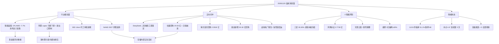

# 2026年11月20日 · 消息面事件驱动

> 数据源新鲜度: partial · 降级状态: true · 置信度: 0.62
> 覆盖窗口: 11/18–11/20 06:01（逐源不同，见审计表）
> 主源: 18份公司公告PDF原件 + 财联社/新浪/证券时报/上证报feed + 新华社/新闻联播 + 匿名群OCR（仅线索）
> 本单元性质: 一次性受限盘前事后回放，仅stdout，不写生产。输入为R4.log字段投影，不宣称读全。

## 一句话结论

隔夜海外风险与阿里capex下调构成行业级负面，压制AI算力全链；国产算力回购与能源新基建是仅有的正向对冲；情绪主跌且炸板率51.1%，首板候选=0，全部对象只到观察层，不授买权。

## 消息面全景图

## 顶级事件详解

### E20261120_001 · 阿里FY27Q2云外部收入+67%、AI产品连续13季三位数增长 · strength=high · polarity=正面 · raw=0.75 · weighted=0.6455

**事件摘要**: 11/19 18:04起新浪/证券时报/上证报转述官方财报：营收2715.2亿（预期2705.3亿）、调整后净利199.1亿（预期266.1亿）、云外部经常性收入+67%、AI产品收入连续13季三位数、FCF −344.72亿。底层为官方财报，媒体为同稿转载，独立源按底层文件计1个官方源。

**推理深度三问**:
- **大资金意图**: 未核。本材料不含11/20盘前资金流；11/19尾盘宽基ETF放量（科创50ETF易方达127.3亿等）是ETF申购口径，与个股承接不是同一件事，不能据此推断机构在抢筹云与AI。
- **为什么走强**: 不能断言"走强"。可核的是收入端超预期：云外部经常性收入+67%、AI产品连续13季三位数，这是财报里唯一明确高于预期的两条；净利与FCF反向。
- **逻辑够不够硬**: 中等偏硬。官方财报原文可核，但A股没有直接映射个股，属叙事级利好而非订单级利好；净利低于预期约67亿，是同一份财报里的反面，不能只看收入。

### E20261120_002 · 阿里称数据中心目标可能下调、capex可能降低；新出口管制影响明年产品 · strength=high · polarity=负面 · raw=-0.70 · weighted=-0.6025 · bearish_scope=行业级

**事件摘要**: 11/19 20:00起电话会，三家媒体转述至22:34。吴泳铭称20GW/2032数据中心目标"可能下调、capex可能降低"；新出口管制影响明年产品；同一表述另含2027–2028国内算力最紧缺、绝大部分模型将依赖国产芯片、V900 2027Q1量产、超节点2027Q2。

**推理深度三问**:
- **大资金意图**: 未核。只能记录管理层口径变化本身；全球CSP capex预期下修是AI算力链的估值锚，资金是否已据此减仓，本材料无数据。
- **为什么走强**: 本条为负面，不适用。若问为何构成压制：capex可能降低直接冲击光模块、CPO、液冷、电源、PCB的2027需求假设，是分母端（估值）而非分子端（订单）的打击。
- **逻辑够不够硬**: 硬在"管理层自己说可能下调"，软在"可能"二字尚未成为指引数字。国产替代口径是同一主体的反向面，不能拿来对冲海外链。

**正反拆分说明**: 同一主体的正面面（云与AI增长）已单列为E001，负面面单列本条，不合并、不互相抵消。

### E20261120_003 · 美股三大指数跌逾2%、AMD因做空报告-7.7%、英伟达六连跌 · strength=high · polarity=负面 · raw=-0.80 · weighted=-0.80 · bearish_scope=行业级

**事件摘要**: 11/19美股收盘：道指-2.19%（49097.06）、标普-2.02%（7175.83）、纳指-2.25%（23879.20）；AMD -7.7%（Hunterbrook做空报告指"循环交易"）、英伟达-3.3%六连跌；恒指-1.95%、恒生科技-2.33%。

**推理深度三问**:
- **大资金意图**: 未核。海外资金行为只能从价格倒推，做空报告是催化剂不是资金流证据；A股11/20竞价前的资金意图完全未知。
- **为什么走强**: 本条为负面。下跌的可核原因是AMD做空报告打击"循环交易"叙事，叠加英伟达六连跌，使海外AI硬件的定价锚松动。
- **逻辑够不够硬**: 中。价格事实硬（收盘数据可核），因果解释（做空报告→AI叙事松动→A股跟跌）是市场归因，未证。反向证据是Anthropic首日+17.07%、市值约1.27万亿美元，说明一级AI估值未同步转弱，但一级融资与二级硬件不是同一口径。

### E20261120_004 · BIS 14nm及以上代工需审批；三星穿透严查传闻不准确；台积电/三星停供传闻未证 · strength=medium · polarity=负面 · raw=-0.75 · weighted=-0.6455 · bearish_scope=行业级

**事件摘要**: 上证报11/19 12:59报道：BIS 11/16新规要求14nm及以上代工需BIS审批；11/18晚"三星穿透严查代工"传闻不准确且无文件；FT所称"台积电/三星暂停向部分中国客户发货"仅见群聊21:41转述，feed未证实。

**推理深度三问**:
- **大资金意图**: 未核。11/19盘中燧原20CM跌停、沐曦-10%、海光盘中-17%，但那是价格反应，不是资金意图证据；且当日中芯+6.21%、华虹+6%以上，代工端并未同步下跌，说明定价不一致。
- **为什么走强**: 本条为负面。可核的只有BIS审批新规这一层；传闻层未被证实，不能当作已发生事实。
- **逻辑够不够硬**: 中等。新规由媒体转述、BIS原文未见；传闻部分单源且feed未证。硬的一面是11/19确实出现了算力芯片大跌，但归因（跌因是BIS还是情绪）未证。

**待核标记**: FT停供传闻标"待核·单源"，不得当已证；无锡50亿先进封装项目仅"无锡发布"转述，单源，不计权。

### E20261120_005 · TrendForce称2027年NAND供需反转、Q1起合约价转跌 · strength=medium · polarity=负面 · raw=-0.55 · weighted=-0.4734 · bearish_scope=板块级

**事件摘要**: TrendForce 11/19 16:04/16:43：2027年NAND供需反转、Q1起合约价转跌、部分CSP大幅下修Enterprise SSD订单。对照11/18 DRAM Q4合约价+10~15%。

**推理深度三问**:
- **大资金意图**: 未核。存储板块资金动向不在本材料内。
- **为什么走强**: 本条为负面。可核的是机构对2027 NAND价格的预测转向；这是预期层面的转向，不是当期合约价。
- **逻辑够不够硬**: 中等。单一机构源（single_source=true），且与DRAM涨价方向相反——存储不能当一个单向板块处理。

### E20261120_006 · 黄金现货失守3660美元、日内-1.74%、白银盘中-5% · strength=medium · polarity=负面 · raw=-0.65 · weighted=-0.65 · bearish_scope=板块级

**事件摘要**: 11/19商品收盘：现货黄金失守3660美元/盎司、日内-1.74%；白银盘中-5%。

**推理深度三问**:
- **大资金意图**: 未核。商品价格是结果，不构成资金意图证据。
- **为什么走强**: 本条为负面。可核的是金银价格同步重挫，具体触发因素（美元、实际利率、获利了结）材料未给，标未知。
- **逻辑够不够硬**: 中。价格数据可核；但传导到A股贵金属板块的幅度取决于个股成本与库存，未核。

### E20261120_007 · DeepSeek二轮融资工商落定 · strength=medium · polarity=正面 · raw=0.55 · weighted=0.4734 · single_source=true

**事件摘要**: 上证报11/19 21:28：注册资本1644.75万→1991.87万，新增杭州程砚持17.265%，31家合伙人；腾讯系9.57%、宁德时代系合计9.57%、中移投资/中信证券投资各7.65%；DeepSeek官方未回应金额。

**推理深度三问**:
- **大资金意图**: 未核。工商登记是资本化事实，不等于产业订单或二级资金流入。
- **为什么走强**: 不能断言走强。可核的是国产大模型生态的资本化进程推进，对国产算力是叙事支撑。
- **逻辑够不够硬**: 偏软。单一媒体源、官方未确认金额，估值与融资额均未证实；参股方多为财务投资，订单传导未证。按契约strength=medium、single_source=true。

### E20261120_008 · 中俄美元首深圳会晤并发表和平宣言 · strength=high · polarity=中性 · raw=0.45 · weighted=0.3873

**事件摘要**: 新华社11/19 18:50，新闻联播21:55头条。深圳首次三国元首会晤；宣言含"增加精炼石油产品生产和供应、能源稳定流动""ICC不得滥用管辖权""核战争打不赢也打不得"。

**推理深度三问**:
- **大资金意图**: 未核。无相关板块资金数据。
- **为什么走强**: 不适用（中性）。能源稳定流动对石油链是正面表述；军工受压是"缓和预期"的传导假设，无价格证据。
- **逻辑够不够硬**: 偏软。宣言是原则性文件，不含采购量、合同或时间表。官方源双确认（新华社+新闻联播）只证明事件为真，不证明产业受益。

**假设与反证**: 军工负面标为传导假设，不构成本单元做空或回避依据。

### E20261120_009 · 全球电子协会预警PCB短缺或延续至2028年中 · strength=medium · polarity=正面 · raw=0.60 · weighted=0.60 · single_source=true

**事件摘要**: 财联社11/20 03:54、新浪05:45，同一底稿：全球电子协会称PCB缺口或延续至2028年中。

**推理深度三问**:
- **大资金意图**: 未核。
- **为什么走强**: 不能断言。可核的是协会给出的供给缺口期限；这是预测不是订单。
- **逻辑够不够硬**: 偏软。单一底稿，无第二家独立机构；同日美股电子链下跌（E003）构成反向压力，PCB板块内部正负交织。

### E20261120_010 · 伯恩斯坦上调2027年全球WFE至2170亿美元、同比+39% · strength=medium · polarity=正面 · raw=0.55 · weighted=0.4734

**推理深度三问**:
- **大资金意图**: 未核。
- **为什么走强**: 不能断言。卖方上调资本开支预测是中期叙事，A股设备板块的短期弹性取决于订单落地。
- **逻辑够不够硬**: 中等偏软。单一券商源、媒体转述、研报原文未见；且BIS新规（E004）限制先进制程扩产，与WFE上行存在方向冲突。

### E20261120_011 · 长鑫科技回购由10-20亿上调至25-50亿、同步注销减资20-40亿 · strength=high · polarity=正面 · raw=0.65 · weighted=0.5595

**事件摘要**: 688825公告PDF原件已核。回购由10-20亿上调至25-50亿；注销并减资20-40亿；回购价上限63.78元（=30日均价150%）；需股东会审议；11/6收盘40.41元、连续20日跌幅累计20%。

**推理深度三问**:
- **大资金意图**: 未核。公司回购是公司行为，不等于主力资金进场；R7资金流不可用（本任务禁止调用）。
- **为什么走强**: 不能断言。可核的是回购规模翻倍以上+注销式减资，对每股权益是实打实的增厚路径。
- **逻辑够不够硬**: 中等偏硬。公告原件可核，但需股东会审议、尚未生效；连续20日跌幅20%说明趋势仍弱，回购不能替代基本面拐点。

### E20261120_012 · 海光信息11/19首次回购137.67万股、耗资2.3526亿 · strength=high · polarity=正面 · raw=0.50 · weighted=0.4304 · 正负交织

**事件摘要**: 688041公告PDF原件已核。11/19首次回购137.67万股、2.3526亿元，价格区间162.69-174.99元；方案规模5-8亿；公告披露供应链体系稳定、CPU/DCU需求放量；11/19收盘180.00元（盘中一度-17%、收-4.81%）。

**推理深度三问**:
- **大资金意图**: 未核。回购是公司资金，不是主力资金；首日买在162.69-174.99区间，收盘180.00高于该区间上沿，说明回购价与收盘价之间存在缺口。
- **为什么走强**: 不能断言。可核的是回购已实际实施，是硬性资金事实。
- **逻辑够不够硬**: 中等。公告原件可核、收盘价可核；但盘中-17%说明回购未能阻断抛压，BIS与停供传闻（E004）仍是压制源。

### E20261120_013 · 紫金矿业新增20-30亿回购、价上限35.00元 · strength=high · polarity=正面 · raw=0.45 · weighted=0.3873 · 正负交织

**事件摘要**: 601899公告PDF原件已核。新增20-30亿回购，价上限35.00元，用于员工持股/股权激励，无需股东会。

**推理深度三问**:
- **大资金意图**: 未核。
- **为什么走强**: 不能断言。可核的是无需股东会，实施路径比长鑫短。
- **逻辑够不够硬**: 中等。回购用途是员工持股/激励而非注销，对每股权益增厚弱于注销式；隔夜黄金-1.74%、白银-5%（E006）压制商品端。35.00元是公司定的回购上限，不是市价，不能当止损。

### E20261120_014 · 三安光电间接控股股东股份被轮候冻结、累计冻结占总股本26.30% · strength=high · polarity=负面 · raw=-0.60 · weighted=-0.5164 · 硬否决

**事件摘要**: 600703公告PDF原件已核。三安集团3869.49万股被上海金融法院轮候冻结；三安电子+三安集团累计被冻结13.12亿股（占总股本26.30%），轮候冻结合计占总股本166.81%。

**推理深度三问**:
- **大资金意图**: 未核。
- **为什么走强**: 本条为负面，不适用。
- **逻辑够不够硬**: 硬。公告原文可核，26.30%总股本的冻结是治理级风险；但轮候冻结不等同于已处置或拍卖，经营层面公告未披露停产或订单流失。

### E20261120_015 · 个股级合规与司法风险密集（鸿博/天普/香雪/燧原）· strength=high · polarity=负面 · raw=-0.55 · weighted=-0.4734 · cluster

**事件摘要**:
- 鸿博股份002229：全资子公司英博数科被诉货款2.7739亿元+资金占用损失2754.31万元，尚未开庭。
- 天普股份605255：11/19复牌；2026/1已收证监会立案告知书；中昊芯英36个月内无借壳计划；前三季营收2.115亿（-8.17%）、归母-1593.33万；11/13收盘73.82元、PB12.44。
- *ST香雪300147：11/19广州中院裁定受理重整；11/20叠加实施退市风险警示。
- 燧原科技688801：3个交易日跌幅偏离值累计≥30%；无限售流通股仅1790.03万股、占总股本4.1595%；称在手订单充沛、经营正常。

**推理深度三问**:
- **大资金意图**: 未核。
- **为什么走强**: 本条为负面，不适用。
- **逻辑够不够硬**: 硬在"每个主体都有各自公告"，软在"合并为一条只为叙事层"。四个主体互相独立，不互相加权；燧原公告自述经营正常，与"跌幅异动"并存，两面都保留。

### E20261120_016 · 国家能源局首个虚拟电厂发展报告、2042.8万千瓦提前达标 · strength=medium · polarity=正面 · raw=0.50 · weighted=0.4304

**推理深度三问**:
- **大资金意图**: 未核。
- **为什么走强**: 不能断言。可核的是官方报告确认装机规模提前达标2027目标。
- **逻辑够不够硬**: 偏软。报告未读原文、单一材料转述、无个股订单映射。不造受益个股。

### E20261120_017 · 全国首条195公里纯氢长输管道启运 · strength=medium · polarity=正面 · raw=0.40 · weighted=0.3443

**推理深度三问**:
- **大资金意图**: 未核。
- **为什么走强**: 不能断言。可核的是首条长输管道启运这一基础设施里程碑。
- **逻辑够不够硬**: 偏软。单一官方报道；下游用氢需求与管道负荷率未披露。不造受益个股。

## 板块 × 事件热力矩阵

| 板块 | 事件锚 | 独立源 | 净极性 | 置信 | 关键矛盾 |
|---|---|:--:|:--:|:--:|---|
| 国产算力/CPU-DCU | E001 E002 E004 E007 E012 | 官方财报+公告+媒体 | 中性偏正 | 🟡 | 同一主体正反两面并存 |
| 海外算力链/光模块/CPO | E002 E003 | 收盘数据+媒体 | 🔴 负面 | 🟢 | capex下修+美股下跌双压 |
| 存储 | E005 E011 | TrendForce+公告 | 🟡 交织 | 🟡 | NAND 2027反转 vs DRAM回购 |
| 先进封装/光刻胶 | E004 E003 | 媒体+收盘 | 🔴 负面 | 🟡 | 11/19该分支逆势上涨，消息与价格背离 |
| 半导体设备 | E004 E010 | 媒体+研报 | 🟡 交织 | 🟡 | WFE上调 vs BIS扩产审批 |
| 晶圆代工 | E004 | 媒体单层 | 🟡 交织 | 🔴 | 11/19中芯+6.21%，消息面未获价格确认 |
| 黄金/白银/有色 | E006 E013 | 商品价格+公告 | 🟡 交织 | 🟡 | 商品重挫 vs 紫金回购 |
| PCB | E003 E009 | 收盘+单一底稿 | 🟡 交织 | 🟡 | 短缺预警 vs 美股电子链下跌 |
| 虚拟电厂/电力设备 | E016 | 官方报告转述 | 🟢 正面 | 🟡 | 无个股映射 |
| 氢能 | E017 | 新华社 | 🟢 正面 | 🟡 | 无个股映射 |
| 能源/石油 | E008 | 新华社+新闻联播 | 🟢 正面 | 🔴 | 原则性表述，无采购量 |
| 军工 | E008 | 同上 | 🔴 负面(假设) | 🔴 | 纯传导假设，无价格证据 |
| 造纸 | — | 公告 | 🟡 中性 | 🔴 | 山鹰600567停牌，不可交易 |
| 传媒游戏 | — | 匿名OCR | 待核 | 🔴 | 限韩令仅韩媒转述，feed零佐证 |

## 🔥 中报业绩预告命中（degraded）

**本节无法制表。** 字段投影未包含逐票预告明细，且已知 `eastmoney_earnings_predict.json` 的 `report_date=2026-09-30`、`NOTICE_DATE` 集中在10/8–10/23，**无11/19新增** → 该维度为2026Q3旧样本，不能用于20261120的业绩交叉验证，也不能据此宣称"今日无业绩催化"。

按契约该维度标 🟡→🔴，`degraded=true`。如后续取得11/20盘前新增预告，应重新交叉：国产算力（688825/688041）、存储、PCB三条链优先。

## 关键证据

- 证据1：11/19收盘广度 649涨/4876跌、涨停23/跌停68、封板率48.9%、炸板率51.1%、最高板3板、成交1.31万亿缩量646亿 · 连板网收盘复盘 + 财联社收评交叉一致，证券时报16:11指数数据。
- 证据2：emotion_cycle.json（本日fetch产出）capitulation/补跌，confidence 0.8，break_rate 0.5106，ladder 3，limit_down 68。与证据1同向，但只是同向观察，不构成因果。
- 证据3：美股11/19收盘 道指-2.19%、标普-2.02%、纳指-2.25%；AMD -7.7%、英伟达-3.3%六连跌；恒指-1.95%、恒生科技-2.33%。
- 证据4：阿里FY27Q2 营收2715.2亿（预期2705.3亿）、调整后净利199.1亿（预期266.1亿）、云外部经常性收入+67%、FCF -344.72亿 · 新浪11/19 18:04起、证券时报、上证报。
- 证据5：18份公告PDF原件（含sha256、页数、正文前缀）：长鑫688825、海光688041、紫金601899、燧原688801、天普605255、山鹰600567、*ST香雪300147、三安600703、鸿博002229、银河微电688689、可孚301087、英力特000635、珠免600185、好利002729、奥联300585、ST汇洲002122、国盾688027、华锡600301。
- 证据6：11/19盘中结构 先进封装/光刻胶逆势（格林达、红宝丽、大港、蓝箭20CM、盛剑3连板）；算力芯片领跌（燧原20CM跌停、沐曦-10%、海光盘中-17%）；中芯+6.21%、华虹+6%以上 · 财联社收评。
- 证据7：OCR 40条记录、31条非空、38ok/2error、全部partial、published_at全null、time_basis=cache_mtime（11/19 06:01:37→11/20 06:01:37）；同稿在group_02/03/05重复只计一次。

## 数据源审计

| 源 | 日期/窗口 | 状态 | 记录数 | 备注 |
|---|---|:--:|:--:|---|
| 公司公告PDF原件 | 各公告日，最新至11/19 | 🟢 | 18 | sha256+页数+正文前缀已核；发布时分多未记录 |
| news_cls 对应feed原文 | 11/19 18:04–11/20 05:45 | 🟢 | 未给 | 财联社/新浪/证券时报/上证报 |
| news_major | 字段投影未单列 | 🔴 | 未给 | 无法确认是否读取，按契约degraded=true |
| eastmoney_earnings_predict | report_date=2026-09-30 | 🟡 | 未给 | NOTICE_DATE集中10/8–10/23，无11/19新增 |
| 新华社/新闻联播 | 11/19 18:50 / 21:55 | 🟢 | 2 | 中俄会晤+宣言、氢管道 |
| wechat_official_20 | 字段投影未单列 | 🟡 | 未给 | 不能宣称已读 |
| wechat_cli_5groups | 字段投影未单列 | 🟡 | 未给 | 仅OCR间接线索 |
| wechat_image_ocr_20261120 | cache_mtime 11/19 06:01–11/20 06:01 | 🟡 | 40 | 31非空、全partial、发布时间null、匿名group_01–05 |
| hithink / vibe / iwencai | 未调用 | 🔴 | 0 | 本任务禁止；business_relevance=null |
| R3_sentiment | 未取得 | 🔴 | — | kol_confirm=unknown |
| topic_knowledge/catalyst_calendar | 11/19 | 🟢 | 1 | 84787字节，sha256与source_id一致 |

## 不确定性 / 反证

1. **正负同源不可抵消**：阿里同一次财报既给云+67%（E001正面）又给capex可能下调（E002负面）。两条独立，不能拿增长对冲capex，也不能拿capex否定增长。
2. **存储不是单向板块**：NAND 2027反转（E005负）与DRAM Q4+10~15%（背景正）、长鑫回购（E011正）方向不同。把"存储"当一个板块下结论会错。
3. **消息面与价格面背离**：11/19先进封装/光刻胶逆势上涨，而BIS新规（E004）与美股下跌（E003）对该分支是负面。背离说明要么消息未定价、要么价格有别的支撑，本材料无法裁定，只能并列。
4. **单源事件不可升strength**：PCB短缺（E009）、DeepSeek融资（E007）、WFE上调（E010）、虚拟电厂（E016）均为单一底层来源，按契约顶格medium。
5. **未证传闻已隔离**：FT"台积电/三星暂停发货"仅群聊21:41、feed未证；"限韩令解除/韩影游戏最惠国"仅匿名OCR韩媒转述、feed零佐证；无锡50亿先进封装仅"无锡发布"。三条均不入top_events、不计权重。
6. **OCR不能当信源**：40条全部low_resolution/thumbnail、ocr_quality=partial、无发送人无群名、发布时间全null。截图只说明"有此说法在传播"，不证明真实性、主体身份或新旧。
7. **业绩维度失效**：东财预告为Q3旧样本，本单元无法做业绩硬alpha交叉，这是本轮最大的单一缺口。
8. **无盘中数据**：本任务明令不用11/20盘中/午盘/后续更新，故"消息是否已被定价"完全未知；所有对象态度只能是观察。

## 与其他 R/D/E 的关系

- 依赖：18份公司公告PDF原件（sha256已核）、11/19–11/20 06:01 feed原文、新华社/新闻联播、emotion_cycle.json、topic_knowledge/catalyst_calendar（sha256一致）。
- 被消费：R2 主线研判（本单元只给事件与极性，不裁定主线归属）、R5 个股画像（688825/688041/601899 三只观察对象）、R6 反证（E002/E003/E004 三条行业级负面与 E015 合规集群）、D1 预案（本单元不授买权）。
- 明确不提供：资金流数据（R7职责，本任务禁止调用）、技术面/估值（R5职责）、情绪共振打分（R3职责，未取得）。

## Sub-Agent 元数据

- skill: analyze_news_impact_v1@1.7
- artifact: 本轮不落盘（隔离回放仅stdout；生产路径 data/research/20261120/R4_news.json 未写）
- md: 本轮不落盘（生产路径 chzl_kg/投研交易/消息面/20261120.md 未写）
- method: llm_v1_isolated_replay（输入为R4.log字段投影）
- run_id: isolated-20261120T125210+0800；original_run: 20261120T061006-66117-15481
- 生成时刻: 2026-11-20T12:57:02.932827+08:00
- 阶段结论: status=partial，confidence=0.62，data_health_severity=1，top_events=17，first_board_candidates=0，research_candidates=3（全部观察）
- 适用限制: 仅适用于20261120盘前判断；不构成交易授权；内容截止冻结输入最晚留存2026-11-20T07:08:52.397410+08:00，该时刻不是行情截至时刻。