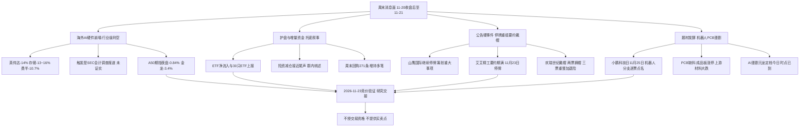

# 2026年11月21日 · **周末轻量消息面事件驱动**

> 🟡 **这是研究记录，不是买入资格。** 非交易日：不写买卖建议、不给买卖点/止损价/仓位；本文所有对象**全部待周一（2026-11-23）竞价验证**，周末没有周一的行情。
> **时间口径**：抓取批次 11-20 06:01 → 11-21 18:04（36h）；重点公告 PDF 原文核验完成于 18:30 前后。不同源的实际覆盖见末尾审计，不能概称"周五至今全覆盖"。
> **契约偏离说明**：正式 R4 契约要求每票四段锚点（买入理由/风险点/止损条件/可验证假设）。本档按非交易日纪律改写为「逻辑支点 / 风险点 / 证伪条件 / 可验证假设」，**不含任何价格条件或交易动作**，原因写在 frontmatter `validation_note`。

## 🧭 一句话结论

**周末新增的是"海外AI硬件二次崩塌"这一行业级利空和"增持回购潮＋险资减仓尾声"这一托底叙事，两条互相对冲；题材侧只有小鹏机器人（11/25）与 PCB 缺料在继续发酵，且周五资金只买了小市值成品板，没买上游材料。**

## 🗺️ 消息传导图

**渲染状态**：已核围栏与 20 个节点结构；本机无 `mmdc`，未做 SVG 渲染验收，不将结构检查冒称渲染通过。

## 🎯 重点事件（事实、新旧、反面同时保留）

`high` 只表示事件事实有官方/发行人原文或收盘数据确认，**不表示股价反应或交易资格**。

### E01 · 美股AI硬件单日崩塌 · 行业级利空 · high（触发因素 medium）

**待周一竞价验证（2026-11-23）**。11-20 美东收盘数据：纳指 **-5.28%**、标普500 **-3.70%**、道指 -1.94%；费城半导体指数 **-10.73%**；英伟达 **-14.01%**（本周 -23%，2008年10月以来最大单周跌幅）；美光 -13.89%、闪迪 -16.05%、SK海力士 -13.11%、博通 -12.19%、AMD -13.25%、台积电 -9.30%；VIX 收 35.89，为 2025-04-07 以来最高收盘。同步：富时A50期指夜盘 **-0.84%** 报 12517；纳斯达克金龙中国指数 -3.4%（本周约 -9%）。证据：`N:L24`（隔夜要闻，纳指 -5.28%）、`N:L199`（收盘快讯，纳指 -5.37%，与上者口径略有差异，两处并存）、`N:L298`（费半 -10.03%~-10.73%）、`N:L150`（VIX 35.89）、`N:L200`（英伟达本周 -23%）、`N:L158`（A50 夜盘）、`N:L1504`（金龙指数）；`P:L18`（证券时报 11-21 07:52）、`P:L103`（贩财局 11-21 07:34 汇总）。

**触发因素要降级看**：媒体把 -14% 归因于"路透社报道美国 SEC 正调查英伟达会计操作"，该说法**源自匿名消息源、英伟达发言人未置评、监管方未确认**（`N:L267`："上述援引匿名消息源的报道无法确定监管机构的调查何时启动"、"英伟达发言人暂未就此报道置评"）。同一窗口另有"加州正调查英伟达是否误导投资者"（`N:L2114`，11-20 07:21）。因此：**跌幅是事实，调查是报道**，两者不能混写成"SEC 已立案"。

**同期两条独立政策/利率线索**：(1) 特朗普称"不会允许美国企业在海外建设数据中心""将对在海外建设数据中心的公司征税"（`N:L435` 新浪、`N:L1547` 财联社）；(2) 美联储鹰派——理事库克"迫切需要加息"、费城联储保尔森"对连续加息持开放态度"，但 OIS 显示 12 月加息溢价降至 23bp、交易员不再完全消化加息（`N:L432` 库克、`N:L330` 保尔森、`N:L276` OIS 加息溢价 23bp）。

- **大资金意图**: 未核。不推断外资或机构周一一定减配 A 股算力链；也不能由群内"国家护盘"叙事反推资金会接手。
- **为什么走强**: 不适用（利空方向）。**周五已部分交易**：A 股当日半导体链先跌（通富微电跌停、海光信息/沐曦重挫、联合化学 20cm 跌停，`P:L4` 收评），全市场 68 家跌停（Tushare `limit_status` 5/6，含北交所）。
- **逻辑够不够硬**: 事实硬、传导软。同链条存在反向读法——群里当日就有人主张"美国生病不能让中国吃药"（`C:L102`），且周五国产算力先于美股走强（真视通 4 板、荣联科技涨停）。**利空与国产替代叙事必须并列交下游，不能只留一头。**

### E02 · 护盘与增量资金：ETF、公募自购、险资减仓尾声 · 正面但属"托底" · medium

**待周一竞价验证（2026-11-23）**。已核事实（官媒原文）：多只宽基 ETF 显著放量（创业板ETF易方达成交近 100 亿元、中证1000ETF 超 36 亿元、沪深300ETF华泰柏瑞突破 50 亿元，`P:L5`）、**30 只 ETF 已上报**（`P:L60`）、**公募机构自购**（`P:L67`）、首批主动 ETF 有 22 家私募参与（`P:L16`）、**华夏上证科创板半导体材料设备 ETF 举牌安集科技至 5.00%**（`N:L28`，年内 ETF 首次举牌 A 股）、1-10 月证券交易印花税 2511 亿元同比 +54.1%（`N:L1421`）。
**未核事实**：群内转述的"昨日 ETF 净流入 899 亿元创 2025-04-08 以来最高""宽基 ETF 买了 7555 亿"（`C:L59/L61`）**只出现在链接标题，未溯源原始发布方**，本文不引用为已核资金数据。"险资减仓接近尾声、手握流动性等信号"（`C:L106/L132`）是专家交流转述，**不是成交数据**。

- **大资金意图**: 只能确认"有增量工具在推进"（ETF 上报、自购、举牌），不能确认规模已入市，也不能确认险资准备买入。
- **为什么走强**: 周五尾盘上证 50 拉红、银行/长江电力/中国神华创历史新高（`P:L4`），说明当日确有托底资金；但这解释的是**指数不塌**，不是小票能涨。
- **逻辑够不够硬**: 中等。且官媒同日自己提示反证——"红利板块经过持续放量上行之后，短期交易拥挤度持续抬升…存在一定补跌调整的潜在风险"（`P:L4`）。**托底逻辑若成立，受益的是宽基与红利，而不是群里吹的小票。**

### E03 · 周末回购潮＋增持潮 · 正面 · high（事实）/ 效果未定

**待周一竞价验证（2026-11-23）**。窗口内公告标题含"回购" **271 条**、含"增持" **63 条**（全量标题筛查，非全文）；官媒已把它做成专题："今夜回购潮！多家 A 股公司公告：全部注销"（`P:L21`）。逐份原文已核的重点：

| 主体 | 原文确认 | 性质与缺口 |
|---|---|---|
| 荣盛石化 002493 | 控股股东荣盛控股拟增持 **10–20 亿元**，自 **2026-11-23** 起 6 个月内，集中竞价，不设价格区间，增持期间不减持 | 计划非成交；PDF 全文已读（[P1]） |
| 泸州老窖 000568 | 控股股东拟 **5,000 万–1 亿元**，**尚在履行内部决策程序**，待程序完备后另行函告 | 连正式增持计划函都还没到，弱于常规增持公告（[P2]） |
| 建发股份 600153 | 控股股东建发集团 **5,000 万–1 亿元**，公告日起 6 个月，自有或专项贷款 | 计划非成交（[P3]） |
| 巨化股份 600160 | 控股股东一致行动人巨化投资拟增持 **1–2 亿元**，11-21 起 3 个月 | **该股周五跌停 -10.01%**，属跌停后护盘式增持（`N:L1882`） |
| 兆易创新 603986 | 集中竞价回购进展，**累计已超 13 亿元、全部注销** | 执行进度非新方案（`P:L27`、`A:L1377`） |
| 鹏鼎控股 002938 | 控股股东提议**未来三年股东回报**，每年不低于 **15 亿元**；同日回购进展 | 是"提议"，还需董事会/股东会程序（`P:L11`、`A:L2023`） |

另有多笔同类：吉林敖东 1–2 亿元注销、海亮股份 3–5 亿元、圣泉集团 2–4 亿元、亚太药业提额至 2–4 亿元、江特电机 1–2 亿元、沪光股份 0.5–1 亿元、江西铜业首次回购 41.41 万股、赛力斯已回购 9.94 亿元并注销、国盾量子/厦门国贸/昊创瑞通**承诺不减持**（`A:L194`、`A:L1695`、`A:L1872`）。

- **大资金意图**: 可确认主体方（控股股东/公司）的行动意图，不能外推为机构抄底。
- **为什么走强**: 未核。回购潮常出现在下跌途中，**密度本身不是底部信号**；且周末公告要到周一才接受检验。
- **逻辑够不够硬**: 单笔事实硬，合计效果软。"全部注销"优于"用于激励"，但需逐份核对用途；本次只核了上表 6 份原文，**271 条不等于 271 个利好**（同一公司常有方案+进展+法律意见多份）。

### E04 · PCB 缺料：成品板已涨停，上游材料反被卖 · 正面逻辑 / 盘面背离 · medium

**待周一竞价验证（2026-11-23）**。事件：全球电子协会（IPC）供应链警报——PCB 缺货从局部蔓延到成品板交付，瓶颈"至少持续到 2027 年上半年"，2028 年中前难实质缓解（`P:L7` 盘前纪要转述，**本次未读原报告**）。周五盘面：成品板/小市值涨停潮——满坤科技 20cm、澳弘电子、超声电子、骏亚科技、光华科技、东晶电子涨停，中京电子 2 连板（`P:L4/L5`，Tushare `limit_status=2` 共 7 只）。
**关键背离**：同一叙事的上游材料周五**全部下跌**——宏和科技 -5.71%、东材科技 -7.66%、德福科技 -7.82%、联瑞新材 -7.68%、凌玮科技 -8.03%、铜冠铜箔 -1.94%、沃特股份 -4.48%、生益科技 -3.18%（Tushare `daily` 20261120）。

- **大资金意图**: 可确认的是资金**只买了成品板小票**，没有买上游材料；不能据此推断机构看好整条链。
- **为什么走强**: 供给缺口＋AI 服务器高端板需求（`P:L5` 引申港证券供需测算：2027 年载板材料缺口约 20%），叙事自洽。
- **逻辑够不够硬**: 产业逻辑偏硬（交期、价格是实物证据），但官媒复盘同日给了定性反证——"今日率先反弹的标的以市值偏小的二三线厂商为主…基本面支撑力度偏弱…偏向资金短期题材轮动"（`P:L4`）。**上游材料与成品板的背离，说明这条链现在走的是资金面而不是基本面。**

### E05 · 小鹏科技日 11/25：机器人分支被逐票点名 · 正面 · medium

**待周一竞价验证（2026-11-23）**。催化日期三处一致：`C:L75/L107/L155`（11-20，三群）"小鹏科技日定档 11 月 25 日"。逐票点名（全部为卖方/群内转述，**无公司公告**）：
- **恒勃股份 301225**：手部套筒已批量供应并获加单、身体套筒重启 PEEK（`C:L78/L164`，申万汽车署名）；周五 **+7.04%**，流通市值 23.2 亿元。
- **多伦科技 603528**：参股北云科技供货小鹏机器人 IMU、江苏数据采集场（`C:L83/L114/L167/L181`，同稿 3 群，只算一篇）。
- **方正电机 002196 / 汉宇集团 300403 / 威贸电子 920346.BJ**：被点名"10cm/20cm/30cm 弹性档"（`C:L170/L173`），威贸为北交所。
- **慈星股份 300307**：11-20 全球首发"经-纬编复合针织横机"为电子皮肤提供方案（`P:L7` 盘前纪要 No.5）。

**内部冲突必须保留**：`C:L150`（冰雨，11-20）称"小鹏机器人 **23 日**展示"，与三处链接标题的"科技日 **25 日**"冲突，本次不裁断，标待核。

- **大资金意图**: 未核。"实锤供货/主供地位"是研报用语，不是供货协议原文。
- **为什么走强**: 周五只做两只——克来机电、长华集团涨停（`P:L4`）；**被点名的多数机器人票是跌的**：方正电机 -2.35%、汉宇集团 -6.54%、丰立智能 -6.87%、多伦科技 -2.42%、慈星股份 -3.23%。也就是说，资金买的是"机器人板块局部"，不是"小鹏分支名单"。
- **逻辑够不够硬**: 中等偏软。日期硬、研报有署名；但群内已把三个弹性档位点完，**属于兑现前的最后一轮传播**，且缺公司公告。

### E06 · AI 漫剧/传媒：催化就在今天，没有时间差 · 正面但已发酵 · medium-low

**待周一竞价验证（2026-11-23）**。`C:L80/L85/L109/L116`（三群重复）"掌阅 AI 漫剧《元龙》定档 11 月 21 日"——即本报告写作当日。快手 CEO 程一笑表态把 AI 短剧作为平台内容生态重要方向（`P:L5` 午报）。芒果超媒《后会友期》数据与"证券部确认爆款综艺对会员增量有帮助"（`C:L113`，转述，无公告）。引力传媒两项红果短剧案例入选（`C:L94/L119/L184`，同一链接 3 群只算一篇）。
周五盘面：龙版传媒、华媒控股、风语筑涨停，果麦文化 **+11.92%**、芒果超媒 **+3.19%**；但掌阅科技 -2.49%、引力传媒 -2.76%、中文在线 -1.71%。

- **大资金意图**: 未核；可确认资金当日买的是"传媒涨停梯队"，不是"漫剧业务兑现"。
- **为什么走强**: 内容上线＋平台表态双催化，且板块先前回调后有资金回流（`P:L4`："AI漫剧概念震荡回升"）。
- **逻辑够不够硬**: 偏软。上线是内容事件不是收入事件；**定档日就是今天，周末已无时间差**，周一只能看延续不能看首因。

### E07 · 公告硬事件：两项停牌重组、一项要约期满、三项戴帽/摘帽、三项重整叠加退市险 · high

**待周一竞价验证（2026-11-23）**。全部为发行人 PDF 原文已读：

| 主体 | 原文确认的事实 | 周一状态 |
|---|---|---|
| 山鹰国际 600567 | 11-19、11-20 已停牌；"相关方正在筹划涉及公司的重大事项"仍处筹划；**11-23 起继续停牌，预计不超过 3 个交易日** | **停牌，无法竞价**（[N1]） |
| 艾艾精工 603580 | 上海誉升部分要约（10.01%、**27.54 元/股**）于 11-20 期满；**11-23 停牌一天，11-24 复牌**（要约结果公告当日复牌） | 停牌；要约价仅为 11-20 收盘 59.01 元的约 47%（[N2]） |
| 麦迪科技 603990 | 间接控股股东安投集团拟公开挂牌转让绵阳皓祥 100% 股权（对应 16.12%），**11-23 在西南联合产权交易所预披露**，控制权可能变更，尚需国资批准 | 正常交易；重组仅是预披露（[N3]） |
| 欢瑞世纪 000892 | 11-19 收到行政处罚事先告知书（2022 年报虚假记载）；**11-23 停牌一天，11-24 起变"ST 欢瑞"**，不触及重大违法强制退市 | 停牌（[N4]） |
| ST 汇洲 002122 | 11-20 停牌一天，**11-23 复牌并撤销其他风险警示→"汇洲智能"**，涨跌幅仍 10% | **周一复牌摘帽**（[N5]） |
| ST 天圣 002872 | **11-23 停牌一天，11-24 复牌摘帽→"天圣制药"** | 停牌（[N6]） |
| \*ST香雪 300147 / \*ST瑞和 002620 / \*ST西旅 000610 | 法院裁定受理重整并指定管理人，**叠加实施退市风险警示** | 退市风险实质升级（`A:L861`、`A:L2151`、`A:L2432`） |
| \*ST仕净 301030 / \*ST天宜 688033 | 收到行政处罚（事先告知/决定）并**叠加其他风险警示** | 双风险叠加；仕净流通市值 6.65 亿元，本身已被 20 亿硬线排除 |
| 英力特 000635 | 控股股东拟协议转让+公司拟发行股份购买资产，**继续停牌** | 停牌（`A:L1120`） |
| 震安科技 300767 / 银河微电 688689 / 万德斯 688178 | 现金收购深圳三维≥51% 进展 / 发股购买资产获受理 / 收购报告书 | 推进中，非新预案（`A:L1936`、`A:L92`、`A:L1298`） |

- **大资金意图**: 未核。资本运作与摘帽都不等于资金已认可。
- **为什么走强**: 未核；停牌期间无交易反应，本次不下走势结论。
- **逻辑够不够硬**: 事实硬（原文逐条已读），**但"重大事项""控制权变更""要约"都不等于资产注入或增厚**；摘帽是合规修复，不是经营改善。

### E08 · 弱线索三条：溴素限产、量子、6G · 正面但未获资金确认

**待周一竞价验证（2026-11-23）**。
- **溴素限产**：潍坊下发管控，溴素企业 **12-01 至 02-28 停产**，其卤水溴素产能占国内六成以上；当下开工率不足五成（`P:L7` 盘前纪要 No.4，转述地方通知，未读原文）。映射名单（山东海化、滨化股份、鲁北化工、亚钾国际）来自同一转述。周五该类全绿：山东海化 -4.66%、鲁北化工 -4.95%、滨化股份 -3.72%、亚钾国际 -2.59%。
- **量子**：证券时报 11-21"量子计算机'高速内存'全球首次真机实现"（`P:L13`）；国盾量子同日公告控股股东及高管**自愿承诺不减持**（`A:L194`）。国盾量子周五 -4.42%。
- **6G**：11-20 央视报道我国实现 6G 频段最高码速率无线通信验证（`P:L5` 午报）。中兴通讯 -3.10%、信科移动 -8.40%。
- **GTA6**：首发+预购 37.9 亿美元破娱乐作品纪录（`N:L69`，Take-Two 口径）。A 股无直接标的，**不映射个股**，仅作游戏板块情绪背景。

- **大资金意图**: 三条全部未核；当天没有一条被资金确认。
- **为什么走强**: 溴素有实物供给约束（限产时间表），量子/6G 是技术里程碑叙事；都不是收入事件。
- **逻辑够不够硬**: 溴素最硬（有时间表与产能占比），但**限产 12-01 才生效，中间有 6 个交易日可以反复**；量子/6G 只有单条媒体报道，且周五同板块下跌。

## 📉 负面清单（红线：负面必须列出）

| 方向 | 已核事实 | 杀伤范围 |
|---|---|---|
| AI 硬件/存储/半导体 | 费半 -10.73%、存储股 -13~16%、A50 期指夜盘 -0.84%（E01） | **行业级**：光模块/CPO/存储/半导体设备/算力租赁/PCB 上游材料 |
| 贵金属 | 伦敦金跌破 3500 美元、本周约 -9%，创 3 月以来最大周跌幅；沪金主力 -5%、沪银 -7%；工行/招行/建行/宁波银行连发贵金属风险提示（`P:L12`、`N:L68`、`N:L13`） | 板块级：黄金/白银/有色采选 |
| 有色基本金属 | LME 铜 -2.75%、锡 -3%、铝 -1.48%（`N:L1546`） | 板块级：铜/铝/锡 |
| 高位妖股与连板 | 天普股份（605255）复牌 2 连跌停；盛剑科技已发**股票交易风险提示**＋异常波动公告（`P:L8`、`A:L282`） | 个股级 |
| 退市/立案 | 三票重整叠加退市风险；两票行政处罚叠加风险警示；欢瑞世纪戴帽（E07） | 个股级 |
| 抱团拥挤 | 官媒提示红利板块"交易拥挤度持续抬升…存在补跌风险"（`P:L4`） | 板块级（红利/银行） |
| 谣言环境 | 两部门公布 4 起编造传播虚假信息案例；华泰证券辟谣"建议清仓 A 股"传闻（`P:L31`、`P:L73`） | 全域：本窗口大量"内部交流"截图真假待核 |

## 👀 周一（2026-11-23）待验证对象：消息侧三层，不做板型判断

**本次没有"已确认首板"名单。** 下表只交"消息侧有无明确刺激 + 周五已收盘的真实状态"，**不判断能否封板、不给任何价格或仓位**。流通市值取 Tushare `daily_basic`（20261120，原单位万元→亿元）；**小于 20 亿元一律不列**（本次候选全部已过线），停牌无行情者单列。

### 第一层：消息有、盘面同向（周五已预热，未涨停）

| 对象/代码 | 消息源与日期 | 周五状态（20261120 收盘） | 流通市值 | 反证/缺口 | 状态 |
|---|---|---|---|---|---|
| 恒勃股份 301225 | `C:L164/L78` 申万汽车"主供地位进一步确认"（11-20） | **+7.04%**，52.88 元 | 23.2 亿 | 研报非公告；在 20–50 亿需警惕庄股区间 | 待周一竞价验证 |
| 果麦文化 301052 | `P:L5` 午报"涨超 15%"（11-20） | **+11.92%**，36.80 元 | 29.5 亿 | 属传媒情绪票，无业绩支撑；同区间警惕 | 待周一竞价验证 |
| 金禄电子 301282 | `P:L4/L5` 收评与午报点名"涨幅居前" | **+8.17%**，30.84 元 | 54.5 亿 | Q3 预告为 10-14 已披露（归母 +192.88%~218.92%），**非周末新增** | 待周一竞价验证 |
| 芒果超媒 300413 | `C:L113` 综艺数据+会员增量（11-20） | **+3.19%**，27.15 元 | 277.4 亿 | "证券部确认"为转述，无公告 | 待周一竞价验证 |
| 唐人神 002567 | `P:L4` 猪肉板块逆势活跃（11-20） | **+5.31%**，3.77 元 | 54.0 亿 | 生猪均价 9.36 元/公斤仅较月初 +8%，行业仍称"供需宽松未根本改变" | 待周一竞价验证 |

### 第二层：消息有、同链条盘面反向（PCB 上游材料，整组下跌）

| 对象/代码 | 消息锚 | 周五状态 | 流通市值 | 关键缺口 | 状态 |
|---|---|---|---|---|---|
| 金安国纪 002636 | `P:L7` CCL 名单（11-20 盘前） | +0.99%，50.88 元 | 369.0 亿 | 未获资金确认 | 待周一竞价验证 |
| 华正新材 603186 | `P:L7` CCL 名单 | +0.29%，123.41 元 | 193.5 亿 | 同上 | 待周一竞价验证 |
| 宏和科技 603256 | `P:L7` 电子布 | **-5.71%**，62.59 元 | 566.2 亿 | 同链反向 | 待周一竞价验证 |
| 东材科技 601208 | `P:L7` 树脂 | **-7.66%**，26.63 元 | 269.0 亿 | 同链反向 | 待周一竞价验证 |
| 德福科技 301511 | `P:L7` 铜箔 | **-7.82%**，45.00 元 | 179.4 亿 | Q3 预告 10-14 已披露（归母 +560.72%~620.78%），铜箔属周期，**单季环比未独立复算** | 待周一竞价验证 |
| 联瑞新材 688300 | `P:L7` 球形硅微粉 | **-7.68%**，67.89 元 | 213.1 亿 | 同链反向 | 待周一竞价验证 |
| 沃特股份 002886 | `P:L7` PTFE | **-4.48%**，16.64 元 | 34.8 亿 | 同链反向；20–50 亿警惕 | 待周一竞价验证 |
| 凌玮科技 301373 | `P:L7` 球形硅微粉 | **-8.03%**，58.20 元 | 40.5 亿 | 同链反向；20–50 亿警惕 | 待周一竞价验证 |

### 第三层：消息有、盘面全绿（无资金确认）

| 对象/代码 | 消息锚 | 周五状态 | 流通市值 | 状态 |
|---|---|---|---|---|
| 山东海化 000822 / 鲁北化工 600727 / 滨化股份 601678 | 溴素 12-01 起限产（`P:L7`） | -4.66% / -4.95% / -3.72% | 31.1 / 32.5 / 84.6 亿 | 待周一竞价验证 |
| 国盾量子 688027 | 量子存储突破（`P:L13`）＋承诺不减持 | -4.42%，284.49 元 | 228.7 亿 | 待周一竞价验证 |
| 信科移动 688387 / 中兴通讯 000063 | 6G 频段验证（`P:L5`） | -8.40% / -3.10% | 301.9 / 1059.3 亿 | 待周一竞价验证 |

### 连板语境（不是首板候选，只记录周五已封板的真实状态）

真视通 002771（**4 板**，+10.01%，28.6 亿）、盛剑科技 603324（**4 板**，+10.00%，40.4 亿，已发风险提示）、中京电子 002579（2 板，78.1 亿）、满坤科技 301132（20cm 首板，48.4 亿）、澳弘电子 605058（61.3 亿）、超声电子 000823（110.1 亿）、骏亚科技 603386（47.6 亿）、光华科技 002741（80.7 亿）、东晶电子 002199（21.8 亿）、龙版传媒 605577（72.0 亿）、华媒控股 000607（33.0 亿）、风语筑 603466（85.1 亿）、克来机电 603960（36.6 亿）、长华集团 605018（48.2 亿）、凡拓数创 301313（20cm，46.6 亿）、易天股份 300812（20cm，32.0 亿，同日公告股权转让框架协议）。全市场当日 `limit_status` 计 **涨停 30 家、跌停 68 家**（含北交所 5572 只口径）。

### 思维链（研究口径，非交易四段）

#### 恒勃股份 301225 · 机器人材料主供
- **逻辑支点（替代"买入理由"，非交易建议）**: 手部套筒批量供应并被加单、身体套筒重启 PEEK 路线，两处独立稿件（`C:L78` 群里全文、`C:L164` 申万署名）指向同一事实链；催化时点 11-25 明确。
- **风险点**: 全部证据来自研报转述，缺公司公告或客户确认；流通市值 23.2 亿元正处 20–50 亿需警惕庄股的区间；若 11-25 兑现无超预期，属"见光"。
- **证伪条件（研究口径，不是止损价）**: 若周一无成交额放大且板块内已涨停的克来/长华不能维持强势，则"资金在做这条分支"的假设不成立；若公司发布澄清或客户否认，则逻辑链断裂。
- **可验证假设**: 11-25 小鹏科技日若公布 Optimus 类人形量产节点或明确供应商名单，则研报叙事被官方验证；否则只能算研报预期。

#### 金禄电子 301282 · PCB 成品板 + 已知业绩
- **逻辑支点**: 周五被官媒复盘点名"涨幅居前"，属 PCB 涨停潮中未封板的中层；10-14 已披露前三季归母 +192.88%~218.92%（扣非 +234%~263%），业绩与题材同向。
- **风险点**: 业绩是 10 月旧闻，**不是周末新增催化**；PCB 当日被定性为"二三线厂商资金轮动"；20cm 弹性意味着反向波动同样大。
- **证伪条件**: 若周一 PCB 成品板普遍低开且成交额萎缩，则"缺料叙事延续"假设不成立；若上游材料继续大跌而成品板也跌，则为整链退潮。
- **可验证假设**: 若下半年 PCB 报价与交期继续上行并被公司公告/调研确认，则涨价逻辑成立；仅靠协会警报不足以确认。

#### 芒果超媒 300413 · AI 漫剧/综艺
- **逻辑支点**: 综艺播放与市占率数据（`C:L113`）＋快手平台表态（`P:L5`）＋板块周五回升，三者同向。
- **风险点**: "证券部确认会员增量"是二手转述；内容数据不等于收入；大市值（277 亿）弹性有限。
- **证伪条件**: 若周一传媒板块涨停梯队（龙版/华媒）不能延续，则该主线只活一天；若会员/广告数据后续证伪，题材退潮。
- **可验证假设**: 后续季报若会员收入与广告收入同向增长，才能把"爆款综艺"折算成业绩；否则仅为情绪。

#### 汇洲智能 002122 · 摘帽复牌（事件型，非题材）
- **逻辑支点**: 11-20 停牌一天、**11-23 复牌并撤销其他风险警示**，涨跌幅仍 10%；摘帽依据是会计差错已追溯重述＋行政处罚满 12 个月（PDF 原文）。
- **风险点**: 摘帽是合规修复，**不是经营改善**；原名带 ST 的票历史波动极端；本次停牌无行情，**流通市值未取得当日值，不能做 20 亿线判定**。
- **证伪条件**: 若复牌后无成交量配合，摘帽行情不成立；若后续再被立案或风险警示，逻辑反转。
- **可验证假设**: 复牌首日的换手与封板情况是唯一可观测验证点；本次无数据，标未核。

## 📚 业绩交叉验证：本窗口新增为零

`eastmoney_earnings_predict.json` 完整解析：**500 条指标记录**（report_date 统一 2026-09-30），公告日期实际分布在 **2026-08-26 至 2026-10-24**，采集时刻 2026-11-21 18:04。**窗口内（11-20 15:00 之后）新增记录 0 条** → `earnings_status=not_available`（三季报预告季已于 10 月下旬结束，**无新增不构成降级**）。

- 对本文全部观察对象逐一查表：仅 **金禄电子 301282**（`records[?]` 命中 2 行，归母 +192.88%~218.92%、扣非 +234.12%~263.82%，10-14）与 **德福科技 301511**（归母 +560.72%~620.78%、扣非 +1478.59%~1635.45%，10-14）命中，**均为旧公告，不作周末新增硬 alpha**。
- 两者接口自带的"环比衍生字段"分别为归母 +166%~200%、+52%~86%；**本次未独立复算单季环比**（缺口径一致的上季/本季拆分），按 `analyze_news_impact_v1` Step 2.5 标记 `earnings_qoq_unverified`，**不据累计同比给出正面业绩评价**。德福科技属铜箔（周期性），按协议应以单季环比与铜价方向为准，本次两者皆未核。
- 其余对象未命中只表示"这 500 条快照里没有"，**不能断言没有财报或预告**。

## 🔗 关键证据

### 发行人原文（本次逐页已读，HTTP 200）

- [P1 荣盛石化 002493 增持计划公告](http://static.cninfo.com.cn/finalpage/2026-11-21/1225680901.PDF)：10–20 亿元、11-23 起 6 个月、不设价格区间、增持期间不减持。
- [P2 泸州老窖 000568 增持提示性公告](http://static.cninfo.com.cn/finalpage/2026-11-21/1225681000.PDF)：5,000 万–1 亿元，**尚在履行内部决策程序**。
- [P3 建发股份 600153 增持计划公告](http://static.cninfo.com.cn/finalpage/2026-11-21/1225681102.PDF)：5,000 万–1 亿元、6 个月。
- [N1 山鹰国际 600567 继续停牌公告](http://static.cninfo.com.cn/finalpage/2026-11-21/1225681465.PDF)：11-19/11-20 已停牌，11-23 起继续停牌≤3 个交易日。
- [N2 艾艾精工 603580 要约期满暨停牌](http://static.cninfo.com.cn/finalpage/2026-11-21/1225681895.PDF)：27.54 元/股、10.01%、11-23 停牌一天、11-24 复牌。
- [N3 麦迪科技 603990 控制权可能变更](http://static.cninfo.com.cn/finalpage/2026-11-21/1225681485.PDF)：16.12%、11-23 产权交易所预披露、需国资批准。
- [N4 欢瑞世纪 000892 实施其他风险警示](http://static.cninfo.com.cn/finalpage/2026-11-21/1225682608.PDF)：11-23 停牌、11-24 起"ST 欢瑞"。
- [N5 ST 汇洲 002122 撤销风险警示](http://static.cninfo.com.cn/finalpage/2026-11-20/1225679977.PDF)：11-20 停牌、11-23 复牌摘帽→汇洲智能。
- [N6 ST 天圣 002872 撤销风险警示](http://static.cninfo.com.cn/finalpage/2026-11-21/1225682610.PDF)：11-23 停牌、11-24 复牌摘帽→天圣制药。

### 本地记录与传播路径（不与原文重复计数）

- 美股收盘与跌幅：`N:L1912`（隔夜要闻）、`N:L1953`（三大股指收盘-5.37%口径）、`N:L1975`（VIX 35.89）、`N:L1981`（英伟达本周 -23%）、`N:L1918`（A50 期指夜盘 -0.84%）；公众号二次传播 `P:L18/L103/L1`，**同一底层事实只计一次**。
- PCI：`P:L7` 盘前纪要转述全球电子协会警报；本次**未读取协会原报告**。
- 机器人分支：`C:L78/L164/L170/L173/L83/L114/L167/L181`（其中多伦一篇跨 3 群重复）、`C:L75/L107/L155`（科技日日期）。
- 护盘：`P:L4`（收评，含上证 50ETF 放量与红利拥挤度提示）、`P:L60/L67`（30 只 ETF、自购）、`C:L59/L61`（群内 899 亿/7555 亿，**未核**）。

## 数据源审计

| 源 | 日期 | 状态 | 实际读取／覆盖与缺口 |
|---|---|:--:|---|
| manifest | 2026-11-21 | 🟢 | 已完整读取；`lookback_hours=36`、`mode=intel_only`；`global_severity=0` 不替代逐源审核 |
| wechat_cli_5groups | 11-20—11-21 | 🟢 | 190 条、5 群全 ok；174/18（周五/周六）；含系统撤回、图片占位、同稿跨群重复，不是 190 个事件 |
| wechat_official_20 | 11-20—11-21 | 🟡 | 104 篇；13 账号有文、6 订阅本窗无文；正文约 4,000 字截尾；与 RSS 文件字节一致只计一次 |
| news_cls | 11-20—11-21 | 🟡 | 2248 条，来源 sina 1480 / 10jqka 449（窗口内）；window 内 1929 条；**content 在源头被截到百余字**，仅用标题＋短正文，不声称已读全文 |
| news_major | 11-20—11-21 | 🟡 | 800 条，content 全空（`records[0]` content=""）；仅标题筛查 |
| anns_window | 11-20—11-21 | 🟡 | 2481 条／1231 公司（1121 日 1332 条、1120 日 1149 条）；已全量标题筛查并分类（回购 271、增持 63、重组并购 26、ST/退市 12、问询处罚 39），**重点 9 份 PDF 逐页核验，未全量读原文** |
| eastmoney_earnings_predict | 08-26—10-24 | 🟡 | 500 条指标、报告期 2026-09-30；窗口新增 0；单季环比未复算 |
| wechat_image_ocr | 11-21 采集 | 🔴 | 26 张唯一图，25 error、1 ok 但正文为空，**可读文本 0**；图片维度“在吹什么”不可得 |
| tushare daily_basic / daily | 20261120 | 🟢 | 5572 只全A；`limit_status` 口径：涨停 30（29+1 一字）、跌停 68（65+3 一字）；`circ_mv` 用于 20 亿硬线 |
| cninfo PDF 原文 | 11-20—11-21 | 🟢 | 实际逐页读取 9 份（P1–P3、N1–N6），均 HTTP 200 |
| mcp_health | 11-21 | 🔴 | **文件缺失＝未检测**；本次 Tushare 接口成功不代表完成全源健康检查 |
| 周末热榜 | — | 🟡 | `attention_weekend` 20261121 四类榜单为 0；`attention_signals` 绑定 signal_trade_date=20261120。**无新榜不构成降级** |

## ⚖️ 不确定性 / 反证

1. **利空方向不等于可交易方向**：美股跌 10.73% 是事实，但 A 股周五已经先跌（68 家跌停），而且同日国产算力逆势走强。**"补跌"是假设，不是结论。**
2. **英伟达调查为报道未证实**：匿名消息源、公司未置评、监管未确认；若周一出现官方否认，情绪可能反向。本文不把报道写成立案。
3. **护盘叙事的规模数字未溯源**：899 亿/7555 亿只在群内链接标题里，本文拒绝引用为已核数据；只有"30 只 ETF 上报""公募自购""ETF 举牌"三项是官媒事实。
4. **回购/增持密度不等于底部**：271 条回购标题里包含方案、进展、法律意见等重复套件；"跌停后增持"（巨化）是护盘性质，不是价值认可。
5. **PCB 上下背离、机器人名单背离**：这两处是本文最重要的两条反面证据——同一条叙事里，资金只买了小市值成品板和两只机器人票。
6. **20 亿硬线的执行边界**：候选全部过线，但恒勃（23.2 亿）、果麦（29.5 亿）、沃特（34.8 亿）、凌玮（40.5 亿）落在 20–50 亿"需警惕庄股"区间，已在表中标注，不因题材热度放宽。
7. **覆盖缺口**：图片 OCR 为 0；快讯正文截断；2481 份公告只做标题筛查；协会警报原报告、潍坊溴素通知原文均未读。凡此类结论均以"转述"标明。

## 🔗 与其他 R/D/E 的关系

- **上游依赖**：`manifest`、5 群群聊、公众号/RSS（同镜像）、`news_cls`、`news_major`、`anns_window`、`eastmoney_earnings_predict`、Tushare `daily_basic`/`daily`、9 份发行人 PDF。
- **被消费**：R2（主线与候选）、R5（业务与业绩边际）、R6（反证）、D1（周一预案）。本文**不写** R2 排序、不给资金判断（属 R7）、不判定技术位置（属 R5）。
- **交接要求**：所有对象需下游重新核当日可交易状态（山鹰/艾艾精工/欢瑞/ST 天圣周一停牌，已在上表标注）、业务兑现与真实风险。**停牌与退市风险不得被题材叙事覆盖。**

## 🧾 Sub-Agent 元数据与验收范围

- 生产角色：R4；方法：周末轻量——原记录全量筛查＋9 份发行人原文逐页核验＋Tushare 收盘口径复核；`confidence=null`（未把主观质量分当实证）。
- 本次按用户周末限定：仅生成此份人读 MD；**不写** `data/research/20261121/R4_news.json`、不写 mcp_health、不写健康文件；未改源码/技能/配置；未调用 QMT、未发送消息。
- 契约偏离：四段锚点改写为研究四段（见文首说明），因非交易日**不得给买卖点**；`stop_loss`/`target_price_zone`/`position_size_suggestion` 全部不生成。
- 验收：原子写入后回读精确目标，核 frontmatter、8 个事件的三问、三层候选的市值口径与周五状态、9 份原文定位、源审计；**SVG 未渲染验收**，不报"全项通过"。
