# 2026年11月22日 · **周末轻量消息面事件驱动**

> 🟡 **这是研究记录，不是买入资格。** 非交易日：不写买卖建议、不给买卖点/止损价/仓位；本文所有对象**全部待周一（2026-11-23）竞价验证**。
> **时间口径**：本次是 **24 小时增量**（11-21 18:04 → 11-22 18:04），不是「周五收盘至今」。周五整日与周六前半段已由 `chzl_kg/投研交易/消息面/20261121.md` 交付，本文引用其已核事实作背景、标注为「老方向」，不重复算作新增催化。
> **口径重叠**：`news_cls` 起点是 11-21 09:00，比本批窗口起点早约 9 小时。重叠段里除英伟达相关（E01）外，其余均已在 20261121 报告披露，本文只在 E01 里认领新证据。

## 🧭 一句话结论

**周末唯一真正升级的是「英伟达 CEO 变动＋监管调查从会计问题升到刑事口径」这条行业级利空；对面的托底叙事给了本轮最大的一笔硬数据（11-20 股票型 ETF 净流入 920.66 亿，历史第三高），但钱买的是宽基和红利，不是算力。题材侧只有人形机器人和 PCB 成板还在发酵，且两者周五的盘面证据都不支持追。**

## 🗺️ 消息传导图（11-21 18:00 → 11-22 18:00）

```mermaid
flowchart TD
    A["周末增量 11-21晚→11-22晚"] --> B["行业级利空：AI硬件"]
    A --> C["托底与增量资金"]
    A --> D["题材发酵"]
    A --> E["公告硬事件"]
    A --> F["宏观与地缘"]

    B --> B1["英伟达CEO变动 董事会/特朗普表态"]
    B --> B2["加州总检察长 调查含潜在刑事违规"]
    B --> B3["买方路演 硬件仓位近零 现金70%"]
    B --> B4["2028资本开支已被定价走平 6000亿美元收入缺口"]
    B --> B5["SK海力士远期PE约2倍 CPO或推迟到2027H2-2028"]

    C --> C1["11-20 股票型ETF净流入920.66亿 历史第三"]
    C --> C2["18只主动ETF 11-23上市 360亿 30万户"]
    C --> C3["9-28以来累计7664亿"]
    C --> C4["高股息指数引入可投资权重上限"]

    D --> D1["人形机器人 URKL南京站 众擎T800"]
    D --> D2["PCB缺料 常规材料紧缺至2027H1"]
    D --> D3["脑机接口 15项成果+脑科保+首例脑脊接口"]
    D --> D4["国产算力 词元出海 昇腾950DT汕头"]

    E --> E1["荣盛发展0.96元 面值退市风险"]
    E --> E2["华友钴业拟再回购最高15亿 标题级"]
    E --> E3["半导体设备/存储回购潮 摩尔线程/拓荆/中科飞测"]
    E --> E4["天孚通信南昌扩产 CPO批量交付"]

    F --> F1["金价一周破四关 铜破年线"]
    F --> F2["融资余额3万亿向2万亿 午后券商强平"]
    F --> F3["台股11-23起禁止平盘下放空"]
    F --> F4["霍尔木兹油轮遇袭 美军巴林基地被袭"]

    B4 --> G["周一2026-11-23 竞价验证 研究交接"]
    C1 --> G
    D1 --> G
    E1 --> G
    G --> H["不授交易资格 不提供买卖点"]
```

## ⏳ 事件时效与衰减（λ=0.15，A股半衰期约4.6日）

| 事件 | 最早可知时点 | days_since | raw_score | weighted_score | decayed |
|---|---|:--:|:--:|:--:|:--:|
| E01 英伟达CEO变动＋监管升级 | 2026-11-21（美媒/共同社/财联社） | 1 | 0.90 | **0.775** | false |
| E02 AI硬件筹码出清＋2028资本开支定价 | 2026-11-21（但斌）／11-22（路演稿） | 1 | 0.70 | **0.602** | false |
| E09 贵金属/有色破位＋杠杆出清 | 2026-11-21（商品预期反转）／11-22（证金事） | 1 | 0.65 | **0.559** | false |
| E03 增量资金与护盘工具落地 | 2026-11-21（iFinD）／11-22（上证报核对） | 1 | 0.65 | **0.559** | false |
| E05 人形机器人赛事＋设备商映射 | 2026-11-22 07:24／16:40 | 0 | 0.55 | **0.550** | false |
| E07 国产算力/词元出海 | 2026-11-21 16:13／16:45 | 1 | 0.60 | **0.516** | false |
| E08 公告硬事件组合 | 2026-11-21（公告）／11-22晚（三份） | 1 | 0.60 | **0.516** | false |
| E06 脑机接口成果与保险/临床 | 2026-11-21 09:38／11:02 | 1 | 0.50 | **0.430** | false |
| E04 天孚通信扩产＋CPO交付 | 2026-11-22 17:23 | 0 | 0.50 | **0.500** | false |

> 全部 `decayed=false`（3 日内未衰减到 raw 的 64% 以下）。注意：**E01 的事实跌幅发生在 11-20 美东**，价格已部分交易，但「CEO 变动/刑事调查」是本窗口新证据，因此不按背景处理。

## 🎯 重点事件详解（三问 + 事实/报道分层）

### E01 · 英伟达 CEO 变动＋监管调查升到刑事口径 · strength=high（事实）／medium（原因）· polarity=负面 · `bearish_scope=行业级`

**事实骨架（逐条可回溯）**：
- 11-22 07:00 财联社早报：「英伟达据悉被 SEC 调查」（`N`）
- 11-21 10:05 新浪：「美媒曝光黄仁勋被董事会罢免的主要原因」——消息源为「两名了解董事会私下讨论情况的人士」，即**匿名源**（`N`）
- 11-21 10:55 共同社（新浪转）：「特朗普对辞去英伟达 CEO 一职的黄仁勋表示期待其回归」——这是**「已辞任」的间接确认腿**（`N`）
- 11-22 01:15 新浪／加州总检察长：「对英伟达的调查涵盖潜在刑法问题」，「同时在核查是否存在州法下的刑事违规行为」（`N`）
- 11-21 23:47–23:50 美财长贝森特：「将审视英伟达在芯片销售方面哪些地方过于随意」「总统认为 H200 芯片可以出售」（`N`）

**必须分层的三件事**：① **CEO 已离开**（两家以上媒体＋白宫口径间接确认，可当事实）；② **「被董事会罢免」的原因**（匿名源，属报道）；③ **SEC/加州刑事调查**（州检察长公开表态＋媒体，但未见立案文书，属「调查进行中」，不能写成「已认定违法」）。

**传导范围**：光模块、CPO、存储、半导体设备、算力租赁、AI 服务器、高端 PCB（`bearish_impact_sectors`）。**A 股周五已部分交易**：费半 -10.73%、英伟达 -14.01%、美光 -13.89%、SK海力士 -13.11%（20261121 报告已核收盘数据）。

- **大资金意图**: 未核。无法从「CEO 离开」推出外资周一必减 A 股算力；能确认的只有海外同类资产的定价已重估。
- **为什么走强**: 不适用（负向）。本窗口 A 股无新价格证据（周日无交易），周五的跌幅是已交易部分。
- **逻辑够不够硬**: **事实硬、传导软，而且自带反向变数**——特朗普公开说「希望他回来」，意味着 CEO 变动存在反复；同一窗口国产替代叙事在机构群被连续推送（E07）。**利空与「国产当自强」必须并列交下游，不能只留一头。**

### E02 · AI 硬件筹码出清＋2028 资本开支定价 · strength=medium · polarity=负面 · `bearish_scope=行业级`

**事实**（两个不同源、同一方向）：
- 11-22 13:43 `P` 调研先知（上海买方路演转述）：硬件多头仓位「基本压到接近零」，**有的机构现金占比到 70%**，海外基金半导体持仓落到个位数；买方对 2028 年已提前定价「资本开支持平甚至下滑」，验证窗口要等 **2027 年 2–3 月**云厂集中披露；算力收入缺口测算：明年约 10GW 新增推理算力 × 700–800 亿美元/GW ≈ **8000 亿美元模型收入**，而华尔街给 Anthropic 的收入预期不到 2000 亿 → **约 6000 亿美元缺口**；SK海力士远期 PE 约 **2 倍**（隐含 2027 年中存储景气崩塌）；CPO 商业化可能推迟到 **2027H2–2028**；晶圆键合良率当前约 **50%**（量产需 ~90%）。
- 11-21 15:27 财联社（`N`）：但斌回应「部分基金到清盘线只能被动减仓」，同时坚持 AI 十年牛市。
- 11-21 12:24 / 11-22 07:47（`N2`）：**近 1900 亿资金进场抄底宽基 ETF，而行业主题 ETF 遭遇资金抛售**——这是「钱在换仓而不是全面撤退」的量化证据。
- 11-21 13:30 财联社（`N2`）：高盛「恐慌指数」逼近最大值，美股下周恐还有一波抛售。
- 11-21 14:13 华尔街见闻（`N2`）：AI 算力市场的危险循环——「越借不到钱，GPU 租金反而越贵」。

**独立性判定**：路演稿是**未署名机构的二手转述**；但斌是**私募自述**；ETF 资金流是**第三方测算**。三者不同源、方向一致，但**都不能证明「机构已经清完仓」**——只能证明「仓位很低＋继续减」。

- **大资金意图**: 部分可核——**宽基被买、行业主题被卖**（ETF 口径）；不能核的是「谁清了多少 AI 硬件个股」。
- **为什么走强**: 不适用（负向）。反证同时存在：11-21 09:26 甲骨文称「已筹集履行与 OpenAI 合同所需全部资金」；11-22 01:33 亚马逊接近 75 亿美元收购 AI 初创 Decart（`N`）——资本开支侧仍在落钱。
- **逻辑够不够硬**: 中等。**缺口测算是模型假设，不是事实**（它依赖「每 GW 需 700–800 亿美元收入」这个行业经验值）；但 SK海力士 2 倍 PE、CPO 时间表推迟、键合良率 50% 这三条是**买方在用的具体约束**，比「AI 泡沫」这种口号硬。

### E03 · 增量资金：920.66 亿＋18 只主动 ETF 周一上市 · strength=high（事实）／medium（效果）· polarity=正面（托底）

**事实（口径必须并列，不得合并）**：
| 口径 | 数字 | 来源 |
|---|---|---|
| 股票型 ETF 净流入（11-20） | **920.66 亿元**，历史单日第三高（前两为 2024-10-08 的 1061.96 亿、2025-04-08 的 1015.26 亿） | `P` 上海证券报 17:46（Choice 测算） |
| ETF 整体净流入（11-20） | 899.25 亿元 | `N` 11-21 09:37（同花顺 iFinD） |
| 股票型（iFinD 口径） | 919.14 亿元；宽基 923.63 亿元 | `N` 同上 |
| 近 5 日（11-16~20）股票型累计 | 1873.18 亿元 | `P` 上海证券报 |
| 本轮（9-28 起）累计 | **7664.01 亿元** | `P` 上海证券报 |
| 单只最大：沪深300ETF嘉实 | 成交 235 亿、净流入 226.51 亿（上市以来纪录） | `P` 上海证券报 |

**周一硬日历**：**11-23 首批 18 只主动 ETF 在沪深两市同步上市**（沪 9＋深 9），全部触及 20 亿募集上限、合计 **360 亿元**、有效认购户数超 **30 万户**；22 家私募参与，国泰海通覆盖 9 只居首（`P` 证券时报 08:10、`N` 09:09、`N2` 11:11）。同日 11-23 还有 傲拓科技（中大型 PLC）申购（`P` 上证报）。

**规则类变化**：上证红利、中证红利等将引入**可投资权重上限**（`N2` 11-21 12:24）——对红利 ETF 是防「虚胖」的规则调整，**既可能降低单票权重集中，也可能被解读为拥挤度治理**，双刃，不裁断。

- **大资金意图**: 可核到工具与规模（ETF 申购/主动 ETF 上市），**核不到「这些钱买什么个股」**；且同日行业主题 ETF 是净流出的。
- **为什么走强**: 周五上证 50 尾盘拉红、银行/长江电力/中国神华创新高（20261121 报告已核）说明当天确有托底资金，但**这解释指数不塌，不解释小票能涨**。
- **逻辑够不够硬**: 数字硬，结论软。**不能由 ETF 净流入推「底部已到」**——本条只能证明「有增量工具在推进、且流向宽基与红利」。

### E04 · 天孚通信 300394：南昌扩产＋CPO 批量交付 · strength=medium（单源转述）· polarity=正面（个股）

**事实**（`P` 证券时报 17:23 转述公告，**PDF 原文未核**）：
- 拟在**南昌经开区**投建「新一代高速光器件研发和生产制造建设项目」，产品用于全球超算/大型数据中心；承接主体为 9 月设立的**江西天孚光互连**。
- 泰国子公司签约购买罗勇安美德城约 **16 万平方米**土地作工厂用地；苏州/江西/泰国三地扩产按计划推进。
- **CPO 配套产品已进入批量交付**，客户需求明确，**预计 2027 年起逐步提量**；NPO 处于送样验证，若顺利 **2027 年有望规模量产**。
- 实绩（已披露经营情况）：前三季营收 47.51 亿（+21.25%）、归母 **20.83 亿（+42.18%）**；Q3 营收 19.23 亿（+31.50%）、归母 **8.79 亿（+55.30%）**。
- 回购：截至 11-18 累计回购 88 万股、1.08 亿元（区间 103.17–150 元/股）。

**盘面**：周五 **-6.84%** 收 102.18（最低=收盘），流通市值 **1112.1 亿元**（`D`）。

- **大资金意图**: 未核。公司层面的意图（扩产/回购）可确认，市场是否认可未知。
- **为什么走强**: 不适用——周五它是最低收，处于 AI 硬件整链杀跌中。
- **逻辑够不够硬**: 中等。**公告口径与买方口径恰好互证**：公司说 CPO「2027 起提量」，买方说 CPO 可能推迟到「2027H2–2028」——两者不冲突，**恰恰说明提量预期已被下调到 2027 之后**。这是「利好但不够超预期」的典型结构。

### E05 · 人形机器人：URKL 南京站（众擎 T800）＋设备商映射 · strength=medium · polarity=正面 · `bearish_scope=板块级`

**事实**：11-21 URKL 城市巡回挑战赛南京站，众擎 **T800** 经多回合攻防，最终南京机甲「紫金麒麟」夺冠；赛事通过真实碰撞、失衡、摔倒与复位，检验运动控制/动态平衡/抗冲击/整机可靠性（`N` 11-22 07:24 同花顺赛事报道；`C` 群B/群C 16:40 同一篇推送，含同图）。
**个股映射（仅一源）**：多伦科技（603528）控股江苏擎安机器人、绑定众擎 T800；中鼎股份（000887）众擎谐波减速器定点落地。

**同窗口的产业侧证据（也算这条链的腿）**：
- 11-22 08:00 思灵机器人 **566 亿人民币估值**，软银/英伟达押注（`N2`）
- 11-21 19:32 智元与蓝思科技合作，「机器人上岗手机产线」（`N2`）
- 11-21 21:44 / 23:01 **「机器人，低质数据泛滥」「20 万小时真机数据揭开具身智能训练痛点」**（`N2`）——**这是本条的反证：数据质量才是瓶颈，格斗赛解决的是可靠性，不是数据供给**

**盘面**：多伦科技 **-2.42%**（39.8 亿流通）、中鼎股份 **-5.47%**（183.9 亿流通）；机器人概念周五 **-5.21%**、人形机器人 **-5.44%**（`D`/`H`）。

- **大资金意图**: 未核。可确认的是**资金没有为这条叙事付钱**（相关票全绿）。
- **为什么走强**: 未核。周五机器人板块只有克来机电、长华集团涨停（20261121 报告已核），那是「板块局部」不是「众擎分支」。
- **逻辑够不够硬**: 中等偏软。赛事真实、时间明确，但「控股江苏擎安/谐波定点」是推送号自带映射，**无公告、无署名研报**；且同窗口已有「数据质量不足」的反向报道。

### E06 · 脑机接口：15 项成果＋脑科保＋首例脑脊接口＋产业报告 · strength=medium · polarity=正面 · 映射=low

**四个独立事实（不同源、不同事件，非同一稿件）**：
1. 11-21 11:02 `N`：**2026 脑机接口大会**发布十五项标志性成果——芯智达「北脑一号」智能脑机系统、中电云脑非侵入式高精度脑电采集计算芯片、品驰医疗植入式神经刺激器、阶梯医疗无线植入式超柔性系统、神舞科技 ND 系列多模态采集。
2. 11-21 09:38 `N2`：**人保财险发布脑机接口专属保险产品「脑科保」**（保险业首次配套，说明商业化路径在被承认）。
3. 11-21 20:42 `N`：《脑机接口创新发展研究报告(2026)》：全球脑机接口企业 1175 家，中国产业集聚京津冀/长三角/粤港澳。
4. 11-22 00:32 `N2`：南方医院完成**首例「脑脊接口」一期植入**，截瘫三年患者有望重启行走。

**映射问题（这是本条最大缺口）**：同花顺「脑机接口」概念周五涨幅前 10 是 **澳洋健康 +0.22%、九州通 -1.15%、联影医疗 -1.23%、一博科技 -1.35%、外高桥 -1.56%、仁和药业 -2.06%、中国医药 -2.37%、世纪华通 -2.41%、亿纬锂能 -2.67%、物产中大 -2.79%**（`hithink` 官方 OpenAPI，20261120 口径）。**整条概念没有一个像样的红盘，且前十名里多数是蹭概念的大池子票**；核心票 三博脑科 **-7.19%**、创新医疗 **-7.63%**（`D`）。

- **大资金意图**: 未核，且**盘面方向是反的**——事件在升级，价格在下跌。
- **为什么走强**: 不成立（周五全线绿）。这不代表周一不会动，只是**周末没有任何资金确认证据**。
- **逻辑够不够硬**: 事实硬（四项都是可核事件链），**映射软**（概念成分混杂、无纯度筛选，不能拿同花顺全量榜当「核心受益池」）。

### E07 · 国产算力/词元出海：昇腾 950DT 集群与「词元工厂」制度化 · strength=high（事实）· polarity=正面 · 传导 medium

**事实**：
- 11-13 **全国首个基于华为昇腾 950DT 的词元出海算力集群在汕头启用**（中国电信提供网络机房、华为提供设备、**天亿马负责投资运营**），境内推理生成词元、经国际海缆向东南亚交付；汕头市政府门户网站 11-16 发布（`C` 群D 20:48 华西计算机刘泽晶稿转述）。
- 11-21 16:13 `N2`：**江苏首批 5 个昇腾 AI 词元工厂发布**，超节点集群加速落地。
- 11-21 16:45 `N2`：**国家数据局**：积极拓展词元服务应用场景，健全**词元计量计费、质量测评**等标准规范。
- 11-21 10:41 `N`：联想与敦煌发布城市超级智能体，推进酒泉「万全混合词元工厂」落地（依托绿电算力）。
- 同一方向的卖方连续强化：11-21 20:48 华西（昇腾）→ 11-22 17:28 国联民生《丢掉幻想，正视现实：再谈国产AI当自强》（`C` 群D）。

**映射名单（卖方给出，非本文选择）**：国产 AI 基建——盛科通信、华丰科技、航天电器、紫光股份、锐捷网络、中科曙光、杰华特、优刻得、神州数码、浪潮信息、华勤技术、拓维信息；晶圆代工——中芯国际、华虹宏力、晶合集成。

**盘面反证**：东数西算(算力)概念周五 **-5.57%**（`H`）；被点名的运营方 天亿马 **-11.78%** 收 29.37（流通市值 **20.17 亿**，**刚过 20 亿硬线**）（`D`）。

- **大资金意图**: 未核。制度性事件（国家标准/工厂落地）与资金行为无关，不能互推。
- **为什么走强**: 不成立（周五整链下跌）。
- **逻辑够不够硬**: 事实硬（政府网站/部委口径/地方发布），**但传导是最软的一环**——「词元出海」是新的计费与交付范式，A 股里能直接对上收入的公司极少，多数是设备/配套叙事；天亿马 20.17 亿流通市值正踩风控红线。

### E08 · 公告硬事件组合（回购潮/退市风险/停复牌/控制权）· strength=high（事实）· 混合极性

见下方「📅 公告硬事件清单」。这一类**只作事实交接**，不构成买入理由；且**每家公司常有「方案＋进展＋法律意见」多份公告，171 条回购标题≠171 个利好**。

### E09 · 贵金属/有色破位＋杠杆出清 · strength=high（价格事实）／medium（强平推断）· polarity=负面 · `bearish_scope=板块级`

**事实**：11-20 国际金价触及 **3502.73 美元**后反弹，上证同日砸到 **3500.88** 后回升；金价一周连破 3900/3800/3700/3600 四关；国内品牌金饰克价连续 10 个交易日下跌、较 1-29 高点回撤近四成（`P` 证金事 07:22、`N` 11-21 10:10、`N2` «建行/招行/宁波银行风险提示»）。
**推断（非事实）**：作者称「融资余额从 7 月初 3 万亿向 2 万亿接近，按沪市 11-20 单日减 206 亿的速度，2 万亿下周就会不保」「每天午后急跌多半是券商强平」——**这是作者的因果推断，没有交易所口径交叉核**。
**相关事实腿**：11-18 LME 铜跌破年线（20 年 4 次，除 2006 外三次进熊市）；11-21 09:08 大宗商品「金、油、铜三大龙头集体变脸」，布伦特从 117 美元上方滑到 **90 美元**附近（`N`）。
**台股同步**：中国台湾地区金管会 11-23 起**全面禁止平盘以下放空**，融券保证金成数 130%→150%（`N` 11-21 16:07/16:10）——是**当地护盘措施**，不是 A 股政策，只作风险偏好参照。

- **大资金意图**: 未核。能确认的是价格与风险提示，不能确认强平规模。
- **为什么走强**: 不适用（负向）。
- **逻辑够不够硬**: 价格事实硬、因果推断软。**「金铜共振下跌＝A 股熊市」是历史类比，不是当期证据**；但它对有色/贵金属板块的压制是直接的。

### E10 · 中东地缘升级（霍尔木兹）· strength=medium · polarity=负面（风险偏好）· `bearish_scope=行业级`，结构性受益板块未获确认

**事实**：11-21 两艘油轮驶出霍尔木兹海峡时接连被不明抛射物击中（北京时间 13:00、13:50）；伊朗革命卫队称袭击美军在巴林两处基地防空雷达；伊朗称击伤一架 F-16（美军否认）；伊朗外长称「霍尔木兹海峡将持续关闭，直到美国接受条件」；特朗普称寻求永久性协议（`N` 多时点、`P` 上证报 18:53）。
- **大资金意图**: 未核。
- **为什么走强**: 不适用。
- **逻辑够不够硬**: 事件硬、传导最软。**同窗口布伦特已从 117 跌到 90 美元**（E09），说明市场此前交易的是供给宽松与需求走弱；地缘升级与油价下跌**并存**，所以「油气/油运/军工受益」只是结构性假设，**没有任何资金确认**。这条对 A 股的主要作用是**风险偏好压制**，不是板块机会。

## 📉 负面清单（红线 3：负面必须列出）

| 方向 | 已核事实 | 杀伤范围 |
|---|---|---|
| AI硬件/存储/半导体/光模块 | 英伟达 CEO 变动＋加州刑事调查口径＋SEC 调查报道（E01）；买方仓位近零、2028 capex 已定价走平、CPO 推迟、键合良率 50%（E02） | **行业级**：光模块/CPO/存储/半导体设备/算力租赁/AI服务器/高端PCB |
| 存储现货价 | 11-21 同花顺行业追踪：**SSD/256GB（SATA3）价格环比大幅下跌**（与「存储涨价」叙事相反） | 板块级：存储模组/渠道 |
| 贵金属/有色 | 金价周线破四关、金饰克价回撤近四成、铜破年线、布伦特 117→90（E09） | 板块级：黄金/白银/铜/铝/锡 |
| 杠杆与流动性 | 融资余额向 2 万亿靠近（作者推断）；行业主题 ETF 净流出、宽基净流入（`N2` 07:47） | 全域（小票尤甚） |
| 退市 | 荣盛发展 002146 收 0.96 元再触面值退市；6 名董监高 11-18 起买入 331.77 万股仍未能托住 | 个股级（地产链情绪） |
| 个别人事/合规 | 中石油集团副总经理谢军被查（中央纪委国家监委 11-22）；顺丰速运、八马茶业、紫光软件、中国交通建设被暂停全军采购资格（11-19 起生效，`P` 上证报） | 个股级 |
| 医药政策 | 全国**单抗类生物药集采启动申报**（`N2` 11-21 17:30）；中医药管理局认证中心声明「未与大模型企业合作、未测评」（`N` 11-22 08:25 证券时报） | 板块级/概念级 |
| 锂电 | 锂矿板块指数跌出新低；亿纬锂能砍投 24 亿改路线、明冠新材重构投资结构（`N2` 11-21 12:35） | 板块级 |
| 监管/异动 | 曲美家居、长白山异常波动问询函；华达科技 5% 以上股东收到监管措施；中恒集团收到警示函（`A`） | 个股级 |
| 地缘 | 霍尔木兹油轮遇袭、美军基地被袭（E10）；伊朗称海峡持续关闭 | 行业级（风险偏好），油价方向反而向下 |

## 🌱 周末发酵题材（三条，均未获资金确认）

| 题材 | 新在哪（本窗口证据） | 老在哪（已披露/已交易） | 结论 |
|---|---|---|---|
| **人形机器人** | URKL 南京站众擎 T800（11-21 赛事，11-22 07:24 报道）；思灵 566 亿估值；智元+蓝思「机器人上岗产线」 | 小鹏科技日 11-25 逐票点名（20261121 报告已核）；周五机器人板块 -5.21% | 题材仍在发酵，**但周末新增的是赛事与一级市场估值，不是订单**；相关票周五全绿 |
| **PCB 缺料** | `P` 上证报 11-22 14:00 全文：常规材料紧缺「至少到 2027H1」，2028 年中前难缓解；FR-4 交期 2–3 周→6–8 周，高端 CCL 14–18 周；A 股 PCB 年内扩产募资超 1000 亿 | 20261121 报告已核「成品板涨停、上游材料全跌」的背离 | **老方向新增催化（细节更实）**；背离没修复，上游仍是最先被卖的一环 |
| **脑机接口** | 十五项成果（11-21）、脑科保（11-21）、首例脑脊接口（11-22）、产业报告（11-21） | 无（本窗口才成形） | 事件链完整，**但概念前十全部绿盘，核心票 -7% 以上**，映射不纯 |

**非题材但同样是「周末发酵」的一条**：`P` 上海证券报 17:46 固态电池最新研判（CBIS 2026，11-20 开幕）——温等静压设备价值 8000 万–1.2 亿/GWh、全固态单 GWh 设备投资 4–5 亿（液态的 4–5 倍）；蓝皮书给的时间表是 2026–2027 中试线集中投运、2027 头部小批量车规交付 2.3GWh、2030 出货 21.9GWh。**这是 11-20 的会议，属老事件的新细节，不列为首板线索。**

## 👀 周一（2026-11-23）待验证对象（三层，消息侧只交刺激与真实状态）

**本次没有「已确认首板」名单。** 下表只回答「消息侧有没有明确刺激 ＋ 周五已收盘的真实状态」，**不判断能否封板、不给任何价格或仓位**。流通市值取 Tushare `daily_basic`（20261120）；**低于 20 亿一律不列**。

### 第一层：消息有、盘面同向（PCB 成品板已涨停潮）

| 对象/代码 | 消息锚（本窗口/前序） | 周五状态（20261120） | 流通市值 | 反证与缺口 | 状态 |
|---|---|---|---|---|---|
| 满坤科技 301132 | PCB 缺料（`P` 上证报 11-22 全文，老方向新细节） | **+19.995%** 收 51.07（20cm 首板），换手 18.8% | 48.4 亿 | 20–50 亿区间需警惕；上游材料同链全跌；官媒定性「二三线小票资金轮动」 | 待周一竞价验证 |
| 中京电子 002579 | 同链，且为周末人气榜第一（`H` 东财人气 rank1，跨三日连续在榜） | **+10.02%** 收 13.39（**2 连板**），换手 12.97% | 78.1 亿 | **已是 2 板，不是首板**；PE 322 倍；上游未跟 | 待周一竞价验证 |
| 超声电子 000823 | 同链（`H` 热榜 rank15） | **+9.98%** 收 18.51，**换手 19.95%** | 110.1 亿 | 大市值换手极高，次日承接压力大 | 待周一竞价验证 |
| 骏亚科技 603386 / 金禄电子 301282 / 四会富仕 300852 | 同链（`hithink` 人形机器人概念涨幅榜里以 PCB 身份出现） | +10.03% / +8.17% / +7.44% | 未逐票核算 | 同链逻辑，非新消息 | 待周一竞价验证 |

### 第二层：消息有、同链盘面反向（机器人/仿真/词元/脑机/光模块）

| 对象/代码 | 消息锚 | 周五状态 | 流通市值 | 关键缺口 | 状态 |
|---|---|---|---|---|---|
| 多伦科技 603528 | URKL 众擎 T800 推送（控股江苏擎安），`C` 群B/C 同稿 | **-2.42%** 收 5.64 | **39.8 亿** | 单源推送、无公告；20–50 亿区间 | 待周一竞价验证 |
| 中鼎股份 000887 | 同上（众擎谐波减速器定点） | **-5.47%** 收 13.99 | 183.9 亿 | 同上；大市值弹性弱 | 待周一竞价验证 |
| 索辰科技 688507 | 仿真数据（`P` 财联社早知道，**旧文迟到**：正文引 11-11 专家会） | **+1.83%** 收 152.13，盘中最高 165.33（+10.7% 后回落） | 135.6 亿 | 冲高回落；旧文；PE 极高 | 待周一竞价验证 |
| 奥比中光 688322 | 83 家机构调研＋深度相机/数据采集（`P` 证券时报 12:23）；机器人视觉 | **-0.33%** 收 85.09，盘中最高 90.71（+6.2%） | 272.6 亿 | 调研≠订单；PE_TTM 375 倍 | 待周一竞价验证 |
| 汉威科技 300007 | 触觉/力觉传感器（`P` 财联社早知道） | **-5.02%** 收 30.08 | 85.1 亿 | 旧文；板块 β 向下 | 待周一竞价验证 |
| 凌云光 688400 | 视觉检测（同上） | **-5.24%** 收 30.18 | 143.6 亿 | 同上 | 待周一竞价验证 |
| 天亿马 301178 | 昇腾 950DT 汕头词元集群**投资运营方**（华西稿转述政府网） | **-11.78%** 收 29.37 | **20.17 亿（刚过线）** | 单源转述；踩 20 亿风控红线；周五暴跌 | 待周一竞价验证 |
| 三博脑科 301293 | 脑机接口十五项成果/首例脑脊接口 | **-7.19%** 收 42.11 | 72.5 亿 | 概念纯度高但事件未映射到收入 | 待周一竞价验证 |
| 创新医疗 002173 | 同上 | **-7.63%** 收 13.08 | 55.0 亿 | 同上；题材属性强 | 待周一竞价验证 |
| 天孚通信 300394 | 南昌扩产＋CPO 批量交付（`P` 11-22 17:23） | **-6.84%** 收 102.18（最低=收盘） | **1112.1 亿** | 大市值；行业级逆风；公告 PDF 未核 | 待周一竞价验证 |
| 微导纳米 688147 | 142 家机构调研、在手订单 67 亿、49.44 亿定增（`P` 证券时报 12:23） | **-10.78%** 收 48.75 | 226.4 亿 | 调研≠买入；周五近跌停 | 待周一竞价验证 |

### 第三层：纯公告、无题材（只交接事实与周一状态）

| 主体 | 事实 | 周一状态 |
|---|---|---|
| 荣盛发展 002146 | 11-20 收 **0.96 元**（-5.88%）再触面值退市；11-22 晚披露风险提示，称正探讨债务化解路径；6 名董监高 11-18 起增持 331.77 万股（300.49 万元） | 正常交易；**退市风险未解除** |
| 华友钴业 603799 | `P` 证券时报 17:55 标题「最高 15 亿元，603799 拟再度回购」——**仅标题级，正文/公告未核** | 待核回购规模与用途 |
| 艾艾精工 603580 | 上海誉升要约（10.01%、27.54 元/股）11-20 期满，**11-23 停牌一天** | 停牌，无法竞价 |
| 山鹰国际 600567 | 筹划重大事项，**11-23 起继续停牌**，预计不超过 3 个交易日 | 停牌 |
| 欢瑞世纪 000892 | 行政处罚事先告知书（2022 年报虚假记载）；**11-23 停牌，11-24 起变「ST 欢瑞」** | 停牌 |
| ST 天圣 002872 | **11-23 停牌一天，11-24 复牌摘帽**→「天圣制药」 | 停牌 |
| ST 汇洲 002122 | 11-23 复牌并撤销其他风险警示→「汇洲智能」（**摘自 20261121 报告已核事实，本窗口未复核新公告**） | 复牌摘帽 |
| 麦迪科技 603990 | 间接控股股东拟公开挂牌转让控股股东股权，**11-23 在西南联交所预披露**，控制权可能变更 | 正常交易；仅预披露 |
| *ST瑞和 002620 / *ST西旅 000610 | 法院裁定受理重整并指定管理人，**叠加实施退市风险警示** | 退市风险实质升级 |
| *ST天宜 688033 / *ST仕净 301030 / *ST卓然 688121 | 行政处罚（决定书/事先告知）＋叠加其他风险警示 | 双风险叠加 |

### 🧠 思维链（研究口径，非交易四段）

> 按非交易日纪律，把契约的「买入理由/风险点/止损条件/可验证假设」改写为「逻辑支点/风险点/证伪条件/可验证假设」——**不含任何价格条件、不含仓位**。

#### 多伦科技 603528 · 众擎 T800 映射（流通市值 39.8 亿）
- **逻辑支点**（替代「买入理由」）：`C` 群B/群C 同稿推送称其控股江苏擎安机器人、绑定众擎 T800；赛事本身 11-21 真实举行、11-22 有同花顺独立报道（`N` 07:24）。**所以事实腿是「赛事」，映射腿是「一篇推送」**。
- **风险点**：映射无公告、无署名研报，推送号未说明控股比例与业务实质；39.8 亿流通市值落在 20–50 亿需警惕庄股的区间；周五 **-2.42%**，说明资金没有提前认。
- **证伪条件**（研究口径，不是止损价）：若周一该公司发布澄清/异动回复，或江苏擎安与 T800 的业务关系被证为仅为参股投资，则映射链断裂；若周一机器人板块继续弱于指数且本票无独立量能，则「资金在做这条分支」的假设不成立。
- **可验证假设**：若后续出现公司公告或客户侧确认（众擎供应链名单/订单），则推送叙事升级为可核事实；否则只能算「一篇推送的传播」。

#### 索辰科技 688507 · 仿真数据（流通市值 135.6 亿）
- **逻辑支点**：`P` 财联社早知道 11-21 21:01 转述专家观点——仿真数据公司价值量可能上升，点名索辰科技/光轮智能；周五 **+1.83%** 收 152.13，盘中最高 165.33（**+10.7% 后回落**），是全窗口唯一盘中走强的相关票（`D`）。
- **风险点**：该文正文引用的是 **11 月 11 日**的专家会，属**旧文迟到**，不是本周末新催化；PE_TTM 超千倍；冲高回落说明上方有抛压。
- **证伪条件**：若周一开盘后不能收复 11-20 盘中高点区间（研究口径：不能重新走强），则「旧文带动」被证伪；若该文被证实为旧稿重发，则本条催化强度归零。
- **可验证假设**：若同期出现公司层面的仿真数据订单/合同公告，则「数据价值量重估」从观点升级为事实；否则仍属卖方观点。

#### 中京电子 002579 · PCB 成品板（流通市值 78.1 亿）
- **逻辑支点**：PCB 缺料逻辑在本窗口获得了完整细节（`P` 上证报 14:00：常规材料紧张至 2027H1、FR-4 交期 2–3 周→6–8 周、A 股年内扩产募资超 1000 亿）；该票周五 **+10.02%** 封板、**2 连板**，且是 `H` 周末跨三日连续在榜的东财人气第一。
- **风险点**：**它已经是 2 板不是首板**；同链上游材料周五全跌（宏和 -5.71%、东材 -7.66%、德福 -7.82%），说明整条链没有被一起买；PE 322 倍。
- **证伪条件**：若周一成品板梯队（满坤/超声/骏亚/金禄）出现炸板或大幅低开，则「小票轮动」这条线断；若上游材料继续弱于成品板，则背离加深，链条只剩资金属性。
- **可验证假设**：若出现 PCB 板厂涨价函/交货期进一步延长的实物证据（可核公告或行业协会数据），则逻辑从「叙事」升级为「涨价事实」；否则仍是资金题材。

## 📅 公告硬事件清单（本窗口 `A` = 1335 份，按类别筛出）

**回购（171 条里，只列「方案/提议/首次」而非进展）**——本窗口最集中的一条是**半导体设备与存储链的回购潮**：

| 主体 | 类型 |
|---|---|
| 摩尔线程 688795 | 实控人/董事长**提议**回购 |
| 拓荆科技 688072 | 董事长**提议**回购 |
| 中科飞测 688361 / 华海清科 688120 / 晶合集成 688249 / 佰维存储 688525 / 中科曙光 603019 | **首次回购**（已开始执行） |
| 芯碁微装 688630 / 燕东微 688172 / 昂瑞微 688790 / 蓝特光学 688127 | **提议**回购（华兴源创 688001 当日是「回购专项贷款承诺函＋前十股东持股」，不是新提议） |
| 紫金矿业 601899 / 通威股份 600438 / 柳钢股份 601003 / 圣泉集团 605589 / 沪光股份 605333 / 聚石化学 688669 / 真爱美家 003041 / 兴森科技 002436 / 锦浪科技 300763 / 利欧股份 002131 / 海亮股份 002203 / 吉林敖东 000623（注销） | 方案/提议/报告书 |

> **读法**：171 条标题**不等于 171 个利好**（同公司常有「方案+进展+法律意见+前十股东持股」多份）。半导体链集中在跌停日之后发回购，是**护盘动作的密度证据，不是估值底部的证据**。PDF 逐份未核。

**增持（12 份计划类）**：金盘科技 688676、伟思医疗 688580、凯立新材 688269、永和股份 605020、巨化股份 600160（周五跌停后护盘，20261121 报告已核）、建发股份 600153、荣盛石化 002493（10–20 亿，已核）、北新路桥 002307、东华软件 002065、兴业银锡 000426、泸州老窖 000568（**仍在履行内部决策程序**，弱于常规公告）、同兴科技 003027（董秘增持）。

**重组/控制权/要约**：万德斯 688178（收购报告书）、麦迪科技 603990（控制权可能变更）、联泰环保 603797（重大资产出售收到问询函）、海汽集团 603069／震安科技 300767／中南文化 002445／本钢板材 000761（进展）、众泰汽车 000980（部分债务重组）、银河微电 6.45 亿并购获受理（`N2` 11-21 22:12，**标的交割前分红 1.71 亿、业绩补偿上限仅 4500 万**）。

**合资/资产运作（本周新）**：兴发集团＋万华化学**拟合资 40 亿成立新公司**（`N2` 11-21 19:03，**仅媒体转述，公告未进窗口**；`A` 同日只有兴发「控股股东全资子公司增持进展」）；特变电工 600089（`A` 原文是「关于开展持有型不动产资产支持专项计划（机构间 REIT）申报发行工作及相关授权事项」；`N2` 转述「拟将 132 万千瓦电厂装入 REIT」，**资产口径以 `A` 标题为准，132 万千瓦未在公告标题出现**）。

**新股与基金（周一硬日历）**：11-23 首批 **18 只主动 ETF 上市**（360 亿/30 万户）；11-23 **傲拓科技**（中大型 PLC）申购；11-26 **猎奇智能**（光模块贴片设备 2025 全球份额第一、耦合第二，客户含中际旭创/索尔思/光迅/源杰/剑桥）申购。两报对第三只（天广实）申购日表述不一致（证券时报写「周三」，上证报未列明）→ **待核**。

## 🔥 业绩预告交叉验证（本窗口：无可核新增）

- `eastmoney_earnings_predict`：`report_date=2026-09-30`，500 条，**全是 Q3 报告期快照**；Q4/年报预告通常要到 1 月才启动。**本文候选票（多伦/中鼎/索辰/奥比/天亿马/天孚/微导/三博/创新医疗/中京/满坤/超声/华友/荣盛）零命中**。
- 按周末纪律：**不置 `degraded`**（不是源失效，是窗口内本就无新预告），标 `earnings_status=not_available`。
- 替代性硬数据（已披露实绩，非预告）：天孚通信 Q3 归母 8.79 亿（+55.30%）；微导纳米在手订单约 67 亿（半导体占 2/3 以上）、1–9 月新增订单半导体占 85%+；奥比中光前三季直接境外收入同比翻倍。**这三条是「调研/公告实绩」，可用作硬 alpha 交叉，但不构成对周一走势的判断。**

## 📊 板块 × 事件热力矩阵

| 板块 | 事件锚 | 周五概念涨跌（11/20 口径） | 独立源数 | 盘面同向？ | 净综合 |
|---|---|:--:|:--:|:--:|:--:|
| PCB（成品板） | PCB 缺料（本窗口独立事件，`P` 上证报 11-22 全文） | 概念 -4.85%，但成品板涨停潮 | 2（上证报＋盘前纪要） | 分化（成品板↑/上游↓） | 🟡 |
| 光模块/CPO | E01 E02 E04 | CPO -5.27% | 4 | **反向** | 🔴 |
| 存储 | E02（2 倍 PE/景气崩塌押注）＋SSD 现货跌价 | 存储芯片 -6.61% | 3 | **反向** | 🔴 |
| 半导体设备 | 回购潮（E08）＋微导订单 | 芯片 -5.99% | 3 | **反向** | 🟡 |
| 人形机器人 | E05＋小鹏 11-25（前序） | 机器人 -5.21%、人形 -5.44% | 3（赛事/推送/调研） | **反向** | 🟡 |
| 脑机接口 | E06 | 概念前 10 全部 ≤+0.22% | 4（不同事件） | **反向** | 🟡 |
| 国产算力/词元 | E07 | 东数西算 -5.57% | 4 | **反向** | 🟡 |
| 高股息/红利 | E03（主动 ETF/权重上限） | 高股息精选 -1.51% | 2 | 相对抗跌 | 🟢 |
| 黄金/有色 | E09 | 黄金概念 -4.31% | 3 | 同向（跌） | 🔴 |
| 猪肉/证金持股 | 无本窗口新事件 | 猪肉 +0.07%、证金持股 **+0.69%**（20 个概念里仅此两个收红） | 1 | 弱 | 🟡 |

## 🧾 数据源审计

| 源 | 日期/口径 | 状态 | 记录数 | 备注 |
|---|---|:--:|:--:|---|
| tushare/news_cls | 11-21 09:00→11-22 08:58 | 🟡 | 485 | 末端滞后约 9h |
| tushare/news_major | 11-21 09:00→11-22 09:00 | 🟢 | 515 | 同上，已去重后取用 |
| eastmoney/earnings_predict | report_date 2026-09-30 | 🟡 | 500 | Q3 快照，候选零命中（不置 degraded） |
| wechat_official_20（RSS 取阅） | 11-21 18:01→11-22 18:01 | 🟡 | 30 | 19 源可达、7 源有文、12 源 0 篇 |
| wechat_cli_5groups | 11-21 20:17→11-22 17:56 | 🟢 | 57 | 5 群全 ok，链接/图片/系统占 44% |
| cninfo/anns_window | ann_date 20261121(1333) / 1122(2) | 🟡 | 1335 | 周日晚间公告索引滞后（天孚/荣盛/华友未进窗口） |
| wechat_image_ocr | 11-22 18:01 采集 | 🔴 | 5 | 5 张唯一图全失败，可读 0 |
| attention_weekend | 20261119–1121 | 🟢 | 24 只在榜 | 11/22 四类榜单全 0（无新榜，不构成降级） |
| hithink_market_query（官方 OpenAPI） | 20261120 口径 | 🟢 | 20 | 脑机接口/人形机器人概念前 10，用于纯度与盘面核对 |
| tushare daily_basic/daily | 20261120 | 🟢 | 21 票 | 流通市值与周五涨跌幅，逐票实测 |
| xtick/hot_news | 本批未调用 | ⚪ | — | MCP 健康文件缺失，未做整体检测；不声称其故障 |

## ⚠️ 不确定性 / 反证（自我批判 6 点）

1. **E01 的证据结构是「结果硬、原因软」**。CEO 离开有两家以上媒体＋白宫口径间接确认，但「被董事会罢免的原因」来自匿名消息源；加州调查是州检察长公开表态，**没有立案文书**。若周一出现「黄仁勋回归」版本（特朗普已公开表态希望其回来），这条行业级利空的**强度要立刻下调**。
2. **E02 的路演稿是二手转述**，未署名具体机构、无仓位数据；「6000 亿美元缺口」是模型假设。它更适合当**买方情绪证据**，不适合当**估值锚**。
3. **E03 的数字有三个口径**（920.66/919.14/899.25），本文并列而非合并；**任何人拿其中一个去讲「千亿抄底」都在选择性引用**。且 11-20 单日异常放量本身可能是**指数调仓或护盘行为**，不是自发的底部买盘。
4. **周末最强的一条其实是「背离」**：消息面全是利好催化（机器人赛事/脑机成果/天孚扩产/词元工厂），价格面却全线阴跌。**这两者不矛盾，它说明当下定价权在资金不在消息**。任何「消息好→股价涨」的推演在这里都会被打脸。
5. **纯度和映射缺口**：脑机接口同花顺前十名里混着 九州通/亿纬锂能/物产中大 这类大池子票，天亿马流通市值 20.17 亿仅比硬线高 0.17 亿。**这两处都必须交下游做纯度筛，不能直接当受益池。**
6. **本窗口缺三类源**：图片（5/5 失败）、周日下午快讯（滞后 9h）、周日晚间公告（索引滞后）。**周日晚 17:00 之后发生的事，本文覆盖最薄**——周一盘前必须先补这三块，再谈竞价。

## 🔗 与其他 R/D/E 的关系

- **依赖（上游）**：`data/raw/20261122/*`、`data/research/20261122/attention_weekend.json`、Tushare `daily_basic/daily`（20261120）、`hithink-market-query`（官方 OpenAPI）。
- **前序**：`chzl_kg/投研交易/消息面/20261121.md`（周五+周六前半段，本文将其结论标为「老方向/前序」，不重复计分）；`chzl_kg/投研交易/群聊情绪/20261122.md`（同窗口情绪侧，本窗口两篇互证）。
- **被消费**：R2 主线（周末题材需在周一竞价后重新排序）、R5 个股画像（E4/E6/E7 的映射缺口需纯度筛）、R6 反证（E02 的 6000 亿缺口与 E10 的地缘传导是最该被反打的两处）、D1 周一预案（本文不授执行资格，只交刺激与真实状态）、E1 复盘（周一验证命中率回填）。
- **本文不生产**：正式 `R4_news.json`（非交易日档只出人读 md）、首板确认、买卖点、仓位。

## 🧾 Sub-Agent 元数据

- skill: `analyze_news_impact_v1@1.7`（周末轻量模式）
- artifact: `chzl_kg/投研交易/消息面/20261122.md`（机读 JSON 未生成，`formal_R4_json_generated=false`）
- 数据窗口: 2026-11-21 18:04 → 2026-11-22 18:04（24h）
- 事件数: E01–E10 共 10 条（负面专列 4 条：E01/E02/E09/E10）；首板候选 0（无可核确认，只给三层待验证对象）
- 生成时刻: 2026-11-22T19:55:00+08:00
- method: 人工+LLM 事件抽取（五源硬约束：群聊/公众号/快讯/公告/热榜），业绩预告为零命中
